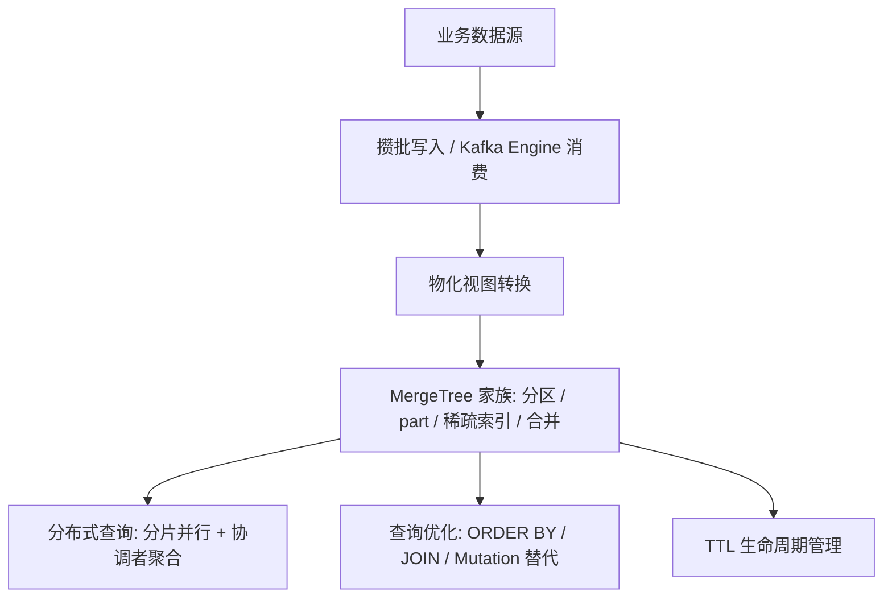

:::note 版本基线
ClickHouse 行为以 **25.x** 为准; 参数默认值核对 ClickHouse 25.x 官方文档（官方文档）, 实例化结论需以本机 `system.settings` 实测为准. 需要留意的是 ClickHouse 当前最新稳定版已是 **26.10**: 26.x 移除了旧查询分析器逻辑、`system.metric_log` 默认改用 `bucketed` 模式、`arrayCount` 返回类型由 `UInt32` 改为 `UInt64`, 凡涉及这几项的默认值或返回值类型, 升级实例后应按目标版本复核.
:::

**主线一览**



:::danger 写入红线
ClickHouse 的**高频小批量写入**会制造大量小 part, 迫使后台频繁合并并放大写放大; *批量攒批*是 Kafka Engine 消费链路的首要约束, 不要用单条 insert 压测或上线.
:::

这份文档面向使用 ClickHouse 做分析存储的后端工程师, 按存储引擎、查询优化与实战的顺序展开. 第一部分从列式存储的物理布局出发, 依次说明 MergeTree 的存储结构与合并流程、稀疏索引、MergeTree 家族引擎的合并策略、分区与分片、副本同步、向量化执行、物化视图与 TTL; 第二部分进入 ORDER BY 键设计、JOIN 实现、Mutation 代价与 OLAP 性能对比. 全文聚焦 ClickHouse 本身, Kafka 侧机制与两者的联合实时数仓链路见 [Kafka 技术手册](./kafka). ClickHouse 行为以 25.x 系列为准.

## 一、ClickHouse 存储引擎

### 列式存储与行式存储的本质区别

行式存储 (MySQL InnoDB): 数据按行连续存放, 一行所有列物理相邻. 适合 OLTP — 单行读写只需一次 I/O 即可取到完整记录.

列式存储 (ClickHouse): 数据按列连续存放, 同一列的所有值物理相邻. 适合 OLAP — 分析查询通常只涉及少数列 (如 `SELECT avg(amount) FROM orders WHERE date > '2024-01-01'`), 列存只读取需要的列, I/O 量与列数成正比而非总列数.

列存的三大优势:

1. I/O 放大消除: 100 列的表查 3 列, 行存读 100 列的数据, 列存只读 3 列, I/O 量与实际读取的列数成正比 (理想估算下为列数之比), 不随未读取列膨胀
2. 压缩率极高: 同列数据类型相同、值域相近 (如 status 列只有几个枚举值), 同列重复度高, 配合 LZ4/ZSTD 获得远高于行存的压缩率; 行存中不同类型混在一行, 压缩率差
3. 向量化执行友好: 同列数据连续存放, CPU 可以用 SIMD 指令一次处理多个值 (如 AVX2 一次处理多个 int32), 充分利用 CPU cache line

列存的代价:

- 单行点查性能差: 取一行需要读 N 个列文件再拼装, 随机 I/O 多
- 写入需要按列拆分: 一行数据要拆成 N 列分别追加, 写放大
- 不适合频繁更新: 列存更新一行等于重写多个列文件

### MergeTree 的存储结构与写入合并流程

MergeTree 是 ClickHouse 最基础的表引擎, 核心组件:

```text
table/
├── 202401_1_1_0/          # 一个 part (数据分片)
│   ├── primary.idx        # 稀疏主键索引 (每 8192 行一个标记)
│   ├── column_a.bin       # 列数据 (压缩后)
│   ├── column_a.mrk2      # 标记文件 (记录每个 granule 的压缩块偏移、块内偏移与行数)
│   ├── count.txt          # 行数
│   ├── columns.txt        # 列元信息
│   └── checksums.txt      # 校验和
├── 202401_2_2_0/          # 另一个 part
└── ...
```

写入流程:

1. 客户端发送 INSERT 数据, ClickHouse 按 ORDER BY 键排序
2. 按 `index_granularity` (默认 8192 行) 切分为 granule
3. 每个 granule 生成一条主键索引记录 (稀疏索引, 只记首行主键值)
4. 列数据按 granule 分块压缩 (默认 LZ4) 写入 `.bin` 文件
5. 标记文件 `.mrk2` 记录每个 granule 在 `.bin` 中的压缩块偏移、解压块内偏移与 granule 实际行数 (Wide part 的自适应标记, 第三个字段为该 granule 行数)
6. 整个写入生成一个新的 part 目录, 原子 rename 对读可见

合并 (Merge) 流程:

- 后台线程定期将多个小 part 合并为大 part (类似 LSM-Tree 的 compaction)
- 合并时重新排序、重建索引、重新压缩
- 合并是异步的, 不阻塞读写; 读时如果数据跨多个 part, 会做多路归并

### 稀疏索引 (primary.idx) 与 B+ 树索引的差异

ClickHouse 的稀疏索引:

- 每 `index_granularity` (默认 8192) 行记录一个索引条目, 只存该 granule 首行的 ORDER BY 键值
- 索引常驻内存 (因为稀疏, 10 亿行也只有约 12 万个条目, 几 MB)
- 查询时二分查找定位到候选 granule 范围, 再顺序扫描这些 granule

```text
primary.idx:  [1, 8193, 16385, 24577, ...]   # 每 8192 行一个值
                 |      |       |
granule 0:   rows 1~8192
granule 1:   rows 8193~16384
granule 2:   rows 16385~24576
```

与 MySQL B+ 树索引的区别:

| 维度     | ClickHouse 稀疏索引             | MySQL B+ 树索引                |
| -------- | ------------------------------- | ------------------------------ |
| 粒度     | 每 8192 行一个条目              | 每行一个叶子节点               |
| 内存占用 | 极小, 全量常驻内存              | 大, 通常只有热页在 buffer pool |
| 定位精度 | 定位到 granule 范围, 需范围扫描 | 定位到具体行                   |
| 适用场景 | 范围查询、前缀匹配              | 点查、范围查询                 |
| 更新代价 | 合并时重建, 无在线维护开销      | 每次写入都要维护 B+ 树平衡     |

:::info{title="稀疏索引生效的前提: 查询条件必须是 ORDER BY 的前缀"}
稀疏索引要求数据**物理有序**（按 `ORDER BY` 排列），因此 MergeTree 写入时会排序. 如果查询条件**不是 `ORDER BY` 的前缀**, 索引无法使用, 退化为全表扫描. 这也是 `ORDER BY` 键设计排在性能优化第一位的根本原因.
:::

### ReplacingMergeTree、AggregatingMergeTree 与 CollapsingMergeTree 的合并策略

MergeTree 家族通过不同的合并策略解决不同场景:

ReplacingMergeTree(version):

- 问题: 同一主键的多条记录 (如 CDC 产生的多次更新), 查询时只想看最新版本
- 机制: 合并时按 ORDER BY 键去重, 保留 `version` 列最大的行; 若 version 相同保留最后写入的
  :::warning{title="去重只在合并时发生"}
  `ReplacingMergeTree` 的**去重只发生在合并时**, 合并前查询仍会看到重复行, 必须配合 `FINAL` 关键字或 `argMax` 聚合才能得到「最新版本」. 不能假设写入后即刻读到唯一行.
  :::
- 典型场景: 从 MySQL binlog 同步到 ClickHouse, 用 ReplacingMergeTree 实现 upsert 语义

AggregatingMergeTree:

- 问题: 预聚合场景, 如按小时统计 UV, 原始数据量太大
- 机制: 定义 AggregateFunction 类型的列 (如 `uniqState(user_id)`), 写入时存聚合中间状态, 合并时将同主键的状态合并
- 查询时用 `uniqMerge` 从中间状态计算最终结果
- 典型场景: 实时报表的预计算, 用物化视图 + AggregatingMergeTree 增量聚合

CollapsingMergeTree(Sign):

- 问题: 需要"更新"但引擎不支持原地更新, 用"先删后插"模拟
- 机制: Sign 列 (+1 表示有效行, -1 表示取消行); 合并时将同主键的 +1 和 -1 配对抵消
- 写入更新 = 插入一条 Sign=-1 的旧值 + 一条 Sign=+1 的新值
- 查询时必须用 `GROUP BY ... HAVING sum(Sign) > 0` 或 `FINAL` 过滤未合并的脏数据
- 缺点: 写入量翻倍, 查询复杂; 实践中更常用 ReplacingMergeTree

### 分区 (PARTITION BY) 与分片 (SHARD) 的职责划分

分区 (PARTITION BY) — 单机内的逻辑划分:

- 将表数据按分区键 (通常是日期 `toYYYYMM(event_date)`) 切分为多个独立的数据集合
- 每个分区内的数据独立存储、独立合并
- 查询时分区裁剪 (partition pruning): WHERE 条件命中分区键时, 只扫描相关分区
- `DROP PARTITION` 可以瞬间删除整个分区的数据 (比 DELETE 快几个数量级)
- 分区数不宜过多 (建议控制在千级以内), 否则元数据膨胀、合并效率下降

分片 (SHARD) — 多机间的物理分布:

- 通过 Distributed 表引擎实现, 数据分散在多台机器的本地表上
- 写入: Distributed 表接收数据, 按分片键 (如 `rand()` 或 `sipHash64(user_id)`) 路由到对应分片
- 查询: Distributed 表将查询下推到各分片并行执行, 汇总结果返回
- 分片解决单机容量和算力瓶颈, 是水平扩展的手段

```sql
-- 本地表 (每台机器上创建)
CREATE TABLE events_local ON CLUSTER my_cluster (
    event_date Date,
    user_id UInt64,
    event_type String
) ENGINE = MergeTree()
PARTITION BY toYYYYMM(event_date)
ORDER BY (user_id, event_date);

-- 分布式表 (查询入口)
CREATE TABLE events_dist ON CLUSTER my_cluster AS events_local
ENGINE = Distributed(my_cluster, default, events_local, sipHash64(user_id));
```

### ReplicatedMergeTree 的副本同步与 ZooKeeper 协调

ReplicatedMergeTree 实现表级副本:

```sql
CREATE TABLE events_local (
    ...
) ENGINE = ReplicatedMergeTree(
    '/clickhouse/tables/{shard}/events',  -- ZK 路径, {shard} 是宏变量
    '{replica}'                            -- 副本名
)
PARTITION BY toYYYYMM(event_date)
ORDER BY (user_id, event_date);
```

工作原理:

1. ZooKeeper 作为协调者, 存储副本间的复制日志 (replication log): 记录每个 part 的创建、合并、变异 (mutation) 操作
2. 写入时: 数据写入当前副本的本地磁盘后, 在 ZK 的 replication log 中注册一个新 part
3. 其他副本通过 Watch 机制感知到 log 变化, 从源副本 (或任意已有该 part 的副本) 拉取数据文件
4. 合并操作: 多个副本可以同时成为 leader (merge_tree 设置 replicated_can_become_leader 可将某副本排除在外), leader 负责调度后台合并 — 它先发起合并并把 "merge parts" 动作写入 replication log; 其余副本各自独立执行同样的合并, 保证结果字节级一致, 只有复制严重落后时才直接下载合并结果 part

ZooKeeper 的角色:

- 不存储数据本身, 只存元数据和复制日志
- 提供分布式协调: leader 选举、part 分配、DDL 同步
- ZK 不可用时: 读不受影响 (本地有完整数据), 但副本表的 INSERT 与 DDL/ALTER 都会失败 (写入依赖 ZK 中的 replication log, 常见表现为表进入只读模式)
- ClickHouse Keeper 用 Raft 协议实现与 ZooKeeper 等价的协调能力, 去掉 Java 依赖, 是当前推荐的部署形态 (原 ZooKeeper 配置下两者可互换)

副本 vs 分片:

- 副本解决高可用 (一个分片挂了, 副本接管)
- 分片解决水平扩展 (数据分散到多台机器)
- 生产部署: N 个分片 x M 个副本, 每个分片有 M 份数据

### 向量化执行引擎与逐行处理的对比

传统数据库 (MySQL) 的 Volcano 模型: 每个算子每次处理一行, 通过 `next()` 调用向上传递. 问题:

- 每行一次虚函数调用, CPU 分支预测失败率高
- 数据在算子间以行传递, cache 局部性差
- 无法利用 SIMD 指令

ClickHouse 的向量化执行:

- 每个算子每次处理一列的一个 block (查询执行层由 `max_block_size` 控制, 默认 65536 行; 不要与存储层的索引粒度 8192 混淆——granule 是 MergeTree 稀疏索引与标记文件的最小单元, 两者概念不同)
- 同列数据连续存放在内存中, 一次加载到 CPU cache line
- 利用 SIMD (SSE4.2 / AVX2 / AVX-512) 一条指令并行处理 4~16 个值
- 减少虚函数调用次数: 从 N 行 x M 列次降为 (N/max_block_size) x M 次

```text
Volcano (逐行):          向量化 (逐列块):
  for each row:            for each block (max_block_size rows):
    filter(row)              filter(column_block)  // SIMD 批量比较
    project(row)             project(column_block) // SIMD 批量计算
    aggregate(row)           aggregate(column_block)
```

实际收益: 在聚合、过滤等计算密集型操作上, 向量化以列块为单位消除逐行虚函数调用并利用 SIMD, 相比逐行 Volcano 模型有数量级级别的吞吐提升; 配合列存的高压缩率, 解压后直接以 SIMD 友好格式处理, 进一步减少内存带宽消耗. 实际加速比取决于列宽、过滤选择性与 CPU 指令集, 需以本机 benchmark 实测为准.

### 物化视图的增量聚合机制

普通视图 (VIEW): 只是一条保存的 SQL, 每次查询时重新执行, 不存储数据.

物化视图 (MATERIALIZED VIEW): 独立存储数据的表, 由 INSERT 触发器驱动增量更新:

```sql
-- 目标表: 存预聚合结果
CREATE TABLE hourly_stats (
    hour DateTime,
    event_type String,
    cnt UInt64
) ENGINE = SummingMergeTree()
ORDER BY (hour, event_type);

-- 物化视图: 定义从源表到目标表的转换逻辑
CREATE MATERIALIZED VIEW hourly_stats_mv TO hourly_stats AS
SELECT
    toStartOfHour(event_time) AS hour,
    event_type,
    count() AS cnt
FROM events_local
GROUP BY hour, event_type;
```

增量聚合机制:

1. 数据 INSERT 到源表 `events_local` 时, 触发物化视图的转换逻辑
2. 只对本次 INSERT 的数据块执行 GROUP BY, 产出增量聚合结果
3. 增量结果 INSERT 到目标表 `hourly_stats`
4. SummingMergeTree 在合并时将同主键的 `cnt` 列累加, 得到最终聚合值

关键特性:

- 物化视图只处理 INSERT 之后的新数据, 历史数据需要手动 `INSERT INTO hourly_stats SELECT ...` (也可在创建物化视图时附加 POPULATE 一次性回填, 但回填期间新写入的数据会丢失, 需另行处理)
- 源表删除数据不会级联删除目标表中已聚合的结果 (聚合不可逆)
- 多个物化视图可以挂在同一张源表上, 各自独立增量计算
- 与 AggregatingMergeTree 配合可以存更复杂的中间状态 (如 HyperLogLog 的 sketch)

### TTL 机制与数据生命周期管理

TTL 可以设置在列级或表级:

```sql
CREATE TABLE logs (
    event_time DateTime,
    level String,
    -- 列级 TTL: 30 天后 message 列被清空 (变为空字符串), 行仍在
    message String TTL event_time + INTERVAL 30 DAY
) ENGINE = MergeTree()
ORDER BY event_time
-- 表级 TTL: 30 天后删除 DEBUG 行, 90 天后删除整行
TTL event_time + INTERVAL 30 DAY DELETE WHERE level = 'DEBUG',
    event_time + INTERVAL 90 DAY DELETE;
```

TTL 还支持:

- `TTL ... TO DISK 'cold'`: 数据冷却后迁移到廉价存储 (如 HDD / S3)
- `TTL ... TO VOLUME 'archive'`: 迁移到指定存储卷
- `TTL ... GROUP BY ... SET cnt = max(cnt)`: 过期后不是删除, 而是聚合压缩 (保留统计值, 丢弃明细)

执行机制:

- TTL 在 part 合并时检查和执行 (不是实时删除)
- 后台合并线程发现 part 中有数据超过 TTL, 在合并时过滤掉过期行
- 可以手动触发: `OPTIMIZE TABLE logs FINAL` 强制全量合并, 立即清理过期数据
- `merge_with_ttl_timeout` 控制 TTL 合并的最小间隔 (默认 4 小时), 避免频繁合并

---

## 二、ClickHouse 查询优化与实战

### ORDER BY 键的设计原则与性能影响

ORDER BY 键决定了数据的物理排列顺序和稀疏索引的结构, 是 ClickHouse 性能优化的第一要素.

设计原则:

1. 最左前缀匹配: 查询条件必须是 ORDER BY 键的前缀才能利用索引. `ORDER BY (a, b, c)` 时, `WHERE a = 1 AND b = 2` 走索引, `WHERE b = 2` 不走
2. 按查询模式决定列顺序, 而非单纯按区分度: 只有部分列被过滤时, 只有这些列处于最左前缀才能裁剪. 若查询总是同时等值过滤多个键列, 列间顺序对裁剪能力影响很小 (ClickHouse 的通用排除搜索支持按前导列低基数、过滤次级列的场景); 此时顺序主要影响压缩率与主键索引体积, 官方建议低基数列在前; 若高频查询只过滤某个高区分度列, 则必须把它放最左
3. 常用查询模式优先: 如果有多种查询模式, 优先满足最高频的; 次要模式可以用投影 (PROJECTION) 或物化视图
4. 不要太多列: ORDER BY 键越长, 索引越大, 排序开销越高; 通常 3~5 列足够
5. 与 PARTITION BY 配合: 分区键通常是时间, ORDER BY 键通常是业务维度; 查询同时命中分区裁剪 + 索引查找时效率最高

错误示例:

```sql
-- 高频查询是 WHERE user_id = ? (不带 status):
-- ORDER BY (status, user_id): user_id 不是最左前缀, 无法裁剪, 只能全表扫描
-- 正确: ORDER BY (user_id, status): user_id 是最左列, 直接定位到少量 granule
```

另一类常见误区: `ORDER BY (status, user_id)` 时查询 `WHERE status = ? AND user_id = ?` 依然能精确裁剪 (status 圈定范围后, 段内数据按 user_id 有序, 通用排除搜索可继续定位), 此时两种顺序的裁剪效果等价, 区别只在压缩率与索引大小.

### JOIN 的实现方式与大表 JOIN 的性能陷阱

ClickHouse 的 JOIN 实现:

1. Hash JOIN (默认): 将右表构建为内存中的哈希表, 左表逐行探测. 右表必须能放进内存, 否则 OOM
2. Partial Merge JOIN: 右表太大时, 分块加载右表, 排序后与左表做归并. 速度慢但不 OOM
3. Grace Hash JOIN: 右表按哈希分桶写磁盘, 逐桶加载构建哈希表, 适合右表大到无法一次放进内存的场景 (`join_algorithm = 'grace_hash'`)
4. Distributed JOIN: 分布式表 JOIN 时, 数据需要在节点间 shuffle, 网络开销大

性能陷阱与优化:

- 小表放右边: `SELECT ... FROM big_table JOIN small_table ON ...` — ClickHouse 总是构建右表的哈希表
- 避免分布式 JOIN: 如果两张表按相同键分片 (colocate), 可以在本地表上 JOIN, 避免 shuffle
- 用 IN 替代 JOIN: 如果只是过滤 (不需要右表的列), `WHERE id IN (SELECT id FROM ...)` 比 JOIN 快
- 字典 (Dictionary): 维度表 (如城市名、商品类目) 加载为内存字典, 用 `dictGet` 函数替代 JOIN
- `join_algorithm` 设置: 根据数据量选择 `hash` / `partial_merge` / `grace_hash` / `auto`

### Mutation 的执行代价与生产替代方案

Mutation 是异步的重量级操作:

```sql
ALTER TABLE events UPDATE status = 'archived' WHERE event_date < '2023-01-01';
ALTER TABLE events DELETE WHERE user_id = 12345;
```

慢的根源:

:::warning{title="Mutation 的代价: 不可变 part 导致整块重写"}
ClickHouse 的 part 是**不可变的 (immutable)**, `UPDATE`/`DELETE` 不是原地修改. 实际执行时: 读取包含目标行的整个 part, 重写所有列文件 (即使只改一列), 生成新 part, 旧 part 标记删除; 一个 1 亿行的 part 改其中 1 行也要重写全部列; 且多个 mutation **排队串行执行, 不并发**. 这正是生产中应优先用 `ReplacingMergeTree`、轻量删除或分区级操作替代 `ALTER UPDATE/DELETE` 的原因.
:::

生产替代方案:

1. ReplacingMergeTree: 插入新版本行, 合并时自动去重, 查询用 FINAL 或 argMax
2. CollapsingMergeTree: 插入 -1 行抵消旧行, +1 行写入新值
3. 分区级操作: `ALTER TABLE DROP PARTITION` 删除整个分区 (瞬间完成)
4. 轻量删除: `DELETE FROM events WHERE ...` (注意不是 `ALTER TABLE DELETE`), 只把命中的行标记为删除, 不重写 part, 查询时过滤掉; 合并时物理清除. 比 mutation 快很多, 但标记行在物理清除前仍占磁盘

### ClickHouse 与 MySQL 在 OLAP 场景的性能差异根源

同样一条 `SELECT count(*) FROM orders WHERE status = 'paid' GROUP BY region` (1 亿行, 20 列):

| 环节     | MySQL (InnoDB)                                                     | ClickHouse                                                     |
| -------- | ------------------------------------------------------------------ | -------------------------------------------------------------- |
| I/O      | 读所有 20 列 (行存, 即使只需 3 列)                                 | 只读 status + region 两列                                      |
| 压缩     | 页级压缩, 压缩率约 2x                                              | 列级 LZ4/ZSTD, 压缩率 5~10x                                    |
| 执行模型 | 逐行 Volcano, 每行一次虚函数调用                                   | 向量化, 按 block (max_block_size 默认 65536 行) 批量 SIMD 处理 |
| 并行度   | 通用查询单线程执行 (仅少数场景如并行 DDL、聚簇索引 count 可多线程) | 多核并行 (max_threads, 默认全部核), 按 granule 区间并行读取    |
| 索引     | B+ 树定位行, 回表读数据                                            | 稀疏索引定位 granule, 顺序扫描                                 |
| 聚合     | 逐行累加                                                           | 列数据连续, cache 友好, SIMD 加速                              |

综合效果: 典型 OLAP 聚合查询在扫描列数、压缩率、并行度与执行模型四个环节同时占优, ClickHouse 相对 InnoDB 行存常有数量级以上的吞吐差距; 具体倍数随数据分布与查询形态变化, 不应作为固定指标写入容量评估.

但 ClickHouse 不适合:

- 高并发点查 (单服务器每秒数百次以上的小查询): 每次查询都要启动多线程、读多个列文件, 延迟高
- 频繁单行更新/删除: 不可变 part 设计导致更新代价极高
- 事务: 不支持 ACID 事务, 没有行锁

---

**延伸阅读**

- [Kafka 技术手册](./kafka): Kafka Engine 消费链路、分区与 ISR、幂等与事务的完整落地; 原联合架构与综合方案设计也一并收录在该篇.
