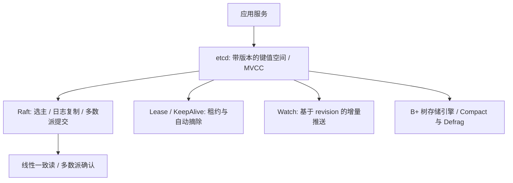

:::note 版本基线
文中默认值与行为以 **etcd 3.6** 为准; 参数默认值核对 etcd 3.6 官方配置文档（官方文档）, 实例化结论需以本机配置与指标实测为准. 其中 `--snapshot-count` 的 3.6 默认值与 3.5 不同（3.6 为 10000, 3.5 为 100000）, 详见 1.7 节的升级变更说明.
:::

**主线一览**



本文面向需要把 etcd 用对、用稳的后端与基础设施工程师, 聚焦强一致的分布式键值存储. 阅读它不需要事先熟悉分布式理论, 但需要具备基本的网络、操作系统与 Go/Java 工程经验. 文档以“它解决什么问题、内部怎么实现、什么时候会失效、该怎么选”为主线, 尽量给出可以直接落地的判据, 而不是停留在名词解释.

## 一、etcd: 强一致的分布式键值存储

etcd 的定位是“小而可靠”: 数据量不大, 但要求线性一致、支持 Watch 与租约, 是 Kubernetes 等系统的元数据底座. 理解它要抓住三条主线——Raft 共识决定写入是否提交、MVCC 决定历史版本如何保存与查询、Lease/Watch 决定它如何被用作协调与发现组件.

### 1.1 数据模型: 带版本的键值空间

etcd 对外是一个扁平的键空间, 所有键按字典序排列, 天然支持前缀查询. 与普通 KV 的差别在于每个键都携带版本信息:

- revision: 全局单调递增的逻辑时钟, 由 Raft 提案序列决定其顺序; 一次事务内多个操作共享同一个 main revision, 用 sub revision 区分先后.
- create_revision / mod_revision / version: 分别表示该键创建、最后一次修改、被修改的次数.
- lease: 键可绑定租约, 租约到期后键自动删除.
- tombstone: 删除并非立即抹掉, 而是写入一条删除标记, 历史版本仍可查询.

由于所有键有序, range 查询 (`WithPrefix`、`WithRange`) 是 O(log N + M) 的树遍历加顺序扫描, 而不是全表扫描; 排序与范围过滤也由同一套索引承担. 这个模型直接决定了 etcd 擅长“按前缀组织的配置、服务实例、元数据”, 而不适合存放大对象.

### 1.2 Raft: 如何达成共识

Raft 把一致性问题拆成三个子问题: 选主、日志复制、安全性.

选主. 节点在 Follower、Candidate、Leader 三个状态间迁移. Follower 在 election timeout 内没有收到 Leader 心跳就转为 Candidate, 递增任期并请求投票; 获得多数票 (N/2+1) 者成为 Leader. 有两点是工程上最关键的:

- 日志较新的节点优先当选. 投票时先比较最后一条日志的任期, 再比较索引, 保证新 Leader 一定包含所有已提交日志.
- 选举超时随机化, 在 [electionTimeout, 2×electionTimeout) 内取值, 避免多个节点同时发起选举导致选票被反复瓜分 (活锁).

日志复制. 客户端写入只能发给 Leader; Leader 把条目追加到本地日志 (此时尚未提交), 并行向所有 Follower 发 AppendEntries; 当多数节点复制成功后, Leader 推进自己的 commit index 并把日志应用到状态机, 随后通过下一次心跳把 commit index 告知 Follower. 因此“多数派确认”是一次写延迟的组成部分, 跨机房部署会直接放大写延迟.

安全性. Raft 用五条不变量保证状态机一致:

| 不变量               | 含义                                                   |
| -------------------- | ------------------------------------------------------ |
| Election Safety      | 同一任期内最多一个 Leader                              |
| Leader Append-Only   | Leader 从不覆盖或删除自己的日志                        |
| Log Matching         | 两条日志在相同 index/term 上一致, 则此前所有条目都一致 |
| Leader Completeness  | 已提交的条目一定存在于所有后续 Leader 的日志中         |
| State Machine Safety | 同一 index 上所有节点应用相同命令                      |

etcd 在标准 Raft 上补充了几项工程优化:

- PreVote: 节点在真正递增任期前先试探能否拿到多数票, 避免网络分区恢复后把健康的 Leader 逼下台.
- CheckQuorum: Leader 周期性确认自己仍与多数节点连通, 否则主动退位, 减少“僵尸 Leader”读.
- Learner: 只复制日志、不参与投票的角色, 用于新节点先追平数据再晋升, 避免扩容期间多数派被拖慢.
- 成员变更: 通过 ConfChange 执行, 且同一时刻只允许一个变更在进行; 涉及多节点的复合变更会先进入联合配置 (joint consensus) 再退出, 避免出现两个互不相交的多数派.

### 1.3 MVCC 与底层存储引擎

etcd 的 MVCC 由内存索引加本地存储引擎组成. 内存中为每个键维护一个 keyIndex, 记录该键在各代 (generation) 中出现过的所有修改版本; 一次删除后再写入会产生新的一代. 存储层把 revision 映射到实际的键值对.

读请求的处理路径是: 先确定要读的 revision (0 表示读最新, 正数表示读历史, 小于 compact revision 则返回 ErrCompacted), 在 keyIndex 中二分查到不晚于目标 revision 的修改版本, 再用该版本从存储引擎取出键值; 如果命中的是删除标记, 则键不存在. 这条路径意味着历史读的开销与当前数据量无关, 只与目标键的修改次数有关.

Compaction 与 Defrag 是两件必须区分的事:

- Compact 只做逻辑删除, 丢弃指定 revision 之前的历史版本, 键空间的最新值不受影响; 好处是控制内存索引与存储增长.
- Defrag 才真正重建底层文件、把空洞释放回文件系统. 它需要逐节点执行, 并会短暂阻塞该节点的读写.

两者配合的方式是: 开启自动压缩, 把 compact 控制在合理范围; 当文件碎片率升高时择机 defrag. 碎片率可以近似看作“文件总大小与在用大小之差占文件总大小的比例”, 超过一个较高阈值 (常见 50%) 就值得整理.

本地存储引擎选择的是一个进程内嵌的、单文件的 B+ 树实现, 它的特性与 etcd 的需求高度吻合:

| 引擎特性     | 具体表现                                                     | 对 etcd 的价值                             |
| ------------ | ------------------------------------------------------------ | ------------------------------------------ |
| 单文件 B+ 树 | 数据与索引在同一文件中, 页式组织                             | 只需一个文件, 备份与迁移简单               |
| 写时复制     | 修改页时复制路径上的页                                       | 崩溃后不会看到半写状态, 天然具备崩溃一致性 |
| 单写多读     | 同一时刻只允许一个写事务, 多个只读事务可并发                 | 与 Raft 单主写入模型一致, 无需额外并发控制 |
| 内存映射读   | 把文件映射到虚拟地址空间, 读操作零拷贝                       | 读多写少场景下读延迟低                     |
| 键全局有序   | 叶页内元素按键有序、页按键序布局, 范围扫描由游标沿树遍历完成 | 天然支持范围扫描, 与 etcd 的键序模型契合   |

它同时带来几项固有局限, 需要在运维上应对:

| 局限          | 表现                                 | 应对                                                                       |
| ------------- | ------------------------------------ | -------------------------------------------------------------------------- |
| 写放大        | 写时复制会复制整条路径上的页         | 用批量提交把多次提案合并成一次后端写入, 摊薄落盘开销                       |
| 单写锁        | 写入串行执行                         | 真实写入瓶颈通常在 Raft 共识而非引擎本身, 扩容写入能力要靠更快的磁盘与网络 |
| 文件只增不减  | 删除不会缩小文件, 空间以空洞形式存在 | 定期压缩历史版本, 配合离线整理回收空间                                     |
| 大 value 低效 | 值越大, 复制与序列化成本越高         | 通过请求大小上限约束单条数据规模, 大对象应放到对象存储                     |

:::info{title="etcd 写瓶颈在共识, 不在引擎"}
一个常见误解是「etcd 写入慢是因为键值存储引擎差」. 事实是: 写入能力瓶颈不是引擎, 而是**每次写入都要经过多数派共识**. 因此提升写吞吐的正确方向是**改善磁盘落盘延迟与网络往返**, 而不是更换存储引擎.
:::

### 1.4 Watch: 基于流的事件订阅

Watch 不是轮询, 而是建立在 gRPC 双向流与 MVCC revision 之上的增量推送. 客户端指定键或前缀, 可选指定起始 revision; 服务端为每个 watcher 记录监听范围, 并按是否落后于当前 revision 分成需要追赶历史的分组和只等实时事件的分组. 当一次写入提交后, 事件按 revision 顺序投递给匹配的 watcher.

```text
客户端 (gRPC Watch 流)
      |
      v
服务端 watch 组件
   |-- 已同步组: 起始 revision >= 当前 revision, 只等实时事件
   |-- 待同步组: 起始 revision < 当前 revision, 先从历史日志追赶
      |
      v
本地存储引擎 (未压缩的历史事件)
```

使用 Watch 时要建立几个正确认识:

- 事件按 revision 全局有序, etcd 保证时间上更早的事件不会出现在已投递事件之后, 跨键顺序可直接依赖 revision, 无需业务侧自行排序.
- 断线重连后可以从上次处理到的 revision+1 继续, 不必全量重拉, 前提是那段历史尚未被压缩. 因此客户端必须处理 ErrCompacted, 收到后走一次全量读取再重新 Watch.
- 支持进度通知 (progress notify): 服务端定期推送一个只带当前 revision 的空事件, 用于让客户端感知“连接还活着但暂时没有数据”. 它也是检测静默断连的手段.
- 支持过滤 (如只收 PUT 或只收 DELETE) 与 PrevKV (事件携带变更前旧值), 能显著减少无用传输, 但会改变事件完整性, 使用前要确认业务是否依赖旧值.
- 监听范围过大会增加服务端遍历与匹配成本; 大量 watcher 监听相同前缀时服务端会批量分发, 但客户端仍要避免“每请求一个 Watch 流”的用法.

### 1.5 Lease、KeepAlive 与服务发现

Lease 是一个带 TTL 的租约, 键绑定租约后生命周期与之绑定: 租约到期或被撤销, 键自动删除. 这正好描述“实例存活期间注册、实例消失后自动摘除”的语义.

服务发现的完整生命周期:

```text
注册方
  1. 申请租约 (TTL = 10s 量级)
  2. Put /services/{svc}/{instance} = 地址与元数据, 绑定租约
  3. 后台按约 TTL/3 的节奏续租
  4. 优雅退出时撤销租约, 实例立即下线

发现方
  1. 首次 Get 前缀, 拿到全部实例与该次读取的 revision
  2. 从 revision+1 开始 Watch 前缀
  3. PUT 事件加入实例列表, DELETE 事件移除
  4. 定期全量读取兜底, 防止长时间断连带来的漂移
```

可靠性来自租约的“超时即失效”语义: 进程崩溃后无法续租, 租约到期键被删除; 网络分区期间续租失败, 但只要 TTL 窗口内恢复就不会误删. 这里有两个生产要点: 一是 TTL 的取值是“故障发现速度”与“误判风险”的权衡, 过短会因偶发网络抖动频繁摘除实例, 过长则故障收敛慢; 二是续租必须是后台持续行为, 并且要把续租失败当作告警信号, 而不是静默重试.

### 1.6 读一致性: 两种模式

etcd 默认提供线性一致读, 代价是每次读都要与多数派确认 Leader 身份, 跨机房时会明显变慢. 它提供两种读模式:

| 模式                | 一致性                     | 延迟                 | 实现                                                                   |
| ------------------- | -------------------------- | -------------------- | ---------------------------------------------------------------------- |
| Linearizable (默认) | 最强, 能读到已提交的最新值 | 最高, 需要多数派确认 | Leader 记录 readIndex, 发心跳确认自身仍是 Leader, 等状态机应用到该索引 |
| Serializable        | 最终一致                   | 最低                 | 直接读本地状态机, 可能读到陈旧数据                                     |

选择依据很直接: 配置读取、选主、分布式锁等不能读旧值, 用默认模式; 只做展示、容忍秒级陈旧的大盘类查询可以用 Serializable 读来降低对 Leader 的压力.

### 1.7 部署、容量与调优

etcd 的性能瓶颈几乎总是磁盘: 每次提案要写 WAL 并 fsync, 每次提交要写后端存储. 因此首要原则是使用低延迟本地盘 (NVMe SSD), 避免与其它高 IO 负载共享磁盘, 文件系统优先选择对 fsync 友好的类型.

集群规模通常取 3 或 5 个节点: 3 节点容忍 1 台故障, 5 节点容忍 2 台; 7 节点及以上写延迟随多数派规模上升, 收益递减. 成员应跨故障域部署, 但要意识到跨机房会直接抬高写延迟, 需要在一致性与延迟之间取舍.

关键参数与推荐方向:

| 参数                             | 默认                    | 说明与调整方向                                                                                                             |
| -------------------------------- | ----------------------- | -------------------------------------------------------------------------------------------------------------------------- |
| --quota-backend-bytes            | 2 GiB                   | 后端存储配额; 超过会触发 NOSPACE 告警并只读, 需要监控文件增长并及时压缩                                                    |
| --snapshot-count                 | 10000                   | 触发一次快照的已提交事务数; **3.6 默认 10000**（3.5 为 100000, 官方 3.6 升级变更表）; 调小可加快重启恢复, 代价是更多磁盘写 |
| --max-request-bytes              | 1.5 MiB（1572864 字节） | 单请求上限, 放大要同步评估内存与复制开销                                                                                   |
| --heartbeat-interval             | 100 ms                  | 同机房保持默认; 仅在高延迟跨机房时适度放宽                                                                                 |
| --election-timeout               | 1000 ms                 | 必须显著大于心跳间隔, 通常为心跳的 5~10 倍                                                                                 |
| --auto-compaction-mode/retention | 未启用                  | 按 revision 或周期自动压缩, 避免历史无限增长                                                                               |

需要重点盯住的指标:

| 指标                                                                       | 关注点                                      |
| -------------------------------------------------------------------------- | ------------------------------------------- |
| etcd_disk_wal_fsync_duration_seconds                                       | WAL 落盘延迟, P99 升高说明磁盘成为瓶颈      |
| etcd_disk_backend_commit_duration_seconds                                  | 后端提交延迟, 反映存储引擎压力              |
| etcd_server_proposals_failed_total                                         | 提案失败计数, 正常应长期为零                |
| etcd_server_leader_changes_seen_total                                      | Leader 切换次数, 频繁切换说明网络或负载异常 |
| etcd_mvcc_db_total_size_in_bytes / etcd_mvcc_db_total_size_in_use_in_bytes | 数据库总量与在用大小, 两者差距即碎片        |
| etcd_server_slow_apply_total                                               | 应用缓慢计数, 提示状态机追赶不上提交        |

容量估算上, 内存需求与键数量和平均键值大小强相关, 索引本身有额外开销; 磁盘上还要为 WAL、快照和历史版本留出余量, 配额不是“能存这么多业务数据”, 而是“后端文件不允许超过这个大小”. 一旦触发配额, 集群进入只读, 必须通过压缩加 defrag 恢复, 所以监控后端文件大小是必需的.

### 1.8 etcd 的适用边界

etcd 适合: 配置中心、服务注册发现、分布式锁与选主、需要强一致的少量元数据、需要变更通知的协调场景. 它不适合: 大 value (超过请求上限)、高写入吞吐的数据面 (写入受多数派共识限制)、需要复杂查询或聚合的数据.

:::warning{title="etcd 的适用边界: 别当通用数据库/消息队列"}
把 etcd 当通用数据库或消息队列使用是常见的架构误用. 遇到大 value、高写吞吐、复杂查询或聚合需求, 应转向专门的存储或消息系统, 而不是硬塞进 etcd.
:::
