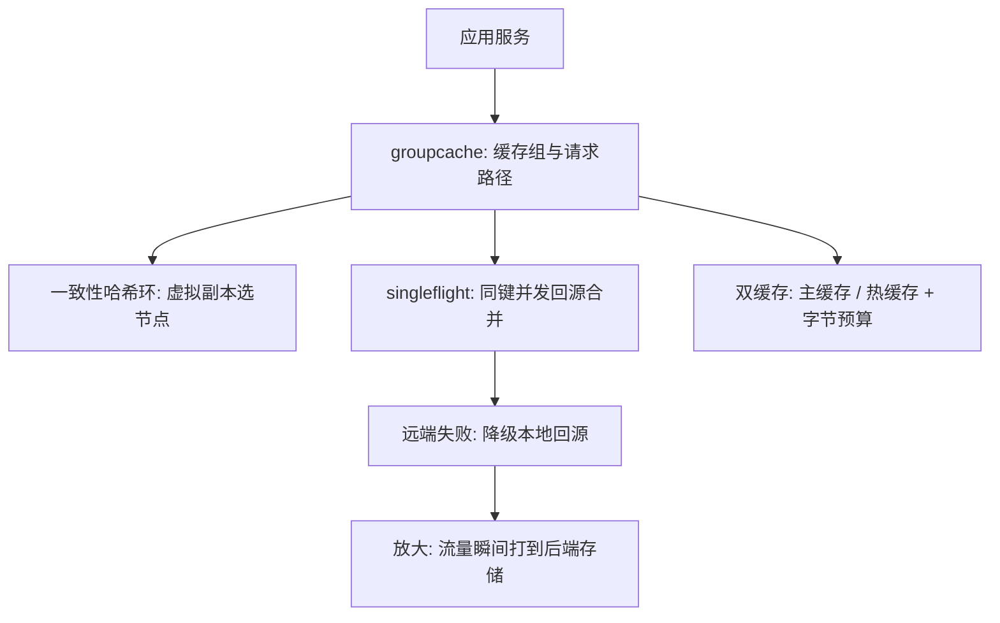

:::note 版本基线
groupcache 不是独立部署的服务, 本文按其当前 Go 生态版本的源码行为口径表述; 文中的常量与概率（`rand.Intn(10) == 0` 的 1/10 概率、`hotBytes > mainBytes/8` 的驱逐切换）均来自其实现, 具体参数需以所用版本的源码为准.
:::

**主线一览**



:::danger 故障放大
**无超时、无上限重试**是分布式系统故障扩散的主要来源; groupcache 远端失败时降级为本地回源虽保证正确性, 却会把流量瞬间打到后端存储, 容量评估必须计入这层放大.
:::

本文面向需要把缓存用对、用稳的后端与基础设施工程师, 聚焦去中心化的进程内缓存库 groupcache. 阅读它不需要事先熟悉分布式理论, 但需要具备基本的网络、操作系统与 Go/Java 工程经验. 文档以“它解决什么问题、内部怎么实现、什么时候会失效、该怎么选”为主线, 尽量给出可以直接落地的判据, 而不是停留在名词解释.

## 一、groupcache: 去中心化的进程内缓存

groupcache 不是一个独立部署的缓存服务, 而是一个进程内库: 它以只读缓存 + 自动回源的方式, 把缓存逻辑嵌入应用, 并通过节点间的一致性哈希与请求合并, 避免集中式缓存的单点与网络热点.

### 1.1 缓存组与请求路径

一个缓存组持有回源函数、本地缓存与请求合并器, 可选地持有节点选择器. 请求路径可以概括为:

```text
Get(key)
  -> 查主缓存 (本节点负责的键)
  -> 查热缓存 (从其它节点镜像来的热点键)
  -> 未命中则进入请求合并, 同键并发只执行一次加载
        -> 一致性哈希选节点
             -> 命中本节点: 调用回源函数
             -> 命中远端: 通过 RPC 取回
             -> 远端失败: 降级为本地回源
  -> 本地回源结果写入主缓存; 远端结果只有一定概率写入热缓存
```

它的设计哲学是无中心、不可变、只读. 因为缓存值不允许依赖“当前时间”或使用过期机制, 键必须唯一描述数据, 这也意味着数据更新靠换新键或重建缓存组, 而不是原地更新.

### 1.2 一致性哈希

节点选择使用带虚拟副本的一致性哈希环. 每个真实节点通过哈希函数映射成多个虚拟副本点, 这些点排序后构成环; 查询时对键取哈希, 在环上二分找到第一个不小于该哈希的点, 其归属节点即目标节点.

| 方案        | 节点增减时的影响范围           | 负载均衡度         |
| ----------- | ------------------------------ | ------------------ |
| 取模 hash%N | 几乎全部键重新映射             | 依赖哈希均匀性     |
| 一致性哈希  | 仅相邻节点区间的键迁移, 约 1/N | 虚拟副本越多越均匀 |

虚拟副本数量是精确度与内存的权衡: 副本越多, 环上分布越均匀、迁移越平滑, 但环的元数据越大、查找常数越高. 默认副本数在数十的量级, 节点规模不大时无需调整.

### 1.3 singleflight: 把并发回源合并成一次

缓存击穿指某个热点键失效瞬间, 大量并发请求同时回源把后端压垮. groupcache 用 singleflight 解决: 对同一个键, 第一个到达的调用执行回源, 其余调用挂起等待同一个结果, 回源完成后一次性分享给所有等待者.

```go
// 语义示意, 非可直接运行的实现
func (g *Group) load(key string) (Value, error) {
    v, err := g.loadGroup.Do(key, func() (interface{}, error) {
        // 二次检查缓存: 合并只覆盖真正并发重叠的调用
        if hit, ok := g.lookupCache(key); ok {
            return hit, nil
        }
        // 选节点; 远端失败则本地回源
        if peer, ok := g.peers.PickPeer(key); ok {
            if v, err := g.getFromPeer(peer, key); err == nil {
                g.maybePopulateHot(key, v)
                return v, nil
            }
        }
        v, err := g.getLocally(key)
        if err != nil {
            return nil, err
        }
        g.populateCache(key, v, &g.mainCache)
        return v, nil
    })
    return v, err
}
```

这里有一个容易被忽略的细节: singleflight 只能合并时间上重叠的调用. 两个请求若一前一后错过缓存 (第一个回源完成前的检查时序错开), 可能顺序触发两次加载. 因此在合并函数内部会再查一次缓存, 避免同一键被重复写入、重复计算占用字节预算.

### 1.4 双缓存与字节预算

每个缓存组把容量预算同时约束在主缓存和热缓存上, 而不是各分一半:

- 主缓存保存“本节点是哈希归属者”的键, 是绝大多数命中来源.
- 热缓存保存“不属于本节点、但在本地很热”的键, 用来避免热门键把某个节点的网卡打成瓶颈.

回源策略决定了二者的写入概率: 本地回源结果一定进主缓存; 从远端取回的结果只以低概率写入热缓存——`rand.Intn(10) == 0`, 即 1/10 概率（groupcache 源码 `getFromPeer`）, 防止镜像数据无序膨胀. 容量超限时的驱逐策略是: 默认从主缓存淘汰最旧的数据; 当热缓存占用超过主缓存的 1/8（`hotBytes > mainBytes/8`, 源码 `populateCache`）时, 改为优先淘汰热缓存. 这样热缓存始终被压制在次要地位, 不会挤占主缓存空间.

需要注意“字节预算”是按键与值的实际长度累计的, 而不是按条目数, 并且键本身的长度也计入. 这使得大 value 会更快触发驱逐, 符合内存缓存的直觉.

### 1.5 节点变更与故障

groupcache 自身不提供服务发现. 节点集合通常由外部系统 (如 etcd、Consul) 在启动时注入或运行时更新, 节点上线后加入哈希环, 下线后移除, 随之发生键归属的迁移与缓存预热. 远程请求失败时的降级路径是本地回源, 这保证了正确性但会在节点故障瞬间把流量打到后端存储, 因此故障期间的容量评估必须考虑“缓存失效放大”.

### 1.6 内置统计

缓存组自带一组计数器, 用于判断“命中了多少、多少回了源、对等节点是否正常”:

| 指标           | 含义                                    |
| -------------- | --------------------------------------- |
| Gets           | 所有读取请求, 包含来自对等节点的请求    |
| CacheHits      | 命中本地缓存 (主缓存或热缓存)           |
| Loads          | 需要加载的次数, 约等于读取数减命中数    |
| LoadsDeduped   | 经过请求合并去重后真正执行的加载        |
| PeerLoads      | 从对等节点成功取回 (远端加载或远端命中) |
| PeerErrors     | 对等节点取回失败                        |
| LocalLoads     | 本地回源成功                            |
| LocalLoadErrs  | 本地回源失败                            |
| ServerRequests | 通过网络从对等节点收到的请求数          |

命中率下降与去重率下降是两类不同的信号: 前者说明缓存容量或键分布有问题, 后者说明热点键并发集中、合并压力大. 对等节点错误上升则提示哈希环上的节点不可达, 需要结合节点发现检查.

### 1.7 与集中式缓存的对比与适用场景

| 维度     | groupcache              | Redis 类集中式缓存 |
| -------- | ----------------------- | ------------------ |
| 部署形态 | 嵌入应用进程, 去中心化  | 独立集群, 中心化   |
| 写能力   | 不支持, 只读回源        | 完整读写与数据结构 |
| 过期语义 | 无 TTL, 按字节 LRU 淘汰 | TTL、多种淘汰策略  |
| 命中延迟 | 进程内命中, 微秒级      | 一次网络往返       |
| 持久化   | 无                      | RDB/AOF 等         |
| 一致性   | 依赖键的不可变性        | 可做主从/集群复制  |
| 额外依赖 | 无, 只需节点发现        | 需要运维缓存集群   |

适合 groupcache 的场景: 读多写少、数据可视为不可变、对延迟极敏感、希望避免引入并运维独立缓存服务、能接受“更新靠换键”. 不适合: 需要频繁写或删除、需要 TTL、需要跨语言访问、数据规模超出单机内存. 它与集中式缓存并不互斥——常见做法是用 groupcache 挡住进程内热点, 用 Redis 承担需要共享状态和过期语义的部分.
