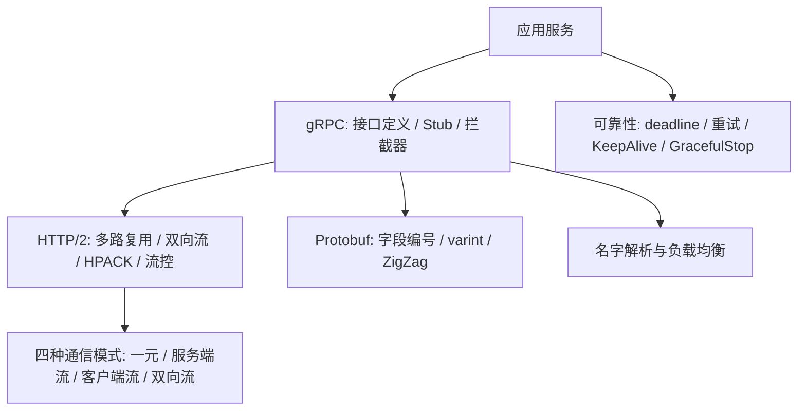

:::note 版本基线
gRPC 行为以当前主版本为准（HTTP/2 + Protobuf）; 状态码以 17 个标准 code 为准, 参数默认值核对对应官方文档（官方文档）, 实例化结论需以本机配置实测为准.
:::

**主线一览**



本文面向需要把服务通信用对、用稳的后端与基础设施工程师, 聚焦基于 HTTP/2 的远程过程调用框架 gRPC. 阅读它不需要事先熟悉分布式理论, 但需要具备基本的网络、操作系统与 Go/Java 工程经验. 文档以“它解决什么问题、内部怎么实现、什么时候会失效、该怎么选”为主线, 尽量给出可以直接落地的判据, 而不是停留在名词解释.

## 一、gRPC: 基于 HTTP/2 的远程过程调用

gRPC 把接口定义、序列化、传输与调用语义标准化, 使跨语言的服务调用像本地方法一样自然. 它的能力边界很大程度上继承自 HTTP/2, 因此理解协议层是理解 gRPC 各种行为的前提.

### 1.1 调用分层

一次调用自下而上经过: TCP/TLS 传输、HTTP/2 帧层、gRPC 消息层 (长度前缀帧)、Protobuf 序列化、生成的 Stub、以及横切的拦截器. 客户端把方法名、元数据与消息编码成 HTTP/2 的 HEADERS 与 DATA 帧; 服务端按 `:path` (形如 /包名.服务名/方法名) 路由到对应处理器, 解码后调用业务逻辑, 再以同样的方式返回状态码与响应消息.

gRPC 的状态码不是 HTTP 状态码, 而是 17 个标准 code (如 OK、NOT_FOUND、DEADLINE_EXCEEDED、UNAVAILABLE、RESOURCE_EXHAUSTED 等), 随响应以 trailer 形式返回. 业务层重试、熔断、告警都应该基于这套状态码, 而不是 HTTP 状态码.

### 1.2 HTTP/2 提供的四项关键能力

| 能力     | 机制                                              | 对 gRPC 的意义                           |
| -------- | ------------------------------------------------- | ---------------------------------------- |
| 多路复用 | 单连接上并行多个 stream, 每个 stream 有独立 id    | 一个连接承载大量并发调用, 避免连接数爆炸 |
| 双向流   | 同一 stream 上双向传输 DATA 帧                    | 支撑四种通信模式, 尤其是服务端与双向流   |
| 头部压缩 | HPACK 对头部做静态表加动态表编码                  | 元数据与状态码可低成本频繁传输           |
| 流控     | 连接级与 stream 级两套窗口, 用 WINDOW_UPDATE 更新 | 防止接收方被快发方压垮                   |

流控是双层结构: 接收方分别维护连接窗口和每个 stream 的窗口, 发送方只能发送不超过两者剩余额度的数据. 对高吞吐的大消息场景, 默认初始窗口可能偏小, 可以在两端调大初始窗口以提升吞吐, 代价是潜在的缓冲内存.

### 1.3 Protocol Buffers 的编码

Protobuf 是二进制、带字段编号的编码格式, 每个字段写成“标签 + 值”. 标签由一个 varint 编码的整数构成, 低三位是线类型 (wire type), 高位是字段编号:

```text
字段编号 << 3 | 线类型   ->  varint 编码的标签
线类型 0: varint (整型、bool、枚举)
线类型 1: 64 位定长 (fixed64、double)
线类型 2: 长度前缀 (string、bytes、嵌套消息)
线类型 5: 32 位定长 (fixed32、float)
```

整数用 varint 变长编码, 小数值占用更少字节; `sint32`/`sint64` 用 ZigZag 映射把负数转成小正数后再编码, 避免负数补码把 varint 撑到 10 字节, 而普通 `int32`/`int64` 的负数仍按补码编码为 10 字节. 字段编号必须不复用、不改变已有字段的类型. 协议演进的规则可以归纳为:

| 变更                 | 是否兼容 | 说明                                               |
| -------------------- | -------- | -------------------------------------------------- |
| 新增字段             | 兼容     | 旧端忽略未知字段, 新端读到默认值                   |
| 删除字段             | 兼容     | 必须保留编号不被复用, 否则新旧端会误解数据         |
| 改字段名             | 兼容     | 编码只依赖编号, 不依赖名字                         |
| 改同线类型的整数宽度 | 谨慎     | 如 32 位与 64 位整数线类型相同但语义不同, 可能截断 |
| 切换线类型           | 不兼容   | 解析失败或得到无意义结果                           |
| 改字段编号           | 不兼容   | 等同于删除旧字段再新增, 破坏语义                   |

相对 JSON 的优势在于: 没有字段名, 只有编号, 体积更小; 解析无需文本扫描与浮点格式化, 编解码更快; 有编译期类型检查与跨语言一致的规范. 代价是可读性差、必须维护 `.proto` 契约、二进制协议在浏览器与人工调试时不友好.

### 1.4 四种通信模式

| 模式         | 语义                   | 典型场景                              |
| ------------ | ---------------------- | ------------------------------------- |
| 一元 (Unary) | 一请求一响应           | 常规 CRUD、查询                       |
| 服务端流     | 一请求多响应           | 日志/事件推送、大结果集分页、实时行情 |
| 客户端流     | 多请求一响应           | 文件分片上传、批量写入、指标汇聚      |
| 双向流       | 多请求多响应, 两侧独立 | 聊天、实时协作、双向订阅              |

流式调用把“分页/轮询”变成协议内建的连续传输, 减少请求开销并能及时推送; 但它也意味着更长的连接生命周期、更难的重试 (部分消息已消费时重试语义需要业务定义) 和更复杂的背压处理.

### 1.5 拦截器

拦截器是 gRPC 的横切扩展点, 分为客户端与服务端两类, 各自又分一元与流式. 一元拦截器接收“方法信息、请求、连接信息、处理器”, 返回响应, 层层包装形成洋葱模型: 请求按注册顺序进入, 响应按相反顺序返回.

生产上常见的拦截器职责包括: 日志与访问指标、认证与鉴权 (从元数据取令牌)、panic 恢复 (把崩溃转成错误状态码而不是进程退出)、限流、链路追踪注入与提取、重试与超时兜底. 设计时要避免在拦截器里做阻塞的慢操作 (例如同步写日志到慢设备), 因为它在每个请求的关键路径上.

### 1.6 名字解析与负载均衡

客户端把“目标地址”抽象成名字解析器、负载均衡策略、子连接三层:

- 名字解析器负责把逻辑名 (如 etcd 中的服务前缀、DNS 名、xDS 资源) 解析成一组实际地址及属性.
- 负载均衡策略从地址列表中选出目标, 常见有 pick_first (依次尝试直到可用) 与 round_robin (轮询可用地址), 也支持自定义策略.
- 每个地址对应一个子连接, 连接状态 (连接中、就绪、失败) 影响选择结果.

与 etcd 集成时, 解析器 Watch 服务前缀, 实例上下线会实时更新地址列表; 配合轮询策略即可实现客户端负载均衡. 这里要区分两类失败: 连接建立失败 (可换地址重试) 与请求失败 (只有幂等请求才应重试). 子连接的连接状态检查能显著缩短故障摘除时间.

### 1.7 可靠性: 超时、重试、KeepAlive 与流控

- 截止时间 (deadline) 通过 context 传播, gRPC 会随请求携带剩余超时, 下游据此裁剪自己的处理预算, 避免上游已超时而下游还在空转. 传播的是剩余时间而非原始超时, 因此逐跳递减是天然正确的.
- 重试需要显式配置: 指定可重试的状态码集合、最大尝试次数、指数退避与抖动, 并且只应对幂等操作启用, 否则可能放大副作用. 对于非幂等操作, 更稳妥的思路是在业务层用幂等键或去重表.
- KeepAlive 通过 HTTP/2 PING 帧探测连接活性, 能在对端静默断开 (如中间设备丢包但未发 FIN) 时及时发现; 但心跳过密会带来额外流量与服务端压力, 需要与服务器的最小 ping 间隔约束配合.
- 服务端优雅关闭使用 GracefulStop 语义: 停止接受新调用, 等待在途调用完成, 再关闭连接, 避免发布时把正在进行的请求打断.

### 1.8 生产注意事项

- 大消息要评估流控窗口与内存, 必要时分片或改用流式, 而不是简单调大上限.
- 连接复用与连接池需要区分: 一元高并发通常复用少量连接足够, 跨地域或存在长尾阻塞的场景可以考虑多连接以隔离.
- 错误处理要基于 gRPC 状态码与错误详情, 而不是把业务错误塞进响应体的字符串里; 这直接影响重试、熔断与可观测性.
  :::tip{title="拦截器链的顺序约定"}
  拦截器链要**短而稳定**, 按「追踪、认证、恢复、限流、日志」的顺序组织, 避免语义相互干扰. 恢复 (panic → 错误码) 应靠前, 日志应靠后, 这样异常也能被完整记录.
  :::
- 面向浏览器或受限网络时, gRPC 需要代理或 Web 协议转换, 选型时要把这一层成本计入.

### 1.9 适用边界

gRPC 适合内部服务间的高性能同步调用、需要流式传输的场景、多语言团队共享强类型契约. 它不适合: 需要浏览器直接访问且无法引入代理、对外公开的简单 API (HTTP/JSON 更通用)、消息量小且团队不愿引入代码生成与契约维护成本的场景.
