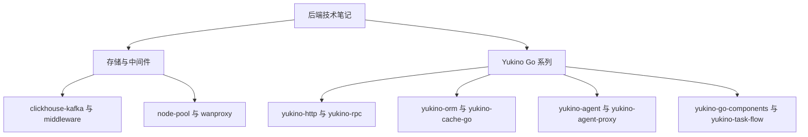

:::tip 阅读建议
Go 语言、MySQL 与 Redis 等通用基础由 `h` 知识库覆盖, 本栏目只保留 `h` 之外的专题与源码解析; **Yukino Go 系列**全部以对应仓库的真实源码为事实依据, 每篇开头的<u>事实基线</u>标注了所依据的检出版本, 便于按源码定位路径与常量。
:::

后端方向的补充笔记, 按主题分为两部分, 共 13 个页面 (含本落地页).

## 第一部分: 存储与中间件

| 页面                                   | 内容概要                                                                                                                                                                                                                                                                                                                                                                                     |
| -------------------------------------- | -------------------------------------------------------------------------------------------------------------------------------------------------------------------------------------------------------------------------------------------------------------------------------------------------------------------------------------------------------------------------------------------- |
| [clickhouse-kafka](./clickhouse-kafka) | ClickHouse 列式存储、MergeTree 家族、分布式架构与查询优化, Kafka 存储模型、消息语义、高可用与调优, 以及两者的联合实时数仓架构与综合方案设计, 行为以 ClickHouse 25.x 与 Kafka 4.x 为基准                                                                                                                                                                                                      |
| [middleware](./middleware)             | etcd、Kafka、groupcache、gRPC、Prometheus、Grafana、OpenTelemetry 的关键机制、生产注意事项与选型建议                                                                                                                                                                                                                                                                                         |
| [node-pool](./node-pool)               | generic-pool 3.9.0 源码级解析: 从资源池要解决的竞态出发, 逐层拆解借还生命周期、工厂契约、超时排队、双向链表与优先级队列、空闲驱逐、配置默认值与停机语义, 并给出连接池场景的实践建议                                                                                                                                                                                                          |
| [wanproxy](./wanproxy)                 | WANProxy Go 移植工作区: XCodec 2048 字节段滚动哈希去重、HELLO/FRAME/ASK/LEARN/ADVANCE/EOS 管道协议会话、XCDFS 磁盘缓存、SSH-2 传输、TCP/UDP/SOCKS/SSH 代理中继与字节计数器; 配置仅接受纯 JSON (无格式探测、无指令式语法、无 .conf 模板) 并由 Draft 2020-12 JSON Schema 与合法/非法夹具校验, 新增 UDP 会话转发与 fleet/status; 以及 server/ 演示服务端、A/B 实验编排与 React 仪表盘的实现机制 |

## 第二部分: Yukino Go 系列

以下文档均以对应仓库的真实源码为事实依据.

| 页面                                           | 内容概要                                                                                                                                                                                                                                                        |
| ---------------------------------------------- | --------------------------------------------------------------------------------------------------------------------------------------------------------------------------------------------------------------------------------------------------------------- |
| [yukino-http](./yukino-http)                   | yukino_http Go HTTP 框架: Koa 风格洋葱模型中间件与延迟响应、TakeOver 响应接管、按段 Trie 路由、分组 Router、SSE 与 RFC 6455 WebSocket 的实现机制与适用场景                                                                                                      |
| [yukino-rpc](./yukino-rpc)                     | yukino_rpc 自研 Go RPC 框架: 二进制线协议、单连接多路复用、Future 异步模型、服务端流式 RPC、熔断限流负载均衡与 etcd 服务发现                                                                                                                                    |
| [yukino-orm](./yukino-orm)                     | yukino_orm: 构建在 MongoDB 官方驱动之上的 Knex 风格链式 Go ORM, 覆盖引擎与连接管理、链式查询构建、聚合分组、流式查询、事务与自增序列                                                                                                                            |
| [yukino-cache-go](./yukino-cache-go)           | yukino_cache Go 分布式缓存: groupcache 风格 read-through Group、字节预算双层 LRU、singleflight 去重、一致性哈希分片、gRPC peer 通信与 etcd 服务发现                                                                                                             |
| [yukino-agent](./yukino-agent)                 | yukino_agent Go 后端: 以 CloudWeGo Eino 编排 RAG 对话、Plan-Execute-Replan 告警分析与文档索引三条流水线, 打通 Milvus 向量知识库与 MCP/Prometheus/MySQL 工具集, 并把浏览器 SDK 上报转换为 Prometheus 指标形成告警闭环                                            |
| [yukino-agent-proxy](./yukino-agent-proxy)     | yukino_agent_proxy: 单二进制以 --agent 代理 Claude Code 或 Codex, 在 Anthropic Messages、OpenAI Responses、Chat Completions 三类协议间双向桥接, 并负责 provider 选择、客户端配置注入与备份、常驻进程管理、MCP 控制面、滚动发布与凭据卫生                        |
| [yukino-go-components](./yukino-go-components) | 九个分布式基础设施模块: redis_lock、consistent_hash、cache_aside、redis_mq、tcc、time_wheel、scheduled_task、lsm_tree、raft 的问题域、关键数据结构与算法、设计取舍与适用边界                                                                                    |
| [yukino-task-flow](./yukino-task-flow)         | yukino_taskflow 条件与定时 AI 任务的单体分布式执行引擎: cron 物化 + 分布式时间轮触发、MySQL 触发器 CDC + outbox 中继、四层幂等防线、TCC 派发事务、openai-go 工具代理与结构化报告、LSM/Raft 本地审计与 MySQL→Redis 状态同步, 并附十个本地 replace 组件的新手教程 |
