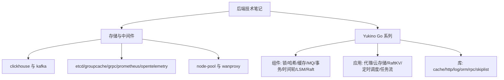

:::tip 阅读建议
Go 语言、MySQL 与 Redis 等通用基础由 `h` 知识库覆盖, 本栏目只保留 `h` 之外的专题与源码解析; **Yukino Go 系列**全部以对应仓库的真实源码为事实依据, 每篇开头的<u>事实基线</u>标注了所依据的检出版本, 便于按源码定位路径与常量。
:::

后端方向的补充笔记, 按主题分为四部分, 共 29 个页面 (含本落地页).

## 第一部分: 存储与中间件

| 页面                             | 内容概要                                                                                                                                                                                                                               |
| -------------------------------- | -------------------------------------------------------------------------------------------------------------------------------------------------------------------------------------------------------------------------------------- |
| [clickhouse](./clickhouse)       | ClickHouse 列式存储、MergeTree 家族、分布式架构与查询优化, 物化视图与 TTL、ORDER BY 设计、JOIN 实现与 OLAP 性能对比, 行为以 ClickHouse 25.x 为基准                                                                                     |
| [kafka](./kafka)                 | Kafka 存储模型、ISR 与 Leader 选举、Producer 幂等/事务、Consumer Group Rebalance、端到端不丢与 exactly-once、顺序性、零拷贝、KRaft、Offset 管理与日志清理; 并含 ClickHouse + Kafka 联合实时数仓与综合方案设计, 行为以 Kafka 4.x 为基准 |
| [etcd](./etcd)                   | etcd 的 MVCC 键值模型、Raft 共识与工程优化、Lease/Watch、事务与线性一致读, 以及生产配置与容量边界, 版本基线 etcd 3.6                                                                                                                   |
| [groupcache](./groupcache)       | groupcache 的 read-through 模型、singleflight 抑制击穿、一致性哈希 peer 选择、字节预算缓存与不适用写密集场景的边界                                                                                                                     |
| [grpc](./grpc)                   | gRPC 基于 HTTP/2 的多路复用与流控、Protobuf 契约、四种流模式、拦截器与错误语义、连接与负载均衡机制                                                                                                                                     |
| [prometheus](./prometheus)       | Prometheus 拉取模型、TSDB 与 Exposition 格式、PromQL、告警规则与 Alertmanager, 以及 Grafana 的多源查询、大盘与统一告警设计                                                                                                             |
| [opentelemetry](./opentelemetry) | OpenTelemetry 的 Trace/Metrics/Logs 三类信号、SDK 与 Collector 管道、采样与导出、上下文传播, 以及跨组件的端到端可观测性与选型实践                                                                                                      |
| [node-pool](./node-pool)         | generic-pool 3.9.0 源码级解析: 从资源池要解决的竞态出发, 逐层拆解借还生命周期、工厂契约、超时排队、双向链表与优先级队列、空闲驱逐、配置默认值与停机语义, 并给出连接池场景的实践建议                                                    |
| [wanproxy](./wanproxy)           | WANProxy Go 移植工作区: XCodec 滚动哈希去重、HELLO/FRAME/ASK/LEARN/ADVANCE/EOS 管道协议、XCDFS 磁盘缓存、SSH-2 传输与多协议中继; 配置仅接受纯 JSON 并由 Draft 2020-12 JSON Schema 校验                                                 |

## 第二部分: Yukino Go 组件

以下文档均以对应仓库的真实源码为事实依据.

| 页面                                               | 内容概要                                                                                  |
| -------------------------------------------------- | ----------------------------------------------------------------------------------------- |
| [yukino-redis-lock](./yukino-redis-lock)           | 所有权安全的分布式锁: token + Lua 比较执行 + 看门狗续期 + RedLock, 以及可重入与边界语义   |
| [yukino-consistent-hash](./yukino-consistent-hash) | 加权虚拟节点哈希环、所有权索引与迁移 diff, 含进程内跳表与 Redis 两种环后端                |
| [yukino-cache-aside](./yukino-cache-aside)         | Cache-aside 读写一致性: 读路径禁写标记抑制回填, Redis 与 MySQL 实现及边界                 |
| [yukino-redis-mq](./yukino-redis-mq)               | 基于 Redis Streams 消费者组的可靠消息投递: 逐消息重试、XAUTOCLAIM 回收、死信与精确 MAXLEN |
| [yukino-tcc](./yukino-tcc)                         | 日志先行的 Try/Confirm/Cancel 最终一致事务, 事务日志落 MySQL 与监控恢复循环               |
| [yukino-time-wheel](./yukino-time-wheel)           | 槽位时间轮 (进程内) 与单 zset + key 索引 (分布式) 的海量延迟任务调度                      |
| [yukino-lsm-tree](./yukino-lsm-tree)               | WAL + 跳表 memtable + 块式 SSTable + 分级 compaction 的高写入本地存储引擎                 |
| [yukino-raft](./yukino-raft)                       | 多副本强一致复制: 选举、日志复制、ReadIndex 与成员变更, 附 raftkv 示例服务                |

## 第三部分: Yukino Go 应用

| 页面                                             | 内容概要                                                                                                                                                                            |
| ------------------------------------------------ | ----------------------------------------------------------------------------------------------------------------------------------------------------------------------------------- |
| [yukino-agent-proxy](./yukino-agent-proxy)       | 单二进制以 `--agent` 代理 Claude Code 或 Codex, 在 Anthropic Messages、OpenAI Responses、Chat Completions 三类协议间双向桥接, 并负责 provider 选择、配置注入、常驻进程与 MCP 控制面 |
| [yukino-cloud-storage](./yukino-cloud-storage)   | 云存储服务: 存储 manager/service 与 storage-agent 协作、日志备份协议与异步日志组装                                                                                                  |
| [yukino-raft-kv](./yukino-raft-kv)               | Raft 之上的 KV 服务: kvserver 节点、持久化与 RPC、clerk 客户端与端到端测试                                                                                                          |
| [yukino-scheduled-task](./yukino-scheduled-task) | 秒级定时任务平台: cron 预展开、分片锁调度、有界工作池与 HTTP 回调, 自带 Redis 锁与布隆过滤器                                                                                        |
| [yukino-task-flow](./yukino-task-flow)           | 条件与定时 AI 任务的单体分布式执行引擎: cron 物化 + 分布式时间轮触发、MySQL CDC + outbox 中继、四层幂等、TCC 派发事务与结构化报告                                                   |

## 第四部分: Yukino Go 库

| 页面                                 | 内容概要                                                                                                           |
| ------------------------------------ | ------------------------------------------------------------------------------------------------------------------ |
| [yukino-cache](./yukino-cache)       | groupcache 风格 read-through Group、字节预算双层 LRU、singleflight、一致性哈希分片、gRPC peer 通信与 etcd 服务发现 |
| [yukino-http](./yukino-http)         | Koa 风格洋葱模型中间件与延迟响应、TakeOver 响应接管、按段 Trie 路由、分组 Router、SSE 与 RFC 6455 WebSocket        |
| [yukino-log](./yukino-log)           | 结构化日志库: 同步/异步写入、文件切割与轮转、错误语义与示例                                                        |
| [yukino-orm](./yukino-orm)           | 构建在 MongoDB 官方驱动之上的 Knex 风格链式 Go ORM: 引擎与连接管理、链式查询、聚合分组、流式查询、事务与自增序列   |
| [yukino-rpc](./yukino-rpc)           | 自研 Go RPC 框架: 二进制线协议、单连接多路复用、Future 异步模型、服务端流式 RPC、熔断限流负载均衡与 etcd 服务发现  |
| [yukino-skiplist](./yukino-skiplist) | 可持久化跳表: 节点层级与查找/插入/删除、编码与持久化、迭代与并发边界                                               |
