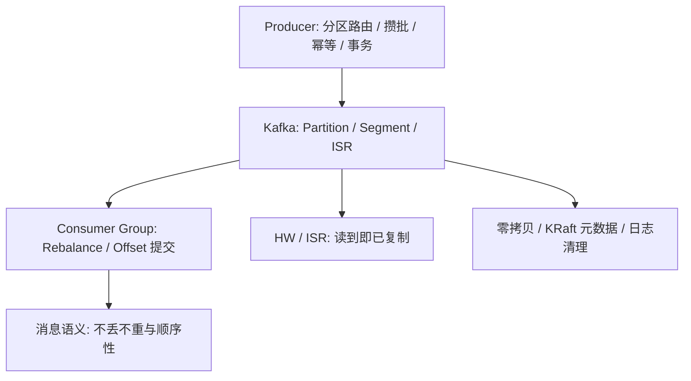
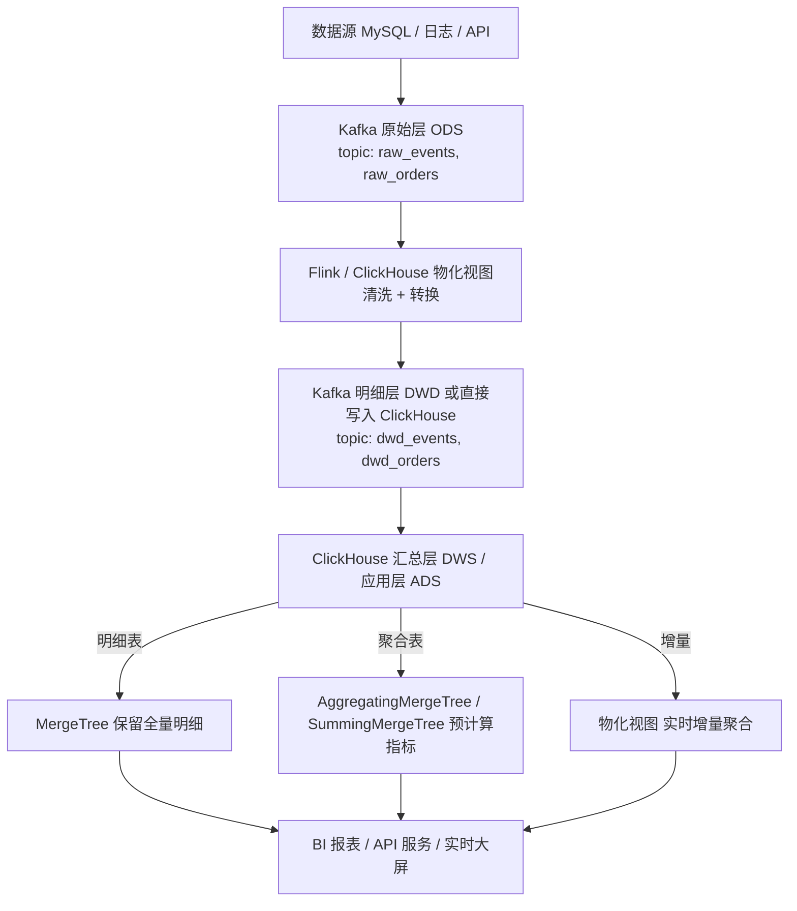
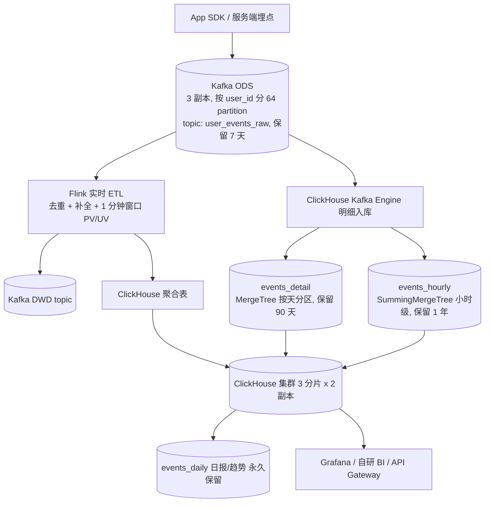

:::note 版本基线
Kafka 行为以 **4.x** 为准; 涉及 KRaft、Log Compaction 与 <u>exactly-once</u> 的结论均按该基线表述. 参数默认值核对 Apache Kafka 4.x 官方配置参考（官方文档）, 实例化结论需以本机 broker 配置实测为准. 联合架构章节中涉及的 ClickHouse Kafka Engine 行为以 ClickHouse 25.x 为准.
:::

**主线一览**



:::danger 写入红线
ClickHouse 的**高频小批量写入**会制造大量小 part, 迫使后台频繁合并并放大写放大; *批量攒批*是 Kafka Engine 消费链路的首要约束, 不要用单条 insert 压测或上线.
:::

这份文档面向使用 Kafka 做消息与流处理管道的后端工程师, 按架构与存储、高级特性与调优、联合架构与综合方案设计的顺序展开. Kafka 部分从整体架构与消息存储出发, 覆盖 ISR 与 Leader 选举、Producer 发送流程与幂等/事务、Consumer Group Rebalance、端到端不丢失与 exactly-once, 并延伸到消息顺序性、零拷贝、KRaft 元数据管理、Offset 管理与日志清理; 最后以独立章节讨论 ClickHouse 与 Kafka 联合的实时数仓分层、Kafka Engine 消费、写入与分布式查询优化, 以及实时用户行为分析系统、消费积压排查、集群扩容三类综合方案. Kafka 行为以 4.x 系列为准. 对 ClickHouse 存储引擎、MergeTree 家族、物化视图、TTL 与 ORDER BY 设计等主题, 见 [ClickHouse 技术手册](./clickhouse).

## 一、Kafka 架构与存储

### Kafka 的整体架构与核心组件

```text
                    ┌─────────────────────────────────────────────────┐
                    │              Kafka Cluster                      │
                    │                                                 │
  Producer ──────>  │  Broker 0          Broker 1          Broker 2   │
                    │  ┌──────────┐     ┌──────────┐     ┌──────────┐ │
                    │  │Topic A P0│     │Topic A P1│     │Topic A P2│ │
                    │  │(Leader)  │     │(Leader)  │     │(Leader)  │ │
                    │  │Topic B P1│     │Topic B P2│     │Topic B P0│ │
                    │  │(Follower)│     │(Follower)│     │(Follower)│ │
                    │  └──────────┘     └──────────┘     └──────────┘ │
                    └─────────────────────────────────────────────────┘
                              ^                    |
                              │                    v
                         Controller           Consumer Group
                         (KRaft)              (C0, C1, C2)
```

核心组件:

- Broker: Kafka 服务节点, 负责消息存储和转发
- Topic: 逻辑上的消息分类, 一个 topic 可以有多个 partition
- Partition: topic 的物理分片, 是并行度和顺序性的基本单位; 每个 partition 是一个只追加的有序日志
- Leader / Follower: 每个 partition 有一个 leader 处理所有读写, 多个 follower 同步数据
- Controller: 集群中的一个节点担任 (KRaft 角色), 负责 partition leader 选举、broker 上下线感知
- Consumer Group: 一组消费者共同消费一个 topic, 每个 partition 只被组内一个消费者消费
- Offset: 每条消息在 partition 内的唯一递增编号, 消费者通过 offset 记录消费进度

### 消息存储结构与高吞吐的来源

存储结构:

```text
partition-0/
├── 00000000000000000000.log      # 消息数据文件 (segment)
├── 00000000000000000000.index    # 稀疏偏移量索引
├── 00000000000000000000.timeindex # 时间戳索引
├── 00000000000005367851.log      # 下一个 segment
├── 00000000000005367851.index
└── ...
```

- Segment: 日志文件按大小 (`log.segment.bytes`, 默认 1GB) 或滚动时间 (`log.roll.ms` / `log.roll.hours`) 切分为多个 segment
- 每个 segment 以第一条消息的 offset 命名, 查找时二分定位到 segment 文件
- `.index`: 稀疏索引, 每 4KB 记录一个 (offset, 物理位置) 对, 查找时先定位到索引区间再顺序扫描
- `.timeindex`: 按时间戳查找消息 (用于 `offsetsForTimes` API)

高吞吐的原因:

1. 顺序写磁盘: 消息追加到日志文件末尾, 顺序写吞吐远高于随机寻道写, 充分利用机械盘与 SSD 的顺序带宽
2. Page Cache: 写入只到 OS 页缓存, 由操作系统异步刷盘; 读取热数据也命中页缓存, 不经过 JVM 堆
3. 零拷贝 (sendfile): 消费者读消息时, 数据从磁盘 -> 页缓存 -> 网卡, 不经过用户空间, 省两次内存拷贝
4. 批量 + 压缩: Producer 端将消息攒批 (默认 16KB, `batch.size`), 压缩 (lz4/zstd) 后一次网络请求发送多条消息
5. 分区并行: 多个 partition 分布在不同 broker, 读写天然并行
6. 消息格式紧凑: 二进制协议, 变长编码, 无冗余字段

### ISR 机制与 Leader 选举流程

ISR (In-Sync Replicas): 与 leader 保持同步的副本集合.

同步标准:

- LEO (Log End Offset): 该副本下一条将要写入的 offset (即已写入的最大 offset + 1)
- Kafka 对副本是否同步的判定依据是时间而非落后条数: follower 在最近 `replica.lag.time.max.ms` (默认 30s) 内向 leader 拉取并追平到 leader 的 LEO, 就认为同步; 超过该时间窗口没追上则被踢出 ISR

HW (High Watermark): ISR 中所有副本的最小 LEO, 消费者只能读到 HW 之前的消息 (保证读到的数据不会因 leader 切换而丢失).

```text
Leader:    [msg0, msg1, msg2, msg3, msg4]  LEO=5
Follower1: [msg0, msg1, msg2, msg3]        LEO=4  (在 ISR 中)
Follower2: [msg0, msg1]                    LEO=2  (在 ISR 中)
                                           HW = min(5, 4, 2) = 2
消费者只能读到 msg0, msg1
```

Leader 选举流程 (KRaft 模式):

1. Controller 检测到某 partition 的 leader broker 下线 (心跳超时)
2. 从该 partition 的 ISR 列表中选第一个存活副本作为新 leader
3. 如果 ISR 为空: 取决于 `unclean.leader.election.enable`
   - false (默认): partition 不可用, 等待 ISR 中的副本恢复 (保证数据不丢)
   - true: 从所有副本 (包括不同步的) 中选一个, 可能丢数据 (可用性优先)
4. Controller 将新 leader 信息写入元数据, 通知所有 broker 和消费者

### Producer 的发送流程与 acks 参数

发送流程:

1. 序列化: key 和 value 经过 Serializer 转为字节数组
2. 分区路由: 指定了 partition 则直接发; 指定了 key 则按 key 的哈希 (murmur2) 对 partition 数取模; 都没有则粘性分区: 消息先集中写入随机选中的 partition, 攒满一个 batch 后换下一个, 兼顾负载均衡和批量效率
3. 攒批: 消息进入 RecordAccumulator, 按 partition 分组, 每个 partition 维护一个或多个 ProducerBatch
4. 触发发送: batch 大小达到 `batch.size` (默认 16KB) 或等待时间达到 `linger.ms` (默认 5ms, Kafka 4.0 起由 0 上调, 可按吞吐需要进一步上调到 50~100ms) 时, Sender 线程取出 batch
5. 压缩: 按 `compression.type` (lz4/zstd/snappy) 压缩整个 batch
6. 网络发送: Sender 线程将 batch 通过 NIO 发送到对应 partition 的 leader broker
7. 回调/重试: 收到 broker 响应后执行 Callback; 可重试的错误 (如 NOT_LEADER_OR_FOLLOWER) 自动重试 `retries` 次

acks 参数:

| acks | 含义                                    | 可靠性        | 延迟 |
| ---- | --------------------------------------- | ------------- | ---- |
| 0    | 不等待任何确认, 发完就认为成功          | 可能丢消息    | 最低 |
| 1    | leader 写入本地日志即确认               | leader 宕机丢 | 中等 |
| -1   | 等待 ISR 中所有副本写入成功才确认 (all) | 最高          | 最高 |

生产建议: `acks=all` + `retries=Integer.MAX_VALUE` + `enable.idempotence=true` (这三项在当前 Kafka 中均为默认值, 显式写出是为了可读性). 这套配置在单分区单会话内做到不丢不重; 跨分区或 Producer 重启后的 exactly-once 仍需事务 Producer, 见下一节.

### 幂等 Producer 与事务 Producer 的实现

幂等 Producer (单分区 exactly-once):

- 开启: `enable.idempotence=true`
- 机制: Producer 初始化时获取一个 PID (Producer ID), 每条消息携带 (PID, Partition, SequenceNumber)
- Broker 端为每个 (PID, Partition) 维护一个序列号, 收到消息时检查:
  - `seq = 期望值`: 正常写入, 期望值 +1
  - `seq < 期望值`: 重复消息, 直接丢弃 (返回成功)
  - `seq > 期望值`: 乱序, 返回错误
- 局限: 只保证单分区内不重复; Producer 重启后 PID 变化, 幂等失效

事务 Producer (跨分区 exactly-once):

- 开启: 设置 `transactional.id`, 调用 `initTransactions()`
- 机制: 引入 Transaction Coordinator (一个特殊的 broker) 管理事务状态
- 流程:

```java
producer.initTransactions();
try {
    producer.beginTransaction();
    producer.send(record1);  // 分区 0
    producer.send(record2);  // 分区 1
    producer.sendOffsetsToTransaction(offsets, groupId); // 消费位移也纳入事务
    producer.commitTransaction();
} catch (Exception e) {
    producer.abortTransaction();
}
```

- 底层: 事务协调者在 `__transaction_state` topic 中记录事务状态 (PrepareCommit -> Commit), 再向各分区 leader 下发 COMMIT/ABORT 标记, leader 把标记写入本地日志; 消费者设置 `isolation.level=read_committed` 时只读 COMMIT 标记之前的消息
- 代价: 事务引入两阶段提交与状态日志写入, 单条延迟上升、吞吐低于普通 Producer, 具体降幅取决于批量大小与事务频率, 需以本机压测为准

### Consumer Group 的 Rebalance 机制、问题与优化

Rebalance 触发条件:

- 消费者加入/离开 group (崩溃、主动 unsubscribe)
- 订阅的 topic 的 partition 数量变化
- 订阅的 topic 列表变化 (正则订阅时新 topic 创建)

Rebalance 流程 (Eager 协议, 默认):

1. 所有消费者向 Group Coordinator (某个 broker) 发送 JoinGroup 请求
2. Coordinator 选出第一个加入的消费者为 Leader, 将 group 信息发给 Leader
3. Leader 根据分配策略 (Range / RoundRobin / Sticky) 计算分配方案, 发给 Coordinator
4. Coordinator 将分配结果发给所有消费者
5. 所有消费者按新方案消费

Eager 协议的问题:

- Stop-the-world: Rebalance 期间所有消费者停止消费, 等待重新分配
- 重复消费: 消费者在 Rebalance 前未提交的 offset 会被重新分配给其他消费者
- 频繁 Rebalance: 心跳由后台线程独立发送, 业务处理慢并不会导致 `session.timeout.ms` (默认 45s) 超时, 它只在进程挂起/断网时生效; 处理慢真正触发的是超过 `max.poll.interval.ms` (默认 5min) 没有再次调用 poll, 消费者主动离组引发 Rebalance, 形成恶性循环

优化:

1. Cooperative Rebalance (增量式): 只迁移需要变动的 partition, 不涉及的 partition 继续消费, 大幅减少停顿; 通过 `partition.assignment.strategy` 指定 CooperativeStickyAssignor 启用
2. Static Membership: 消费者设置 `group.instance.id`, 短暂离线 (如 GC、重启) 不触发 Rebalance, 在 `session.timeout.ms` 内重连则恢复原分配
3. 调参: 增大 `session.timeout.ms`、`max.poll.interval.ms` (默认 45s / 5min, 按业务处理耗时上调), 减小 `max.poll.records` 避免处理超时
4. 手动提交 offset: 处理完再提交, 避免自动提交导致的重复消费

### 端到端不丢失与 exactly-once 的实现

消息可能在三个环节丢失:

1. Producer -> Broker: 网络抖动、broker 宕机
   - 解决: `acks=all` + 重试; 幂等 Producer 防重复
2. Broker 存储: leader 宕机, 未同步到 follower 的消息丢失
   - 解决: `replication.factor >= 3` + `min.insync.replicas >= 2` + `acks=all`
   - `min.insync.replicas`: ISR 中副本数低于此值时, leader 拒绝写入 (宁可不可用也不丢数据)
3. Consumer 处理: 消费者拉到消息后崩溃, offset 已提交但处理未完成
   - 解决: 手动提交 offset, 处理成功后再 commit; 或事务性消费

端到端 exactly-once (Kafka Streams 的 read-process-write 场景):

```text
Consumer (read_committed) --> 处理逻辑 --> Transactional Producer
     |                                          |
     └── sendOffsetsToTransaction() ────────────┘
         (将消费 offset 纳入 producer 事务)
```

- 消费 offset 的提交和生产消息在同一个事务中原子完成
- 要么都成功 (消息产出 + offset 前进), 要么都回滚
- 局限: 只适用于 Kafka -> Kafka 的场景; 如果下游是外部系统 (如 MySQL), 需要业务层幂等 (唯一键去重) 或两阶段提交

---

## 二、Kafka 高级特性与调优

### 消息顺序性的保证与乱序场景

Kafka 的顺序保证:

- 单 partition 内: 消息严格按写入顺序排列, 消费者按 offset 顺序消费, 天然有序
- 跨 partition: 无顺序保证, 不同 partition 可能分布在不同 broker, 消费速度不同

保证全局有序:

- 将 topic 设为单 partition (牺牲并行度)
- 或将需要有序的消息用相同 key 路由到同一 partition (如订单 ID 作为 key, 同一订单的消息有序)

乱序场景:

1. Producer 重试: 消息 A 发送失败触发重试, 消息 B 先到达 broker, 导致 B 在 A 前面
   - 解决: 幂等 Producer (序列号去重) + `max.in.flight.requests.per.connection=1` (牺牲吞吐) 或开启幂等后设为 5 (broker 端排序)
2. 多 partition: 不同 partition 的消费速度不同, 跨 partition 的消息到达下游的顺序不确定
3. Consumer 多线程处理: 一个 partition 的消息被分发到多个线程, 处理完成顺序不确定
   - 解决: 单 partition 单线程; 或按 key 哈希分发到固定线程

### 零拷贝 (Zero-Copy) 原理与传统 I/O 对比

传统 I/O (read + write):

```text
磁盘 --> 内核缓冲区 --> 用户空间缓冲区 --> Socket 缓冲区 --> 网卡
         (DMA)          (CPU 拷贝)         (CPU 拷贝)       (DMA)
```

4 次拷贝 (2 次 DMA + 2 次 CPU), 4 次上下文切换.

Kafka 使用 sendfile 系统调用:

```text
磁盘 --> 内核缓冲区 --> 网卡
         (DMA)          (DMA, 直接从页缓存到网卡)
```

2 次拷贝 (都是 DMA, 无 CPU 拷贝), 2 次上下文切换.

实现:

- Java 中通过 `FileChannel.transferTo()` 调用底层 `sendfile`
- Kafka 的 `LogSegment.read()` 返回 `FileRecords`, 底层用 `FileChannel.transferTo` 将日志文件内容直接传输到 SocketChannel
- 数据不经过 JVM 堆内存, 不触发 GC, 不占用应用缓冲区

补充: 如果开启了压缩 (producer 端压缩), 消息在 broker 端是压缩存储的, 消费者也是压缩接收后自行解压, 所以 broker 转发时不需要解压, 零拷贝仍然有效.

### Kafka、RocketMQ 与 RabbitMQ 的对比与选型

| 维度       | Kafka                 | RocketMQ                  | RabbitMQ                  |
| ---------- | --------------------- | ------------------------- | ------------------------- |
| 设计目标   | 高吞吐日志/流处理     | 业务消息, 金融级可靠      | 灵活路由, 企业集成        |
| 吞吐量     | 百万级 TPS            | 十万级 TPS                | 万级 TPS                  |
| 延迟       | 毫秒级 (批量优化)     | 毫秒级                    | 微秒~毫秒级 (单条低延迟)  |
| 消息模型   | Pull (消费者拉取)     | Pull + 长轮询             | Push (broker 推送)        |
| 顺序消息   | 分区内有序            | 队列内有序 + 严格顺序模式 | 单队列有序                |
| 延迟消息   | 不原生支持            | 支持延迟消息与定时投递    | 插件支持                  |
| 事务消息   | 支持 (事务 Producer)  | 支持 (半消息 + 回查)      | 不原生支持                |
| 消息回溯   | 支持 (按 offset/时间) | 支持 (按时间)             | 不支持 (消费即删除)       |
| 消息过滤   | 不支持 (需消费端过滤) | Tag / SQL92 过滤          | Routing Key / Header 匹配 |
| 死信队列   | 不原生支持            | 支持                      | 支持                      |
| 协议       | 自定义二进制协议      | 自定义协议                | AMQP / MQTT / STOMP       |
| 运维复杂度 | 中 (KRaft 元数据管理) | 中 (NameServer 轻量)      | 低 (Erlang 单节点)        |

选型建议:

- 日志收集、指标监控、流计算 (Flink/Spark): Kafka
- 电商交易、金融支付、需要延迟消息和事务回查: RocketMQ
- 中小规模、复杂路由、多协议接入: RabbitMQ

### Controller 选举与 KRaft 元数据管理

Kafka 用 KRaft 管理集群元数据与 Controller, 不需要外部协调服务:

- 部分节点配置为 Controller 角色 (`process.roles=controller`), 组成一个 Raft 组; 其余节点为 broker 角色 (`process.roles=broker`), 也可以配置为 broker+controller 混合角色
- Controller 组内通过 Raft 选举: 拿到多数派选票的节点成为 active controller, 其余为 follower; 元数据变更以日志形式复制到多数派
- 元数据存放在内部日志 `__cluster_metadata` 中, active controller 处理元数据变更, follower controller 同步日志
- 某 partition 的 leader broker 下线时, active controller 感知心跳超时后从该 partition 的 ISR 中选出新 leader 并广播给所有 broker

KRaft 的优势:

1. 元数据管理只需一套系统: 不必额外维护 ZooKeeper 集群
2. 元数据作为 Kafka 内部日志, 复用 Kafka 自身的复制与持久化机制
3. 启动更快: 元数据从本地日志恢复, 不需要与外部协调服务交互
4. 支持更大规模: 不受 ZooKeeper Watch 机制在大量 partition 下性能下降的制约
5. 元数据变更可追溯: 所有变更是 Raft 日志, 天然有审计能力

### 消费者 Offset 管理: 自动提交与手动提交

Offset 存储: 消费者的 offset 存在内部 topic `__consumer_offsets` 中 (默认 50 个 partition), key 是 (group, topic, partition).

自动提交 (`enable.auto.commit=true`, 默认):

- 每 `auto.commit.interval.ms` (默认 5s) 自动提交上次 poll 返回的最大 offset
- 问题:
  - 消息处理失败但 offset 已提交 -> 消息丢失
  - Rebalance 时上次自动提交的 offset 之后、当前处理位置之前的消息被重复消费

手动提交:

```java
while (true) {
    ConsumerRecords<String, String> records = consumer.poll(Duration.ofMillis(100));
    for (ConsumerRecord<String, String> record : records) {
        process(record);  // 业务处理
    }
    consumer.commitSync();  // 同步提交, 阻塞直到成功
    // 或 consumer.commitAsync();  // 异步提交, 不阻塞, 通过回调处理失败
}
```

更精细的控制:

- `commitSync(offsets)`: 提交指定 partition 的指定 offset, 而非全部
- 每处理完一条就提交: 可靠性最高, 但频繁提交影响性能
- 批量处理后提交: 一批处理完统一提交, 平衡可靠性和性能
- 异步 + 同步兜底: 平时 `commitAsync` 提高吞吐, 在 `poll` 循环结束或 Rebalance 回调中 `commitSync` 保证最后一次提交成功

Rebalance 时的 offset 处理:

```java
consumer.subscribe(topics, new ConsumerRebalanceListener() {
    @Override
    public void onPartitionsRevoked(Collection<TopicPartition> partitions) {
        consumer.commitSync();  // 交出 partition 前提交当前进度
    }
    @Override
    public void onPartitionsAssigned(Collection<TopicPartition> partitions) {
        // 初始化新 partition 的状态 (如 seek 到指定位置)
    }
});
```

### 日志清理策略与 Log Compaction 原理

两种清理策略 (`log.cleanup.policy`):

1. delete (默认): 按时间 (`log.retention.hours`, 默认 7 天) 或大小 (`log.retention.bytes`) 删除过期 segment
2. compact: 保留每个 key 的最新值, 删除旧值 (类似 LSM-Tree 的 compaction)

Log Compaction 原理:

```text
清理前:
offset 0: key=A, value=1
offset 1: key=B, value=2
offset 2: key=A, value=3
offset 3: key=C, value=4
offset 4: key=B, value=5

清理后:
offset 2: key=A, value=3   (A 的最新值)
offset 3: key=C, value=4   (C 的最新值)
offset 4: key=B, value=5   (B 的最新值)
```

- 后台 Log Cleaner 线程维护一个 offset map (key -> 最大 offset), 扫描日志时只保留每个 key 的最后一条
- 活跃 segment (正在写入的) 不会被 compact, 只有非活跃 segment 参与
- Compaction 不保证立即执行, 有延迟 (`log.cleaner.min.cleanable.ratio` 控制触发阈值)

适用场景:

- `__consumer_offsets` topic 本身就是 compact 策略 (只保留每个消费者的最新 offset)
- 数据库变更日志 (CDC): 只关心每行的最终状态
- 配置/缓存同步: 每个 key 只需要最新值

### 生产环境的关键配置与调优参数

Broker 端:

| 参数                          | 建议值                | 说明                               |
| ----------------------------- | --------------------- | ---------------------------------- |
| `num.io.threads`              | 8~16                  | 磁盘 I/O 线程数, 与磁盘数量相关    |
| `num.network.threads`         | 4~8                   | 网络处理线程数                     |
| `log.flush.interval.messages` | 不设置 (依赖 OS 刷盘) | 强制刷盘会严重降低吞吐             |
| `num.partitions`              | 按吞吐估算            | 默认 1, 生产建议 >= 6              |
| `default.replication.factor`  | 3                     | 副本数                             |
| `min.insync.replicas`         | 2                     | 配合 acks=all, 保证至少 2 副本写入 |
| `log.retention.hours`         | 按业务                | 默认 168 (7 天)                    |
| `message.max.bytes`           | 按需                  | 默认 1MB, 大消息需调大             |

Producer 端:

| 参数                                    | 建议值          | 说明                         |
| --------------------------------------- | --------------- | ---------------------------- |
| `acks`                                  | all             | 最高可靠性                   |
| `batch.size`                            | 65536 (64KB)    | 攒批大小, 太小浪费网络       |
| `linger.ms`                             | 10~50           | 攒批等待时间, 0 表示立即发送 |
| `compression.type`                      | lz4 或 zstd     | lz4 速度快, zstd 压缩率高    |
| `buffer.memory`                         | 67108864 (64MB) | 发送缓冲区, 太小会阻塞 send  |
| `max.in.flight.requests.per.connection` | 5               | 幂等模式下最大 5, 保证顺序   |

Consumer 端:

| 参数                   | 建议值        | 说明                                   |
| ---------------------- | ------------- | -------------------------------------- |
| `fetch.min.bytes`      | 1024~65536    | 最少攒够多少数据再返回, 减少请求次数   |
| `fetch.max.wait.ms`    | 500           | 攒不够时的最大等待时间                 |
| `max.poll.records`     | 500           | 单次 poll 最大条数, 防处理超时         |
| `max.poll.interval.ms` | 300000 (5min) | 两次 poll 最大间隔, 超时触发 Rebalance |
| `session.timeout.ms`   | 45000         | 心跳超时, 太短容易误判死亡             |

---

## 三、联合架构与综合方案设计

### Kafka Engine 的数据消费机制

ClickHouse 内置 Kafka 引擎, 可以将 Kafka topic 作为数据源:

```sql
-- 1. 创建 Kafka 引擎表 (消费入口)
CREATE TABLE events_kafka (
    event_time DateTime,
    user_id UInt64,
    event_type String,
    payload String
) ENGINE = Kafka()
SETTINGS
    kafka_broker_list = 'broker1:9092,broker2:9092',
    kafka_topic_list = 'user_events',
    kafka_group_name = 'clickhouse_consumer',
    kafka_format = 'JSONEachRow',
    kafka_num_consumers = 4;

-- 2. 创建目标存储表
CREATE TABLE events (
    event_time DateTime,
    user_id UInt64,
    event_type String,
    payload String
) ENGINE = MergeTree()
PARTITION BY toYYYYMMDD(event_time)
ORDER BY (user_id, event_time);

-- 3. 创建物化视图, 将 Kafka 数据持续导入目标表
CREATE MATERIALIZED VIEW events_mv TO events AS
SELECT * FROM events_kafka;
```

工作原理:

1. Kafka 引擎表不存储数据, 它是一个虚拟的消费者
2. 物化视图触发时, ClickHouse 从 Kafka 引擎表 poll 一批消息
3. 消息经过物化视图的 SELECT 转换后 INSERT 到目标表
4. 消费 offset 由 ClickHouse 管理, 提交到 Kafka 的 `__consumer_offsets`

注意事项:

- `kafka_num_consumers` 不要超过 topic 的 partition 数 (多出的消费者分不到 partition)
- 消息解析失败不会重试: `kafka_skip_broken_messages` 默认为 0, 一条坏消息即报错并阻塞该引擎表的消费; 调大它可按条数跳过坏消息并记日志; `kafka_handle_error_mode` 控制错误处理模式 — 默认 `default` 直接抛异常, `stream` 把错误与原始消息写入 `_error`/`_raw_message` 虚拟列由下游自行处理, `dead_letter_queue` 把错误数据写入 system.dead_letter_queue. 需自行监控 system.kafka_consumers 表与日志
- 每批消费的数据量由 `kafka_max_block_size` 控制 (默认取 `max_insert_block_size`, 即 1048576 行)
- ClickHouse 重启后从上次提交的 offset 继续消费, 可能重复消费 (需目标表去重)

### 实时数仓的分层设计与职责划分



各层职责:

- ODS (原始层): Kafka 保存原始数据, 保留 7 天, 作为数据回溯和重放的基础
- DWD (明细层): 清洗 (去重、补全、格式化) 后的明细数据, 可以仍在 Kafka (流处理中间态) 或落入 ClickHouse
- DWS (汇总层): 按维度预聚合 (如每小时 UV、每日 GMV), 用 AggregatingMergeTree 存储
- ADS (应用层): 面向具体业务的宽表或指标表, 直接服务查询

关键设计决策:

- 是否需要 Flink: 简单 ETL 用 ClickHouse 物化视图即可; 复杂的多流 JOIN、窗口计算、状态管理需要 Flink
- 去重策略: Kafka 的 at-least-once 语义导致 ClickHouse 端必须去重, 用 ReplacingMergeTree 或查询时 `GROUP BY + argMax`
- 数据回溯: Kafka 保留期内可以重置 offset 重新消费, 重建 ClickHouse 中的聚合表

### 写入性能优化与高频小批量写入的代价

:::tip{title="高频小批量写入的命门: part 数量爆炸"}
ClickHouse **每次 INSERT 都生成一个新 part**, 后台合并跟不上时就会触发 `Too many parts` 错误. 核心解法只有一个字——**攒批**: 客户端攒够一批 (如 10000~100000 行) 再 INSERT, 或借助 **Buffer 表引擎** / 服务端 `async_insert` 在服务端合并. 每个 part 都有独立索引与标记文件, 小文件随机 I/O 远慢于少量大文件的顺序 I/O.
:::

写入模型:

- 每次 INSERT 生成一个新的 part (数据分片)
- 后台线程将小 part 合并为大 part (类似 LSM-Tree compaction)
- 合并有 I/O 和 CPU 开销, 且合并期间占用额外磁盘空间

高频小批量写入的问题:

- 每秒 INSERT 一次, 每次 100 行 -> 每秒产生一个 part
- 后台合并跟不上 part 产生速度 -> part 数量爆炸 (Too many parts 错误)
- 每个 part 都有独立的索引文件、标记文件, 元数据膨胀
- 合并时大量小文件随机 I/O, 效率远低于少量大文件的顺序 I/O

优化方案:

1. 攒批写入: 客户端攒够一批 (如 10000~100000 行) 再 INSERT, 或用 Buffer 表引擎缓冲
2. Buffer 表引擎: 在内存中攒批, 达到阈值后刷入目标 MergeTree 表

```sql
CREATE TABLE events_buffer AS events
ENGINE = Buffer(default, events, 16, 10, 100, 10000, 100000, 1000000, 10000000);
-- 16 个 buffer, 最短 10s / 最长 100s 刷一次, 最少 10000 行 / 最多 100000 行刷一次
```

3. 异步 INSERT: `SET async_insert = 1`, ClickHouse 服务端攒批, 多个客户端的小 INSERT 合并为一次写入
4. 分区设计: 分区键不要太细 (按天或按月), 避免同一批数据写入太多分区
5. 写入时排序: 数据按 ORDER BY 键预排序后再写入, 减少合并时的排序开销
6. 避免写入时更新: 用 ReplacingMergeTree 追加新版本, 不要 ALTER UPDATE

### 分布式查询的执行流程与性能瓶颈

分布式查询执行流程 (以 `SELECT count() FROM events_dist WHERE date = '2024-01-01' GROUP BY region` 为例):

1. 客户端将 SQL 发送到任意节点 (协调者)
2. 协调者解析 Distributed 表引擎, 确定涉及哪些分片
3. 将查询改写为本地表查询, 发送到各分片:
   `SELECT count() FROM events_local WHERE date = '2024-01-01' GROUP BY region`
4. 各分片在本地并行执行, 返回部分聚合结果
5. 协调者汇总各分片的部分结果, 做最终聚合, 返回客户端

性能瓶颈:

1. 网络传输: 各分片返回中间结果到协调者, 如果中间结果集很大 (如 GROUP BY 基数高), 网络成为瓶颈
   - 优化: 尽量在本地完成聚合, 减少返回数据量; 使用 `distributed_aggregation_memory_efficient` 模式
2. 数据倾斜: 分片键选择不当导致某些分片数据量远大于其他, 查询时间取决于最慢的分片
   - 优化: 用 `sipHash64` 等均匀哈希作为分片键
3. 协调者瓶颈: 所有结果汇聚到一个节点, 高并发查询时协调者 CPU 和内存压力大
   - 优化: 多节点轮询作为协调者; 或用 `distributed_group_by_no_merge` 让客户端自行合并
4. JOIN 的 shuffle: 分布式 JOIN 需要将右表数据广播或按 key shuffle 到各分片, 数据量大时极慢
   - 优化: 表 colocate (相同分片键); 字典替代 JOIN; 全局临时表 (`GLOBAL IN/JOIN`)

### 高并发查询的表结构设计与常见陷阱

高并发查询设计:

1. 预聚合: 用物化视图 + SummingMergeTree / AggregatingMergeTree 将明细数据预聚合为指标, 查询直接读聚合表, 避免实时扫描海量明细
2. 投影 (PROJECTION): 为同一张表定义不同排序的副本, 不同查询模式走不同投影

```sql
ALTER TABLE events ADD PROJECTION proj_by_type (
    SELECT * ORDER BY (event_type, event_time)
);
```

3. 合理设置 `max_threads`: 默认用所有 CPU 核, 高并发时每个查询用少量核 (如 4), 避免资源争抢
4. 读写分离: 写入走一个副本, 查询走其他副本
5. 缓存: 对重复查询开启 query cache: `SET use_query_cache = true`

常见坑:

1. 分区过多: 按小时分区 + 数据保留一年 = 8760 个分区, 元数据膨胀, 合并效率低; 建议按天或按月
2. ORDER BY 键选了低基数列: 如 `ORDER BY (status)` 只有 5 个值, 索引几乎无效
3. 用 ClickHouse 做高频点查: 它为分析型查询设计, 官方文档建议单服务器查询速率保持在每秒百次量级以内; 点查仍要经过多 part 扫描与线程池调度开销, 延迟远高于 OLTP 数据库; 点查场景用 Redis / MySQL
4. 频繁 ALTER UPDATE/DELETE: Mutation 是重写 part, 生产上应尽量避免
5. 不设置 `max_memory_usage`: 单个查询可能吃光内存导致 OOM, 影响其他查询
6. Distributed 表上直接 INSERT: 数据先写本地临时文件再异步分发, 可能丢数据; 应直接写本地表, 或用 `distributed_foreground_insert=1`

---

### 实时用户行为分析系统的全链路设计

需求: 日活千万级 App, 采集用户点击/浏览/购买事件, 支持实时看板 (分钟级延迟) 和历史明细查询.

架构设计:



关键设计决策:

1. Kafka 分 64 partition: 支撑消费并行度, 按 user_id 分区保证同一用户事件有序
2. Flink 和 ClickHouse Kafka Engine 双通道: Flink 做复杂计算 (多流 JOIN、窗口), ClickHouse 直接消费做简单入库, 两者消费不同 consumer group 互不影响
3. 去重: Kafka at-least-once + ClickHouse ReplacingMergeTree(event_id) 双重保障
4. 分层存储: 明细 90 天后 TTL 删除, 聚合数据长期保留, 控制存储成本
5. 查询路由: 实时看板查 events_hourly (数据量小, 毫秒响应); 明细分析查 events_detail (按需扫描)

### Kafka 消费积压 (Consumer Lag) 的排查与解决

排查步骤:

1. 确认积压程度:

```bash
kafka-consumer-groups.sh --bootstrap-server broker:9092 \
  --describe --group my_group
# 关注 LAG 列, 即 (log-end-offset - current-offset)
```

2. 定位原因:
   - 消费速度低于生产速度: 消费者处理能力不足
   - 消费者频繁 Rebalance: 查看日志中是否有 `Attempt to heartbeat failed` / `Rebalance`
   - 下游阻塞: 消费者处理逻辑中调用外部 API 超时、数据库慢查询
   - 分区数不足: 消费者数 > 分区数时, 多出的消费者空闲

解决方案:

| 原因           | 解决方案                                                                        |
| -------------- | ------------------------------------------------------------------------------- |
| 消费能力不足   | 增加消费者实例 (不超过 partition 数); 增加 partition 数                         |
| 处理逻辑慢     | 异步化 (消息放入队列, 多线程处理); 批量处理; 优化下游调用                       |
| 频繁 Rebalance | 增大 `session.timeout.ms`; 增大 `max.poll.interval.ms`; 减小 `max.poll.records` |
| 分区数不足     | 扩 partition (注意: 扩分区后按 key 的路由会变化, 顺序性被打破)                  |
| 突发流量       | 临时扩容消费者; 非核心消息降级 (跳过或写入死信 topic 后续处理)                  |

紧急处理 (积压数百万条):

1. 临时新建一个 topic, partition 数翻倍
2. 原消费者改为"转发模式": 只将消息转发到新 topic, 不做业务处理
3. 新消费者消费新 topic, 有足够并行度处理积压
4. 积压消化后恢复正常架构

### ClickHouse 集群扩容、数据迁移与服务不中断保障

扩容流程 (以从 3 分片扩到 4 分片为例):

1. 新增节点部署 ClickHouse, 加入集群 (修改 remote_servers 配置)
2. 在新节点上创建本地表 (与现有分片结构一致)
3. 修改 Distributed 表的分片配置, 加入新分片
4. 数据再平衡:
   - 方案 A: 新数据自动路由到新分片 (Distributed 表写入时按分片键分配), 旧数据不动 — 简单但数据不均匀
   - 方案 B: 用 `INSERT INTO new_shard SELECT ... FROM old_shard WHERE sipHash64(user_id) % 4 = 3` 手动迁移部分数据 — 均匀但有 I/O 开销
   - 方案 C: 用脚本自动化方案 B (按分片键计算目标分片、批量 INSERT SELECT、校验行数后清理源数据); 注意 ClickHouse 没有内建的"跨分片数据再平衡"命令, 迁移只能靠 INSERT SELECT 或外部工具完成

保证不中断:

- 扩容期间 Distributed 表的读请求: 新分片无数据时返回空, 不影响正确性 (只是新分片暂时没贡献数据)
- 扩容期间写入: 修改 Distributed 配置后新数据自动写入新分片, 旧分片继续接收数据
- 数据迁移: 在低峰期执行, 限制 `INSERT SELECT` 的并发与资源 (`max_insert_threads`、`max_execution_time`、`max_memory_usage`)
- 副本保障: 迁移期间如果某分片压力大, 查询可以路由到该分片的副本

缩容 (更复杂):

- 先将待下线分片的数据迁移到其他分片
- 修改 Distributed 配置移除该分片
- 确认无流量后下线节点
- 注意: 缩容前必须确保数据已完整迁移, 否则数据丢失

---

**延伸阅读**

- [ClickHouse 技术手册](./clickhouse): 列存、MergeTree 家族、物化视图、TTL 与 ORDER BY 设计等分析存储主题.
- [etcd 技术手册](./etcd)、[gRPC 技术手册](./grpc)、[Prometheus 与 Grafana 技术手册](./prometheus)、[OpenTelemetry 技术手册](./opentelemetry): Kafka 之外的协调、通信与可观测性组件在数仓链路中的配套作用.
