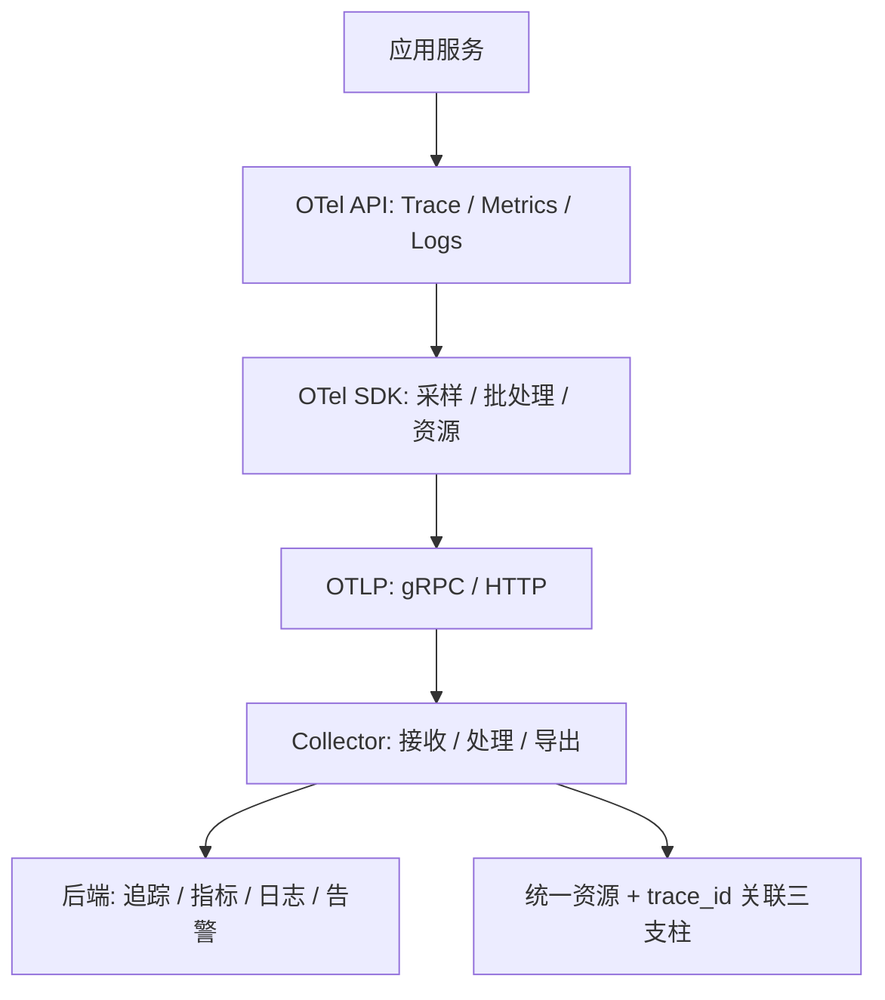
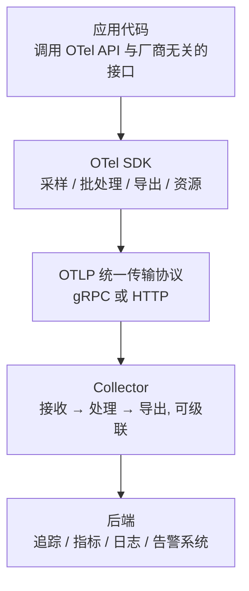

:::note 版本基线
文中默认值与行为以 **OpenTelemetry 1.x** 为准; 参数默认值核对对应官方文档（官方文档）, 实例化结论需以本机配置与指标实测为准.
:::

**主线一览**



本文面向需要把可观测性用对、用稳的后端与基础设施工程师, 聚焦统一采集层 OpenTelemetry. 阅读它不需要事先熟悉分布式理论, 但需要具备基本的网络、操作系统与 Go/Java 工程经验. 文档以“它解决什么问题、内部怎么实现、什么时候会失效、该怎么选”为主线, 尽量给出可以直接落地的判据, 而不是停留在名词解释. 末尾的选型与实践章节汇总了本系列 etcd、Kafka、groupcache、gRPC、Prometheus、Grafana 与 OpenTelemetry 各篇的结论.

## 一、OpenTelemetry: 统一的可观测性采集层

OpenTelemetry 解决的是“信号分散、厂商锁定、埋点重复”的问题: 它定义统一的 API、SDK 与传输协议, 把追踪、指标、日志三类信号用同一套资源与上下文模型采集并导出到任意后端.

### 1.1 信号与总体架构

三类信号——追踪 (traces)、指标 (metrics)、日志 (logs)——共享资源 (resource) 与上下文 (context) 概念. 整体分层:



API 与 SDK 分离是它的关键设计: 库作者只依赖 API, 应用在启动时装配 SDK, 因此“换后端”“关采样”“本地不上报”都不需要改业务代码. Collector 独立进程则把“如何接收、如何加工、发往哪里”从应用中剥离, 便于统一治理.

SDK 层面由几类对象组成: 追踪用 TracerProvider 管理 Tracer 与 span 处理器 (负责采样、批处理、导出), 指标用 MeterProvider 管理 Meter 与读取器 (周期性地把聚合结果交给导出器), 日志用 LoggerProvider 管理日志处理器; 三类 Provider 共享同一个 Resource, 因此同一进程产出的信号天然带相同的服务标识. 使用方在启动时装配 Provider (设置采样、导出端点、资源、批处理参数), 库作者只依赖 API 接口, 这就是“不换代码换后端”的实现方式. 进程退出前要正确关闭 Provider, flush 尚未导出的数据, 否则最后一批遥测可能丢失.

### 1.2 Trace 数据模型与上下文传播

一次追踪由 trace_id 标识, 包含若干 span. trace_id 是 128 位、span_id 是 64 位, 在一条追踪内唯一. 每个 span 至少记录: 操作名、起止时间、父 span、属性 (键值对)、事件与状态. span 之间的关系构成有向无环树, 根 span 表示整个请求.

上下文传播依赖标准化的头部, 最常用的是 W3C Trace Context: `traceparent` 携带 trace_id、span_id、采样标志与版本, `tracestate` 携带厂商扩展. 跨进程调用时由客户端注入、服务端提取, 从而把不同服务的 span 串成一条链. 除了 HTTP, 消息队列 (在消息头里注入上下文) 与 RPC 也有对应的传播方式, 否则异步链路的追踪会断裂.

资源 (resource) 描述“哪台进程、哪个服务、哪个版本”, 通常由一批语义约定属性构成, 例如服务名、服务版本、实例 ID、部署环境. 所有信号共享同一资源, 这是把指标、日志、追踪关联起来的基础.

### 1.3 采样策略

采样决定“哪些追踪被记录”, 直接影响成本与可观测性:

| 策略               | 决策时机              | 特点                                                               |
| ------------------ | --------------------- | ------------------------------------------------------------------ |
| 头部采样           | 追踪开始时            | 实现简单、开销低; 无法基于整条链的结果决策                         |
| 基于比率的头部采样 | 开始时按比例          | 如 1/1000, 适合高流量降噪                                          |
| 基于父级的头部采样 | 开始时继承父决策      | 保证同一条追踪在各服务采样一致                                     |
| 尾部采样           | 追踪结束后            | 可基于错误、延迟、业务标签决策; 需要缓冲完整追踪, 成本高、实现复杂 |
| 组合               | 头部降量 + 尾部精细化 | 生产常用: 头部按比例, 尾部保留错误与慢请求                         |

常见取向: 低流量全采; 中等流量按比例头部采样并让错误与慢请求强制保留; 高流量用尾部采样按策略取舍. 无论哪种策略, 都要保证采样标志在上下文中正确传播, 否则会出现“上游采了、下游没采”的断链.

采样决策随上下文传播有一个重要含义: 头部采样一旦在链路的第一个服务做出决定, 后续服务应继承而不是重新决定 (基于父级的策略), 否则同一条追踪可能在部分服务被记录、在另一部分被丢弃, 形成残缺的链路. 除追踪上下文外, 还可以传播跨服务共享的业务键值对 (如租户、渠道), 但要注意这类数据也会随请求头传递, 不应放入敏感信息.

指标信号通常不采样 (它们本身就是聚合值), 但可以用聚合视图或基数控制来降低成本; 日志一般全量采集, 靠采集端的过滤与丢弃策略控制量.

### 1.4 Collector 的 pipeline 与部署模式

Collector 的配置围绕 pipeline 组织: 接收器 (receiver) 读取数据, 处理器 (processor) 加工数据, 导出器 (exporter) 写出数据; 三者通过 pipeline 串起来, 不同信号有各自的 pipeline. 典型处理器包括批处理 (把多个请求合并以提升导出效率)、内存限流 (防止积压导致 OOM)、属性增删改、采样、过滤.

部署模式有两类, 常见的是二者组合:

- 边车/主机级 (agent): 每个节点或 Pod 部署, 负责本机数据的接收与初加工, 靠近数据源、故障域小.
- 集中式 (gateway): 接收 agent 汇聚的数据, 做统一采样、属性规范化与多后端分发, 减少 agent 配置复杂度.

组合模式的价值在于: agent 只做简单可靠的转发, gateway 承担需要全局视角的处理 (如尾部采样需要看到完整追踪). 但 gateway 会引入一跳网络与单点, 需要做多副本与背压设计.

### 1.5 三类信号的关联

关联是可观测性真正产生价值的地方:

- 指标到追踪: 在直方图的样本里记录 exemplar, 把延迟分位数上的具体请求与 trace_id 关联; 从大盘点开某个尖刺即可跳转到那条追踪.
- 日志到追踪: 日志结构中注入 trace_id 与 span_id, 日志系统据此提供“查看该请求的日志”.
- 追踪到日志/指标: 从 span 的属性出发, 查询同一时间窗内相关服务的日志与指标.
- 统一资源: 所有信号带相同的服务名与实例标识, 这是自动关联的前提.

实现关联要求埋点规范统一: 同一个 trace_id 必须能在日志、指标 exemplar 与追踪中一致出现, 因此“日志注入 trace 上下文”通常是落地时的第一优先级任务.

### 1.6 落地路径与常见问题

一个务实的落地顺序是: 先统一资源属性并把日志与追踪关联起来, 再接入自动埋点覆盖 HTTP、RPC、数据库调用, 最后才是自定义业务指标与告警. 自动埋点应覆盖尽可能多的框架边界, 手动埋点只补充框架看不到的业务阶段.

常见问题:

- 采样策略与后端查询能力不匹配: 采得太少导致问题难以复现, 采得太多导致成本失控. 应按“错误与慢请求全保留”的思路设计.
- 属性基数失控: 把用户 ID、URL 参数写进指标或 span 属性, 会迅速推高成本. 属性要按“值得聚合的维度”设计.
- 传播断链: 异步任务、消息队列、后台作业没有传递上下文, 导致追踪片段化.
- Collector 成为瓶颈: 缺少限流与批处理配置, 突发流量下 OOM 或丢弃数据.
- 只上追踪不做关联: 有了追踪却无法从指标或日志跳转过去, 排查效率提升有限.

### 1.7 与既有监控体系的衔接

OpenTelemetry 与 Prometheus 并不互斥: 可以用 OTel 指标 SDK 产生指标并通过导出器暴露或推送到 Prometheus 兼容后端, 也可以用 Collector 同时导出到指标、追踪、日志三类后端. 选择的关键在于团队是否愿意用一套 SDK 统一三类信号. 如果已经深度使用 Prometheus 生态, 通常的做法是“追踪走 OTel, 指标继续用 Prometheus 客户端库”, 并靠统一资源标签与服务发现把两者关联.

## 二、综合: 可观测性体系与中间件选型

本章汇总本系列各篇的结论: 表格覆盖 Kafka、etcd、Redis、groupcache、gRPC、Prometheus、Grafana 与 OpenTelemetry, 是从 etcd、Kafka、groupcache、gRPC、Prometheus 与 Grafana、OpenTelemetry 各篇提炼出的统一决策速查.

### 2.1 三支柱统一的可观测性体系

指标、追踪、日志各自回答不同问题: 指标回答“有没有问题、问题多大”, 追踪回答“问题发生在哪一跳”, 日志回答“这一跳具体发生了什么”. 统一体系的关键是三者可互相跳转.

```text
应用
  |-- 指标 SDK / 暴露端点   --> 采集器 --> 时序库 --> 大盘与告警
  |-- 追踪 SDK              --> Collector --> 追踪后端
  |-- 结构化日志 (带 trace_id) --> 日志采集 --> 日志后端
                                           |
             统一资源属性 + trace_id 关联这三条链路
```

落地分四步: 先统一资源标签与日志的追踪上下文; 再接入自动埋点覆盖框架边界; 然后搭建分层大盘与黄金指标告警; 最后持续做采样调优与基数治理. 跳过第一步会导致后面所有关联都做不起来, 是最常见的返工点.

### 2.2 消息与通知机制的选型

三种机制经常被混用, 但语义差别很大:

| 维度     | Kafka                  | etcd Watch                     | Redis Pub/Sub 与 Streams             |
| -------- | ---------------------- | ------------------------------ | ------------------------------------ |
| 定位     | 分布式消息日志         | 配置与元数据变更通知           | 轻量发布订阅与内存流                 |
| 持久化   | 磁盘持久化, 可回放     | 依托 MVCC, 可回放 (未压缩部分) | Pub/Sub 不持久; Streams 可持久       |
| 消费模型 | 消费组与位移管理       | 每个订阅者独立                 | Pub/Sub 广播; Streams 有消费组与确认 |
| 吞吐     | 很高, 水平扩展         | 中等, 受共识限制               | 高 (内存内)                          |
| 顺序     | 分区内有序             | 同键按 revision 有序           | Pub/Sub 无保证; Streams 按流有序     |
| 典型用途 | 事件流、日志、异步任务 | 配置变更、服务发现、选主       | 实时通知、轻量队列                   |

选择判据: 需要持久化、回放、多消费者与高吞吐, 用 Kafka; 需要强一致的少量元数据变更通知, 用 etcd Watch; 只要实时通知且允许丢失, 用 Pub/Sub; 需要消费组与确认但又想复用 Redis, 用 Streams. 用 Kafka 承载配置变更或选主会引入不必要的复杂度与延迟, 用 Pub/Sub 承载不能丢的订单事件则必然出事.

### 2.3 服务注册与发现

基于租约与 Watch 的方案已经在前文展开. 把它做成生产级组件还需要处理三件事:

- 客户端容错. 本地缓存最后一次成功的实例列表, 在注册中心不可用时仍能工作, 避免注册中心故障引发全站不可用.
- 双通道健康检查. 主动续租感知进程存活, 被动健康检查感知“进程活着但依赖不可用”, 两者结合才能正确摘除实例.
- 收敛速度与抖动控制. 租约 TTL、心跳间隔、摘除阈值要一起设计, 避免网络抖动造成实例反复上下线.

### 2.4 容量规划与故障演练

容量规划的方法论是: 先压测得到单节点/单集群的吞吐与延迟曲线, 确定瓶颈资源; 再按业务增长与峰值系数估算目标流量; 然后按分片/分区拆分到单节点并留出冗余; 最后用真实流量验证.

几类中间件的容量口径:

| 组件       | 主要资源口径                                             | 关键约束                         |
| ---------- | -------------------------------------------------------- | -------------------------------- |
| Kafka      | 磁盘 = 日消息量 × 消息大小 × 副本数 × 保留天数           | 分区数与文件句柄、恢复时间       |
| etcd       | 内存 ≈ 键数 × 平均键值大小 × 索引系数; 磁盘受配额约束    | 写吞吐受共识限制, 配额超限转只读 |
| Redis      | 内存 = 数据量 × 冗余系数, 向量场景另加图结构             | 单机内存上限与主从同步开销       |
| Prometheus | 磁盘 ≈ 活跃序列数 × 每秒样本数 × 保留秒数 × 每样本字节数 | 基数与抓取目标数                 |

故障演练按层级递进: 单点故障 (杀一个节点, 验证自动转移与数据不丢) → 网络故障 (分区、延迟、丢包, 验证超时重试与降级) → 集群级故障 (同故障域同时失效, 验证恢复与降级) → 依赖故障 (DNS、下游超时, 验证熔断与兜底). 演练要先提出可验证的假设, 再在测试环境小范围验证、生产低峰灰度、定期全量演练, 并保证每次都有复盘与修复闭环.

### 2.5 选型与实践建议

把前文的结论汇总成一份决策速查:

| 需求                     | 首选          | 备选           | 何时不选首选             |
| ------------------------ | ------------- | -------------- | ------------------------ |
| 强一致元数据、配置、选主 | etcd          | 专用协调服务   | 需要高写吞吐或大 value   |
| 事件流、日志、异步任务   | Kafka         | 云托管消息服务 | 团队无法承担集群运维     |
| 进程内只读缓存、抗热点   | groupcache    | 本地缓存库     | 需要写、需要 TTL         |
| 服务间同步调用、流式     | gRPC          | HTTP/JSON      | 浏览器直连、对外通用 API |
| 指标与告警               | Prometheus    | 托管监控       | 高基数明细分析           |
| 多源可视化与大盘         | Grafana       | 托管可视化     | 仅需极简图表             |
| 三类信号统一采集         | OpenTelemetry | 厂商 SDK       | 已深度绑定单一后端       |
| 在线向量检索             | Redis 向量    | 专用向量数据库 | 十亿级、需分布式扩展     |

几条贯穿全文的实践原则:

- 先明确语义再选组件. 需要“至少一次”还是“精确一次”、需要强一致还是最终一致、需要回放还是即发即弃, 这些决定了组件, 而不是反过来.
- 把可观测性当作功能的一部分. 没有指标、追踪与日志的服务上线即是盲区; 采集本身也要治理基数与成本.
- 用超时、重试、熔断、降级作为标准配置. 默认无超时、无上限重试是分布式系统故障扩散的主要来源.
- 容量与故障要提前演练. 分布式系统的正确性往往在部分失效时才暴露, 演练是唯一可靠的验证方式.
- 优先复用已有基础设施, 但不要把“已经有一个 Redis”当作所有问题的答案. 选型要看语义匹配度, 而不是部署成本.

---

**延伸阅读**

- [ClickHouse 技术手册](./clickhouse) 与 [Kafka 技术手册](./kafka): 列存分析、消息语义与实时数仓链路的完整落地.
- [Go RPC 框架原理](./yukino-rpc): 服务注册发现、负载均衡、超时重试与 gRPC 机制在工程框架中的封装.
- [Go 缓存库实践](./yukino-cache): singleflight、本地缓存与一致性哈希在应用侧的落地对照.
