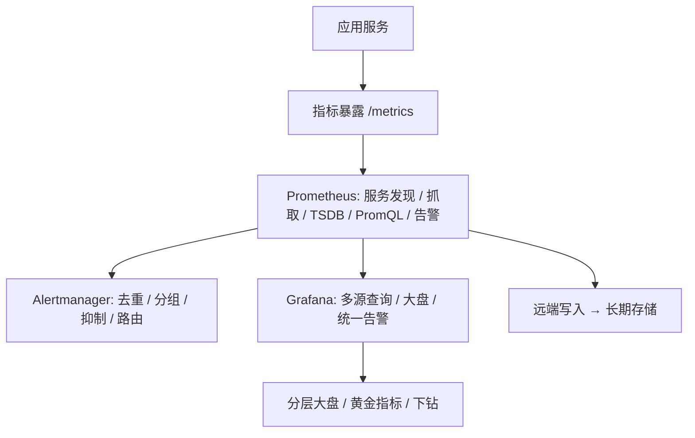
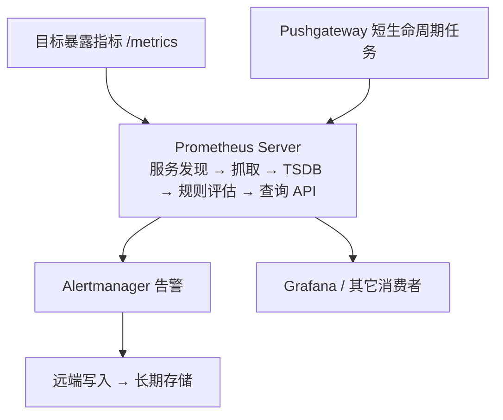

:::note 版本基线
文中默认值与行为以 **Prometheus 3.x** 与 Grafana 当前主版本为准; 参数默认值核对对应官方配置文档（官方文档）, 实例化结论需以本机配置与指标实测为准.
:::

**主线一览**



本文面向需要把监控与可视化用对、用稳的后端与基础设施工程师, 聚焦拉模型监控体系 Prometheus 与查询展示层 Grafana. 阅读它不需要事先熟悉分布式理论, 但需要具备基本的网络、操作系统与 Go/Java 工程经验. 文档以“它解决什么问题、内部怎么实现、什么时候会失效、该怎么选”为主线, 尽量给出可以直接落地的判据, 而不是停留在名词解释.

## 一、Prometheus: 拉模型监控与告警

Prometheus 的核心是“多维时间序列 + 拉取采集 + 强大查询语言”. 它把指标作为一等公民, 用标签做维度, 用 PromQL 做聚合与速率计算, 配合 Alertmanager 完成告警闭环.

### 1.1 架构与数据流



三条主线值得记住: 抓取由服务端主动发起 (拉模型), 服务发现负责“该抓谁”, 规则评估既产生告警也产生预聚合的 recording 规则. 服务本身不感知被监控, 这与“注册中心推送”的模型有本质区别: 目标消失后它的序列随之出现陈旧标记并最终停止, 因此“目标整体不见了”可以用 `absent()` 类查询来告警.

### 1.2 指标模型与四种类型

Prometheus 的样本是“指标名 + 一组标签 = 值 + 时间戳”. 指标名描述“是什么”, 标签描述“哪一类”, 两者共同构成序列标识. 标签不是越多越好, 标签值的基数直接决定序列数量与存储成本.

| 类型      | 语义                             | 适用                       | 注意                                                |
| --------- | -------------------------------- | -------------------------- | --------------------------------------------------- |
| Counter   | 单调递增, 只在重启时归零         | 请求数、错误数、处理字节数 | 必须用 rate/increase 转换为速率, 不能直接比较原始值 |
| Gauge     | 可增可减的瞬时值                 | 内存、连接数、队列长度     | 可直接做算术与阈值判断                              |
| Histogram | 分桶计数 + 总和 + 计数           | 延迟、大小分布             | 可聚合、可分位数近似; 分桶边界要按业务延迟范围设计  |
| Summary   | 客户端计算的分位数 + 总和 + 计数 | 单实例精确分位数           | 分位数不可跨实例聚合, 且计算成本在客户端            |

延迟监控优先选择 Histogram: 它的桶可以跨实例求和后再求分位数, 适合“全局 P99”; Summary 的分位数在客户端计算, 跨实例求平均没有意义. 代价是 Histogram 需要预先设计桶边界, 边界不合理会导致分位数失真.

每个被抓取的目标都有一个自动生成的 `up` 序列, 取值 1 表示本次抓取成功、0 表示失败. 抓取失败时 `up=0` 仍会持续写入; 只有当目标从服务发现中移除 (真正下线) 后, Prometheus 才会给它的序列打上陈旧标记, 使其不再出现在查询结果中, 这就是“实例下线后 `up` 也跟着消失”的原因, 也是用 `absent()` 判断“整个目标不见了”的依据. `up` 本身既是可用性指标, 也是最常用的抓取健康度信号.

### 1.3 PromQL 的核心查询模式

PromQL 以“选择器 + 范围 + 聚合 + 函数”组合出查询. 几个高频模式:

```text
rate(http_requests_total[5m])                          # 每秒请求速率
histogram_quantile(0.99,                                # 从桶近似 P99
  sum by (le, service) (rate(http_request_duration_bucket[5m])))
sum(rate(http_requests_total{status=~"5.."}[5m]))       # 错误率分子
  / sum(rate(http_requests_total[5m]))
predict_linear(node_filesystem_avail_bytes[1h], 4*3600) < 0   # 磁盘耗尽预测
absent(up{job="svc"} == 1)                              # 整个目标消失
```

理解速率计算有一个关键点: `rate` 需要至少两个样本才能工作, 窗口长度应远大于抓取间隔 (经验上是 4 倍以上), 否则会因样本不足产生空洞. 直方图的 `_bucket` 序列带一个 `le` 标签, 求分位数前必须先按 `le` 与其它维度聚合, 缺了 `by (le)` 会得到无意义的结果.

### 1.4 服务发现与 relabel

抓取目标不写死在配置里, 而是由服务发现机制动态生成候选目标, 每个候选带一组元数据标签 (以 `__meta_` 开头). 候选经过 relabel 过滤与重写, 得到最终目标, 抓取后还可以用 metric relabel 丢弃不需要的指标.

```yaml
scrape_configs:
  - job_name: kubernetes-pods
    kubernetes_sd_configs:
      - role: pod
    relabel_configs:
      - action: keep # 只保留带抓取注解的 Pod
        source_labels: [__meta_kubernetes_pod_annotation_prometheus_io_scrape]
        regex: "true"
      - action: replace # 用注解覆盖抓取端口
        source_labels:
          [__address__, __meta_kubernetes_pod_annotation_prometheus_io_port]
        regex: ([^:]+)(?::\d+)?;(\d+)
        replacement: $1:$2
        target_label: __address__
      - action: labelmap # 把 Pod 标签映射成业务标签
        regex: __meta_kubernetes_pod_label_(.+)
```

常见服务发现机制与它们的来源:

| 机制          | 来源                                        | 典型元数据                     |
| ------------- | ------------------------------------------- | ------------------------------ |
| static        | 配置文件写死                                | 无                             |
| kubernetes_sd | API Server 的 Pod/Service/Node/Endpoints 等 | 名称、命名空间、标签、容器端口 |
| consul_sd     | Consul 目录                                 | 地址、标签、健康状态           |
| dns_sd        | SRV/A/AAAA 记录                             | DNS 名、端口                   |
| file_sd       | JSON/YAML 文件, 支持热更新                  | 自定义标签                     |

relabel 是拉模型里最容易被低估的部分: 它既决定了抓什么 (过滤无关目标)、怎么抓 (改写地址与协议), 也决定了落库的标签维度 (labelmap 与 labeldrop), 因此也是控制基数的第一道闸门.

### 1.5 存储引擎

TSDB 的写入路径是: 样本先追加到预写日志 (WAL) 保证崩溃可恢复, 同时写入内存中的 head 块; head 块覆盖最近约三小时的样本, 每两小时切分并落盘为一个不可变的持久块; 持久块之间再按倍数 (通常每次扩大为原来的数倍) 合并成更大的块, 直到达到单块时长上限. 上限由保留时间决定——取“31 天”与“保留时间的十分之一”中的较小值, 因此保留越短, 单块越小.

时间戳序列用 delta-of-delta 编码 (相邻间隔的变化量大多为零或很小), 值与浮点数用 XOR 编码, 两者配合把每个样本压缩到很小的字节数. 理解压缩的意义在于估算存储: 容量 ≈ 活跃序列数 × 每秒样本数 × 保留秒数 × 每样本字节数 × 冗余系数, 再考虑索引与压缩波动.

高可用与长期存储的两个方向: 一是本地多副本加远端写入, 把数据复制到长期后端 (Thanos、Mimir、VictoriaMetrics 等) 并支持全局查询; 二是用 Prometheus 做采集与短保留, 长期查询完全交给远端. 单机 Prometheus 不做副本间一致性保证, 跨实例查询的重复与冲突要靠长期后端解决.

### 1.6 告警与 Alertmanager

告警规则在 Prometheus 中定义 (表达式 + for 持续时间 + 标签与注解), 状态机为: 不活跃 → 待定 (满足条件但未到 for 时长) → 触发; 条件恢复后进入已解决. `for` 是抑制抖动的重要手段, 但没有 `for` 的规则会因瞬时尖刺频繁告警.

Alertmanager 负责去重、分组、抑制、静默与路由:

| 环节   | 作用                                                      |
| ------ | --------------------------------------------------------- |
| 路由   | 按标签匹配路由树, 决定通知发给哪个接收者                  |
| 分组   | 把同一故障相关的多条告警合并成一条通知, 避免告警风暴      |
| 抑制   | 高级别告警抑制低级别告警 (如整机宕机抑制其上所有服务告警) |
| 静默   | 按标签与时间窗临时屏蔽通知, 用于维护窗口                  |
| 接收者 | 邮件、即时通讯、电话、Webhook 等通道                      |

告警与预聚合使用同一套规则语法, 区别只在是否带告警注解:

```yaml
groups:
  - name: service.rules
    rules:
      - record: job:request_error_ratio:5m
        expr: sum by (job) (rate(http_requests_total{status=~"5.."}[5m]))
          / sum by (job) (rate(http_requests_total[5m]))
      - alert: HighErrorRatio
        expr: job:request_error_ratio:5m > 0.05
        for: 10m
        labels:
          severity: warning
        annotations:
          summary: "{{ $labels.job }} 错误率超过 5%"
```

recording 规则把高频查询变成低基数序列, 既加速大盘也降低查询成本; 告警规则通常建立在 recording 结果之上, 避免在告警表达式里重复复杂计算.

生产经验: 告警要面向“需要人采取行动的故障”, 而不是所有异常; 每条告警都应有明确的处置手册; 同一根因的告警要做分组与抑制, 否则会迅速耗尽值班人员的注意力.

### 1.7 高基数治理

:::warning{title="高基数爆炸: Prometheus 头号稳定性杀手"}
基数爆炸是 Prometheus 最常见的成本与稳定性问题, 治理手段按优先级排列:
:::

- 在设计阶段就避免无界标签: 用户 ID、请求 ID、订单号、完整 URL 路径都不能做标签值.
- 用 relabel 与 metric relabel 在入库前丢弃或改写高基数标签, 把路径参数归一化 (如把 /users/123 归成 /users/:id).
- 用 recording 规则做预聚合, 把细粒度序列定期聚合成低基数序列供大盘与告警使用.
- 对确实需要的高基数分析, 改用支持列式存储与采样追踪的系统, 而不是硬扛在 Prometheus 里.
- 监控自身: 关注活跃序列数、每秒样本数、抓取时长与目标数量, 把“指标系统的指标”作为一等公民.

### 1.8 适用边界

Prometheus 适合: 指标监控与告警、容器与微服务的动态发现、需要灵活多维聚合的场景、作为 SLO 计算的数据源. 它不适合: 事件与日志的全文检索 (用日志系统)、高基数明细分析 (用列式存储)、账单级精确计数 (采样与抓取丢失会造成误差)、作为长期归档的唯一副本 (应配合远端长期存储).

## 二、Grafana: 可视化与统一告警

Grafana 是查询与展示层: 它不存储业务指标, 而是把各类数据源的查询结果组织成面板、大盘与告警, 并提供统一的访问控制与协作能力.

### 2.1 架构与插件体系

Grafana 是前后端分离的 Go 服务加浏览器前端, 元数据 (大盘、用户、告警规则、数据源) 存储在关系型数据库或嵌入式数据库中. 三类插件构成扩展体系:

| 插件类型 | 职责                             | 例子                            |
| -------- | -------------------------------- | ------------------------------- |
| 数据源   | 把统一查询接口翻译成具体后端查询 | Prometheus、SQL、日志与追踪系统 |
| 面板     | 把数据渲染成图表、表格、状态等   | 时序图、统计、热力图            |
| 应用     | 打包数据源、面板、页面与后端逻辑 | 专项监控套件                    |

后端插件作为独立子进程运行, 主进程基于 HashiCorp go-plugin 通过 gRPC 与其通信, 数据以列式格式在前后端之间流动, 这让不同结构的数据源能在同一套面板里呈现.

### 2.2 查询与渲染流程

打开大盘时, 前端解析大盘模型, 替换模板变量, 向数据源代理发送统一查询请求; 数据源插件把查询翻译成后端查询并执行, 把结果转成统一的列式结构返回, 前端据此渲染面板. 理解这条链路有助于排查“面板空白”: 可能是变量取值错误、查询语法不兼容、数据源权限不足或时间范围不对, 而不是渲染问题.

模板变量是把大盘从“一张图”变成“可复用工具”的关键: 可以在指标标签、查询语句、面板标题与链接中使用变量, 从而在同一张大盘上切换服务、实例、环境. 变量的取值方式分为查询型、自定义型、常量型与基于其它变量的级联型:

| 类型     | 取值来源                   | 典型用法             |
| -------- | -------------------------- | -------------------- |
| 查询型   | 从数据源查询标签值         | 服务名、实例地址     |
| 自定义型 | 手工枚举或用逗号分隔的列表 | 环境、区域           |
| 常量型   | 隐藏的固定值               | 数据源名、固定阈值   |
| 级联型   | 取值依赖另一个变量的当前值 | 选定服务后再选其实例 |

变量配合“全部”选项可以实现“默认看全局、下钻看单个实例”的体验, 但要注意“全部”会在查询中展开为多值, 若指标基数高会显著提高查询成本.

### 2.3 统一告警

Grafana 的统一告警把告警规则、评估与通知统一到一处, 支持跨数据源查询, 并用表达式流水线加工结果:

```text
查询节点 (Query) -> 归约 (Reduce) -> 数学运算 (Math) -> 阈值判断 (Threshold)
```

- 查询节点从数据源取原始数据.
- 归约把区间数据压成单值 (如取最大值、平均值、最后一个值).
- 数学节点做多查询间的算术, 例如错误率.
- 阈值节点判定是否满足条件, 配合“持续时间” (类似 for) 避免抖动.

告警进入统一状态机后由通知策略路由到联系点, 支持分组、静默与静默时段 (mute timings), 语义与 Alertmanager 类似.

### 2.4 生产级大盘设计

大盘的组织原则是分层与可下钻, 而不是把所有图堆在一页:

| 层级   | 内容                                | 目的               |
| ------ | ----------------------------------- | ------------------ |
| 概览层 | 流量、延迟、错误、饱和度 (黄金指标) | 一眼判断“是否正常” |
| 服务层 | 单服务的依赖、实例、关键业务指标    | 定位到具体服务     |
| 组件层 | 数据库、缓存、消息队列、主机资源    | 继续下钻到根因     |

实践要点:

- 图表标题写清指标含义与单位, 而不是依赖标签名.
- 用阈值标注 SLA 线, 让“是否达标”不靠眼力.
- 用注解 (annotation) 标记发布、扩容、故障事件, 把指标变化与变更关联起来.
- 大盘即代码: 通过配置文件声明数据源与大盘, 纳入版本管理与发布流程, 避免手工改动无法追溯.
- 控制单页图的密度, 把高频排查路径放在最上方.

### 2.5 适用边界

Grafana 适合: 统一查询与可视化多数据源、对外/对内交付监控大盘、基于指标的告警编排. 它不适合: 作为唯一的数据存储 (它不持久化业务数据)、需要复杂交互式探索的临时分析 (专业分析工具更合适)、在没有数据源与指标治理的前提下“一键出好看大盘”.
