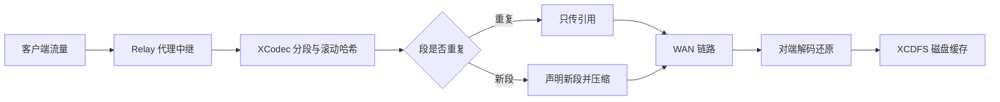

:::note 事实基线
本文依据 `$HOME/github/wanproxy` 在 `62975591df24` 的源码事实撰写；文中的路径、常量与 API 名称均可在该检出中定位。
:::

**主线一览**



:::tip 读图要点
XCodec 把流切成 **2048 字节段**, 命中缓存时只传引用、未命中才声明新段并 zlib 压缩; <u>去重收益</u>取决于数据的重复度, 镜像与增量备份最明显。
:::

WANProxy 是一个 WAN 优化代理的 Go 移植工作区, 移植对象是同名的 C++ 原版。核心能力是 XCodec 去重编解码: 把数据流拆成 2048 字节的段, 用滚动哈希识别重复段, 在 WAN 链路上只传输引用与新段声明, 再叠加 zlib 压缩, 使重复数据 (虚拟机镜像、日志流、增量备份) 的跨链路传输量收敛到引用级别。当前 Go 工程零第三方运行时依赖、自成体系, C++ 线格式仅作为算法与 golden 向量的参照。工作区包含三个可构建部分: `wanproxy.go/` 是纯标准库的 Go 库与五个命令行程序 (守护进程、tack、xcdump、fwdproxy、diskdup), `srv.go/` 是基于 [yukino_http](./yukino-http) 的演示服务端, 负责拉起一支 10 个代理的演示舰队并提供文件/基准/A/B 实验 API, `web/` 是 React + TailwindCSS 仪表盘。本文面向想理解 WAN 优化代理内部机制、或需要一个可验证正确性的 Go 代理库的工程师, 依次讲解工作区布局、XCodec 编解码、管道协议会话、缓存体系、SSH 传输、代理中继与 UDP 转发、纯 JSON 配置与 Schema 校验、监控与日志、命令行工具、一致性证据, 最后是演示栈的编排与 API。

## 工作区布局与构建

仓库是一个 Go workspace, `go.work` 声明 `go 1.26.0` 并 `use` 两个模块 (`./srv.go` 与 `./wanproxy.go`)。根 Makefile 的所有目标都转发给跨平台编排器 `go run ./srv.go/cmd/stack`, 端口用变量注入 (`SRV_PORT=3101`、`WEB_PORT=5173`、`MONITOR_PORT=9901`、`SSH_ECHO_PORT=8349`, 经 `--srv-port`/`--web-port`/`--monitor-port`/`--ssh-echo-port` 传入):

| 目标                                                  | 作用                                       |
| ----------------------------------------------------- | ------------------------------------------ |
| `make dev` (默认)                                     | 后端 + web 前台运行, Ctrl-C 同时停止       |
| `make srv` / `make web`                               | 只跑后端 / 只跑前端                        |
| `make start` / `stop` / `restart` / `status` / `logs` | 后台运行 (pidfile 与日志在 `srv.go/data/`) |
| `make install`                                        | 安装 web 依赖并构建 Go 后端                |
| `make build` / `build-go` / `build-web`               | 构建                                       |
| `make test` / `test-go` / `test-web`                  | Go 测试/vet + web 构建/lint                |
| `make open` / `clean` / `help`                        | 打开浏览器 / 清理构建产物 / 列出所有目标   |

| 目录           | 内容                                                                                                                                                                                                                                                                                                                                             |
| -------------- | ------------------------------------------------------------------------------------------------------------------------------------------------------------------------------------------------------------------------------------------------------------------------------------------------------------------------------------------------ |
| `wanproxy.go/` | Go 移植本体: xcodec、ssh、pipeline、proxy、config、monitor、validation、common 包与 `cmd/{wanproxy,tack,xcdump,fwdproxy,diskdup}` 五个程序, 外加 `e2e/`、`examples/` (5 份 JSON 示例)、`config/schema.json`、`wanproxy.example.json` 与自己的 Makefile (`build` 产出 `bin/` 下五个二进制, 另有 `test`/`race`/`vet`/`fmt`/`e2e`/`schema`/`clean`) |
| `srv.go/`      | 演示服务端模块: `cmd/{server,wanbench,stack}` 与 `internal/{daemon,files,monitor,bench,benchsvc,payload,tools,server,paths}`, `demo/wanproxy.example.json` 演示配置模板, 运行时状态落在 `data/`                                                                                                                                                  |
| `web/`         | React 仪表盘 (页面、shadcn 组件、主题)                                                                                                                                                                                                                                                                                                           |

`wanproxy.go` 的模块路径是 `github.com/hangtiancheng/wanproxy/wanproxy.go`, `go.mod` 没有任何 `require`, 全部实现基于标准库 (`net`、`net/netip`、`compress/zlib`、`net/http`、`crypto/*`、`encoding/json`、`encoding/binary`、`reflect`、`log/slog`)。`srv.go` 模块 `github.com/hangtiancheng/wanproxy/srv.go` 用 `replace` 指向相邻的 `../wanproxy.go`, 并依赖 `github.com/hangtiancheng/yukino.go/libs/yukino_http v0.0.1`。

## wanproxy.go 模块结构

包与职责:

```text
xcodec/       滚动哈希、编码器/解码器、回引用窗口、内存/配对/空缓存、
              XCDFS 磁盘缓存、流帧编解码、管道协议会话、流式读写器
ssh/          SSH-2 传输层: 版本交换、KEXINIT 协商、DH 组交换、
              RFC 4253 密钥派生、二进制包、ssh-rsa 主机密钥、应用帧
pipeline/     编解码规格 (CodecSpec)、模式/角色/方向步骤解析、zlib 封装、字节计数器
proxy/        TCP-TCP 监听器、SOCKS4/5 代理、双向中继与半关闭、flowQueue、
              fleet、UDP 会话转发与 status 快照
config/       纯 JSON 配置加载、命名资源解析、磁盘句柄生命周期、Schema 与夹具
monitor/      HTTP 监控: HTML /、逐对象 /object/<name>、文本 /:text、JSON /status
validation/   大文件 XCodec 往返校验 (SHA-256)
common/       C++ 风格组件路径的分级日志掩码 (slog 之上)
cmd/wanproxy  守护进程: wanproxy [-q | -v] -c configfile (JSON)
cmd/xcdump    XCodec 流解码与美化打印: xcdump [-v] [file ...]
cmd/tack      面向文件的字典压缩: tack [-p cache | -F fifo-cache | -N] [-svQ] [-T [-ES]] {-c|-d|-h} [file ...]
cmd/fwdproxy  JSON 驱动的纯端口转发: fwdproxy [-q | -v] -c configfile
cmd/diskdup   块级最小写入卷复制: diskdup [-s block_size] source target
```

## XCodec 去重编解码

XCodec 把数据流变成三类元素的混合: 对已见段的哈希引用、对新段的带内声明、以及转义后的字面数据。转义字节 (Magic) 为 `0xf1`, 段长固定 2048 字节, 四种流帧:

| 帧          | 线上格式                  | 语义                                       |
| ----------- | ------------------------- | ------------------------------------------ |
| `<ESCAPE>`  | `f1 00`                   | 输出一个字面 `0xf1` 字节                   |
| `<EXTRACT>` | `f1 01` + 2048 字节       | 带内声明新段: 哈希后进入输出流与回引用窗口 |
| `<REF>`     | `f1 02` + uint64 大端哈希 | 按哈希引用已声明的段                       |
| `<BACKREF>` | `f1 03` + uint8 下标      | 按回引用窗口位置引用段                     |

### 滚动哈希

`Hash` 对恰好 2048 字节的窗口做内容哈希, 由两个 32 位回绕累加器组成: `bytes` 累加每字节的 word 值 (`ch + 1`), `bits` 累加 `ffs(ch)` (最低置位位的 1 起始下标, 零字节为 0), 两张 256 项查找表在 init 时预计算。窗口满后可用 `Roll` 逐字节前滚: 从 `sum1` 减去被淘汰字节的 word、从 `sum2` 减去 `dead * SegmentLength`, 再加入新字节。`Mix()` 把内部状态压缩成 64 位摘要: `bitsHash = uint32((bits.sum1 << 16) + bits.sum2)`, `bytesHash = uint32((bytes.sum1 << 20) + bytes.sum2)`, 结果为 `(bitsHash << 36) + bytesHash`。`Add`/`Roll`/`Mix` 在窗口状态不对时 panic (镜像 C++ 断言), `HashSegment` 要求输入恰好 2048 字节。摘要与 C++ `XCodecHash` 逐字节一致 —— `hash_test.go` 运行 C++ `xcodec-hash1` 的已知答案向量 (`kat_vectors_test.go` 的 256 个单字节填充段摘要) 以及 roll 与重算的一致性检查。

### 编码器

`Encoder` 除缓存与回引用窗口外不保留跨调用状态, 因此可以任意分块喂入流。`EncodeWithReferences` 的主循环: 用滚动哈希覆盖每个 2048 字节窗口, 若缓存命中且内容逐字节相等 (哈希冲突时跳过且不记候选), 先转义输出引用之前的间隙, 再输出引用, 然后在引用段之后重启哈希; 未命中则记为候选, 候选与后续窗口不重叠时被声明。声明行为取决于缓存是否带外: 带内缓存 (内存/磁盘) 输出 `<EXTRACT>` 并进入窗口, 带外缓存 (如 tack 的 `-N`/`-p`) 直接输出 `<REF>`。字面数据经 `appendEscaped` 复制, 每个 `0xf1` 后补一个 `0x00`。最坏情况下编码把数据翻倍, 这正是管道协议把帧上限设为载荷上限两倍的依据。

`WithBackrefs()` 选项允许编码器对仍在回引用窗口中的段输出 `<BACKREF>` (3 字节代替 10 字节); C++ 编码器从不发出 backref, 因此默认关闭。编码同时返回 refmap (哈希 → 段), 管道协议靠它在对端 `<ADVANCE>` 之前应答 `<ASK>`。

### 解码器

`Decoder.Decode(chunk)` 追加缓冲并尽可能消费: 魔法字节之前都是字面数据; `<ESCAPE>` 还原一个 `0xf1`; `<EXTRACT>` 计算段哈希, 缓存已有不同内容时 `Replace` (带内缓存的名字复用), 否则 `Enter`, 并声明进窗口; `<REF>` 查缓存, 命中即输出并声明进窗口, 未命中则停下, 用 `skim` 不消费地扫描缓冲余部, 收集所有既不在缓存也不被余下 `<EXTRACT>` 定义的哈希 (排序后随 `DecodeResult.Unknown` 返回), 调用方把段喂进缓存 (通常经由 `<LEARN>`) 后再次 `Decode` 即可从断点恢复。`skim` 会把最初阻塞的那个哈希强制保留在未知集合里, 防止共享缓存的并发插入让解码器在没发出 `<ASK>` 的情况下停摆。`<BACKREF>` 窗口缺失、未知操作码返回错误; `outputLimit` 非零时限制单次接收的展开量 (会话置为 16 MiB), 超限返回 `ErrSessionLimit`。`Finish()` 在仍有缓冲时返回 `ErrIncompleteStream`。

### 回引用窗口与缓存体系

`Window` 是 `WindowCount = 256` 槽循环表, `Declare` 在游标处插入并驱逐旧槽、清除同哈希的旧条目, `Present` 可校验段内容, `Dereference` 按下标取段。

`Cache` 接口是编码/解码器的段存储抽象 (`Lookup`/`Enter`/`Replace`/`Touch`/`Has`/`Size`/`OutOfBand`/`Connect`/`ID`), 要求并发安全, 段视为不可变:

| 实现          | 行为                                                                                                                                                                                                                                                        |
| ------------- | ----------------------------------------------------------------------------------------------------------------------------------------------------------------------------------------------------------------------------------------------------------- |
| `MemoryCache` | 内存 LRU (`container/list`), 限额以段数计 (`WithSegmentLimit`); `NewMemoryCacheWithBytes` 按 `字节数 / 2048` 折算, 非零小额至少 1 段; 未指定 `WithCacheID` 时用 `crypto/rand` 生成 16 字节身份; `Connect(id)` 为每个对端派生同限额的兄弟缓存 (children map) |
| `PairCache`   | 主缓存叠次缓存: 写双层, 查先主后次, 次级命中提升到主级, 主级命中时 `Touch` 次级刷新淘汰状态; 身份继承次级 (更持久的一方), `OutOfBand` 取主级                                                                                                                |
| `NullCache`   | 什么都不存, 带外语义, 供 tack `-N` 使用 (解码端被假定与编码端共享先验知识)                                                                                                                                                                                  |

`CacheID` 是 16 字节身份, 在管道协议 `<HELLO>` 中交换, 对应 C++ 的 UUID。

## 管道协议会话

会话帧格式 (对应 C++ `xcodec_pipe_protocol.h`):

| 帧                    | 操作码          | 载荷                                               |
| --------------------- | --------------- | -------------------------------------------------- |
| `<HELLO>`             | `0xff`          | uint8 长度 + 16 字节缓存身份, 必须出现在编码流开头 |
| `<FRAME>`             | `0x02`          | uint32 长度 + 编码块                               |
| `<ASK>`               | `0xf0`          | uint16 数量 + 哈希列表, 请求段数据                 |
| `<LEARN>`             | `0xf1`          | uint16 数量 + 整段数据, 应答 `<ASK>`               |
| `<ADVANCE>`           | `0x01`          | uint32 帧数, 对端已消费、无需再保留这些帧的引用    |
| `<EOS>` / `<EOS_ACK>` | `0xfc` / `0xfb` | 无更多数据 / 全部数据已处理                        |

协议常数: 最大帧 `PipeMaxFrame = 1 MiB`, 单帧最大明文 `PipeMaxPayloadFrame = 512 KiB` (编码至多翻倍, 帧自包含), 每个 `<ASK>`/`<LEARN>` 至多 `PipeAskMax = 512` 个哈希, HELLO 身份固定 `PipeHelloIDLength = 16` 字节。`ReadPipeFrame` 对长度为零/超限、计数为零/超限、未知操作码一律返回 Invalid。

`Session` 是会话的一端 (对应 C++ `XCodecPipePair`), 双向: `EncodeData`/`CloseWrite` 产生本端发送的线上字节, `Receive` 消费对端字节并返回解码明文、要回写的协议响应与流结束信号。一个编码 goroutine 与一个解码 goroutine 可并发使用。

编码半边: 首次使用时先发 `<HELLO>`。`<HELLO>` 里通告的身份是缓存的 UUID, 跨连接稳定 —— 重连的对端复用之前连接的解码缓存, 引用无需重新 `<ASK>`/`<LEARN>`。明文按 512 KiB 切块, 每块编码成一个 `<FRAME>`; 每帧的 refmap 与明文大小记入 `refFrames` 并累计 `inFlightBytes`。窗口默认 `defaultInFlightBytes = 8 MiB` (字节限额可由 `WithInFlightLimit` 调整), 未确认帧数上限固定 `maxInFlightFrames = 256`; 单次调用超出窗口直接 `ErrSessionLimit`, 窗口满返回 `ErrBackpressure` 且输入不被消费; `EncodeDataContext` 在不持锁的情况下等待 `<ADVANCE>` (每次 ADVANCE 关闭 `advanced` channel 并重建) 或 ctx 取消。`CloseWrite` 产生 `<EOS>`。

解码半边: `Receive` 先把字节追加进 `decBuffer` (上限 `maxReceiveBytes = 16 MiB`), 循环解析控制帧, 再解码已帧化的数据。`<HELLO>` 用对端身份 `Connect` 出专属解码缓存视图, 外包一层 `learnedCache` 把 ASK 应答钉住, 与共享缓存的淘汰解耦, 保证解码前进。`<ASK>` 从保留的 refFrames 里逐哈希找段 (找不到即协议错误), 组装 `<LEARN>` 回写; `<LEARN>` 要求每个段都对应一个未决 ASK (拒绝 C++ 所称的 gratuitous LEARN), 冗余 LEARN (缓存已有相同数据) 保持原样, 名字复用则 `Replace`; 全部未知哈希解决且解码缓冲排空后清空钉住的段。`<ADVANCE>` 按计数释放 refFrames、归还 in-flight 窗口, 计数超过保留帧数是错误。解码产生的 `<ASK>` 按 512 个一组排序发出。

结束语义: 收到 `<EOS>` 且对端所发全部处理完毕后回 `<EOS_ACK>` 并置 `OutputEOF` (调用方应半关闭下游写向); 双向都确认后 `Done` 一次性置位, 此后再收到数据是错误。`HasPending`/`FinishReceive` 用同一组条件判断传输 EOF 时是否丢了数据 (未解析控制字节、未解码帧、被未知哈希阻塞的解码器)。协议违例全部拒绝: 二次 `<HELLO>`、解码器初始化前收到帧、`<EOS>` 后收到帧、`<HELLO>` 前收到 `<ASK>`/`<LEARN>`/`<ADVANCE>`/`<EOS>`、未发 `<EOS>` 或重复收到 `<EOS_ACK>`、`<EOS_ACK>` 时仍有未确认帧等。

`stream.go` 提供 `EncodeReader`/`DecodeReader` 两个 `io.Reader` 适配器: 以 512 KiB 的段对齐块编码 (块边界不会强迫转义), 源 EOF 时把尾部不足一块的数据编码掉; 解码端遇到未知引用或流尾残缺帧直接报错; 连续 100 次零字节且无错误的底层读触发 `io.ErrNoProgress`。

## XCDFS 磁盘缓存

`xcodec/xcdfs.go` 实现共享磁盘后端 (C++ `XCodecDisk`/`XCodecDiskCache`)。卷是 2048 字节块的文件或设备, 布局为 `[registry: 8 块][index: N 块][data: N*204 块]`, 多字节字段小端:

- registry: 1024 个 16 字节 UUID 槽 (每块 128 个), 把 XUID 映射到对端缓存命名空间; XUID 0 是本地身份, 卷上没有任何命名空间时生成随机 UUID 写入。
- index: 每块一个 uint64 单调计数器加 204 条 `(uint16 xuid, uint64 hash)` 条目, 描述其后按 FIFO 排列的数据块; 计数器为零表示空闲块。
- data: 每块存一个 2048 字节段。

`OpenDisk(path, size, log)` 按绝对路径 (符号链接先解析) 在全局 `diskMap` 中共享同一个 `Disk` 并计数引用; size 非零时普通文件被 truncate 到该值, 已存在且大小不符或打开中的卷不能resize; size 为零则取现有文件大小 (tack `-F` 的用法)。最小卷容量要能放下 registry + 1 个索引块 + 204 个数据块。加载序列与 C++ 构造一致: 读 registry (重复 XUID 记错误日志), 扫描索引块计数器确定 FIFO 顺序并定位写头 (第一个空闲块, 卷满时取最小计数器), 按计数器升序加载条目使每个哈希的最新版本获胜, 其中前 80 块与后 80 块逐条读数据块做哈希校验, 写头窗口内发现损坏就把写头重置回该块使其被重写; 最后回收没有条目的对端命名空间 (本地 XUID 除外)。

写入路径: `enter` 先写数据块, 把条目追加进内存中的在途索引块; 索引块写满 204 条才整块落盘, 然后写头前移 (回绕), 失效新写头将要重写的条目, 计数器递增 (跳过 0)。这与 C++ 一致 —— 在途索引块只在写满时落盘, 退出时最多丢 203 条, 是文档化的 "little consistency" 取舍。`lookup` 读块并复核哈希, 读失败或哈希不符即删除内存索引项。任何一次写失败都会置 `writeErr`, 之后的变更全部禁用。

`Connect(uuid)` 为对端分配 XUID 并写 registry; XUID 耗尽返回错误 (空的命名空间可能仍被活跃会话持有, 复用会串写), 而 `DiskCache.Connect` 在磁盘端失败时退回一个隔离的内存缓存, 让流以 ASK/LEARN 方式继续而不是失败。与 C++ 的两处重要差异: C++ `registry_write` 读第 N 块却写回第 0 块, 会损坏超过 128 个 XUID 的 registry, Go 版写到正确的块; 共享打开在发布前完成初始化并引用计数, 空命名空间在加载时回收, 而不是在 registry 满时复用活缓存句柄。

## SSH-2 传输层

`ssh/` 是 C++ SSH-2 传输层的移植, 供 SSH-SSH 代理与演示的 echo 端点使用。`Transport` 包装一条 `net.Conn`, `Handshake()` 后呈现解密后的应用字节流; 允许一个读 goroutine 与任意多个写 goroutine 并发 (写由 `wmu` 串行化)。

握手四步: (1) 版本交换 —— 写出识别串 (默认 `SSH-2.0-WANProxy Go`) 再逐字节读对端, 要求 `SSH-2.0` 前缀, 允许前面最多 `maxVersionLines = 255` 行前导, 单行不超过 8192 字节; (2) KEXINIT 交换与协商 —— 16 字节随机 cookie 加各类算法 name-list, 协商规则是客户端偏好顺序决定, 且选中的算法必须存在于本地注册表, 压缩只接受 `none`; (3) diffie-hellman-group-exchange —— 客户端请求 `[min=1024, n=1024, max=8192]`, 服务端像 C++ `USE_TEST_GROUP` 一样恒定回复硬编码的 1024 位测试素数 (生成元 2); 客户端校验收到的素数位宽在 1024..8192、生成元在 `(1, p-1)`; 私指数随机取 `[1, p-2]`, 双方都校验对端公钥在 `(1, p-1)` 且共享密钥不得退化 (`K <= 1` 拒绝); (4) NEWKEYS —— 发送自己的 NEWKEYS 并立即切换发送方向密钥, 然后持续读包直到对端 NEWKEYS, 期间对端提前发来的应用数据照常投递。

算法表 (顺序即本地偏好): 密钥交换 `diffie-hellman-group-exchange-sha256` 优于 `-sha1`; 主机密钥仅 `ssh-rsa` (SHA-1 + PKCS#1 v1.5 签名交换哈希); 加密 `aes128-ctr`、`aes128-cbc`、`aes192-ctr`、`aes192-cbc`、`aes256-ctr`、`aes256-cbc`、`3des-ctr`、`3des-cbc`、`arcfour`; MAC `hmac-sha1`、`hmac-sha2-256`、`hmac-sha2-512`、`hmac-md5`、`hmac-sha1-96`、`hmac-md5-96`。C++ 表里 Go 标准库没有的条目 (blowfish/cast128/idea、hmac-ripemd160) 被省略, 协商默认值 (aes128-ctr、hmac-sha1、dh-group-exchange-sha256) 与现代 OpenSSL 构建的 C++ 版一致。

密钥派生: 交换哈希 `H = hash(V_C || V_S || I_C || I_S || K_S || kexAccum || mpint(K))`, 其中 kexAccum 是组交换消息体 (`[min,n,max] || p || g || e || f`) 的线上编码拼接; 首个 H 即会话 ID; 共享密钥 K 以 mpint 线上编码参与派生; `KEY = HASH(K || H || letter || session_id)`, 不够长时用 `HASH(K || H || KEY_so_far)` 扩展; 字母 A/B、C/D、E/F 分别是客户端/服务端方向的 IV、加密密钥、MAC 密钥。

二进制包: `uint32 长度 + uint8 填充长 + payload + 随机填充`, 填充长为 `4 + (blockSize - ((4 + 1 + len(payload) + 4) % blockSize))`, 块大小取密码块长且至少 8; MAC 按 `seq(4 字节大端) || 明文包` 计算并截断到 MAC 尺寸, 然后加密包体、把 MAC 附在密文后; 接收端先解密首块读出长度, 校验 `packetLen >= 12` 且 `(packetLen+4)` 整除块长、不超过 `maxPacketSize = 4 MiB`, 用 `hmac.Equal` 验 MAC, 填充长必须在 `[4, len-5]`。C++ 原版没有包长上限, 这个上限防恶意对端耗尽内存。

应用帧: `Config.Tagged` 决定成帧方式, 与 C++ `SSHStream` 一致 —— 该跳有激活编解码时用 0xff 前缀包 (写方向按 32768 字节切块), 读方向剥掉前缀; 否则内部用 `[uint32 长度][数据]` 帧, 写方向跨调用缓冲不完整帧, 帧长必须在 `1..maxPacketSize-256`。握手完成后, 除 `DISCONNECT` (读端返回 EOF) 与 `IGNORE` 外的所有消息都按应用数据处理 —— 不做 C++ 那种按首字节分发, 避免未加标签流的首字节恰好是协议号时被破坏。`CloseWrite` 委托底层连接的半关闭。主机密钥 PEM 由 `LoadRSAPrivateKeyPEM` 加载, 接受 PKCS#1 `RSA PRIVATE KEY` 与 PKCS#8 `PRIVATE KEY` (仅限 RSA)。

与 C++ 的关键差异: C++ 代码从不发送第一个 NEWKEYS (源码里有两处 XXX 注释承认), 导致数据阶段不加密; Go 版按 RFC 在密钥交换后发送 NEWKEYS, C++ 的 NEWKEYS 处理器会回应并激活密钥, 因此双向互通。随机填充、畸形包对齐/超大应用帧/退化 DH 公值的拒绝都是移植中加入的。

## 管线组合与代理中继

### CodecSpec 与步骤解析

`pipeline.CodecSpec` 是一个激活的编解码实例: `Mode` (`none`/`zlib`/`xcodec`/`zlib+xcodec`)、`CompressorLevel` (-1 默认, 越界时 zlib 封装退回默认压缩)、`Cache` (含 XCodec 的模式必填)、`TrackStatistics`/`Stats`。库级 `ParseMode` 还接受 `None`/`XCodec` 与 `zlib-xcodec`/`zlibxcodec` 等别名, 但配置文件只接受 `schema.json` 枚举的四个小写值。`Role` (`incoming`/`outgoing`) 把编解码挂到代理的某一侧: `incoming` 是 peer 编解码 (WAN 侧在上游), `outgoing` 是 interface 编解码 (WAN 侧在监听端); `Direction` 中 `Send` 是监听→上游, `Receive` 是上游→监听。`ResolveSteps` 给出单向步骤序列, 规则是流向 WAN 的数据先编码后 deflate, 从 WAN 流入的先 inflate 后解码, 与 C++ `WANProxyCodecPipePair` 的接线一致。`CodecStats` 是四个 `atomic.Int64` 计数器 (`IncomingToCodec`/`CodecToOutgoing`/`OutgoingToCodec`/`CodecToIncoming`), 快照 JSON 键为 `incomingToCodecBytes` 等, 对应 C++ `track_statistics`。配置里编解码以命名对象存在, 代理用 `interfaceCodec`/`peerCodec` 字符串引用它们; 声明顺序无关, 引用按名字解析。

### Relay 的并发结构

`Relay` 在客户端 (interface 侧) 与上游 (peer 侧) 两条 `StreamConn` (`net.Conn` 或 SSH transport) 之间搬数据。两侧编解码都未配置时走纯转发: 两个 goroutine 各跑一个 `io.Copy`, EOF 后 `CloseWrite`, 让 `net.TCPConn` 使用平台优化拷贝路径。

有编解码时每方向三阶段、共六个 goroutine, 由四条有界 `flowQueue` (各 `relayQueueLimit = 16 MiB`) 连接:

```text
readSource(client)  --toUpstream-->  forward(encode=sessionP) --upstreamWire--> upstream
readSource(upstream) --toClient-->  forward(encode=sessionI) --clientWire----> client
                 即时响应(ASK/LEARN) -> controlsI/controlsP -> writeControls -> 同一 wireWriter
```

- `readSource` 独占一个 socket 的读侧, 每次读 32 KiB 喂给本侧会话的 `Receive`, 从不等待 socket 写。`splitResponses` 把响应拆开: `<ASK>`/`<LEARN>` 立即进控制队列, `<ADVANCE>`/`<EOS_ACK>` 挂在投递消息上、等明文转发之后再发 —— 这样被阻塞的 socket 写不会卡住必须处理控制帧才能解阻塞的读端。纯源 (无会话) 用 `pushContext`, 队列满时施加普通读背压而非失败连接。
- `forward` 独占一个应用方向: 计数明文字节, 需要编码时 `EncodeDataContext` (等待 ADVANCE 可被 ctx 取消唤醒), 写 `wireWriter`; EOF 时发 `<EOS>` (有会话) 或 `Close` (无), 最后把延迟响应推进控制队列。
- `writeControls` 消费控制队列写同一 `wireWriter`, `done` 时关闭写侧。

`flowQueue` 的数据队列把小读合并成 32 KiB 块 (防止碎片化把有界字节窗口变成百万级排队对象), 控制队列则保证一条控制帧永远是原子的单次线上写 —— 编码数据不能插进一条 `<LEARN>` 中间。

`wireWriter` 是朝一个对端的同步写侧, 承载编码数据帧与交叉回来的协议响应: 有压缩时每次写后 `Flush` (对应 C++ `DeflatePipe` 每次 consume 以 `Z_SYNC_FLUSH` 收尾, 数据立即上线), `Close` 收尾 deflate 并半关闭 socket; 关闭后的写返回 `errWireClosed`。`countingReader`/`countingWriter` 在最靠近 socket 的位置计原始字节, 镜像 C++ `PipeByteCount`。

四个字节计数器的落点: 客户端读计 interface 编解码的 `IncomingToCodec`, 上游读计 peer 编解码的 `OutgoingToCodec`; 客户端 wire 写计 interface 编解码的 `CodecToIncoming`, 上游 wire 写计 peer 编解码的 `CodecToOutgoing`; 两条 `forward` 在应用边界上分别计 interface 的 `CodecToOutgoing` + peer 的 `IncomingToCodec` (发送向) 与 peer 的 `CodecToIncoming` + interface 的 `OutgoingToCodec` (接收向)。演示服务就是用这套计数器算出每次传输的 wire/app 字节数。

半关闭与排空: 每方向先泵数据到源流逻辑结束, 再完成对侧写 (`<EOS>` 或 flush + `CloseWrite`), 最后把源 socket 读到 TCP EOF —— 交叉的控制帧因此总被处理, 正常关闭时最终帧不会变成 reset 丢数据。`RunContext` 用 `context.WithCancelCause` 管理: 取消会关闭两条 socket 中断阻塞的网络 I/O 并唤醒等待 ADVANCE 的编码器, 返回值是首个失败原因。

### 监听器、SOCKS 与 Fleet

`listenerState` 拥有 accept 循环、出站 dial 上下文与全部 socket: 注册与关停共享一把锁, `Stop` 取消 dial 上下文、关闭监听器与所有在册 socket、等待 handler 退出, 可重复并发调用; 还暴露 `Listening`/`Address`/`AcceptedConnections`/`ActiveSockets`。默认拨号是 `net.Dialer{Timeout: 30s, KeepAlive: 30s}`, 可用 `DialContext` 覆盖 (`Stop` 会取消其 ctx)。`Fleet` 统一管理 TCP、UDP 与 SOCKS 监听器 (`AddTCP`/`AddUDP`/`AddSocks`, `NewFleet`): `Start` 按 TCP→UDP→SOCKS 顺序启动, 失败时按注册逆序回滚已启动项; `Stop` 收集第一个错误; `Addresses` 汇总所有已绑定地址; `Status` 产出 `FleetStatus` (每个代理的 listening/accepted/active/编解码快照与 UDP 会话统计)。状态类型定义在 `proxy/status.go`: `TcpProxyStatus` (`kind` 为 `tcp` 或 `ssh`)、`SocksProxyStatus`、`UDPProxyStatus` (`kind: "udp"`), 三者通过 `FleetStatus.Proxies` 的异构数组输出。

`Listener` 是 TCP-TCP 代理 (C++ `ProxyListener` + `ProxyConnector`): accept 后 dial peer, 可选 SSH 握手, 然后 `NewRelay(...).Run()`。SSH 代理由 `SSHSettings{HostKey, HandshakeTimeout}` 启用: interface 跳跑 SSH 服务端传输、peer 跳跑 SSH 客户端传输, 两个握手在同一个 deadline (零值默认 15s) 下并发进行, 任一侧失败就关闭两条连接并等另一侧结束; 成帧规则与 C++ 相同 —— 某跳的编解码激活时该跳才用 0xff 加标签。配置层通过 `"type":"ssh"` 的 `hostKey` 字段显式提供 PEM (PKCS#1 RSA 或 PKCS#8), 没有隐式默认文件名。

`SocksListener` 服务 SOCKS4/SOCKS5 CONNECT: 协商有 15s 默认时限 (`HandshakeTimeout` 零值时); SOCKS5 方法协商要求包含 no-auth (0x00), 否则回 `05 ff`; SOCKS4 只接受命令 0x01, user id 以 NUL 结尾且不超过 1024 字节; SOCKS5 支持 IPv4/域名/IPv6 三种地址类型。成功响应只在目标拨号成功之后发送, SOCKS5 应答携带出站 socket 的真实绑定地址 (含正确的 IPv6 类型), 拨号失败按错误类型映射 SOCKS5 失败码 (ECONNREFUSED→5、ENETUNREACH→3、EHOSTUNREACH/DNS→4、超时→6、其余→1); `bufio` 可能多读的应用字节 (管道化数据) 对两种协议都保留并在建链后补发给上游。SOCKS4A、BIND 与 SOCKS5 UDP ASSOCIATE 不支持。

### UDP 转发

`proxy/udp.go` 实现固定目标的 UDP 转发, 与流中继完全独立: `UDPListener` 对 `Iface` 用 `net.ListenPacket` 绑定一个 `net.UDPConn`, 每个客户端 `netip.AddrPort` 分配一个专属的已连接上游 UDP socket, 因此回复不会串到别的客户端。数据报与回复保留各自边界, 空数据报同样是有效数据 (不会被当作 EOF); IPv4/IPv6 在两侧可各自独立选择 (`Endpoint.UDPNetwork()` 把 `ip`/`ipv4`/`ipv6` 映射为 `udp`/`udp4`/`udp6`, 拒绝 Unix 族)。

关键常数与默认值 (`proxy/udp.go`):

| 常数                    | 值         | 含义                                     |
| ----------------------- | ---------- | ---------------------------------------- |
| `DefaultUDPIdleTimeout` | `60s`      | 会话空闲超时 (零值取默认)                |
| `DefaultUDPMaxSessions` | `1024`     | 单监听器最大会话数 (零值取默认)          |
| `udpQueueSize`          | `16`       | 每会话出站数据报队列容量                 |
| `udpMaxDatagramSize`    | `65535`    | 收发缓冲与写缓冲预留 (一个完整 UDP 载荷) |
| `idleTimeoutSeconds`    | `1..86400` | 配置范围 (`seconds()` 校验)              |
| `maxSessions`           | `1..65536` | 配置范围                                 |

`Start` 用 `SetWriteBuffer(65535)` 预留足够容纳一个完整数据报的发送缓冲 (某些平台默认值更小); 启动 `receive` 与 `expire` 两个 worker, 每个新会话再起 `forward` 与 `replies` 两个 goroutine。任一方向的活动都刷新 `s.active`; `expire` 以 `min(IdleTimeout, 1s)` 为周期扫描, 空闲超过阈值的会话在一个额外扫描周期内 (至多一秒) 被回收, 包括仍在 pending dial 的会话。会话数达到上限、或某会话队列已满时, 新数据报被丢弃并计入 `DroppedDatagrams`; 单个客户端的慢拨号或满队列不会阻塞其他客户端。每条出站数据报通过 `SetWriteDeadline(IdleTimeout)` 限定, `replies` 用单个 `writeToken` 串行化共享写 deadline 的修改与写回, 同时允许被取消的会话退出等待。`Stop`/`shutdown` 取消所有会话、关闭全部 socket 并 `wg.Wait()` 汇合 worker, 可重复并发调用。

UDP 是固定目标转发: 不套用流编解码, 也不做 SSH 成帧; 配置层对 `"type":"udp"` 显式拒绝 `interfaceCodec`/`peerCodec`/`hostKey`/`handshakeTimeoutSeconds` 与 Unix 端点。`monitor` 报告 UDP 会话数、双向成功转发的数据报/字节数以及因准入或队列限制丢弃的数据报数。

## 配置系统

`config/` 只接受 JSON。配置顶层字段由 `fileConfig` 定义, 与 `config/schema.json` 一一对应:

| 字段      | 内容                                                                                                                      |
| --------- | ------------------------------------------------------------------------------------------------------------------------- |
| `$schema` | 可选, Draft 2020-12 Schema 的相对路径, 供编辑器补全/校验; 守护进程不抓取该 URI、运行时无 Schema 库依赖                    |
| `log`     | `level`: `debug`/`info`/`warn`/`error` (默认 `info`); `masks`: 有序 `{regex, level}` 列表, 首匹配生效, 之后由默认级别兜底 |
| `caches`  | 命名 `memory`/`disk`/`pair` 缓存的映射                                                                                    |
| `codecs`  | 命名流编解码的映射, 代理用 `interfaceCodec`/`peerCodec` 引用                                                              |
| `proxies` | 非空数组, 每项必须带唯一 `name`、`type` 与 `listen`; 四种 `type` 的必填/禁用字段由条件规则约束                            |
| `monitor` | 可选对象, 含 `listen` 端点                                                                                                |

名字统一匹配 `^[A-Za-z0-9][A-Za-z0-9._-]*$` (`configName`); 磁盘卷路径、Unix socket 路径与 SSH 主机密钥路径相对进程工作目录解析, 也可为绝对路径。所有监听器归入同一个 `proxies` 数组, 用显式 `type` 区分:

| `type`  | 必填                                    | 可选                                                                         | 禁止                                                                      |
| ------- | --------------------------------------- | ---------------------------------------------------------------------------- | ------------------------------------------------------------------------- |
| `tcp`   | `name`, `listen`, `upstream`            | `interfaceCodec`, `peerCodec`                                                | `hostKey`, `handshakeTimeoutSeconds`, `idleTimeoutSeconds`, `maxSessions` |
| `udp`   | `name`, `listen`, `upstream`            | `idleTimeoutSeconds` (1..86400), `maxSessions` (1..65536)                    | 编解码槽、`hostKey`、握手超时、Unix 端点                                  |
| `ssh`   | `name`, `listen`, `upstream`, `hostKey` | `interfaceCodec`, `peerCodec`, `handshakeTimeoutSeconds` (1..86400, 默认 15) | `idleTimeoutSeconds`, `maxSessions`                                       |
| `socks` | `name`, `listen`                        | `handshakeTimeoutSeconds` (1..86400, 默认 15)                                | `upstream`、编解码槽、`hostKey`                                           |

端点 (`Endpoint`) 有两种形态, 由 `oneOf` 约束: IP 端点 `{family?: ip|ipv4|ipv6 (默认 ip), host, port}`, 监听口允许 `0` (请求临时端口), 上游口必须 `1..65535`; Unix 端点 `{family:"unix", path}`, 供流监听器与 monitor 使用, UDP 两侧都必须是 IP 端点。`loadEndpoint` 把 IP 端点落成 `proxy.Endpoint{Family, Host, Port}` (端口转字符串), 由 `Network()` 得到 `tcp`/`tcp4`/`tcp6`/`unix`。

缓存 (`caches`) 是命名映射, 按名字解析、声明顺序无关, 且必须无环:

| `type`   | 字段                   | 行为                                                                                                                     |
| -------- | ---------------------- | ------------------------------------------------------------------------------------------------------------------------ |
| `memory` | `size?`                | `NewMemoryCacheWithBytes(CacheID{}, size)`; 省略/零尺寸使用无界缓存; 禁止 `path`                                         |
| `disk`   | `path` (必填), `size?` | `OpenDisk(path, uint64(size), common.Logger())` 并登记为 `Config.resources`; 省略/零尺寸按现有卷大小打开, 新卷必须给尺寸 |
| `pair`   | `primary`, `secondary` | `NewPairCache(primary, secondary)`, 身份继承次级; 禁止 `size`/`path`                                                     |

`ParseSize` 用 `^(0|[1-9][0-9]*)([KkMmGgTt]?[Bb])?$` 解析十进制字节加可选大小写无关 `B`/`KB`/`MB`/`GB`/`TB` 后缀, 单位按 1024 幂 (`1<<10` 至 `1<<40`), 并做 `math.MaxInt64/mult` 溢出检查; `-1`、`0x10`、`1.5MB`、`12qb`、超 int64 的值一律拒绝。

编解码 (`codecs`) 是命名映射: `mode` 只能是 `none`/`zlib`/`xcodec`/`zlib+xcodec`; 含 XCodec 的模式必须给 `cache` (引用已定义缓存), 其余模式禁止 `cache`; 仅 zlib 类模式可给 `compressorLevel` (-2..9, 默认 -1); `trackStatistics` 为真时分配 `CodecStats`。引用与缓存图一样按名字解析, `spec.Validate()` 复核模式/缓存/压缩级别。每个缓存、编解码、代理都经 `addObject` 登记到 `Config.Objects`, 名字带命名空间前缀 `cache.<name>`、`codec.<name>`、`proxy.<name>`, 供 monitor 导出; `cache`/`primary`/`secondary`/`interfaceCodec`/`peerCodec` 字段渲染成指向对应对象的指针链接。

### 解析与校验链

`config.Load(path)` 只做 `os.ReadFile` 再交给 `Parse(data)`, 不做任何格式探测。`Parse` 的校验分两层:

1. 词法/结构层 —— `validateJSON` 用 `json.Decoder.UseNumber()` 逐 `Token` 递归遍历, 以 `reflect.TypeFor[fileConfig]()` 推导每个位置期望的类型: 出现 `null` 令牌报 "null values are not allowed"; 对象内重复属性报 "duplicate property"; 未知属性报 "unknown property"; 数组/对象类型不符报错; 结尾还有多余令牌报 "trailing content"。随后用带 `DisallowUnknownFields()` 的解码器把字节读进 `fileConfig`, 完成标量类型检查。
2. 语义层 —— `proxies` 至少一个; 日志级别与 `regexp.Compile` 的掩码正则合法; 缓存图按 `sortedKeys` 递归 `resolve`, `visiting` 检测环 ("cyclic cache hierarchy"), 尺寸溢出、路径/尺寸与类型冲突全部拒绝; 编解码模式、缓存引用、压缩级别、`Validate()` 通过; 代理名唯一且合法、type 合法、端点合法、字段与 type 的适配规则 (见上表)、SSH `hostKey` 可读且 `LoadRSAPrivateKeyPEM` 成功、UDP 端点 `UDPNetwork()` 通过、秒数与会话数在范围内。`Parse` 出错时通过 `defer` 调用 `owned.Close()`, 释放已打开的磁盘卷。

`Config` 持有 `Proxies`/`Monitor`/`LogLevel`/`LogMasks`/`Objects` 与 `resources` (磁盘句柄); `Close` 用 `sync.Once` 按注册逆序 `errors.Join` 释放, 嵌入方应在 fleet 停止后再调用。`NewFleet(log)` 直接按 `ProxyConfig.Type` 构造 `UDPListener`/`SocksListener`/`Listener` (SSH 型附 `SSHSettings`) 注册进 `proxy.Fleet`, 无需调用方逐个建成员。

### JSON Schema 与共享夹具

`config/schema.json` 是 JSON Schema Draft 2020-12 文档: 顶层 `additionalProperties: false`, `proxies` 设 `minItems: 1`, 各命名映射用 `propertyNames.pattern` 约束名字, 缓存与端点用 `oneOf` 区分形态, 并用 `allOf` + `if/then/else` 表达按 `type`/`mode` 的条件约束 (SOCKS 禁 `upstream`、非 SOCKS 必填 `upstream`; UDP/SOCKS 禁编解码槽; SSH 必填 `hostKey`、其余禁; TCP/UDP 禁 `handshakeTimeoutSeconds`; 仅 UDP 可给 `idleTimeoutSeconds`/`maxSessions` 且两端点必须是 `ipEndpoint`; XCodec 模式必填 `cache`、非 zlib 模式禁 `compressorLevel`)。端口、超时、会话数、压缩级别的范围与 `size` 的正则都在 Schema 里声明; 唯一命名、引用存在、缓存图无环、Go 正则、尺寸溢出与 SSH 密钥文件等语义检查则在守护进程内完成。

`config/schema_test.py` 用 `Draft202012Validator` 独立校验: `check_schema(schema)` 自检 Schema 本身, 再验证 `examples/*.json`、`wanproxy.example.json`、`srv.go/demo/wanproxy.example.json` 全部通过, 并对 `testdata/{valid,invalid}` 下共享夹具断言 `is_valid == (kind == "valid")`。`config/fixtures_test.go` 的 `TestConfigurationFixtures` 用同一批夹具喂给 Go 的 `Parse`, 断言 valid 全部接受、invalid 全部拒绝 —— Go 解析器与 Python Schema 校验共用一套事实。`make schema` (`uv run --with jsonschema python config/schema_test.py`) 是可选的开发期校验, 守护进程运行时不需要。

夹具共 5 份合法 (`socks-ipv6.json`、`tcp-codec.json`、`udp-options.json`、`udp.json`、`unix-tcp.json`) 与 20 份非法 (`bad-type.json`、`cache-forbidden-path.json`、`case-sensitive-fields.json`、`codec-forbidden-compressor.json`、`empty-family.json`、`empty.json`、`large-sessions.json`、`legacy-json.json`、`missing-cache.json`、`missing-log-regex.json`、`missing-port.json`、`null-port.json`、`socks-upstream.json`、`ssh-no-key.json`、`tcp-udp-options.json`、`udp-codec.json`、`udp-unix.json`、`unknown-field.json`、`upstream-zero.json`、`zero-idle.json`)。`legacy-json.json` 是一个被显式拒绝的、不符合当前顶层布局的负例; `case-sensitive-fields.json` 确认字段名大小写敏感。`config/config_test.go` 另有 `TestCompleteJSONConfig` (一次覆盖 log/caches/codecs/四种 type/monitor 与对象导出)、`TestJSONErrors` (空对象、null、数组、未知字段、缺失/null 端口、重复键、尾随内容、非法日志级别与正则)、`TestProxyValidation`、`TestCacheAndCodecValidation`、`TestLoadJSONOnly` (非 JSON 文本被 `Load` 拒绝)、`TestParseSize`; `config/lifecycle_test.go` 验证解析失败时共享磁盘引用被关闭、`Close` 幂等且保留错误; `config/examples_test.go` 逐一加载 `../examples/*.json`。

### 示例配置

`examples/` 下 5 份示例 (全部带 `$schema: "../config/schema.json"`): `forwarding.json` (TCP + UDP 纯转发, 供 `fwdproxy` 使用)、`udp-echo.json` (UDP 转发 + monitor)、`tcp-xcodec-echo.json` (命名 memory 缓存 + xcodec 编解码 + monitor)、`two-proxy-chain.json` (两条 TCP 代理构成 zlib+xcodec 编解码链, 分别挂 `peerCodec` 与 `interfaceCodec`, 带 `trackStatistics`)、`socks-with-monitor.json` (SOCKS + monitor)。模块根 `wanproxy.example.json` 是完整部署示例: `log` 级别与掩码、`128MB` memory + `1GB` disk + pair 缓存层次、`encode`/`decode` 两个 zlib 级 6 的 `zlib+xcodec` 编解码、四条代理 (3300→3301→3302 的 TCP 链、3302 的 SOCKS、5300→53 的 UDP), monitor 在 `9900`。`srv.go/demo/wanproxy.example.json` 是演示舰队的 10 代理模板 (见「演示拓扑与端口」)。

## 监控与日志

`monitor.Server` 绑定一个 interface 端点, 从 `Source` 接口取配置对象与舰队状态 (`Objects()` + `Status()`), `http.Server` 设 10s `ReadHeaderTimeout`, 只接受 GET:

| 路径                             | 输出                                                                                              |
| -------------------------------- | ------------------------------------------------------------------------------------------------- |
| `/status`                        | JSON 状态 (两空格缩进), 演示服务与仪表盘消费它; 含 `kind: "udp"` 的 UDP 会话条目                  |
| `/`                              | HTML: 配置对象表 (指针字段渲染成 `/object/<name>` 链接) + 状态表 (UDP 行显示双向数据报/字节/丢弃) |
| `/object/<name>`                 | 单对象 HTML                                                                                       |
| `/:text`、`/:text/object/<name>` | 上述内容的 text/plain 渲染 (CRLF 行)                                                              |

对象名用 `cache.<name>`/`codec.<name>`/`proxy.<name>` 分隔命名空间; `status.go` 的 `CodecStatus` 把 `mode`/`compressorLevel`/`trackStatistics` 与四计数器快照一起输出, 未配置或 `ModeNone` 的槽为 `null`。

`common` 包实现 C++ `Log::mask` 语义的分级日志: slog TextHandler (stderr) 外包一层 `maskHandler`, 掩码是 (组件正则, 级别) 的有序列表, 第一个匹配的掩码决定结果 —— 消息级别不低于掩码级别才输出; 组件不匹配任何掩码时输出; 一条掩码都没有时全部输出。`Mask(regex, level)` 编译失败返回错误 (对应 C++ `regcomp` 失败), `SetLevel` 用单一 catch-all 替换全部掩码, `ResetMasks` 清空, `Component(path)` 派生带 C++ 风格组件路径 (如 `/wanproxy/proxy/proxy0`) 的 logger。守护进程 `cmd/wanproxy` 的安装顺序与 C++ `main()` 一致: 横幅 (`WANProxy (Go port)` 与版权行) 先于任何掩码打印, 因此 `-q` 下也可见; `-v`/`-q` 用 `common.SetLevel(Debug/Error)` 装单一 catch-all, 配置里的 `log.masks` 不生效; 不带 `-q`/`-v` 时先 `ResetMasks()`, 再逐条安装 `cfg.LogMasks`, 最后用 `common.Mask(".?", cfg.LogLevel)` 追加一条覆盖所有组件的兜底掩码。配置里的 `log.level` 只接受 `debug`/`info`/`warn`/`error` (`parseLogLevel`)。

## 命令行工具

wanproxy 守护进程 (`wanproxy [-q | -v] -c configfile`, 两标志互斥, 配置必须是 JSON): 打印横幅, 按上述顺序装日志掩码, `config.Load`, `cfg.NewFleet(log)` 构造全部监听器 (TCP/UDP/SOCKS/SSH), `fleet.Start`, 配置了 monitor 则 `monitor.NewServer(*cfg.Monitor, &fleetSource{...}).Start()`, 用 `fleet.Addresses()` 逐行打印 `proxy listening on host:port` 与 `monitor listening on host:port`, 然后等 SIGINT/SIGTERM, 停 monitor, 并靠 defer 依次 `fleet.Stop()`、`cfg.Close()`。

tack 是文件级字典压缩器 (`tack [-p cache | -F fifo-cache | -N] [-svQ] [-T [-ES]] -c/-d/-h [file ...]`): `-c` 压缩、`-d` 解压、`-h` 逐完整段输出 8 字节大端 XCodec 哈希 (尾部不足一段忽略); 缓存选择 `-p` (持久缓存文件 = 原始 2048 字节段的拼接, 启动时预热进内存缓存, 新段追加、`Close` 时冲刷, 解压时只读)、`-F` (XCDFS 卷, 大小从文件探测)、`-N` (空缓存), 缺省是全新内存缓存; `-s` 向 stderr 打印未压缩/压缩字节与压缩比, `-Q` 丢弃输出, `-T/-E/-S` 以微秒采样统计编解码调用 (输出到 stderr 的纯文本行)。与 C++ 的差异: 解码失败、缓冲输出失败、字典冲刷失败都会以非零码退出 (C++ 记日志后 exit 0), 哈希计算与源读边界无关。

xcdump 把 XCodec 流美化成 XML 风格行: `<data/>`、`<escape />`、`<hash-declare/>`、`<hash-reference/>`、`<back-reference/>`; `-v` 加 hash/offset 属性, `-vv` 再加十六进制数据; 尾部无法解析的残缺帧按 data 输出 (与 C++ 一致)。

fwdproxy 是文件驱动的纯端口转发器 (`fwdproxy [-q | -v] -c configfile`): 复用与守护进程相同的 JSON 配置加载 (`config.Load`/`cfg.NewFleet`), 但显式拒绝 `monitor`, 且要求所有代理都是 `type` 为 `tcp`/`udp` 且不带 `interfaceCodec`/`peerCodec` 的纯转发; 参考 `examples/forwarding.json`。启动后逐行打印 `proxy listening on host:port`, 等 SIGINT/SIGTERM 后停 fleet。

diskdup 以最小写入量把源卷复制成目标卷 (`diskdup [-s block_size] source_volume target_volume`): 逐块 (默认 65536 字节, `-s` 可调) 双读比较, 只写不同的块, 在较短卷的末尾停止; 卷在块中间结束报 "received non-empty end-of-stream" 并提示块大小可能不对; 源只读、目标以 O_RDWR 打开且必须已存在; 读写失败非零退出 (C++ 记日志后 exit 0)。

## 与 C++ 原版的一致性

移植以正确性、有界流式处理与地道 Go 为先, 不追求复现 C++ 的实现细节或 bug, 一致性由测试证据支撑:

- 哈希与帧: `hash_test.go` 跑 C++ `xcodec-hash1` 的 256 个已知答案向量与 roll-vs-重算检查; `TestEncodeDecodeCharKAT` 移植 C++ `xcodec-encode-decode1` 对每个字节值的往返; `golden_test.go` 钉死 ESCAPE/EXTRACT/REF/BACKREF 与 HELLO/FRAME/ASK/LEARN/ADVANCE/EOS/EOS_ACK 的精确线上字节, 含一次最小会话交换。
- 会话: `session_test.go` 覆盖完整状态机、独立对端缓存、协议违例拒绝与 gratuitous LEARN 规则; `session_limits_test.go` 覆盖背压、取消、微小帧上限与截断传输。
- 部署: `relay_test.go` 在真实 TCP 上跑双代理链 (客户端侧 peer 编解码 + 服务端侧 interface 编解码、独立缓存), 验证数据完整性、每编解码四个 C++ 字节计数器与跨连接去重; 三代理测试以 18 MiB 传输与极小缓存同时驱动两个编解码槽; `flow_test.go` 用无缓冲 `net.Pipe` 验证写阻塞时控制流量仍能推进。
- 配置与 Schema: `config/fixtures_test.go` 与 `config/schema_test.py` 共用 5 份合法 / 20 份非法夹具, 分别由 Go 解析器和 Draft 2020-12 校验器验证; `examples_test.go` 加载全部 `examples/*.json`; `config/config_test.go` 覆盖完整 JSON 配置、错误输入、代理/缓存/编解码语义校验、`TestLoadJSONOnly` 与 `ParseSize`; `config/lifecycle_test.go` 覆盖解析失败时的磁盘句柄回收与幂等 `Close`; `srv.go/internal/daemon/config_test.go` 用守护进程同一个 `config.Parse` 校验演示模板经端口/路径替换后仍是合法的 10 代理拓扑。
- 端到端: `e2e/e2e_test.go` 用内嵌 JSON 模板构建并运行守护进程 (SOCKS5 客户端 → proxy0 → zlib+xcodec WAN → proxy1 → SOCKS → echo), 断言回显逐字节一致且 monitor `/status` 中 `codecToOutgoingBytes` 显著小于 `incomingToCodecBytes`; `e2e/ssh_e2e_test.go` 用两个带显式 `hostKey` 的 SSH-SSH 代理夹一段 zlib+xcodec WAN 跳; `e2e/udp_e2e_test.go` 覆盖空/普通/60000 字节数据报的 UDP 回显、monitor 的 `kind: "udp"` 计数器与 HTML UDP 状态行, 并验证活跃 UDP 会话下守护进程能被干净终止。`proxy/udp_test.go` 另覆盖 IPv4/IPv6、并发客户端隔离、空闲重建、会话/队列上限与取消。
- SSH: `transport_test.go` 覆盖握手、DH 组交换、密钥派生、NEWKEYS 切换、加标签/不加标签成帧与 100KB 加密往返。
- XCDFS/日志/diskdup: registry、FIFO 回绕与索引失效、边界损坏检查、跨重开的 XUID 命名空间隔离、Memory+Disk 配对; C++ `Log::mask` 语义 (有序正则、首匹配生效、未匹配输出、空表全输出) 与 `log.masks` 校验 (含非法正则拒绝); diskdup 的最小写入、短卷停止、尾部残块与 CLI。
- 基准: `bench_test.go` 把 C++ 的 `xcodec-hash-speed1`/`xcodec-hash-roll1`/`xcodec-encode-decode1` 速度示例移植为 Go 基准。

已知差异 (不含上文 SSH NEWKEYS 与 XCDFS registry 修复): 算法子集过时 (以现代标准衡量); XCDFS 在途索引块写满才落盘 (与 C++ 相同的取舍); SOCKS 成功响应在 dial 之后、应答携带绑定地址、缓冲数据保留; 会话生命周期更严格 (EOS 后数据、过早 EOS_ACK、截断传输都是错误, LEARN 应答独立于共享缓存淘汰被钉住); UDP 是固定目标转发、保留正常丢包与乱序语义、受会话与队列上限约束且不支持 SOCKS5 UDP ASSOCIATE; tack/diskdup 失败非零退出; 未移植 IRC 与 HTTP 协议库、`uinet` 用户态 TCP/IP 栈、event/callback 子系统、`Buffer`/引用计数/线程基础设施 (由 Go 切片、goroutine 与 GC 取代) 以及 `websplat` 演示 Web 服务器; `XCodecCache::connect` 的进程级 UUID 表换成内存缓存的 per-cache children map 与磁盘缓存的 XCDFS registry。C++ SSH 互操作仍是独立的验证目标。

## srv.go 演示服务端

`srv.go` 用一个进程完成四件事: 拉起 wanproxy.go 演示舰队与进程内 SSH echo、在 `127.0.0.1:3101` 提供 HTTP API、通过代理链跑服务端基准、在 SIGINT/SIGTERM 时完整拆除 (不留孤儿子进程)。

### 舰队生命周期

`internal/daemon` 的 `Start` 顺序: `prepare` (建目录; 缺 `wanproxy.go/bin/{wanproxy,tack,xcdump}` 时在该目录跑 `make build`; 缺主机密钥时生成演示用 RSA-2048 PKCS#1 PEM, 权限 0600; `renderConfig` 读 `demo/wanproxy.example.json`) → `spawnWanproxy` 以 `-c data/wanproxy.json` 启动 wanproxy 子进程 (stdout/stderr 按行加 `[wanproxy]` 前缀转进 Go 日志) → `waitForHTTP` 轮询 monitor `/status` 至多 15s (2xx 或 404 均视为就绪) → 启动进程内 SSH echo (`bench.ServeSSHEcho` 加载同一主机密钥, 每连接握手后 `io.Copy(tr, tr)`) → 等 echo 端口可连至多 10s。任何一步失败都先拆除已启动的部分。

`renderConfig` 是纯 JSON 变换: `json.Unmarshal` 成 `map[string]any` 后递归 `apply`, 把 `port` 值 `3101`/`9901`/`8349` 分别替换成 `paths.SRVPort()`/`MonitorPort()`/`SSHEchoPort()`, 把 `path` 值 `"wanproxy.xcache"` 换成 `paths.XCachePath`, 把每个 `hostKey` 换成 `paths.HostKeyPath`, 再 `json.MarshalIndent` (两空格) 写回 `data/wanproxy.json` (由 `json` 编码器处理转义, `daemon/config_test.go` 用带引号与反斜杠的路径验证)。内部代理跳的端口保持模板中的固定值。`Restart(clearCache)` 由 `restartMu` 串行化: 停止、可选删除 `data/wanproxy.xcache` (XCDFS 卷, 内存缓存重启后总是冷的) 得到真正的冷启动基线、再 `Start`。`Stop` 幂等: 先关 echo, 再给子进程 SIGTERM (Windows 直接 Kill), 3s 宽限后 SIGKILL。

`internal/paths` 负责仓库/端口解析: `SRV_ROOT` 依次尝试环境变量 `SRV_ROOT`、`runtime.Caller` 的源码相对路径、可执行文件与 cwd 向上查找 (判据是存在 `demo/wanproxy.example.json`); `ConfigPath = data/wanproxy.json`、`ExampleConfigPath = demo/wanproxy.example.json`、`HostKeyPath = data/ssh-hostkey.pem`、`XCachePath = data/wanproxy.xcache`。端口取 `PORT` (优先) / `SRV_PORT` (默认 3101)、`MONITOR_PORT` (9901)、`SSH_ECHO_PORT` (8349)。

### HTTP API

`internal/server` 在 `yukino.New()` 上挂 `httpLog`、`cors` (反射 Origin、OPTIONS 直接 204、前后各应用一次以扛住 Recovery 清头) 与 `yukino.Recovery()`, 路由:

| 方法与路径                                                 | 用途                                                                                  |
| ---------------------------------------------------------- | ------------------------------------------------------------------------------------- |
| `GET /api/files`                                           | 列出已存文件                                                                          |
| `POST /api/files/generate`                                 | 确定性 LCG 测试文件 `{name,size,pattern,seed}` (默认 mixed/16MiB/seed 42, 上限 4 GiB) |
| `POST /api/files/upload?name=`                             | 流式 octet-stream 上传 (SHA-256 随写计算)                                             |
| `GET /api/files/:id/content`                               | 下载, 支持 HTTP Range: 206 + Content-Range, 非法区间经 `TakeOver` 返回 416            |
| `DELETE /api/files/:id`                                    | 删除                                                                                  |
| `GET /api/monitor/status`                                  | 原样透传守护进程 `/status` (失败 502)                                                 |
| `GET /api/monitor/scenarios` (别名 `/api/bench/scenarios`) | 场景目录                                                                              |
| `POST /api/bench/run`                                      | 单场景基准 `{scenario,direction,pattern,size,seed}`                                   |
| `POST /api/bench/experiment`                               | 多臂 A/B 实验                                                                         |
| `POST /api/bench/sink` / `GET /api/bench/source`           | 基准跑者用的原始上传/下载端点                                                         |
| `POST /api/daemon/restart`                                 | `{clearCache}` 重启舰队 (基准进行中 409)                                              |
| `POST /api/tools/analyze`                                  | 对已存文件跑 `tack -c`、`tack -p`、`xcdump -v` 并汇总帧构成                           |

文件存于 `data/files/<uuidv4>`, 元数据在 `data/files.json`。bench 与 experiment 共享一把单飞锁, 并发请求得 409。

### 基准与 A/B 实验

`internal/bench` 是跑者库 (SRV 进程内调用, `wanbench` CLI 是同一库的调试壳): `http` 场景对给定 base 直连或经 TCP 代理 (上传 POST `/api/bench/sink` 并核对字节数与 SHA-256, 下载 GET `/api/bench/source` 流式哈希); `socks` 场景自己实现 no-auth SOCKS5 握手 + CONNECT; `ssh` 场景用移植的 SSH 客户端传输 (未加标签成帧), 以 1 MiB `[u32 长度][数据]` 帧边发边并发读回 echo、只对载荷哈希。每次运行后与本地生成器的 SHA-256 对账, 结果带 `durationMs`/`throughputMBps`/`ok`/`error`。

`internal/benchsvc` 在传输前后各取一次 monitor 计数器 (`internal/monitor.StatsOf` 按代理名与 `interfaceCodec`/`peerCodec` 槽取四计数器), 按方向折算 app/wire 字节: 上传取 `incomingToCodec`/`codecToOutgoing`, 下载取 `codecToIncoming`/`outgoingToCodec`, roundtrip 双向求和, `ratio = wire/app`。实验上限: `maxArms = 8`、`maxIterations = 20` (默认 3)、`maxExperimentSize = 1 GiB`、seed 0..2^31-1, direction 默认 download, baseline 默认第一臂且必须是臂之一。`isolateArms` 默认 true: 第 i 臂的 seed 为 `seed + i*7919`, 使舰队级共享去重缓存不会在臂间泄漏热状态 (置 false 可观察共享缓存的跨链效应)。无编解码计数的臂 (direct/passthrough/socks) 按定义 `wire = app = size × 倍数` (roundtrip 倍数 2)。报告聚合每臂 mean/median 时长、平均吞吐、wire/app 总量, 并给出相对基线的裁决: 线上字节节省与缩减百分比、吞吐加速比、耗时节省。

`internal/payload` 是确定性负载生成器: LCG `x = (x*1103515245 + 12345) mod 2^31`, 字节取 `(x >> 16) & 0xff`, 同一 (pattern, size, seed) 在文件生成器、source 端点与基准跑者之间逐字节一致, 完整性因此无需交换载荷即可用 SHA-256 验证。四种模式: `random` 纯伪随机 (不可压缩诚实性检查); `repeat` 一个 4096 字节块 (`BlockSize = 4096`) 重复 (最大去重); `mixed` 三个 4 KiB 块按块序轮换、每 10 块中第 3/7/9 块换成新随机块 (70% 重复 + 30% 伪随机, 模拟 VM 镜像); `text` 每 40 行一个周期, 前 30 行是从 12 条词表行循环取出的固定日志行 (约 2.5 KB 的字节级重复段, 比一个 XCodec 段还长), 后 10 行携带序号/trace token/延迟的唯一行 (任何优化器都消不掉), 模拟可压缩日志流。

`internal/tools` 对已存文件跑三步分析: 带内压缩 (`tack -c -s`)、字典两遍 (先 `-c -Q -p dict` 建字典, 再压缩两遍得到 first/second pass 尺寸)、`xcdump -v` 帧转储, 然后汇总 EXTRACT/REF/ESCAPE/data 计数、data 字节数、按出现次数排序的前 8 个哈希与前 24 帧。

`cmd/stack` 是根 Makefile 背后的跨平台编排器: `dev` 同时起后端二进制与 `pnpm --dir web dev` (任一方退出或 Ctrl-C 时杀整棵进程树); `start` 后台化并写 `srv.go/data/pids/{srv,web}.pid` 与 `server.log`/`web.log`; `logs` 先输出各日志尾部 4096 字节再每 500ms 增量跟随; `build-go` 编译 wanproxy.go 全部包与五个二进制再编 `srv.go/bin/wanproxy-srv`; `test-go` 跑 wanproxy.go 测试加 srv.go 的 vet + 测试; `clean` 只删构建产物。

## web 仪表盘

React 19 + react-router 7 + Vite 8 + TailwindCSS 4 (`@tailwindcss/vite`), UI 用 shadcn 组件 (cva 变体) 与 recharts 图表。`src/lib/api.ts` 用原生 `fetch` 请求 `http://127.0.0.1:3101`, 类型定义与 SRV 的 JSON 逐字段对齐; Files 页的文件传输改用 axios, 以便经 `UPLOAD_ROUTES` 里可选的入口 (SRV 直连 :3101、passthrough :8310、zlib 链 :8311、xcodec 链 :8312、WAN 链 :8320) 上传/下载, 让浏览器流量真实穿过代理链。`vite.config.ts` 设 `@` 别名并用 `advancedChunks` 把 react 系与 UI 系依赖拆成独立 vendor 块; `pnpm build` 是 `tsc -b && vite build`, `pnpm lint` 用 flat config (ui/ 组件豁免 fast-refresh 规则)。主题色是 `src/index.css` 里的语义 token (`primary` 蓝、`success`/`warning`/`info`、`chart-1..5`), 支持暗色。

| 路由          | 页面                | 内容                                                                   |
| ------------- | ------------------- | ---------------------------------------------------------------------- |
| `/`           | Overview            | 实时舰队拓扑与逐代理统计 (来自 monitor `/status`)、编解码压缩比        |
| `/experiment` | A/B Experiment      | 多臂实验: 预设、逐迭代热身曲线、wire 字节裁决                          |
| `/files`      | File Transfers      | 生成测试负载、经可选代理链上传/下载 (Range 支持视频拖动)、浏览器内预览 |
| `/scenarios`  | Protocol Benchmarks | 按场景跑服务端 wanbench, 对比 wire 字节                                |
| `/inspector`  | Stream Inspector    | 用移植的 tack/xcdump 做帧级分析                                        |

## 演示拓扑与端口

首次启动时 SRV 由 `demo/wanproxy.example.json` 渲染出的 `data/wanproxy.json` 定义一支 10 个代理的舰队 (`daemon/config_test.go` 断言 `len(cfg.Proxies) == 10`): `256MB` 内存缓存叠 `1GB` XCDFS 卷的 Pair 缓存 (`memorycache0`/`diskcache0`/`cache0`), 命名编解码 `wan-a`/`wan-b`/`zlib-only`/`xcodec-only`/`zlib-b`/`xcodec-b`/`ssh-a`/`ssh-b` 全部开 `trackStatistics`; 两个 SSH 代理用显式 `hostKey`; 除 SSH 链终结于 SSH echo 外, 所有场景最终转发到 SRV 源站 (`3101`):

| 端口               | 角色                                                  |
| ------------------ | ----------------------------------------------------- |
| 5173               | Vite dev server (web)                                 |
| 3101               | SRV HTTP API + 基准源站                               |
| 9901               | wanproxy 守护进程 HTTP monitor                        |
| 8310               | passthrough 代理 (无编解码, 对照基线)                 |
| 8311 → 8351        | zlib 压缩链 (proxy-zlib → proxy-zlib-b)               |
| 8312 → 8352        | XCodec 去重链 (proxy-xcodec → proxy-xcodec-b)         |
| 8320 → 8321        | WAN 优化链 (proxy-wan-a → proxy-wan-b, XCodec + zlib) |
| 8330               | SOCKS5 CONNECT 代理                                   |
| 8340 → 8341 → 8349 | SSH 链 (proxy-ssh-a → proxy-ssh-b → 进程内 SSH echo)  |

七个基准场景 (`direct`、`passthrough`、`zlib-chain`、`xcodec-chain`、`wan-chain`、`socks`、`ssh-chain`) 由 `internal/monitor.Scenarios()` 统一定义, 跑者与 web 消费同一份目录。repeat 模式负载过 WAN 链时, XCodec 去重能把兆级应用字节收敛到千级线上字节, 这正是仪表盘上 A/B 实验展示的裁决。

## 快速上手

```sh
make install     # 安装 web 依赖并构建 Go 后端
make dev         # SRV (:3101) + web (:5173), 前台; 打开 http://localhost:5173
```

直接使用库与工具 (在 `wanproxy.go/` 下):

```sh
cd wanproxy.go
go build ./... && go test ./...
go run ./cmd/wanproxy -c examples/udp-echo.json       # 单 UDP 转发 + monitor
go run ./cmd/wanproxy -c wanproxy.example.json        # 完整 TCP + SOCKS + UDP 部署
go run ./cmd/fwdproxy -c examples/forwarding.json     # 纯端口转发
go run ./cmd/tack -c -s input.file > input.tack       # 压缩并打印比率
go run ./cmd/tack -d input.tack > input.restored      # 解压
go run ./cmd/tack -c -F fifo.xcache input.file > input.tack  # XCDFS 卷缓存
go run ./cmd/xcdump -v input.tack                   # 检查帧流
go run ./cmd/diskdup -s 65536 source.img target.img
```

可选 Schema 校验与竞态/静态检查:

```sh
make schema                 # uv run --with jsonschema python config/schema_test.py
go test -race ./...
go vet ./...
```

monitor 端点: `GET /status` (JSON)、`GET /` (HTML)、`GET /:text`、`GET /object/<name>`。

## 适用场景与已知边界

适合: 需要在 Go 中嵌入 TCP/UDP 代理与 WAN 优化能力、且要求线上格式与 C++ 原版逐字节一致 (帧级 golden 测试背书) 的场景; 需要可验证去重收益 (四计数器 + SHA-256 对账) 的实验与基准; 学习滚动哈希去重、管道协议会话、UDP 会话转发与 SSH 传输层实现; 需要编辑器补全与离线 Schema 校验的 JSON 配置工作流。

边界与代价: 会话/队列限额 (8 MiB in-flight、16 MiB 接收与队列) 是每缓冲/每队列的上限而非进程内存预算, 共享缓存另有自己的尺寸规则; UDP 每监听器默认 1024 会话、每会话队列 16 个数据报, 超限或队列满的数据报被丢弃, UDP 保留正常的丢包与乱序语义, 且是固定目标转发 (无流编解码、无 SSH 成帧、不支持 SOCKS5 UDP ASSOCIATE/BIND、不支持 Unix 端点); SSH 算法集沿袭 C++ 原版、以现代标准衡量已过时 (1024 位测试 DH 组、SHA-1 签名、无重密钥), 适合演示与受控环境而非公网对抗; Go↔Go 加密交换有测试覆盖, 与 C++ 的互操作仍是独立的验证目标; XCDFS 在途索引写满才落盘, 退出最多丢 203 条 (与 C++ 相同的取舍); SOCKS 不支持 SOCKS4A 与认证; 未移植 IRC/HTTP 协议库、uinet 栈与 event 子系统。

**延伸阅读**

演示服务端 `srv.go` 的 HTTP 层直接构建在 [yukino_http](./yukino-http) 上 —— 路由分组、CORS 中间件、`Recovery`、文件下载的 `TakeOver` 接管与 Range 流式写出都是该框架机制的直接应用; 移植中用到的并发原语 (`sync.WaitGroup`、channel、`sync.Once`、`context` 级联取消) 与标准库约定见 [Go 语言核心](./go)。
