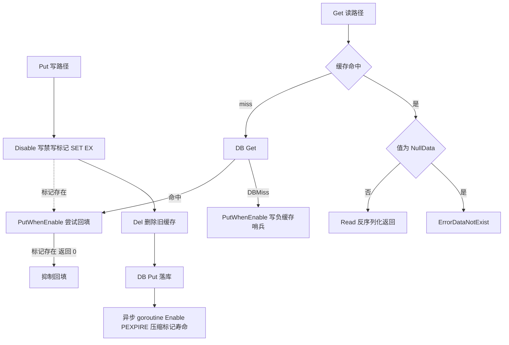

:::note 事实基线
本文依据 `$HOME/github/yukino.go/components/cache_aside` 在 `91712867080` 的源码事实撰写；文中的路径、常量与 API 名称均可在该检出中定位。
:::

**主线一览**



:::warning 禁写标记 TTL 必须覆盖最慢的一次写
`Put` 的语义是"先标记、再删缓存、再落库、最后延迟重开"。如果 `Disable` 的 TTL 先于落库结束而过期, 读路径会提前重新开放, 慢读者仍可能把旧值回填。默认 `10s` 标记 + `1000ms` 重开延迟对多数负载足够保守, 慢写业务必须调大 `WithDisableExpireSeconds`。
:::

经典 cache-aside 的读写流程看起来无害:

```text
read  : cache.Get -> miss -> db.Get -> cache.Set
write : db.Put -> cache.Del
```

并发下它会竞态: 一个在写入发生前就 miss 的慢读者, 会在写入删除缓存之后把旧值回填, 于是缓存持续提供陈旧数据直到 TTL 到期。加锁能解决, 但会让读路径阻塞在写路径上。`components/cache_aside` 选择另一条路: 写路径开启一个短暂的读路径禁写标记, 标记存在期间所有回填都被抑制, 从而关闭旧值窗口。正确性来自**抑制**而非加锁, 读路径永不阻塞。

## 一、四个接口与错误语义

`interface.go` 定义了组件需要的全部契约:

```go
const NullData = "Err_Syntax_Null_Data"

var (
    ErrorDataNotExist = errors.New("data not exist")
    ErrorCacheMiss    = errors.New("cache miss")
    ErrorDBMiss       = errors.New("db miss")
)

type Cache interface {
    Enable(ctx context.Context, key string, delayMillis int64) error
    Disable(ctx context.Context, key string, expireSeconds int64) error
    Get(ctx context.Context, key string) (string, error)
    Del(ctx context.Context, key string) error
    PutWhenEnable(ctx context.Context, key, value string, expireSeconds int64) (bool, error)
}

type DB interface {
    Put(ctx context.Context, obj Object) error
    Get(ctx context.Context, obj Object) error
}

type Object interface {
    KeyColumn() string
    Key() string
    Write() (string, error)
    Read(body string) error
}

type Logger interface {
    Errorf(format string, v ...any)
    Warnf(format string, v ...any)
    Infof(format string, v ...any)
    Debugf(format string, v ...any)
}
```

业务方只需为缓存对象实现 `Object`: `Key()` 给出缓存键, `KeyColumn()` 给出数据库唯一列名, `Write`/`Read` 负责序列化。`Logger` 默认取自 `internal/log`, 可用 `WithLogger` 替换。

## 二、Service 的两条路径

`service.go` 是组件的全部业务逻辑, `NewService(cache, db, opts...)` 构造后调用 `repair` 补齐默认值。

### 2.1 写路径 Put

`Put` 依次执行四步:

1. 参数校验: service/opts/ctx/obj/cache/db 均不能为空, `obj.Key()` 不能为空。
2. `cache.Disable(ctx, key, disableExpireSeconds)` 写下禁写标记。若失败, 整个写路径直接返回, 不触碰数据库。
3. `cache.Del(ctx, key)` 删除旧缓存, 然后 `db.Put(ctx, obj)` 落库。
4. 通过 defer 启一个异步 goroutine, 用 `context.WithTimeout(context.Background(), time.Second)` 调用 `cache.Enable(ctx, key, enableDelayMillis)`。

"重新启用"不是等待而是**压缩标记寿命**: Redis 适配器里 `Enable` 对标记键执行 `PEXPIRE`, 把剩余寿命改成 `delayMillis`, 使标记在延迟后自然消失。这样所有在途读有足够时间完成"查库后回填被抑制", 而不会在标记刚释放时被慢读者用旧值污染。重新启用失败只记日志, 不影响 `Put` 的返回值。

### 2.2 读路径 Get

`Get` 返回 `(useCache bool, err error)`, 序列如下:

1. `cache.Get(ctx, key)`。非 `ErrorCacheMiss` 的错误直接返回。
2. 命中且值等于 `NullData` → 返回 `(true, ErrorDataNotExist)`。
3. 命中且值等于 `NullData + "\x00"` → 先剥掉后缀恢复为 `NullData`, 再 `obj.Read(v)`。这是"数据库里真实字符串恰好等于哨兵"的消歧设计。
4. 命中普通值 → `obj.Read(v)`, 返回 `(true, err)`。
5. 未命中 → `db.Get(ctx, obj)`。返回 `ErrorDBMiss` 时, 用 `PutWhenEnable` 写 `NullData` 哨兵防穿透, 然后返回 `(false, ErrorDataNotExist)`; 其他错误直接返回。
6. 数据库命中 → `obj.Write()` 得到值, 若恰好等于 `NullData` 则追加 `\x00`; 随后 `PutWhenEnable` 尝试回填, 返回 `(false, nil)`。

`PutWhenEnable` 的错误只记日志 (错误分支里的 `ok` 不会被当作失败), 因此回填失败等价于一次缓存未命中, 不会破坏读路径。所有正缓存与负缓存都走同一条受控写入路径, 不存在绕过标记的旁路。

:::tip useCache 是测试锚点
`Get` 的布尔返回值精确区分"这次值来自缓存还是数据库"。`example/example_test.go` 用它断言并发写期间所有读都绕过缓存, 以及延迟过后读能重新命中缓存。
:::

## 三、Lua: 检查与写入必须原子

`redis/cache.go` 的 `Cache` 实现五个方法:

| 方法                          | Redis 动作                                  |
| ----------------------------- | ------------------------------------------- |
| `Enable(key, delayMillis)`    | `PExpire` 标记键, 压缩到延迟毫秒            |
| `Disable(key, expireSeconds)` | `SetEx` 标记键, 值固定为 `"1"`              |
| `Get(key)`                    | `Get`, 把 redis Nil 转成 `ErrorCacheMiss`   |
| `Del(key)`                    | `Del`                                       |
| `PutWhenEnable(...)`          | `Eval(LuaCheckEnableAndWriteCache, 2, ...)` |

标记键由 `disableKey(key)` 生成, 格式为 `Enable_Lock_Key_{key}` (花括号是字面量)。`LuaCheckEnableAndWriteCache` 一次调用带两个 KEYS:

```lua
local disable_key = KEYS[1];
local disable_flag = redis.call("get",disable_key);
if disable_flag then
    return 0;
end
local key = KEYS[2];
local value = ARGV[1];
local cache_expire_seconds = tonumber(ARGV[2]);
redis.call("set",key,value,"ex",cache_expire_seconds);
return 1;
```

若把"检查标记"和"写缓存"拆成两条命令, 写路径就会在两者之间插入, 旧值窗口重新出现。`PutWhenEnable` 返回 `n == 1` 表示真的写入, `0` 表示被抑制; 非 int64 响应会被当成错误。

## 四、配置与 TTL 抖动

`option.go` 的默认值:

| 常量                          | 值     | 含义         |
| ----------------------------- | ------ | ------------ |
| `DefaultCacheExpireSeconds`   | `60`   | 缓存基础 TTL |
| `DefaultDisableExpireSeconds` | `10`   | 禁写标记寿命 |
| `DefaultEnableDelayMillis`    | `1000` | 重新启用延迟 |

`WithCacheExpireRandomMode()` 打开抖动后, `CacheExpireSeconds()` 返回 `base + rand.Int63n(base+1)`, 即基础 TTL 的 1 倍到 2 倍之间, 用互斥量保护随机源, 打散集中失效。`repair` 会做边界校正: 非正数或超过 `MaxInt64/1e9` 的 TTL 回退到 60 秒; 抖动模式下若基础 TTL 超过一半上限也回退, 防止相加溢出。

## 五、适配器细节

### 5.1 MySQL/GORM

`mysql/db.go` 提供 `NewDB(dsn)` 与 `NewWithGorm(db)` 两种构造:

- `Put`: 若对象实现了 `TableName() string`, 先 `db.Table(...)`; 然后 `Create(obj)`。遇到重复键 (`IsDuplicateEntryErr`, 错误码 1062) 时, 按 `obj.KeyColumn()` 组装 `WHERE` 子句回退为 `Updates(obj)`, 所以同一对象重复写入是幂等的。
- `Get`: 同样支持 `TableName()`, 按 `KeyColumn = Key` 取 `First(obj)`; `gorm.ErrRecordNotFound` 转成 `ErrorDBMiss`。

### 5.2 Redis

`redis/redis.go` 封装 go-redis, 提供 `NewRedisCache(&redis.Config{Address, Password})` 与 `NewCache(client)`。组件不绑定具体缓存/数据库产品, 只要实现 `Cache`/`DB` 接口即可替换。

## 六、并发模型与边界

- 写路径上的读抑制是**单向**的: 写不等待读, 读遇到标记只是降级到数据库。因此吞吐不受临界区长度直接影响。
- 重新启用由独立 goroutine 执行, 使用脱离调用方 context 的 1 秒超时 context, 避免 `Put` 的调用方取消导致标记永久留存。
- 该方案只保证"最终不会有旧值", 不保证"读一定最新": 标记解除前, 读到的仍可能是数据库快照中的旧值, 只是不会被回填进缓存。
- 多写者同时写同一个 key 时, 每个 `Put` 都会写标记与延迟重开; 标记寿命被最后一次 `PEXPIRE` 压缩决定, 因此需要业务侧保证写顺序或接受最终结果由最后一次落库决定。

:::danger 不是强一致缓存
需要"读一定最新"的场景不要使用本组件。也不要把 `PutWhenEnable` 的布尔返回值当成事务提交凭据: 它只说明这次回填是否被标记抑制。
:::

## 七、真实使用片段

`README.md` 的 `Object` 实现示例:

```go
type Article struct {
    ID    uint   `json:"id" gorm:"primarykey"`
    Slug  string `json:"slug" gorm:"column:slug"`
    Body  string `json:"body" gorm:"column:body"`
}

func (a *Article) KeyColumn() string { return "slug" }
func (a *Article) Key() string       { return a.Slug }
func (a *Article) Write() (string, error) {
    b, err := json.Marshal(a)
    return string(b), err
}
func (a *Article) Read(body string) error { return json.Unmarshal([]byte(body), a) }
```

装配与使用:

```go
service := cache_aside.NewService(
    redis.NewRedisCache(&redis.Config{Address: addr, Password: pass}),
    mysql.NewDB(dsn),
    cache_aside.WithCacheExpireSeconds(120),
    cache_aside.WithCacheExpireRandomMode(),
    cache_aside.WithDisableExpireSeconds(1),
)
if err := service.Put(ctx, &Article{Slug: "hello", Body: "..."}); err != nil { log.Fatal(err) }
art := Article{Slug: "hello"}
useCache, err := service.Get(ctx, &art)
if errors.Is(err, cache_aside.ErrorDataNotExist) { /* 真实不存在 */ }
```

`example/example_test.go` 的三个集成测试 (需填写 `redisAddress`/`mysqlDSN` 占位常量):

- `Test_CacheAside`: 单次写/read 往返。
- `Test_CacheAside_Correct`: 100 个并发写者, 断言值正确与精确缓存命中次数。
- `Test_CacheAside_ReadWrite`: 同一 key 上交替读写, 断言禁写期间每次读的 `useCache == false`, 延迟后再次读才变为 `true`。

## 八、源码索引

本文引用的源码文件 (均相对于组件目录):

| 路径                                           | 用途                                              |
| ---------------------------------------------- | ------------------------------------------------- |
| `README.md`                                    | 时序图、API 表与配置项                            |
| `interface.go`                                 | `Cache`/`DB`/`Object`/`Logger`、错误与 `NullData` |
| `service.go`                                   | `Put`/`Get` 主流程与哨兵消歧                      |
| `option.go`                                    | 默认值、抖动模式与 `repair`                       |
| `redis/cache.go`                               | 禁写标记键与 `PutWhenEnable` 调用                 |
| `redis/lua.go`                                 | 原子检查并写入脚本                                |
| `redis/redis.go`                               | Redis 适配器                                      |
| `mysql/db.go`                                  | GORM 写入幂等与 `ErrorDBMiss` 映射                |
| `internal/log/log.go`                          | 默认日志实现                                      |
| `example/example_test.go`                      | 真实集成用例与 `useCache` 断言                    |
| `example/example_po.go`、`example/example.sql` | 示例对象与建表语句                                |
