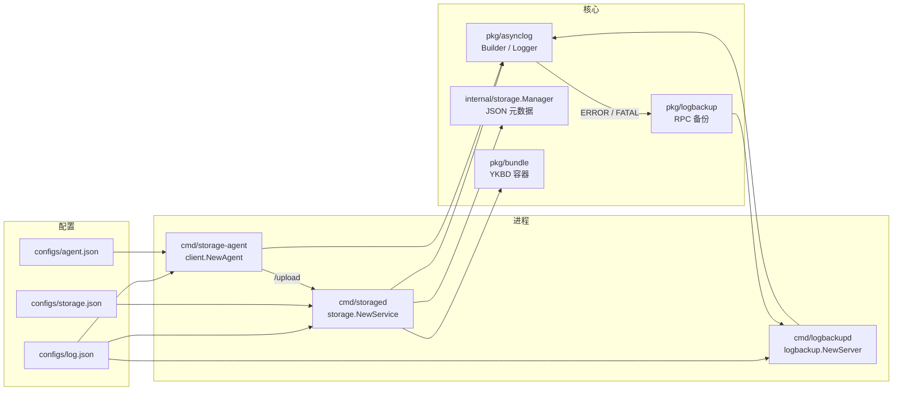

:::note 事实基线
本文依据 `$HOME/github/yukino.go/apps/cloud_storage` 在 `91712867080` 的源码事实撰写；文中的路径、常量与 API 名称均可在该检出中定位。
:::

**主线一览**



:::tip 读图要点
三条实线入口各自对应一个独立二进制；**唯一跨进程的数据通路**是 agent 向 storaged 的 `/upload` POST，以及 asynclog 把 `ERROR`/`FATAL` 经 `pkg/logbackup` 送到 logbackupd。三者共享同一份 `configs/log.json` 定义的日志口径。
:::

cloud_storage 是 C++ 项目的 Go 重写，README 把它概括成"嫁接在小型云存储服务上的异步日志系统"。它不是一个单体服务，而是**三个可单独启停的守护进程**加一套可复用的内部库：HTTP 服务、目录上传代理、远程日志接收端。模块路径为 `github.com/hangtiancheng/yukino.go/apps/cloud_storage`，`go.mod` 声明 `go 1.26.0`，除标准库外只直接依赖同仓库的 `libs/yukino_http v0.0.1` 与 `libs/yukino_rpc v0.0.2`。本文按"配置装配 → 三个进程 → 存储核心 → 日志与备份 → 并发与边界"的顺序拆解真实源码。

## 定位与整体架构

源码按职责切成三块，目录与角色的对应关系直接写在 `README.md` 的 Layout 段：

| 路径                | 角色                   | 关键文件                                                          |
| ------------------- | ---------------------- | ----------------------------------------------------------------- |
| `cmd/storaged`      | HTTP 存储服务入口      | `main.go`                                                         |
| `cmd/storage-agent` | 目录监听与上传代理     | `main.go`                                                         |
| `cmd/logbackupd`    | 远程日志备份接收端     | `main.go`                                                         |
| `internal/storage`  | 服务端存储域 + Web UI  | `config.go`、`manager.go`、`service.go`、`info.go`、`fileutil.go` |
| `internal/client`   | agent 域               | `agent.go`、`manager.go`                                          |
| `internal/logging`  | 每个二进制的日志装配   | `logging.go`                                                      |
| `pkg/asynclog`      | 可复用异步日志系统     | `config.go`、`builder.go`、`buffer.go`、`logger.go`、`flush.go`   |
| `pkg/bundle`        | 自描述压缩容器         | `bundle.go`                                                       |
| `pkg/logbackup`     | RPC 备份客户端与接收端 | `protocol.go`、`client.go`、`server.go`                           |

设计上的取舍很明确：HTTP 表面交给 `yukino_http`，远程备份传输交给 `yukino_rpc`，压缩完全落在标准库 `compress/gzip`、`compress/zlib`、`compress/flate`。README 特别说明**没有使用 `yukino_cache`**——deep 下载解压到唯一临时文件并在响应后删除，不在内存里缓存大对象。

## 三个二进制的启动参数

`README.md` 的 Running 段与三个 `main.go` 的 `flag` 定义一致：

| 二进制          | 主要 flag                                         | 默认值                                                                                |
| --------------- | ------------------------------------------------- | ------------------------------------------------------------------------------------- |
| `storaged`      | `-config` / `-log-config` / `-log-file`           | `configs/storage.json` / `configs/log.json` / `./logfile/storage`                     |
| `storage-agent` | `-config` / `-log-config` / `-log-file` / `-once` | `configs/agent.json` / `configs/log.json` / `./logfile/agent` / `false`               |
| `logbackupd`    | `-addr` / `-out` / `-log-config` / `-log-file`    | `0.0.0.0:8080` / `./logfile/backup.log` / `configs/log.json` / `./logfile/logbackupd` |

三个进程都接收 `SIGINT`/`SIGTERM` 并优雅停止：日志侧由 `cleanup()` 排空缓冲，服务侧由 `http.Server.Shutdown`（10 秒超时）或 `logbackup.Server.Stop()` 完成。`make build` 产出 `./bin/yukino-*`，`go test -race ./...` 可跑全量竞态测试。

## 三份配置如何装配组件

配置不是隐式单例，而是由各进程显式加载、归一化、校验后注入构造函数。三个二进制的 `-log-config`（以及 storaged、storage-agent 的 `-config`）默认值都指向 `configs/` 下的示例文件。

### configs/storage.json（storaged）

`internal/storage.Config` 的字段与示例值一一对应：

| 字段（json tag）            | 示例值             | 含义                                         |
| --------------------------- | ------------------ | -------------------------------------------- |
| `server_ip` / `server_port` | `0.0.0.0` / `8081` | 监听地址，`Addr()` 拼成 `host:port`          |
| `download_prefix`           | `/download/`       | 下载路由前缀                                 |
| `deep_storage_dir`          | `./deep_storage/`  | 压缩桶目录                                   |
| `low_storage_dir`           | `./low_storage/`   | 原样文件目录                                 |
| `storage_info`              | `./storage.data`   | JSON 元数据表路径                            |
| `bundle_format`             | `gzip`             | deep 层压缩格式                              |
| `temp_dir`                  | 空串               | deep 下载解压临时目录，空则用 `os.TempDir()` |
| `max_upload_bytes`          | `2147483648`       | 上传体上限，2 GiB                            |

`LoadConfig` 在 `DefaultConfig()` 之上做 `json.Unmarshal`，再调 `Validate()`。`Validate()` 会校验端口在 `1..65535`，把 `download_prefix` 规范成首尾都带 `/`（否则 `prefix+"/*name"` 会拼出 `/downloadname` 这种坏路由），用 `bundle.ParseFormat` 拒绝未知格式，并把空的目录字段补回默认值。常量 `defaultDownloadPrefix = "/download/"`、`defaultBundleFormat = "gzip"`、`defaultMaxUploadBytes = int64(2 << 30)`。

### configs/agent.json（storage-agent）

`internal/client.Config` 的时长字段不是 `time.Duration` 原生 JSON 形态，而是自定义 `Duration` 类型：`UnmarshalJSON` 接受 `"1s"` 这类 Go 时长字符串，也接受裸整数并按毫秒解释。`configs/agent.json` 给出 `scan_interval: "1s"`、`quiet_period: "5s"`、`timeout: "30s"`。`Validate()` 要求 `server_url` 非空，并把其它非正时长补成 1s / 0 / 30s 默认值。

### configs/log.json（三个进程共用）

`pkg/asynclog.Config` 对应示例中的 `buffer_size: 1048576`、`threshold: 16777216`、`linear_growth: 1048576`、`flush_log: 1`、`thread_count: 1`、`level: "DEBUG"`、`include_goroutine_id: true`，以及用于远程备份的 `backup_addr`（空串关闭）与 `backup_port: 8080`。`FlushModeValue()` 把 `flush_log` 整数翻译成 `FlushMode`；Go 实现每个 logger 只有一个 worker goroutine。

### internal/logging.Setup：统一的装配点

`logging.Setup(Options)` 是三处共用的胶水：先 `asynclog.LoadConfig`（未给路径则用 `DefaultConfig()`），再链式构造 `asynclog.NewBuilder().Name(...).FromConfig(cfg).AsyncType(asynclog.AsyncSafe)`；按选项附加 `NewStdoutFlusher(cfg.FlushModeValue())` 与 `NewRollFileFlusher(opts.FilePath, maxSize, cfg.FlushModeValue())`；当 `backup_addr` 非空且 `DisableBackup == false` 时，创建 `logbackup.NewClient` 并 `builder.Backup(backup)`。最后 `builder.Build()` 得到 `*asynclog.Logger`，`asynclog.Register(logger)` 使其可被 `GetLogger` 找到，返回的 `cleanup` 只是 `logger.Close()`。

:::warning logbackupd 必须禁用自我备份
`cmd/logbackupd/main.go` 给 `logging.Options` 设了 `DisableBackup: true`，注释写明"这个进程就是备份接收端，不能备份给自己"。若手动增加配置时漏掉这一点，接收端会把收到的错误日志再发回自己，形成回环。备份客户端的诊断信息也刻意用 `fmt.Fprintf(os.Stderr, ...)` 输出，避免递归进入拥有该客户端的 logger。
:::

## storaged：两层存储与 HTTP 表面

`cmd/storaged` 的 `run()` 顺序是：加载 `storage.Config` → `logging.Setup` → `storage.NewManager(cfg.StorageInfoFile)` → `storage.NewService(cfg, data, logger)` → `signal.NotifyContext` → `svc.Run(ctx)`。`Run` 先同步 `net.Listen`，让端口占用错误在宣称监听之前暴露；随后构造 `http.Server`，只设 `ReadHeaderTimeout = 15s` 与 `IdleTimeout = 60s`，**故意不设 `ReadTimeout`/`WriteTimeout`**，因为上传下载是流式传输，限额改由 `http.MaxBytesReader` 负责。

`Service.Handler()` 用 `yukino.New()` 建应用，装 `yukino.Recovery()` 和自定义 `accessLog()` 中间件，注册三条路由：

```text
GET  /                       -> handleList       内嵌模板渲染文件列表
POST /upload                 -> handleUpload     接收 low/deep 上传
GET  {prefix}/*name          -> handleDownload   下载（GET 不隐式覆盖 HEAD）
HEAD {prefix}/*name          -> handleDownload   显式注册，交给 http.ServeContent
```

`accessLog()` 在 `next()` 返回后用 `ctx.Method`、`ctx.Request.URL.Path`、`ctx.Status` 和耗时记一行 `Infof`，把所有输出统一到异步日志管道。

### 上传路径：分阶段落盘与可回滚发布

`handleUpload` 从 `FileName` 请求头取 base64 文件名，先试 `base64.StdEncoding`，失败再容错过 URL-safe 的 `base64.URLEncoding`，然后过 `SafeFileName`。`StorageType` 仅接受小写 `low` 或 `deep`；请求体被 `http.MaxBytesReader` 包住，超限会映射成 `http.StatusRequestEntityTooLarge`。

真正写入分两步：

1. `stageObject(dir, body, deep)` 在目标目录旁创建 `.upload-*` 临时文件。deep 分支经 `bundle.NewWriter(f, s.cfg.BundleCodec(), bundle.DefaultLevel)` 压缩写入；随后 `f.Sync()`、`f.Close()` 才返回。
2. `publishObject(staged, dest, deep)` 持 `Service.objects` 写锁，先用 `os.Link(dest, staged+".previous")` 保留旧 inode，再 `os.Rename(staged, dest)`，接着 `NewStorageInfo(dest, prefix, deep)` 生成记录并把 `Version` 设为临时文件名，最后 `s.data.Insert(info)`。任何一步失败都会回滚：有旧对象就 `os.Rename(backup, dest)` 恢复，没有就删除新对象；若恢复也失败则保留 `.previous` 供人工恢复。

`defer os.Remove(staged)` 保证成功路径不残留暂存文件。

### 下载路径：条件请求与唯一临时文件

`handleDownload` 先以 `ctx.Request.URL.Path` 调 `Manager.GetByURL`，未命中回 404。deep 对象经 `materialise(stored)` 用 `bundle.NewReader` 解压到 `os.CreateTemp(tmpDir, "yukino-dl-*")`，`Seek(0, io.SeekStart)` 后交给 `http.ServeContent`；临时文件在响应结束后删除。响应头设置 `Content-Type: application/octet-stream`、带引号转义的 `Content-Disposition`、`ETag`、`Accept-Ranges: bytes`，随后 `ctx.TakeOver()` 把响应交给 `http.ServeContent`，由它正确处理 Range、条件请求与 HEAD。`statusRecorder` 把最终状态码回写到 `ctx.Status`，其 `ReadFrom` 在底层 writer 支持 `io.ReaderFrom` 时直接委托，走内核零拷贝路径。

:::danger 直接改源码目录会绕过元数据表
服务端所有下载都由 `Manager.GetByURL` 的 URL 映射驱动，而 `StorageInfo` 只在上传时写入。手工往 `low_storage_dir`/`deep_storage_dir` 拷贝文件不会生成下载 URL；反过来删除文件而保留记录会得到 500（"stored object is missing"）而不是 404。
:::

## pkg/bundle：deep 层的自描述容器

`pkg/bundle` 用四字节 `magic = "YKBD"` 加 `version = 1` 标识容器，头部再写 1 字节 `Format` 和一个 `binary.AppendUvarint` 编码的原始大小。`Format` 是 `uint8` 枚举：`FormatRaw`（原样）、`FormatGzip`（gzip + CRC-32）、`FormatZlib`（zlib + Adler-32）、`FormatFlate`（裸 DEFLATE）。`DefaultLevel = flate.DefaultCompression`。

| API                                               | 作用                                                                                                    |
| ------------------------------------------------- | ------------------------------------------------------------------------------------------------------- |
| `ParseFormat(s string)`                           | 名称到格式；别名 `raw/none/store`、`gzip/gz`、`zlib`、`flate/deflate`，大小写不敏感                     |
| `Pack(format, level, data)` / `Unpack(container)` | 一次性编解码，`Unpack` 按头部原始大小用 `LimitReader` 只读多 1 字节防恶意分配，并校验 `ErrSizeMismatch` |
| `NewWriter(w, format, level)`                     | 流式写：立即写头部，原始大小填 0                                                                        |
| `NewReader(r)`                                    | 流式读：先消费头部与 uvarint，再返回解码 reader                                                         |
| `IsPacked(data)`                                  | 判断是否以 `magic` 开头                                                                                 |

错误哨兵有 `ErrNotPacked`、`ErrBadVersion`、`ErrBadFormat`、`ErrSizeMismatch`。整包只用标准库，没有绑定 C++ 的 bundle 工具链。

## internal/storage 的元数据与文件工具

`StorageInfo` 的字段包括 `ModTime`、`AccessTime`、`Size`、`StoragePath`、`URL`、`Name`、`Deep`、`Version`（json tag 分别是 `mtime`/`atime`/`fsize`/`storage_path`/`url`/`name`/`deep`/`version`）。`NewStorageInfo` 用 `os.Stat` 取时间与大小，`URL = downloadPrefix + filepath.Base(storagePath)`；Go 无法可移植地取 atime，因此 `AccessTime` 镜像 `ModTime`。`ETag()` 优先用 `Version` 生成带引号的 validator，否则用 `"name-size-mtime"`，符合 RFC 7232 的引号要求。

`Manager` 是 `map[string]*StorageInfo`（以 URL 为键）加 `sync.RWMutex`。`Insert` 先写新值再 `persist()`，失败时恢复旧值；`GetByURL`、`GetByStoragePath`、`All` 都返回拷贝，避免调用方改到内部状态；`persist()` 按 URL 排序后 `json.MarshalIndent`，再走 `WriteFileAtomic`。`fileutil.go` 里的 `WriteFileAtomic` 在同目录建 `.yukino-tmp-*` 临时文件，`Sync` 后 `Chmod(0o644)` 并 `os.Rename`，保证崩溃不会把元数据写成半截。

路径安全集中在 `SafeFileName` 与 `SafeJoin`：前者取 `filepath.Base` 剥掉所有目录成分，替换控制字符与 `/ \ : * ? " < > |`，拒绝空名、`.`、`..`；后者再以 `filepath.Rel` 做纵深防御，确保结果不逃出目录。

## storage-agent：扫描、去重与上传

`client.Agent` 持有 `Config`、`client.Manager`、`http.Client{Timeout: cfg.Timeout.Duration()}` 和 `Logger` 接口（`Infof`/`Warnf`/`Errorf`）。`Run(ctx)` 用 `time.NewTicker` 周期调用 `scanOnce`，`ScanOnce(ctx)` 暴露单次扫描给 `-once` 与测试。

`collect()` 同时遍历 `LowDir`（tier=`low`）和 `DeepDir`（tier=`deep`）。`needsUpload(c)` 只有两个条件：文件已被静默至少 `QuietPeriod`，且 `Manager.Get(path)` 记录的标识与当前 `identifier(st)` 不同；`identifier` 是 `name-size-mtimeUnix` 三元组。上传成功后才 `state.Set`，因此失败不会把状态推进。`upload()` 向 `ServerURL + "/upload"` POST，设置 `FileName`（base64）、`StorageType`、`Content-Type: application/octet-stream`，并用 `io.Copy(io.Discard, io.LimitReader(resp.Body, 4096))` 排空有限响应体以复用连接。`client.Manager` 用 JSON map 取代原 C++ 的空格分隔行，`Set` 同样原子落盘（`.yukino-agent-*` 临时文件 + rename）。

## pkg/logbackup：有界非阻塞的远程备份

`protocol.go` 定义服务名 `ServiceName = "LogBackup"`、方法名 `AppendMethod = "Append"`，以及 `AppendRequest{Source, Records}` / `AppendReply{Stored}`。

- `ClientOptions`：默认 `QueueSize = 4096`、`BatchSize = 64`、`Timeout = 3s`、`RetryBackoff = 200ms`。`Backup(record)` 非阻塞入队，队列满则返回并累加 `dropped`，满足 `asynclog.BackupSink`。
- `Client.invoke` 通过 `rpc.Dial(addr, rpc.WithTimeout(...), rpc.WithDialCodec(rpc.CodecJSON))` 惰性建连并 `atomic.Pointer` 缓存；`sendBatch` 最多 `maxAttempts = 3` 次，退避按 attempt 线性放大，失败整批计入 `dropped`。`Sent()`/`Dropped()` 暴露计数。
- `Server` 在 `NewServer` 时就 `rpc.NewServer()` 并 `rpc.Register(ServiceName, s)`，避免 `Stop` 早于 `Serve` 时漏掉 `GracefulStop`。`Append` 按 `MaxBatch`（默认 1024）截断，逐条加 `[source] ` 前缀、补换行、`bufio.Writer.Flush()`。`Stop()` 会 `GracefulStop()` 并关闭文件。

## 并发、容错与边界

| 关注点     | 实现                                                                                              |
| ---------- | ------------------------------------------------------------------------------------------------- |
| 元数据并发 | `storage.Manager` 用 `sync.RWMutex`；`client.Manager` 用 `sync.Mutex`；两者写入失败都回滚内存状态 |
| 文件发布   | `Service.objects` 读写锁 + hard link 备份 + rename，旧 inode 保持到元数据持久化成功               |
| 路径穿越   | `SafeFileName` 剥目录 + `SafeJoin` 的 `filepath.Rel` 复核                                         |
| 大对象     | 上传用 `MaxBytesReader` 限流；deep 下载解压到唯一临时文件且不缓存                                 |
| 日志写入   | `asynclog.Builder` 的 `AsyncSafe` 类型；每 logger 一个 worker；`RollFileFlusher` 按大小切割       |
| 关停       | 三个 `cmd` 都用 `signal.NotifyContext`，优雅退出时 `cleanup()` 排空异步日志                       |

`asynclog` 的 `Level` 序列为 `LevelDebug`、`LevelInfo`、`LevelWarn`、`LevelError`、`LevelFatal`，`ParseLevel` 还接受 `WARNING` 别名。日志配置里的 `thread_count` 对应的实际并发度由 worker goroutine 决定，不是可水平扩展的线程池。

## 适用与不适用

**适用**

- 需要一个自带 Web UI 的轻量文件服务，且希望 low/deep 两档存储用同一套 HTTP 接口。
- 需要一个目录到云的单向同步代理，接受"静默期 + 名字/大小/时间三元组"作为变更判据。
- 需要把错误日志在进程崩溃前送远端留存，且能接受有界队列满时丢弃少量记录。

**不适用**

- 需要多副本、强一致或跨节点元数据同步：这里只有单机 JSON 元数据表，没有复制协议。
- 需要上传断点续传、对象版本浏览或删除 API：`Handler()` 只注册了列表、上传、下载与 HEAD。
- 需要把 deep 容器交给第三方工具直接读取：`YKBD` 头是本包自定义格式，只有 `pkg/bundle` 认识。

**延伸阅读**

HTTP 路由、中间件和 `ctx.TakeOver()` 的语义见 [yukino_http](./yukino-http)；远程备份所依赖的 RPC 框架见 [yukino_rpc](./yukino-rpc)；另一个自带异步写入与文件切割的日志实现见 [yukino_log](./yukino-log)。分布式共识存储可对照 [yukino_raft_kv](./yukino-raft-kv)。
