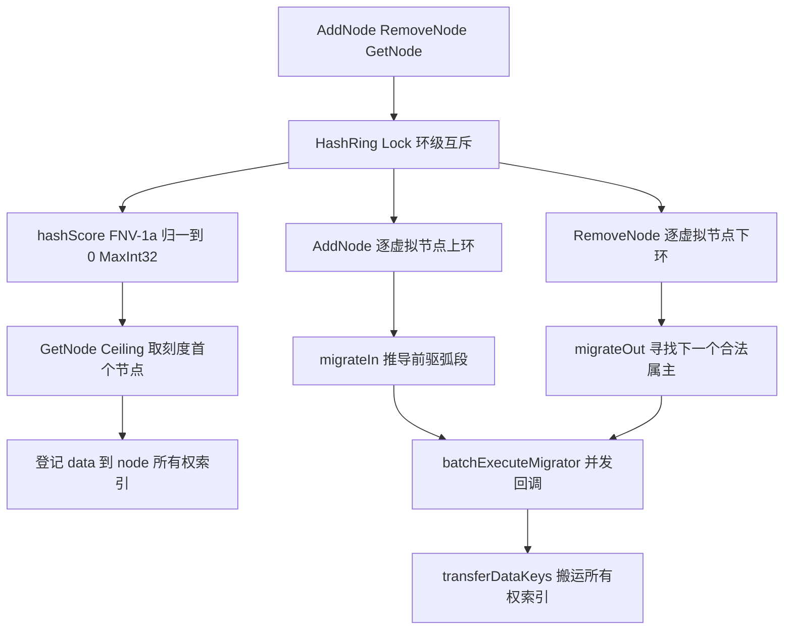

:::note 事实基线
本文依据 `$HOME/github/yukino.go/components/consistent_hash` 在 `91712867080` 的源码事实撰写；文中的路径、常量与 API 名称均可在该检出中定位。
:::

**主线一览**



:::warning Migrator 必须幂等
迁移回调在环状态更新后并发执行, 但源码并未为"同一批键被其他调用方同时读写"提供隔离。迁移窗口内存在短暂双写可能, `Migrator` 必须设计成幂等, 否则重放会产生副作用。
:::

取模哈希在节点增减时会把几乎所有键重新映射, 引发缓存雪崩与全量数据搬迁。一致性哈希把扰动限制在新节点与其前驱之间的弧段, 但"找出这段弧里的键并搬走"通常留给调用方。`components/consistent_hash` 的定位是把两件事都做完: 维护环, 并在 `AddNode`/`RemoveNode` 的副作用中直接算出需要迁移的键集与方向。它是 `go.work` 下的独立 module (`go.mod` 声明 `go 1.26.0`)。

## 一、公开 API 与接口边界

`consistent_hash.go` 只暴露三个操作, 全部需要 context:

```go
func NewConsistentHash(hashRing HashRing, encryptor Encryptor, migrator Migrator, opts ...ConsistentHashOption) *ConsistentHash
func (c *ConsistentHash) AddNode(ctx context.Context, nodeID string, weight int) error
func (c *ConsistentHash) RemoveNode(ctx context.Context, nodeID string) error
func (c *ConsistentHash) GetNode(ctx context.Context, dataKey string) (string, error)
```

配套接口定义在 `hash_ring.go` 与 `encryptor.go`、`migration.go`:

```go
type HashRing interface {
    Lock(ctx context.Context, expireSeconds int) error
    Unlock(ctx context.Context) error
    Add(ctx context.Context, virtualScore int32, nodeID string) error
    Ceiling(ctx context.Context, virtualScore int32) (int32, error)
    Floor(ctx context.Context, virtualScore int32) (int32, error)
    Rem(ctx context.Context, virtualScore int32, nodeID string) error
    Nodes(ctx context.Context) (map[string]int, error)
    AddNodeToReplica(ctx context.Context, nodeID string, replicas int) error
    DeleteNodeToReplica(ctx context.Context, nodeID string) error
    Node(ctx context.Context, virtualScore int32) ([]string, error)
    DataKeys(ctx context.Context, nodeID string) (map[string]struct{}, error)
    AddNodeToDataKeys(ctx context.Context, nodeID string, dataKeys map[string]struct{}) error
    DeleteNodeToDataKeys(ctx context.Context, nodeID string, dataKeys map[string]struct{}) error
}

type Encryptor interface { Encrypt(origin string) int32 }
type Migrator func(ctx context.Context, dataKeys map[string]struct{}, from, to string) error
```

`HashRing` 把算法与存储解耦: 算法层只依赖刻度操作、环级互斥、节点副本数簿记与数据键所有权索引。ring 的实现可以换成进程内结构或 Redis。

## 二、虚拟节点、权重与分数

每个物理节点按 `weight * replicas` 个虚拟节点上环。`option.go` 的默认值是 `WithReplicas` 对应 `replicas = 5`、`WithLockExpireSeconds` 对应 `lockExpireSeconds = 15` (秒)。

`AddNode` 对权重做钳制: `getValidWeight` 把 `<=0` 变成 1, `>=10` 变成 10。随后做两道溢出防护:

```go
if c.opts.replicas > int(^uint(0)>>1)/weight { return errors.New("virtual node count overflows int") }
replicas := weight * c.opts.replicas
if replicas > 1<<20 { return errors.New("virtual node count exceeds the configured safety limit") }
```

虚拟节点名由 `getRawNodeKey(nodeID, i)` 生成, 格式为 `nodeID_i`; 反向解析用 `getNodeID`, 取最后一个 `_` 之前的部分。这意味着**节点 ID 本身不应包含下划线后缀歧义**。

哈希函数由 `encryptor.go` 抽象。当前非测试代码只提供一种实现 `FnvHasher`: `fnv.New32a()` 后对 `math.MaxInt32` 取模, 把结果压到 `[0, MaxInt32)`。所有分数进入环之前都经过 `hashScore` 复检, 越界直接返回错误, 不会让坏分数污染环。README 里提到 SHA-1, 但本检出中 `encryptor.go` 只有 FNV 实现——以源码为准。

## 三、所有权索引是迁移的数据源

`HashRing` 除了刻度, 还维护两类簿记:

- 节点到虚拟节点数: `AddNodeToReplica` / `DeleteNodeToReplica` / `Nodes`。
- 节点到数据键集合: `DataKeys` / `AddNodeToDataKeys` / `DeleteNodeToDataKeys`。

`GetNode` 的流程是: `hashScore(dataKey)` → `Ceiling(score)` 找到不小于该分数的最小刻度 → 取该刻度节点列表的第一个 → `getNodeID` 得到物理节点 → `AddNodeToDataKeys` 登记"这个数据键属于哪个节点"。注意 `GetNode` **也会获取环级锁**并在 defer 中释放, 不只是 `AddNode`/`RemoveNode` 才加锁。正因为每次查询都登记归属, 增删节点时才不需要扫描全量数据就能得到迁移集合。

当环为空时, `Ceiling` 返回 -1, `GetNode` 返回 `no node available`; 刻度存在但没有节点列表时返回 `no node available with empty score`。`checkReady` 还要求实例非 nil、ring 与 encryptor 非 nil、ctx 非 nil。

## 四、AddNode: 上环、迁入与回滚

`AddNode` 的顺序严格:

1. `checkReady` 后检查 `migrator != nil`, 否则返回 `node changes require a data migrator`; 再检查 nodeID 非空。
2. 拿环级锁 (`WithLockExpireSeconds`, 默认 15 秒), defer 解锁。
3. `Nodes` 查重, 重复返回 `repeat node`。
4. 钳制权重、算虚拟节点列表, 登记副本数。
5. 逐个虚拟节点 `Add(score, nodeKey)`, 紧接着调用 `migrateIn` 计算迁入任务。
6. 最后 `batchExecuteMigrator` 批量执行。

任何一步失败都会走 `rollbackAddNode`: 把已经算出的迁入键从目标节点索引删掉并加回源节点, 依次摘掉已上的虚拟刻度, 删除副本登记, 并用 `fmt.Errorf("add node failed, ring state rolled back: %w", cause)` 包装原始错误。这样环不会留下"半个注册节点", 调用方可以安全重试。

## 五、migrateIn: 左开右闭弧段的推导

`migrateIn` (`migration.go`) 为新虚拟节点找出应迁入的键:

- 若该分数上已有多个节点, 直接跳过 (无法唯一决定归属)。
- 前驱 `Floor(decreaseScore(virtualScore))`, 后继 `Ceiling(incrScore(virtualScore))`; `incrScore`/`decreaseScore` 在 0 与 `MaxInt32-1` 之间显式回绕。
- 用 `patternOne = lastScore > virtualScore` 与 `patternTwo = nextScore < virtualScore` 识别跨 0 弧段, 通过有符号 32 位整数减去 `math.MaxInt32` 做归一比较, 而不是假设环单调。
- 落入 `(lastScore, virtualScore]` 的键从**后继节点** (`nextNodes[0]` 所属物理节点) 的所有权索引取出, 返回 `from = nextNodeID, to = nodeID`。

## 六、migrateOut: 寻找下一个合法属主

`migrateOut` 是镜像操作:

- 只有该刻度上第一个节点就是本节点时才处理; 取出本节点全部 `DataKeys`, 选出落在 `(lastScore, virtualScore]` 内的键。
- `lastScore == -1 || lastScore == virtualScore` 表示没有前驱, 若该刻度只有一个节点则返回 `no other no`, 否则走 `onlyScore` 分支把该弧段的全部键迁出。
- 若同一刻度挂了多个节点, `to` 直接取列表第二个节点; 否则递归调用 `getValidNextNode`。
- `getValidNextNode` 用 `Ceiling(score+1)` 向后找, 跳过仍属于同一节点的刻度, 并用 `ranged map[int32]struct{}` 记录已访问分数, 防止环上只剩同节点虚拟节点时无限递归; 找不到返回 `no other node`。

`RemoveNode` 先按副本数算出所有虚拟分数, 再循环: 每个分数先 `migrateOut` 计算迁移目标, 然后 `Rem` 摘除刻度。若其中任一步失败, 已经收集到的迁移任务仍会被 `batchExecuteMigrator` 执行——因为 `migrateOut` 已经重排了索引, 真实数据必须跟上。只有所有刻度都摘除成功才 `DeleteNodeToReplica`, 使失败重试时节点仍处于注册状态。

## 七、并发迁移与错误聚合

`batchExecuteMigrator` 为每个任务启一个 goroutine, 每个任务带 `defer recover()`: panic 被转成 `fmt.Errorf("migration task panicked: %v", fault)`, 不会中断整批。用 `WaitGroup` 等待全部回调, 结果写进 buffered channel 并按原索引回填。

回调成功后才执行 `transferDataKeys`:

```go
if err := c.hashRing.DeleteNodeToDataKeys(ctx, plan.from, plan.dataSet); err != nil { ... }
if err := c.hashRing.AddNodeToDataKeys(ctx, plan.to, plan.dataSet); err != nil {
    rollbackErr := c.hashRing.AddNodeToDataKeys(ctx, plan.from, plan.dataSet)
    return errors.Join(..., rollbackErr)
}
```

所有错误最终用 `errors.Join` 聚合返回, 节点操作不会"静默成功"。`cloneDataSet` 保证传给 Migrator 的键集是副本, 回调不会被索引变更影响。

## 八、两种环后端

### 8.1 进程内跳表环 `local.SkiplistHashRing`

`local/hash_ring.go` 用 `virtualNode{score int32, nodeIDs []string, nexts []*virtualNode}` 实现跳表, `roll()` 以 `rand.Intn(2)` 逐级提升, 最高 31 层。`mu sync.RWMutex` 保护环与两张索引; `Ceiling`/`Floor` 找不到时回绕到 `first()`/`last()`。

环级互斥由 `LockEntity` 提供: 一个容量为 1 的 channel 作为信号量, owner 由 `os.GetCurrentProcessAndGoroutineIDStr()` (包 `components/consistent_hash/pkg/os`) 记录。`expireSeconds > 0` 时起一个定时器 goroutine, 到期自动解锁; `expireSeconds == 0` 表示不自动释放。解锁会校验 owner, 因此不能由别的 goroutine 代解。文件里还定义了 `LockEntityV2`, 它用互斥量与到期时间表达同一语义, 并借用了 `components/redis_lock/utils.GetProcessAndGoroutineIDStr`——但当前 `SkiplistHashRing` 嵌入的是 `LockEntity`。

:::tip 本地环不依赖 Redis 服务
进程内后端自带本地锁, 不访问 Redis。它只是复用了 redis_lock 包里的 goroutine ID 工具函数 (在 `LockEntityV2` 中), 这与"Redis 环后端把环锁委托给 redis_lock"是两件不同的事。
:::

### 8.2 Redis zset 环 `redis.RedisHashRing`

`redis/hash_ring.go` 的键布局 (花括号为环 key 占位):

| 键                                                    | 类型   | 内容                                               |
| ----------------------------------------------------- | ------ | -------------------------------------------------- |
| `redis:consistent_hash:ring:lock:{key}`               | string | 环锁, 由 redis_lock 持有                           |
| `redis:consistent_hash:ring:{key}`                    | zset   | score 为虚拟分数, member 为该分数上节点列表的 JSON |
| `redis:consistent_hash:ring:node:replica:{key}`       | hash   | 节点到副本数                                       |
| `redis:consistent_hash:ring:{key}:node:data:{nodeID}` | string | 该节点数据键集合的 JSON                            |

`Lock` 调用 `redis_lock.NewRedisLock(getLockKey(), client, redis_lock.WithExpireSeconds(int64(expireSeconds)))` 并加锁, 成功后按"进程 + goroutine ID"把锁对象存进 `locks` map; `Unlock` 取回同一个对象, 在 `context.WithoutCancel(ctx)` + 2 秒超时的 context 中释放, 确保同一调用者拿回自己的 token。

`LuaRingAdd` 与 `LuaRingRem` 原子地在某个分数的 JSON 数组里追加/删除 nodeID: 若同一分数的成员数超过 1, 直接 `redis.error_reply('invalid score entity len: ...')`, 防止数据被覆盖。`Ceiling`/`Floor` 用 `ZRangeArgsWithScores` 的 `Count: 1` 取相邻刻度, `Floor` 额外带 `Rev: true`; 取不到时回退到 `FirstOrLast`, 仍没有则返回 -1。

## 九、适用场景与边界

适合:

- 节点会动态增减、且数据必须按权重比例分布的分片场景。
- 迁移必须显式可控、不能靠缓存自然过期的场景, 因为 `Migrator` 会收到精确的键集与方向。

不适合:

- 键空间极小或节点基本不动: 直接取模更简单, 环与索引的维护成本不值得。
- 需要严格一致分片归属 (例如把它当存储分区依据): 环的最终一致语义意味着迁移窗口内同一键可能被并发读写; 调用方必须让 Migrator 幂等。
- 节点 ID 含下划线且可能形成 `name_数字` 形态时, `getNodeID` 的"最后一个下划线"解析会产生歧义。

## 十、真实使用片段

`example_test.go` 的本地环用例:

```go
ring := local.NewSkiplistHashRing()
ch := consistent_hash.NewConsistentHash(
    ring,
    consistent_hash.NewFnvHasher(),
    func(ctx context.Context, dataKeys map[string]struct{}, from, to string) error {
        log.Printf("migrate %d keys: %s -> %s", len(dataKeys), from, to)
        return nil // do the real move here
    },
    consistent_hash.WithReplicas(5),
    consistent_hash.WithLockExpireSeconds(5),
)
_ = ch.AddNode(ctx, "node_a", 2) // weight 2
_ = ch.AddNode(ctx, "node_b", 1)
node, err := ch.GetNode(ctx, "data_a")
_ = ch.AddNode(ctx, "node_c", 1)
_ = ch.RemoveNode(ctx, "node_c")
```

Redis 环用例:

```go
client := redis.NewClient("tcp", addr, password)
hashRing := redis.NewRedisHashRing("orders:hashring", client)
ch := consistent_hash.NewConsistentHash(hashRing, consistent_hash.NewFnvHasher(), migrator)
```

`example_test.go` 中 Redis 用例的占位常量为 `address = "redis address"`, 未填写时测试直接跳过。

**与 redis_lock 的关系**: 本组件是仓库内两条 redis_lock 依赖之一, 且只发生在 Redis 环后端; 进程内跳表环自带本地锁。

## 十一、源码索引

本文引用的源码文件 (均相对于组件目录):

| 路径                                                       | 用途                                                   |
| ---------------------------------------------------------- | ------------------------------------------------------ |
| `README.md`                                                | 设计动机、API 表与双后端说明                           |
| `consistent_hash.go`                                       | 编排、权重钳制、回滚与迁移批处理                       |
| `migration.go`                                             | `migrateIn`/`migrateOut`/`getValidNextNode` 与回绕算术 |
| `hash_ring.go`                                             | `HashRing` 接口                                        |
| `encryptor.go`                                             | `Encryptor` 与 `FnvHasher`                             |
| `option.go`                                                | `WithReplicas`、`WithLockExpireSeconds` 及默认值       |
| `local/hash_ring.go`                                       | 跳表环、本地锁实体                                     |
| `local/hash_ring_test.go`                                  | 本地环测试                                             |
| `redis/hash_ring.go`                                       | Redis 环键布局、Lua 与 redis_lock 委托                 |
| `redis/redis.go`                                           | Redis 适配器原语                                       |
| `example_test.go`                                          | 双后端真实使用片段                                     |
| `consistent_hash_test.go`、`consistent_hash_redis_test.go` | 算法与 Redis 集成断言                                  |
