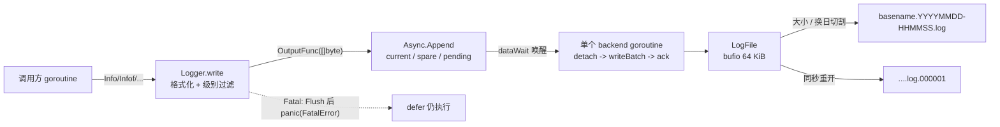

:::note 事实基线
本文依据 `$HOME/github/yukino.go/libs/yukino_log` 在 `91712867080` 的源码事实撰写；文中的路径、常量与 API 名称均可在该检出中定位。
:::

**主线一览**



:::tip 读图要点
**前端同步、后端异步**：`Logger.write` 只做级别过滤、拼行、`runtime.Caller` 取调用点和一次 `OutputFunc` 调用；真正的磁盘写入由唯一后端 goroutine 完成。一条记录从 `Append` 成功返回到 `Stop` 返回之间一定会被写出，这是 `Async.Append` 的契约。
:::

yukino_log 是"并发日志库：同步前端 + 双缓冲文件后端"。它保留 C++ 原版的设计——一行格式化记录、固定暂存缓冲、单个后端 goroutine、按大小与按天切割——并修正了若干缺陷。模块路径 `github.com/hangtiancheng/yukino.go/libs/yukino_log`，`go.mod` 声明 `go 1.26.0`，**只用标准库，没有任何 require**。本文按"Logger 前端 → Async 后端 → LogFile → 错误语义 → 并发边界"逐层说明。

## 定位与文件布局

| 文件                  | 职责                                                             |
| --------------------- | ---------------------------------------------------------------- |
| `doc.go`              | 包级文档，描述概览、后端与错误契约                               |
| `logger.go`           | `Level`、`Options`、`Logger`、`FatalError` 的触发点与包级 logger |
| `async.go`            | `Async` 双缓冲后端、chunk 池、条件变量与 epoch/acked 回执        |
| `logfile.go`          | `LogFile` 滚动文件、`Open`、`FileOptions` 与命名/切割规则        |
| `errors.go`           | 哨兵错误与 `FatalError` 值类型                                   |
| `cmd/logdemo/main.go` | 小驱动，示例 `go run ./cmd/logdemo -n 1000 -roll 1048576`        |

基本用法（来自 README 与 `example_test.go`）：

```go
logger := yukino_log.New(yukino_log.Options{MinLevel: yukino_log.LevelInfo})
logger.Infof("listening on %s", addr)   // 格式化
logger.Info("ready")                    // 类似 fmt.Sprint 的拼接
```

要写文件则先 `NewAsync(AsyncOptions{Basename: "logs/server", RollSize: 64 << 20})`，`Start()` 后 `logger.Attach(backend)`，退出前 `defer backend.Stop()`。也可以 `Open("logs/server", 64<<20, FileOptions{})` 直接拿到一个 `io.Writer`，把它作为 `Options.Output`。

## Logger 同步前端

### 级别与固定列宽

`Level` 是 `int`，从低到高为 `LevelTrace`、`LevelDebug`、`LevelInfo`、`LevelWarn`、`LevelError`、`LevelFatal`。`levelTags` 是六个定长字符串：`"TRACE "`、`"DEBUG "`、`"INFO  "`、`"WARN  "`、`"ERROR "`、`"FATAL "`，保证级别列始终占 6 字节、日志列对齐。`String()` 返回去掉填充的名字，`tag()` 对越界值回退到 `"UNK   "`。

记录格式为：

```text
2006/01/02 15:04:05.000000 LEVEL message - file.go:42
```

`appendStamp` 用 `now.In(loc)` 格式化日期时间，再以 `fmt.Appendf(dst, ".%06d ", now.Nanosecond()/1000)` 强制补成六位微秒——标准库的 `AppendFormat` 会剥掉尾部零，所以这里单独拼。`appendSuffix` 追加 `" - "`、`basename(file)`、`:`、行号与换行。`example_test.go` 用固定时钟验证了 `2024/03/01 08:30:00.123456 INFO  hello world` 这一段输出。

### Options 与可变配置

`Options` 包含 `MinLevel`、`Output OutputFunc`、`Flush FlushFunc`、`Now func() time.Time`、`Location *time.Location`。零值默认：记录全部级别、输出到标准输出、时区 `time.Local`。`New(opts)` 只补齐 nil 字段，不做其它校验。

`OutputFunc` 的签名是 `func(p []byte) (int, error)`。实例方法的 setter 有 `SetMinLevel`、`SetOutput`、`SetFlush`、`Attach(a *Async)`、`Flush()`；包级对应 `SetMinLevel`、`SetOutput`、`SetFlush`、`Attach`、`Flush`，它们操作包内单例 `std = New(Options{})`。

:::warning OutputFunc 不能保留传入的字节切片
`OutputFunc` 消费完 `p` 后该切片会被 `linePool` 复用，`Logger` 文档明确要求不得 retain。`io.Writer` 本来就遵守这条规则；自己实现输出函数时若想异步持有内容，必须先 `append([]byte(nil), p...)` 拷贝。
:::

### write 方法与 Fatal 语义

`Logger.write(level, skip, format, args)` 的流程：

1. 持 `RLock` 读取 `min`、`output`、`now`、`location`；`level < min && level != LevelFatal` 时直接丢弃。
2. `runtime.Caller(skip)` 取调用点（`skip = 2` 对应公开方法），失败则记为 `???` 与行号 0。
3. 从 `linePool` 取 `*[]byte` 复用缓冲，初始容量 `defaultLineCap = 4000`，超过 `maxPooledLine = 64*1024` 的缓冲不归还池。
4. `format == ""` 用 `fmt.Append`（拼接语义），否则 `fmt.Appendf`；调用 `out(buf)` 后立刻 `releaseLine`。
5. 输出函数返回错误时调 `report("writing log output", err)`，错误写 stderr，**不回灌 logger**，避免递归。

`Fatal`/`Fatalf` 在写完记录后先 `l.Flush()`，再 `panic(FatalError{Message: fatalMsg})`。`FatalError` 定义在 `errors.go`，只有一个 `Message string` 字段，`Error()` 返回该文本。README 与 `doc.go` 都强调：panic 取代了 C++ 原版的 abort，**deferred 调用仍会执行**，因此 `defer backend.Stop()` 可以正常排空缓冲；进程不会被强制终止。

### 包级 logger 与演示程序

`logger.go` 末尾的 `std = New(Options{})` 是包级 API 的载体。包级函数与实例方法一一对齐：`SetMinLevel`、`SetOutput`、`SetFlush`、`Attach`、`Flush`、`Log`/`Logf`、`Trace`/`Tracef`、`Debug`/`Debugf`、`Info`/`Infof`、`Warn`/`Warnf`、`Error`/`Errorf`、`Fatal`/`Fatalf`。它们都直接转调 `std`，因此修改包级配置会影响所有使用包级函数的代码。

`example_test.go` 用 `bytes.Buffer` 作 `Output`、用固定时钟与 `time.UTC` 作 `Now`/`Location`，验证输出前缀 `2024/03/01 08:30:00.123456 INFO  hello world`；注意级别列是 `INFO` 加两个空格凑足六字节。`cmd/logdemo/main.go` 可以按 `-n` 与 `-roll` 生成记录，终端只输出一行，其余落到 `logs/` 目录，用来观察切割结果。

README 还强调两条容易踩的语义：默认 `MinLevel` 是 trace，所以零值 `Options` 不丢任何级别；而 **fatal 记录即使最低级别设为 fatal 也一定写出**，因为它被 `level != LevelFatal` 的过滤条件单独豁免。

## Async：双缓冲异步后端

### 构造与状态

`DefaultBufferSize = 4_000_000`，对应 C++ 的 `kLargeBufferSize`。`AsyncOptions` 有 `Basename`、`RollSize`、`BufferSize`、`FlushInterval`、`File FileOptions`；零值 `BufferSize` 取 `DefaultBufferSize`，零值 `FlushInterval` 取 `DefaultFlushInterval`。

`NewAsync` 校验 basename 与 rollSize，分配 `current` 与 `spare1` 两个 `chunk`，并用 `sync.NewCond(&a.mu)` 建 `dataWait` 与 `flushWait` 两个条件变量。**它不创建文件**；`Start()` 才 `Open(...)`、置 `started = true` 并 `go a.loop()`。`Async` 还维护 `pending []*chunk`、`epoch/acked uint64`、`err error` 与 `done chan struct{}`。

### 摄入策略

`Append(p)` 在持锁状态下调 `ingestLocked`：

| 情况                        | 处理                                                                           |
| --------------------------- | ------------------------------------------------------------------------------ |
| `current.avail() >= len(p)` | 拷进 current；刚好填满则 `handOffLocked()` 交给后端                            |
| current 有数据但装不下      | 先 handOff，换 spare 再试一次                                                  |
| 记录比整个 buffer 还大      | 单独 `append([]byte(nil), p...)` 成一个 owned chunk 入 pending，不丢弃、不切分 |

`handOffLocked` 把 current 追加到 pending，再从 `spare1`/`spare2` 取一个重置后的 chunk（都空了就新建）。`Write(p)` 只是 `Append` 的 `io.Writer` 适配。

### 后端循环与 Flush 回执

`loop()` 在 `defer` 中依次注册 `close(done)`、`finish()` 和 panic 恢复（`errPanic` 把 panic 转成错误），然后循环 `detach() -> writeBatch() -> recycle() -> ack()`。

`detach()` 在没有数据、没有 flush 请求且 `epoch == acked` 时调 `waitIntervalLocked()`：用 `time.AfterFunc(flushEvery, ...)` 定时给 `dataWait` 发信号，超时后把当前缓冲也并进批次。**`Flush()` 会把 `epoch++` 并 `dataWait.Signal()`，然后等到 `acked >= want`**，所以它的语义是"把本次调用之前接受的字节写出去"，等待期间新进来的字节不在范围内。

`writeBatch` 对批次中每个 chunk 调 `file.Append(c.b)`，最后 `file.Flush()`；任何错误经 `noteErr` 记录，只保留**第一个**。`recycle` 只回收容量恰好等于 `bufferSize` 的 chunk，避免把巨记录 chunk 放进 spare 池。`finish()` 关闭文件、置 `stop = true`、把 `acked` 推到 `epoch` 并 `Broadcast`。

`Stop()` 置 `stop`、发信号、等 `<-a.done`，所有并发/重复调用返回同一个 `a.err`（干净关闭时为 nil）。`Stop` 在 `Start` 之前返回 `ErrNotStarted`。

:::danger Flush 只推到 OS，不等于落盘
`Async.Flush()` 和 `LogFile.Flush()` 都只把 `bufio` 缓冲推给操作系统，**不调用 file.Sync()**。真正的 sync 发生在 `LogFile.Close()`、切割时和 `Async.Stop()` 的收尾。断电或内核崩溃仍可能丢失已 Flush 的数据；需要强持久性时必须在自己的 `FlushFunc` 里补 `Sync`（或用提供 sync 的后端）。
:::

## LogFile：滚动文件

### 常量与 FileOptions

`logfile.go` 顶部四个常量：

```go
DefaultFlushInterval = 3 * time.Second   // 部分填充缓冲最长等待
DefaultCheckEveryN   = 1024              // 本地午夜检查间隔（按 append 次数）
fileBufferSize       = 64 * 1024         // bufio 缓冲，匹配 C++ 的 64 KiB
maxRollSequence      = 100_000           // 同秒重开时的序号上限
```

`FileOptions` 有 `FlushInterval`、`CheckEveryN`、`Now func() time.Time`、`Location *time.Location`。`positiveDuration` 拒绝负值（`ErrFlushInterval`），`positiveCount` 拒绝负值（`ErrCheckEvery`），零值取上述默认。`Now` 不能回调 LogFile 自身。

### 命名与切割

`Open(basename, rollSize, opts)` 校验 basename（不能为空、不能以路径分隔符结尾、final element 不能是 `.`/`..`），`prepareDir` 用 `MkdirAll(dir, 0o755)` 建父目录，再 `openLocked(now, true)` 创建第一个文件。文件名由 `stampName` 生成：`basename.YYYYMMDD-HHMMSS.log`；同一秒内再开时用 `fmt.Sprintf("%s.%06d", name, seq)` 追加六位数字，排序上排在原名之后。

`create` 的时间戳取自 `now.In(f.loc).Format("20060102-150405")`，首次用 `os.O_CREATE|os.O_WRONLY|os.O_APPEND` 打开已有同名文件（追加）；后续 roll 用 `O_EXCL` 避开已占用的序号，超过 `maxRollSequence` 才报错。`openLocked` 还检查：若是首次打开且已有文件已超过 `rollSize`，就关闭它并按非首次分支重开，避免重启进程每次都把同一文件再撑大一个 roll。

`Write(p)` 的核心在 `chunkLen`：

- 若剩余空间能容纳整段 p，直接全写。
- 否则在可写范围内找**最后一个**换行 `bytes.LastIndexByte(p[:limit], '\n')`，只写到这里，保证一条记录不被撕成两行。
- 若当前文件为空，即使单条记录超过 `rollSize` 也整条写入，不切分；这样文件可能超限，但日志行保持完整。
- 空间不足且文件非空时返回 0，外层 `closeLocked()` 后在下一轮迭代打开后继文件——后继是在**下一个字节到来时**才创建，所以最后一次切割不会留下空文件。

`Write` 每次 append 递增 `count`，达到 `checkEveryN` 时用 `sameDay(now, f.period, f.loc)` 比较本地日历日期；跨日则 `closeLocked()`，触发点那条记录留在**旧文件**里。`closeLocked()` 依次 `bufw.Flush()`、`file.Sync()`、`file.Close()`，并用 `errors.Join` 汇总错误。`Close()` 幂等，`Name()` 返回当前（或最后）文件名，`Written()` 返回打开时已有字节数加本次写入字节数——**不是已 sync 的字节数**。

## 错误语义汇总

`errors.go` 的哨兵错误：

| 错误               | 触发场景                                                                                     |
| ------------------ | -------------------------------------------------------------------------------------------- |
| `ErrClosed`        | `Async.Append` / `Async.Flush` 在 `Stop` 后调用；`LogFile.Write` / `Flush` 在 `Close` 后调用 |
| `ErrNotStarted`    | `Async.Append` / `Flush` / `Stop` 在成功的 `Start` 之前调用                                  |
| `ErrBasename`      | basename 为空、以路径分隔符结尾或没有可用的 final element                                    |
| `ErrRollSize`      | roll size 非正                                                                               |
| `ErrFlushInterval` | flush interval 为负                                                                          |
| `ErrCheckEvery`    | 每日检查间隔为负                                                                             |
| `ErrBufferSize`    | async buffer size 为负                                                                       |

后端第一次写失败会被 `noteErr` 记住，同时用 `report(what, err)` 写到标准错误；`Async.Stop`、`Async.Flush`、`LogFile.Close` 返回的都是这个首次错误。文档明确：**失败的输出不会 panic，也不会回流到 logger**，所以坏 sink 不会造成递归。`panicError` 把 backend goroutine 的 panic 转成文本错误，同样走 `noteErr`。

## 并发、容错与边界

| 关注点   | 实现                                                                         |
| -------- | ---------------------------------------------------------------------------- |
| Logger   | `sync.RWMutex` 保护配置；`write` 持读锁取快照后释放，输出函数调用不在锁内    |
| Async    | 一把 `sync.Mutex` 保护 current/spare/pending/epoch；后端在锁外写文件         |
| LogFile  | 一把 `sync.Mutex` 串行化 `Write`/`Flush`/`Close`；bufio 64 KiB               |
| 对象复用 | `linePool` 复用格式化缓冲，超过 64 KiB 的丢弃；chunk 按原容量回收            |
| 顺序     | `epoch` 单调增、`acked` 只前进，`Flush` 等到 `acked >= want`                 |
| 时区     | 命名与换日用 `Options.Location`，默认本地时区；不是 Unix 时间的 86400 秒边界 |

`Attach(a)` 把 logger 的 `output` 设为 `a.Write`、`flush` 设为 `a.Flush`；传入 nil 会 panic。若 `Async` 未 `Start` 就写日志，`Append` 会返回 `ErrNotStarted`，`write` 通过 `report` 报 stderr 但不会中断业务调用。

## 适用与不适用

**适用**

- 需要零依赖、可在任意 Go 1.26+ 项目中嵌入的并发日志库。
- 需要"调用方不阻塞在磁盘 I/O"且退出时能排空所有已接受记录的场景。
- 需要按大小与按本地日期自动切割、且同秒重开不会覆盖旧文件的长期运行进程。

**不适用**

- 需要结构化字段、采样、多输出路由或日志轮转删除策略：本库只产出行式文本并写单个滚动文件。
- 需要崩溃后零丢失：Flush 不 sync，只有 Stop / Close / 切割才 sync。
- 想用 `Fatal` 直接终止进程：它只 panic `FatalError`，调用方若 recover 或上层框架吞掉 panic，进程仍会继续。

**延伸阅读**

同仓库另一个独立实现的异步日志系统在 [yukino_cloud_storage](./yukino-cloud-storage) 的 `pkg/asynclog` 中（Builder/Flusher/远程备份语义不同，不要与本文的 `Async` 混用）；并发有序容器见 [yukino_skiplist](./yukino-skiplist)；使用该库风格日志的 Web 框架见 [yukino_http](./yukino-http)。
