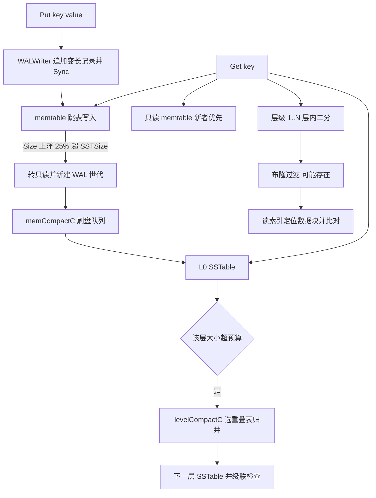

:::note 事实基线
本文依据 `$HOME/github/yukino.go/components/lsm_tree` 在 `91712867080` 的源码事实撰写；文中的路径、常量与 API 名称均可在该检出中定位。
:::

**主线一览**



:::danger 教学实现, 不要存不可丢失的数据
当前对外只有 `Put`/`Get`: 没有 `Delete`、没有墓碑、没有 MVCC 与快照隔离, WAL 记录也没有校验和 (README 中 "CRC-checked" 的描述与源码不符)。没有目录 fsync, 也没有批量提交策略。生产存储必须补齐这些能力。
:::

LSM-Tree 的思想是把随机写转换为顺序写: 写入先进内存缓冲与预写日志, 再批量顺序落盘, 后台持续合并。代价是同一份数据可能存在多个层级, 读取需要从新到旧逐层查找, 空间放大与读放大都需要 compaction 控制。`components/lsm_tree` (module `components/lsm_tree`, `go.mod` 声明 `go 1.26`) 是一个无外部依赖的完整实现, 覆盖预写日志、跳表内存表、块式 SSTable、布隆过滤与分级合并。

## 一、配置与入口

`NewConfig(dir, opts...)` 创建数据目录与 `walfile/` 子目录, 返回配置; `NewTree(conf)` 重建 SSTable 拓扑并重放 WAL 后启动 compaction goroutine。`Tree` 只暴露三个操作:

```go
func NewTree(conf *Config) (*Tree, error)
func (t *Tree) Put(key, value []byte) error
func (t *Tree) Get(key []byte) ([]byte, bool, error)
func (t *Tree) Close()
```

配置项与默认值 (`config.go`):

| 配置                  | 默认值                        | 含义                                |
| --------------------- | ----------------------------- | ----------------------------------- |
| `MaxLevel`            | `7`                           | 层数                                |
| `SSTSize`             | `1024*1024`                   | L0 单表预算, 深层按 `10^level` 放大 |
| `SSTNumPerLevel`      | `10`                          | 每层触发合并的表数阈值              |
| `SSTDataBlockSize`    | `16*1024`                     | 数据块目标大小                      |
| `SSTFooterSize`       | `32` → `repair` 抬到 `40`     | 尾部固定大小, 至少 40 字节          |
| `Filter`              | `filter.NewBloomFilter(1024)` | 可注入自定义 `filter.Filter`        |
| `MemTableConstructor` | `memtable.NewSkiplist`        | 可注入自定义内存表                  |

`repair` 在 `NewConfig` 与 `NewTree` 中都会被调用, 所以即使调用方直接构造 `Config` 也不会得到零值配置。

## 二、写入路径: WAL 先行

`wal/writer.go` 的 `WALWriter` 以 `os.O_CREATE|os.O_WRONLY|os.O_APPEND` 打开日志, 每条记录编码为:

```text
uvarint(len(key)) | uvarint(len(value)) | key | value
```

`Write` 在互斥锁内循环 `Write` 直到写完整个 buffer (零写入返回 `io.ErrShortWrite`), 最后调用 `dest.Sync()`。因此每条被确认的写都刷盘, 且 O_APPEND 保证崩溃重开不覆盖已有内容。辅助缓冲 `assistBuffer [30]` 用于编码两个变长整数。

`wal/reader.go` 的 `RestoreToMemtable` 处理撕裂写:

1. 一次性读入文件, `readAll` 逐个解析 uvarint 长度与键值, 并对长度做剩余字节与 int 上限检查。
2. 遇到长度前缀被截断、键/值被截断或长度明显越界时, 停止解析并保留已解析部分。
3. 若有效字节数小于文件长度, 调用 `os.Truncate(file, validSize)`, 把半条日志裁掉。
4. 把解析出的 KV 逐条灌入传入的 `MemTable`。

:::warning 没有校验和
记录只有长度前缀与原始字节, 没有 checksum 字段。也就是说"长度自洽但内容损坏"的情况无法检测; 源码也不做目录 fsync。这是教学实现的取舍, 不应存放不可恢复的数据。
:::

## 三、内存表与刷盘触发

`memtable/memtable.go` 定义接口:

```go
type MemTable interface {
    Put(key, value []byte)
    Get(key []byte) ([]byte, bool)
    All() []*KV
    Size() int
    EntriesCnt() int
}
type MemTableConstructor func() MemTable
```

默认实现 `memtable/skiplist.go` 的 `Skiplist`: 写入时克隆 key/value, 更新覆盖写只调整 `size` 差值; `roll()` 以 `rand.Intn(2)` 提升层数 (0..30, 最终层数 `level+1`); `All()` 按 key 有序返回, 供落盘时顺序写出。

`Tree.Put` 在全局 `dataLock.Lock()` 内依次 `walWriter.Write` 与 `memTable.Put`, 然后判断:

```go
if uint64(t.memTable.Size()*5/4) <= t.conf.SSTSize { return nil }
return t.refreshMemTableLocked()
```

即估算大小上浮 25% 后仍不超过预算才继续写, 否则把当前 memtable 转为只读、关闭其 WAL、送入 `memCompactC`, 递增 `memTableIndex` 并新建 memtable 与新一代 WAL (`walfile/{世代}.wal`)。

## 四、SSTable 物理格式

`flushMemTable` 与 `compactLevel` 都通过 `NewSSTWriter(t.sstFile(level, seq), conf)` 写盘, 文件名形如 `0_1.sst`, 实际路径由 `path.Join(conf.Dir, file)` 拼出。

一个 SSTable 由三段加一个固定尾部组成:

```text
[data blocks][filter blocks][index block][footer]
```

### 4.1 数据块与前缀压缩

`block.go` 的 `Block.Append` 记录三个 uvarint: 共享前缀长度、`len(key)-sharedPrefixLen`、值长度, 随后写键后缀与值。`util.SharedPrefixLen(a, b)` 计算相邻 key 的公共前缀。读取时 `SSTReader.ReadRecord(prevKey, buf)` 取回前缀并拼接, 同时做长度边界检查。每块目标 `SSTDataBlockSize` (16 KiB)。

### 4.2 布隆过滤块

`SSTWriter.refreshBlock` 在每个数据块结束时把 `conf.Filter.Hash()` 得到的位图写到 filter 块, key 是该数据块在文件中的偏移量 (`prevBlockOffset`), 然后 `Filter.Reset()`。`filter/bloom_filter.go` 的实现以 FNV-1a 为基础, 用旋转双哈希 `delta = (h>>17)|(h<<15)` 生成 k 个位置; `bestK()` 按 `0.69*m/键数` 计算并钳制在 `[1,30]`; 位图长度为 `(m+7)/8 + 1`, 最后一个字节存放 k。`Exist` 在位图为空、长度不符或 k 越界时返回 **true (可能存在)**, 宁可多读一次也不误判成不存在。

### 4.3 索引块与尾部

`insertIndex` 用 `util.GetSeparatorBetween(prevKey, key)` 生成分隔键 (通常取前一块最后一个键), 值为两个 uvarint: 前一块偏移与长度。因此定位是二分而不是扫描。

`Finish()` 写四个 uvarint 到尾部: 数据区长度、过滤区长度、数据+过滤累计长度、索引区长度。写入用 `writeFull` 循环, 最后 `dest.Sync()`。`Close()` 若发现 `!finished || finishErr != nil`, 会删除半成品文件。`SSTReader.readFooterLocked` 校验三段偏移必须首尾相接、正好填满尾部之前的所有字节, 否则返回 `invalid sst section offsets`。

## 五、读取路径

`Tree.Get` 的顺序 (`tree.go`):

1. `dataLock.RLock()` 下查活跃 memtable, 命中即返回。
2. `slices.Backward(t.rOnlyMemTable)` 查只读 memtable, 新者优先。
3. 释放 dataLock, 取 `levelLocks[0].RLock()`, `slices.Backward(t.nodes[0])` 逐表查 L0 (L0 表键范围可重叠, 必须都查)。
4. 对 level 1..N, 每层 `levelBinarySearch(level, key, ...)` 按 `startKey`/`endKey` 二分定位至多一张表 (层内不重叠), 再查该表。

`node.go` 的 `Node.Get`: 用 `binarySearchIndex` 在分隔键上二分定位数据块 → 取 `blockToFilter[PrevBlockOffset]` 位图做布隆判断 → `SSTReader.ReadBlock` 读块 → `ReadBlockData` 解压 → 线性比对 key。`Node.GetAll()` 走 `ReadData()` 读整个数据区, 供 compaction 使用。恢复时把每张表的布隆位图与索引一次性读进内存 (`loadNode`), 运行期读表只碰数据块。

## 六、并发模型

| 锁                              | 保护范围                                                            |
| ------------------------------- | ------------------------------------------------------------------- |
| `dataLock sync.RWMutex`         | 活跃/只读 memtable 与 WAL writer; 写 WAL 与写 memtable 在同一临界区 |
| `levelLocks [][]sync.RWMutex`   | 每层 `nodes` 切片的增删与读取, 层间互不阻塞                         |
| `WALWriter.mu` / `SSTReader.mu` | 单文件写入与读取位置                                                |
| `closeOnce sync.Once`           | `Close` 幂等                                                        |

compaction 是单 goroutine (`compact()`) 消费两个通道: `memCompactC` 刷只读表、`levelCompactC` 层间合并。旧表先从层级索引摘除, 再由独立 goroutine `Node.Destroy()` 关闭句柄并删除文件, `destroyWG` 保证 `Close` 时等待清理完成。

## 七、合并策略

`tryTriggerCompact(level)` 计算该层所有表大小之和, 超过 `SSTSize * 10^level * SSTNumPerLevel` 时向 `levelCompactC` 发信号。

`compactLevel(level)`:

1. `pickCompactNodes`: 取本层第一个表与中间表 (`len/2`) 的键范围并集作为参与区间, 收集本层与下一层中与之重叠的表 (循环 `for i := level+1; i >= level; i--`)。
2. `pickedNodesToKVs`: 用临时 memtable 归并所有参与表的 KV, 利用跳表的"相同 key 覆盖"语义去重, 得到有序结果。
3. 写入下一层, 单表上限 `SSTSize * 10^(level+1)`, 超出即 `Finish`/`Close`/`insertNode` 并开启新表; 任一步失败删除半成品文件。
4. `removeNodes` 从两层索引摘除旧表, 异步删除文件; 然后 `tryTriggerCompact(level+1)` 形成级联下推。

## 八、恢复流程

`NewTree` 先 `constructTree()`: 扫描目录中 `*.sst`, 按 `(level, seq)` 排序, `loadNode` 读取每张表的 filter 与 index 并插入层级索引。再 `constructMemtable()`: 扫描 `walfile/` 中的 `*.wal`, 按世代编号排序:

- 除最后一个外, 每个 WAL 重放为只读 memtable 并立刻送入 `memCompactC` 刷盘。
- 最后一个成为活跃 memtable, 并以追加模式重新打开对应 WAL 继续写入。
- 没有 WAL 时直接 `newMemTable()`。

## 九、适用场景与边界

适合:

- 高写入吞吐、键值语义简单、能接受后台带宽开销的本地引擎。
- 教学与嵌入式审计日志 (例如把执行事件按 key 追加进去)。

不适合:

- 需要事务、快照隔离或删除语义的场景: `Tree` 没有 `Delete`、没有墓碑、没有 MVCC。
- 不能承受 compaction 带宽抖动的场景: 合并由单 goroutine 驱动, 大层合并会占用 IO。
- 不能丢数据的重要存储: 没有校验和、没有目录 fsync、没有 fsync 策略调优。

## 十、真实使用片段

`README.md` 的 Quick start:

```go
conf, err := lsm_tree.NewConfig("./data",
    lsm_tree.WithMaxLevel(7),
    lsm_tree.WithSSTSize(4<<20),        // L0 sstable size, 4 MiB
    lsm_tree.WithSSTNumPerLevel(10),
    lsm_tree.WithSSTDataBlockSize(16<<10),
)
if err != nil { log.Fatal(err) }
tree, err := lsm_tree.NewTree(conf)
if err != nil { log.Fatal(err) }
defer tree.Close()

if err := tree.Put([]byte("hello"), []byte("world")); err != nil { log.Fatal(err) }
value, found, err := tree.Get([]byte("hello"))
log.Printf("found=%v value=%s", found, value)
```

`NewConfig` 自动创建数据目录与 `walfile/` 子目录; `NewTree` 会从已有 SSTable 与 WAL 重建状态。测试覆盖块编码、跳表、布隆误判率、WAL 写/恢复、端到端 put/get、并发与撕裂日志 (`wal_torn_test.go`、`tree_regression_test.go`)。

## 十一、源码索引

本文引用的源码文件 (均相对于组件目录):

| 路径                                                          | 用途                                      |
| ------------------------------------------------------------- | ----------------------------------------- |
| `README.md`                                                   | 架构图与 Quick start (部分描述与源码不符) |
| `config.go`                                                   | 配置、默认值与目录创建                    |
| `tree.go`                                                     | `Put`/`Get`、锁模型与内存表切换           |
| `tree_compact.go`                                             | 刷盘、选表、归并、级联触发                |
| `tree_restore.go`                                             | SSTable 拓扑重建与 WAL 重放               |
| `wal/writer.go`、`wal/reader.go`                              | 变长记录写入与撕裂恢复                    |
| `memtable/memtable.go`、`memtable/skiplist.go`                | 内存表接口与默认跳表                      |
| `block.go`                                                    | 块编码与前缀压缩                          |
| `sst_writer.go`、`sst_reader.go`                              | 三段块+尾部格式与校验                     |
| `node.go`                                                     | 表内索引二分与布隆过滤                    |
| `filter/bloom_filter.go`、`filter/filter.go`                  | 布隆实现与接口                            |
| `util/string.go`                                              | 共享前缀与分隔键                          |
| `tree_test.go`、`tree_concurrent_test.go`、`wal_torn_test.go` | 行为与恢复验证                            |
