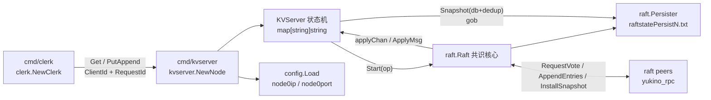

:::note 事实基线
本文依据 `$HOME/github/yukino.go/apps/raft_kv` 在 `91712867080` 的源码事实撰写；文中的路径、常量与 API 名称均可在该检出中定位。
:::

**主线一览**



:::tip 读图要点
**读请求也走 Raft 日志**：clerk 的 `Get` 与写请求一样经 `Raft.Start` 提交，再用 `applyChan` 回执，因此读操作天然排在所有更早的已提交写之后。去重不靠"读本地 map"，而靠 `(ClientId, RequestId)` 表。
:::

raft_kv 是一个"可线性化的分布式 KV 存储"，README 明确说它是 C++ 项目的移植：控制流保持对齐便于对照，线程/fiber 换成 goroutine，mprpc 换成 `yukino_rpc`，boost 序列化换成 `encoding/gob`，原来的跳表引擎换成 `map[string]string` 加互斥锁。模块路径 `github.com/hangtiancheng/yukino.go/apps/raft_kv`，`go.mod` 声明 `go 1.26.0`，直接依赖只有 `libs/yukino_rpc v0.0.2`。本文按"节点装配 → Raft 核心 → KV 状态机 → 客户端 → 容错边界"展开。

## 定位与目录结构

| 目录               | 内容                                                                                     |
| ------------------ | ---------------------------------------------------------------------------------------- |
| `cmd/kvserver`     | 单节点模式与本地集群 bootstrap 入口                                                      |
| `cmd/clerk`        | 演示客户端，一次性操作与压测循环                                                         |
| `raft/`            | `raft.go`（共识核心）、`persister.go`（原子持久化）、`rpc.go`（RPC 类型与 Service 包装） |
| `kvserver/`        | `kvserver.go`（状态机与 RPC handler）、`node.go`（节点装配）                             |
| `clerk/`           | 带 leader 故障转移的客户端库                                                             |
| `config/`          | 节点地址文件读写                                                                         |
| `test/e2e_test.go` | 真实 loopback 集群端到端测试                                                             |

`Makefile` 提供 `make build`、`make test`、`make race`。README 的快速上手是 `bin/kvserver -n 3 -f test.conf -datadir ./data` 起三节点集群，再用 `bin/clerk -f test.conf -put x=hello` / `-append x=,world` / `-get x` 驱动。

## 节点装配：cmd/kvserver 与 config

`cmd/kvserver/main.go` 的 flag 与含义：

| Flag            | 默认值      | 含义                        |
| --------------- | ----------- | --------------------------- |
| `-f`            | `test.conf` | 集群配置文件                |
| `-id`           | `-1`        | 单节点模式的节点 id         |
| `-n`            | `0`         | 启动 n 个子进程的本地集群   |
| `-maxraftstate` | `500`       | 快照阈值（字节），`-1` 关闭 |
| `-datadir`      | `.`         | 持久化状态与快照目录        |
| `-v`            | `false`     | debug 级日志                |

`runNode()` 调 `config.Load` 得到 `[]config.Node`，把每个节点的 `Addr()` 汇成 `addrs []string`，再 `kvserver.NewNode(kvserver.NodeConfig{ID, Addrs, MaxRaftState, DataDir, Logger})`。`Node.Serve()` 在 goroutine 里跑，`SIGINT`/`SIGTERM` 到达时调 `node.Shutdown()`。

`runCluster()` 用 `findFreePortRange(n)` 找 n 个连续空闲端口，`config.Save` 写入配置，然后用 `os.Executable()` 找到自身二进制，以 `exec.CommandContext` 启动 n 个子进程；`cmd.Cancel` 发 `os.Interrupt` 让子节点优雅退出，`WaitDelay = 5s` 给它们收尾时间。`waitAll` 汇总第一个非信号类失败。

`config.Load` 按 `node0ip`/`node0port` 顺序读，遇到第一个缺失的 `node{i}ip` 结束；空行与 `#` 注释忽略；缺端口或端口越界都会报错。`Node.Addr()` 用 `net.JoinHostPort` 输出地址。

### NewNode 如何把各层拼起来

`kvserver.NewNode(NodeConfig)` 是真正的装配中心，顺序固定：

1. 校验 `ID` 落在 `[0, len(Addrs))`，否则返回错误；日志加 `node=<id>` 属性。
2. `raft.NewPersister(cfg.DataDir, cfg.ID)` 打开该节点的持久化记录。
3. 为除自己外的每个地址 `raft.DialPeer(addr)` 建立 peer stub，`peers[me]` 保持 nil——节点不向自己发 RPC；任一步失败就关闭已建的 peer。
4. 创建 `applyChan := make(chan raft.ApplyMsg, 256)`，与 `applyChanBuffer` 对齐，再 `raft.NewRaft(peers, id, persister, applyChan, logger)`。
5. `NewKVServer(id, maxRaftState, rf, persister, applyChan, logger)` 建立状态机，并让它也从同一个 persister 读快照。
6. `rpc.NewServer()` 上注册两个服务：`raft.ServiceName` → `rf.Service()`，`ServiceName`（`KVServer`）→ `kv`；两者共享 `net.Listen("tcp", cfg.Addrs[ID])` 得到的单个 listener。
7. `Serve()` 阻塞在 `rpcServer.Serve(listener)`；`Shutdown()` 依次 `kv.Stop()` → `rf.Kill()` → `rpcServer.GracefulStop()` → 关闭所有 peer connections。

`Node.Raft()`、`Node.KV()`、`Node.Addr()` 为监控与测试暴露内部对象。注意构造阶段只建对象不接收连接，`Serve()` 才真正 accept。

## Raft 共识核心（raft 包）

### 时序常量与角色

`raft/raft.go` 顶部常量直接沿用 C++ 的 `config.h` 口径：

```go
HeartBeatTimeout  = 25 * time.Millisecond
ApplyInterval     = 10 * time.Millisecond
MinElectionTimeout = 300 * time.Millisecond
MaxElectionTimeout = 500 * time.Millisecond
applyChanBuffer   = 256
```

心跳间隔比选举超时低一个数量级，保证 leader 能在 follower 发起新选举前确立权威。角色是 `Status` 枚举：`Follower`、`Candidate`、`Leader`。

### Raft 结构与持久化状态

`Raft` 的所有可变状态由一把 `mu` 保护：`currentTerm`、`votedFor`、`logs []LogEntry`、`commitIndex`、`lastApplied`，以及 leader 专有的 `nextIndex`/`matchIndex`。网络调用在自己的 goroutine 中执行且**绝不持锁做 I/O**。`persistedState` 用 gob 编码，包含 `CurrentTerm`、`VotedFor`、`LastSnapshotIncludeIndex`、`LastSnapshotIncludeTerm`、`Logs`。

`ApplyMsg` 是 Raft 传给状态机的信封：`CommandValid`、`Command`、`CommandIndex` 四个字段承载已提交命令，`SnapshotValid`、`Snapshot`、`SnapshotTerm`、`SnapshotIndex` 四个字段承载快照安装。`Progress` 提供 `Term`、`Status`、`IsLeader`、`VotedFor`、`CommitIndex`、`LastApplied`、`LastLogIndex`、`SnapshotIndex`、`SnapshotTerm` 的即时视图，供监控与测试使用。

对外 API 精简为 `NewRaft(peers, me, persister, applyCh, logger)`、`GetState()`、`Progress()`、`GetRaftStateSize()`、`Start(command)`、`Snapshot(index, snapshot)`、`CondInstallSnapshot(...)` 与 `Kill()`。`Start` 返回 `(index, term, isLeader)`，非 leader 直接拒绝提交。

`NewRaft` 在启动三个 ticker（`electionTicker`、`heartbeatTicker`、`applierTicker`）之前先 `readPersist` 恢复状态；当 `lastSnapshotIncludeIndex > 0` 时把 `lastApplied` **和 `commitIndex` 都**设为该索引——源码中的 FIX 注释指出 C++ 原版只恢复了前者，导致重启节点短暂认为已提交数据未提交、可能重复 apply。

### RPC 类型与 Service 包装

`raft/rpc.go` 定义 `ServiceName = "Raft"`、`PeerRPCTimeout = 2 * time.Second`，以及 `LogEntry`、`RequestVoteArgs/Reply`、`AppendEntriesArgs/Reply`、`InstallSnapshotRequest/Response`。`Peer` 封装一条到对端的连接，`DialPeer(addr)` 建立，`RequestVote`、`AppendEntries`、`InstallSnapshot` 三个方法带 `context` 与 bool 返回值表示 RPC 是否成功。

`Raft.Service()` 返回一个薄包装 `*Service`，只暴露 `RequestVote`、`AppendEntries`、`InstallSnapshot` 三个网络可达方法；`Start`、`Snapshot`、`Kill` 等管理接口不会被网络调用到。这与 `kvserver.ServiceName = "KVServer"` 的两个服务共享节点上的同一个 listener。

### 选举、复制与提交的实现要点

README 的 Features 段把共识侧的四个关键点写得很清楚，源码也按这个口径组织：

| 机制     | 当前实现                                                                                                  |
| -------- | --------------------------------------------------------------------------------------------------------- |
| 选主     | 随机化选举超时，避免多个 follower 同时超时造成反复 split vote                                             |
| 日志复制 | 带"按冲突 term 回溯"的快速优化，不必逐个 index 回退 `nextIndex`                                           |
| 提交     | 通过扫描各节点的 `matchIndex` 统计多数派；只有**当前 term** 的条目可以按计数提交，保证 Raft Figure 8 安全 |
| 追赶     | 日志落后的 follower 通过 `InstallSnapshot` 直接接收状态机快照                                             |

三个后台 goroutine 的职责分别是：超时未收到 leader 消息就发起选举、leader 按 `HeartBeatTimeout` 广播心跳、按 `ApplyInterval` 把已提交条目推入 `applyChan`。它们都从墙钟截止时间重算 sleep 间隔，而不是固定 sleep；`shutdown` channel 让每个阻塞 `select` 都能及时退出。

### 从 C++ 移植时修正的缺陷

源码中用 `FIX` 注释标出了若干真实缺陷，这些是阅读两个版本时最容易混淆的地方：

| 位置                                 | 修正内容                                                                                               |
| ------------------------------------ | ------------------------------------------------------------------------------------------------------ |
| `raft/persister.go`                  | C++ 的持久化层会破坏它本应保护的状态；Go 版改为 magic + 长度前缀的单记录原子写，并在启动时加载而非截断 |
| `raft/raft.go` `NewRaft`             | 恢复快照时同时设置 `commitIndex`，避免重启后短暂把已提交数据当作未提交、重复 apply                     |
| `kvserver/kvserver.go`               | 快照触发比例从硬编码的 1/10 改为文档意图的 9/10（`<maxRaftState` 的 9/10）                             |
| `kvserver/kvserver.go` `NewKVServer` | 快照损坏时显式报错，而不是从空状态启动导致静默数据丢失                                                 |

这些修正不改变对外 API，但会影响对旧日志/旧快照的解读：新版本从 `raftstatePersistN.txt` 中按 `pairMagic` 和 8 字节长度切出 state 与 snapshot，而不是从两个独立文件分别读取。

### Persister：状态与快照共用一个原子记录

`raft/persister.go` 的 `pairMagic = "\x00yukino-kv-state-v1\x00"`。`Persister` 把 Raft 状态和对应快照拼成一条记录写入 `raftstatePersistN.txt`：magic + 8 字节大端状态长度 + state + snapshot。`NewPersister(dir, me)` 会读旧文件；若带 magic 就按长度切分，否则回退读老的 `snapshotPersistN.txt` 双文件布局。

`SaveRaftState(state)` 保留现有 snapshot，`Save(raftState, snapshot)` 同时替换两者；`ReadRaftState()` 与 `ReadSnapshot()` 都返回 `bytes.Clone` 的拷贝，`RaftStateSize()` 给 KV 层判断是否需要快照。`writeFileAtomically` 走临时文件 → `Sync` → `Close` → `os.Rename` → 打开目录再 `Sync`，读者只会看到旧内容或新内容，不会看到半截写入。

## KVServer：状态机与恰好一次执行

`kvserver/kvserver.go` 的关键常量：

```go
ServiceName         = "KVServer"
ConsensusTimeout    = 500 * time.Millisecond
OK / ErrNoKey / ErrWrongLeader / ErrInvalidOp
OpPut / OpAppend / OpGet
snapshotNumerator = 9
snapshotDenominator = 10
```

`Op` 是走 Raft 日志的命令：`Operation`、`Key`、`Value`、`ClientId`、`RequestId`。`encode()`/`decodeOp()` 用 gob。`snapshotPayload` 包含 `DB map[string]string`、`LastRequestId map[string]int` 和 `LastSnapshotIndex`，确保快照安装后仍能跳过已执行命令。

`KVServer` 结构里，`db` 是状态，`waitApplyCh map[int]map[chan Op]struct{}` 把 log index 映射到等待回执的 RPC handler，`lastRequestId map[string]int` 记录每个 client 已执行的最大请求 id，`lastSnapShotRaftLogIndex` 标记最新快照覆盖到的索引。`NewKVServer` 从 `persister.ReadSnapshot()` 恢复快照（损坏时只记 error 不静默清空），并启动 `readRaftApplyCommandLoop`。

### 请求路径

1. `Get`/`PutAppend` 构造 `Op`，`op.encode()` 后 `submit(encoded)`；非 leader 立即回 `ErrWrongLeader`。
2. Raft 复制并提交，`applyChan` 把 `ApplyMsg` 送回；handler 在 `ConsensusTimeout` 内等 `waitApplyCh[index]` 上的 channel。
3. apply 循环用 `ifRequestDuplicate(clientId, requestId)` 判重，未重复才执行 `OpPut`/`OpAppend`（`OpGet` 仅作读屏障），随后唤醒等待者。
4. 等待者核对回执中的 `ClientId`/`RequestId` 是否与自己的请求一致；不一致说明 `Start` 到提交之间 leader 变了，回 `ErrWrongLeader`。
5. 写请求超时时查去重表：若命令已执行，只丢了回复，直接回 `OK`；否则让 clerk 换节点重试。`Get` 超时则直接回 `ErrWrongLeader`。

`readRaftApplyCommandLoop` 用两层 `select`：先非阻塞地优先看 `kv.done`，保证忙碌的 apply channel 不会拖慢关停。`getCommandFromRaft` 会跳过索引 ≤ `lastSnapShotRaftLogIndex` 的陈旧消息。

### 快照触发

当 `maxRaftState != -1` 且已持久化状态超过阈值的 9/10（`snapshotNumerator`/`snapshotDenominator`），状态机调 `Snapshot(db)` 把 `snapshotPayload` 交给 Raft 压缩日志。源码 FIX 注释说明 C++ 原版接受比例参数却硬编码为 1/10，这里按文档意图改为 9/10。滞后 follower 通过 `InstallSnapshot` 追赶，`CondInstallSnapshot` 让状态机有机会拒绝与当前状态冲突的快照。

## clerk：带 leader 故障转移的客户端

`clerk/clerk.go` 导出 `ErrNoKey = errors.New("clerk: key does not exist")`、`Clerk`、`NewClerk(addrs, logger)`、`ClientId()`、`Get(ctx, key)`、`Put(ctx, key, value)`、`Append(ctx, key, value)`、`PutAppend(ctx, key, value, op)` 和 `Close()`。

客户端 id 由 `crypto/rand` 生成，请求 id 单调递增，因此同一操作重试携带相同 `(clientId, requestId)`，配合服务端去重表实现**至少一次投递下的恰好一次执行**。`cmd/clerk/main.go` 的开关包括 `-f`、`-count`（默认 500）、`-key`（默认 `x`）、`-get`、`-put`、`-append`、`-v`；`-put`/`-append` 用 `strings.Cut(value, "=")` 拆 `key=value`，读不到键时打印 `<no such key>`。

:::warning 后端引擎不是跳表
C++ 原版用跳表做状态机，这里换成 `map[string]string` + `sync.Mutex`；README 明确说原项目 README 把引擎视为可替换的状态机。真正的并发跳表实现在同仓库另一个库，见文末交叉链接；不要在 raft_kv 里寻找 `SkipList` 类型。
:::

## 并发、容错与边界

| 关注点   | 当前事实                                                                                                |
| -------- | ------------------------------------------------------------------------------------------------------- |
| 锁顺序   | 一把锁护 Raft 状态、一把护 KV 状态；严格按 **KV → Raft** 加锁，不会死锁                                 |
| 网络 I/O | 所有 RPC 调用都不持锁，三个 ticker 按墙钟截止时间重算 sleep 间隔                                        |
| 关停     | `shutdown` channel 被每个阻塞 `select` 监听；`Kill()` 等三个 ticker 退出，避免关停后继续写状态          |
| 崩溃恢复 | 原子写入 + 目录 fsync + 启动恢复 term/vote/log/db；快照与去重表一起持久化                               |
| 幂等     | 写请求超时回查去重表；读请求走日志成为读屏障，避免陈旧读                                                |
| 测试覆盖 | `test/e2e_test.go` 覆盖基本操作、Append、缺失键、leader 切换、快照压缩、follower 重启追赶与全量崩溃恢复 |

`NewKVServer` 遇到损坏快照时只写 error 日志而不清空状态，源码注释指出"从空状态启动会静默丢数据，所以必须显式暴露"。`Stop()` 幂等且等 apply 循环退出，未处理完的已提交消息不会丢：重启后 Raft 会重放快照点之后的所有命令，去重表保证不重复执行。

:::danger maxraftstate 的单位是字节
`-maxraftstate` 默认 500（字节），不是条目数；`-1` 才关闭快照。把它当成"500 条日志"会过早触发快照，而设得过大则会让 Raft 状态无限增长、拉长重启恢复时间。
:::

## 适用与不适用

**适用**

- 学习或对照 Raft 的选主、日志复制、冲突回溯、快照安装与 Figure 8 安全性约束。
- 需要一个可本地一键起集群、可注入故障并跑端到端测试的 KV 原型。
- 需要"读也走共识 + 请求 id 去重"这种强语义的教学型存储层。

**不适用**

- 生产级多租户存储：没有鉴权、限流、压缩策略配置或在线成员变更。
- 需要很高写入吞吐：每条命令（含读）都经一次多数派复制，`ConsensusTimeout` 仅 500ms。
- 需要范围查询或事务：`db` 只是 `map[string]string`，只支持 `Get`/`Put`/`Append`。

**延伸阅读**

共识组件本身见 [yukino_raft](./yukino-raft)；节点间与客户端 RPC 使用的框架见 [yukino_rpc](./yukino-rpc)；原 C++ 版本所用引擎的 Go 对照实现见 [yukino_skiplist](./yukino-skiplist)；另一套"配置装配 + 多进程"的 Go 服务见 [yukino_cloud_storage](./yukino-cloud-storage)。
