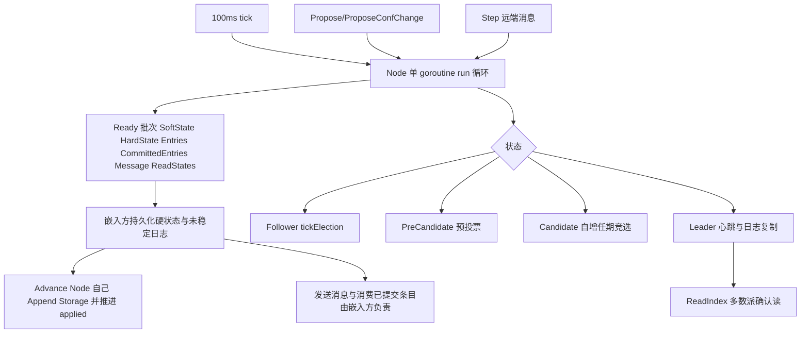

:::note 事实基线
本文依据 `$HOME/github/yukino.go/components/raft` 在 `91712867080` 的源码事实撰写；文中的路径、常量与 API 名称均可在该检出中定位。
:::

**主线一览**



:::danger 示例不能用于真实多节点部署
`cmd/raftkv` 是单节点配置 (ID=1, peers 只有自己), 存储是内存, 传输层置空: `Ready.Message` 被丢弃, 消息会被生成但不会真正跨进程发送, `Node.Step` 也没有被接线。需要生产共识请使用成熟的 etcd/raft 实现。
:::

这是对 Raft 的一次完整而非发散的实现: 选举状态机 (追随者、预候选、候选、领导者四态)、随机化选举超时、可选的预投票 (`Config.PreVote`)、日志复制、成员变更、线性一致读, 以及按批量驱动模型封装的对上层接口。用途是演示共识算法的结构与驱动方式, 而不是提供生产级协调服务。module `components/raft` 的 `go.mod` 声明 `go 1.26`。

## 一、分层与文件地图

| 层       | 文件                                                                                                                | 职责                                  |
| -------- | ------------------------------------------------------------------------------------------------------------------- | ------------------------------------- |
| 共识核心 | `raft.go`、`follower.go`、`candidate.go`、`leader.go`、`log.go`、`progress.go`、`read.go`、`model.go`、`storage.go` | 纯状态机, 不含网络                    |
| 驱动     | `node.go`、`ready.go`                                                                                               | 单 goroutine 事件循环与 Ready 批次    |
| 示例服务 | `cmd/raftkv/{main.go,proxy.go,kv_store.go,http_api.go}`                                                             | HTTP API + raftProxy 驱动 + KV 状态机 |

`Config` 的关键字段: `ID`、`peers` (未导出)、`Storage`、`Applied`、`PreVote`、`ElectionTick`、`HeartbeatTick`。`Peer{ID, Context}` 用于初始集群成员。`Node` 公开 `StartNode`、`Tick`、`Campaign`、`Propose`、`ProposeConfChange`、`ReadIndex`、`Step`、`ApplyConfChange`、`Ready`、`Advance`、`Stop`。

## 二、Node 驱动模型

`StartNode(conf, peers)` 构造 `raft` 核心、加入 peers, 启动 `n.run(r)` 后返回 `Node`。`run` 是一个单 goroutine 的 `select`, 串行处理:

- `proc` 通道: 本地提议 (`Propose`/`ProposeConfChange`), 处理时把 `m.From` 设为自身 ID。
- `recvChan` 通道: 远端消息, 来自 `Step` 或本地流程。
- `confChan`/`confStateChan`: `ApplyConfChange` 的同步往返。
- `tickChan`: `Tick()` 以非阻塞方式发送信号。
- `readyChan`/`advanceChan`: Ready 批次的交付与确认。

`Ready` 批次包含 `SoftState`、`HardState`、`ReadStates`、未稳定 `Entries`、已提交 `CommittedEntries`、`Message []Message`。`newReady` 只在软/硬状态变化时设置对应字段。交付一批 Ready 后, `run` 会清空 `r.msgs` 与 `r.readStates`。

`Advance()` 触发的收尾由 Node 循环**自己完成**: 把未稳定条目 `Append` 到 `Storage`、标记 stable、持久化 `HardState`、按 `CommitIndex` 推进 applied。而**发送消息**与**应用已提交条目**留给嵌入方处理——这是理解示例行为的关键。

`Step(ctx, message)` 只接受 `MsgApp` 到 `MsgPreVoteResp` 区间的远端消息类型, 要求 `From != None`, 并在入队前用 `cloneMessage` 深拷贝 `Entries` 与 `Context`, 所以调用方可以安全复用消息缓冲区。

## 三、共识核心的状态机

`raft.go` 用函数指针表达角色行为: `tick` 在 `tickElection`/`tickHeartbeat` 间切换, `step` 在 `stepFollower`/`stepCandidate`/`stepLeader` 间切换。核心状态包括 `Term`、`Vote`、`lead`、`prs map[uint64]*Progress`、`votes`、`msgs`、`pendingConf`、`readOnly`、`checkQuorum` 与随机化选举超时。

`reset` 在进入新任期时清空 Vote、lead、计时器、投票记录与 pendingConf, 并调用 `resetRandomizedElectionTimeout`: 超时 = `ElectionTick + rand[0, ElectionTick)`。

消息处理先比较任期 (`raft.Step`):

- `m.Term > r.Term`: 退位为追随者, lead 取消息来源 (投票类消息除外)。但 `MsgPreVote` 与被接受的 `MsgPreVoteResp` 不触发退位——这是预投票不打断稳定集群的关键。
- `m.Term < r.Term`: 直接忽略; 若开启 `checkQuorum` 且是心跳/追加消息, 回一条 `MsgAppResp` 帮助对方发现落后。
- `MsgHup` 触发选举: 已是 leader、不可提升、或存在未应用的成员变更条目时都不发起。

## 四、选举与预投票

`campaign(typ)`:

- `campaignPreElection`: 进入 `StatePreCandidate`, 使用 `r.Term + 1` 作为消息任期但**不自增本地任期**, 广播 `MsgPreVote`。
- `campaignElection`: 进入 `StateCandidate`, `reset(r.Term+1)` 自增任期, `Vote = r.id`, 广播 `MsgVote`。

`poll` 用 `votes map[uint64]bool` 累计grant, `quorum() = len(prs)>>1 + 1`。拿到多数派预投票后才真正竞选, 这样刚恢复的网络分区节点不会用高任期打断稳定集群。当选后 `becomeLeader` 立即追加一条空日志条目 (`Data: nil`) 确立权威, 并把每个 peer 的 `Progress.Next` 重置为 `lastIndex+1`。

`stepCandidate` 在收到 `MsgApp`/`MsgHeartbeat` 时退位追随者; 收到投票响应时按 grant 数决定当选或退位。

## 五、日志复制与进度跟踪

`leader.go` 的 `sendAppend(to)` 依据 `Progress.Next` 取前一条日志的任期与后续条目, 构造 `MsgApp`。追随者 `handleAppendEntries` 调用 `raftLog.maybeAppend` 做一致性检查: 成功回 `MsgAppResp{LogIndex: lastNewIndex}`; 失败回 `Reject: true` 并带 `RejectHint = rafLog.lastIndex()`, 领导者用 `mayDecreaseTo` 回退 Next 再重试。心跳由 `tickHeartbeat` 每 `HeartbeatTick` 触发, `sendHeartbeat` 携带 `CommitIndex = min(commitIndex, pr.Match)`。

提交索引推进在 `maybeCommit`: 收集所有 peer 的 `Match` 降序排序, 取第 `quorum()` 位的值交给 `raftLog.maybeCommit(mid, r.Term)`; 只有该位置任期等于当前任期才推进。`candidate.go` 中当选后也会立刻 `broadcastAppend()`。

## 六、成员变更

变更以 `EntryConfChange` 类型的日志条目提交 (`ProposeConfChange` 把 `ConfChange` JSON 化后作为 `MsgProp` 提议)。约束:

- `stepLeader` 遇到 `EntryConfChange` 且 `pendingConf == true` 时, 把该条目降级为 `Entry{Type: EntryNormal}`, 保证同一时刻只有一条待决变更。
- `MsgHup` 检查未应用区间内的待决变更, 有则拒绝发起选举。
- 上层调用 `ApplyConfChange(cc)` 后, `applyConfChange` 按 `ConfChangeAddNode`/`RemoveNode`/`UpdateNode` 改配置, 清除 `pendingConf`, 返回新的 `ConfState`。移除自身时会退位为追随者。

`ConfChange` 结构包含 `ID`、`Type`、`NodeID`、`Context`;`ConfChangeType` 有 `AddNode`、`RemoveNode`、`UpdateNode` 三种。

## 七、ReadIndex 线性一致读

`ReadIndex` 不追加日志 (`leader.go`):

- 单节点集群: 直接把当前 `commitIndex` 写进 `ReadState` 返回。
- 多节点: 先校验提交索引处条目的任期等于当前任期 (防止新领导者用旧提交应答), 记录 `commitIndex` 与请求上下文到 `readOnly.addRequest`, 然后广播一次带上下文的心跳。
- 收到多数派 `MsgHeartbeatResp` 后 `readOnly.advance(ctx)` 批量确认: 本节点发起的读生成 `ReadState`, 转发的读则回 `MsgReadIndexResp` 给跟随者。
- 跟随者收到 `MsgProp`/`MsgReadIndex` 会把消息转发给 leader; 收到 `MsgReadIndexResp` 生成 `ReadState`。

读的代价是一次心跳往返, 而不是一条日志。`read.go` 用 `pendingReadIndex map[string]*readIndexStatus` 与 `readIndexQueue []string` 管理待确认请求。

## 八、存储抽象

`storage.go` 的 `Storage` 接口提供 7 个方法: `InitialState`、`Entries`、`Term`、`FirstIndex`、`LastIndex`、`Append`、`SetHardState`。内置 `MemoryStorage` 用 `entries []Entry` 加首条哨兵实现, 并对写入做校验:

- `Append`: 条目索引必须连续, 超出本地 LastIndex 返回 `ErrUnavailable`, 越界/回绕返回 `ErrInvalidRange`; 取出时深拷贝 `Data`。
- `SetHardState`: 拒绝 `CommitIndex > LastIndex`。
- `Entries`: `l > r` 返回 `ErrInvalidRange`, 已压缩区间返回 `ErrCompacted`, 越界返回 `ErrUnavailable`。
- `Term`: 越界分别返回 `ErrCompacted` 与 `ErrUnavailable`。

## 九、示例服务的实际接线与边界

`cmd/raftkv/main.go` 以 `newRaftProxy(1, []string{"node1"}, ...)` 启动单节点, 创建 `kvStore`, 在 8091 端口提供 HTTP 服务。

`proxy.go` 的 `run`/`listen`:

- 构造 `raft.Config{ID: 1, ElectionTick: 10, HeartbeatTick: 1, Storage: raft.NewMemoryStorage()}`, `PreVote` 未开启。
- 每 100ms 调用一次 `node.Tick()`; 从 `node.Ready()` 收批次, 调 `applyReady` 后 `node.Advance()`。
- `applyReady` 对 `CommittedEntries` 逐个处理: `EntryConfChange` 反序列化后 `ApplyConfChange`; `EntryNormal` 且数据非空则把 `string(entry.Data)` 送入 `commitC` (空数据是领导者 no-op, 跳过)。

**当前示例把已提交条目送进了 KV 状态机**; 仍然缺失的是传输层: `rd.Message` 没有被发送, `Node.Step` 没有被调用, 因此 `Ready` 里的消息被直接丢弃。`kv_store.go` 从 `commitC` 读 `{key, val}` JSON 并写入内存 map。`http_api.go` 只接受 `PUT /<key>` (提议写) 与 `POST /{nodeID}` (提议 `ConfChangeAddNode`), 没有读接口——线性读能力存在于核心, 示例并未接线。

:::warning 单节点 ≠ 共识验证
示例只能在单进程里验证状态机、驱动模型与日志语义。它不会跨进程发送消息, 也没有持久化与读接口, 不能用来验证多数派、分区恢复或线性读。
:::

## 十、真实使用片段

`README.md` 的嵌入方式:

```go
c := raft.Config{
    ID:            1,
    ElectionTick:  10,
    HeartbeatTick: 1,
    Storage:       raft.NewMemoryStorage(),
}
node := raft.StartNode(&c, []raft.Peer{{ID: 1}})
go func() {
    ticker := time.NewTicker(100 * time.Millisecond)
    defer ticker.Stop()
    for range ticker.C { node.Tick() }
}()
for {
    select {
    case <-node.Ready():
        // 1. persist HardState / ConfState
        // 2. persist unstable entries
        // 3. send messages to peers
        // 4. apply committed entries to your state machine
        node.Advance()
    }
}
_ = node.Propose(ctx, []byte("key=value"))
_ = node.ProposeConfChange(ctx, raft.ConfChange{NodeID: 2, Type: raft.ConfChangeAddNode})
_ = node.ReadIndex(ctx, nil)
```

示例服务的 HTTP 调用:

```sh
curl -X PUT http://localhost:8091/name -d 'yukino'
curl -X POST http://localhost:8091/2 -d 'node-2-context'
```

## 十一、核心类型速查与示例差距清单

| 类型        | 关键字段/方法                                                                         | 作用                                |
| ----------- | ------------------------------------------------------------------------------------- | ----------------------------------- |
| `Entry`     | `Term`、`Index`、`Type`、`Data`                                                       | 日志条目, `Type` 区分普通与成员变更 |
| `Message`   | `Type`、`From`/`To`、`Term`、`LogTerm`/`LogIndex`、`Entries`、`RejectHint`、`Context` | Raft RPC 联合类型                   |
| `HardState` | `Term`、`Vote`、`CommitIndex`                                                         | 必须持久化的三元组                  |
| `SoftState` | `Lead`、`RaftState`                                                                   | 可丢弃的易失状态                    |
| `Ready`     | `SoftState`、`HardState`、`ReadStates`、`Entries`、`CommittedEntries`、`Message`      | 批量交付单元                        |
| `Progress`  | `Match`、`Next`                                                                       | 每个 peer 的复制进度                |
| `Storage`   | 7 个方法                                                                              | 日志与硬状态持久化抽象              |
| `ReadState` | `Index`、`RequestCtx`                                                                 | 线性读结果                          |

从示例走向真实部署, 至少还差四件事:

1. **传输层**: 把 `Ready.Message` 发给对应节点, 并在收到 RPC 时调用 `Node.Step`; 示例两项都没有。
2. **持久化**: 用可落盘的 `Storage` 替换 `MemoryStorage`, 并在 `Advance` 前保存 HardState 与未稳定条目。
3. **状态机应用**: 示例已把已提交条目送入 `commitC`, 但没有持久化状态机与重放逻辑。
4. **读接口与成员变更治理**: 示例没有 GET 端点, `ReadIndex` 未接线; `POST /{nodeID}` 只是提议加节点, 没有变更安全性约束的编排。

:::tip 读核心代码的最佳顺序
先读 `model.go` 建立类型词汇表, 再读 `node.go`/`ready.go` 理解驱动契约, 然后按 `raft.go` → `follower.go` → `candidate.go` → `leader.go` 走一遍选举与复制, 最后看 `read.go` 与 `cmd/raftkv/proxy.go` 如何把核心接到应用上。
:::

## 十二、源码索引

本文引用的源码文件 (均相对于组件目录):

| 路径                                                      | 用途                                                 |
| --------------------------------------------------------- | ---------------------------------------------------- |
| `README.md`                                               | 架构图、嵌入示例与 HTTP API                          |
| `model.go`                                                | `Config`、`Message`、`Entry`、`ConfChange`、状态常量 |
| `raft.go`                                                 | 状态机、任期比较、选举与提交推进                     |
| `follower.go`、`candidate.go`、`leader.go`                | 三态具体行为与 ReadIndex                             |
| `log.go`、`progress.go`                                   | 日志一致性与 Match/Next                              |
| `read.go`                                                 | ReadIndex 请求追踪                                   |
| `storage.go`                                              | `Storage` 接口与 `MemoryStorage`                     |
| `node.go`、`ready.go`                                     | 驱动循环、Ready 批次与 Advance                       |
| `cmd/raftkv/main.go`、`proxy.go`                          | 示例装配与驱动                                       |
| `cmd/raftkv/kv_store.go`、`http_api.go`                   | KV 状态机与 HTTP 表面                                |
| `raft_test.go`、`concurrency_test.go`、`shutdown_test.go` | 共识行为与停机验证                                   |
