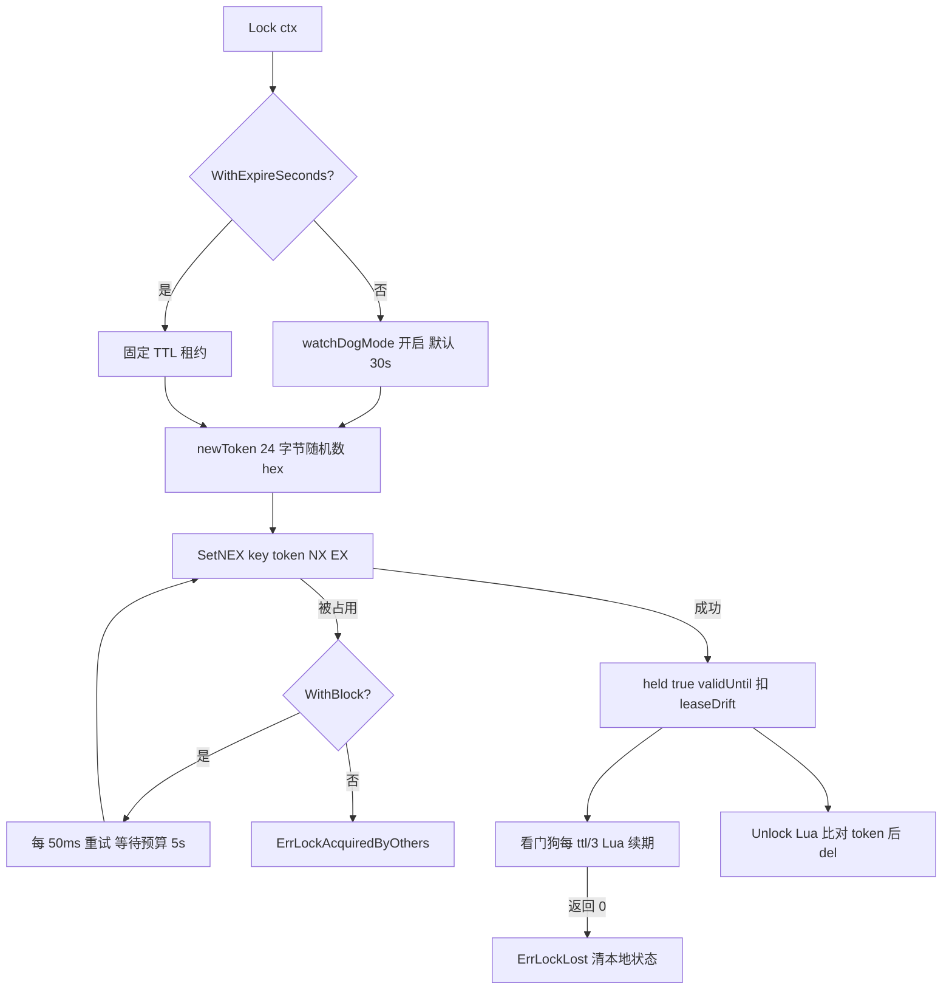

:::note 事实基线
本文依据 `$HOME/github/yukino.go/components/redis_lock` 在 `91712867080` 的源码事实撰写；文中的路径、常量与 API 名称均可在该检出中定位。
:::

**主线一览**



:::danger 不可重入、不可换实例释放
`RedisLock` 只持有一个 token 与一个 `held` 标志, 同一实例二次 `Lock` 直接返回 `ErrAlreadyHeld`; 另一个实例即使在同一进程也无法解开这把锁, 因为 token 不匹配。需要嵌套语义时, 必须在锁之上自行维护计数。
:::

redis_lock 是 `go.work` 下的独立 Go module (`components/redis_lock/go.mod`, `go 1.26.0`), 同时提供两个层次的原语: 面向单个 Redis 主节点的 `RedisLock`, 以及面向多个独立主节点的 `RedLock`。它要消灭的核心事故是"释放了别人的锁": 客户端 A 加锁后超时, 租约过期, 客户端 B 拿到同一把锁, 此时 A 才执行释放, 把 B 的锁删掉。组件把所有权编码进 token, 并把所有变更状态的操作变成 Lua 里的"先比较再执行", 使这类错误在构造上不可能发生。

## 一、API 表面与文件地图

| 文件          | 角色                                                                     |
| ------------- | ------------------------------------------------------------------------ |
| `lock.go`     | `RedisLock` 结构、加锁/续期/释放、看门狗、token 生成                     |
| `red_lock.go` | `RedLock` 结构、多节点并行加锁/续期/释放                                 |
| `lua.go`      | `LuaCheckAndDeleteDistributionLock`、`LuaCheckAndExpireDistributionLock` |
| `redis.go`    | `LockClient` 接口与内置 go-redis 适配器 `Client`                         |
| `option.go`   | 客户端/单锁/RedLock 三组 option 与默认值                                 |
| `utils/os.go` | 进程与 goroutine ID 工具 (供 consistent_hash 复用)                       |
| `README.md`   | 快速上手与命令示例                                                       |

导出 API 按用途分为三组:

```go
// 单节点锁
func NewRedisLock(key string, client LockClient, opts ...LockOption) *RedisLock
func (r *RedisLock) Lock(ctx context.Context) error
func (r *RedisLock) Unlock(ctx context.Context) error
func (r *RedisLock) DelayExpire(ctx context.Context, expireSeconds int64) error
func (r *RedisLock) Held() bool
func (r *RedisLock) Remaining() time.Duration

// 多节点锁
func NewRedLock(key string, confs []*SingleNodeConf, opts ...RedLockOption) (*RedLock, error)
func NewRedLockWithClients(key string, clients []LockClient, opts ...RedLockOption) (*RedLock, error)
func (r *RedLock) Lock(ctx context.Context) error
func (r *RedLock) Unlock(ctx context.Context) error
func (r *RedLock) DelayExpire(ctx context.Context, seconds int64) error
func (r *RedLock) Held() bool
func (r *RedLock) Remaining() time.Duration
func (r *RedLock) Close() error

// 适配器与接口
type LockClient interface {
    SetNEX(ctx context.Context, key, value string, expireSeconds int64) (int64, error)
    Eval(ctx context.Context, src string, keyCount int, keysAndArgs []any) (any, error)
}
func NewClient(network, address, password string, opts ...ClientOption) *Client
```

还能够通过 `IsRetryableErr(err)` 识别"锁被别人占用, 稍后再试": 它只认 `ErrLockAcquiredByOthers`; `ErrLockLost` 表示所有权或本地有效期已丢失, `ErrAlreadyHeld` 表示实例已经持锁。

## 二、token: 把所有权变成可比较的值

锁在 Redis 中就是一个字符串键。实际键名由 `getLockKey()` 拼出: `RedisLockKeyPrefix + key`, 其中 `RedisLockKeyPrefix = "DISTRIBUTED_LOCK_PREFIX_"`。值是 `newToken()` 生成的 24 字节密码学随机数, 经 hex 编码后成为 48 个字符的字符串, 每次 `Lock` 都重新生成并保存在实例的 `r.token` 中。

真正改变状态的操作都不是裸命令, 而是 `lua.go` 里的两段脚本:

```lua
-- LuaCheckAndDeleteDistributionLock
local getToken = redis.call('get', lockerKey)
if (not getToken or getToken ~= targetToken) then return 0
else return redis.call('del', lockerKey) end

-- LuaCheckAndExpireDistributionLock
local getToken = redis.call('get', lockerKey)
if (not getToken or getToken ~= targetToken) then return 0
else return redis.call('expire', lockerKey, duration) end
```

比较与修改被打包进一次 `EVAL`, 中间不会插入其他客户端的执行, 这是原子性的来源。加锁本身用 `SetNEX` (底层 `SET key value NX EX ttl`) 完成; 返回 0 映射为 `ErrLockAcquiredByOthers`, 返回非 0 非 1 则视为异常响应。

`lockWithToken` 的清理分支同样重要: 只要整个加锁过程返回错误, 就在 `context.WithoutCancel(ctx)` 派生的 2 秒 context (`commandTimeout`) 中再跑一次 compare-and-delete, 回收本次写入的 token。清理成功才清空 token; 清理失败时把 `validUntil` 推到租约末尾, 让重试逻辑知道这次写入可能还留在 Redis 里。清理错误通过 `errors.Join` 返回, 不会被吞掉。

## 三、租约折减与本地有效期

`tryLock` 在 `SetNEX` 前记录 `started`, 成功后把本地有效期设为:

```go
ttl := time.Duration(r.expireSeconds) * time.Second
r.validUntil = started.Add(ttl - leaseDrift(ttl))
r.leaseTTL = ttl
```

`leaseDrift(ttl) = ttl/100 + 2*time.Millisecond`, 即扣掉 1% 时钟漂移与 2 毫秒命令误差。`Held()` 与 `Remaining()` 都只依据 `held` 与 `validUntil` 给出**本地保守估计**, 不是向 Redis 查询所有权; 文档与测试都应该把它当提示而非凭证。

:::tip 为什么用两条时间线
Redis 侧的 key TTL 决定锁何时真正可被别人抢到; 本地 `validUntil` 决定本进程何时**停止声称**自己持有锁。两者刻意留出漂移余量, 避免"Redis 已经过期、本地还在用"的危险重叠。
:::

## 四、看门狗: 按当前租约的 ttl/3 续期

`repairLock` 有一个关键分支: 只要调用方没有显式给出正的 `WithExpireSeconds`, 就把 `expireSeconds` 补成 `DefaultLockExpireSeconds` (30) 并置 `watchDogMode = true`。也就是说**默认就是看门狗模式**, 显式指定 TTL 才是固定租约。

`watchDog(ctx)` 用 `context.WithoutCancel(ctx)` 派生续期 context, 因此调用方的取消不会中止续期; 续期持续到 `Unlock`、续期失败或所有权丢失。`runWatchDog` 的节奏是:

1. 定时器初值 `ttl / 3` (`ttl` 来自本次加锁的 `leaseTTL`)。
2. 定时触发时, 检查 context、token 是否仍是自己的, 然后以 `int64(r.leaseTTL / time.Second)` 秒调用 `delayExpire`, 成功后 `timer.Reset(ttl / 3)`。
3. `DelayExpire` 手动改租约会往 `r.renewed` 通道发一次唤醒; 看门狗收到唤醒后读取**新的** `leaseTTL` 并重置定时器, 所以手动调整 TTL 后节奏会跟着变。
4. Lua 返回 0 说明锁已易主: `delayExpire` 清空 token 与 `validUntil`, 看门狗退出; 其他错误同样退出, 不会无限重试争夺一把不属于自己的锁。

`Unlock` 无论 Lua 返回 0 还是 1 都会先 `stopWatchDog()` 并清空 token: 返回 1 是正常释放; 返回 0 表示锁已不在, 仍返回 `ErrLockLost`。`delayExpire` 在被调用前若发现本地已过期, 会直接标记 `held=false` 并返回 `ErrLockLost`。`operationMu` 串行化 `Lock`/`Unlock`/`DelayExpire`, `watchDogMu` 单独保护停止函数, `runningDog` 用原子计数跟踪看门狗 goroutine。

:::warning WatchDogWorkStepSeconds 并不参与调度
`option.go` 里仍定义了 `WatchDogWorkStepSeconds = 10`, 但当前 `runWatchDog` 使用的是 `r.leaseTTL / 3`。按 30 秒默认租约实际是每 10 秒续一次, 数值恰好一致; 一旦改了 TTL, 真正生效的是 ttl/3, 不是这个常量。以源码行为为准。
:::

## 五、阻塞等待与命令预算

每条 Redis 命令都由 `context.WithTimeout(ctx, commandTimeout)` 限定, `commandTimeout = 2 * time.Second`。内置 `Client` 在 `NewClient` 时设置 `MaxRetries: -1` (禁用重试) 与 `ContextTimeoutEnabled: true`, 并统一设置 Dial/Read/Write/Pool 超时为 2 秒。自定义 `LockClient` 必须尊重 context 截止期, 且返回错误后不得把命令排队到稍后执行, 否则 token 清理的语义会被破坏。

等待策略有两种:

- 默认非阻塞: `tryLock` 失败立即返回。
- `WithBlock()` 开启阻塞: `blockingLock` 以 50ms 间隔重复 `tryLock`, 总预算 `WithBlockWaitingSeconds` (默认 5 秒)。预算**包含首次尝试**, 超时返回包装了 `ErrLockAcquiredByOthers` 的错误; 遇到非可重试错误立即退出。等待预算耗尽后若上游 context 仍有效, 错误信息明确写成 `block waiting timed out`。

池参数由 `WithMaxIdle` (默认 20)、`WithIdleTimeoutSeconds` (默认 10)、`WithMaxActive` (默认 100) 控制, `repairClient` 会在 `maxIdle > maxActive` 时把前者压到后者。

## 六、RedLock: 多数派、漂移折减与全节点清理

`NewRedLock` 先做配置校验, 再逐个构造 `NewClient`; `NewRedLockWithClients` 借用已有客户端, 不负责关闭它们。构造期铁律:

- key 非空且至少 3 个独立节点, 否则直接报错。
- 地址按 `network://address` 去重 (`network` 为空时按 `tcp` 处理); 借用客户端时用反射识别 nil 与重复的可比较身份。
- 过期时长必须为正整数秒 (`expireDuration >= time.Second && %time.Second == 0`)。
- 单节点超时必须小于 `TTL/10`; 默认值 `DefaultSingleLockTimeout = 50ms`, 未设置过期时长时 `repairRedLock` 补成 `DefaultRedLockExpireSeconds * time.Second` (30 秒)。因此 RedLock **不走看门狗模式**。

`Lock` 把同一个 token 并发写到所有节点, 每个节点用 `singleNodesTimeout` 限界。只有 `reply == 1 && err == nil` 的节点算成功, 且必须达到 `len(clients)>>1 + 1` 多数派、上游 context 未取消、本地仍在其有效性窗口内, 才置 `held = true`。`validUntil` 从**发起时刻**起算, 减去 `leaseDrift(expireDuration)`: 总耗时与漂移都被计入, 因而不会高估租约。

失败路径会把 `ErrLockAcquiredByOthers`、ctx 错误与所有节点错误用 `errors.Join` 聚合, 并紧接着调用 `release(ctx)`。`release` 的语义值得注意:

- 它联系**所有**节点, 包括 `SetNEX` 返回错误的节点——服务器可能在响应丢失前已经写入。
- 每次清理使用 `context.WithoutCancel(ctx)` + 单节点超时的新 context, 避免上游取消导致残留锁一直等到 TTL。
- 只有在所有节点都返回预期值时才清空 token 与 `validUntil`; 未决的 token 被保留, 留给后续 `Unlock`/`Close` 重试。
- `RedLock.Unlock` 对空 token 直接返回 nil, 因此是幂等的; `Close` 先 `release(context.Background())`, 再由 `NewRedLock` 创建的实例关闭底层客户端。

`DelayExpire` 同样要求**重新拿到多数派**, 且必须在旧有效期结束前完成; 否则置 `held=false` 并返回 `ErrLockLost`。

## 七、仓库内真实的依赖关系

`go.work` 当前列出 19 个模块 (5 个应用 + 8 个组件 + 6 个库)。就 redis_lock 而言, 组件间对它只有两条实际依赖:

1. `components/consistent_hash/redis/hash_ring.go` 直接 `import components/redis_lock`, 环级互斥用 `redis_lock.NewRedisLock` 实现, 保证拓扑变更不并发。
2. `components/tcc/example/txstore.go` 用 `redis_lock.NewRedisLock` 做多协调者监控循环的互斥, 事务日志落在 MySQL。

:::warning 不要把它与 scheduled_task 的自包含锁混为一谈
`apps/scheduled_task` 常被误认为这些原语的组装, 但它完全自包含: 自带基于 token 所有权的 `pkg/redis.ReentrantDistributeLock`、按天布隆过滤器、有界工作池与 cron 解析器, 并不 import redis_lock。它与本组件是"同一类问题的另一种完整实现", 不是依赖方。
:::

## 八、适用场景与边界

适合:

- 短临界区的跨进程互斥、选主、幂等去重的最后一道闸门。
- 需要明确区分"竞争失败"与"真故障"的调用方, 可直接用 `IsRetryableErr` 驱动重试。
- 多主 Redis 环境下, 能接受有界时钟漂移假设的粗粒度互斥。

不适合:

- 把 RedLock 当作 CP 系统。在时钟漂移与网络分区下, RedLock 只能降低而非消除脑裂风险; 强一致协调应交给 etcd/ZooKeeper 这类共识系统。源码注释也明确说明它不提供存储侧 fencing 或共识。
- 固定 TTL 短于业务耗时: 租约过期后互斥立刻失效。未知耗时的临界区应使用默认看门狗。
- 长事务或需要可重入语义的场景: 该锁不可重入, 且不能被另一个实例释放。

## 九、真实使用片段

`README.md` 给出的单锁用法:

```go
client := redis_lock.NewClient("tcp", "localhost:6379", "")
defer client.Close()
lock := redis_lock.NewRedisLock("order:42", client,
    redis_lock.WithExpireSeconds(30),
    redis_lock.WithBlock(),
    redis_lock.WithBlockWaitingSeconds(5),
)
if err := lock.Lock(ctx); err != nil { return err }
defer lock.Unlock(context.Background())
// Finish the critical section while lock.Held() and lock.Remaining() > 0.
```

RedLock 用法:

```go
lock, err := redis_lock.NewRedLock("order:42", []*redis_lock.SingleNodeConf{
    {Network: "tcp", Address: "redis-a:6379"},
    {Network: "tcp", Address: "redis-b:6379"},
    {Network: "tcp", Address: "redis-c:6379"},
}, redis_lock.WithRedLockExpireDuration(30*time.Second),
   redis_lock.WithSingleNodesTimeout(50*time.Millisecond))
if err != nil { return err }
defer lock.Close()
if err := lock.Lock(ctx); err != nil { return err }
// Finish within lock.Remaining(), or renew via DelayExpire(ctx, seconds).
```

测试入口 (`README.md`):

```sh
go test -race -count=1 ./...
redis_lock_ADDR=127.0.0.1:6379 redis_lock_ADDRS=127.0.0.1:6379,127.0.0.1:6380,127.0.0.1:6381 go test -race -count=1 ./...
```

## 十、源码索引

本文引用的源码文件 (均相对于组件目录):

| 路径                                                 | 用途                                                 |
| ---------------------------------------------------- | ---------------------------------------------------- |
| `README.md`                                          | 快速上手、RedLock 示例与测试命令                     |
| `go.mod`                                             | 模块路径与 Go 版本                                   |
| `lock.go`                                            | 单锁、token、看门狗、`Held`/`Remaining`              |
| `red_lock.go`                                        | RedLock 构造校验、多数派与清理                       |
| `lua.go`                                             | 两段 compare-and-set Lua                             |
| `redis.go`                                           | `LockClient` 与 go-redis 适配器                      |
| `option.go`                                          | `WithBlock`/`WithExpireSeconds`/RedLock 选项及默认值 |
| `utils/os.go`                                        | 进程与 goroutine ID 工具                             |
| `lock_test.go`、`mock_test.go`、`regression_test.go` | 行为与回归验证                                       |

**小结**: redis_lock 的正确性建立在两个简单而严格的锚点上——每次获取都换一个不可预测的 token, 每次状态变更都在 Lua 里先比对 token。看门狗与 RedLock 只是把"租约够用"这件事在不同部署形态下做到可验证; 一旦业务越过租约边界, 任何锁实现都救不了它。
