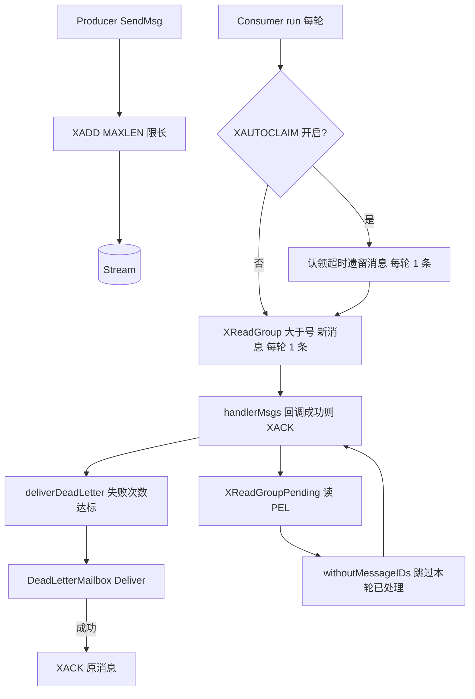

:::note 事实基线
本文依据 `$HOME/github/yukino.go/components/redis_mq` 在 `91712867080` 的源码事实撰写；文中的路径、常量与 API 名称均可在该检出中定位 (目录名是下划线 `redis_mq`)。
:::

**主线一览**



:::danger 死信必须先投递成功再确认
`deliverDeadLetter` 的顺序是 `Deliver` → `XACK` → 清除本地计数。若 `Deliver` 失败, 消息留在 PEL 中不确认, 下一轮继续尝试死信投递。若反过来先 ACK, 毒消息会静默消失。
:::

Redis Streams 已经提供可靠投递所需的原语: 追加写、消费者组、每消费者的待确认列表 (PEL)、显式确认。缺的是**策略层**: 一条消息失败几次算失败, 毒消息去哪里, 消费者崩溃后遗留的消息由谁接手。`components/redis_mq` (module 路径 `components/redis_mq`, 目录名为下划线, `go.mod` 声明 `go 1.26.0`) 就在这些原语上补齐策略。

## 一、API 表面

```go
// 生产
func NewProducer(client *redis.Client, opts ...ProducerOption) *Producer
func (p *Producer) SendMsg(ctx context.Context, topic, key, val string) (string, error)

// 消费
type MsgCallback func(ctx context.Context, msg *MsgEntity) error
func NewConsumer(client *redis.Client, topic, groupID, consumerID string,
    callbackFunc MsgCallback, opts ...ConsumerOption) (*Consumer, error)
func (c *Consumer) Stop()

// 消息与死信
type MsgEntity = redis.MsgEntity // {MsgID, Key, Val}
type DeadLetterMailbox interface { Deliver(ctx context.Context, msg *MsgEntity) error }
func NewDeadLetterLogger() *DeadLetterLogger
```

选项集中在 `option.go`:

| 选项                                 | 默认                    | 作用                                    |
| ------------------------------------ | ----------------------- | --------------------------------------- |
| `WithMsgQueueLen(n)`                 | `500`                   | `XADD` 的流最大长度                     |
| `WithReceiveTimeout(d)`              | `2s`                    | `XREADGROUP` 阻塞读取超时               |
| `WithMaxRetryLimit(n)`               | `3`                     | 触发死信的失败次数阈值                  |
| `WithDeadLetterMailbox(m)`           | `NewDeadLetterLogger()` | 死信终点                                |
| `WithDeadLetterDeliverTimeout(d)`    | `1s`                    | 单次 `Deliver` 超时                     |
| `WithHandleMsgsTimeout(d)`           | `1s`                    | 单批处理超时                            |
| `WithAbandonedMessageRecovery(idle)` | 关闭                    | 开启 `XAUTOCLAIM` 回收, 空闲阈值 `idle` |

## 二、生产者: 一条 XADD 就够了

`producer.go` 只做一件事: 把 `SendMsg(ctx, topic, key, val)` 转发给 `client.XADD`。`redis/redis.go` 的 `XADD` 构造 `go_redis.XAddArgs`:

```go
args := &go_redis.XAddArgs{
    Stream: topic,
    ID:     "*",
    Values: map[string]any{key: val},
}
if maxLen > 0 {
    args.MaxLen = int64(maxLen)
}
```

注意这里只设置 `MaxLen`, **没有设置 `MaxLenApprox`**: 当前实现是精确截断, 每次写入按上限裁剪。README 里"approximate `MAXLEN ~`"的描述与源码不一致, 以实现为准。topic 与 field key 不能为空, 否则返回错误。

## 三、消费者初始化与参数校验

`NewConsumer` 先创建脱离调用方的 context (`context.WithCancel(context.Background())`) 与 `done` 通道, 再 `checkParam`:

- `callbackFunc` 不能为 nil。
- `client` 不能为 nil。
- `topic`、`groupID`、`consumerID` 都不能为空。

然后应用选项、`repairConsumer` 补默认值, 最后 `XGroupCreate(ctx, topic, groupID)`。底层使用 `XGroupCreateMkStream(..., "0-0")`, 组已存在时错误文本包含 `BUSYGROUP` 就静默通过。成功后起 `run` goroutine 并返回消费者。`Stop()` 调用 `stop()` 后等待 `<-done`, 实现优雅停机。

## 四、主循环的四段流水线

`run()` 每轮按顺序执行四段, 每段都有独立 context 预算:

1. **遗弃消息回收 (可选)**: `claimIdle > 0` 时调用 `XAutoClaim(topic, group, consumer, claimCursor, idle)`, 每轮最多 1 条 (`Count: 1`); 返回的游标 `next` 跨轮推进。认领到的消息 ID 记入 `handledIDs`, 并在 `handleMsgsTimeout` 预算内处理。
2. **新消息**: `receive()` 用 `XREADGROUP` 以 `>` 读取尚未投递给本组的新消息, 每轮 1 条, 阻塞 `receiveTimeout` 毫秒。`go_redis.Nil` 被转成 `ErrNoMsg`, 不算错误; 其他错误记日志并退避 1 秒 (`retryBackoff`) 后重来。
3. **死信投递**: 用 `deadLetterDeliverTimeout` 预算调用 `deliverDeadLetter`。
4. **PEL 扫描**: `receivePending()` 用 `XREADGROUP` 以 `0-0` 从本消费者已分配列表读取 (不阻塞), 再经 `withoutMessageIDs` 过滤掉本轮已处理的 ID, 避免同一条消息一轮内被回调两次; 剩余消息在 `handleMsgsTimeout` 预算内处理。

:::tip XAUTOCLAIM 与 PEL 是两道不同的网
PEL 扫描覆盖"本消费者已分配但未确认"的消息; `WithAbandonedMessageRecovery` 打开的 `XAUTOCLAIM` 覆盖"别的消费者崩溃后遗留"的消息。后者认领阈值应大于回调超时, 否则可能抢走仍在执行中的消息。
:::

## 五、逐消息失败计数与 ACK

`consumer.go` 维护三张进程内表:

- `failureCnts map[redis.MsgEntity]int`: 以整个消息实体为键的计数 (用于内部去重)。
- `failureCounts map[string]int`: 以 `MsgID` 为键的失败次数, 死信阈值判断用它。
- `failedMsgs map[string]*redis.MsgEntity`: `MsgID` 到消息体的映射, 供死信投递使用。

`handlerMsgs` 对每条消息调用 `invoke`, 后者用 `defer recover()` 把回调 panic 转成 `message handler panicked: ...` 错误, 因此单个坏回调不会杀死消费者。成功路径用独立的 `ack()` 确认: 它不使用可能已被慢回调耗尽的批次 context, 而是用 `context.WithTimeout(c.ctx, 5*time.Second)` (`ackTimeout`) 新建 context——避免因为 ACK 超时造成无谓的重复投递。成功后清除三张表中的该消息记录。

失败路径把三张表的计数加一/记录消息体, 然后继续下一条; 不在这里 ACK, 消息留在 PEL 中等待下一轮重试。

## 六、死信语义

`deliverDeadLetter` 遍历 `failureCounts`, 挑出 `failureCnt >= maxRetryLimit` 的消息:

```go
if err := c.opts.deadLetterMailbox.Deliver(ctx, msg); err != nil { continue }
if err := c.ack(msg.MsgID); err != nil { continue }
delete(c.failureCounts, msgID)
c.deleteFailureByID(msgID)
delete(c.failedMsgs, msgID)
```

默认实现 `DeadLetterLogger.Deliver` 只打一条错误日志并返回 nil; 生产使用通常替换为"写入另一条流 / 落库 / 告警"的实现。`example/consumer_test.go` 里的 `DemoDeadLetterMailbox` 就是个自定义例子, 通过回调把死信打出来。

## 七、Redis 客户端表面

`redis/redis.go` 刻意保持小接口: `XADD`、`XACK`、`XReadGroup`、`XReadGroupPending`、`XAutoClaim`、`XGroupCreate`, 外加通用 helper `Get`/`Set`/`SetNX`/`SetNEX`/`Del`/`Incr`/`Eval`。

几个实现细节:

- `xReadGroup` 对"新消息"用 `Streams: []string{topic, ">"}`、`Count: 1`、`Block = receiveTimeout`; 对"PEL"用 `Streams: []string{topic, "0-0"}` 且不设 Block。
- `parseStreamValues` 会把消息字段按 key 排序后取第一个, 因此 `SendMsg` 写入的单个字段是确定的; 多字段消息应自己约定字段顺序。
- `XACK` 若返回大于 1 的回复值视为异常。
- `XAutoClaim` 固定 `Count: 1`, 返回消息与下一轮游标; 出错时游标回到 `0-0`。

## 八、适用场景与边界

适合:

- 已经有 Redis、不希望再引入 Kafka/RabbitMQ 的场景。
- 中等吞吐、允许**至少一次**投递、需要明确失败终点的任务队列。

不适合:

- 严格顺序: 每轮只取 1 条新消息并扫描 PEL, 吞吐与顺序都不适合高要求场景。
- 极高吞吐: 单消费者串行处理, 每轮多次 Redis 往返。
- 长期留存与重放: 流会随写入增长, 必须靠 `WithMsgQueueLen` 截断。
- 恰好一次语义: **失败计数与死信表都是进程内 map, 跨重启会丢失**; 真正需要一次性效果时必须在业务侧用唯一键做最终去重。

:::warning 回调超时与回收阈值要配套
`handleMsgsTimeout` 默认 1 秒, `receiveTimeout` 默认 2 秒, `deadLetterDeliverTimeout` 默认 1 秒。若开启 `WithAbandonedMessageRecovery(idle)`, `idle` 应显著大于回调超时, 否则会认领仍在执行中的消息, 造成并发重复回调。
:::

## 九、真实使用片段

`example/consumer_test.go`:

```go
client := redis.NewClient(network, address, password)
callbackFunc := func(ctx context.Context, msg *redis.MsgEntity) error {
    log.Printf("receive msg, id=%s key=%s val=%s", msg.MsgID, msg.Key, msg.Val)
    return nil
}
consumer, err := redis_mq.NewConsumer(client, topic, consumerGroup, consumerID, callbackFunc,
    redis_mq.WithMaxRetryLimit(2),
    redis_mq.WithReceiveTimeout(2*time.Second),
    redis_mq.WithDeadLetterMailbox(demoDeadLetterMailbox))
defer consumer.Stop()
```

`example/producer_test.go`:

```go
producer := redis_mq.NewProducer(client, redis_mq.WithMsgQueueLen(10))
msgID, err := producer.SendMsg(ctx, topic, "test_kk", "test_vv")
```

两个 example 测试都有 `skipWithoutRedis`, 未填写 `address` 占位常量时自动跳过。

## 十、源码索引

本文引用的源码文件 (均相对于组件目录):

| 路径                                                      | 用途                                         |
| --------------------------------------------------------- | -------------------------------------------- |
| `README.md`                                               | 设计动机、API/选项表与死信示例               |
| `producer.go`                                             | `SendMsg` 与选项应用                         |
| `consumer.go`                                             | 主循环、失败计数、ACK 与死信顺序             |
| `option.go`                                               | 所有选项与 `repairConsumer` 默认值           |
| `message.go`                                              | `MsgEntity` 类型别名                         |
| `dead_letter.go`                                          | `DeadLetterMailbox` 与默认日志信箱           |
| `redis/redis.go`                                          | Stream 原语、XGROUP/XAUTOCLAIM 与通用 helper |
| `redis/option.go`                                         | Redis 客户端选项                             |
| `example/producer_test.go`、`example/consumer_test.go`    | 真实集成片段                                 |
| `consumer_test.go`、`option_test.go`、`fakeredis_test.go` | 行为验证                                     |
