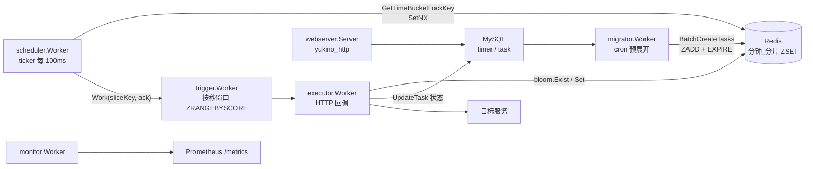

:::note 事实基线
本文依据 `$HOME/github/yukino.go/apps/scheduled_task` 在 `91712867080` 的源码事实撰写；文中的路径、常量与 API 名称均可在该检出中定位。
:::

**主线一览**



:::tip 读图要点
热路径**不解析 cron**：migrator 提前把未来窗口的触发点物化成 task 行并预热 Redis ZSET；scheduler/trigger 只做按分钟的锁竞争与按秒的分数区间读取。锁的获取期与成功租约用 **不同 TTL**，慢任务不会被提前抢走。
:::

scheduled_task 是"秒级精度的分布式定时任务服务"，README 把它拆成 Migrator、Scheduler、Trigger、Executor、Monitor、WebServer 六个角色。它自带 `cmd/scheduled_task` 入口、`conf.yml` 配置、`start.sh` 启动脚本，依赖 MySQL（gorm）、Redis（go-redis/v9）、`robfig/cron/v3`、murmur3、dig 依赖注入、Prometheus 客户端与 `yukino_http`。模块路径 `github.com/hangtiancheng/yukino.go/apps/scheduled_task`，`go.mod` 声明 `go 1.26.0`。本文按"装配与配置 → 角色实现 → 键与分片 → 去重与回调 → 并发边界"拆解。

## 定位与整体架构

| 角色      | 实现文件                                          | 职责                                                                                            |
| --------- | ------------------------------------------------- | ----------------------------------------------------------------------------------------------- |
| Migrator  | `internal/service/migrator/worker.go`             | 按窗口展开启用的 cron，物化 task 行，写入 Redis 缓存；每窗口一把 Redis 锁                       |
| Scheduler | `internal/service/scheduler/worker.go`            | 每 `tryLockGapMilliSeconds` 扫描 `bucketsNum` 个分片，为当前与上一分钟申请 `(minute,bucket)` 锁 |
| Trigger   | `internal/service/trigger/worker.go`、`task.go`   | 把一分钟切成 `zrangeGapSeconds` 的秒级窗口，取到期任务投递给 executor                           |
| Executor  | `internal/service/executor/worker.go`、`timer.go` | 执行 HTTP 回调、写状态、bloom 去重、上报延迟指标                                                |
| Monitor   | `internal/service/monitor/worker.go`              | 按分钟锁上报未执行任务数与启用定时器数                                                          |
| WebServer | `internal/app/webserver/app.go`                   | 基于 `yukino_http` 的 timer/task CRUD REST API 与 `/metrics`                                    |

目录分层：`internal/app` 放 dig provider 与角色启动包装，`internal/service` 放六个角色，`internal/dao` 是 gorm + Redis 缓存，`common` 放配置/模型/常量/工具，`pkg` 放 `bloom`、`cron`、`hash`、`mysql`、`redis`、`pool`、`xhttp`、`promethus`（包路径就是这个拼写）等可复用件。

## 进程入口与配置装配

`cmd/scheduled_task/main.go` 一次性从 dig 容器取出四个应用对象并启动：

```go
migratorApp := app.GetMigratorApp()
schedulerApp := app.GetSchedulerApp()
webServer := app.GetWebServer()
monitor := app.GetMonitorApp()
```

`migratorApp`、`schedulerApp`、`monitor` 都 `Start()` 并 `defer Stop()`；`webServer.Start()` 后主 goroutine 起一个 `net/http/pprof` 服务监听 `:9999`，最后阻塞在 `SIGINT`/`SIGTERM` 上。

`internal/app/provider.go` 的 `init()` 创建 `dig.New()`，依次 `provideConfig`、`providePKG`、`provideDAO`、`provideService`、`provideApp`。配置 provider 包括 `DefaultMysqlConfProvider`、`DefaultRedisConfigProvider`、`DefaultSchedulerAppConfProvider`、`DefaultTriggerAppConfProvider`、`DefaultMigratorAppConfProvider`、`DefaultWebServerAppConfProvider`；除 mysql/redis 外，各段缺省都有默认值。

`conf.yml` 的关键字段与 README 示例：

| 段          | 字段                                                                                | 示例值         |
| ----------- | ----------------------------------------------------------------------------------- | -------------- |
| `scheduler` | `workersNum` / `bucketsNum`                                                         | 100 / 20       |
| `scheduler` | `tryLockSeconds` / `tryLockGapMilliSeconds` / `successExpireSeconds`                | 70 / 100 / 130 |
| `trigger`   | `zrangeGapSeconds` / `workersNum`                                                   | 1 / 10000      |
| `migrator`  | `workersNum` / `migrateStepMinutes`                                                 | 1000 / 60      |
| `migrator`  | `migrateTryLockMinutes` / `migrateSuccessExpireMinutes` / `timerDetailCacheMinutes` | 20 / 120 / 2   |
| `webserver` | `port`                                                                              | 8092           |

## Migrator：cron 预展开与缓存预热

`migrator.Worker.Start(ctx)` 用 `migrateStepMinutes` 作 ticker 周期。每次 tick 计算窗口：

```text
step        = migrateStepMinutes * time.Minute
windowStart = utils.TruncateToStep(time.Now().Add(step), step)
windowEnd   = windowStart.Add(step)
```

`utils.GetMigratorLockKey(windowStart)` 生成 `migrator_lock_<MinuteFormat>` 格式的锁键，`locker.Lock` 的过期时间取 `migrateTryLockMinutes * (time.Minute/time.Second)`。成功进入 `migrate()` 后：读取所有 `consts.Enable` 的 timer，对每个 timer 调 `cronParser.NextsBetween(timer.Cron, start, end)`，再用 `timer.BatchTasksFromTimer(nexts)` 批量落 task 行；为减轻数据库压力，相邻 timer 之间固定 `time.NewTimer(5 * time.Second)` 等待，且等待也监听 `ctx.Done()`。

`migrate()` 最后调 `migrateToCache()`：`taskDAO.GetTasks(WithStartTime, WithEndTime)` 取回窗口内任务，交给 `taskCache.BatchCreateTasks` 写入 Redis。成功后 `locker.ExpireLock` 把租约延长为 `migrateSuccessExpireMinutes * 60` 秒，`keepLock = true` 表示不再主动解锁；失败路径则用 `context.WithoutCancel` 派生的 2 秒超时 ctx 主动解锁。

`pkg/cron.CronParser` 基于 `robfig/cron/v3` 的 `ParseStandard`，导出 `IsValidCronExpr`、`NextFromNow`、`NextsBefore`、`NextsBetween(expr, start, end)` 和 `NextAfter`。`NextsBetween` 要求 `end >= start`，循环 `schedule.Next(cur)` 直到越过 end；`ParseStandard` 失败或 `Next` 返回零值都会报错，不存在"静默按每分钟兜底"的行为。

## 分片与键：从分钟到 ZSET

`common/utils/timer.go` 集中定义所有键格式：

| 函数                                                        | 生成的键                                       |
| ----------------------------------------------------------- | ---------------------------------------------- |
| `UnionTimerIDUnix(timerID, unix)` / `SplitTimerIDUnix`      | `"<timerID>_<unix>"` 任务标识                  |
| `GetTimeBucketLockKey(t, bucketID)`                         | `time_bucket_lock_<MinuteFormat>_<bucketID>`   |
| `GetSliceMsgKey(t, bucketID)`                               | `<MinuteFormat>_<bucketID>`，trigger 的 input  |
| `GetMigratorLockKey(t)` / `GetMonitorLockKey(t)`            | `migrator_lock_<分钟>` / `monitor_lock_<分钟>` |
| `GetTaskBloomFilterKey(dayStr)` / `GetBucketCntKey(minute)` | `task_bloom_<日>` / `bucket_cnt_<分钟>`        |

`MinuteFormat = "2006-01-02 15:04"`，`SecondFormat`、`HourFormat`、`DayFormat` 也定义在 `common/consts/timer.go`。

分片规则很直接：`task.TimerID % uint(bucketsNum)`。`dao/task.TaskCache.GetTableName(task)` 把表名写成 `<分钟>_<bucket>`，`BatchCreateTasks` 用 `ZADD` 写入 member `UnionTimerIDUnix(timerID, unix)`、score 为 `RunTimer.UnixMilli()`，并设 24 小时 `EXPIRE`。`GetTasksByTime(ctx, table, start, end)` 用 `ZrangeByScore(ctx, table, start, end-1)` 取成员，再 `SplitTimerIDUnix` 还原成 `po.Task{TimerID, RunTimer}`。

`trigger.TaskService.GetTasksByTime` 先查缓存；缓存未命中时回 MySQL 查 `[start,end)` 内状态为 `consts.NotRun` 的任务，并在 Go 侧用 `TimerID % maxBucket == bucket` 过滤，保证回退路径与缓存路径的分片语义一致。

:::danger 动态分片逻辑目前是关闭的
README 末尾的 WARNING 明确说：`getValidBucket` 当前直接返回配置里的 `BucketsNum`，动态扩缩容代码虽在但被禁用。因此分片数变化不会自动重分布历史任务，且 `README` 也把表结构与索引的建立留给部署方。上线前必须自行保证 `bucketsNum` 稳定并完成 DDL。
:::

## Scheduler：每分片的分布式锁

`scheduler.Worker.Start(ctx)` 先启动 trigger（`w.trigger.Start(ctx)`），再用 `tryLockGapMilliSeconds` 建 ticker。每个 tick 调 `handleSlices`：

```go
for i := 0; i < w.getValidBucket(ctx); i++ {
    w.handleSlice(ctx, i)
}
```

`handleSlice(ctx, bucketID)` 对 `now.Add(-time.Minute)` 和 `now` 各提交一个任务到 `pool.NewGoWorkerPool(workersNum)`——这就是 README 所说"同时处理当前与上一分钟"的出处，用来兜住跨分钟边界的迟到触发。

`asyncHandleSlice` 取 `utils.GetTimeBucketLockKey(t, bucketID)` 对应的 `redis.DistributeLocker`，`Lock(ctx, tryLockSeconds)` 失败就静默返回（别的实例拿到了锁）；成功后注册 `ack` 回调，在 `trigger.Work` 完成时用 `ExpireLock(ctx, successExpireSeconds)` 把锁续到成功租约。

## Redis 分布式锁与 Lua 脚本

`pkg/redis/lock.go` 的接口是：

```go
type DistributeLocker interface {
    Lock(context.Context, int64) error
    Unlock(context.Context) error
    ExpireLock(ctx context.Context, expireSeconds int64) error
}
```

`ReentrantDistributeLock` 用 `sync.Mutex` 串行化自身操作，用 `held bool` 防止同一实例重复获取。锁键前缀常量 `ftimerLockKeyPrefix = "FTIMER_LOCK_PREFIX_"`，真实键是前缀加业务 key。获取时用 `crypto/rand` 读 24 字节并 `hex.EncodeToString` 成 48 字符 token，`client.SetNX(ctx, key, token, expireSeconds)` 返回 `int64(1)` 才算成功；若 RPC 报错，会用 `context.WithoutCancel` 派生 2 秒 ctx 调用 Lua 清理可能的残留。

`Unlock` 与 `ExpireLock` 都通过 Lua 做"校验 token 后再操作"，脚本在 `pkg/redis/lua.go`：

- `LuaCheckAndDeleteDistributionLock`：token 不匹配返回 0，匹配才 `del`。
- `LuaCheckAndExpireDistributionLock`：token 不匹配返回 0，匹配才 `expire key duration`。

两次操作后若返回值不是 1，就把 `held` 置回 false 并报错，避免误删或误续别人的锁。

:::tip 为什么要两种 TTL
`tryLockSeconds: 70` 是"抢锁窗口"，锁住期间 bifurcation 风险较低；`successExpireSeconds: 130` 是"成功后的租约"，覆盖 trigger 扫完一整分钟（60 秒）加余量。若两者相等，持锁者还没扫完锁就过期，第二个实例会重复触发同一分片。
:::

## Trigger：按秒窗口取任务

`trigger.Worker.Work(ctx, minuteBucketKey, ack)` 先把 key 拆成起始分钟（`getStartMinute`）和 bucket（`getBucket`），然后 `endTime := startTime.Add(time.Minute)`。它用 `zrangeGapSeconds` 建 ticker，用 `concurrency.NewSafeChan(int(time.Minute/gap)+2)` 收集批量处理错误，并起一个 `wg.Go` 先处理首个窗口 `[start, min(start+gap, end))`。

每 tick 把 `startTime` 前移 gap，未到 end 就提交下一个 `handleBatch`。`handleBatch` 调 `taskService.GetTasksByTime(ctx, key, bucket, start, end)`，对每个任务提交到 `pool.NewGoWorkerPool(workersNum)`，执行 `executor.Work(ctx, utils.UnionTimerIDUnix(task.TimerID, task.RunTimer.UnixMilli()))`。所有批次结束且 ctx 未取消、notifier 无错误后，才调 `ack()` 并记 "ack success"。

`ctx.Done()` 或任一批次报错会 `cancel()` 并 `wg.Wait()` 后返回，此时**不会 ack**，锁在 `tryLockSeconds` 后自然过期，下一轮重试。

## Executor：回调、去重与状态回写

`executor.Worker.Work(ctx, timerIDUnixKey)` 先用 `SplitTimerIDUnix` 拆出 `timerID` 与毫秒 unix。去重采用两级判断：

1. 用 `bloom.Filter.Exist(ctx, task_bloom_<当天>, key)` 检查；若报错或命中，再查数据库 `GetTask(WithTimerID, WithRunTimer)`，状态不是 `consts.NotRun` 就跳过。
2. 通过后才 `executeAndPostProcess`：`TimerService.GetTimer` 取定义，若 `timer.Status != consts.Enable` 直接跳过；否则按 `NotifyHTTPParam.Method` 分派。

`execute` 的 switch 只覆盖 `GET`、`PATCH`、`DELETE`、`POST`，分别调用 `xhttp.JSONClient` 的同名方法；其它方法（包括 README 中提到的 PUT）落入 `default` 分支返回 `invalid http method` 错误。

`postProcess` 做三件事：异步 `reporter.ReportExecRecord` 与 `ReportTimerDelayRecord`（延迟 = 实际毫秒 − 期望毫秒）；`bloom.Filter.Set` 写入 `consts.BloomFilterKeyExpireSeconds = 24*60*60` 秒 TTL；查回 task，把 `Output` 设为响应 JSON，`Status` 按执行错误设为 `consts.Failed` 或 `consts.Succeed`，再 `UpdateTask`。状态常量为 `NotRun=0`、`Running=1`、`Succeed=2`、`Failed=3`；timer 状态 `Unable=1`、`Enable=2`。

`bloom.Filter` 用两个 murmur3 哈希：`Murmur3Encryptor.Encrypt` 取 `murmur3.Sum128` 的 h1，`Murmur3AltEncryptor` 取 h2；位图大小 `bitmapBits = 1 << 24`；`Set` 用 Lua 一次 `SETBIT` 两位，并仅在没有 TTL 时设过期。

`TimerService`（`internal/service/executor/timer.go`）每 `timerDetailCacheMinutes` 刷新一次本地 `map[uint]*vo.Timer`，查询结果为空时保留旧快照，避免瞬时失败把全部查询压回数据库；`GetTimer` 未命中本地缓存才回 `timerDAO.GetTimer`。

## WebServer 与可观测性

`internal/app/webserver/app.go` 用 `yukino.Default()` 建应用，先 `Use(CorsHandler())`，再注册三个 `Router` 分组：

| 分组            | 路由                                                                                                          |
| --------------- | ------------------------------------------------------------------------------------------------------------- |
| `/api/timer/v1` | `GET                                                                                                          | POST | DELETE | PATCH /def`，`GET /defs`、`GET /defsByName`，`POST /enable`、`POST /unable` |
| `/api/task/v1`  | `GET /records`                                                                                                |
| `/api/mock/v1`  | `ALL /mock`，返回 `{"word":"hello world!"}` 用于测试回调                                                      |
| 根路径          | `ALL /metrics`，用 `httptest.NewRecorder` 调 `promhttp.Handler()` 后把头、状态码与响应体搬回 `yukino.Context` |

`Server.Start()` 在 goroutine 里 `app.Listen(fmt.Sprintf(":%d", conf.Port))`，端口来自 `webserver.port`（示例 8092）。`main.go` 另外把 `net/http/pprof` 挂在 `:9999`。

## 并发、容错与边界

| 关注点     | 实现                                                                                |
| ---------- | ----------------------------------------------------------------------------------- |
| 有界并发   | 每个角色都用 `pool.NewGoWorkerPool`；trigger 默认 10000 workers，migrator 默认 1000 |
| 重复执行   | 分片锁 + bloom 位图 + DB 状态复核三级防护                                           |
| 锁所有权   | token 校验 Lua，解锁/续期都拒绝非持有者                                             |
| 失败重试   | trigger 出错不 ack，锁到期后下一轮重扫；migrator 失败主动解锁                       |
| 时钟语义   | `MinuteFormat` 与 `GetStartMinute` 用 `time.Local`，不是 UTC 秒边界                 |
| 数据一致性 | 缓存命中优先，未命中回 MySQL 并再次按 `TimerID % bucketsNum` 过滤                   |

`utils.SplitTimeBucket` 用 `time.ParseInLocation(consts.MinuteFormat, ..., time.Local)` 解析锁键，跨时区部署时所有实例必须保持同一时区，否则分钟键无法对齐。bloom 命中只是"可能执行过"，必须回数据库确认才能跳过；未命中则确定没写过，可直接进入执行——这是布隆过滤器"有假阳性、无假阴性"的标准语义。位图用 `1 << 24` 位，多个任务哈希到同一组比特时会产生假阳性，因此数据库复核并非多余防线。

## 适用与不适用

**适用**

- 大量 cron 定义需要统一调度，且触发目标是 HTTP 回调而非进程内函数。
- 需要多实例水平扩容，且能接受以 Redis 作为协调层、MySQL 作为事实源。
- 需要秒级精度、按分片横向扩展worker、并对任务延迟做 Prometheus 上报。

**不适用**

- 需要严格恰好一次执行：当前是 bloom + DB 复核的近似去重，极端并发下仍依赖最终状态判断。
- 需要动态扩缩分片：`getValidBucket` 目前返回静态配置值，README 明确标注该逻辑被禁用。
- 需要开箱即用的数据库：表结构与索引由部署方负责，仓库只提供 `common/model/sql/task.sql` 与 `timer.sql`。

**延伸阅读**

Web 层所用的框架见 [yukino_http](./yukino-http)；同样基于 Redis 做消息扇出的组件见 [yukino_redis_mq](./yukino-redis-mq)；同仓库的通用日志库见 [yukino_log](./yukino-log)；需要另一类"锁与一致性"设计时可对照 [yukino_raft_kv](./yukino-raft-kv)。
