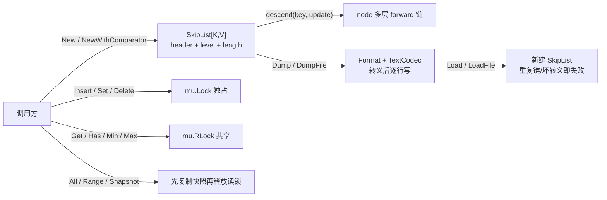

:::note 事实基线
本文依据 `$HOME/github/yukino.go/libs/yukino_skiplist` 在 `91712867080` 的源码事实撰写；文中的路径、常量与 API 名称均可在该检出中定位。
:::

**主线一览**



:::tip 读图要点
跳表的搜索路径 `descend` 从最高占用层向下走，每层沿 `forward[level]` 前进直到下一个键不小于目标；`update[level]` 记录需要改写后继指针的前驱节点，插入和删除共用这条路径，期望复杂度都是 O(log n)。
:::

yukino_skiplist 是"并发有序 map"，用概率跳表实现。它保留 C++ 原版的插入、删除、查找、有序显示、dump/load、size 等操作，补上了原版缺失的原地更新（`Set`），并修正了并发与持久化缺陷。模块路径 `github.com/hangtiancheng/yukino.go/libs/yukino_skiplist`，`go.mod` 声明 `go 1.26.0`，**只用标准库**。本文按"结构 → 算法 → 迭代 → 持久化 → 并发"展开。

## 定位与文件布局

| 文件                | 职责                                                                                                  |
| ------------------- | ----------------------------------------------------------------------------------------------------- |
| `skiplist.go`       | `SkipList`、构造、`descend`/`find`/`randomLevel`/`put`、`Insert`/`Set`/`Get`/`Has`/`Delete`/`Clear`   |
| `node.go`           | 泛型 `node[K,V]` 与头哨兵 `headerNode`                                                                |
| `options.go`        | `Option`、`WithMaxLevel`/`WithProbability`/`WithRandSource`、配置校验                                 |
| `iterate.go`        | `Entry`、`All`/`Range`/`RangeFrom`/`Keys`/`Values`、`Min`/`Max`/`Floor`/`Ceiling`/`Snapshot`/`String` |
| `record.go`         | `Format`、字段转义与 `splitRecord`                                                                    |
| `codec.go`          | `TextCodec[T]` 及内置 codec                                                                           |
| `persist.go`        | `Dump`/`DumpFile`/`Load`/`LoadFile` 及 `ParseError` 处理                                              |
| `errors.go`         | 记录级哨兵错误与 `ParseError`                                                                         |
| `cmd/skiplist-demo` | 对应原版 `main.cpp` 的驱动，并加了并发步骤                                                            |

## 节点、哨兵与 SkipList 结构

`node[K, V any]` 只有三个字段：`key`、`value`、`forward []*node[K,V]`。`len(forward)` 就是节点高度，`forward[0]` 恒为底层后继，nil 表示该层结束。`newNode(key, value, height)` 按高度分配切片；`headerNode(maxLevel)` 用 K/V 的零值造一个锚定所有层的哨兵，**永不暴露给调用方**。

`SkipList[K, V any]` 的字段分两组：

- 构造时固定、之后不变：`compare func(a,b K) int`、`maxLevel`、`probability`、`nextFloat func() float64`、`ready bool`。
- 受 `mu sync.RWMutex` 保护：`header *node[K,V]`、`level int`（最高占用层，空表为 0）、`length int`。

`ready` 在构造完成、指针发布前写入，之后不再修改，因此导出方法可以无锁读它；零值 `SkipList` 的 `ready == false`，`requireUsable()` 会按情况 panic `nilListPanic` 或 `zeroListPanic`，两条消息都要求用 `New` 或 `NewWithComparator` 构造。因为内嵌 `sync.RWMutex`，**首次使用后不得复制**，要按指针传递，`go vet` 会检查这一点。

### 构造器与选项

```go
func New[K cmp.Ordered, V any](opts ...Option) *SkipList[K, V]
func NewWithComparator[K, V any](compare func(a, b K) int, opts ...Option) *SkipList[K, V]
```

`New` 只是把 `cmp.Compare` 传给 `NewWithComparator`；后者拒绝 nil comparator，并用 `mustConfig(opts...)` 在非法选项时 panic（类似 `regexp.MustCompile`）。选项解包走 `newConfig`，返回 error 的版本用于 `Load` 系列。

| 常量 / 选项           | 值 / 约束                                                |
| --------------------- | -------------------------------------------------------- |
| `DefaultMaxLevel`     | 16，配合 0.5 概率可支撑六万多条以上                      |
| `DefaultProbability`  | 0.5，每个节点平均两个前向指针                            |
| `MaxLevelLimit`       | 4096，`WithMaxLevel` 的硬上限                            |
| `stackUpdateLimit`    | 64；不超过它时前驱数组留在栈上，更高则分配到堆           |
| `WithMaxLevel(n)`     | 取 `[1, MaxLevelLimit]`，计的是**层数**而非最高层下标    |
| `WithProbability(p)`  | 必须是开区间 `(0,1)` 实数，NaN/Inf 拒绝                  |
| `WithRandSource(src)` | 换成固定种子的 `*rand.Rand` 可复现形状，nil 会令校验失败 |

## 核心算法与 API

### descend / find / randomLevel

`descend(key, update)` 从 `s.level-1` 向下：每层内层循环沿 `next := current.forward[level]` 前进，遇到 `next == nil || s.compare(next.key, key) >= 0` 停止；若 `update != nil`，把当前节点写入 `update[level]`。返回值是"最后一个键严格小于 key"的节点，没有则是 header。调用方至少持共享锁。

`find(key)` 就是 `descend(key, nil).forward[0]`，再比较一次键是否相等。`randomLevel()` 从 1 起，只要 `level < maxLevel && nextFloat() < probability` 就加一；调用方必须持独占锁，这也串行化了对随机源的访问。源码注释指出 C++ 原版从 1 起抽签后却链接 `0..draw` 两层，导致底两层节点重复，并且会一直抛硬币到失败才截断，循环没有局部上界。

### put 与公开写操作

`put(key, value, overwrite)` 先准备前驱数组（≤ 64 层走栈，否则 `make`），`descend` 后检查 `forward[0]` 是否同键：

- 同键：返回旧值与 `existed = true`；`overwrite` 为真才替换 `value`。
- 新键：抽高度；若高于当前 `level`，把新增层的 `update[level]` 设为 header 并抬高 `level`；然后逐层把新节点接入 `update[level]` 与其后继之间，`length++`。

公开 API 的语义差异很重要：

| API                                                  | 已存在键的行为                          | 返回                                                           |
| ---------------------------------------------------- | --------------------------------------- | -------------------------------------------------------------- |
| `Insert(key, value)`                                 | **不覆盖**，保持原值（对齐 C++ insert） | `bool` 是否新增                                                |
| `Set(key, value)`                                    | 覆盖                                    | `(previous V, existed bool)`，类似 `sync.Map.LoadOrStore` 家族 |
| `Get(key)`                                           | 读                                      | `(V, bool)`                                                    |
| `Has(key)`                                           | 读                                      | `bool`                                                         |
| `Delete(key)`                                        | 摘除并递减 `level`                      | `(value V, deleted bool)`                                      |
| `Clear()`                                            | 换一个新 header，`level`/`length` 归零  | —                                                              |
| `Len()` / `Level()` / `MaxLevel()` / `Probability()` | 读元数据                                | —                                                              |

`Delete` 在摘链后把 `victim.forward = nil`，让 GC 能回收后继链而不被已删除节点挂住；随后循环收缩 `level`。`Clear` 用常数时间的"换 header"，不会爆栈。

`doc.go` 给出的期望复杂度：`Insert`/`Set`/`Delete`/`Get`/`Has` 为 O(log n) 期望、O(n) 最坏；`Len`/`Level`/`Min` 为 O(1)；`Max`/`Floor`/`Ceiling` 为 O(log n) 期望；`All`/`RangeFrom` 为 O(n)/O(log n + k)；`Range` 为 O(log n + k)；`Snapshot`/`String`/`Dump` 为 O(n)。

## 迭代与有序视图

`iter.go` 用 Go 1.23 起的 `iter.Seq`/`iter.Seq2` 暴露惰性迭代：`All()` 返回 `iter.Seq2[K,V]`，`Keys()` 返回 `iter.Seq[K]`，`Values()` 返回 `iter.Seq[V]`，`Range(from,to)` 是半开区间 `[from,to)`，`RangeFrom(from)` 取所有 ≥ from 的键。

关键在取值方式：`All()` 的闭包调用 `s.Snapshot()` 得到 `[]Entry[K,V]`，**Snapshot 在返回前就释放读锁**，随后闭包才逐项 `yield`。`Range`/`RangeFrom` 走 `rangeSnapshot`，同样在 `RLock` 下复制片段、返回前解锁。因此：

- 快照是**一致性浅拷贝**：开始迭代时的键值集合固定，中途插入不会出现在本次循环里。
- 循环体可以安全地读或写同一个 list，不会与迭代器持有的锁冲突。
- 代价是 O(k) 额外内存（k 为捕获条目数），`Range` 的时间为 O(log n + k)。
- 键值本身**不深拷贝**：value 是 slice 或 map 时，迭代拿到的仍是同一底层对象。

`Entry[K,V]` 是 `Snapshot` 产出的 `{Key, Value}` 二元组。`Min()` 直接读 `header.forward[0]`；`Max()` 从最高层一路向右走到头。`Floor(key)` 先查 `descend(key,nil).forward[0]` 是否精确相等（**精确匹配优先**），否则退回前驱节点；`Ceiling(key)` 返回 `descend(...).forward[0]`。`String()` 实现 `fmt.Stringer`，按层从高到低打印 `L<n> | k:v -> ... nil`，仅供诊断，布局不是稳定接口。

## 持久化：行式记录与编解码

`Dump(w, format)` 与 `DumpFile(path, format)` 写一行一条记录：

```text
<key>:<value>\n
```

`Format[K,V]` 有 `Key TextCodec[K]`、`Value TextCodec[V]` 与 `Separator byte`；零值不可用，`NewFormat(key, value)` 用 `DefaultSeparator = ':'`。`normalize()` 要求两个 codec 的 `Encode`/`Decode` 都非 nil，分隔符缺省填 `':'`，且必须是可打印 ASCII（`0x21..0x7e`）并排除反斜杠、`n`、`r`。

`TextCodec[T]` 就是 `{Encode func(T)(string,error), Decode func(string)(T,error)}`。内置实现：`StringCodec()`、`BoolCodec()`、`IntCodec()`、`Int64Codec()`、`Uint64Codec()`、`Float64Codec()`（`'g'`, -1 精度保证往返）、`BytesCodec()`（无填充 base64），以及 `TextCodecFor[T, PT]()`，后者委托 `encoding.TextMarshaler`/`TextUnmarshaler`，可直接用于 `time.Time`、`net/netip.Addr`、`net/url.URL` 等。

转义规则集中在 `record.go`：`escapeField` 给分隔符、反斜杠、`\n`、`\r` 加反斜杠，后两者分别改写成 `\n`、`\r` 字母码；`unescapeField` 反向还原，遇到孤立反斜杠或未识别序列返回 `ErrInvalidEscape`。`splitRecord` **按字节扫描第一个未被转义的分隔符**，因为转义后的分隔符仍保留原字节，直接用 `strings.Cut` 会把键 `a:b`（存为 `a\:b`）切错。

`persist.go` 的关键约束与 API：

| 名称                                               | 说明                                                                                                               |
| -------------------------------------------------- | ------------------------------------------------------------------------------------------------------------------ |
| `MaxRecordSize = 16 << 20`                         | 单条编码记录上限，不含换行                                                                                         |
| `Dump(w, format)`                                  | 在共享锁下 `Snapshot()`，释放锁后再编码写入；慢 writer 不阻塞 list                                                 |
| `DumpFile(path, format)`                           | 写目标目录临时文件 → `bufio.Flush` → `Chmod(0o644)` → `Sync` → `Close` → `os.Rename` → `syncDir`，失败清理临时文件 |
| `Load(r, format, opts...)` / `LoadFile(path, ...)` | 标准比较器版本，返回新列表                                                                                         |
| `LoadWithComparator` / `LoadFileWithComparator`    | 自定义比较器版本                                                                                                   |
| `ParseError{Line, Record, Err}`                    | 携带 1-based 行号与原样错误行；`Unwrap` 支持 `errors.Is/As`                                                        |

`load()` 用 `bufio.Scanner`，缓冲上限设为 `MaxRecordSize+2`；跳过空行，其余坏行一律包成 `*ParseError` 终止加载，返回 nil list——不会把坏文件部分导入。`loadRecord()` 先 `splitRecord`，再解转义与 codec 解码，最后用 `Insert`；重复键返回 `ErrDuplicateKey`。`errors.go` 的哨兵还有 `ErrRecordTooLarge`、`ErrMalformedRecord`、`ErrInvalidEscape`，`recordSummaryLimit = 32` 限制错误里引用的字段长度，避免一行超长记录刷屏。

:::danger 零值不能用，且值不做深拷贝
对 nil 或零值 `SkipList` 调用任何导出方法都会 panic，消息直接提示 `New`/`NewWithComparator`。另外 `Snapshot`、`Get`、`All` 返回的值保持原样：如果 V 是 `[]byte`、map 或 slice，调用方修改返回值会影响列表内的对象，需要隔离时必须自行拷贝。
:::

## 与 C++ 原版的行为差异

README 与包注释把修正点写得很清楚，移植阅读时需要逐条对照：

| 方面            | C++ 原版                                             | 当前 Go 实现                                                       |
| --------------- | ---------------------------------------------------- | ------------------------------------------------------------------ |
| 更新已有键      | `insert` 拒绝覆盖，没有原地更新 API                  | `Insert` 保持拒绝语义，另加 `Set` 覆盖并返回旧值                   |
| 节点高度抽样    | 从 1 起抽签后链接 `0..draw` 两层；一直抛到失败才截断 | `randomLevel` 从 1 起、带 `maxLevel` 局部上界，底 lane 只放一次    |
| 搜索路径同步    | 完全无同步                                           | 共享锁 / 独占锁保护所有结构访问                                    |
| `clear`         | 递归销毁，可能爆栈                                   | 换一个新 header，O(1) 且交给 GC                                    |
| 记录分隔符      | 直接按第一个 `':'` 切                                | `splitRecord` 跳过被转义的分隔符，键 `a:b` 可往返                  |
| 行内换行/反斜杠 | 会破坏行式格式                                       | `escapeField`/`unescapeField` 完整转义                             |
| `load` 坏行     | 无分隔符时沿用上一个键、丢空值、所有键走 `stoi`      | 任何坏行都返回 `*ParseError` 并丢弃部分结果                        |
| 随机源          | 全局状态                                             | 默认 `math/rand/v2` 包级安全源；可用 `WithRandSource` 注入可复现源 |

## 测试与演示命令

README 给出三条可复现命令：

```bash
go test -race -count=1 ./...
go test -bench=. -benchmem ./...
go run ./cmd/skiplist-demo -workers 4 -ops 1000
```

`-race` 是验证并发模型的关键：写者走独占锁、读者走共享锁、`WithRandSource` 只在独占锁内访问，这三条约束中任何一条被破坏，`-race` 都会捕获。`cmd/skiplist-demo` 的默认参数会生成 8 个 worker × 20000 次操作，输出按 worker 分流的吞吐与剩余元素数，并在结尾断言 `Snapshot()` 结果有序。

## 并发模型

每把跳表自带一把 `sync.RWMutex`：`Get`、`Has`、`Min`、`Max`、`Floor`、`Ceiling`、`Snapshot` 与范围快照取共享锁，读者之间互不阻塞；`Insert`、`Set`、`Delete`、`Clear` 取独占锁。默认随机源是 `math/rand/v2` 的包级 `rand.Float64`，本身并发安全；通过 `WithRandSource` 注入的 `*rand.Rand` 只在独占锁内读取，因此单表不需要自带锁，但**不要在可能同时被写的两张表之间共享同一个非并发安全随机源**。比较器也不能重入列表（例如在 compare 里调用 `Get`），否则会在持锁路径上自锁。

`cmd/skiplist-demo/main.go` 用 `-store`（默认 `store/dump.txt`）、`-workers`（默认 8）、`-ops`（默认 20000）跑完整流程：插入 → 查找 → 持久化与往返校验（含含分隔符/反斜杠/换行的 tricky 值）→ 删除 → 有序视图 → 并发读写，最后校验 `slices.IsSortedFunc` 确认结构仍有序。它用 `demoMaxLevel = 6`，注释说明 C++ 驱动把这个参数当"最高层下标"因而多分配一层，这里计的是层数。

## 适用与不适用

**适用**

- 需要标准库之外零依赖、支持泛型与自定义比较器的有序 KV 容器。
- 读多写少、需要范围扫描与 `Floor`/`Ceiling` 这类有序查询的内存索引。
- 需要把内存状态以人类可读文本落盘，且字段中可能含分隔符或换行。

**不适用**

- 需要持久化后的随机访问或查询下推：Dump 是逐行文本，Load 要整表重建。
- 需要高度并发写且要求无锁：这里是单把 `RWMutex` 串行化所有写者。
- 需要 `V` 的深拷贝语义或零值可用性：两者都不提供，须由调用方保证。

**延伸阅读**

同仓库另一个泛型有序容器的使用背景见 [yukino_raft_kv](./yukino-raft-kv)（该模块的 KV 状态机实际用 `map[string]string` 而非跳表）；日志与诊断输出见 [yukino_log](./yukino-log)；基于该容器风格的 demo 驱动与 Web 框架见 [yukino_http](./yukino-http)。
