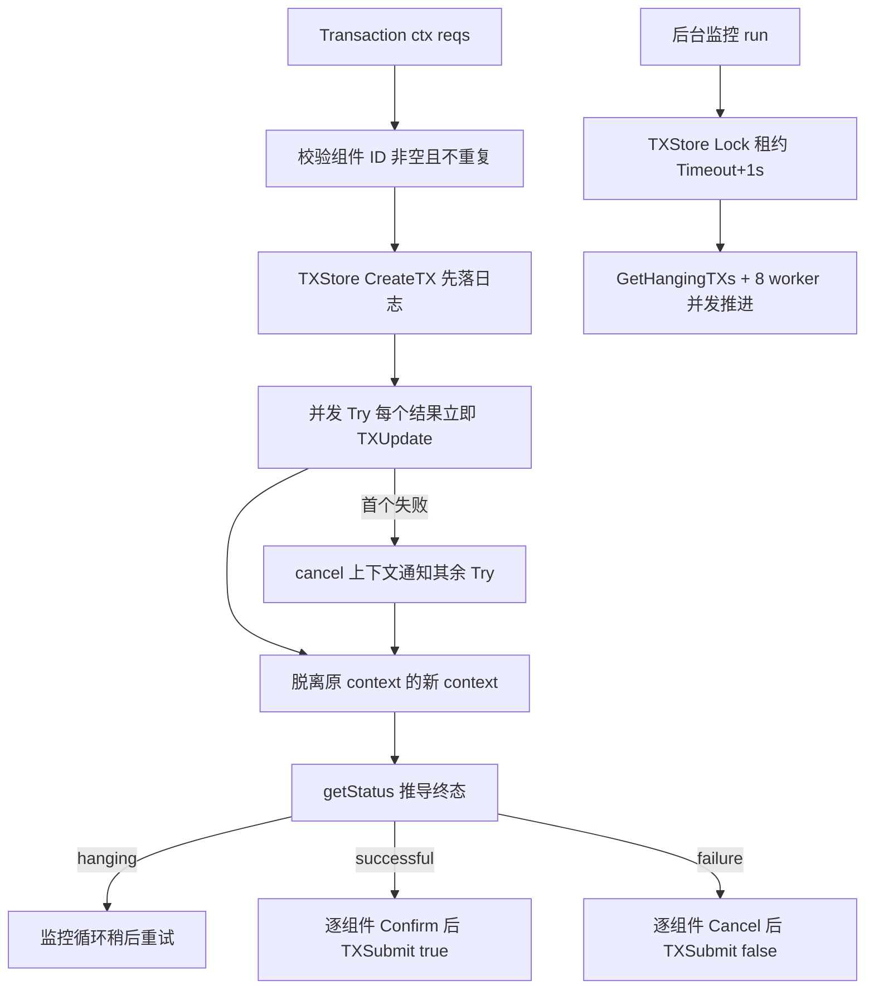

:::note 事实基线
本文依据 `$HOME/github/yukino.go/components/tcc` 在 `91712867080` 的源码事实撰写；文中的路径、常量与 API 名称均可在该检出中定位。
:::

**主线一览**



:::danger Confirm/Cancel 必须幂等
恢复循环会对未完成事务反复重放 Confirm 或 Cancel, 直到每个响应都带 ACK 且 `ComponentID`/`TXID` 与请求一致。非幂等的二阶段实现会在重试中不断产生副作用, 这是 TCC 落地最常见的错误。
:::

TCC (Try-Confirm-Cancel) 把一次分布式事务拆成三阶段: Try 预留并冻结资源, Confirm 提交预留, Cancel 释放预留。困难不在正常路径, 而在协调者在 Try 与 Confirm 之间崩溃时如何收场。`components/tcc` (module `components/tcc`, `go.mod` 声明 `go 1.26.0`) 的答案是把事务日志作为第一公民: 在任何网络调用发生前先落日志, 每个参与方的 Try 结果即时持久化, 崩溃后由后台监控循环重放未完成事务推进到终态。

## 一、契约层: 参与方与存储

`component.go` 定义参与方契约:

```go
type TCCReq struct {
    ComponentID string         `json:"componentID"`
    TXID        string         `json:"txID"`
    Data        map[string]any `json:"data"`
}

type TCCResp struct {
    ComponentID string `json:"componentID"`
    ACK         bool   `json:"ack"`
    TXID        string `json:"txID"`
}

type TCCComponent interface {
    ID() string
    Try(ctx context.Context, req *TCCReq) (*TCCResp, error)
    Confirm(ctx context.Context, txID string) (*TCCResp, error)
    Cancel(ctx context.Context, txID string) (*TCCResp, error)
}
```

`Confirm`/`Cancel` 只接收事务 ID, 不接收业务数据——业务数据应由参与方按 `txID` 找回自己冻结的资源。`txstore.go` 定义存储契约:

```go
type TXStore interface {
    CreateTX(ctx context.Context, components ...TCCComponent) (txID string, err error)
    TXUpdate(ctx context.Context, txID, componentID string, accept bool) error
    TXSubmit(ctx context.Context, txID string, success bool) error
    GetHangingTXs(ctx context.Context) ([]*Transaction, error)
    GetTX(ctx context.Context, txID string) (*Transaction, error)
    Lock(ctx context.Context, expireDuration time.Duration) error
    Unlock(ctx context.Context) error
}
```

`model.go` 定义请求与状态模型。`RequestEntity{ComponentID, Request}` 是调用方入口 (JSON tag 分别为 `componentName` 与 `request`); `TXStatus` 与 `ComponentTryStatus` 各有 `hanging`/`successful`/`failure` 三态。`Transaction` 包含 `TXID`、`Components []*ComponentTryEntity`、`Status`、`CreatedAt`。

注册中心 `tccregister.go` 用 `RWMutex` 保护 `map[string]TCCComponent`: nil 组件、空 ID、重复 ID 都会被拒绝。

## 二、状态推导: getStatus 的超时推断

终态不是直接存储的, 而是从组件 Try 结果推导 (`model.go` 的 `getStatus(createdBefore time.Time)`):

1. 任一组件 `TryFailure` → `TXFailure`。
2. 有非 `TrySuccessful` 的组件, 且 `CreatedAt.Before(createdBefore)` → `TXFailure`。这是**超时推断失败**, 防止资源预留因协调者反复失联而永久泄漏。
3. 有未决组件但未超时 → `TXHanging`, 监控循环跳过。
4. 全部成功 → `TXSuccessful`。

调用方传入的 `createdBefore` 是 `time.Now().Add(-t.opts.Timeout)`, 因此判定窗口完全由 `WithTimeout` 控制 (默认 5 秒)。

## 三、事务主流程

`TXManager.Transaction(ctx, reqs...)` 的步骤:

1. 校验 manager/opts/txStore/ctx 非 nil。
2. 用 `context.WithTimeout(ctx, Timeout)` 派生 `ctx2`。
3. `getComponents`: 拒绝空请求、空 ComponentID、重复 ComponentID, 再从注册中心解析组件; 数量不匹配返回错误。
4. `txStore.CreateTX(ctx2, components...)` —— 日志先于任何 Try 调用落盘。
5. `twoPhaseCommit(ctx2, txID, entities)`, 返回 `(txID, committed, nil)`。

`twoPhaseCommit` 的并发模型:

- 用 `context.WithCancel(ctx)` 派生 Try 阶段 context, 起一个 goroutine 内用 `WaitGroup` 并发执行所有 `Try`, 每个 Try 使用 `&TCCReq{ComponentID, TXID, Data: entity.Request}`。
- 校验响应必须非 nil、`ACK == true`、`ComponentID` 与 `TXID` 匹配; 任一条件不满足即视为失败。
- 每个 Try 结果都立即调用 `TXUpdate`, 且使用 `context.WithTimeout(context.WithoutCancel(ctx2), Timeout)` 的新 context, 确保即使 Try 阶段被取消, 日志也能写完。
- 主协程从 `errCh` 收到第一个错误就 `cancel()` 通知其余 Try, 但会继续排空 `errCh`, 保证所有 goroutine 与日志写入结束。
- 二阶段在 `context.WithTimeout(context.WithoutCancel(ctx), Timeout)` 的新 context 中执行 `advanceProgressByTXID`; 失败只记日志, 不回传给调用方。调用方拿到的是 `txID` 与 Try 阶段是否全部成功的布尔值。

## 四、推进逻辑 advanceProgress

`advanceProgress(ctx, tx)` 先用 `getStatus(now - Timeout)` 推导状态, `TXHanging` 直接返回。否则:

- `TXSuccessful`: 对 `tx.Components` 逐个从注册中心取组件, 调用 `Confirm(ctx, tx.TXID)`, 全部成功后 `TXSubmit(ctx, txID, true)`。
- `TXFailure`: 改为调用 `Cancel`, 最后 `TXSubmit(ctx, txID, false)`。

每个响应都必须 `resp != nil && resp.ACK && resp.ComponentID == component.ComponentID && resp.TXID == tx.TXID`, 否则返回 `component: %s ack failed`。组件取不到时返回 `get tcc component failed`。

## 五、后台监控与退避

`NewTXManager` 在 `txStore != nil` 时启动 `run` goroutine; `Stop()` 取消 context 并等待 `done`。`run` 的节奏:

1. 上一轮无错误则 `tick = MonitorTick`; 有错误则 `tick = backOffTick(tick)`, 即翻倍并封顶在 `MonitorTick << 3` (8 倍)。成功后恢复配置周期。
2. 到点后创建 `context.WithTimeout(t.ctx, Timeout)` 的监控 context, 调用 `txStore.Lock(monitorCtx, Timeout+1*time.Second)`。拿不到锁就跳过本轮且 `err = nil` (多半是别的实例在干活, 不算错误)。
3. `GetHangingTXs` → `batchAdvanceProgress`, 用 8 个 worker 消费事务通道并发推进; 单个事务出错不影响整批, 但会被收集用于退避。
4. 释放锁用 `context.WithoutCancel(monitorCtx)`, 避免扫描超时取消连带导致释放失败。

`option.go` 默认值: `WithTimeout` 5 秒, `WithMonitorTick` 10 秒。注意 `txStore == nil` 时不会启动恢复循环, 适合只做测试或只跑主流程的场景。

## 六、参考实现: MySQL 日志 + redis_lock 互斥

`example/` 目录给出可运行的组合:

- `example/dao/txrecord.sql` 定义 `tx_record` 表: `id` 自增主键, `status` (hanging/successful/failure), `component_try_statuses` JSON, 以及 `created_at`/`updated_at`/`deleted_at` 与 `idx_status` 索引。
- `example/dao/txrecord.go` 的 `TXRecordPO.TableName()` 返回 `tx_record`;`UpdateComponentStatus` 与 `TXSubmit` 都走 `LockAndDo`, 后者在 GORM 事务中用 `clause.Locking{Strength: "UPDATE"}` 做 `SELECT ... FOR UPDATE` 行锁。组件 Try 状态只允许从 `hanging` 单向迁移到 `successful`/`failure`, 同状态重复提交直接返回 nil; `TXSubmit` 校验终态互斥: 已判 failure 不能再提交 success, 反之亦然。
- `example/txstore.go` 的 `MockTXStore` 实现 `TXStore`: `CreateTX` 把所有组件的 Try 状态初始化为 `hanging` 并写入 JSON 列; `Lock` 使用 `redis_lock.NewRedisLock(pkg.BuildTXRecordLockKey(), client, redis_lock.WithExpireSeconds(int64(expireDuration.Seconds())))`; `Unlock` 同样通过 lockFactory 构造锁对象。
- `example/example_test.go` 需要环境变量 `TCC_TEST_MYSQL_DSN` 与 `TCC_TEST_REDIS_ADDR`, 否则跳过; 测试注册三个组件并跑一次完整事务。

:::warning 这是仓库内第二条 redis_lock 依赖
`example/txstore.go` 直接 import `components/redis_lock`, 用锁保护多协调者的监控循环; 事务日志本身落在 MySQL。核心包 `tcc` 不依赖 redis_lock, `TXStore.Lock/Unlock` 由使用方注入实现。另一条 redis_lock 依赖在 `components/consistent_hash/redis`。
:::

## 七、适用场景与边界

适合:

- 跨多个微服务、需要最终一致且可补偿的业务, 例如"下单扣库存 + 冻结余额"。
- 参与方能为每个 `txID` 提供可重复的预留/提交/释放语义。

不适合:

- 参与方无法提供预留语义的场景, 此时 Saga 更合适。
- 强一致事务: 终态达成前数据处于"已预留未提交"中间态, 所有读取方都必须理解这个状态。
- 长时间运行的业务: 默认 5 秒超时会把未决事务判为 failure 并取消, 长事务需要调大 `WithTimeout` 且确保监控锁租约覆盖恢复过程。

## 八、真实使用片段

`README.md` 的参与方实现:

```go
func (p *PaymentComponent) ID() string { return "payment" }
func (p *PaymentComponent) Try(ctx context.Context, req *tcc.TCCReq) (*tcc.TCCResp, error) {
    // Freeze the funds under req.TXID; safe to retry.
    return &tcc.TCCResp{ComponentID: p.ID(), TXID: req.TXID, ACK: true}, nil
}
func (p *PaymentComponent) Confirm(ctx context.Context, txID string) (*tcc.TCCResp, error) {
    // Idempotently commit the frozen funds.
    return &tcc.TCCResp{ComponentID: p.ID(), TXID: txID, ACK: true}, nil
}
```

启动管理与发起事务:

```go
manager := tcc.NewTXManager(txStore,
    tcc.WithTimeout(30*time.Second),
    tcc.WithMonitorTick(3*time.Second),
)
defer manager.Stop()
_ = manager.Register(paymentComponent)
txID, ok, err := manager.Transaction(ctx,
    &tcc.RequestEntity{ComponentID: "payment", Request: map[string]any{"amount": 42}},
)
```

`example/example_test.go` 的真实调用形态一致, 只是组件 ID 为 `componentA`/`componentB`/`componentC`, `Request` 里放 `biz_id`。测试命令由 `makefile` 提供 `make cover`, 也可直接 `go test -v -coverprofile=codecov.report -covermode=atomic ./...`。

## 九、源码索引

本文引用的源码文件 (均相对于组件目录):

| 路径                                                  | 用途                                     |
| ----------------------------------------------------- | ---------------------------------------- |
| `README.md`                                           | 模式说明、API 表与状态模型               |
| `component.go`                                        | `TCCReq`/`TCCResp`/`TCCComponent`        |
| `model.go`                                            | `RequestEntity`、状态常量、`getStatus`   |
| `txstore.go`                                          | `TXStore` 接口                           |
| `option.go`                                           | `WithTimeout`/`WithMonitorTick` 及默认值 |
| `tccregister.go`                                      | 组件注册中心                             |
| `txmanager.go`                                        | 主流程、Try 并发、恢复循环与退避         |
| `example/txstore.go`                                  | MySQL + redis_lock 参考实现              |
| `example/dao/txrecord.sql`、`example/dao/txrecord.go` | 表结构与行锁状态迁移                     |
| `example/example_test.go`                             | 端到端集成片段                           |
| `example/tcc_component.go`、`example/interfaces.go`   | 示例参与方与锁抽象                       |
