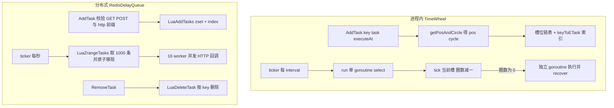

:::note 事实基线
本文依据 `$HOME/github/yukino.go/components/time_wheel` 在 `91712867080` 的源码事实撰写；文中的路径、常量与 API 名称均可在该检出中定位。
:::

**主线一览**



:::warning 源码与 README 的一处口径差异
`README.md` 把分布式实现描述为"按分钟分片的 zset + 删除标记", 但 `redis_delay_queue.go` 实际使用**单个** zset `yukino_time_wheel_tasks:{wheel}` 加索引哈希 `yukino_time_wheel_task_index:{wheel}`, `LuaZrangeTasks` 直接 `ZREM` 到期成员。本文按源码事实撰写。
:::

用堆或 `time.Timer` 管理海量延迟任务, 每次插入是 O(log n), 且容易退化成"一个任务一个 goroutine/定时器"。时间轮把任务按到期时刻映射到槽位, 游标每 tick 前进一步, 插入与删除都是 O(1), 且由单个 goroutine 驱动全部任务。代价是精度受 tick 间隔限制, 且实现需要处理"超过一圈"的任务。`components/time_wheel` (module `components/time_wheel`, `go.mod` 声明 `go 1.26.0`) 在一篇里给出两套实现: 进程内 `TimeWheel` 与 Redis 支撑的 `RedisDelayQueue`。

## 一、进程内 TimeWheel

### 1.1 状态与 API

```go
func NewTimeWheel(slotNum int, interval time.Duration) *TimeWheel
func (t *TimeWheel) AddTask(key string, task func(), executeAt time.Time)
func (t *TimeWheel) RemoveTask(key string)
func (t *TimeWheel) Stop()
```

`slotNum <= 0` 补 10, `interval <= 0` 补 `time.Second`。核心状态 (`time_wheel.go`):

| 字段                                  | 作用                           |
| ------------------------------------- | ------------------------------ |
| `slots []*list.List`                  | 每个槽挂一条任务链表           |
| `curSlot int`                         | 当前游标                       |
| `keyToETask map[string]*list.Element` | key 到链表元素, 支撑 O(1) 取消 |
| `addTaskCh` / `removeTaskCh`          | 串行化外部操作                 |
| `stopChan` / `done` / `taskWG`        | 停机与任务等待                 |
| `sync.Once`                           | 保证 `Stop` 幂等               |

`taskElement` 保存 `task func()`、`pos`、`cycle`、`key`、`executeAt`。

### 1.2 事件循环与圈数

`run()` 是一个单 goroutine 的 `select`, 处理 tick、新增、删除、停止四类事件, 因此**所有轮体状态无需加锁**。`Stop()` 用 `Once` 关闭 stopChan 与 ticker, 等待 `done` 后再 `taskWG.Wait()`, 保证已开始执行的任务结束。

`getPosAndCircle(executeAt)` 把执行时刻换算成槽位与圈数:

```go
ticks := int64(1)
if delay := executeAt.Sub(t.nextTick); delay > 0 {
    ticks += int64((delay-1)/t.interval + 1)
}
advance := ticks - 1
pos := (t.curSlot + int(advance%slotCount)) % len(t.slots)
cycle := int(advance / slotCount)
```

`tick` 只执行当前槽链表并 `circularIncr()`; `execute` 遍历链表时, `cycle > 0` 的元素仅减一后保留在原槽, 归零才真正派发。这样一个 10 槽的小轮也能承载任意远的未来任务。每个到期任务在独立 goroutine 中执行并 `recover`, 单个 panic 不会杀死轮体。

`addTask` 发现同一 key 已有任务时先调用 `removeTask` 再挂入新任务, 天然支持重新调度;`RemoveTask` 找不到 key 时安静返回。`AddTask`/`RemoveTask` 在 stopChan 关闭后直接返回, 不会阻塞。

:::tip 过去的任务会怎样
`executeAt` 早于 `nextTick` 时 `ticks` 保持 1, 任务被放进即将扫描的槽位, 下一 tick 即执行。`time_wheel_test.go` 的 `Test_TimeWheel_PastExecuteAt` 专门验证这一行为。
:::

## 二、分布式 RedisDelayQueue

### 2.1 数据结构与 API

```go
type RedisDelayTask struct {
    Key         string            `json:"key"`
    CallbackURL string            `json:"callback_url"`
    Method      string            `json:"method"`
    Req         any               `json:"req"`
    Header      map[string]string `json:"header"`
}

func NewRedisDelayQueue(redisClient *redis.Client, httpClient *time_wheel_http.Client) *RedisDelayQueue
func (r *RedisDelayQueue) AddTask(ctx context.Context, key string, task *RedisDelayTask, executeAt time.Time) error
func (r *RedisDelayQueue) RemoveTask(ctx context.Context, key string, executeAt time.Time) error
func (r *RedisDelayQueue) Stop()
```

两个固定键名 (`getTaskQueueKey`/`getTaskIndexKey`):

- zset: `yukino_time_wheel_tasks:{wheel}`, score 为 `executeAt.Unix()`, member 是任务 JSON。
- hash: `yukino_time_wheel_task_index:{wheel}`, field 是任务 key, value 是同一份任务 JSON。

任务体在 `AddTask` 中先 `taskCopy := *task; taskCopy.Key = key` 再序列化, 因此以参数 key 为准。

### 2.2 三段 Lua

`time_wheel_lua.go` 定义 `LuaAddTasks`、`LuaDeleteTask`、`LuaZrangeTasks`:

- **加入**: 先按 key 从索引哈希取旧任务, 存在则 `ZREM` 掉, 然后 `HSET` 新任务、`ZADD` 新分数。重新调度同一 key 自动顶替旧条目, 不会产生两条任务。
- **取消**: 从索引哈希取任务 JSON, 取不到返回 0; 否则 `ZREM` 集合成员并 `HDEL` 索引。
- **弹出**: `ZRANGEBYSCORE key -inf maxScore LIMIT 0 1000`, 在脚本内逐条 `pcall(cjson.decode)` 并要求 `type(task.key) == 'string'` 且非空; 任何一条损坏都会 `redis.error_reply('invalid time wheel task payload')` 让整次调用失败。随后逐条比对"索引中该 key 的值是否等于集合成员", 相等才 `HDEL`, 最后 `ZREM`。解码、校验与移除在一次往返内完成, 这是多实例不重复触发的根本原因。

:::warning RemoveTask 的 executeAt 参数当前未被使用
`RemoveTask(ctx, key, executeAt)` 接受执行时刻, 但 `redis_delay_queue.go` 构造 Lua 参数时只传了 key。当前实现只依赖索引哈希定位任务。
:::

### 2.3 运行循环与回调

`run()` 每秒 tick 一次, `executeTasks` 有三层防护:

1. `fetchCtx`: `context.WithTimeout(r.ctx, 10*time.Second)`, 调用 `LuaZrangeTasks` 取到期任务; 失败只记日志。
2. 有任务时启动一个 goroutine `deliverTasks`, 由 `dispatchWG` 跟踪。
3. `deliverTasks` 用 `context.WithTimeout(r.ctx, 30*time.Second)`, 开 16 个 worker 消费任务通道; `executeTask` 再次执行 `addTaskPreCheck` 后调用 `httpClient.JSONDo`。

`addTaskPreCheck` 只接受 `GET`/`POST` 方法与 `http://`/`https://` 前缀的 URL。回调以 JSON 请求体发出 (`pkg/http/http.go` 的 `JSONDo` 默认 `Content-Type: application/json`), 响应非 200 返回错误, 只记日志**不重试**。`Stop()` 用 `Once` 取消 context、关闭 stopChan 与 ticker, 等待 `done` 与 `dispatchWG`。

## 三、适用场景与边界

适合:

- 进程内高并发短延迟任务: 超时关闭、心跳、重试, 使用 `TimeWheel`。
- 跨实例秒级到分钟级 HTTP 延迟回调, 使用 `RedisDelayQueue`。

不适合:

- 毫秒级精度: 进程内轮受 `interval` 限制, 分布式轮固定每秒扫描一次。
- 突发海量到期任务: 单轮最多弹出 1000 条, 剩余任务推迟到下一轮; 同一 key 同时只存在一条任务。
- 非 HTTP 业务: 分布式任务体是 HTTP 回调描述, 业务逻辑必须暴露成可回调接口。
- 回调必须成功的语义: 当前实现失败只记日志, 没有重试与死信。

:::warning 与 scheduled_task 的关系
`apps/scheduled_task` 并不是 `time_wheel` 的上层封装: 它完全自包含 (自带基于 token 所有权的 Redis 锁、按天布隆过滤器、有界工作池、cron 解析器), 没有 import 本组件。二者是"同一类延迟调度问题的两种完整实现"。
:::

## 四、真实使用片段

`README.md` 的进程内用法:

```go
wheel := time_wheel.NewTimeWheel(10, 500*time.Millisecond)
defer wheel.Stop()
wheel.AddTask("send-reminder", func() { log.Println("reminder fired") }, time.Now().Add(3*time.Second))
wheel.RemoveTask("send-reminder")
```

`README.md` 的分布式用法:

```go
client := redis.NewClient("tcp", "localhost:6379", "")
delayQueue := time_wheel.NewRedisDelayQueue(client, time_wheel_http.NewClient())
defer delayQueue.Stop()
err := delayQueue.AddTask(ctx, "order-42-timeout", &time_wheel.RedisDelayTask{
    CallbackURL: "https://internal.example.com/orders/42/timeout",
    Method:      http.MethodPost,
    Req:         map[string]any{"orderID": 42},
    Header:      map[string]string{"X-Source": "time-wheel"},
}, time.Now().Add(30*time.Minute))
```

`time_wheel_test.go` 的 `Test_RedisDelayQueue` 需填写 `address` 与 `callbackURL` 占位常量, 否则跳过; 其中先为 `test2` 添加 4 秒后任务再 `RemoveTask`, 验证取消路径。

## 五、两套实现的对照与选型

| 维度      | 进程内 `TimeWheel`                    | 分布式 `RedisDelayQueue`                    |
| --------- | ------------------------------------- | ------------------------------------------- |
| 状态载体  | 槽位数组 + 链表 + key 索引 (进程内存) | 单个 zset + 索引哈希 (Redis)                |
| 驱动      | 一个 goroutine 的 `select` 事件循环   | 每秒 tick + 一次 Lua 弹出 + 16 worker       |
| 插入/删除 | O(1), 同 key 覆盖旧任务               | Lua 原子 `ZREM` 旧任务后 `ZADD` 新任务      |
| 取消      | 按 key 从 `keyToETask` 摘除元素       | 按 key 从索引哈希取任务体后 `ZREM` + `HDEL` |
| 到期粒度  | `interval`, 默认 1 秒                 | 1 秒扫描 + `executeAt.Unix()`, 秒级         |
| 任务形态  | 任意 `func()` 闭包                    | `RedisDelayTask` 描述的 HTTP 请求           |
| 失败处理  | panic 被 recover 并记录               | 非 200 记录日志, 不重试                     |
| 跨实例    | 不支持                                | 支持, 依赖 Lua 内的 JSON 校验与条件删除     |

选择原则很直接: 任务只在单进程内生效且需要任意闭包时用 `TimeWheel`; 任务要跨实例、且业务已经能暴露 HTTP 接口时用 `RedisDelayQueue`。二者共享的是"按到期时刻分桶 + 单驱动循环"的思想, 不共享代码路径。

`pkg/http/http.go` 的 `JSONDo` 是回调执行的最后一环: 构造带 context 的请求, 逐条写入自定义 Header, 未设置时补 `Content-Type: application/json`, 非 200 返回 `invalid status: %d`。`pkg/redis/redis.go` 则只封装延迟队列所需的最小 Redis 表面, 包括 `Eval` 与 zset/hash 操作。

## 六、源码索引

本文引用的源码文件 (均相对于组件目录):

| 路径                    | 用途                                |
| ----------------------- | ----------------------------------- |
| `README.md`             | 两套原语的说明 (部分口径以源码为准) |
| `time_wheel.go`         | 进程内时间轮、圈数计算与事件循环    |
| `time_wheel_lua.go`     | 加入/取消/弹出三段 Lua              |
| `redis_delay_queue.go`  | 分布式队列、回调派发与键名          |
| `pkg/http/http.go`      | JSON HTTP 客户端与非 200 判定       |
| `pkg/redis/redis.go`    | Redis 客户端封装                    |
| `pkg/util/time.go`      | 时间格式化辅助                      |
| `time_wheel_test.go`    | 进程内行为与分布式集成用例          |
| `pkg/http/http_test.go` | HTTP 客户端测试                     |
