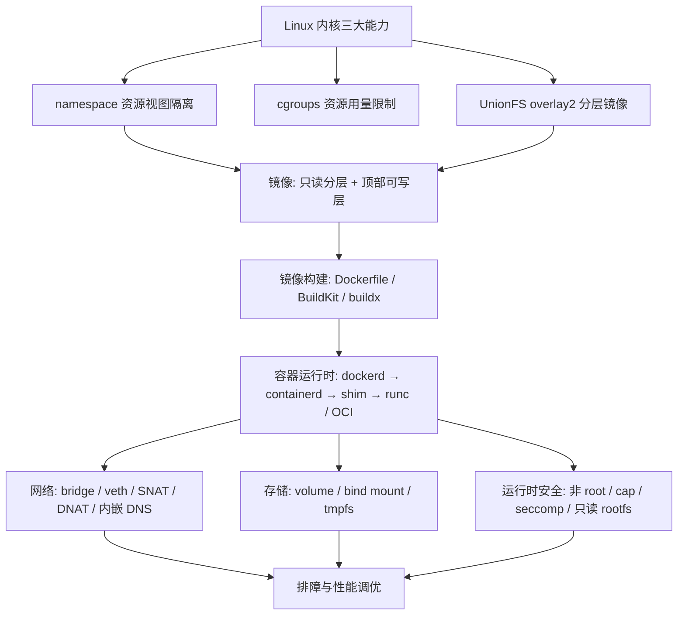

**主线一览**



> 定位: 本篇是 Docker 的完整面试知识体系, 每个知识点 = 一句话回答 (先背这个) + 追问展开 (应对深挖)。
> 环境现状: 本机已装 Docker Engine 29.8.2 与 kubectl v1.36.1, cgroup v2, 无集群 context, 如需实操可启动 Docker Desktop 并开启其内置 Kubernetes。
> 串联: Kubernetes 知识体系见 [k8s](./k8s); 把 Docker 与 Kubernetes 串起来做 JSError 自动修复的实战见 [agent-sandbox](./agent-sandbox)。

:::note 版本基线
Docker 知识体系按当前稳定版本撰写: Docker Engine 29.x (Engine API 与 containerd shim 链路), cgroup v2 为现代发行版默认; Docker Compose v2 是 Go 实现的 CLI 插件。容器运行时链路 `dockerd → containerd → containerd-shim-runc-v2 → runc` 按 OCI image-spec / runtime-spec / distribution-spec 口径撰写, 与 Kubernetes 1.24 移除 dockershim 后经 CRI 直连 containerd/CRI-O 的现状对齐。供应链与运行时安全部分涉及的 Harbor、trivy/grype、cosign、syft 及 gVisor/Kata/Firecracker 均按当前主流版本口径, 不钉具体版本号。
:::

---

## 第一部分 Docker

### 1. Docker 是什么? 和虚拟机有什么区别? (必考)

**一句话**: Docker 是基于 Linux 内核三大能力的容器引擎——namespace 做资源视图隔离、cgroups 做资源用量限制、UnionFS 做分层镜像; 容器共享宿主机内核, 没有 Guest OS, 所以秒级启动、MB 级开销。

| 维度     | 容器                      | 虚拟机                          |
| -------- | ------------------------- | ------------------------------- |
| 隔离级别 | 进程级 (共享内核)         | 硬件级 (Hypervisor + 完整 OS)   |
| 启动速度 | 秒级 / 毫秒级             | 分钟级                          |
| 资源开销 | MB 级                     | GB 级                           |
| 隔离强度 | 较弱 (内核漏洞可逃逸)     | 强                              |
| 密度     | 单机可跑成百上千个        | 单机几十个                      |
| 关键技术 | namespace / cgroups / OCI | Hypervisor (KVM / VMware / Xen) |

**追问 1: namespace 有哪几种, 各隔离什么?**

Linux 目前共 8 种 namespace, 前 6 种是 Docker 早期就使用的经典集合:

| namespace | 隔离内容                         | 容器内表现                         |
| --------- | -------------------------------- | ---------------------------------- |
| PID       | 进程号                           | 容器内主进程是 PID 1               |
| Network   | 网卡、路由表、iptables、端口空间 | 独立 IP, 端口不冲突                |
| Mount     | 挂载点与文件系统视图             | 只看到自己的 rootfs                |
| UTS       | 主机名与域名                     | 每个容器可有自己的 hostname        |
| IPC       | 信号量、消息队列、共享内存       | 容器间默认不能用 IPC 通信          |
| User      | 用户与用户组 ID 映射             | 容器内 root 可映射为宿主机普通用户 |
| Cgroup    | cgroup 根目录视图                | 容器看不到宿主机的 cgroup 层级     |
| Time      | 系统时钟 (Linux 5.6+)            | 容器可有独立 CLOCK_MONOTONIC 偏移  |

验证方式: `ls -l /proc/<pid>/ns/`, 每个软链指向的 inode 号相同即在同一 namespace。

**追问 2: cgroups 限制什么, 怎么实现的?**

- cgroups (control groups) 负责资源限制、优先级分配、审计统计与进程控制, 覆盖 CPU、内存、块设备 IO、PID 数量等子系统。
- `docker run --cpus=1.5` 本质是写 cgroup 的 CPU 配额 (v2 里是 `cpu.max = 150000 100000`, 即每 100ms 周期最多用 150ms CPU 时间, 超限被**限流**而不是杀); `--memory=512m` 写 `memory.max`, 超限触发 cgroup 级 OOM kill (退出码 137 = 128 + SIGKILL)。
- v1 每个子系统一棵独立层级树, v2 统一为单层级 (unified hierarchy); Docker 20.10+ 支持 cgroups v2, 现代发行版默认 v2。
- **CPU 是可压缩资源 (限流), 内存是不可压缩资源 (OOM 杀)**——这个结论直接平移到 K8s 的 requests/limits 语义。

**追问 3: 容器逃逸的根源与加固?**

- 根源是共享内核: 容器内进程直接对宿主机内核发起 syscall, 一个内核提权漏洞就是逃逸面; 挂载 docker.sock、privileged 模式、危险 capability (SYS_ADMIN) 是工程上最常见的逃逸通道。
- 加固阶梯: 非 root 运行 + drop capabilities + seccomp/AppArmor 收窄 syscall → rootless dockerd / user namespace remap → 安全容器: **gVisor** (用户态内核拦截并代理 syscall, 牺牲部分性能与兼容性)、**Kata Containers** (每容器一个轻量 VM, 硬件级隔离)、Firecracker (microVM, AWS Lambda 同款)。K8s 里通过 RuntimeClass 一行切换 (见 [Agent 沙箱实战](./agent-sandbox) 的 RuntimeClass 配置)。

**追问 4: Docker 的组件架构与 OCI?**

```text
docker CLI → dockerd (REST API: 构建/网络/卷/镜像管理)
           → containerd (容器与镜像生命周期管理, CNCF 毕业项目)
           → containerd-shim-runc-v2 (每容器一个, 使容器不依赖 daemon 存活, 收集退出状态、转发 stdio)
           → runc (按 OCI runtime-spec 创建 namespace/cgroups, 启动进程后即退出)
```

- OCI (Open Container Initiative) 三大规范: image-spec (镜像格式)、runtime-spec (如何运行一个 rootfs + config)、distribution-spec (registry HTTP API)。标准化之后「Docker 镜像」在任何合规运行时 (containerd、CRI-O、Podman) 都能跑。
- 与 K8s 的关系: K8s 1.24 移除 dockershim, kubelet 改经 CRI 直连 containerd/CRI-O, 不再绕道 Docker daemon; 但 Docker 构建出的 OCI 镜像照常使用。Docker 作为开发构建工具依然是主流。
- macOS/Windows 上的 Docker Desktop 实际在一个 Linux 虚拟机 (HyperKit/VMKit/WSL2) 里跑 dockerd——容器只能运行在 Linux 内核上。

### 2. 核心概念: 镜像、容器、仓库

- **镜像 Image**: 只读的分层文件系统模板 + 运行配置 (entrypoint、env、暴露端口), 按内容哈希 (sha256 digest) 寻址。
- **容器 Container**: 镜像的运行实例 = 只读镜像层 + 顶部一个可写层; 删容器不删镜像, 可写层数据随之丢失。
- **仓库 Registry / Repository**: Registry 是存镜像的服务 (Docker Hub / Harbor / 云 ACR), Repository 是同名镜像下所有 tag 的集合 (`nginx` 仓库下有 `1.27`、`alpine` 等 tag)。
- **tag 与 digest**: tag 可变 (今天 `latest` 和明天 `latest` 可以不是同一个镜像), digest 不可变; 生产部署用 digest 或不可变 tag (git sha) 钉死版本, 这是供应链安全的第一课。
- **Dockerfile**: 构建镜像的脚本, 每条指令产生一层 (或仅元数据)。

### 3. 镜像分层与存储驱动原理 (原理题)

**一句话**: 镜像 = 多个只读层经 UnionFS (主流实现 overlay2) 叠加, 容器运行时在顶部加一个可写层; 层以内容哈希寻址, 相同层在不同镜像间复用, 省磁盘省传输。

- overlay2 的四个目录: `lowerdir` (只读镜像层, 可多层) + `upperdir` (容器可写层) + `workdir` (原子操作暂存) → 合并视图 `merged` (容器看到的 rootfs)。
- **写时复制 (CoW)**: 修改只读层文件时先 copy-up 到可写层再改; 删除文件在可写层放一个 whiteout 标记遮住下层文件——所以下载镜像后删除大文件并不能减小体积, 必须在构建期同一层内删。
- 拉取镜像时并行下载各层, 已有层直接跳过——分层是增量分发的基础。
- 验证命令: `docker history <image>` 看每层来源指令与大小; `docker image inspect <image>` 的 `RootFS.Layers` 看层 diffID 链。
- 推论 (高频考点): **可写层的数据随容器删除而丢失**, 持久化必须用 volume; **层数与体积在构建期决定**, 镜像瘦身的全部手段都作用于构建期。

### 4. 必背命令

```bash
# 构建与运行
docker build -t app:v1 .                     # 构建镜像
docker run -d -p 8080:80 --name web app:v1   # 后台运行 + 端口映射
docker run -it --rm node:24 sh               # 前台交互, 退出即删
docker run -d --restart unless-stopped \
  -v data:/var/lib/mysql -e MYSQL_ROOT_PASSWORD=x mysql:8  # 重启策略 + 卷 + 环境变量

# 查看与排障
docker ps / docker ps -a                     # 运行中 / 全部容器
docker logs -f --tail 100 web                # 看日志 (排障第一步)
docker exec -it web sh                       # 进入运行中容器 (新开进程, 不影响主进程)
docker inspect web                           # IP、挂载、环境变量、State.ExitCode 等元数据
docker stats                                 # 实时 CPU/内存/IO
docker top web / docker diff web             # 容器进程 / 可写层文件改动
docker events                                # 实时事件流 (die/oom/kill/start...)

# 生命周期与清理
docker stop / start / restart / rm web       # stop 发 SIGTERM, 宽限 10s 后 SIGKILL
docker images / docker rmi app:v1            # 镜像管理
docker system df                             # 磁盘占用分析
docker system prune -a --volumes             # 清理停止容器/悬空镜像/未用网络/卷 (危险, 加 --volumes 前想清楚)

# 迁移与归档
docker save app:v1 -o app.tar / docker load -i app.tar    # 镜像归档 (保留分层与元数据)
docker export web -o web-fs.tar / docker import web-fs.tar # 容器文件系统扁平化 (丢历史层与配置)
```

**退出码约定** (排障常用): `125` docker 命令本身失败; `126` 命令不可执行; `127` 命令不存在; `128+N` 被信号 N 终止——`137` = SIGKILL (常见于 OOM 或 stop 超时), `143` = SIGTERM 正常终止。

### 5. Dockerfile 最佳实践 (高频)

```dockerfile
# 多阶段构建: 编译层与运行层分离, 最终镜像极小
FROM golang:1.26 AS builder
WORKDIR /src
COPY go.mod go.sum ./
RUN go mod download          # 依赖单独一层, 利用缓存
COPY . .
RUN CGO_ENABLED=0 go build -o app .

FROM gcr.io/distroless/static-debian12   # 运行层用最小基础镜像
COPY --from=builder /src/app /app
EXPOSE 8080
ENTRYPOINT ["/app"]
```

考点清单:

- **层缓存顺序**: 把变化少的指令放前面 (`COPY go.mod` + `go mod download`), 变化多的 (源码 `COPY .`) 放后面; 某层缓存失效则其后所有层重建。前端项目同理: 先 `COPY package.json pnpm-lock.yaml` 装依赖, 再 COPY 源码。
- **多阶段构建**: 编译工具链不进最终镜像, 镜像从 GB 级降到几十 MB; `COPY --from=builder --chown=1000:1000` 顺带解决属主问题。
- **基础镜像选择**: `alpine` (~5MB, 但用 musl libc, glibc 依赖的软件与 DNS 解析行为有兼容坑)、`distroless` (无 shell 无包管理器, 攻击面最小, 调试要靠 `kubectl debug` 临时容器)、`*-slim` (Debian 裁剪版, 兼容性均衡)、企业内用 UBI 等合规镜像。
- **一条 RUN 用 `&&` 串联并清理缓存**: `apt-get update && apt-get install -y --no-install-recommends x && rm -rf /var/lib/apt/lists/*`; apk 用 `--no-cache`。分层机制决定了「后一层删不掉前一层的文件」。
- **`.dockerignore`**: 排除 node_modules、.git、.env, 加速构建上下文传输、防止缓存被无关变更打穿、避免泄密。
- **COPY 优先于 ADD**: ADD 多了 URL 下载与 tar 自动解压两个隐式行为, 不可控; 只在需要自动解压本地 tar 时用 ADD。
- **ARG 与 ENV**: ARG 仅构建期可见 (可被 `--build-arg` 覆盖, 多阶段间需每段重新声明), ENV 进镜像运行期可见; 敏感值两者都不要用 (会留在层历史), 用 BuildKit secret mount。
- **USER 非 root**: 运行期最小权限; 需要 root 的安装步骤放 USER 之前。
- **HEALTHCHECK**: `HEALTHCHECK --interval=30s CMD curl -f http://localhost/ || exit 1`, docker/compose 会据此标记 unhealthy; K8s 不用它 (用探针)。
- **EXPOSE 只是文档**: 真正的端口暴露由 `run -p` / 网络模式决定。
- **WORKDIR 代替 RUN cd**: 自动创建目录, 且后续指令都在此上下文。
- **钉死版本**: 基础镜像带明确 tag, 依赖带 lockfile; 可复现构建的前提。

### 6. CMD vs ENTRYPOINT 与信号处理 (必考辨析)

- `ENTRYPOINT`: 容器的「主程序」, `docker run image xxx` 的追加参数不会覆盖它 (除非 `--entrypoint`)。
- `CMD`: 默认参数或默认命令; 有 ENTRYPOINT 时 CMD 是它的默认参数, run 追加参数会**整体替换 CMD**。
- 组合范式: `ENTRYPOINT ["nginx"]` + `CMD ["-g","daemon off;"]`, 用户 run 时传参即覆盖默认参数。

**exec 形式 vs shell 形式** (经典追问):

| 形式           | 实际执行                           | 信号行为                              |
| -------------- | ---------------------------------- | ------------------------------------- |
| `["app","-f"]` | 直接 execve, app 是 PID 1          | 直接收到 SIGTERM, 可优雅退出          |
| `app -f`       | `/bin/sh -c "app -f"`, sh 是 PID 1 | sh 默认不转发信号, app 收不到 SIGTERM |

后果: shell 形式下 `docker stop` 发 SIGTERM 无人响应, 等宽限期 (默认 10s) 后 SIGKILL 硬杀——优雅退出失效, 在途请求被掐断。三种解法: 用 exec 形式; shell 脚本入口里用 `exec app` 替换进程映像; 引入 `tini`/`dumb-init` 做 PID 1。

**PID 1 的两个特殊性**: 信号语义——内核不对 PID 1 执行默认信号动作, 未注册处理器的信号直接被丢弃 (SIGKILL/SIGSTOP 除外), 所以 shell 形式下 `docker stop` 的 SIGTERM 被 sh 吞掉, 应用进程收不到; 回收职责——PID 1 承担孤儿进程回收, 应用进程若不做 reap, 子进程退出后的僵尸无人收走会累积。tini/dumb-init (`ENTRYPOINT ["tini","--"]`) 一次解决信号转发与僵尸回收两件事; K8s 场景下 pause 容器不承担 reap, 业务容器仍需自己处理。

### 7. 容器网络

| 模式             | 说明                                         | 场景               |
| ---------------- | -------------------------------------------- | ------------------ |
| bridge (默认)    | 容器接 docker0 网桥, NAT 出网, `-p` 映射端口 | 单机多容器         |
| host             | 直接共享宿主机网络栈, 无 NAT 无端口映射      | 高性能、弱隔离需求 |
| container        | 与另一容器共享 network namespace             | K8s Pod 的原理雏形 |
| none             | 只有 lo, 无外部网络                          | 纯计算、安全隔离   |
| ipvlan / macvlan | 容器以独立 L2/L3 身份直挂物理网络            | 需要真实网段 IP    |
| overlay          | VXLAN 跨主机组网 (Swarm/多机)                | 多机容器网络       |

**bridge 模式原理** (追问必问):

1. 每个容器有独立 network namespace, 通过一对 **veth pair** 接入网络: 一端在容器内叫 eth0, 另一端挂在 docker0 网桥上。
2. 容器默认网关指向 docker0; 出公网走 **SNAT** (iptables MASQUERADE, 源地址换成宿主机 IP)。
3. `-p 8080:80` 是宿主机 8080 → 容器 80 的 **DNAT** 规则 (iptables nat 表 DOCKER 链), `iptables -t nat -L DOCKER -n` 可直接看到; 用户态还有 docker-proxy 兜底本机访问。
4. **默认 bridge 与自定义 bridge 的关键区别**: 自定义 bridge 网络自带内嵌 DNS (容器内 resolv.conf 指向 127.0.0.11), 容器名/别名可直接互访; 默认 bridge 只能靠 IP 互联。生产与 compose 一律用自定义网络。

**追问**: 容器间通信——同一自定义 bridge 内直接二层可达; host 模式容器与 bridge 容器经宿主机 IP 互访。`--network-alias` 可给容器加多个 DNS 名。MTU 要与底层网络匹配, 否则出现「ping 通但 TCP 大包卡死」的经典故障。

### 8. 数据持久化 (三种方式)

| 方式       | 存放位置                       | 管理方 | 场景                   |
| ---------- | ------------------------------ | ------ | ---------------------- |
| volume     | `/var/lib/docker/volumes/<名>` | Docker | 生产持久化 (推荐)      |
| bind mount | 宿主机任意路径                 | 用户   | 开发调试、挂配置文件   |
| tmpfs      | 内存                           | 内核   | 敏感临时数据、高速缓存 |

- volume 生命周期独立于容器: `docker rm` 默认保留卷, `docker rm -v` 才删; `docker volume prune` 清理无主卷。
- 多个容器可同时挂载同一 volume 实现共享 (注意并发写一致性由应用自己负责)。
- bind mount 支持传播模式 (`:ro` 只读、`:rslave` 等), 依赖宿主机路径, 可移植性差。
- 备份: `docker run --rm -v data:/data -v $(pwd):/backup alpine tar czf /backup/data.tgz -C /data .`。
- 与 K8s 的对应关系: tmpfs ≈ emptyDir (memory), bind mount ≈ hostPath, volume ≈ PV/PVC 抽象的起点。

### 9. Docker Compose

**一句话**: Compose 是单机多容器编排工具, 用一个 YAML 声明 services/networks/volumes, `docker compose up -d` 一键拉起整套依赖 (应用 + 数据库 + 缓存)。

- v2 是 Go 实现的 CLI 插件 (`docker compose`), v1 的 Python `docker-compose` 已停止维护。
- 高频特性: `depends_on` 配 `condition: service_healthy` 表达启动顺序 (仅顺序, 不是就绪保证的替代品); `profiles` 按需启用调试服务; `watch` 模式做代码热重载; `build` 段内联 Dockerfile 参数。
- 定位边界: Compose 面向**单机开发/测试环境**; 生产多机编排、自愈、滚动发布是 K8s 的职责 (Swarm 已边缘化)。面试可补一句: Compose 文件是描述依赖拓扑的好载体, 迁移 K8s 时可用 kompose 转换后人工修整。

### 10. BuildKit、buildx 与多架构镜像

- **BuildKit** (Docker 23+ 默认构建器): 把构建解析成 DAG 并行执行、按需构建 (只构建最终镜像依赖的层)、缓存输出更克制、失败才展示对应日志。
- 三个杀手级 mount:
  - `RUN --mount=type=cache,target=/root/.npm npm ci`——依赖缓存跨构建复用但不进镜像层;
  - `RUN --mount=type=secret,id=token ...`——密钥只在指令执行期可见, 不落入任何层;
  - `RUN --mount=type=ssh`——用宿主机 SSH agent 拉私有依赖, 不拷贝私钥。
- **buildx**: 多平台构建入口。`docker buildx build --platform linux/amd64,linux/arm64 -t app:v1 --push .` 产出 OCI image index (manifest list), 一个 tag 下按客户端架构自动分发; 跨架构靠 QEMU 模拟或原生交叉编译 (前端/Go 项目优先交叉编译, 快一个数量级)。
- CI 缓存: `--cache-from type=registry,ref=app:buildcache --cache-to type=registry,ref=app:buildcache,mode=max`, 让无状态 CI runner 也能命中层缓存。

### 11. 镜像仓库与供应链安全

- Registry 协议是 HTTP API (distribution-spec); 自建主流选 **Harbor**: 项目与 RBAC、跨仓库复制、tag 保留策略与 GC、漏洞扫描集成、镜像签名。
- **漏洞扫描**: trivy/grype 扫 OS 包与应用依赖 CVE, 进 CI 做门禁 (CRITICAL 阻断); 关注「可修复漏洞」而非总数, 避免告警疲劳。
- **镜像签名与准入**: cosign (sigstore, 支持 keyless OIDC 签名) 签 digest, K8s 侧用准入控制器 (Kyverno/policy-controller) 拒绝未签名镜像——防「谁都能往生产推镜像」。
- **SBOM**: syft 生成软件物料清单归档, 漏洞爆发时 (log4shell 式) 反查影响面。
- 供应链三件套: lockfile 锁定依赖 + 内部镜像源 (npm proxy/Artifactory) + digest 钉死基础镜像。

### 12. 容器运行时安全加固

- **最小权限运行**: `USER` 非 root; `--cap-drop ALL --cap-add NET_BIND_SERVICE` 按需授予 capability (Docker 默认给约 14 个, K8s restricted PSA 要求 drop ALL); `--security-opt no-new-privileges` 禁 setuid 提权。
- **seccomp**: Docker 默认 profile 屏蔽了几十个危险 syscall (mount、reboot、kexec 等); 自定义 profile 可进一步收窄。
- **AppArmor/SELinux**: docker-default profile 限制文件与 capability 访问; RHEL 系用 SELinux 标签 (`:z`/`:Z` 挂载选项)。
- **只读根文件系统**: `--read-only` + `--tmpfs /tmp`, 逼应用把所有写路径显式化, 也让入侵者难以落盘。
- **资源围栏**: `--pids-limit` 防 fork 炸弹; `--ulimit nofile` 限句柄; `--cpus/--memory` 见 §1。
- **rootless dockerd / userns-remap**: daemon 本身以非 root 运行, 容器内 root 映射为宿主机高位 UID, 逃逸拿到也只是普通用户。
- **铁律**: 绝不把 `/var/run/docker.sock` 挂进不受信容器——等于交出宿主机 root (可创建 privileged 容器挂载宿主根目录)。

### 13. Docker 排障速查

| 现象                   | 常见原因                                       | 排查手段                                              |
| ---------------------- | ---------------------------------------------- | ----------------------------------------------------- |
| 容器启动即退出         | 主进程是前台短命进程 / 命令写错                | `docker logs`; `docker inspect` 看 State.ExitCode     |
| 退出码 137             | OOM (cgroup 内存超限) 或 stop 超时被 SIGKILL   | `docker inspect` 的 OOMKilled 字段; `docker events`   |
| 退出码 127/126         | 命令不存在 / 无执行权限 (常见于 COPY 丢权限位) | 检查 ENTRYPOINT 路径与 `chmod +x`                     |
| 端口映射不通           | 应用只监听 127.0.0.1 / 防火墙 / iptables 被清  | 容器内 `ss -lntp`; 宿主机 `iptables -t nat -L DOCKER` |
| 容器间无法互访         | 用了默认 bridge (无内嵌 DNS)                   | 建自定义网络, 用容器名访问                            |
| 磁盘被吃满             | 镜像层/构建缓存/容器日志堆积                   | `docker system df`; json-file 日志配 max-size 轮转    |
| 构建缓存全失效         | 早期层 COPY 了频繁变化的文件                   | 调整指令顺序, 依赖清单先行                            |
| 进不去 distroless 容器 | 镜像内无 shell                                 | `docker debug` / K8s `kubectl debug` 临时容器         |

**两个原理性认知**: ① 容器的生命周期 = 主进程的生命周期, 「容器里跑个 systemd/多进程」是反模式 (一容器一职责, 确需多进程用 supervisord 且自担复杂度); ② 容器时钟共享内核, 不存在漂移, 时区问题用 `TZ` 环境变量或挂载 `/etc/localtime` 解决。

### 14. 高频杂项问答

- **镜像如何瘦身**: 多阶段构建、小基础镜像 (alpine/distroless)、合并 RUN 并在同层清理缓存、.dockerignore、静态编译去 libc 依赖 (Go 的 `CGO_ENABLED=0`)、`docker export` 扁平化 (丢历史层与元数据, 最后手段)。
- **容器删除数据丢吗**: 可写层丢, volume/bind mount 不丢。
- **如何修改镜像里的文件**: 正道是改 Dockerfile 重建; `docker commit` 把容器固化成镜像仅用于临时调试留证, 生产禁用 (不可追溯、层越滚越大)。
- **`docker exec` 与 `docker attach` 区别**: exec 在容器内新起进程 (退出无副作用); attach 接管主进程 stdio (Ctrl-C 会杀主进程)。
- **镜像拉取策略**: 本地有 tag 就不拉 (`IfNotPresent` 语义), CI/生产用 digest 或 `--pull always` 防陈旧 latest。
- **为什么 K8s 弃用 dockershim**: Docker daemon 不说 CRI 协议, kubelet 要经 dockershim 转译再进 containerd, 链路长、维护成本高; 1.24 起直连 CRI 运行时。Docker 的开发者体验 (build/compose) 不受影响。

---

**本篇延伸**

- [k8s](./k8s): Kubernetes 架构、Pod/控制器/Service/调度/探针/资源/RBAC/排障完整知识体系; 文末自检清单含 Docker 部分的口述自查项。
- [agent-sandbox](./agent-sandbox): 把 Docker 与 Kubernetes 组合起来的前端 JSError 自动修复云沙箱实战。
