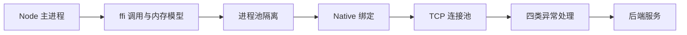
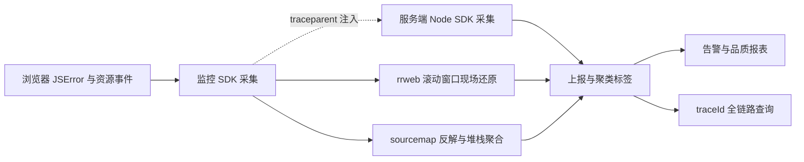

:::note 事实基线
本文由「NoSQL 管理端工程实践」与「前端监控与数据请求工程实践」两部分合并而成, 依据 `$HOME/github/r/src/data/default-resume.json` 在 `2b3f2e48656` 的简历事实整理, 文中的路径、常量与 API 名称均可在该检出中定位。

**NoSQL 管理端部分**不绑定单一代码仓库: native 侧为第三方 C++ `.so` 动态库, JS 绑定经 ffi-napi (评估迁移 N-API Addon), 进程池/连接池基于 generic-pool; 可观测性栈为 prom-client + Prometheus + Grafana、OpenTelemetry (OTLP/Prometheus 导出)、Sentry Node。文中给出的包名、指标名与 API 名称按当前主流版本口径撰写; 具体依赖版本以落地项目的 lockfile 为准, 本文不钉版本号。

**前端监控部分**: SDK 相关章节 (JSError 模型、滚动窗口录屏、sourcemap 反解、FSP 计算、网络监听与批量上报、全链路 trace) 对照本地仓库 `~/github/yukino-sentry/sentry` @ `2eb55b6c8f1` 核验, 源码路径标注于对应小节; 其余章节 (资源竞态、手写 SWR、引导脚本监控) 为通用工程实践总结, 文中实测数字均标注为记录值或估算示例, 不在该仓库源码内复算。
:::

**主线一览**



这份文档整理一个 NoSQL 管理端在长期迭代中遇到的五类工程问题: 公共选择器从类组件迁移到函数组件时的语义差异与数据竞争、通过 ffi 调用 C++ 动态库时的内存模型与进程池隔离、与数据库管理端 TCP 长连接的连接池治理、JS 堆内闭包引用导致的内存泄漏排查, 以及把上述排查手段常态化的服务可观测性体系。

五部分各自独立, 但共享同一套方法论: 先界定问题的约束 (语义模型、内存归属、连接状态、可达性、数据口径), 再对比可选方案, 最后给出实现要点与边界。适合做 Node 后端稳定性治理、React 组件重构或 native 互操作的工程师参考。

后半部分 (第 7 章起) 并入前端监控与数据请求工程实践: 如何在上报错误的同时还原故障现场、如何组织错误信息才能定位到源码行与组件、如何用一个 traceId 把前端报错与后端故障串成完整链路、资源懒加载竞态如何分析与缓解、SPA 首屏渲染时间怎么度量, 以及一个不依赖框架的接口预加载与缓存去重方案。内容按问题组织: 每个小节先交代约束与现象, 再对比可选方案, 给出实现要点与边界条件, 并保留可复用的实测结论与量化结果。

## 1. 类组件迁移到函数组件

### 迁移动机

管理端页面存在多个公共选择器, 历史上都是类组件实现: 集群选择器、备用集群选择器、数据库选择器、表选择器 (该 NoSQL 的表格式是 XML)。迁移动机来自类组件本身的几类摩擦:

- 生命周期逻辑分散: 一段副作用逻辑常散落在 componentDidMount、componentDidUpdate、componentWillUnmount 三个方法里, 读代码要来回跳; 函数组件用 useEffect 把"执行副作用加清理副作用"收敛到一处, 按逻辑单元组织。
- this 与绑定问题: 类组件的事件处理要么手动 bind, 要么写箭头函数属性, 容易踩 this 指向的坑; 函数组件全是普通闭包, 没有这类问题。
- 逻辑复用能力: 选择器之间有大量共性逻辑 (拉取选项列表、缓存、联动刷新), 类组件只能靠继承或高阶组件复用, 函数组件可以抽成自定义 hook, 复用更直接、组合更灵活。
- 性能优化手段更细: React.memo、useMemo、useCallback 可以精确控制重渲染与重复请求。
- 生态与维护: 现代 React 生态 (状态管理、路由、组件库) 都以 hooks 为中心, 统一成函数组件后代码风格一致; TypeScript 下函数组件加 hooks 的类型推导也比类的 this 类型更顺。
- 面向未来: 并发特性 (useTransition、useDeferredValue) 以 hook 形式提供, 只对函数组件友好。

### 生命周期与 hooks 的语义映射

核心难点是生命周期与 hooks 的语义并不一一对应, 机械翻译会出 bug。对应关系与注意点:

| 类组件                              | hooks 等价物                                  | 注意点                                                         |
| ----------------------------------- | --------------------------------------------- | -------------------------------------------------------------- |
| componentDidMount                   | useEffect(fn, [])                             | effect 在浏览器绘制后异步执行, 与 componentDidMount 时机有差异 |
| 需要在绘制前同步读 DOM              | useLayoutEffect                               | 用于避免闪烁或依赖布局尺寸的计算                               |
| componentDidUpdate                  | 带依赖数组的 useEffect                        | 依赖必须列全, 漏列会拿到过期值                                 |
| componentWillUnmount                | effect 返回的清理函数                         | 监听、定时器、在途请求的取消都放这里                           |
| shouldComponentUpdate               | React.memo 包裹组件, 配合 useMemo/useCallback | 引用不稳定会让 memo 失效                                       |
| getDerivedStateFromProps            | 渲染期直接计算或 useMemo                      | 优先不存第二份 state                                           |
| 错误边界 (getDerivedStateFromError) | 无 hook 等价物                                | 错误边界组件必须保留类组件                                     |

### state 的形态变化

this.state 是一个对象, setState 是合并且批量异步的; useState 是多个独立状态, 更新是整体替换。迁移时如果照搬对象形态塞进一个 useState, 更新时漏掉字段就会丢数据。正确的做法是按更新粒度拆分 state, 或改用 useReducer 把状态转移集中表达, 保证每次更新都是完整的下一状态。

### 闭包过期值与请求竞态

这是迁移中最容易踩到的问题, 分成两层:

- 闭包过期值: 函数组件里事件处理与异步回调都是闭包, 捕获的是当次渲染的 state。异步请求回来后再 setState, 可能基于过期值计算。
- 请求竞态: 选择器场景下接口响应时间不稳定, 用户连续切换筛选条件发出多个请求, 如果后发的请求先返回, 晚到的旧响应会覆盖新响应, 下拉选项与选中态错乱。

修法是在 effect 的清理函数里标记本次请求作废 (或用 AbortController 中断), 响应回来后先校验"是否仍是最新一次请求"再写入状态。稳定的请求标识加竞态校验是选择器类组件的必备逻辑。

### 避免重复请求

迁移后利用性能优化 hooks 收敛请求。两类重复请求最常见: 同一选择器在多个面板同时挂载, 每个实例各自发一次拉取选项的请求; 级联切换 (集群 -> 数据库 -> 表) 时, 传给请求 hook 的参数对象每次渲染都是新引用, hook 判定"参数变了"又发一次。解法分三层:

1. 请求参数稳定化。把传给请求 hook 的参数收敛为原始值 (例如集群 id), hook 内部再用 useMemo 把参数组装成稳定对象, 依赖数组只放原始值, 保证内容不变时引用不变。参数引用不稳定是重复请求的最大来源, 这一步不做, 后面的缓存全部失效。
2. 请求逻辑抽成自定义 hook 加模块级缓存。hook 内部读写模块级缓存 Map (key 为参数序列化后的字符串): 命中直接返回, 未命中才发请求, 多个面板挂载同一选择器时共享同一份缓存。再配一层在途请求去重, 相同 key 的请求还在飞时, 后来者复用同一个 Promise, 而不是并发再发一次。缓存条目带过期时间, 或在选项数据有变更的入口 (新增、编辑) 主动失效对应 key。
3. 渲染性能。选项列表的派生数据 (过滤、分组) 用 useMemo 缓存; onChange 等回调用 useCallback 稳定引用, 避免把新函数传给 React.memo 包裹的子组件导致 memo 失效; 选择器组件本身用 React.memo 包裹。memo、useMemo、useCallback 要成套配合, 任何一环引用不稳定, 整条 memo 链都会失效。

效果: 多面板挂载同一选择器时, 拉取请求从每个实例一次收敛为全局一次; 级联切换只请求真正变化的层级; 面板内其他状态变化引起重渲染时, 选择器子树基本被 memo 跳过。

### 用大模型批量迁移的工程方法

选择器数量多、结构相似, 适合用大模型做批量迁移, 但不能无脑托管, 实际做法是规范先行、模型生成、人工把关:

1. 先沉淀迁移规范作为约束。把生命周期映射表、state 拆分规则、竞态处理模式、命名与目录约定写成规范文档, 每次迁移作为上下文喂给模型, 保证多个组件的产出风格一致、映射规则统一。
2. 单组件批量生成。一次只迁移一个选择器, 把类组件源码加规范交给模型产出函数组件版本。第一个组件人工精修后的成品可以作为后续组件的 few-shot 示例, 越迁越稳。
3. 人工 review 聚焦高风险点。模型的机械翻译 (JSX 结构、props 透传、事件绑定) 可信度高, 精力集中在模型容易错的地方: useEffect 依赖数组是否完整、异步回调是否捕获过期 state、竞态校验是否存在、setState 合并语义是否正确转换、清理函数时机是否与原 componentWillUnmount 一致。
4. 用模型辅助验证。让模型对照新旧两版代码逐条列出行为差异清单 (副作用时机、状态更新顺序、边界处理), 人工按清单回归; 也可以让模型根据原组件行为生成测试用例, 迁移前后各跑一遍对比。
5. 小步提交、可回滚。一个选择器一次提交, 迁移加回归通过再合入, 出问题可以单独回滚。

迁移是重构不是重写, 验收标准是行为完全一致: 交互流程、联动逻辑、边界 case 要逐条回归; 选择器之间还有级联关系 (选集群后才能选数据库、表), 一个组件迁移后联动方也要回归。

## 2. 进程池与 ffi 内存模型

### 场景约束

管理端中表文件的格式是 XML, Node 服务需要对文件做解密与解析。解密与解析由 C++ 实现并编译成 .so 动态链接库, JS 侧通过 ffi-napi 调用。这三条约束决定了后续所有设计:

- 第三方只提供二进制 .so, 没有源码, 因此无法直接改写 native 实现。
- native 代码存在内存泄漏这类不稳定因素, 且崩溃会带走宿主进程。
- 解析每次都要创建大对象 (部分属性是大 buffer), 高频分配会给 GC 带来压力。

对应的三条主线是: 用 valgrind 定位 C++ 侧内存泄漏; 用进程池把 .so 调用隔离到子进程, 避免崩溃与堆外泄漏影响主服务; 用对象池复用解析上下文对象, 并保持对象结构稳定以降低 GC 压力。

### 进程池与线程池的选型

两者参数模型基本一致, 关键差异在故障隔离:

| 维度       | 线程池 (worker_threads)                                            | 进程池                                        |
| ---------- | ------------------------------------------------------------------ | --------------------------------------------- |
| 地址空间   | 共享进程地址空间                                                   | 每个 worker 独立地址空间                      |
| 通信开销   | 小, 可直接共享内存                                                 | 大, 需要序列化或 IPC                          |
| 崩溃影响   | 任一线程内 native 崩溃 (segfault、abort) 带走整个进程              | 子进程崩溃只影响自己, 主进程重建新进程即可    |
| 线程安全性 | 多线程并发调用同一份 .so 全局状态, 要求库可证明线程安全            | 每个进程持有全局/静态状态的独立副本, 天然隔离 |
| 堆外泄漏   | 泄漏块落在进程共享的 native 堆, 回收线程无法归还, 只能重启整个进程 | 泄漏圈在子进程内, 定期回收子进程即可全部归还  |
| 资源成本   | 低                                                                 | 高 (fork、加载 .so、初始化运行时)             |
| 适用场景   | native 代码可信、追求低延迟                                        | native 代码不可信、需要崩溃与堆外泄漏隔离     |

本场景选进程池。这个结论不依赖单一的崩溃风险, 而是三层递进的理由; 第一层直接回应一个常见误判 —— "native 错误能被 try/catch 兜住并处理, 所以隔离层可以省"。

**第一层: 错误的可兜性取决于隔离模型。** "错误能被兜住"必须先分类才成立:

| 错误类型                                                        | 线程池 (worker_threads)                                                               | 进程池                                           |
| --------------------------------------------------------------- | ------------------------------------------------------------------------------------- | ------------------------------------------------ |
| .so 返回错误码、C++ 异常转错误返回                              | 可兜                                                                                  | 可兜                                             |
| worker 内 JS 异常                                               | 可兜 (worker 的 `error` 事件 / Promise reject)                                        | 可兜                                             |
| native 崩溃 (SIGSEGV、SIGABRT、C++ 未捕获异常走 std::terminate) | 兜不住: 信号是进程级的, try/catch 拦不了, 任一线程崩溃带走全部线程与主进程            | 可兜: 转化为子进程的 `exit` 事件, 池销毁重建即可 |
| 堆损坏 (越界写破坏共享堆元数据)                                 | 最糟: 损坏点与崩溃点解耦, 可能很久之后在主线程的无关分配里爆发, JS 层错误处理完全无效 | 损坏圈在子进程内, 崩溃即重启, 主服务无感         |

worker 的 `error` 事件只覆盖 JS 异常, native 崩溃不经过它。"错误能被兜住"这个前提, 恰恰是进程池把不可兜的进程级故障转化成可兜的 JS 事件之后才成立的 —— 它是选进程池的论据, 而不是反驳它的论据。

**第二层: 堆外泄漏在线程模型下无法隔离。** 本场景的 valgrind 排查 (见后文) 实锤了 .so 存在 definitely lost, 且没有源码、无法修复。泄漏块落在 glibc 共享堆 (进程级 arena), `worker.terminate()` 只能回收该线程的 V8 isolate 与 JS 堆, 对 native 泄漏块零作用, RSS 单调增长, 唯一的回收手段是重启整个主服务, 连带 TCP 连接池与在途请求一起陪葬; 进程池把泄漏圈在子进程, 按 RSS 阈值或累计使用次数定期回收子进程就能全部归还, 主服务内存曲线保持稳定。即使崩溃风险为零、所有异常都能 catch, 单这一条就足以否决线程池: 对不可修复的第三方二进制堆外泄漏, 子进程重启是唯一的回收机制。

**第三层: .so 的线程安全性不可证明。** 第三方只提供二进制, 无法审计其是否使用全局/静态状态 (老式 C++ 解析、解密库很常见)。线程池意味着多个 worker 线程在同一地址空间并发调用同一份全局状态, 一旦存在数据竞争就是未定义行为, 直接通向上表最糟一行的堆损坏。要用线程池就得先证明线程安全, 没有源码证明不了; 退而求其次把并发压到单线程, 池化收益也就消失了。进程池让每个 worker 持有独立的全局状态副本, 根本不需要这个前提。

线程池在通信开销与资源成本上的优势, 在本场景可以摊薄: 池是常驻的 (min > 0), fork 与 .so 加载成本一次性摊销, 不在请求路径上; 大 buffer 的 IPC 拷贝可以通过传文件路径让子进程自行读取来规避, 或接受一次结构化克隆 —— 解析本身是 CPU 密集加大对象分配, 拷贝占比小。反过来, 线程池省下的这些开销, 换来的是一次 segfault 全服务宕机加无法回收的 RSS 增长, 收益与风险完全不对等。

结论翻转的条件: 同时拿到源码或可证明 .so 线程安全、ASan/valgrind 长跑干净 (泄漏已修)、崩溃风险可接受, 线程池 (或 N-API Addon 的 AsyncWorker 走 libuv 线程池) 才因低延迟胜出。这与后文"迁移到 Addon 之后进程池的隔离层仍然保留"的判断一致: Addon 解决性能与 GC 联动, 不解决故障隔离, 两者是叠加而不是替代。

### 池参数模型

以 generic-pool 为例, 参数模型如下:

| 参数                                               | 含义                                       | 调优思路                                                                      |
| -------------------------------------------------- | ------------------------------------------ | ----------------------------------------------------------------------------- |
| max                                                | worker 数量上限, 决定并发天花板            | CPU 密集型任务参考 CPU 核数; 进程池还要按"单进程峰值内存乘以 max"估算内存约束 |
| min                                                | 常驻最小数量                               | 持续有请求就设大于 0 避免冷启动毛刺; 明显有波峰波谷就设小一些配合空闲回收     |
| acquireTimeoutMillis                               | 从池中获取 worker 的等待超时               | 要大于单次任务的 P99 耗时, 避免误杀正常慢请求, 同时不能让调用方无限等待       |
| maxWaitingClients                                  | 排队等待队列上限, 与超时共同构成背压       | 池满时快速报错, 避免请求在队列里无限堆积                                      |
| idleTimeoutMillis                                  | 空闲多久后回收 (数量高于 min 的部分)       | 突发型流量的空闲回收可以释放内存                                              |
| evictionRunIntervalMillis / numTestsPerEvictionRun | 空闲驱逐检查的周期与每次检查数量           | 与 idleTimeout 配合控制回收节奏                                               |
| testOnBorrow                                       | 借出时是否调用 factory.validate 做健康检查 | 进程池可在这里检查子进程是否存活, 避免把已崩溃的进程借给调用方                |
| fifo                                               | 是否按先进先出复用空闲 worker              | 按负载形态选择                                                                |

一个容易踩的实现细节: generic-pool 的 validate 只挂在借出路径上, testOnReturn 配置即使被解析也不会在归还路径触发校验, 归还前的校验需要在业务侧自己做。

### valgrind 的原理与排查流程

valgrind 是动态分析框架, 最常用的 memcheck 工具用于排查内存错误与内存泄漏。

原理:

- 采用动态二进制插桩 (dynamic binary instrumentation): 不修改源码、不需要重新编译, 程序运行在 valgrind 的虚拟 CPU 上, valgrind 在程序加载时把机器指令逐段翻译、插入检查代码后再执行。
- memcheck 为程序的每一个内存字节维护两份影子状态: 该字节是否可寻址 (addressable, 是否属于合法分配的内存), 以及该字节的值是否已定义 (defined)。所有内存读写指令都被插桩检查这两个状态。
- 基于这套机制可以检测: 读写已释放的内存 (use after free)、越界读写、使用未初始化的值、new/delete 与 malloc/free 不匹配, 以及内存泄漏。
- 泄漏检测原理: 程序退出前, memcheck 扫描所有寄存器、栈与全局数据中仍指向堆内存的指针, 把堆块分类为 definitely lost (没有任何指针指向, 确定泄漏)、indirectly lost (指向它的内存本身也泄漏)、possibly lost (指针指向块内部而非块起始, 疑似泄漏)、still reachable (仍有指针可达, 通常不算问题)。
- 代价: 插桩执行比原生慢一个数量级以上, 内存占用也显著增加, 适合定向排查, 不适合常态运行。

调用 .so 的 Node 进程中, ffi-napi 加载的动态库在同一进程内, 会被一起插桩:

```sh
valgrind --tool=memcheck \
  --leak-check=full \
  --show-leak-kinds=definite,possible \
  --track-origins=yes \
  --log-file=valgrind.log \
  node parse-xml.js
```

排查步骤:

1. 构造最小输入: 准备一份典型的 XML 表文件, 写一个只调用 .so 解密加解析的入口, 减少 Node 自身的噪音。更干净的做法是用 C++ 写一个最小复现程序, 只走解析路径。
2. 跑 valgrind 拿到报告, 关注 definitely lost 的条目, 每条都带分配点的调用栈。
3. 读调用栈定位分配点: 报告的栈会指向 protobuf 内部的分配路径, 结合 C++ 侧代码确认是哪类对象没有释放。本场景最终定位到解析产生的 message 对象在部分路径上没有正确释放, 每次解析都漏一点, 长时间运行后进程内存持续增长。
4. 用 suppression 过滤无关噪音: Node、glibc 等运行时的已知泄漏写进 suppression 文件, 让报告聚焦业务代码。
5. 修复后复测: 同样的输入再跑一遍, 确认 definitely lost 归零; 再长跑观察 RSS 是否稳定。

如果能改 C++ 源码并重新编译, AddressSanitizer (ASan) 是更快的替代方案, 运行时开销远小于 valgrind, 但需要带 -fsanitize=address 重新构建; valgrind 的优势是零编译、对现成的 .so 二进制直接可用, 排查第三方二进制时这个特性很关键。

### ffi 调用的内存模型

结论先行: 分情况。标量参数是拷贝, 不共享; Buffer 与指针参数是共享内存; JS GC 只能管理 JS 侧分配的内存, C++ 侧分配的内存不受 JS GC 控制。

调用机制:

- ffi-napi 底层基于 libffi。JS 侧声明 C 函数签名 (参数类型、返回类型), ffi-napi 通过 dlopen 加载 .so、dlsym 找到符号, 调用时按 ABI 把参数组装成 C 能理解的布局再跳转执行。
- 标量类型 (int、double 等) 按值拷贝进寄存器或栈, C++ 侧拿到的是副本, 两边互不影响。

Buffer 与指针场景是真正的共享内存:

- JS 把 Buffer 传给 C++ 函数时, 传的是这块内存的地址, C++ 侧直接在这块内存上读写, 零拷贝; C++ 写入的内容 JS 侧立刻可见。解密、解析这类场景正是这样用的: JS 分配 buffer, C++ 原地写入解析结果。
- 共享带来两个必须注意的问题:
  - 生命周期: C++ 侧只在同步调用期间使用这块内存是安全的; 如果 C++ 把指针存下来异步使用, 而 JS 侧已经没人引用这个 Buffer, GC 可能回收它, C++ 侧就拿到悬垂指针。规避方式是 JS 侧保持引用直到 C++ 用完, 或者 C++ 侧同步拷贝走。
  - 小 Buffer 的池化陷阱: Node 对小于 `Buffer.poolSize >>> 1` 的 Buffer 会从共享内存池切片分配 (当前 Node 默认 poolSize 为 8KB, 阈值即 4KB; 该默认值随 Node 版本调整, 以运行时 `Buffer.poolSize` 实测为准)。把这种切片的地址交给 C++ 有越界读写相邻数据的风险, 传给 native 的 buffer 应用 `Buffer.allocUnsafeSlow` 或确保独立分配。

C++ 侧分配的内存不受 JS GC 控制:

- .so 内部用 malloc/new 分配内存 (例如解析出的 message), 把指针返回给 JS 后, 这块内存完全在 V8 堆外, JS GC 看不见它、不会回收它。
- 唯一的释放途径是 JS 侧显式再调一次 .so 提供的释放函数 (例如 destroy_message), 用 ffi 声明这个函数并在用完后调用。
- 实践中可以用 try/finally 保证释放一定执行; 也可以用 FinalizationRegistry 在 JS 包装对象被 GC 时触发释放, 但 GC 时机不可控, 只能作为兜底。
- 如果忘了释放, 表现是 Node 进程 RSS 持续增长但 V8 堆内存正常。这类泄漏要用 valgrind 或 ASan 在 native 侧排查, 用 heap snapshot 查不到。两个指标的口径差异、查看 API 与这一现象的成因见下一节。

这也解释了为什么进程池是合适的隔离层: 堆外泄漏与崩溃都发生在子进程里, 最坏情况下重启子进程就能恢复, 主服务的内存曲线保持稳定。

### RSS 与 V8 堆内存: 两个口径的内存

"RSS 持续增长但 V8 堆内存正常"之所以成立, 是因为这两个词统计的根本不是同一块内存。

**RSS (Resident Set Size)** 是操作系统口径的进程级指标: 进程当前实际驻留在物理内存中的页总量, 涵盖进程地址空间里所有常驻部分 —— V8 堆、native 堆 (C++ 侧 malloc/new 分配的块)、Buffer 与 ArrayBuffer 的后备存储、可执行文件与共享库的代码段、各线程的栈、显式 mmap 的映射。OOM killer 与容器内存限制针对的也是这个口径的物理占用, 所以 RSS 才是"这个进程到底吃了多少内存"的最终答案。

**V8 堆**是 V8 垃圾回收器管理的对象存储区, 按空间 (space) 组织: new_space (新生代)、old_space (老生代)、code_space (JIT 代码)、large_object_space (大对象) 等。里面只存放 JS 对象, 且只有从 GC root 可达的对象才会留下。`heapTotal` 是 V8 已向操作系统申请到的堆容量, `heapUsed` 是其中被存活对象占用的部分 —— 它是"托管区"口径, 天然不包含任何 native 分配。

两者的关系是包含: V8 堆只是 RSS 的组成部分之一。差异可以归成三点:

| 维度     | RSS                                                                 | V8 堆 (heapTotal/heapUsed)    |
| -------- | ------------------------------------------------------------------- | ----------------------------- |
| 统计主体 | 操作系统 (进程页表)                                                 | V8 引擎 (GC 托管区)           |
| 覆盖范围 | 全部驻留物理内存: V8 堆、native 堆、Buffer 后备、代码段、栈、共享库 | 仅 JS 对象所在的各 heap space |
| 回收机制 | OS 不主动回收, 进程退出或显式 free/munmap 才释放                    | V8 GC 按可达性自动回收        |

**查看 API。** JS 侧的第一入口是 `process.memoryUsage()`, 五个字段各有口径:

| 字段         | 含义                                                 |
| ------------ | ---------------------------------------------------- |
| rss          | 进程驻留的物理内存总量, 即上述 OS 口径               |
| heapTotal    | V8 已申请的堆容量                                    |
| heapUsed     | V8 堆中存活对象的占用量                              |
| external     | 绑定到 JS 对象的 C++ 对象内存 (含 Buffer 的后备存储) |
| arrayBuffers | external 中属于 ArrayBuffer 后备存储的部分           |

一个能直接验证口径差异的实验: 分配一个 10MB 的 Buffer, `external` 与 `arrayBuffers` 各涨约 10MB, 而 `heapUsed` 几乎不动 —— Buffer 的数据体从来就不在 V8 堆里, JS 堆里只有那个几十字节的包装对象。

更细的明细还有三层:

- `process.memoryUsage.rss()`: 只返回 RSS 的轻量接口, 跳过 V8 堆统计的采集开销, 适合监控里高频采样。
- `v8.getHeapStatistics()`: V8 内部视角, 除 used_heap_size、heap_size_limit 外, 还有 malloced_memory (V8 自身 malloc 的内存)、external_memory、number_of_detached_contexts (已分离但未回收的 context 数, 本身就是泄漏线索) 等字段; `v8.getHeapSpaceStatistics()` 再按 space 细分容量。
- `process.report.getReport()` (或 `node --report-on-signal`): 生成诊断报告, 内含内存汇总与 libuv 句柄列表, 返回的是对象而非 JSON 字符串。

OS 侧不依赖 Node API 也能看: Linux 读 `/proc/<pid>/status` 的 VmRSS 或 `/proc/<pid>/smaps_rollup`; `ps -o rss -p <pid>` 各平台通用; macOS 用 `vmmap <pid>` 能看到分区明细 (V8 堆、malloc 区、共享库各占多少)。

**为什么 native 泄漏表现为"RSS 涨、V8 堆正常"。** 把泄漏块的归属代入上面的口径就清楚了:

1. .so 里 new 出来的 message 落在 native 堆 (glibc malloc 的 arena), 属于进程驻留内存, 每泄漏一块, RSS 就垫高一截;
2. 这块内存不在任何 V8 space 里, V8 GC 只按 JS 可达性回收, 对 native 分配零感知, 所以 heapTotal/heapUsed 完全平稳;
3. heap snapshot 记录的是 JS 对象及其保留链, native 块在快照里至多以某个 Buffer 的大小标注出现; ffi 场景里 JS 侧拿到的只是指针值本身, 泄漏的 C++ 块不计入 external, 于是 JS 侧唯一能观测到的信号就是 rss;
4. 排查工具随之分裂: 堆内泄漏用 heap snapshot 看对象保留链, 堆外泄漏只能到 native 侧用 valgrind/ASan 看分配点调用栈 (见前文 valgrind 小节)。

两个容易误判的相邻现象值得区分:

- RSS 冲高后不回落不等于泄漏: glibc malloc 出于 arena 缓存与碎片考虑, free 掉的内存不一定还给 OS。判断泄漏看的是"长期单调增长"的趋势线, 而不是单次峰值是否回落。
- external/arrayBuffers 持续上涨也不是 native 泄漏: 那是 JS 侧 Buffer/ArrayBuffer 用得多或被引用住, 属于堆内问题, heap snapshot 能查到保留链。

这套"先看 rss 与 heapUsed 两条曲线的相对走势, 再决定用哪套工具"的分诊方法, 在后文闭包泄漏排查一节会再次出现, 两处共用同一条原则: 判断泄漏先分清在哪个堆。

### 从 ffi 迁移到 N-API Addon

随着解析调用量与数据量上升, 评估并迁移到 C++ Addon (基于 N-API / node-addon-api) 的方案。收益:

- 调用开销更低: ffi-napi 每次调用都要经 libffi 做运行时参数组装 (JS 值到 C ABI 布局), 类型转换全靠运行时描述; Addon 直接通过 N-API 读写 JS 值, 没有这层中间转换, 高频调用场景差距明显。
- 大数据零拷贝更自然: Addon 可以直接接收 ArrayBuffer 并在 C++ 侧原地处理, 解析结果也可以包成 external buffer 返回, 不需要像 ffi 那样围绕裸指针手工管理。
- 内存管理可与 GC 联动: N-API 支持给 external 内存挂 finalize 回调, JS 侧包装对象被 GC 回收时自动触发 C++ 侧释放, 堆外内存泄漏的敞口变小。
- 异步能力完整: CPU 密集的解析可以用 AsyncWorker 丢进 libuv 线程池执行, 不阻塞事件循环; 跨线程回传结果有 ThreadSafeFunction 兜底。ffi-napi 的异步支持弱, 之前只能靠进程池顺带解决阻塞问题。
- 类型表达更强: 可以直接在 C++ 侧构造 JS 对象、数组返回, 不用把解析结果序列化成 buffer 再在 JS 侧二次解析, 省一次编解码。
- ABI 稳定: N-API 保证跨 Node 版本 ABI 兼容, Addon 不需要跟随 Node 小版本反复重编。

代价:

- 编译与分发成本: ffi-napi 自带预编译的 native 产物 (libffi 封装), 安装即用; Addon 要走 node-gyp 构建, CI 需要维护编译工具链, 多平台多 Node 版本要产出对应的 prebuild 产物, 发布链路明显变重。
- 迭代耦合: .so 更新只需替换二进制, JS 侧无感; Addon 的接口变更要同时改 C++ 与 JS 两侧并重新编译发布, 迭代节奏被绑在一起。
- 崩溃隔离并未解决: 这是最容易误判的一点。Addon 运行在 Node 主进程地址空间内, C++ 侧崩溃依然会带走整个进程。因此迁移到 Addon 之后进程池的隔离层仍然保留, Addon 跑在池内的子进程里。Addon 解决性能与内存管理问题, 进程池解决故障隔离问题, 两者是叠加关系而不是替代关系。
- 开发与调试门槛: 需要掌握 N-API 的引用计数、handle scope、ThreadSafeFunction 等概念, native 崩溃的排查依然要靠 valgrind 或 ASan 这套工具链。

小结: ffi-napi 适合快速接入一个现成 .so、调用量不大的阶段; 当调用频率与数据体积上来, 且希望堆外内存与 GC 联动时, N-API Addon 更合适; 无论用哪种绑定方式, 第三方 C++ 代码的崩溃风险都要靠进程池兜底。

### 其他绑定与迁移形态

围绕"JS 进程里调用 .so"这条链路, 除 ffi-napi 与 N-API Addon 之外还有几类形态:

| 形态                  | 前提                                  | 收益                                                         | 代价                                                     |
| --------------------- | ------------------------------------- | ------------------------------------------------------------ | -------------------------------------------------------- |
| napi-rs 等现代工具链  | 团队具备 Rust 工程能力                | 跨平台预编译产物由框架托管, Rust 内存安全减少一类 native bug | 仍不解决崩溃隔离, 进程池要保留                           |
| 独立解析服务 (服务化) | 解析量大到需要独立伸缩, 或多方复用    | 崩溃与内存泄漏圈在服务内, 可独立扩容、发布、重启             | 多一跳网络与序列化 (大 buffer 传输成本高), 运维成本增加  |
| WASM 编译             | 能拿到 C++ 源码并通过 Emscripten      | 线性内存边界受控, 越界是 trap 而非崩溃, 省去多平台编译产物   | 现成 .so 无法直接转 wasm, 性能通常低于原生               |
| 纯 JS 重写            | 解析量不大, 或压测证明瓶颈不在 native | 消灭绑定成本、崩溃风险与堆外内存问题, 类型直接对齐 TS        | CPU 密集场景性能可能不够, 解密逻辑要逐位兼容, 验证成本高 |
| 命令行子进程封装      | 低频、粗粒度调用                      | 实现最简单, 崩溃隔离天然成立                                 | 每次调用都有进程创建开销, 大 buffer 走管道传输成本高     |

选型看三个维度: 有没有源码 (没有源码就排除 WASM 与纯 JS 重写, 只能在绑定方式与服务化之间选)、调用量与数据量 (决定对调用开销与序列化开销的敏感度)、对崩溃与内存风险的容忍度 (决定隔离层级: 进程内到子进程到独立服务)。拿到源码可优先评估 WASM 或纯 JS 重写; 调用量继续涨或需要多方复用则走服务化。

## 3. TCP 连接池与连接异常处理

### 连接池的价值

管理端需要与数据库管理服务通信, 协议是 TCP 长连接。连接池在请求到来时借出一条连接, 用完归还复用:

- 省建连成本: TCP 三次握手加上对端的认证握手, 每次现建连都是毫秒级开销, 高频请求下累积明显。
- 控制连接数量: 对端对单个来源的连接数有限制, 连接池把并发连接数收敛到 max 以内, 不会把对端打满。
- 复用与预热: 常驻连接让请求直接命中热连接, 延迟稳定。

但 TCP 长连接不是"建好就永远可用", 连接池的核心难点正是异常处理: 连接失败、超时、对端主动关闭、静默断开, 每一种都要有明确策略。

### factory 模型

连接池围绕一个 factory 定义连接的生命周期, 异常处理的所有策略都落在这三个函数与池参数的配合上:

- create: 创建并初始化连接, 内部完成建连、认证握手, 并挂上 error 与 close 事件监听 (Node 的 socket 没有 error 监听器时, 一次错误会抛未捕获异常打崩进程)。create 内部必须带连接超时, 因为 TCP 连接可能长时间挂起 (被防火墙丢包时既不通也不拒), 超时要主动销毁并抛错。
- destroy: 彻底关闭 socket、释放文件描述符。
- validate: 借出前校验连接是否可用 (testOnBorrow 开启时调用), 通常检查存活标记并做协议层 ping。

不要在 create 里做无限重试。重试应由池的按需重建加上层有限次重试组成, create 内部死循环重试会把池卡死。

### 异常一: 连接失败

场景: 对端不可达 (网络故障、对端宕机、端口未监听), 或认证握手被拒绝, 此时 create 抛错。处理要点:

- 区分错误类型: 认证失败是配置错误, 重试没有意义, 应该快速失败并告警; 网络类错误 (ECONNREFUSED、超时) 可以交给池的重建机制。
- 池层面: create 失败后, 排队方在 acquireTimeoutMillis 内拿不到连接就抛错, 上层捕获后返回降级响应 (例如"管理服务暂时不可用"), 而不是让请求挂死。
- 背压: acquireTimeout 与 maxWaitingClients 共同限制排队规模, 池满时快速报错。

### 异常二: 请求超时

场景: 连接本身是通的, 但某次请求发出去后对端迟迟不响应 (对端负载高、请求卡住、中间链路丢包)。处理要点:

- 请求级超时: 每次在连接上发请求都带超时计时, 超过阈值判定失败。超时与连接失败要分开统计, 前者说明对端处理能力问题, 后者说明连通性问题。
- 超时后的连接处置是关键: 请求超时意味着这条连接上的协议状态已经不可信, 对端可能稍后把迟到的响应发回来, 污染下一个借用者的请求。正确做法是销毁这条连接, 让池补一条新的, 而不是归还复用。
- 归纳成一条原则: 任何让连接状态变得不确定的错误, 一律销毁, 绝不归还。只有明确"连接还干净"的场景 (业务层返回错误码、连接本身正常) 才归还。
- 是否重试: 读类请求可以换一条连接重试一次; 写类请求要看对端操作是否幂等, 不幂等就不能盲目重试。

### 异常三: 对端主动关闭连接

场景: 对端有自己的空闲连接回收策略、例行重启、发布维护, 会主动关闭连接, JS 侧收到 socket 的 close 或 FIN。处理要点:

- 连接上必须挂 error 与 close 事件监听, 监听后把连接标记为不可用, 并从池中驱逐。
- 池内感知: 要么通过事件回调主动驱逐 (pool.destroy), 要么依赖 testOnBorrow 在下次借出时用 ping 探活发现失效再销毁重建。两种机制并存时, 事件驱动是主路径, 探活是兜底。
- 规避对端空闲回收: 如果对端的空闲超时是已知的 (例如 5 分钟), 池的 idleTimeoutMillis 应设置得比对端更短, 让己方先回收空闲连接, 减少"借到一条对端已关闭的连接"的概率; 也可以发应用层心跳保活。
- 半关闭的细节: 对端发 FIN 只表示它不再发数据。Node 的 net.Socket 默认 allowHalfOpen=false, 收到 FIN 会自动 end 并触发 close, 半关闭只在显式开启 allowHalfOpen 时成立。因此判断连接可用性不能只看"socket 没报错", 要结合协议层 ping 的结果。

### 异常四: 静默断开

这是最隐蔽的一类: 中间网络设备重启、NAT 映射过期、链路丢包, 连接两端都没有收到 FIN/RST, 从 JS 侧看这条连接"一切正常", 直到下次写数据才发现不通, 或者请求发出去石沉大海。三层防御缺一不可:

- TCP keepalive: 开启 socket 的 keepalive 并设置较短的探测间隔, 让操作系统尽早发现死连接。默认的两小时探测间隔在生产环境基本没有意义, 必须调短。
- 应用层心跳: 比 keepalive 更可靠, 定期在协议层发 ping 并期待 pong, 连续 N 次无响应就判定连接死亡并驱逐。keepalive 探测包由对端内核的 TCP 协议栈直接应答, 不经过业务代码, 只能证明链路与对端协议栈活着; 心跳走业务协议, 能证明对端应用层还活着。
- 请求超时兜底: 即使前两者都漏了, 请求级超时仍能保证调用方不会永久挂起, 超时后按"状态不确定"原则销毁连接。

### 通用原则与可观测性

- 连接状态不确定就销毁: 超时、半关闭、写失败之后, 连接一律 destroy 由池重建, 绝不把脏连接归还给下一个借用者。
- 连接级错误与请求级错误分开: 业务错误码 (查询的表不存在) 不影响连接可用性, 正常归还; 传输层错误才触发销毁重建。
- 池自动补位: 销毁连接后池按 min 配置重建, 保证常驻容量; create 失败不会让池缩容到无法恢复。
- 有限重试加幂等前提: 失败请求换连接重试一次, 写操作以幂等为前提; 重试风暴比对端宕机本身更危险。
- 可观测性: 暴露池的借用等待时长、排队数、创建失败率、销毁原因分布。连接池的问题大多是从指标异常开始的。

### 与进程池的对照

进程池隔离的是"C++ .so 崩溃"这类进程内风险, TCP 连接池管理的是"跨进程、跨机器的连接生命周期"风险。两者都用了 generic-pool, 但 factory 的语义完全不同: 前者的 worker 是子进程, 健康检查是进程存活; 后者的 worker 是 TCP 连接, 健康检查是协议层探活。池化模型是通用的, 异常处理策略必须贴着被池化资源的特性设计。

## 4. 闭包引用导致的内存泄漏排查

### 泄漏成立的两个条件

Node 服务长时间运行后堆内存持续缓慢增长、不随 GC 回落, 排查后定位到闭包引用导致的内存泄漏: 一些函数闭包捕获了大对象引用 (解析后的 XML 表数据、请求上下文), 而这些闭包被定时器、事件监听或长生命周期结构持有, 导致大对象永远可达。

机制层面:

- JS 函数在创建时捕获所在作用域的变量引用, 形成闭包。V8 中体现为函数对象上挂着一个 context 链, 指向它引用的外层变量集合。
- V8 的 GC 是标记-清除 (mark-and-sweep): 从 GC roots (全局对象、执行栈、活跃的内部结构) 出发标记所有可达对象, 不可达的才回收。
- 闭包只要被引用, 它捕获的变量就保持可达。所以问题不是"对象被闭包引用", 而是"闭包被长生命周期的东西引用, 且闭包捕获了不该长期持有的大对象"。

泄漏成立需要两个条件同时满足: 闭包捕获了大对象 (或会持续增长的结构); 闭包被长生命周期载体持有, 例如未清理的 setInterval/setTimeout、未移除的事件监听器、挂到全局或模块级变量上的回调、没有淘汰策略的缓存。只满足其一不会泄漏: 闭包捕获大对象但自身很快不可达, GC 正常回收; 闭包长期存活但只捕获小标量, 没有实际影响。

### 典型泄漏模式

- 定时器持有闭包: setInterval 没有清理, 闭包一直活着, 它捕获的数据永远可达。修复方式是保存句柄, 在明确的生命周期点 clearInterval/clearTimeout, 服务类对象要有 dispose 语义。
- 事件监听器未移除: 每次请求都注册监听、从不 removeListener, 监听回调的闭包累积, 每个都捕获了当次请求上下文。修复方式是注册与移除成对出现; EventTarget 类 API 可以用 `{ once: true }` 或 AbortController 的 signal 统一管理移除; 经典 EventEmitter 维护好对应的 removeListener。
- 闭包意外捕获大作用域: 同一作用域创建的所有闭包共享同一个 context, 只要有一个闭包捕获了大对象, 另一个只用了小变量、却被长生命周期持有的闭包也会让大对象一起常驻。V8 只把被内层函数引用的变量放进作用域的 context, 但共享 context 意味着捕获面是"整个 context"而不是"单个闭包实际用到的变量"。修复方式是缩小闭包捕获面: 把大对象的使用收敛到局部, 注册回调前把需要的字段提取成小变量, 必要时把注册逻辑拆到独立函数, 切断与大作用域的联系。
- 缓存只进不出: 缓存 Map 挂在全局, 闭包写入后没有任何淘汰路径。修复方式是加淘汰策略, 容量上限用 LRU, 或键是对象时改用 WeakMap, 让条目随键的回收自动消失。
- 被遗忘的全局引用: 调试时把大对象挂到 global 或模块顶层变量, 上线后没有移除。代码审查中禁止随手挂全局, 调试代码不进主干。

### 排查手段

1. 先确认现象, 区分堆内还是堆外。用 process.memoryUsage() 观察 heapUsed 与 rss: heapUsed 持续涨说明是 V8 堆内问题 (闭包泄漏属于这类); rss 涨而 heapUsed 平稳则要往 native 侧查, 用 valgrind 或 ASan 定位。判断泄漏先分清在哪个堆。
2. heap snapshot 三次快照对比法 (核心手段)。在服务稳定后拍第一次快照; 执行可疑操作 N 次 (例如反复触发解析请求); 再拍第二次; 手动触发 GC 后拍第三次。用 Comparison 视图对比第一次与第三次, 只看新增且未被回收的对象, 泄漏对象会成批出现。
3. 看保留链 (retainers)。选中可疑对象查看保留链, 保留链会一路指到 GC root。闭包泄漏的典型形态是对象到闭包到函数, 再到某个全局的定时器、监听器或 Map。保留链的终点就是修复的入口。
4. 定位闭包的捕获内容。在快照里函数节点可以看到它关联的 context 对象, 展开能看到闭包实际捕获了哪些变量, 确认是否意外捕获了大对象。
5. 辅助手段。Allocation instrumentation on timeline 适合定位"哪个操作路径在持续分配"; 生产环境不方便接调试器时, 可以周期性打 heapUsed 指标, 结合发布变更记录二分定位引入泄漏的版本。

### 修复后如何验证

用同样的三次快照法复测: 执行 N 次操作后, Comparison 视图里不应再有该类型的新增对象残留, heapUsed 曲线恢复锯齿形 (涨后被 GC 拉回)。

与其他问题的关联: 堆外的 native 泄漏表现为 RSS 涨而 heapUsed 平稳, 用 valgrind 排查; 本文的闭包泄漏是 JS 堆内问题, heapUsed 涨, 用 heap snapshot 排查。React 侧的闭包泄漏同样常见, useEffect 里注册的监听、定时器如果不在清理函数里释放, 组件卸载后闭包依然存活, 这也是组件迁移规范里要求严格检查清理函数的原因。

## 5. 服务可观测性: 插桩、抓栈与三支柱落地

前文的内存排查依赖 heap snapshot、process.memoryUsage() 这类手动、按需的观测手段。要让同样的判断在生产环境持续成立, 需要把它们常态化: 持续产出指标、链路、错误与 profile 四类数据, 在其上建立看板与告警。这一节讲 JS 插桩、抓栈与 CPU Profiling 在企业级 Node 项目中的落地, 以及 Prometheus、Grafana、OpenTelemetry、Sentry 的组合方式 (Prometheus、Grafana、OpenTelemetry 的中间件侧机制与选型见 [后端中间件与基础设施](../be/opentelemetry))。

### 三支柱与数据生产手段: 总述

可观测性数据按回答的问题分为三支柱:

| 支柱               | 回答的问题           | 数据形态                           | 典型工具             |
| ------------------ | -------------------- | ---------------------------------- | -------------------- |
| metrics            | 系统整体状态如何     | 聚合时序, 便宜、可长期保留、可告警 | Prometheus + Grafana |
| traces             | 这一次请求经历了什么 | 单请求的因果链, 跨服务串联         | OpenTelemetry        |
| errors 与 profiles | 具体错在哪、慢在哪   | 栈级数据, 直接指向函数与代码行     | Sentry               |

- metrics 是聚合口径: 单点成本极低, 适合大盘趋势与阈值告警, 但看不到任何一次具体请求; 前文"先看 rss 与 heapUsed 两条曲线的相对走势"的分诊, 常态化之后就是 metrics 看板。
- traces 记录单请求因果链: 每一跳的 span 与耗时, 回答跨服务慢请求卡在哪一段。
- errors 与 profiles 是栈级数据: 错误报告带异常堆栈, profile 带调用栈样本, 都直接回答"哪个函数哪一行"。

JS 插桩与抓栈是后两类数据的生产手段: traces 来自插桩 (在函数或请求的入口出口记录起止时间), profiles 来自抓栈 (周期性对调用栈做快照)。两种范式的本质区别、开销模型与取舍在 [插桩与抓栈的理论与方法](tiktok) 里已系统展开, 服务端与设备端是同一套理论, 只是实现载体不同。metrics 的生产手段则不同: 不插桩也不抓栈, 而是读取运行时暴露的计数器与快照 (process.memoryUsage()、v8.getHeapSpaceStatistics()、perf_hooks 等)。

### 运行时指标: RSS、V8 堆与事件循环

prom-client 的 collectDefaultMetrics 一行代码注册全套默认指标, 是 Node 运行时指标的事实标准。按观测对象分组:

**内存类。** 指标口径与上文 "RSS 与 V8 堆内存: 两个口径的内存" 一节完全对齐 —— process_resident_memory_bytes 就是 OS 口径的 RSS, nodejs_heap_* 是 V8 托管区口径。数据源对应: heap 系列指标取自 process.memoryUsage() 的 heapTotal/heapUsed/external 三个字段, heap space 系列取自 v8.getHeapSpaceStatistics(), RSS 指标在 Linux 上读 `/proc/<pid>/status` 的 VmRSS、其他平台读 process.memoryUsage() 的 rss 字段:

| 指标                                                                   | 含义                                                                       |
| ---------------------------------------------------------------------- | -------------------------------------------------------------------------- |
| process_resident_memory_bytes                                          | RSS, 进程驻留物理内存, OOM killer 与容器限制针对的口径                     |
| process_heap_bytes / process_virtual_memory_bytes                      | OS 口径的进程堆 (Linux 的 VmData) 与虚拟内存 (VmSize)                      |
| nodejs_heap_size_total_bytes / nodejs_heap_size_used_bytes             | V8 已申请的堆容量 / 存活对象占用                                           |
| nodejs_external_memory_bytes                                           | 绑定到 JS 对象的 C++ 对象内存 (含 Buffer 后备存储)                         |
| nodejs_heap_space_size_total_bytes / nodejs_heap_space_size_used_bytes | 按 space 细分的容量与占用, 带 space 标签 (new、old、code、large_object 等) |

**CPU 类。** process_cpu_seconds_total、process_cpu_user_seconds_total、process_cpu_system_seconds_total 均为累计秒数的 Counter, 用 rate() 折算使用率; 用户态与系统态分开, 便于区分"业务代码忙"与"内核调用忙"。

**事件循环类。** nodejs_eventloop_lag_seconds 及 min/max/mean/stddev 与 p50/p90/p99 分位数变体 (nodejs_eventloop_lag_min_seconds、nodejs_eventloop_lag_max_seconds、nodejs_eventloop_lag_mean_seconds、nodejs_eventloop_lag_stddev_seconds、nodejs_eventloop_lag_p50_seconds、nodejs_eventloop_lag_p90_seconds、nodejs_eventloop_lag_p99_seconds)。底层是 `perf_hooks.monitorEventLoopDelay({resolution})` 的统计值, 采样精度由 eventLoopMonitoringPrecision 控制, 默认 10ms。

**GC 类。** nodejs_gc_duration_seconds 是 Histogram, 带 kind 标签区分 GC 类型 (major、minor、incremental、weakcb); 底层用 perf_hooks.PerformanceObserver 观察 entryTypes ['gc'], 按 entry.detail.kind 归类 (NODE_PERFORMANCE_GC_MAJOR 即 major GC), 分桶可用 gcDurationBuckets 自定义。

**句柄、文件描述符与其他。** nodejs_active_handles 与 nodejs_active_handles_total、nodejs_active_requests 与 nodejs_active_requests_total、nodejs_active_resources 与 nodejs_active_resources_total 反映 libuv 侧活跃的句柄、请求与资源; process_open_fds 与 process_max_fds 是文件描述符用量与上限, 连接池泄漏这类问题 (见上文 TCP 连接池一节) 在这里有直接信号; process_start_time_seconds 与 nodejs_version_info 提供启动时间与版本元数据。

collectDefaultMetrics(config) 支持五个配置: register (自定义 Registry)、prefix (指标名前缀)、labels (附加公共标签)、eventLoopMonitoringPrecision、gcDurationBuckets。包内另有 Counter、Gauge、Histogram、Summary 四类自定义指标, 以及 Registry 与 Pushgateway (供短生命周期任务推送)。

自定义业务指标用同一套 API。以请求延迟 Histogram 为例:

```js
const httpDuration = new client.Histogram({
  name: "http_request_duration_seconds",
  help: "HTTP request latency in seconds",
  labelNames: ["method", "route", "status_class"],
  buckets: [0.01, 0.05, 0.1, 0.3, 1, 3],
});
```

标签基数纪律是自定义指标的第一约束: 标签值必须是有限可枚举集合 (路由模板、状态码段、操作类型), 不要把 userId、原始 URL、traceId 放进标签 —— 标签组合数就是时间序列数, 基数失控会直接压垮存储与查询。

OTel 路线: 项目已接入 OpenTelemetry 时, 指标可并入同一体系。PrometheusExporter (继承 MetricReader) 以 `{port, endpoint}` 配置启动内置 HTTP server 暴露 /metrics, Prometheus 照常抓取。semantic-conventions 定义的一组进程与事件循环指标名: `nodejs.eventloop.delay.{min,max,mean,stddev}`、nodejs.eventloop.time、nodejs.eventloop.utilization、process.cpu.time、process.cpu.utilization、process.memory.usage、process.memory.virtual、process.context_switches、process.disk.io —— 语义与 prom-client 默认指标一一对应, 只是命名风格不同; 两条路线选一条, 不要重复采集。

两条路线都是拉取模型: Prometheus 按固定周期主动抓取每个实例的 /metrics, 服务端不推送、不维护上报状态, 只负责备好一份当前快照。

### OpenTelemetry: 自动插桩与手动 span

装配入口是 NodeSDK, 关键选项:

| 选项                         | 用途                                  |
| ---------------------------- | ------------------------------------- |
| instrumentations             | 自动插桩库数组                        |
| serviceName                  | 服务名, 全部遥测数据的归属坐标        |
| resource / resourceDetectors | 资源属性与自动探测 (主机、容器、环境) |
| spanProcessors               | span 处理器数组, 负责导出             |

一个真实的企业落地实例 (agent 服务的 observability 模块): 用 NodeSDK 装配自定义 SpanProcessor (Langfuse 导出器) 把 trace 导出到 Langfuse; 未配置密钥时整个模块降级为 no-op, 业务路径完全不受影响, 初始化失败也只记日志不抛错; initObservability 与 shutdownObservability 成对, 退出时 sdk.shutdown() 冲刷残余 span。这个 "NodeSDK + spanProcessors + 优雅降级" 的模式值得照抄: 可观测性是增强项而非依赖项, 自身故障必须被吞掉。

自动插桩库生态按类别:

| 类别           | 库                                                                        |
| -------------- | ------------------------------------------------------------------------- |
| HTTP 框架      | http、express、koa、connect、hapi                                         |
| 数据库与缓存   | ioredis、mongodb、mongoose、mysql、mysql2、knex、generic-pool、dataloader |
| 消息与 RPC     | kafkajs、amqplib、grpc、aws-sdk、aws-lambda                               |
| 日志           | pino、bunyan                                                              |
| 网络与文件系统 | net、fs、dns                                                              |
| 其他           | graphql                                                                   |

开启后, 框架请求出入口、数据库调用、消息收发自动生成带耗时与属性的 span, 不改一行业务代码。这是企业语境下 JS 插桩的主路径: 标准层 (HTTP、DB、消息) 交给自动插桩全覆盖, 不手写探针。

手动 span 是补充: 用 tracer.startActiveSpan 在中间件层包 span、在关键业务路径埋 span (事务核心步骤、大文件解析、模型调用), 用 attributes 记录业务坐标 (租户、操作类型、数据规模)。自动插桩保证链路连续不断, 手动 span 保证关键业务节点可见。

跨服务上下文传播靠 traceparent 请求头: 出口请求自动注入当前 trace 上下文, 下游入口自动还原, 多个服务的 span 因此串成同一条 trace。

导出侧 OTLP 全家桶齐备: trace 有 exporter-trace-otlp-http、exporter-trace-otlp-grpc、exporter-trace-otlp-proto 三种协议, metrics 与 logs 各有对应的 exporter-metrics-otlp-_、exporter-logs-otlp-_; 后端是 Prometheus 时也可改用上一节的 PrometheusExporter 直接暴露 /metrics。

### Sentry Node: 错误、性能与持续 profiling

@sentry/node 整体构建在 OpenTelemetry 之上: 依赖 @opentelemetry/api、instrumentation、sdk-trace-base, 并内置 http、express、koa、ioredis、mongodb、mysql2、knex、graphql、kafkajs 等 instrumentation 库 —— 性能数据的采集路径直接复用 OTel 自动插桩, Sentry 提供的是上报、聚合、检索与告警平台。

错误上报就是错误场景下的抓栈, 一条错误事件携带:

- 完整异常堆栈: 抛出时刻的调用栈帧, 定位代码位置与调用路径的直接材料。
- includeLocalVariables 选项: 开启 LocalVariables 集成后, 报告在堆栈上附带每一帧的局部变量值, 大量错误不必本地复现就能从现场值判断成因。
- source map 还原: 上传 source map 后, 平台把编译压缩过的栈帧映射回源文件与行号, 栈直接呈现源码视角。

性能监控由 tracesSampleRate / tracesSampler 控制 trace 采样率。

持续 profiling 对应新的 continuous profiling API (旧的 profilesSampleRate/profilesSampler 已在大版本迭代中移除), 相关选项:

| 选项                       | 语义                                                             |
| -------------------------- | ---------------------------------------------------------------- |
| profileSessionSampleRate   | profile 会话采样率, 默认 0 (关闭), 按会话采样                    |
| profileLifecycle: 'manual' | 默认值, 手动控制 profiling 的启停                                |
| profileLifecycle: 'trace'  | profiler 随根 span 自动启停, 被采样的 trace 自动附带一段 profile |

trace 模式把 profiling 挂进 trace 生命周期: 请求被采样就顺带采集 CPU profile, 问题发生时调用链与同一时刻的栈样本同时可得, 免去"去生产复现一次"的环节。

ESM 项目注意 registerEsmLoaderHooks (默认 true): ESM 没有 require hook, 自动插桩依赖 loader hooks 生效; 包的导出入口 '.', './import', './loader', './init', './preload' 对应不同的加载与预加载方式。

Sentry 侧告警分两类: issue alert 针对错误事件 (新错误出现、错误回归、出现次数突增), metric alert 针对聚合指标 (错误率、延迟的阈值与持续时长)。前者回答"出了什么新错误", 后者回答"整体水位是否越线"。

### CPU Profiling: 生产环境的按需抓栈

生产 CPU profiling 有三种形态, 对应不同的问题节奏:

| 形态           | 手段                                                | 适用                              |
| -------------- | --------------------------------------------------- | --------------------------------- |
| 启动即采       | node --cpu-prof 家族参数, 退出落盘 .cpuprofile      | 可复现问题、短生命周期进程        |
| 运行时按需     | inspector.Session 调 Profiler API, 抓完即停         | 线上定向排查, 信号或管理端点触发  |
| 持续 profiling | Sentry profileLifecycle: 'trace', 随采样 trace 附带 | 常态化, profile 与 trace 天然关联 |

**启动即采。** --cpu-prof 开启采集, --cpu-prof-dir 指定输出目录, --cpu-prof-interval 设置采样间隔, --cpu-prof-name 指定文件名, 进程退出时自动落盘 .cpuprofile。适合两类场景: 问题能稳定复现时带参数跑一遍即可; CLI、构建脚本这类短生命周期进程没有运行时挂载的机会, 只能启动即采。

**运行时按需。** 通过 inspector.Session 依次调用 V8 Profiler 协议: Profiler.enable、`Profiler.setSamplingInterval({interval})` (interval 单位微秒, 越小越精细、开销越高)、Profiler.start 开始采集, 观察窗口结束后 Profiler.stop 取回 profile 并立即停止。触发方式通常是进程信号或受保护的管理端点。纪律: 有问题才开, 抓完即停, 不做无采样的长期开启。

**持续 profiling。** 即 Sentry 的 profileLifecycle: 'trace', 无需人工触发, 开销由采样率控制。

profile 的数据结构是 `{nodes, startTime, endTime, samples, timeDeltas}`: nodes 是压缩调用树, samples 记录每次采样的栈顶节点 id, timeDeltas 是相邻样本的间隔。从样本聚合出火焰图的方法 (inclusive/self 归因、横轴是样本占比不是时间、顶层宽平台是 self 热点) 与设备端完全一致, 见 [插桩与抓栈的理论与方法](tiktok), 此处不重复展开。

--prof 是另一条路径: V8 记录采样 tick 的原始日志, 离线用自带的 tick processor 分析, 属引擎级分析手段, 能看到时间在 JS 代码、GC、编译代码之间的分布, 适合判断"慢在业务代码还是引擎本身"。

与指标联动是企业环境的用法: 平时不开 profiling, CPU 告警 (rate(process_cpu_seconds_total[5m]) 异常) 或事件循环延迟告警 (nodejs_eventloop_lag_max_seconds 超阈值) 触发后再按需抓 profile, 同时可以用 process.report.getReport() 落一份诊断报告 (内存汇总与 libuv 句柄列表) 保留现场。指标回答"什么时候出了问题", profiling 回答"当时 CPU 在干什么"。

### Grafana 看板与告警设计

看板按观测对象分区, 每区一行:

| 分区     | 面板内容                                            | 主要指标                                                                                                                    |
| -------- | --------------------------------------------------- | --------------------------------------------------------------------------------------------------------------------------- |
| 内存     | rss、heapUsed、external 三线叠加; 按 space 的堆占用 | process_resident_memory_bytes、nodejs_heap_size_used_bytes、nodejs_external_memory_bytes、nodejs_heap_space_size_used_bytes |
| 事件循环 | lag 的均值与最大值                                  | nodejs_eventloop_lag_mean_seconds、nodejs_eventloop_lag_max_seconds                                                         |
| GC       | 单位时间 GC 耗时占比, 按 kind 拆分                  | rate(nodejs_gc_duration_seconds_sum[5m])                                                                                    |
| 请求     | QPS、延迟分位、错误率                               | 自定义业务 Histogram 与 Counter                                                                                             |

内存面板直接服务前文的分诊法: rss 与 heapUsed 同图叠加, 两条曲线的相对走势一眼可辨堆内还是堆外问题。

告警规则示例 (指标名均出自上文核实的默认指标集; http_request_duration_seconds 为自定义业务 Histogram):

```yaml
groups:
  - name: node-service
    rules:
      # 内存泄漏趋势: 按最近 1 小时斜率外推 6 小时后的 RSS
      - alert: NodeMemoryLeakTrend
        expr: predict_linear(process_resident_memory_bytes[1h], 6 * 3600) > 1.5 * 1024 * 1024 * 1024
        for: 30m
      # 堆压力: 堆占用/堆容量持续高位
      - alert: NodeHeapPressure
        expr: nodejs_heap_size_used_bytes / nodejs_heap_size_total_bytes > 0.9
        for: 10m
      # GC 压力: 单位时间 GC 耗时占比超阈值
      - alert: NodeGcPressure
        expr: rate(nodejs_gc_duration_seconds_sum[5m]) > 0.3
        for: 10m
      # 事件循环延迟: 最大 lag 持续超阈值
      - alert: NodeEventLoopLag
        expr: nodejs_eventloop_lag_max_seconds > 0.1
        for: 5m
      # 延迟 SLO: P99 超阈值
      - alert: HttpP99LatencyHigh
        expr: histogram_quantile(0.99, sum(rate(http_request_duration_seconds_bucket[5m])) by (le)) > 1
        for: 10m
```

规则设计要点:

- 内存泄漏用 predict_linear 做趋势外推而非固定阈值: RSS 绝对值受实例规格与流量影响, "按当前斜率 6 小时后越过红线"才是泄漏的强信号, 对应上文"长期单调增长才算泄漏"的判断标准。
- SLO 告警推荐多窗口燃烧率: 短窗口高燃烧率 (快速发现) 与长窗口低燃烧率 (抑制误报) 两条规则配合定级, 兼顾灵敏度与噪音。
- 堆压力与 GC 告警联看: nodejs_heap_size_used_bytes/nodejs_heap_size_total_bytes 持续高位且 rate(nodejs_gc_duration_seconds_sum[5m]) 同步上升, 说明堆逼近上限、GC 在做无用功, 随后通常伴随事件循环延迟上升。
- 事件循环延迟可先用 avg_over_time(nodejs_eventloop_lag_mean_seconds[5m]) 看平滑趋势, 告警则用 max 口径抓尖峰。

告警设计原则:

- 症状优先于原因: 告警指向用户可感知的症状 (错误率、延迟、内存水位、事件循环延迟), 原因级异常 (单次 GC 变慢、某个句柄增多) 放看板辅助排查, 不做半夜叫醒人的触发器。
- SLO 燃烧率分级: 高燃烧率短窗口立即响应, 低燃烧率长窗口降级为工作时间通知。
- 按严重度路由: Alertmanager 按 severity 路由, 相关告警分组去重, 维护窗口静默, 配合抑制规则避免级联风暴。
- 抑制告警疲劳: 每条告警必须有对应的处理动作, 长期无人响应的告警要么降级要么删除。

分工上, Grafana unified alerting 负责规则定义与可视化 (可直接以 Prometheus 为数据源), Alertmanager 负责告警的分组、路由、静默、抑制与通知渠道; 纯 Prometheus 体系中规则写在 Prometheus rules 文件, Alertmanager 承接通知。

### 分工与选型

| 维度     | metrics                                    | traces               | errors             | profiles                                              |
| -------- | ------------------------------------------ | -------------------- | ------------------ | ----------------------------------------------------- |
| 成本     | 极低, 聚合数值                             | 中, 按请求采样       | 低, 出错才上报     | 较高, 栈采样, 靠采样率控制                            |
| 粒度     | 实例级聚合                                 | 单请求因果链         | 单次错误事件       | 单会话/单请求的时间切片                               |
| 典型问题 | 内存泄漏趋势、堆压、GC 压力、容量          | 跨服务慢请求定位     | 异常堆栈与错误成因 | CPU 热点、事件循环阻塞点                              |
| 工具     | prom-client 或 OTel + Prometheus + Grafana | OpenTelemetry + OTLP | Sentry             | --cpu-prof、inspector Profiler、Sentry 持续 profiling |

回到全文的方法论: 先界定问题, 再选工具。内存问题先分清堆内堆外 (rss 与 heapUsed 的相对走势), 再决定用 metrics 看趋势还是 heap snapshot 抓对象; 性能问题先分清聚合还是单请求, 再决定看 metrics 看板还是拉 traces 链路; CPU 热点由指标发现、由 profile 定位。可观测性不是工具堆叠, 而是让每一类问题都有"看得见、报得出来、定位得下去"的数据源。

## 6. 适用场景与结论（NoSQL 管理端）

- 组件迁移: 适合有明确映射规范、结构相似的组件批量重构。核心风险不在语法翻译, 而在 effect 依赖完整性、setState 合并语义、异步闭包过期值与请求竞态; 错误边界这类无 hook 等价物的组件必须保留类组件。
- native 绑定: 现成 .so、调用量不大时 ffi-napi 是成本最低的接入方式; 调用频率与数据体积上升、需要堆外内存与 GC 联动时迁移到 N-API Addon; 无论哪种绑定, 只要 native 代码不可信, 进程池的隔离层都不能省: try/catch 兜不住信号级崩溃, 回收线程也归还不了共享堆上的泄漏, 只有子进程重启能同时兜住这两类故障。
- 池化资源: 进程池解决崩溃与堆外泄漏的隔离, 连接池解决连接复用与状态治理。参数 (max、min、超时、驱逐) 的取值必须结合被池化资源的成本与故障特征, 通用默认值不足以覆盖生产场景。
- 内存排查: 先分清堆内堆外, 堆内用 heap snapshot 三次对比加保留链, 堆外用 valgrind 或 ASan; 修复后必须用同一套观测手段复测, 否则无法确认泄漏已收敛。
- 可观测性: 指标看聚合趋势 (RSS、堆压、GC、事件循环延迟), traces 看单请求因果链, errors 与 profiles 做栈级定位; 告警以症状与 SLO 燃烧率为准, 内存泄漏用 predict_linear 看趋势, CPU 与事件循环告警触发按需 profiling。

---

## 7. 前端监控与数据请求工程实践（总览）

**主线一览**



这份文档整理前端监控与数据请求两条主线上的一系列工程问题: 如何在上报错误的同时还原故障现场、如何组织错误信息才能定位到源码行与组件、如何用一个 traceId 把前端报错与后端故障串成完整链路、资源懒加载竞态如何分析与缓解、SPA 首屏渲染时间怎么度量, 以及一个不依赖框架的接口预加载与缓存去重方案。

内容按问题组织: 每个小节先交代约束与现象, 再对比可选方案, 给出实现要点与边界条件, 并保留可复用的实测结论与量化结果。适合做前端监控体系、性能优化或存量系统数据层改造的工程师参考。

## 8. 故障现场还原: 如何在错误发生前留下信息

### 核心思路: 滚动窗口而不是事后补录

页面报错后的排查链条通常很长: 用户反馈模糊、错误堆栈被压缩、无法复现操作路径。要建立的闭环是「错误上报 -> 现场还原 -> 自动分析」, 其中最棘手的一步是: 错误发生时机不可预测, 如何记录错误发生之前的信息。

不能等错误发生后再去补录之前, 而是始终在录、但只在内存里保留最近 N 秒。这就是滚动窗口 (rolling window, 也称环形缓冲) 策略, 类似行车记录仪: 一直在录, 出事时保存最近一段, 其余丢弃。录制是常态化的, 错误触发时直接从内存缓冲区取快照即可。

滚动窗口能成立的前提是录制本身足够便宜。如果是录视频, 常态录制不可行; 而结构化事件录制 (DOM 增量加交互事件) 的开销很小, 全程录制是可行的。

### 录制方案: rrweb 的工作原理

rrweb (record and replay the web) 是录制与回放用户浏览器操作的开源方案, 由 record、replay、snapshot 三部分组成:

1. 录制时不录视频, 而是录「DOM 与事件的增量描述」: 首帧做全量 DOM 快照, 深度遍历 DOM 树, 把每个节点序列化为自定义的序列化节点 (含标签、属性、文本、样式), 生成一份可脱离原页面重建页面的数据; 后续帧只录增量, 基于 MutationObserver 捕获 DOM 增删改, 基于事件监听捕获鼠标移动、点击、滚动、输入、视口尺寸变化等, 每条事件带时间戳。
2. 回放时在沙箱 iframe 中按时间戳重放: 先用全量快照重建 DOM, 再按时间轴应用增量变更与交互事件, 还原出与真实页面一致的动态过程。

相比录屏视频:

| 维度   | rrweb 结构化事件录制           | 录屏视频           |
| ------ | ------------------------------ | ------------------ |
| 体积   | 文本化增量, 压缩后通常几十 KB  | 视频流, 体积大     |
| 清晰度 | 矢量渲染, 任意分辨率文字都清晰 | 分辨率固定, 放大糊 |
| 可检索 | 事件是结构化数据, 可统计与聚合 | 只能人眼看         |
| 隐私   | 录制侧可配 mask 规则脱敏       | 需要额外打码       |

### 三步实现: 常态录制、滚动淘汰、触发上报

1. 常态录制、内存缓冲: 启动录制后, 每产生一个事件 (DOM 增量、点击、滚动) 就推进一个数组。因为录的是结构化增量而非视频, 开销很小。
2. 滚动淘汰、只留最近一段: 每次事件到达时执行窗口裁剪, 以 `事件时间戳 - 窗口长度` 作为截止线, 把数组头部更早的事件移除。内存占用恒定, 也不会记录用户完整操作历史, 兼顾隐私与体积。
3. 错误触发、取快照上报: 上报事件命中触发类型 (`Error` / `Xhr` / `Fetch` / `Resource` / `UnhandledRejection`, 见 `sentry/src/constants/index.ts`) 时置位录屏标记, 下一次事件到达时把当前窗口内的事件做 JSON 序列化、`pako.gzip` 压缩、base64 编码, 作为独立的录屏事件 (`name: "ScreenRecord"`) 上报, 不复用触发错误的载荷。错误发生的那一刻, 窗口里装的恰好就是错误前几秒的事件流。窗口时长由配置项 `screenRecordDurationMs` 控制, 默认 `3000` 毫秒, 实现见 `sentry/src/plugins/screen-record/recorder.ts`。

回放侧走逆过程: base64 解码、解压、JSON 解析得到事件数组, 交给回放器按时间轴重放。

```ts
// 窗口裁剪与触发上报的语义
pruneWindow(event.timestamp); // 移除早于 timestamp - windowMs 的事件
if (screenRecordEventTypes.has(type)) {
  shouldScreenRecord = true; // 命中触发类型
}
if (shouldScreenRecord) {
  report(base64(gzip(JSON.stringify(events)))); // 独立录屏事件
}
```

### checkout 机制为什么必要

回放必须从一个全量 DOM 快照开始重建 DOM, 之后的增量才有意义。滚动窗口会不断裁掉旧事件, 如果不做周期性的全量快照, 窗口里唯一的全量快照也可能被裁掉, 窗口就无法独立回放。

解决办法是让录制按窗口长度周期性生成新的全量快照 (checkout)。这样任意时刻的滚动窗口内都至少包含一份完整的 DOM 快照, 可以独立回放, 不依赖更早被裁掉的事件。

### 方案的边界

- 录制启动前的错误录不到: 录制代码通常是异步加载的, 首屏极早期的报错可能赶不上录制。缓解手段是尽早预加载 (空闲时发起加载), 或接受这部分损失, 靠面包屑和堆栈兜底。
- 窗口长度是权衡: 3 秒是体积、隐私与还原能力之间的折中。想还原更长的链路可以调大窗口, 代价是上报体积线性增长。
- 触发类型要覆盖全面: JS 错误、请求失败、资源加载失败、未处理的 Promise 拒绝都应有触发能力, 否则会漏掉根因在现场之外的问题。

本质上, 这套方案用「持续低成本录制 + 定长内存缓冲」把「预测错误时机」的问题转化成了「取快照」的问题。

### 录屏能力的体积治理

录屏库加压缩库的体积远高于核心包预算, 对一个目标体积只有几 KB 的监控 SDK 不可接受。按层次处理:

1. 插件化解耦: 录屏做成独立插件而非核心能力, 提供独立的子路径入口, 核心包完全不引入录屏库, 不启用录屏的项目产物里根本没有录屏代码; 插件通过事件总线与核心通信, 核心不感知录屏实现; 多入口加 ESM 输出保证 tree-shaking 生效。
2. 动态导入分级加载: 运行时动态导入录屏库与压缩库, 各自成为独立代码块, 首屏 JS 不含任何录屏代码, 插件初始化时才异步拉取; 加载失败降级为空操作, 不影响其他监控能力。可进一步分级: 等页面空闲或首屏指标上报完成后再加载, 避免与业务代码抢带宽与主线程; 只对命中采样比例的用户加载; 按环境区分 (内部用户全量开启, 线上大盘只保留错误上报)。
3. 压缩与传输优化: 滚动窗口只保留最近几秒而不是全程录制, 从源头控制数据量; gzip 进一步压缩序列化后的事件数组; 触发式上报, 只有错误类事件才附带录屏, 正常浏览不产生录屏流量。
4. 依赖裁剪: 关闭不需要的采集配置 (例如不录画布时去掉相关逻辑); 打包侧确认内部未被引用的模块被 tree-shake, 必要时用别名替换较大的子依赖。
5. 体积防线: CI 对各入口产物做体积检查, 核心包超过预算即失败, 防止有人把录屏库静态引入核心; 构建报告定期确认代码块划分符合预期 (核心、插件、录屏、压缩各自独立)。

三层叠加的效果是: 插件化保证不用就不打包, 动态导入保证用了也不进首屏, 滚动窗口与压缩保证产生了也不大, 录屏能力对首屏体积的影响趋近于零。

## 9. JSError 上报的数据模型

上报字段的组织原则是能定位、能归因、能复现, 信息分四层。

### 第一层: 错误本身 (定位到代码行)

| 字段          | 来源                               | 作用                                       |
| ------------- | ---------------------------------- | ------------------------------------------ |
| message       | ErrorEvent.message / Error.message | 错误描述, 聚合与检索的主键之一             |
| filename      | ErrorEvent.filename                | 出错脚本 URL, 用于匹配对应版本的 sourcemap |
| name          | Error.name                         | 错误类型名 (如 TypeError、ReferenceError)  |
| line / column | ErrorEvent.lineno / colno          | 出错行列号, 配合 sourcemap 反解到源码      |
| stack         | Error.stack                        | 完整调用栈, 反解后还原调用链               |

为什么存在两条捕获路径:

- window error 事件 (未捕获的运行时异常): 浏览器派发 ErrorEvent, HTML 规范规定事件对象直接携带 filename、lineno、colno, 采集时直接取值, 无需解析。
- 运行时抛出的 Error 对象 (try-catch 捕获、Promise 拒绝的 reason、框架错误处理器的入参): ECMAScript 规范只规定了 name 与 message, 没有行号列号; 但 stack 字符串 (非标准, 主流引擎都实现, 帧格式随引擎不同) 里带帧信息。V8 的每帧形如 `at 函数名 (文件:行:列)`, SpiderMonkey 则是 `函数名@文件:行:列`, 行列号藏在字符串里, 需要正则提取。

两类错误在实际页面中同时存在, 采集逻辑必须两套兜底: 有 ErrorEvent 时优先用它的 filename/lineno/colno, 只有 Error 对象时退回解析 stack 的帧信息, 归一化成同一套数据模型 (name/message/line/column/stack) 后再交给 sourcemap 反解。只写一种分支会漏掉另一类错误的行列号。

### 第二层: 事件上下文 (归因)

- url: 错误发生时的 location.href。SPA 中报错页面与当前页面可能已经不同, 必须在事件产生时快照。
- timestamp / time: 毫秒时间戳加 ISO 字符串, 便于与后端日志对齐。
- traceId: W3C trace 标识, 页面视图粒度生成, 把同一视图内的前端事件与经 traceparent 传播到后端的故障串成一条链路(见「前后端全链路 Trace」章节)。
- type: 错误来源分类 (Error / Resource / unhandledrejection / React / Vue), 决定后端处理管道。
- status: Error/OK 状态枚举。
- 框架上下文: React ErrorBoundary 的 ErrorInfo (含 componentStack, 组件层级栈)、Vue errorHandler 的 info 字符串与组件实例信息。componentStack 对 React 尤其关键, 它给出的是组件树路径而不是 JS 调用栈。

### 第三层: 用户与设备维度 (缩小排查范围)

- deviceId: localStorage 持久化的设备 ID, 跨会话聚合同一设备的错误。
- sessionId: sessionStorage 的会话 ID, 串联一次会话内的行为。
- userId / projectId / sdkVersion: 归属与版本维度。
- deviceInfo: 浏览器名与版本、操作系统与版本、UA、设备型号、语言、屏幕分辨率, 用于判断"是否只在某个浏览器或系统上出现"这类环境相关问题。

### 第四层: 行为与现场 (复现)

- 面包屑 (breadcrumbs): 错误前的用户行为序列, 按类型分为路由切换、HTTP 请求、点击、资源加载、代码错误等, 回答"报错前用户做了什么"。
- 录屏事件: 错误前几秒的 DOM 变更与交互事件流, 可直接回放。
- 关联 HTTP 数据: 错误前失败的接口请求 (状态码、耗时、请求响应体摘要), 很多前端报错的根因是接口异常。

### 组装、去重与批量聚合

采集层在基础数据 (id、deviceId、sessionId、traceId、时间戳) 之上, 由错误处理器提取 filename/message/line/column 形成错误事件; 入队时再包上外层检索维度 (type、name、message、status、traceId、url、userId、projectId、sdkVersion、deviceInfo), 并整体保留原始采集数据作为 payload。

两个工程化细节（实现见 `sentry/src/core/error-dedup.ts` 与 `sentry/src/core/handle-code-error.ts`）:

- 错误去重: 用 `Error-message-filename-line-column` 拼接的字符串作为错误签名, 放入容量 1000 的 `BoundedSet`（`sentry/src/utils/data-structures.ts`）, 超出容量时淘汰最早插入的记录, 相同错误只上报一次（由 `repeatCodeError` 配置开关）, 防止循环报错打爆上报通道。对于 filename 为空或 unknown 的错误则跳过去重始终上报, 因为这类错误没有可靠签名, 去重键会误合并不同错误。
- 批量聚合: 每条错误入队都会重置 2000ms 的防抖窗口, 窗口内无新错误后批量发送; 按 `type-name-message` 分组的同一错误达到 5 次及以上时, 折叠为一条带 `batchErrorLength`（聚合条数）与 `batchErrorLastHappenTime`（最后发生时间）的记录, 不足 5 次仍逐条上报。

### 跨域脚本错误只有 Script error 的成因与解决

成因: 浏览器同源策略对 window error 事件做了保护。当出错的脚本来自跨域 (如 CDN) 且该脚本请求未通过 CORS 校验时, error 事件的 message 只有 `Script error.`, filename 与行列号全部为空, 目的是防止跨域脚本的内部信息泄露给页面。

解决的核心是让脚本加载与错误上报都通过 CORS 校验, 需要两步同时满足:

- script 标签加 crossorigin 属性 (anonymous 表示不需要凭证; 若 CDN 需要 cookie 则用 use-credentials), 可同时配子资源完整性校验防止 CDN 被篡改后在原站执行恶意代码。
- CDN 响应头返回 Access-Control-Allow-Origin。

两者缺一不可: 只加 crossorigin 而 CDN 没有 CORS 头, 脚本会直接加载失败, 比 Script error 更糟; 只配 CDN 头不加 crossorigin, 错误信息依然模糊。

配套的工程手段:

- SDK 侧过滤: 对确实无法修复的跨域错误 (例如第三方广告脚本) 配置忽略规则, 避免污染错误数据。
- 未知来源错误始终上报: filename 为空或 unknown 的错误跳过去重逻辑, 因为这类错误没有可靠签名, 去重键会误合并不同错误。
- 兜底定位: 用 try-catch 包裹关键调用主动上报带堆栈的错误, 不依赖 window error; 给关键异步边界加未处理拒绝捕获, Promise 链中的错误不受 Script error 限制, 能拿到完整堆栈; 自己的脚本即使走了 CDN, 配齐 CORS 后结合隐藏 sourcemap 仍可反解; 自建 CDN 与页面同域可以从根上消除跨域。
- 旧做法已过时: 「子域加 document.domain」的方式不再可靠, 浏览器已默认禁用 document.domain setter (仅当页面显式返回 Origin-Agent-Cluster 相关响应头主动退出 origin-keyed agent cluster 时才可恢复), 不建议依赖; 优先选择同域部署, 或保留跨域但配齐 CORS。
- 资源加载错误不受此限制: 图片、脚本、样式表加载失败走捕获阶段的 error 事件, 能拿到目标元素的 src 或 href, 可以直接定位是哪个资源挂了。

## 10. 组件栈 (componentStack): 组件树维度的归因

### 它是什么, 从哪来

componentStack 是 React ErrorBoundary 配套的能力, 本质是一串描述「出错组件在组件树里的层级路径」的字符串, 从出错组件一路向上到组件树根节点 (包含接收错误的 ErrorBoundary)。它由 ErrorBoundary 的 componentDidCatch(error, info) 的第二个参数 ErrorInfo 携带:

```tsx
class Boundary extends React.Component {
  componentDidCatch(error: Error, info: React.ErrorInfo) {
    reportError(error, info.componentStack);
  }
  render() {
    return this.props.children;
  }
}
```

两个限制: getDerivedStateFromError 只接收 error, 拿不到 info, 想上报 componentStack 必须走 componentDidCatch; 事件处理器与异步代码 (setTimeout/Promise) 抛的错误不会触发 ErrorBoundary, 只有渲染、生命周期、构造函数阶段的错误才进得来。

### 与 error.stack 的区别

| 维度     | error.stack (JS 调用栈)            | componentStack (组件树路径)    |
| -------- | ---------------------------------- | ------------------------------ |
| 描述对象 | JavaScript 函数的调用路径          | React 组件的层级结构           |
| 帧内容   | 业务渲染函数被框架内部渲染流程调用 | 组件被其父组件渲染, 一路向上   |
| 业务价值 | 大部分帧是框架实现细节, 噪声多     | 一眼看出业务组件层级, 直接可读 |

对监控的价值: 生产代码压缩混淆后函数名被改写, error.stack 里的业务信息基本不可读, 而组件名可以通过确定的手段保住; 它给出「哪个组件挂的」这个归因维度, 同一组件树的错误可以聚合在一起; 与 sourcemap 反解互补, JS 栈反解定位到代码行, componentStack 定位到组件层级。componentStack 沿 Fiber 树向上重建, 依赖 Fiber 协调与组件层级信息。

### React 16 与 React 17+ 的生成机制

componentStack 的实现经历了根本性变化, 分水岭是 React 17, 不能用一套机制解释所有版本:

| 维度                   | React 16                                     | React 17+                                                         |
| ---------------------- | -------------------------------------------- | ----------------------------------------------------------------- |
| 位置信息来源           | 构建期 `__source` 到 fiber 的 `_debugSource` | 运行时临时 Error 的原生栈帧                                       |
| dev 模式格式           | `in Chat (at Chat.tsx:10)`                   | `at Chat (http://...bundle.js:1234:5)`                            |
| prod 模式格式          | `in s` (仅组件名, 无位置)                    | `at s (http://...bundle.js:1:470)` (有 bundle 行列号, 前缀随引擎) |
| prod 是否可用于定位    | 仅组件层级, 无定位价值                       | 配合 sourcemap 可反解到原始源码                                   |
| 格式前缀               | 固定 `in`                                    | 随 JS 引擎变化 (V8: `at`, SpiderMonkey: 无前缀)                   |
| 对 `_debugSource` 依赖 | 强依赖                                       | 不依赖                                                            |

React 16 依赖构建期注入。JSX 转换插件在编译时给每个 JSX 元素注入 `__source` 属性 (含文件名、行号、列号), React 运行时在协调阶段把它存到 fiber 的 `_debugSource` 上, 出错时遍历 fiber 树拼出 componentStack。这个插件是 dev-only: dev 模式下 componentStack 带源码位置, 生产构建下 JSX 结果里没有 `__source`, fiber 上拿不到位置, 生成时拼不出文件行号, 同时组件名被压缩工具 mangle。生产环境采集到的 React 16 componentStack 只有被改写过的短标识符与层级深度, 没有行列号, sourcemap 无从反解。

React 17+ 改为运行时从原生 JS 栈帧重建: 捕获错误后沿 fiber 树向上, 对每个祖先组件重新执行一次它的函数 (函数组件是 render, 类组件是 constructor), 在调用中构造临时 Error 捕获原生调用栈, 从中提取该组件对应的原生栈帧 (包含 bundle 文件 URL 与行列号), 再拼成 componentStack。这个机制不区分 dev/prod, 生产环境同样生效, 格式天然跟随 JS 引擎 (V8 带 `at` 前缀, SpiderMonkey 无前缀)。

React 17+ 生产环境产物的典型形态与几个边界:

- 组件名同样被压缩成无意义标识符, 但每帧带 bundle 文件 URL 加行列号, 配合 sourcemap 可以反解出原始组件的源码位置。即使 error.stack 的业务帧不可读, componentStack 仍能提供组件级定位。
- URL 中的内容哈希天然就是版本标识, 监控平台可以直接用它匹配对应构建产物上传的 sourcemap, 不需要额外的版本关联逻辑。
- host component (如 `div`) 没有可重新执行的 render 函数, 只输出标签名, 没有位置信息。
- 某些组件 (Context Provider/Consumer、Suspense 边界, 或预编译库中无法重新执行 render 的组件) 在重建机制下拿不到栈帧, 退化为只输出组件名。监控侧解析时需要对「有位置」与「无位置」的帧分别处理。
- 该机制会重新执行组件的 render 与 constructor, 如果这些函数有副作用, 可能在错误处理路径中被再次触发。编写组件时要避免在 render 里放副作用。

### 保住组件名可读性

压缩工具默认 mangle 函数与类名, 线上 componentStack 里的组件名会变成单个字符。几种方案及局限:

- keep_classnames 只保护类声明的名称, 对函数组件无效。
- keep_fnames 保护函数声明与具名函数表达式的名称, 但对箭头函数赋值无效 (箭头函数是匿名函数赋值给变量, 变量名仍会被 mangle)。现代 React 项目大量使用箭头函数, keep_fnames 救不了。
- displayName 是最实用的方案: React 生成 componentStack 时优先读组件的 displayName 属性, 它作为普通字符串属性不会被压缩工具 mangle, 无论组件怎么写都能保留可读名称。

displayName 在不同 React 版本下的价值不同: React 16 生产环境 componentStack 只有组件名、没有行列号, displayName 是唯一能让组件名可读的手段; React 17+ 生产环境带 bundle 行列号, 即使组件名被压缩也能靠 sourcemap 反解, displayName 的价值降级为运行时直接可读、聚合质量更好、以及 sourcemap 丢失时的兜底。它还有 sourcemap 管不到的作用域: 开发者工具组件树、性能分析面板的按组件名聚合、React 警告信息、以及监控聚合阶段 (聚合发生在反解之前)。

自动注入 displayName 的三种工程方案:

| 维度         | Webpack 插件         | Babel 插件                       | Vite/Rollup 自定义插件    |
| ------------ | -------------------- | -------------------------------- | ------------------------- |
| 接入成本     | 极低 (一行配置)      | 极低 (一行配置)                  | 中等 (需添加插件文件)     |
| 维护状态     | 停更于 2022          | 长期停更                         | 自主可控                  |
| 兼容性风险   | 低                   | 中 (可能不兼容新版 Babel)        | 低 (依赖稳定)             |
| 可定制性     | 中 (include/exclude) | 低                               | 高 (完全自主)             |
| 适用构建工具 | 仅 Webpack           | Webpack + Vite (需切 Babel 模式) | Vite / Rollup             |
| 性能影响     | 小                   | 小                               | 小 (可加预检跳过无关文件) |

选型: Webpack 项目用现成插件; Vite 项目且已切 Babel 模式用 Babel 插件; Vite 项目用 esbuild/SWC 时写自定义插件, 不牺牲构建速度 (esbuild 处理 JSX, 自定义插件只做轻量 AST 追加)。自定义插件的核心是 AST 遍历: 识别函数声明、箭头函数赋值、函数表达式赋值、`forwardRef`/`memo`/`lazy` 包装、以及继承 React.Component 的类声明, 在这些语句之后插入 `ComponentName.displayName = "ComponentName"`, 并做重复注入检查与预检跳过。

体积代价方面, keep_fnames/keep_classnames 属于中等代价 (保留所有函数或类名, 几到几十 KB), 手动或自动注入 displayName 代价极低 (仅若干字符串字面量)。如果只是为了 componentStack 可读性, displayName 更划算; keep_fnames/keep_classnames 更适合确实需要保留函数名用于其他用途 (反射、error.name) 的场景。

### sourcemap 反解 componentStack 的流程与边界

React 17+ 生产环境的 componentStack 带 bundle 行列号, 可以走 sourcemap 反解:

1. 构建时生成 sourcemap (隐藏式 sourcemap, 不部署到公网), 上传至监控平台, 与项目加版本关联。
2. 运行时采集含 bundle URL 加行列号的 componentStack。
3. 服务端按 URL 匹配对应版本的 sourcemap, 逐帧把 bundle 行列号反解为原始文件路径与行号。

还原能力的边界: 能把 bundle 行列号还原为原始文件路径与行号; 若 sourcemap 包含源码内容, 可还原出错行附近的原始源码; 无法可靠还原被压缩工具 mangle 掉的组件名, 因为 sourcemap 的 names 字段是位置相关的符号映射, 不等同于组件的语义名称。因此反解后文件路径与行号是主定位依据, 组件名仅作辅助, 这也是 displayName 仍有价值的原因。

高频踩坑点: sourcemap 版本必须严格对应出错产物 (源码小改动会造成偏移量剧变, 用错版本还原结果全错); 若在浏览器端拉取 sourcemap, CDN 需要配置跨域响应头; sourcemap 中的 sourceRoot 指向本地开发路径会导致解析器找不到原始文件, 构建时应置空; 多层转换 (TypeScript 到 Babel 到 Terser) 要确保每层正确传递上一层的 sourcemap, 否则映射链断裂。

### 与静态代码知识图谱的互补

componentStack 与 CodeGraph 这类静态代码知识图谱在结构上是互补的:

- 信息形态同构: componentStack 本身是「出错组件到组件树根的组件名序列」, 恰好对应代码图里的一条组件父子链路径。图把 React 组件建模为一等节点并生成 JSX 子组件边, 因此 componentStack 的每一行都能映射成图上的节点与边, 等于给自动分析提供了一条现成的图遍历起点序列。
- 查询入口互补: 有源码文件行列号的帧可以按位置命中符号; 只有组件名的帧可以按符号名查询; React 17+ 的 bundle 行列号先经 sourcemap 反解再按位置查询。几种形态都有对应入口。
- 归因维度互补: 有了代码图, 按组件归因可以从扁平的名字列表升级为结构化子树聚合——多条上报都经过同一个中间组件时, 可沿子组件边确认它们属于同一个子树。
- 覆盖互补: 事件处理器与异步代码抛的错误没有 componentStack, 而代码图可以通过事件绑定与动态分发边把错误关联回触发它的组件。
- 前置条件: 按组件名查询依赖组件名在生产未被改写 (需要 displayName 或保留名称); React 17+ 项目即使组件名被压缩, bundle 行列号加 sourcemap 仍可走位置命中路径。解析时还要识别 React 版本, 因为 React 16 的 `in` 前缀格式与 React 17+ 的引擎相关格式解析逻辑不同。

## 11. Sourcemap 反解、堆栈聚合与报警

### sourcemap 反解

线上代码经过压缩混淆, 上报的堆栈行列号对应产物代码, 无法直接定位源码。sourcemap 维护产物行列到源码行列的映射, 输入产物行列号即可得到源码行列号。映射关系用 VLQ (Variable-Length Quantity) 编码压缩, 实际工程中当黑盒使用, 业界有成熟的解析库; `@yukino.js/sentry` 服务端反解封装在 `sentry/src/source-map/source-map.ts`（`SourceMapConsumer.with` + `originalPositionFor`），构建期上传插件分 `vite.ts` 与 `webpack.ts` 两个入口:

```js
const { SourceMapConsumer } = require("source-map");
const consumer = await new SourceMapConsumer(rawSourceMap);
const pos = consumer.originalPositionFor({ line: 1, column: 328 });
// => { source: "src/app.ts", line: 42, column: 8, name: "handleClick" }
```

sourcemap 的上传时机有三种:

| 方案             | 做法                                             | 问题                                     |
| ---------------- | ------------------------------------------------ | ---------------------------------------- |
| 事后反解         | 异常发生后拿堆栈去本地或线上反解                 | 效率低, 定位慢                           |
| sourceMappingURL | 在产物末尾声明 map 文件 URL, 浏览器自动关联      | 等于把源码逻辑暴露给所有用户, 有保密风险 |
| 构建时上传       | 打包插件或 CLI 在构建阶段把 sourcemap 上传到后端 | 主流方案                                 |

构建时上传的流程: 发版构建生成 sourcemap, 上传到监控后端并关联项目与版本; 线上异常上报后, 后端自动用对应版本的 map 反解, 用户看到的已经是源码堆栈, 不需要自己反解。

### 堆栈聚合 (fingerprint)

如果每条上报都独立展示, 错误列表会被大量重复上报淹没。最朴素的聚合方式是 name 加 message, 但这远远不够: 两个不同文件、不同代码段抛出的同类错误可能有完全相同的 message, 会被错误聚合到一起, 导致修了一个以为全修了。

更精确的做法是利用反解后的 stack:

1. 把反解后的 stacktrace 拆分为一系列帧 (frame)。
2. 每个帧提取三个关键信息: 调用函数名、文件名、当前执行行。
3. 每个提取部分称为一个分组组件, 自上而下递归检测, 自下而上生成嵌套的分组组件树。
4. 顶层分组组件取哈希, 得到最终 fingerprint。

相同 fingerprint 的上报归为同一异常。相比 name 加 message, 利用 stacktrace 能区分不同文件下触发相同 message 的情况, 聚合精度显著提高。

客户端去重与服务端聚合解决的是不同层面的问题: SDK 侧用轻量错误签名加有界集合做客户端去重, 防止循环报错打爆上报通道; 服务端 fingerprint 基于反解后的完整帧信息做聚合, 把同类错误归组供人消费, 粒度更细。

### 异常报警机制

错误反解与聚合完成后, 问题的发现仍依赖人工走查, 对严重线上问题不够, 需要主动通知。报警分宏观与微观两类。

宏观报警 (数量或比率报警) 统计某类指标是否超出阈值, 不关心具体是什么错误。三个关键配置:

- 样本量或用户数阈值: 防止小样本导致比率剧烈波动产生误报。例如"错误率大于 20% 报警", 当错误数从 0 涨到 1 时, 增长率因分母为 0 而无定义, 需要特殊处理 (直接视为新增异常走微观报警); 设置"影响用户数大于 5 才触发"可过滤小样本噪声。
- 归因维度: 仅知道"错误率超了"没有行动力。配置归因维度后, 报警信息附带绝对量最大的前三个错误与增长最快的前三个错误, 帮助快速定位原因。
- 时间窗口与运行频率: 数量或比率需要一个统计范围, 报警不是实时盯数据, 而是定时器定期检查窗口内数据是否超阈值。运行频率决定检查间隔, 做到类实时监测而不带来过大资源开销。

微观报警 (新增异常报警) 关注每一个具体问题: 只要该问题此前没出现过就主动通知。区别在于: 宏观报警是定时查找、有运行频率与窗口限制、实时性有限; 微观报警是主动推送、实时性更高, 适合发版与灰度等对新问题极敏感的阶段。判断"新增"基于版本维度: 指定版本或最新版本时分析该 fingerprint 是否为该版本代码中首次出现; 全体版本时在"首次"基础上增加时间限制, 因为某个错误长期未出现后又突然出现仍有通知意义, 不加时间限制会因历史上出现过而漏报。

### 处理人自动分配

异常定位后如果能直接分配给这行代码的提交者, 可以进一步提升处理效率, 实现依赖版本关联加 git blame:

- 需要的信息: 报错项目对应的源代码仓库名; 报错代码的版本, 以及该版本关联的提交。
- 为什么需要版本关联: 默认 blame 的文件是最新版本, 但线上跑的不一定是最新代码, 不同版本可能发生行的变动, 影响行号, 必须确保 blame 的文件与线上报错的文件处于同一版本。
- 落地方式: 在发布脚本中通过 CLI 提供当前版本与关联仓库信息, 采集侧携带相同版本; 线上异常发生后通过版本找到对应时期的源文件, 调用代码托管平台的开放接口获取 blame 历史, 确定提交者并自动分配。

## 12. 前后端全链路 Trace: 用一个 traceId 串起 JSError 与服务端故障

### 问题: 两条孤立的数据流

前端 JSError 里相当一部分的根因在后端: 接口 500、网关超时、响应结构非法导致前端解析抛错。监控体系通常有两个入口——浏览器端(对标 `@sentry/react`)与服务端(对标 `@sentry/node`)——但两端的上报是两条孤立的数据流: 前端事件有页面地址与会话 ID, 后端事件有进程日志与请求路径, 关联手段只剩时间戳加用户 ID 加 URL 的人工对齐, 在流量大或链路跨多级服务时几乎无法排查。

缺的不是采集能力, 而是一个贯穿两端的关联键。标准答案是 W3C Trace Context: 给每条端到端链路分配全局唯一的 `traceId`(32 位十六进制), 链路内每个操作持有 `spanId`(16 位十六进制), 进程之间用 `traceparent` 请求头传播:

```text
traceparent: 00-<traceId>-<spanId>-01
```

只要前端事件、后端事件与请求传播都携带同一个 traceId, 无论故障从哪一端上报, 都能凭 traceId 拉出前后端完整链路。`@yukino.js/sentry` 的实现对照见 `sentry/src/core/trace.ts` 与 `sentry/src/node/trace.ts`。

### 前端: 页面视图是 trace 的根

第一个设计决策是 trace 的粒度。浏览器端没有天然的"请求"概念, SDK 选择页面视图作为 trace 的根: 初始化(首个 PageLoad)、每次 history/hash 路由切换与手动 PV 上报都会生成新的 traceId(`renewTraceContext` 挂在 `sentry/src/core/pv-lifecycle.ts` 的 `createPageState` 里), `getBaseData()` 把当前 traceId 打进每条事件, 上报外壳再把它提升为顶层检索维度。同一页面视图内的 JSError、HTTP 事件、点击、PV、性能指标与录屏事件天然聚合在同一个 traceId 下。

一个顺序细节: 路由切换时为上一页补发的停留时长事件(PageDwell)先于上下文轮换上报, 因此携带旧 traceId——停留时长属于上一个页面视图的链路, 语义恰好正确。

### 传播: 被监控请求注入 traceparent

SDK 本来就 hook 了 XHR 与 fetch, 注入点是现成的: 每个被监控请求生成自己的 spanId(记在事件载荷上), 发起前按传播规则注入 `traceparent` 头。三条必须守住的边界:

- CORS 安全: `traceparent` 不是 CORS 安全列表头, 跨源注入会触发预检甚至导致请求失败。因此浏览器默认只对同源请求传播(相对路径视为同源), 跨源目标必须用 `tracePropagationTargets` 显式选择加入(字符串按子串、正则按 test 匹配); Node 运行时没有 CORS 约束, 默认对全部出站请求传播。
- 防御性注入: XHR 的 `setRequestHeader` 包在 try/catch 里且仅在 `readyState === OPENED` 时执行, 注入失败只记日志、不打断业务请求; fetch 按「Request 自带头 → init 头 → traceparent」的顺序合并, 不丢失任何一方的头。
- 自身排除: 发往上报端点(dsn)的请求在忽略判定阶段就被排除, 监控流量不携带无意义的头。

### 后端: continueTrace + AsyncLocalStorage 还原请求上下文

服务端要解决的是"这条事件属于哪个请求"。Node SDK 用 `AsyncLocalStorage` 实现: 导出 `continueTrace(traceparent, callback)`, 解析入站头(继承其 traceId、给自己签发新 spanId, 拒绝畸形与全零 id), 在 ALS 上下文内运行回调。框架接入是一行中间件:

```ts
import { continueTrace } from "@yukino.js/sentry/node";

// Koa
app.use((ctx, next) =>
  continueTrace(ctx.req.headers.traceparent, () => next()),
);
// Express
app.use((req, _res, next) => continueTrace(req.headers.traceparent, next));
```

上下文内创建的所有事件(含 await 之后的异步延续)都携带入站请求的 traceId: 请求处理中的 `traceError`、失败的出站 fetch、未处理拒绝全部自动归入同一条链路; 出站 fetch 继续注入 `traceparent`, 多级服务可以级联串起来。ALS 上下文沿异步调用链传播, 恰好覆盖"一次请求穿过多层异步函数"的服务形态。

### 查询与边界

traceId 是上报外壳的顶层字段, 日志服务端用一个等值查询就能聚合: `GET /api/logs/trace?traceId=<id>` 按时间升序返回该 trace 的全部事件。一条完整链路形如: PageLoad PV → 一批资源/性能事件 → 失败的 fetch 事件(带 spanId) → 前端 JSError → 同一 trace 下后端服务的错误事件; 现场由录屏事件与面包屑同时保留。

边界同样要明确:

- 进程级崩溃无法归因到请求 trace: `uncaughtException` 到达处理器时 ALS 上下文已丢失, 这类事件获得独立的新 traceId。这是所有基于 ALS 方案的共同限制, 需要归因的业务错误应在请求上下文内捕获并用 `traceError` 手动上报。
- 未在 `continueTrace` 内上报的事件每次获得新 traceId——诚实地标记"无上下文", 而不是错误地绑定到某个陈旧值。
- 采样、去重与批量聚合都发生在 traceId 打标之后, 不影响关联; 批次折叠的记录保留组内第一条事件的 traceId。
- traceId 与 sessionId、deviceId 是三个不同粒度的检索维度: traceId 是"一次操作链路"(页面视图级或请求级), sessionId 是"一次会话", deviceId 是"一台设备"。排查时先用 traceId 定位现场, 再用 sessionId 展开会话全貌。

## 13. 性能监控: 瓶颈定位与品质度量

### 慢会话筛选与性能时序瀑布图

针对用户上报的任意维度对一类日志做过滤, 而不是只拿到聚合后的列表, 好处是可以直接定位到一条具体日志、找到真实数据点分析, 视图状态可保存并通过链接还原现场。在此基础上可以做慢会话筛选: 对某类页面访问上报关联的性能指标做数值筛选, 不需要预设慢会话阈值, 例如筛选出首屏指标超过 3 秒的访问现场。

性能时序瀑布图依赖一个全局的视图标识: 每次页面访问上报后生成视图标识, 只要没有页面切换就保持不变; 后续的请求、异常、静态资源上报通过它做时序串联, 形成资源加载瀑布图。瀑布图由真实用户上报形成, 比统计值产生的甘特图更能帮助解决实际问题。

### Longtask 与交互卡顿

瀑布图能定位网络与资源因素导致的加载迟缓, 但卡顿不一定来自网络。例如 head 中插入一段耗时同步脚本 (长循环), 卡顿来自主线程代码执行。浏览器提供 Long Tasks 接口收集占据主线程时间过长的任务 (以 50ms 为判定阈值), 同样通过视图标识串联到页面访问中, 观察性能指标是否受繁重主线程任务影响。局限是目前只能获得执行时间信息, 无法像浏览器性能面板一样定位到具体代码段。

交互卡顿也常见: 页面卡顿不一定发生在加载阶段, 也可能来自点击、滚动等交互, 导航与页面级指标无法定位这类问题。做法是对操作行为计时, 把计时范围内触发的请求、资源与长任务以瀑布图方式收敛到一起, 定位"慢操作"。

### 指标评分与达标率

采集到指标后需要结论: 好还是不好。两个前提:

- 以单页面为维度判定: 整站视角的置信度受诸多因素影响, 一个站点包含轻量登录页与功能丰富的中后台, 性能要求与用户容忍度不一致, 简单平均会观察不到重点。
- 需要参照系: 同样的首屏耗时对不同业务的含义不同 (逻辑较重的数据平台与做了服务端渲染的回流页基准差异很大), 需要把业务场景转化为具体的指标基准线。

评分方案参考成熟做法: 对每个性能指标用对数正态分布把指标值转化为百分制分数, 再给每个指标权重计算整体分数。达标率则是给整体分数制定基准线, 超过才认为达标, 整站达标水平等于达标子页面数除以全站页面数, 让不熟悉技术的角色也能定期巡检页面品质。

## 14. 请求与静态资源的两种采集方案

主流监控方案有两种: 手动 hook 与 ResourceTiming。

### 手动 hook

通过 hook XHR 与 Fetch 的原型方法, 记录请求参数、状态与耗时: hook XHR 的 open 记录方法与 URL, hook send 在状态变化时打点计算耗时; Fetch 则直接 hook 全局 fetch。

优势: 无关兼容性, 采集方便, 能拿到请求响应体等业务信息。
劣势: 打点计时包含了事件队列处理等非服务端因素, 与后端口径对不齐。

### ResourceTiming

利用浏览器内置的 Performance Resource Timing 接口, 采集更精准的资源加载各阶段耗时。页面加载前可以读取已完成的资源条目, 页面加载后用 PerformanceObserver 持续监控, 条目包含 DNS、TCP、TLS、首字节、下载等各阶段精确耗时。

优势: 更精准, 记录避开了额外的事件队列处理耗时。
劣势: 拿不到请求响应体等业务信息。

### ResourceTiming 的阶段划分

实践中常遇到前端上报时间极长但后端日志正常的情况, 通常是打点方案计入了太多非服务端因素 (网络、前端代码执行排队)。从 ResourceTiming 中分离这些因素有两种方案:

| 方案           | 做法                                       | 问题                                               |
| -------------- | ------------------------------------------ | -------------------------------------------------- |
| 浏览器面板类比 | 把线上采集数据与浏览器性能面板指标类比还原 | 面板实际计算方式不明确, 近似值可能对不上           |
| 规范划分       | 按 W3C 规范划分阶段                        | 通用性好、一定符合规范, 但阶段粗, 无法完整区分排队 |

实践中以规范方案为主、浏览器面板方案为辅, 与服务端对齐耗时的方法是用标准方案的请求阶段减去服务端计时中 CDN 与网关部分的耗时。

规范划分的依据是 PerformanceResourceTiming 条目上的一组时间戳, 每个阶段由两个时间戳相减得到:

| 阶段            | 计算                                | 含义                                         |
| --------------- | ----------------------------------- | -------------------------------------------- |
| DNS 解析        | domainLookupEnd - domainLookupStart | 域名解析耗时, 命中本地缓存时为 0             |
| TCP 建连        | connectEnd - connectStart           | 三次握手耗时, 连接复用时为 0                 |
| TLS 握手        | connectEnd - secureConnectionStart  | HTTPS 下的协商耗时                           |
| 请求等待 (TTFB) | responseStart - requestStart        | 从请求发起到首字节到达, 最接近服务端处理时间 |
| 内容下载        | responseEnd - responseStart         | 响应体传输耗时                               |

与服务端对齐时, 取 TTFB (responseStart - requestStart) 作为"请求阶段", 再减去服务端计时里 CDN 回源与网关转发的部分, 剩下的才是业务服务真正的处理时间。前端上报里那些"极长"的耗时, 往往落在 DNS、TCP、TLS 与内容下载这几段, 而不是服务端。此外, 资源在 fetchStart 之前的排队 (queuing) 与连接复用时间不在这些时间戳里单独体现 (对资源而言 startTime 与 fetchStart 基本重合), 这正是"规范划分阶段粗、无法完整区分排队"的原因。

## 15. 监控 SDK 的架构与体积、性能

### 插件化架构

面对大量移动端页面 (对首包体积与主线程占用极苛刻) 以及 Node、小程序、Electron 等多平台场景, 如果每种场景重写一套 SDK, 人力损耗大。解决思路是框架平台无关、数据采集以插件形式存在、可插拔。把 SDK 看作一条流水线:

- 输入: 用户配置, 由配置管理器管理。
- 处理: 具体事件, 由插件采集与产出。
- 输出: 上报数据, 由发送器批处理、传输器发送。

流水线是平台无关的, 不关心事件是什么、从哪来, 把组件交互抽象为客户端上的事件, 数据采集器可介入数据流转的每个阶段。传输器是平台强相关的: 浏览器用 XHR 或 Fetch, Node 用对应模块。生命周期钩子 (如发送前钩子) 让用户可以在适当阶段修改即将发送的内容。插件实现了某种程度的控制反转: 开发者不需要关心事件怎么处理、参数从哪来, 只利用传入的参数获取配置、启动插件。

为降低首包体积, 插件分两种加载方式: 可以预收集的监控代码以异步插件方式接入, 不出现在首包中; 无法预收集的监控代码 (错误监听、请求 hook) 与首包打在一起同步尽早启动。异步插件采用约定式加载: 主包加载时在全局初始化注册表与注册方法, 读取配置后拉取远端插件, 用全局注册方法获取插件实例并传入客户端执行, 用户在使用层面无感。

预收集机制解决"异常先于监控代码加载发生"的问题: 同步加载一段精简代码, 在其中启动事件监听采集先于主逻辑发生的错误, 存储到全局队列; 监控代码就位后读取队列缓存并上报, 不会漏报。同时, 通过 JS 代码创建的 script 标签默认携带 async 属性, 下载阶段不阻塞页面加载。经过插件化拆分与动态导入改造后, 核心包不再包含录屏与压缩代码, 首包体积显著下降。

### 体积优化

微观层面是精简代码表达:

- 避免过多 class 与过长属性方法名: class 定义会被编译成函数声明加原型赋值, 且压缩工具无法压缩对象属性名; 函数式写法在这种情况下压缩收益明显更大, 但要注意保持可读性的分寸。
- 内部函数传参用数组代替对象: 对象字段名不会被压缩工具压缩, 数组传参压缩后无字段名, 可配合 TypeScript 的具名元组类型保证可维护性。
- 避免可选链、空值合并、逻辑赋值等操作符: 编译到低版本目标时, 过多的空值操作符会显著增加体积; 展开运算符、生成器等新语法编译后可能引入额外 polyfill。

宏观层面是减少产物包含的内容:

- 拆分文件: 把非必须提前执行的逻辑拆成异步加载文件, 不同功能拆成不同文件按需加载。
- 避免 polyfill: 尽可能不使用存在兼容性缺口的方法, 不需要兼容低端环境时不引入 polyfill。
- 减少重复常量字符串: 把重复出现的字符串 (例如事件名、方法名) 提取为公共变量。这个方法在 Web 端收益有限, 因为传输层已经做 gzip 压缩; 但对嵌入移动端 App、不走 gzip 的监控 SDK 有可观测的体积收益, 可用转换工具或 Babel 插件自动完成提取。

### 性能衡量与优化

SDK 最可能影响性能的地方: 初始化时执行各类监听、事件上报请求对业务的影响、数据缓存的内存使用。

衡量分两个维度: 接入 SDK 后自动运行的各类监控 (页面加载之初执行, 劣化会严重影响首屏), 以及开发者主动调用的客户端方法 (可能被频繁调用)。由于监控 SDK 依赖大量浏览器环境对象, 无法在 Node 中模拟, 做法是把 benchmark 代码打包后放入 headless 浏览器执行, 通过 CDP 启动 Profiler 采集火焰图。

实测发现: 开启性能监听（各 `PerformanceObserver` 注册）在移动端弱 CPU 上叠加其他监听时, 累计占用足以逼近长任务阈值; 其中首屏相关指标（首次绘制、首次内容绘制、最大内容绘制、布局偏移）的监听注册与回调占其中相当比例。

benchmark 是理想化的方法调用性能, 实际浏览器环境中的影响用对照实验衡量: 选一个逻辑简单、性能好、无外部请求的基准页面作为空白组, 通过 URL 参数注入监控 SDK 作为实验组, 用 headless 浏览器运行并收集性能指标分数、网络请求、主线程 JS 与渲染、长任务信息。对照实验显示, 在降频移动端档位下 SDK 注入会对首屏绘制、最大内容绘制与加载完成带来可观测的劣化, 且 SDK 在 `load` 之前执行的主线程占用是劣化的主要来源之一; 具体量级随业务页面与设备档位变化, 应以本项目基准页面实测为准。

对应的优化手段:

- 监控任务切片运行、区分优先级: 除必要的监听与事件预收集外, 其他任务不应阻碍业务代码执行。异常与请求监听必须前置, 其他事件监听拆分为单独任务, 采样、数据运算、上报等后处理逻辑在空闲时执行。
- 减少重复监听: 多个指标监听同一事件的公用监听器只注册一次。例如布局偏移与最大内容绘制都需要监听页面恢复事件, 可以合并为一次。
- 可延迟的方法延迟执行: 高版本浏览器中 PerformanceObserver 有缓冲机制, 可直接获取调用之前产生的性能指标, 这些调用可以等页面完全加载后执行, 减少对首屏的影响。
- 请求数量优化: 插件脚本通过 CDN 合并服务把多个异步插件请求合并为一个; 事件上报在内部维护缓存, 达到时间间隔或累计数量后统一上报; 页面卸载时的上报用 navigator.sendBeacon, 它专为统计与诊断代码设计, 保证在文档卸载期间仍能发送数据 (卸载期间发起的异步请求可能被浏览器取消, 同步请求在现代浏览器已被禁用)。

经过以上优化后, SDK 对业务首屏指标与加载耗时的影响降到最低。

## 16. 资源加载竞态: monaco worker 加载错误

### 现象与成因

编辑器类页面基于 monaco editor, 它的运行时资源分两部分: 编辑器本体 (提供界面与编辑能力) 与各语言的 web worker (基础 worker 与 TypeScript、JSON、CSS 等语言服务 worker, 承载语法高亮、代码补全、类型检查)。这些脚本平时命中浏览器缓存, 体验无感; 但前端发版后集中出现资源加载错误, 且集中在一种路径上: 用户不是从根路径跳转进来, 而是直接访问编辑器路径, 此时语法高亮等 worker 脚本尚未就绪, 编辑器抛出资源加载错误。

本质是懒加载资源在需要的那一刻还没下载完: 文件都存在且版本一致, 但 worker 是按需创建的独立请求, 直连进入时脚本还没下载完就被调用, 抛出 worker 不可用错误。发版后缓存失效需要重新请求, 把这个竞态暴露得更明显。三个因素叠加:

1. 语言能力由 web worker 异步承载, 这些脚本只在编辑器挂载、worker 被创建时才发起请求, 属于典型懒加载资源。
2. SPA 入口 HTML 不预置所有路由的脚本, 入口只加载首屏必需的代码块, 编辑器页面代码与其依赖靠路由级懒加载在访问时才拉取。
3. 从根路径跳转与直连编辑器路径的差异, 本质是资源下载有没有时间余量。内部导航不重新请求 HTML, 只触发编辑器代码块与依赖的动态 import, 这些下载与页面渲染并行, 且用户在前序页面停留期间有较多空闲带宽, 下载大概率先于用户操作完成, 竞态被掩盖; 直连时入口代码块、编辑器代码块、编辑器本体、worker 脚本全部要现下载, 弱网或 CDN 抖动时组件已挂载而 worker 未就绪, 直接抛错。

需要注意的是, 内部导航能掩盖竞态并不是因为浏览器预取了编辑器代码块 (SPA 默认不会预取其他路由), 而是因为不重载 HTML, 资源下载有前序停留时间做缓冲。

### worker 加载方式与容错降级

一种常见做法是构建主体产物, worker 脚本不参与打包, 而是通过环境变量或全局配置直接拼出 CDN 地址按需拉取。这种方式的 worker 文件名是官方固定文件名, 不带内容哈希, 版本管理完全靠 URL 里的版本路径。

```ts
self.MonacoEnvironment = {
  getWorkerUrl(_moduleId: string, label: string) {
    const base = `${MONACO_CDN}/${MONACO_VERSION}/min/vs`;
    if (label === "json") return `${base}/language/json/json.worker.js`;
    if (label === "typescript" || label === "javascript")
      return `${base}/language/typescript/ts.worker.js`;
    return `${base}/editor/editor.worker.js`;
  },
};
```

worker 创建要加容错: 加载失败时降级回主线程提供基础编辑能力, 编辑器不至于整体崩溃。但回退能力有限: 基础编辑与简单高亮可保留, TypeScript 的语义检查、跨文件类型推导等强依赖 worker 的能力会降级或缺失。容错是保住编辑器不整体崩溃, 不是等价替代。

### 三层防御

1. 动态 import 重试 (静默消化网络抖动)。在整页重试之前, 先在 import 层面做有限次自动重试并指数退避, 避免短时间密集重试加重 CDN 负担。重试前要判断错误类型: 只有代码块加载失败 (网络或缓存问题) 才重试; 业务代码运行时错误重试无意义。

```ts
const CHUNK_LOAD_ERRORS = [
  "Loading chunk",
  "Failed to fetch dynamically imported module",
  "Importing a module script failed",
];
const isChunkLoadError = (e: Error) =>
  CHUNK_LOAD_ERRORS.some((kw) => e.message.includes(kw));

function retryImport<T>(
  importer: () => Promise<T>,
  retries = 3,
  delay = 1000,
): Promise<T> {
  return importer().catch((error) => {
    if (retries <= 0 || !isChunkLoadError(error)) throw error;
    return new Promise((resolve) =>
      setTimeout(
        () => resolve(retryImport(importer, retries - 1, delay * 2)),
        delay,
      ),
    );
  });
}
```

2. 路由级 ErrorBoundary (交互式提示)。ErrorBoundary 捕获动态 import 的拒绝后, 区分代码块加载失败与业务错误: 前者给出重试入口, 后者走通用错误页。重试时给页面地址附加时间戳并整页刷新, 以全新导航地址重新加载; 时间戳只作用于页面地址, 不改变代码块 URL, 因此不影响代码块自身的 HTTP 缓存。

3. 资源错误上报 (监控侧定位)。script 与 link 加载失败不冒泡到 window error, 必须在捕获阶段监听 error 事件, 从事件目标上取 src 或 href 归为资源类型事件。这样拿到失败的 URL 就能精确定位是哪个 worker 脚本挂了, 而不是只看到模糊的"编辑器初始化失败"。

三层的关系: import 重试尽量无声地消化抖动, ErrorBoundary 在重试失败后给用户交互式提示, 资源错误上报发生在监控侧、对用户无感。

### 预加载策略

预加载是缓解直连竞态最直接的手段, 但时机选择取决于首屏是否包含编辑器:

- 如果首屏本身包含编辑器, 用 modulepreload 预取编辑器核心代码块。modulepreload 是专为 ES module 设计的资源提示, 相比普通 preload 不仅提前下载脚本, 还会提前解析和编译模块 (但不执行), 真正 import 时省去网络往返与编译开销。它不阻塞 HTML 解析, 但优先级不低, 会和首屏资源竞争带宽。
- 如果首屏不包含编辑器 (编辑器是其他路由), modulepreload 几百 KB 的编辑器依赖会挤占首屏带宽, 弱网下间接拖慢首屏, 此时改用空闲回调在首屏完成后预取。空闲回调带超时兜底参数, 避免页面一直不空闲导致预取被无限延迟; 回调里同时预取编辑器页面代码块 (用动态 import) 与 worker 脚本 (worker 是 CDN 地址, 不在打包体系内, 用 fetch 预取到 HTTP 缓存), 竞态根源是 worker 未就绪, 预取 worker 是最直接的缓解。

此外可以把编辑器本体拆为独立依赖代码块: 编辑器体积大, 拆成独立代码块后跨多个编辑器页面共享缓存, 用户从规则配置页跳到编辑页时不必重复下载, 只有业务代码块变化。

总结: 竞态型错误靠预加载加 worker 容错降级缓解, 其余错误靠监控 SDK 的资源错误捕获与现场还原兜底。这类问题无法百分之百消除 (用户可能离线、CDN 可能故障), 最终依赖错误上报、录屏还原、跨域错误解析等能力闭环排查。

## 17. SPA 首屏渲染时间 (FSP) 的计算

### 为什么需要独立指标

SPA 的首屏内容由 JS 执行后动态渲染, 不是 HTML 直出。传统指标都不够准确:

- DOMContentLoaded 只表示 HTML 解析完成。
- load 表示所有资源 (包括非首屏图片、iframe) 加载完毕, 可能远晚于首屏完成。
- LCP (Largest Contentful Paint, 最大内容绘制) 更接近, 但浏览器按元素面积自动选"最大内容元素", 候选元素仅限视口内, 仍可能选到骨架屏占位等不代表首屏真正完成的元素。

FSP (First Screen Paint, 首屏绘制) 只关心首屏视口内可见元素的出现时间。

### 计算原理与实现

核心思路: 用 MutationObserver 监听 DOM 变化, 每个新增元素交给 IntersectionObserver 观察, 元素真正与首屏视口相交的那一刻记录其交叉时间戳, 最终取最新的时间戳作为 FSP——只有最后一个首屏元素出现, 首屏才算完整。`@yukino.js/sentry` 的等价实现见 `sentry/src/plugins/performance/first-screen-paint.ts`。

```ts
const excluded = new Set(["link", "script", "style"]);
let latestRenderTime = 0;

const onIntersect = (entries: IntersectionObserverEntry[]) => {
  for (const entry of entries) {
    io.unobserve(entry.target);
    if (entry.isIntersecting)
      latestRenderTime = Math.max(latestRenderTime, entry.time);
  }
};

const onMutate = (records: MutationRecord[]) => {
  for (const mutation of records) {
    for (const node of mutation.addedNodes) {
      if (
        node instanceof HTMLElement &&
        !excluded.has(node.tagName.toLowerCase())
      ) {
        io.observe(node); // IntersectionObserver 不可用时退化为 getBoundingClientRect 判定
      }
    }
  }
};

mo.observe(document, { childList: true, subtree: true });
```

收尾流程: 用 requestAnimationFrame 轮询 readyState, 页面加载完成时先消费尚未派发的 MutationRecord, 断开 MutationObserver; 若使用过 IntersectionObserver, 需再延后一帧让交叉记录结算完毕, 然后取最新交叉时间戳回调 FSP。函数调用即开始观察, 并返回清理函数供插件销毁时取消观察; 环境不支持时直接回调 0 并返回空清理函数。

### 关键设计决策

- 为什么取最新时间戳: 每个元素记录的交叉时间戳是它进入视口的时刻, 首屏渲染完成等于最后一个首屏元素出现。例如 React 分三批渲染 (骨架屏、列表头部、列表内容), FSP 取列表内容出现的时间。
- 为什么用 IntersectionObserver 判定可见: MutationObserver 只能知道元素被加入 DOM, 不知道它是否在视口内; 交给 IntersectionObserver 由浏览器做真实交叉判定, entry.time 是浏览器给出的进入视口时刻, 比手动取当前时间更准。不可用时退化为 getBoundingClientRect 交叉判定加 performance.now()。
- 为什么用 rAF 轮询而不是 onload 事件: onload 等待所有资源, 可能远晚于首屏完成; rAF 每帧检查 readyState, 能在 DOM 稳定后尽快得出 FSP。readyState 变为 complete 后还要先消费剩余记录、再延后一帧排空交叉记录, 才回调 FSP。
- 为什么排除 link/script/style: 这些元素不产生视觉渲染, 不应计入首屏时间。
- 为什么不延迟启动: 调用即开始观察, 观察开销很小; SPA 首屏元素在 JS 执行后才出现, 立即启动在时序上就能覆盖。

### 边界与局限

- 骨架屏干扰: 观察在页面加载完成后的下一帧结束, 如果真实内容在此时才渲染出来 (典型 SPA 骨架屏先出、数据接口返回后才渲染正文), 骨架屏之后的真实内容不会被计入, FSP 停留在骨架屏出现的时间, 导致偏小。缓解手段是结合首次内容绘制判断骨架屏与真实内容。
- 服务端渲染场景退化: 如果首屏元素由服务端直出, 元素在 HTML 解析阶段就已存在, MutationObserver 只监听新增节点观察不到, 时间戳停留在初值 0。缓解手段是退化到 LCP 或 DOMContentLoaded。
- 路由切换不算首屏: FSP 只计算文档初始化阶段的首屏, 路由切换后的渲染不在观察范围内。

核心取舍是用更精确的统计换取更复杂的实现。

## 18. 从配置式路由到文件路由

### 问题与约定

配置式路由在页面多了以后维护成本高: 路由表与页面文件两处维护、新增页面要手动注册、容易漏配懒加载。改造目标是约定式文件路由, 目录结构即路由结构:

```text
src/pages/
├── page.tsx              -> /
├── behavior/page.tsx     -> /behavior
├── errors/page.tsx       -> /errors
└── performance/page.tsx  -> /performance
```

### 代码生成而不是运行时扫描

实现选择构建期代码生成, 而不是运行时扫描文件系统: 构建插件扫描目录, 生成一个静态的路由文件交给路由库消费。插件在构建开始时扫描生成, 开发模式下监听页面目录, 文件增删自动重新生成。生成逻辑的三步: 递归扫描所有页面文件; 目录相对路径转路由路径; 路由路径转组件名 (转为帕斯卡命名, 根路径命名为 Home); 每个页面生成一个懒加载声明。

生成产物是显式的 `lazy(() => import(...))` 声明加路由表, 打包工具对代码块拆分、命名、依赖分析最直接。工程细节:

- 懒加载天然实现路由级分包, 每个页面独立代码块, 首屏只加载当前路由代码。
- 写入幂等: 生成内容与现有文件一致时跳过写入, 避免无意义的开发服务器抖动。
- 双构建复用: 扫描与生成逻辑抽成纯 Node 模块, Vite 插件与 Webpack 插件共享。
- 生成文件纳入忽略列表或标注禁止手工修改, 避免被覆盖。

不选运行时方案 (例如用构建工具的 glob 能力在运行时动态构建路由表) 的原因: 代码生成产物是显式的懒加载声明, 打包工具优化最直接; 运行时方案需要额外的路由表构建代码, 且类型推导更弱。

## 19. 手写 SWR: 预加载、去重与 stale-while-revalidate

### 业务约束

中后台系统存在大量公用选择器数据源: 用户选择器、算法选择器、向量库选择器等。这类数据有三个共同特征: 多个页面、多个组件同时消费同一份数据; 数据变化频率低 (分钟级甚至小时级), 短时间内拿到旧数据完全可接受; 首屏渲染强依赖, 选择器没有数据页面就没法交互。

传统做法是在每个组件的 useEffect 里各自发请求, 带来三个问题:

- 请求发起时机晚: 要等 JS bundle 下载、解析、组件挂载之后才开始, 网络请求与脚本加载串行。
- 同一份数据被多个组件重复请求, 浪费带宽与后端资源。
- 页面切换后组件卸载、内存状态丢失, 再次进入页面又要重新等待完整请求。

手写方案用一份不引入任何第三方数据请求库的轻量实现解决这三个问题, 核心逻辑集中在单一模块内, 读完即可掌握全部行为。

### 两阶段设计与数据结构

方案分预加载阶段与消费阶段, 核心数据结构是一个全局 Map 缓存, 每个 key 对应一条记录:

```ts
interface SWREntry<T> {
  promise: Promise<T>; // 在途请求, 用于去重
  result: T | undefined; // 已返回结果, 用于缓存命中
  timestamp: number; // 请求发起时间
}
const cache = new Map<string, SWREntry<unknown>>();
```

一条记录同时持有 promise 与 result 两个锚点, 这是整个方案的关键设计: promise 用于请求在途时的去重, result 用于请求完成后的缓存命中。真实项目中这两个锚点挂在全局对象上, 便于非框架代码访问。

预加载阶段模拟 HTML head 中的内联脚本: 浏览器解析到这段脚本时立即执行, 此时框架 bundle 可能还在下载, fetch 请求与 bundle 下载并行。要点:

- 多个请求同时发起, 互不等待, 总耗时取决于最慢的那个。
- promise 先入缓存, result 在回调中补充, 这样无论消费方什么时候到达, 都能命中 promise 或 result 二者之一。
- 预加载脚本不依赖任何框架, 原生 JS 页面也可以写同样的逻辑。

### 消费阶段的三级降级

消费侧按优先级依次判断:

1. result 已就绪 (缓存命中): 立即返回已有数据, 耗时接近 0, 同时后台静默发起重新校验请求, 新数据回来后更新缓存。这就是 stale-while-revalidate 的含义——宁可先给旧数据, 也不让用户等待。
2. promise 在途 (请求去重): 预加载请求还没返回, 但 promise 已存在, 直接等待复用这个 promise, 只等剩余的网络时间。多个组件同时消费时共享同一个 promise, 天然去重。
3. 冷启动兜底: 缓存里什么都没有 (预加载没执行或缓存被清), 重建完整流程——发请求、写入缓存、等待完整往返。这保证方案在任何接入状态下都能正确工作。

一个需要澄清的并发问题: 两个组件几乎同时调用, 会不会竞态发两个请求? 不会。判断 promise 是否存在与写入缓存都在同一个同步代码块里完成, JS 单线程加事件循环模型保证这段同步判断不会被打断, 第二个调用进入时缓存里已有 promise, 走复用分支。

### 性能收益

传统时序是串行的: HTML 解析、bundle 下载、bundle 执行、组件挂载、useEffect 触发 fetch、等待完整往返、渲染数据, 网络请求排在整条链路尾部。预加载把 fetch 提前到 HTML 解析阶段, 与 bundle 下载、解析、执行并行。以一组假设参数做示例估算 (网络延迟与抖动、bundle 下载加执行耗时均按本地场景代入):

| 阶段         | 预加载加缓存组                   | 对照 (组件挂载后请求)         |
| ------------ | -------------------------------- | ----------------------------- |
| 数据就绪时间 | 取请求与 bundle 下载执行的最大值 | bundle 耗时与网络往返串行相加 |
| 二次消费     | 接近 0ms (缓存命中)              | 需重新等待完整请求往返        |

网络延迟越大、bundle 越大, 并行化收益越大, 弱网环境下差距可达数秒。这本质上是把关键路径上的两段串行等待改成并行, 与资源预加载提示、脚本延迟执行是同一类优化思路; 具体收益量级需在目标页面实测。

请求去重的收益有两层: 前端减少 N-1 次响应解析与状态更新; 后端减少 N-1 次接口调用, 对公用选择器这种被全系统高频消费的接口, 去重直接降低了后端 QPS。实现依赖 promise 的可共享性: promise 是同一个在途计算的句柄, 创建时执行器就已启动, 多次等待同一个 promise 不会重新执行请求逻辑, 只会各自注册回调。

stale-while-revalidate 的收益: 命中缓存时立即返回旧数据, 耗时接近 0, 同时后台刷新; 用户看不到骨架屏与加载态, 二次进入页面瞬间有数据; 对变化频率低的数据, 绝大多数消费拿到的数据其实都是新的, stale 窗口极短。这个策略成立的前提是业务能容忍短暂旧数据——它是拿一致性换延迟的权衡, 适合读多写少、容忍最终一致的场景, 强一致场景不能用。

对核心指标的影响: 首屏可交互时间会缩短 (选择器数据就绪前页面不可交互, 预加载直接缩短这段); 总阻塞时间不受影响 (方案只提前与合并网络请求, 不增加主线程长任务); 带宽因去重而下降。

### 为什么存量项目手写而不是用现成的 hook 库

答案不是现成库不好, 而是存量项目的约束条件让现成方案接不进去, 而手写方案恰好绕开了这些约束。

架构约束: 大型存量中后台的典型现状是构建产物为多个独立 HTML 入口的多页应用 (MPA), 每个页面是独立加载单元, 页面间跳转就是整页刷新; 老技术与新框架页面长期共存, 迁移是逐页进行; 框架版本可能较旧, 无法使用新的数据获取特性。现成的 hook 库只能在组件内使用, 且通常推荐配合全局 Provider 做缓存配置, 这意味着非组件页面完全无法消费它的缓存, 多页应用下每个页面都要单独引入并初始化, 页面跳转时内存缓存随整页刷新丢失。手写方案把缓存锚点放在全局对象上, 缓存生命周期与页面文档绑定而不是与某个框架实例绑定, 任何技术栈的页面都能用同一个入口函数消费。

接入成本: 现成库的接入路径通常是安装依赖、在应用根部包 Provider、把组件里的 useEffect 加 fetch 逐个改写成 hook、处理加载与错误状态的渲染逻辑。对一个几百个页面的存量项目, 这是全量改造, 风险与排期都不可接受。手写方案的接入是渐进式的: 在需要优化的页面 head 里加一段内联脚本发起预加载并挂载锚点; 消费侧调用入口函数, 一行代码; 不需要 Provider、不需要 hook、不需要改构建配置、不需要升级框架版本; 哪个页面收益大就先改哪个, 改坏了只回退那一个页面。这种单页面粒度、可灰度、可回退的接入方式, 是存量项目选型时权重最高的因素。

能力匹配: 完整数据请求库 (如 [TanStack Query](../fe/tanstack-query)) 提供轮询、重试、指数退避、聚焦重新校验、乐观更新、分页、无限滚动、依赖请求等能力, 但本场景只需要三件事——预加载、请求去重、缓存命中后立即返回加后台刷新。引入完整库属于过度设计, 代价包括包体积、心智负担 (团队要学习 hook API、缓存 key 规范、失效策略, 而手写方案一个文件读完)、升级维护 (第三方库的版本升级与破坏性变更都要跟进)。选型看的是能力覆盖度与接入成本的比值, 不是功能数量: 当需求是三个能力而库提供三十个能力时, 多出来的能力不是收益, 是体积、复杂度和维护成本。

预加载时机: 这是技术上最本质的一点。hook 库的请求生命周期从组件渲染时才真正开始, 即使有预取能力也要等 bundle 加载并执行; 手写方案把请求发起点提前到 HTML 解析阶段的内联脚本, 此时 bundle 还在下载, 网络请求与脚本加载并行。这个时间窗口是任何运行在 bundle 内部的库都无法利用的, 因为库本身就是 bundle 的一部分。要让请求早于 bundle 发出, 只能用不依赖 bundle 的内联脚本, 而消费侧需要一个能"认领"这个早期 promise 的机制。

什么时候应该选现成库: 纯单页应用、框架版本较新、团队已统一使用数据请求库的新项目; 需要乐观更新、mutation 后缓存失效、轮询、请求重试等复杂能力; 需要配套的开发工具与完整的缓存生命周期管理。手写方案明确不覆盖这些场景, 它的定位是在存量项目里低成本拿到预加载、去重、缓存三个收益的战术工具, 不是通用数据请求库的替代品。

### 延伸问题

- 缓存挂全局对象上会不会污染? 真实项目使用带命名空间的 key, 模块级 Map 是等价封装。挂全局是手段不是目的, 目的是让缓存脱离任何框架实例的生命周期。
- 后台刷新失败怎么办, 缓存会不会一直是旧数据? 后台刷新的回调只在成功时更新缓存, 失败保留旧数据, 下次消费再重试。生产实现应补错误处理, 并可判断数据陈旧程度, 超过阈值就降级为阻塞式重新请求, 避免无限使用过期数据。
- 如何做缓存失效? 当前实现是"每次命中都后台刷新"的激进策略, 适合低频变化数据。可扩展方向是基于时间戳的 TTL 判断 (TTL 内不刷新)、暴露主动失效方法供写操作后调用、按 key 配置不同过期策略, 都是几十行代码内可完成的演进。
- 项目后续升级到新框架的单页应用, 方案还有价值吗? 预加载部分依然有价值, 内联请求早于 bundle 的时间窗口与框架无关; 消费侧可逐步替换为现成 hook, 并用它们的初始数据注入能力认领全局对象上的预加载结果, 两套机制可以平滑过渡。
- 与现成库的预取有什么区别? 库的预取运行在 bundle 内部, 最早也只能在应用初始化时触发, 无法早于 bundle 下载; 且缓存挂在库的客户端实例上、消费侧依赖 Provider 包裹, 非组件页面无法使用。手写方案的预加载发生在 HTML 解析阶段, 消费入口是普通函数, 这两点差异正是存量多页项目选择它的原因。

## 20. 手写前端性能监控

### 监控引导脚本的思路

有一类监控对象不适合交给第三方 SDK: 业务系统的启动链路 (加载依赖库、登录校验、菜单预取、初始化执行)。对一个启动引导脚本手写监控, 由五部分组成, 全部基于浏览器原生 Performance 接口:

1. 启动打点: 脚本入口第一行执行启动标记, 在整个启动流程完成后打结束标记, 再用测量接口计算启动总耗时。测量封装了错误处理, 标记不存在时不会抛错中断业务。
2. 长任务监听: 用 PerformanceObserver 观察 longtask 类型条目, 只上报超过 50ms 的任务 (50ms 是长任务判定阈值)。上报内容附带当前页面路径与业务码, 便于按页面维度归因卡顿; 启动采集完成时断开监听, 避免后续交互的长任务污染启动阶段数据。
3. 资源加载采样: 记录启动后一段窗口内执行的模块, 按低采样率上报模块路径, 用于离线分析"哪些模块值得做预加载"。这是监控反哺优化的典型用法: 先采样观测, 再决定预加载清单; 窗口长度与采样率按上报量与观测精度折中配置。
4. 关键指标采集: 启动完成后一次性采集三类数据——导航计时 (拆解文档自身的 DNS 耗时、请求排队时间、请求耗时)、资源计时 (先扩大资源计时缓冲区防止条目被丢弃, 再按 URL 匹配找出关键接口请求的耗时, 并对并行发起的多个菜单请求排序找出最慢的那个, 定位启动链路瓶颈)、自定义测量 (启动总耗时与启动起点)。
5. 队列化上报: 所有数据推入全局队列, 格式统一为动作加参数的事件结构, 由后加载的监控 SDK 异步消费。上报动作全部包在错误处理中, 监控代码的任何异常都不会影响业务启动。

### 为什么采集要早于 SDK

选择手写有三个现实原因:

1. 采集时机必须早于 SDK 本身。监控对象是启动链路, 而第三方 SDK 是 JS bundle 的一部分, 只有 bundle 下载执行后才就位; 依赖 SDK 就意味着 SDK 加载之前的启动阶段全部测不到。引导脚本手写采集加全局队列暂存, 让数据先于 SDK 产生, SDK 就位后异步消费队列——这与插件化 SDK 的预收集机制是同一思路, 只是预收集的是性能打点而非错误。
2. 指标是业务启动链路的私有定制。业务码归因长任务、指定接口的单独耗时、多个并行菜单请求中找最慢的一个、低采样率的模块路径上报, 这些都描述特定系统的启动流程, 通用监控 SDK 的标准采集项覆盖不到, 硬套自定义事件接口反而绕远。
3. 引导脚本有严格的体积与稳定性约束。它运行在关键路径上, 每多一个依赖都会拖慢被测量的启动过程, 监控代码自身异常更不能中断业务启动, 所以标记、测量、上报全部包错误处理。几十行原生接口代码的可控性远好于引入一个完整 SDK。

这与手写 SWR 的选型逻辑同构: 在存量约束下, 用最小的自研代码精准采集业务真正关心的指标, 公共底座都是浏览器原生能力 (Performance 接口、promise、全局挂载), 这也是它能在任何技术栈页面里通用的原因。

### 等价实现的验收口径

按同样的思路落地一套等价监控, 覆盖队列化上报、长任务监听 (50ms 阈值)、启动打点与测量、启动完成后一次性采集导航与资源计时、扩大资源计时缓冲区, 以及关键接口耗时探测。验收时关注: 启动总耗时是否等于最慢网络请求的等待时间（框架挂载延迟若与网络请求并行则被覆盖）; 探测请求耗时量级; 启动期间捕获到的长任务数量与归属; 单轮上报的事件条数与分类是否完整。具体数值随页面与网络环境变化, 以目标页面实测为准。

## 21. 适用场景与结论（前端监控与数据请求）

监控与现场还原:

- 只要目标是"还原用户报错前做了什么", 就应该采用常态化低成本录制加定长内存缓冲, 而不是等错误发生后再补录; 窗口长度是体积、隐私与还原能力之间的旋钮。
- 前端与后端的上报必须用同一个 traceId 串起来: 页面视图作 trace 根、被监控请求注入 traceparent、服务端用 continueTrace 还原上下文; 故障上报后按 traceId 检索即可得到前后端完整链路, 取代时间戳人工对齐。传播默认值要保守(浏览器仅同源), 跨源与服务间传播显式配置。
- React 项目的 componentStack 价值取决于框架版本: React 17 之前生产环境没有位置信息, 只能当辅助归因维度; React 17 起生产环境带 bundle 行列号, 配合 sourcemap 可独立参与定位。无论哪个版本, displayName 都是成本最低的可读性保障。
- 监控 SDK 自身的体积与执行开销必须被当作产品指标管理: 插件化保证不用就不打包, 动态导入保证用了也不进首屏, 任务切片与延迟执行保证不影响首屏, 核心包体积与监听耗时都应纳入基线监控持续治理。

资源与首屏:

- 懒加载资源的竞态无法被根除, 只能被分层缓解: import 重试消化抖动、错误边界给用户出口、资源错误上报提供定位、预加载按首屏是否包含目标资源选择时机。
- 首屏指标没有唯一正确答案。LCP 便宜但可能选到骨架屏; FSP 更贴近用户感受, 但对骨架屏先出、服务端直出、路由切换三类场景都有局限。按业务形态选择并明确其边界, 比换一个更精确的指标更有价值。

数据请求:

- 预加载加缓存去重的核心价值在于把请求发起点提前到框架执行之前, 并把在途请求变成可共享的句柄; 这套能力不依赖具体框架, 在多页应用与多技术栈共存的环境里尤其明显。
- 选型原则是能力覆盖度与接入成本的比值。需求只有三个能力时, 引入提供三十个能力的库不是收益; 但当需求扩展到乐观更新、缓存失效、轮询等复杂形态时, 现成库的成熟度与生态就是净收益。

---

**延伸阅读**

- [后端中间件与基础设施](../be/opentelemetry): Prometheus、Grafana、OpenTelemetry 在服务端的中间件侧机制与选型对照。
- [Node 连接池与线程池](../be/node-pool): 池化参数模型、工厂生命周期与异常驱逐的服务端视角补充。
- [插桩与抓栈的理论与方法](./tiktok): 采样/插桩范式、CPU profiling 火焰图归因与跨运行域对齐的完整方法论。
- [FetchPriority 与 SWR 实践](../fe/fetchpriority): 资源优先级提示与请求预加载在真实项目中的落地细节。
- [TanStack Query](../fe/tanstack-query): 完整服务端状态管理库的能力面, 对照手写 SWR 的选型边界。
