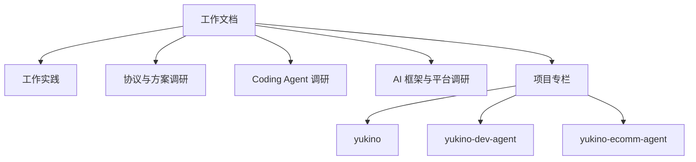

**主线一览**

本部分收录工作期间的技术复盘、开源项目调研与项目源码解析, 按主题分为五个部分, 直属页面共 11 个 (含本落地页), 三个项目专栏另含 40 个页面.

## 工作实践

工作期间亲历的技术实践, 保留实测数据与决策过程:

- [tiktok](tiktok): 移动端性能采集与数据链路. 设备端插桩与抓栈两种范式、JS 运行时采集与 CPU profiling 火焰图分析、Kafka/Hive/ClickHouse/MySQL/Redis 的链路分工、RPC 与 BFF 分层, 以及不定高虚拟滚动的实现与取舍.
- [ieg](ieg): NoSQL 管理端工程实践. 类组件迁移函数组件的语义映射与请求竞态、ffi 调用的内存模型与进程池隔离、TCP 连接池的四类异常处理、闭包引用导致的内存泄漏排查, 以及运行时指标、OpenTelemetry 插桩、Sentry 错误与 profiling、Grafana 告警设计的服务可观测性体系.
- [data](data): 前端监控与数据请求工程实践. JSError 上报的数据模型、rrweb 滚动窗口的故障现场还原、componentStack 与 sourcemap 定位、资源加载竞态、FSP 首屏计算与手写 SWR 方案.
- [docker-k8s-agent-sandbox](docker-k8s-agent-sandbox): Docker 与 Kubernetes 面试知识体系及 JSError 自动修复云沙箱实战. 容器原理 (namespace/cgroups/UnionFS)、镜像构建与运行时安全、K8s 声明式架构、Pod/控制器/Service/调度/探针/RBAC/排障全景, 以及基于 K8s Job + Docker Agent 沙箱的前端 JSError 自动定位、修复、复现验证与提 MR 的端到端方案.

## 协议与方案调研

- [a2ui](a2ui): A2UI 声明式 UI 协议. 消息信封与 Catalog 契约、数据绑定与事件回传语义、v0.9.1 生产版与 v1.0 候选版的差异、basic/MCP/VegaChart 三份官方 catalog、多语言 SDK 与渲染器能力面、A2A 集成, 以及仓库内示例链路.
- [mcp-app](mcp-app): MCP Apps 扩展. 工具与 UI 资源的声明契约、宿主与 iframe 的通信与安全模型、以真实工具为例的工程实践与降级路径, 以及与 A2UI 的对比.

## Coding Agent 调研

- [claude-code](claude-code): 一个终端 AI 编码助手的工程实现剖析. Bun 代码分割构建、流式 Agent 循环与工具并发调度、核心白名单加延迟发现的工具系统, 以及把异构模型协议收敛到 Anthropic 内部格式的流适配器模式.
- [pi](pi): Pi Agent Harness. 极简内核与扩展机制的边界、entry 树会话模型、TypeScript SDK 的进程内嵌入、durable 运行时的持久化不变量与执行环境抽象、pi-env 的远程执行协议、chord 应用组合运行时与遥测落库、codemode 的沙箱化脚本执行、统一 provider 面与容器化、五种接口形态与 TUI 渲染工程.

## AI 框架与平台调研

- [langchain](langchain): LangChain.js 1.x. monorepo 包布局、langchain-core 的 Runnable 与消息/工具抽象、provider 集成模式、createAgent 与中间件体系, 以及构建、测试与发布设施.
- [langgraph](langgraph): LangGraph.js. 从 monorepo 包分层讲到 StateGraph 到 Pregel 的超步执行循环、channels 与 reducers 的状态更新语义、节点间状态与上下文传递、上下文压缩与 Store 长期记忆、checkpointer 持久化与恢复、interrupt/resume 人机协同、流式输出模式与 SDK/前端集成.

## 项目

三个项目专栏, 均以对应仓库源码为唯一事实依据:

- [yukino](yukino/index): 终端 Coding Agent Yukino Code (`@yukino.js/yukino`) 的引擎源码解析, 共 27 个页面 (含落地页). 覆盖 ReAct 主循环与事件流、LLM 三协议接入、工具调用与 MCP、system prompt 与上下文压缩、权限/沙箱/Hook、AGENTS.md 与三层记忆、Skill 与 Slash Command、Subagent/Agent Team/Workflow/Worktree/Goal 多代理协作、TUI/Print/Remote/A2A 宿主形态, 以及遥测、任务跟踪与代码评审.
- [yukino-dev-agent](yukino-dev-agent/index): Next.js 16 + AI SDK 全栈 AI 应用, 文档栏目共 4 篇 (含落地页). OnCall 值班助手与 DevFlow 工程副驾双产品面: Milvus 混合检索 RAG、ReAct 与 Plan-Execute-Replan 编排、A2UI 交互界面、MCP 工具体系、Langfuse/Prometheus 可观测性.
- [yukino-ecomm-agent](yukino-ecomm-agent/index): 电商客服 Agent (Yukino Select), 共 9 个页面 (含落地页). Hono + LangGraph 服务端与 Lit 控制台的总体组织、会话上下文分层、LLM 接入与表设计、MCP 工具、RAG 检索、图编排 workflow、HTTP API、可观测性与数据飞轮.
