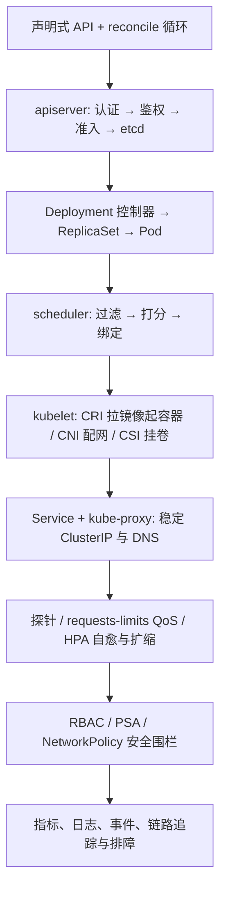

**主线一览**



> 定位: 本篇是 Kubernetes 的完整面试知识体系, 每个知识点 = 一句话回答 (先背这个) + 追问展开 (应对深挖), 末尾附场景串联题与自检清单。
> 串联: Docker 底层原理见 [docker](./docker); 把 Kubernetes Job 与 Docker 沙箱组合起来做 JSError 自动修复的实战见 [agent-sandbox](./agent-sandbox)。

:::note 版本基线
Kubernetes 知识体系按当前稳定 minor (v1.36 线) 撰写: 原生 sidecar 1.33 GA、kube-proxy nftables 模式 1.33 GA、ReadWriteOncePod 1.27 GA、1.25 移除 PSP 后由 Pod Security Admission 承接、1.24 移除 dockershim 后 kubelet 经 CRI 直连 containerd/CRI-O。Ingress/Gateway API、HPA v2、EndpointSlice (1.21 起取代 Endpoints, 按 100 个端点分片) 与 CSI 均按当前稳定口径; 文中涉及的 ClickHouse 按 25.x、Kafka 按 4.x 口径。第四部分沙箱设计的目标架构见 [agent-sandbox](./agent-sandbox), 不是现有实现。
:::

---

## 第一部分 Kubernetes 核心知识体系

### 1. 为什么需要 K8s: 声明式 API 与控制器模式 (灵魂考点)

**一句话**: 容器解决了「打包一次到处运行」, 但生产环境要面对多机调度、扩缩容、自愈、滚动发布、服务发现与配置管理——K8s 是容器的「操作系统」, 用**声明式 API + 控制器 reconcile 循环**把期望状态持续变成现实状态。

**追问 1: 声明式与命令式的本质区别?**

- 命令式: 「启动 3 个容器」——描述动作, 执行一次, 系统漂移后无人纠正。
- 声明式: 「副本数 = 3」——描述期望态, 写进 etcd; 控制器无限循环对比实际态与期望态, 有差异就行动 (reconcile)。节点宕机少了 1 个 Pod, 不需要任何人下命令, ReplicaSet 控制器自动补齐——**自愈不是特性, 是 reconcile 循环的自然结果**。
- 推论: 所有操作都应幂等 (apply 同一个 YAML 一百次结果一致); 运维动作的对象是「修改期望态」而不是「操作进程」。

**追问 2: 水平触发 vs 边缘触发?**

控制器是**水平触发** (level-triggered) 的: 它关心「当前状态与期望状态是否有差」, 而不依赖「收到了某个事件」。即使 watch 事件丢失, 下一次 resync 全量对比也能收敛——这是 K8s 系统健壮性的根基。边缘触发 (事件驱动、丢事件即丢状态) 的系统才需要复杂的消息可靠投递保证。

**追问 3: `kubectl apply -f deploy.yaml` 之后发生了什么?** (全链路串讲)

1. kubectl 读 kubeconfig, 向 apiserver 发起请求;
2. apiserver 依次执行 **认证 (authn) → 鉴权 (authz, RBAC) → 准入控制 (admission: 先 mutating 改对象——注入 sidecar/默认值, 再 validating 校验——PSA/策略门禁)**;
3. 对象写入 etcd, 返回成功——此时**一个 Pod 都还没跑**;
4. Deployment 控制器 (watch 到) 创建 ReplicaSet → RS 控制器创建 Pod 对象 (此时 Pod 的 nodeName 为空);
5. scheduler (watch 未调度 Pod) 过滤打分选节点, 把绑定结果写回 apiserver;
6. 目标节点 kubelet (watch 到绑定给自己的 Pod) 调 CRI 拉镜像、起容器, 调 CNI 配网络, 调 CSI 挂卷, 持续上报 status。

每一步都是「组件 watch apiserver + 各司其职」, 没有任何组件之间的直接调用——这条链路能完整口述, 架构题就过关了。

### 2. 整体架构 (必画必背)

```text
Control Plane (控制面)
├── kube-apiserver          唯一入口: REST API + 认证鉴权准入 + watch 分发; 唯一直连 etcd 的组件
├── etcd                    分布式 KV (Raft 强一致), 集群唯一持久化存储
├── kube-scheduler          为 nodeName 为空的 Pod 选节点: 过滤 (Filter) → 打分 (Score) → 绑定
├── kube-controller-manager 几十个控制器 (Deployment/ReplicaSet/Node/Job/EndpointSlice/SA...)
└── cloud-controller-manager 对接云厂商 (LB/路由/节点生命周期), 自建集群可无

Node (工作节点)
├── kubelet                 节点代理: 保证本节点 Pod 按 spec 运行, 执行探针, 上报状态
├── kube-proxy              维护 Service 转发规则 (iptables/ipvs/nftables)
└── 容器运行时              containerd / CRI-O, 经 CRI 协议对接 kubelet

插件层 (Addon)
├── CoreDNS                 集群 DNS
├── CNI 插件                Calico / Cilium / Flannel, 实现 Pod 网络
├── Ingress Controller      nginx-ingress / traefik
└── metrics-server          资源指标 (HPA / kubectl top 依赖)
```

**追问清单**:

- 所有组件只与 apiserver 通信, 组件之间零直接依赖; etcd 只有 apiserver 直连——apiserver 是唯一的读写收口, 也是唯一的水平扩展点 (无状态, 前面挡 LB)。
- **watch 机制与 Informer**: 客户端 List 全量 + Watch 增量 (基于 resourceVersion), 本地维护缓存 (Indexer) 与工作队列; 控制器 reconcile 读的是本地缓存, 不打爆 apiserver。断线重连从上次 RV 续传, RV 被 compact 则重新 List。
- 控制面组件自己怎么跑: kubeadm 集群里 apiserver/etcd/scheduler/controller-manager 都是 **static Pod** (kubelet 直接监视 `/etc/kubernetes/manifests`), 先有 kubelet 后有控制面, 解决鸡生蛋问题。
- Docker 与 K8s: 1.24 移除 dockershim, 走 CRI 标准直连 containerd/CRI-O; Docker 构建的 OCI 镜像照常使用。

### 3. 对象模型通用机制 (答出这些细节即拉开差距)

- **spec 与 status**: 用户写 spec (期望态), 控制器/kubelet 写 status (实际态); 二者分离是声明式模型的落点。`kubectl get x -o yaml` 看到的完整对象还带 metadata。
- **labels 与 selectors**: label 是键值对标识, selector 是查询语言。等值匹配 (`env=prod`) 与集合匹配 (`tier in (frontend, backend)`)。**Service 选 Pod、Deployment 管 RS、探针摘流量, 全靠 label 松耦合**——label 打错是「Service 不通」类故障的头号原因。
- **annotations**: 给工具与人看的元数据 (部署时间、last-applied-configuration), 不用于选择对象。
- **namespace**: 逻辑隔离单元 + ResourceQuota/LimitRange/NetworkPolicy/PSA 的作用域; 并非所有对象都分命名空间 (Node/PV/ClusterRole 是集群级, `kubectl api-resources --namespaced=false` 可查)。
- **ownerReferences 与级联 GC**: Pod 属 RS、RS 属 Deployment, 删 Deployment 沿属主链级联删光; `--cascade=orphan` 可留孤儿。
- **finalizers**: 删除前置钩子列表——对象被打上 deletionTimestamp 后, 要等所有 finalizer 被对应控制器摘除才真正从 etcd 消失。「Pod/Namespace 卡在 Terminating」九成是某个 finalizer 的控制器没干活 (如 PV 保护、外部资源清理)。
- **metadata.generation 与 status.observedGeneration**: 判断控制器是否已处理最新 spec 的依据。

### 4. Pod 深入

**一句话**: Pod 是一组共享 network namespace 与存储卷的容器集合, 是 K8s 调度的最小单位; Pod 内容器共享 IP, 用 localhost 互访。

**追问 1: 为什么最小单位是 Pod 而不是容器?**

紧耦合的容器 (主容器 + 日志收集 sidecar + 服务网格代理) 需要共享网络栈与文件卷、需要同生共死同调度; Pod 就是这个「原子部署单元」的抽象。Docker 的 container 网络模式 (共享 netns) 正是它的原理雏形。

**追问 2: pause 容器是什么?**

每个 Pod 先启动一个极小的 pause (infra) 容器, 它持有 Pod 的 network/IPC namespace 并永远睡眠; 业务容器以 join 方式进入这些 namespace。好处: 业务容器崩溃重启不影响 Pod 网络身份 (IP 不变), namespace 的生命周期与最脆弱的业务容器解耦。

**追问 3: Pod 生命周期?**

- Pod phase: `Pending` (已创建, 镜像未就绪/未调度) → `Running` (至少一个容器在跑) → `Succeeded` / `Failed` (所有容器终止), 另有 `Unknown`。
- 容器状态: Waiting / Running / Terminated (带 reason: OOMKilled、Error、Completed)。
- **restartPolicy** (Always/OnFailure/Never) 作用于 Pod 内容器, 由 kubelet 在原 Pod 内重启容器 (指数退避 10s→20s→…→5min); 「CrashLoopBackOff」就是这个退避在等待期。**Pod 本身不会原地复活**——节点没了, 控制器在新节点重建新 Pod (新 IP), 所以 Pod 是牲口 (cattle) 不是宠物 (pet), 前面必须挡 Service。

**追问 4: init 容器与原生 sidecar?**

- init containers: 主容器启动前**顺序**执行完毕, 用于等依赖、初始化数据、拉配置; 任一失败按 restartPolicy 重启。
- **原生 sidecar (1.33 GA)**: init container 设 `restartPolicy: Always`, 先于主容器启动、伴随整个 Pod 生命周期、独立重启——解决了老 sidecar (普通容器) 的两个痛点: 启动顺序无保证、Job 场景 sidecar 不退出导致 Pod 无法 Succeeded。

**追问 5: Pod 终止的完整流程?** (零停机发布的核心)

1. `kubectl delete pod` → apiserver 打上 deletionTimestamp, 进入宽限期 (默认 30s);
2. EndpointSlice 控制器把该 Pod 从 Service 后端**异步**摘除, kube-proxy 更新转发规则;
3. kubelet 执行 `preStop` hook (若有), 然后向主进程发 **SIGTERM**;
4. 宽限期耗尽仍未退出 → **SIGKILL**。

关键竞态: 第 2 步与第 3 步**并行**, 流量摘除可能晚于 SIGTERM 到达——所以标准做法是 preStop 里 `sleep 5~10` 让转发规则先收敛, 再开始优雅退出。这是「发布期间偶发 502」的标准答案。

**追问 6: Downward API 与 PDB?**

- Downward API 把 Pod 自身元数据 (name、namespace、labels、requests) 注入容器 env 或文件, 应用无需调 apiserver 即可自知身份。
- **PodDisruptionBudget**: 约束**自愿中断** (节点排水、集群升级) 时最少可用副本 (`minAvailable`/`maxUnavailable`), `kubectl drain` 会遵守 PDB 阻塞等待; 非自愿中断 (节点宕机) 不受 PDB 保护。

### 5. 工作负载控制器 (选型必考)

| 控制器          | 用途与特征                                                               |
| --------------- | ------------------------------------------------------------------------ |
| **Deployment**  | 无状态应用首选; 管理 ReplicaSet, 滚动更新/回滚/暂停                      |
| **StatefulSet** | 有状态应用: 稳定网络标识 (pod-0/1/2)、每副本独立 PVC、有序部署扩缩与更新 |
| **DaemonSet**   | 每节点恰好一个: 日志采集、监控 agent、CNI、镜像预热                      |
| **Job**         | 一次性任务: 跑完即止, 支持并行度与索引                                   |
| **CronJob**     | 定时任务: 到点创建 Job                                                   |
| ReplicaSet      | 维持副本数; 几乎不直接用, 由 Deployment 管理                             |

**Deployment 滚动更新原理** (高频):

- 更新 Pod template → 创建**新 ReplicaSet**, 新旧 RS 并存; 按 `maxSurge` (最多超出期望副本数, 默认 25%) 与 `maxUnavailable` (最多不可用数, 默认 25%) 逐步扩新缩旧。
- 追求零容量损失: `maxUnavailable=0, maxSurge=1` (先起新的、就绪了再杀旧的)。
- `progressDeadlineSeconds` (默认 600s) 内无进展则 Deployment 标记 Failed——新镜像起不来时的止损线。
- **回滚**: 历史 RS 按 `revisionHistoryLimit` (默认 10) 保留, `kubectl rollout undo` 本质是把旧 RS 的 template 重新扩起来; `rollout history` / `rollout pause|resume` (批量改动合并为一次滚动)。
- 触发滚动的只有 template 变化; 改 replicas、改 label selector 不触发 (selector 不可变, 改了会拒绝)。

**StatefulSet 三要素**:

1. **稳定网络标识**: Pod 名固定 `mysql-0/1/2`, 配合 Headless Service 每个 Pod 有稳定 DNS `mysql-0.mysql.ns.svc.cluster.local`;
2. **稳定存储**: `volumeClaimTemplates` 给每个序号副本独立 PVC, Pod 重建后仍绑回同一 PVC (缩容时 PVC 默认保留, 防误删数据; `persistentVolumeClaimRetentionPolicy` 可改);
3. **有序性**: 默认 OrderedReady——按 0→N 逐个就绪后继续, 缩容与更新逆序; `RollingUpdate` 支持 `partition` 金丝雀 (只更新序号 ≥ partition 的), `OnDelete` 手动删才更新; 无顺序需求可设 `podManagementPolicy: Parallel`。

典型对象: MySQL 主从、Kafka、ZooKeeper、ES。**面试加分句**: 能上无状态就别上有状态, 数据库类负载在 K8s 里运维成本高, 常见折中是「无状态应用进 K8s, 有状态中间件用云托管」。

**DaemonSet**: 每节点一个, 新节点加入自动补齐; 自动容忍 not-ready/unreachable 等节点污点 (保证网络插件、日志采集在故障节点上也能跑); 更新策略 RollingUpdate (`maxUnavailable` 默认 1) 或 OnDelete。

**Job / CronJob 关键参数**:

- Job: `completions` (需要成功次数) × `parallelism` (并行度); `backoffLimit` (默认 6, 失败重建上限); `activeDeadlineSeconds` 硬超时; `ttlSecondsAfterFinished` 自动清理 (见 [Agent 沙箱实战](./agent-sandbox) 的 TTL 配置, 这是它的核心依赖); **Indexed Job** (每 Pod 固定序号, 分片任务); `podFailurePolicy` 按退出码/条件区分可重试与不可重试失败; `suspend` 暂停排队。
- CronJob: `schedule` (标准 cron 表达式); `concurrencyPolicy: Allow/Forbid/Replace` (上一轮没跑完怎么办); `startingDeadlineSeconds` (错过调度的容忍窗口, 超过则跳过本次); `timeZone` 指定时区; Job 模板里再套上面的参数。

### 6. Service 与 kube-proxy (原理必问)

**一句话**: Service 给一组动态变化的 Pod 一个稳定的虚拟 IP (ClusterIP) 与 DNS 名, 靠 label selector 圈定后端, 由 kube-proxy 维护的转发规则做负载均衡。

| 类型             | 暴露范围                            | 场景                           |
| ---------------- | ----------------------------------- | ------------------------------ |
| ClusterIP (默认) | 集群内虚拟 IP                       | 内部服务互访                   |
| NodePort         | 每节点开静态端口 (默认 30000-32767) | 测试/简单暴露                  |
| LoadBalancer     | 云厂商外部 LB (自建可用 MetalLB)    | 生产 L4 对外暴露               |
| ExternalName     | CNAME 到外部域名 (无 ClusterIP)     | 把集群外服务映射成集群内名     |
| Headless         | `clusterIP: None`, DNS 直返 Pod IP  | StatefulSet / 客户端自负载均衡 |

**追问 1: ClusterIP 的原理?**

ClusterIP 是**虚拟 IP**: 不绑在任何网卡上, ping 不通是正常的; 它只存在于每个节点的 iptables/ipvs/nftables 规则里——数据包目的地址命中 ClusterIP 时被 **DNAT** 改写为某个后端 Pod IP。后端列表由 EndpointSlice 对象维护 (控制器 watch selector 匹配且**就绪**的 Pod 生成; 1.21 起取代 Endpoints, 按 100 个端点分片, 避免大集群下单对象更新风暴)。

**追问 2: kube-proxy 三种模式演进?**

| 模式      | 机制                          | 特点                                                            |
| --------- | ----------------------------- | --------------------------------------------------------------- |
| userspace | 流量先进用户态进程再转回内核  | 两次穿越内核, 早已淘汰                                          |
| iptables  | 规则链按概率随机 DNAT (默认)  | 无用户态转发, 但规则数随 Service×Pod 线性增长, 大规模集群更新慢 |
| ipvs      | 内核 LVS 哈希表               | 查找 O(1), 支持 rr/lc/sh 等调度算法, 大规模集群首选             |
| nftables  | iptables 的内核后继 (1.33 GA) | 集合化规则表达, 兼顾性能与可维护性, 新集群方向                  |

**追问 3: 会话保持与源 IP?**

- `sessionAffinity: ClientIP` (默认超时 3h) 把同一客户端固定到同一后端; 应用级会话更推荐无状态化 (session 外置 Redis)。
- `externalTrafficPolicy: Local` 让 NodePort/LB 流量只进本节点的 Pod——**保留真实源 IP** 且少一跳 SNAT, 代价是负载可能不均 (没 Pod 的节点直接丢包, 需 LB 健康检查配合); `Cluster` (默认) 全集群均衡但源 IP 被 SNAT 掉。
- `internalTrafficPolicy: Local` 同理作用于集群内流量。

**追问 4: 无 selector 的 Service?**

手动维护 EndpointSlice, 把集群外的服务 (自建数据库、遗留系统) 映射成集群内 Service 名——应用配置无需感知内外差异。ExternalName 则是 DNS 层 CNAME, 不做代理。

### 7. 集群 DNS (CoreDNS)

- Service 记录: `<svc>.<namespace>.svc.cluster.local` → A 记录指向 ClusterIP; Headless Service 直接返回**全部就绪 Pod IP** (客户端自行均衡)。
- StatefulSet Pod 记录: `<pod>.<headless-svc>.<ns>.svc.cluster.local` → 单 Pod IP, 稳定身份的网络基石。
- 命名端口生成 SRV 记录; Pod 也有 A 记录 (IP 中划线形式)。
- 同 namespace 内可只写服务名 (search 域补全); 跨 namespace 至少写 `<svc>.<ns>`。
- **ndots:5 陷阱**: Pod 的 resolv.conf 默认 `options ndots:5`, 域名中点数少于 5 的先拼 search 域逐个尝试——访问 `api.example.com` 会先查 `api.example.com.ns.svc.cluster.local` 等 3 个无效名。外部域名密集型应用 (爬虫、网关) 要显式加尾点 (`api.example.com.`) 或 dnsConfig 调低 ndots。
- 大规模集群标配 **NodeLocal DNSCache**: 每节点本地缓存, 顺带规避 conntrack UDP 竞态导致的经典「DNS 5 秒超时」。

### 8. Ingress 与 Gateway API

**一句话**: Ingress 是集群入口的 L7 (HTTP/HTTPS) 路由规则对象, 本身不干活, 需要 Ingress Controller (nginx-ingress/traefik 等) 真正执行; 按域名/路径把外部流量路由到不同 Service, 支持 TLS 终结。

- **Service 解决 L4, Ingress 解决 L7**: 一个公网 IP + 证书, 承载几十个域名路径规则, 避免每个服务一个 LoadBalancer。
- nginx-ingress 原理: controller (本身是 Deployment/DaemonSet) watch Ingress 对象 → 渲染 nginx.conf → reload; 前面再挡一层云 LB 或 NodePort。典型链路: 外部 LB → Ingress Controller → Service → Pod。
- 常用能力: `ingressClassName` 多控制器并存、TLS Secret 终结 (配 cert-manager 自动续期)、path rewrite、基于 annotation 的限流/灰度 (canary 按权重/header 分流)。
- **Gateway API** (Ingress 的下一代): 三种角色分离——GatewayClass (基础设施提供方)、Gateway (集群运维方, 定义监听器与证书)、HTTPRoute (应用开发方, 定义路由规则); 原生支持流量切分、header 匹配、跨 namespace 引用, 表达力远超 annotation 堆砌的 Ingress。新项目可直接评估 Gateway API。

### 9. ConfigMap 与 Secret

**一句话**: 配置与镜像分离——ConfigMap 存非敏感配置, Secret 存敏感数据; 都可注入为环境变量或挂载为文件。

| 维度     | ConfigMap             | Secret                                        |
| -------- | --------------------- | --------------------------------------------- |
| 内容     | 明文配置              | base64 编码 (**不是加密**, 追问必答)          |
| 类型     | 单一                  | Opaque / kubernetes.io/tls / dockerconfigjson |
| 静态加密 | 无                    | EncryptionConfiguration (aescbc / KMS v2)     |
| 大小上限 | 1MB (etcd 单对象限制) | 1MB                                           |

- **热更新语义** (高频追问): 挂载为 volume 的 ConfigMap 会自动更新 (kubelet 同步周期 + 缓存 TTL, 分钟级延迟; 应用需自己 watch 文件变化); **`subPath` 挂载不会更新**; **环境变量方式永不更新**, 改配置需滚动重启 (`kubectl rollout restart deployment/x` 是标准动作)。`immutable: true` 的 ConfigMap/Secret 不再被 watch, 大集群可显著降 apiserver 压力。
- Secret 生产姿势: RBAC 最小化 (get/list Secret 是高危权限)、开启 etcd 静态加密、或干脆用外部密钥系统 (Vault / 云 KMS + external-secrets-operator 同步进集群)。
- `imagePullSecrets` 挂在 ServiceAccount 上, 私有仓库拉镜像用。

### 10. 存储体系: Volume / PV / PVC / StorageClass / CSI

**一句话**: Pod 内用 volume 抽象挂载点; PV 是集群级存储资源 (管理员/动态供给), PVC 是用户的存储申请, 二者按容量与访问模式绑定; StorageClass 实现动态供给——PVC 创建时自动开 PV。

**追问 1: 为什么 Pod 不直接写磁盘?**

Pod 是牲口: 重建后节点、IP、本地盘全变。存储必须与 Pod 生命周期解耦成独立对象 (PV), 由 PVC 声明式申领, 跟着工作负载 (StatefulSet) 而不是跟着节点走。

**追问 2: PV 生命周期与访问模式?**

- 生命周期: **供给** (静态: 管理员预建 PV 池; 动态: StorageClass 按需创建) → **绑定** (PVC 与 PV 一对一) → **使用** → **回收** (Retain 保留数据人工处理 / Delete 连底层云盘一起删)。
- 访问模式: `ReadWriteOnce` (单节点读写) / `ReadOnlyMany` / `ReadWriteMany` (多节点读写, NFS/CephFS/云文件存储才支持) / `ReadWriteOncePod` (单 Pod 独占, 1.27 GA)。
- `volumeBindingMode: WaitForFirstConsumer`: 延迟到 Pod 调度后再开盘——否则 PV 可能开在与 Pod 调度结果不同的可用区, 拓扑冲突导致永远 Pending。云盘类 StorageClass 必配。
- 扩容: `allowVolumeExpansion: true` + 改 PVC 的 requests (文件系统在线扩容有内核/文件系统前提)。

**追问 3: CSI 是什么?**

Container Storage Interface——存储厂商按 gRPC 规范实现插件, K8s 侧通用对接, 取代树内 (in-tree) 卷插件。两类组件: controller plugin (创建/删除/attach/快照, Deployment 形态) + node plugin (每节点 mount, DaemonSet 形态)。快照 (VolumeSnapshot)、克隆、拓扑感知都经 CSI 能力协商。

**追问 4: 常用 volume 类型速查?**

- `emptyDir`: 随 Pod 生死的空目录 (可设 sizeLimit、medium: Memory 变内存盘)——缓存、同 Pod 容器间交换文件;
- `hostPath`: 直挂节点路径——DaemonSet 采集节点日志 (`/var/log`) 等系统级场景, 业务 Pod 禁用 (节点绑定 + 安全风险);
- `configMap`/`secret`/`downwardAPI`: 配置注入;
- `persistentVolumeClaim`: 生产持久化的唯一正解。

### 11. 调度机制 (高频)

**一句话**: scheduler 为每个未绑定 Pod 执行「过滤 (哪些节点可行) → 打分 (哪个最好) → 绑定」, 用户通过 nodeSelector、亲和性、污点容忍、拓扑分布约束表达调度意图。

**追问 1: 四种调度约束怎么选?**

| 手段                          | 语义                                                           | 典型场景                                                      |
| ----------------------------- | -------------------------------------------------------------- | ------------------------------------------------------------- |
| nodeSelector                  | 节点标签硬匹配, 最简单                                         | GPU 节点、专属节点池                                          |
| nodeAffinity                  | 节点亲和, 硬 `required` / 软 `preferred`, 支持 In/NotIn/Exists | 多可用区偏好、机型偏好                                        |
| podAffinity / podAntiAffinity | 让 Pod 靠近/远离某些 Pod (按 topologyKey 划定「同一处」)       | 缓存与应用同节点; **副本反亲和打散到不同节点/机架, 避免单点** |
| taints + tolerations          | **节点主动排斥**, 只有带容忍的 Pod 能进                        | 专用节点、故障节点隔离、控制面                                |
| topologySpreadConstraints     | 按拓扑域均匀打散 (maxSkew 控制偏斜度)                          | 跨可用区高可用的现代写法                                      |

- 亲和是「Pod 挑节点」, 污点是「节点挑 Pod」——方向相反, 专用节点要**两者同用** (taint 挡住别人 + nodeSelector/亲和让自己去对地方)。
- taint 的三种 effect: `NoSchedule` (新 Pod 不进) / `PreferNoSchedule` (尽量不进) / `NoExecute` (不进且**驱逐已在跑的**, 配 tolerationSeconds 可延迟)。节点故障时 controller 自动打 `node.kubernetes.io/not-ready`、`unreachable` 等污点, 这就是「节点失联 5 分钟后 Pod 被驱逐重建」的机制来源。
- `topologySpreadConstraints`: `maxSkew: 1` + `topologyKey: topology.kubernetes.io/zone` + `whenUnsatisfiable: DoNotSchedule` = 跨区严格均匀; 比 podAntiAffinity 表达力强且大规模下性能好。

**追问 2: 优先级与抢占?**

PriorityClass 定义优先级数值; 资源不足时高优 Pod 可**抢占** (驱逐) 低优 Pod; `preemptionPolicy: Never` 可声明只排队不抢。[Agent 沙箱实战](./agent-sandbox) 用 `batch-low` 优先级, 保证修复任务永远给业务让路。

**追问 3: 配额与默认值?**

- ResourceQuota: namespace 级总量封顶 (CPU/内存/对象数), 超了直接拒绝创建;
- LimitRange: 给没写 requests/limits 的容器注入默认值、约束单容器上下限——防止 BestEffort Pod 混进生产。
- 大集群性能: scheduler 的 `percentageOfNodesToScore` 找到足够可行节点即停止全量过滤; 调度吞吐不够时跑多 scheduler 实例分片。

### 12. 三种探针 (必考)

| 探针                    | 回答的问题            | 失败后果                           |
| ----------------------- | --------------------- | ---------------------------------- |
| **livenessProbe** 存活  | 容器是否卡死/不可恢复 | **重启容器** (计入 restartCount)   |
| **readinessProbe** 就绪 | 现在能否接流量        | 从 EndpointSlice **摘除** (不重启) |
| **startupProbe** 启动   | 启动完成了没          | 启动期内屏蔽另两个探针, 失败重启   |

- 探测方式: `httpGet` (2xx/3xx 算成功) / `tcpSocket` / `exec` (退出码 0) / `grpc` (标准 gRPC Health Checking Protocol)。
- 参数: `initialDelaySeconds`、`periodSeconds` (默认 10)、`timeoutSeconds` (默认 1)、`failureThreshold` (默认 3)、`successThreshold` (就绪恢复需连续成功次数)。
- **startupProbe 的价值**: 慢启动应用 (JVM 预热、大模型加载) 若只靠调大 liveness 的 initialDelay, 要么保护不够要么故障发现变慢; startupProbe 用 `failureThreshold × periodSeconds` 给出启动预算 (如 30×10s=5min), 启动成功后交棒给另两个探针。
- **经典误配追问**: ① 只配 liveness 不配 readiness → 滚动更新时新 Pod 没就绪就接流量, 发布期报错; ② liveness 探依赖 (如探数据库连通性) → 依赖抖动引发全集群雪崩式重启, **liveness 只探自身健康**; ③ readiness 失败不影响 Pod 存活, 只影响流量。
- 探针由 kubelet 发起, 目标是 Pod IP (不经 Service)。

### 13. 资源管理、QoS 与驱逐

**一句话**: `requests` 是调度依据与资源承诺, `limits` 是运行上限; CPU 超限被限流 (可压缩), 内存超限被 OOMKilled (不可压缩)。

- CPU 限制的实现: CFS quota (每 100ms 周期内的配额), 超限被 throttle 而非杀——表现为延迟毛刺, `container_cpu_cfs_throttled_periods_total` 可观测。
- 内存限制: cgroup memory.max, 超限触发 OOM kill (退出码 137, reason OOMKilled); JVM/Node 等运行时的堆参数要与 limit 匹配 (Node 可用 `--max-old-space-size` 或依赖 cgroup 感知)。
- **三种 QoS** (由 requests/limits 配置自动判定, 决定驱逐顺序):

| QoS        | 条件                                       | 节点压力下的命运     |
| ---------- | ------------------------------------------ | -------------------- |
| Guaranteed | 所有容器 requests == limits (CPU+内存都设) | 最后被驱逐           |
| Burstable  | 至少设了部分 requests                      | 居中, 超用越多越先死 |
| BestEffort | 什么都不设                                 | **最先被驱逐**       |

- **节点压力驱逐** (kubelet eviction): 监控 `memory.available` (默认阈值 100Mi)、`nodefs.available` (10%)、`imagefs.available` (15%)、`pid.available`; 触线后按 QoS + 超用量排序驱逐 Pod, 并给节点打污点 (如 `node.kubernetes.io/memory-pressure`) 阻止新 Pod 调入。软阈值可配优雅期。
- HPA 见下节; 另注意 **requests 设得准比设得大重要**: 虚高的 requests 浪费调度容量, 过低则超卖引发驱逐。

### 14. 自动扩缩容: HPA / VPA / Cluster Autoscaler / KEDA

- **HPA** (水平, 改副本数): v2 API 按指标类型 Resource (CPU/内存利用率, 基于 requests) / Pods (均值) / Object (如 Ingress QPS) / External (消息队列长度) / ContainerResource 扩缩; `behavior` 段可配扩缩速率与稳定窗口 (默认缩容 5min 稳定窗口防抖动); 默认容忍度 ±10%; 依赖 metrics-server (自定义指标走 Prometheus Adapter)。**HPA 与 VPA 对 CPU/内存不能同时作用于同一负载** (互相打架)。
- **VPA** (垂直, 改 requests/limits): 三种 updateMode——Off (只出建议) / Initial (仅创建时注入) / Auto (原地重建 Pod 调整); 适合无法水平扩的单体与成本治理场景。
- **Cluster Autoscaler** (节点层): 有 Pod 因资源不足 Pending → 扩节点; 节点长期低利用率且 Pod 可迁移 → 缩节点 (尊重 PDB); 云厂商托管节点池实现。
- **KEDA** (事件驱动): ScaledObject/ScaledJob + 几十种 scaler (Kafka lag、Redis 队列长度、Prometheus 查询、Cron); 本质是「外部指标 → HPA」的适配层, 且支持**缩到 0** (HPA 最小副本是 1)。批处理/队列消费型负载首选, [Agent 沙箱实战](./agent-sandbox) 的 ScaledJob 按积压扩并发就是它。
- 三层联动: HPA 扩 Pod → 节点不够 CA 扩节点 → 缩容反向逐层回收。

### 15. 安全体系: RBAC / ServiceAccount / PSA / NetworkPolicy

**RBAC 四对象**: Role/ClusterRole (能干什么——规则集: apiGroups+resources+verbs) + RoleBinding/ClusterRoleBinding (谁能干——把角色绑给主体)。主体三类: User (集群外身份, 无对象) / Group / **ServiceAccount** (Pod 的集群内身份, 有对象)。

- 默认 ClusterRole: `view` / `edit` / `admin` / `cluster-admin`; 集群角色可被 RoleBinding 限定在单 namespace 使用。
- 排障神器: `kubectl auth can-i delete pods --as=system:serviceaccount:ns:sa`; 审计日志回答「谁在什么时候干了什么」。
- **ServiceAccount token**: 使用 **bound token** (TokenRequest API 签发, 绑定 Pod 生命周期、指定 audience、自动轮换), Pod 删除即失效。生产应关闭默认 SA 的 automountServiceAccountToken, 不需要访问 apiserver 的 Pod 一律不挂 token。

**Pod Security Admission** (1.25 移除 PSP 后的官方方案): namespace 打标签声明三档策略——`privileged` (不设限) / `baseline` (禁止已知提权: privileged 容器、hostNetwork、危险 cap) / `restricted` (最严: 必须非 root、drop ALL capabilities、seccomp RuntimeDefault), 每档可分别设 `enforce` / `audit` / `warn` 三种动作。[Agent 沙箱实战](./agent-sandbox) 的沙箱 Pod 就是按 restricted 标准写的。

**NetworkPolicy**: Pod 级防火墙, 由 CNI 插件执行 (Calico/Cilium; 没装支持 NP 的 CNI 则写了也无效)。

- 默认全通; 一旦有 policy 选中某 Pod, 该 Pod 变为默认拒绝, 只放行规则内流量。
- `ingress: []` = 拒绝一切入站; `egress` 白名单模式必须放行 DNS (UDP 53 到 kube-system 的 CoreDNS), 否则容器连域名都解不了——经典踩坑。
- 选择器可组合 podSelector / namespaceSelector / ipBlock (带 except), 跨 namespace 授权靠 namespace label。

**其他安全面**: Secret 静态加密与外部 KMS (见 §9); 镜像签名验证准入 (见 [Docker](./docker) §11); 审计日志 (audit policy) 与准入 webhook 策略引擎 (Kyverno/OPA Gatekeeper); 节点层 SSH 收敛与 etcd 客户端证书。

### 16. K8s 网络模型与 CNI

**网络模型三铁律** (由 CNI 插件实现, K8s 本身不管网络):

1. 每个 Pod 有独立 IP, 全集群唯一;
2. Pod 之间不经 NAT 直达 (跨节点也是);
3. 节点与 Pod 之间直接通信。

四层通信拆解: 同节点 Pod↔Pod (veth 经网桥/eBPF 直达)、跨节点 Pod↔Pod (CNI 的 overlay 或路由)、Pod↔Service (kube-proxy 规则)、外部↔Service (NodePort/LB/Ingress)。

**主流 CNI 对比**:

| CNI        | 数据面                    | 特点                                               |
| ---------- | ------------------------- | -------------------------------------------------- |
| Calico     | BGP 纯路由 / IPIP / VXLAN | NetworkPolicy 实现最完整, 性能好, 主流选择         |
| Flannel    | VXLAN (默认)              | 简单可靠, 功能面窄 (无 NetworkPolicy)              |
| Cilium     | eBPF                      | 可替代 kube-proxy, L7 策略、可观测性强, 新项目热门 |
| 云 VPC CNI | Pod IP 直接是 VPC IP      | Pod 可被集群外直接访问, 受 IP 配额约束             |

overlay (封包, 兼容任意底层网络) vs 路由 (不封包, 性能高但要求网络可控) 是 CNI 选型的主轴。

### 17. etcd

- 集群唯一事实来源, Raft 强一致, 写请求经 leader; 生产要求**奇数节点 (3/5)**——容忍 (N-1)/2 个节点故障。
- 容量: 默认配额 2GB (可调至 8GB), 超限触发 NOSPACE 告警只读; 历史版本靠 compact + **defrag** (碎片整理, 逐节点做, 会短暂阻塞) 回收。
- 备份: `etcdctl snapshot save` 定期快照 + 异地存储; 恢复是「全集群重建」级操作, 演练过才算有备份。
- 性能敏感点: WAL 落盘延迟 (要求低延迟 SSD, 监控 `wal_fsync_duration`); 大对象与高频 List 是 apiserver/etcd 的头号压力源——这也是 EndpointSlice 分片、informer 缓存、`--chunk-size` 分页存在的原因。
- watch 被 compact 的 RV 会报错, 客户端必须实现「重新 List」兼容 (client-go informer 已内置)。

### 18. 可观测性

- **指标**: metrics-server (内存态, 供 HPA/kubectl top) + Prometheus 体系 (Operator 管理, ServiceMonitor 声明抓取, 长期存储用 Thanos/VictoriaMetrics); 四大黄金信号在容器层的对应: 延迟 (应用指标)、流量 (Ingress QPS)、错误 (5xx 比例)、饱和度 (CPU throttle、内存工作集、队列深度)。
- **日志**: 容器写 stdout/stderr → 运行时落盘 (`/var/log/pods`) → 节点级采集器 (DaemonSet: Promtail/Fluent Bit) → Loki/ES; Pod 销毁后日志仍可查的前提是**采集先于销毁** (见 [Agent 沙箱实战](./agent-sandbox) 的 TTL 清理依赖)。
- **事件**: `kubectl get events --sort-by=.lastTimestamp -A`, 调度失败、拉镜像失败、探针失败都在这里; 事件只保留 1h (默认), 生产要外采。
- **链路追踪**: OpenTelemetry SDK + sidecar/直连导出, 跨服务调用链定位慢点。
- **调试利器**: `kubectl debug` 临时容器 (ephemeral container)——给 distroless/无 shell 的 Pod 注入一个带工具的调试容器, 共享目标进程 namespace (`--target`) 可直接 attach 排障; `kubectl debug node/x` 调试节点。

### 19. 排障速查 (场景题必考)

| 现象                         | 常见原因                                                 | 排查手段                                                                                |
| ---------------------------- | -------------------------------------------------------- | --------------------------------------------------------------------------------------- |
| `Pending`                    | 资源不足 / 污点没容忍 / nodeSelector 无匹配 / PVC 未绑定 | `kubectl describe pod` 看 Events (FailedScheduling 原因写得很清楚)                      |
| `ImagePullBackOff`           | 镜像名/tag 错 / 私仓没配 imagePullSecrets / 网络不通     | describe + 节点上 crictl pull 验证                                                      |
| `CreateContainerConfigError` | 引用的 ConfigMap/Secret 不存在                           | describe 看缺失对象名                                                                   |
| `CrashLoopBackOff`           | 应用启动即崩 / 探针配错 / 缺配置 / 依赖连不上            | `kubectl logs --previous` 看上次崩溃日志                                                |
| `OOMKilled` (137)            | limits 内存过小 / 应用泄漏                               | describe 看 Last State; 监控内存工作集曲线                                              |
| `Evicted`                    | 节点磁盘/内存压力, QoS 低的先死                          | describe 看驱逐原因; 清理节点或扩容量                                                   |
| `Terminating` 卡住           | finalizer 无人处理 / 宽限期过长 / 节点失联               | 看 finalizers 字段; 节点失联则强制删除需谨慎 (有状态负载双写风险)                       |
| `ContainerCreating` 卡住     | 卷 attach/mount 失败 (跨可用区、CSI 插件异常)            | describe Events + CSI 插件日志                                                          |
| Service 不通                 | selector 对不上 / targetPort 错 / readiness 全失败       | `kubectl get endpointslices -l kubernetes.io/service-name=x` (空 = selector 或就绪问题) |
| DNS 解析慢/超时              | ndots:5 放大 / conntrack UDP 竞态 / CoreDNS 过载         | Pod 内 `dig +trace`; 上 NodeLocal DNSCache                                              |
| 发布期偶发 502               | 流量摘除与 SIGTERM 竞态 / 无 readiness / 无 preStop      | 见 §4 Pod 终止流程                                                                      |

**万能三板斧**: `kubectl get pods -o wide` (定位 Pod 与节点) → `kubectl describe pod xxx` (看 Events) → `kubectl logs xxx [--previous]` (看应用输出); 再深入: `kubectl exec` 进容器验证、`kubectl debug` 注入工具、节点上 `crictl ps/logs` 看运行时层。

### 20. kubectl 高频实操

```bash
kubectl get pods -o wide -A --sort-by=.metadata.creationTimestamp  # 全集群按创建时间
kubectl get deploy x -o yaml / -o jsonpath='{.spec.replicas}'      # 输出格式
kubectl explain pod.spec.containers.resources                      # 字段文档 (离线 API 字典)
kubectl api-resources / kubectl api-versions                       # 集群能力清单
kubectl apply -f x.yaml --dry-run=server -o yaml                   # 服务端预演 (过准入, 不落盘)
kubectl diff -f x.yaml                                             # 声明式变更预览
kubectl rollout status|history|undo deployment/x                   # 发布控制
kubectl port-forward svc/x 8080:80                                 # 本地隧道调试
kubectl top pods --sort-by=memory                                  # 资源排序 (需 metrics-server)
kubectl get events -A --sort-by=.lastTimestamp | tail -20          # 最近事件
kubectl auth can-i --list                                          # 当前身份权限清单
kubectl drain node1 --ignore-daemonsets --delete-emptydir-data     # 节点排水 (尊重 PDB)
kubectl cordon/uncordon node1                                      # 标记不可调度/恢复
kubectl label ns prod pod-security.kubernetes.io/enforce=restricted # PSA 标签
```

### 21. 扩展机制: CRD / Operator / Webhook / Helm

- **CRD**: 向 apiserver 注册自定义资源类型 (结构化 schema、子资源 status/scale); 配合自定义控制器即 **Operator 模式**——把运维知识 (备份、扩容、故障转移) 写成 reconcile 代码。开发框架: kubebuilder / controller-runtime; 关键工程点: reconcile 幂等、工作队列限速重试、finalizer 清理外部资源、leader election 防双写。
- **准入 Webhook**: MutatingAdmissionWebhook (改对象: 注入 sidecar、补默认值) 与 ValidatingAdmissionWebhook (拦截: 策略门禁); `failurePolicy: Fail/Ignore` 决定 webhook 挂了是阻断还是放行——生产策略类 webhook 要慎重权衡可用性与强制性。
- **聚合层 (APIService)**: 把整个子 apiserver 挂进主 apiserver (metrics-server 就是这么接的), 比 CRD 重得多, 少用。
- **Helm vs Kustomize**: Helm 是包管理器 (模板 + 值文件 + release 生命周期 + hook), 适合分发带参数的应用; Kustomize 是无模板 overlay (base + 环境差异 patch), kubectl 内置。两者常组合: Helm 装依赖, Kustomize 管环境差异; GitOps (ArgoCD/Flux) 把二者产物同步进集群。

### 22. 集群运维与升级

- **kubeadm 升级路径**: 逐小版本升 (1.32→1.33, 不可跳版); 顺序: 控制面先升 (kubeadm upgrade apply → 其余控制面节点逐台 kubeadm upgrade node) → 工作节点后升 (cordon + drain → 升 kubelet → uncordon); 版本 skew 策略保证滚动期间集群可用: kubelet/kube-proxy 最多比 apiserver 低 3 个小版本, controller-manager/scheduler 等控制面组件最多低 1 个小版本, kubectl 在 ±1 个小版本内。
- **证书**: kubeadm 签发的组件证书有效期 1 年, `kubeadm certs renew all` + 重启控制面; 证书过期是自建集群最高频的生产事故之一, 要进监控 (`kubeadm certs check-expiration`)。
- **节点运维**: cordon (新 Pod 不调入) → drain (驱逐存量, 尊重 PDB 与 DaemonSet) → 维护 → uncordon; 批量操作要控制并发, 避免容量真空。
- **备份体系**: etcd 快照 (集群状态) + GitOps 仓库 (期望态声明) + PV 数据快照 (业务数据), 三层各自独立恢复演练。
- **多集群与联邦**: 单集群建议 ≤ 5000 节点 (etcd/apiserver 规模上限); 更大规模或多地域/多环境隔离走多集群, 用 ArgoCD ApplicationSet / Cluster API 管理集群生命周期。

---

## 第二部分 场景题 & 串联题 (压轴)

### Q1: 一个请求如何到达你的应用? (全链路)

浏览器 → DNS 解析域名 (公网 DNS / 云解析) → 云 LB (L4) → Ingress Controller Pod (L7: 按域名/路径匹配规则、TLS 终结) → 目标 Service 的 ClusterIP → 本节点 kube-proxy 规则 (iptables/ipvs) DNAT → 某个**就绪** Pod 的容器端口 → 应用进程。

加分细节: 每一跳的寻址方式 (DNS → VIP → Pod IP); 「就绪」由 readinessProbe 决定, EndpointSlice 是名单载体; 若 `externalTrafficPolicy: Local` 则 LB 只把流量给有 Pod 的节点以保留源 IP。

### Q2: 如何实现零停机发布?

五件套:

1. Deployment 滚动更新 (`maxUnavailable=0, maxSurge=1` 保容量);
2. **readinessProbe** 保证新 Pod 真就绪才接流量 (就绪 ≠ 启动, 要探业务健康接口);
3. **优雅终止**: preStop sleep 5~10s 等流量摘除收敛 → SIGTERM → 应用停止接新请求、排空在途请求后退出; `terminationGracePeriodSeconds` 要大于应用排空耗时;
4. 发布门禁: `progressDeadlineSeconds` 止损 + 监控告警联动回滚 (`kubectl rollout undo`);
5. 进阶: 金丝雀 (双 Deployment + Ingress 权重分流 / Gateway API 流量切分) 或 Argo Rollouts 自动化分析回滚。

### Q3: 流量突增怎么办?

分层应对: HPA 按指标自动扩副本 (提前配好, 指标选 QPS/队列深度比 CPU 更前瞻) → 节点不够时 Cluster Autoscaler 扩节点 (分钟级, 要预留缓冲或用定时预扩) → 入口层限流熔断 (Sentinel/Istio/网关) 保护后端 → 静态资源 CDN 卸载、缓存层扛读。面试可补: 突发流量下冷启动是瓶颈 (拉镜像 + JVM 预热), 镜像预热、startupProbe、最小副本保底都是配套手段。

### Q4: CI/CD 全流程怎么串?

代码提交 → CI 跑 lint/单测/构建 → `docker buildx build` 构建多架构镜像, tag 用 git sha (不可变) → 扫描 (trivy) + 签名 (cosign) → push Harbor → CD: ArgoCD 监听 GitOps 仓库 manifest 变更自动同步 (或 Jenkins `kubectl set image`) → Deployment 滚动更新 → 观测指标, 异常自动/手动回滚。加分: 镜像 tag 用 sha 而非 latest; GitOps 下集群期望态全部在 Git, 可审计可回滚。

### Q5: Deployment vs StatefulSet 本质区别?

无状态副本**可互换**: 名字随机、无独立存储 (或共享)、可并行扩缩、删了重建无副作用; 有状态需要**稳定身份**: 固定序号名 + 稳定 DNS + 每副本独立 PVC + 有序启停。典型: Web 服务用 Deployment; MySQL 主从、Kafka、ZK、ES 用 StatefulSet。追问「数据库要不要上 K8s」: 能托管就托管, 自建则 StatefulSet + 本地盘/高性能云盘 + Operator 管备份故障转移, 运维成本要诚实评估。

### Q6: 为什么 K8s 弃用 dockershim? 对镜像有影响吗?

Docker daemon 不说 CRI 协议, kubelet 要经 dockershim 转译再进 containerd, 链路长且维护成本高; 1.24 移除后直连 CRI 运行时 (containerd/CRI-O), 少一层、更轻。对镜像**零影响**: Docker build 产出的是 OCI 标准镜像, 任何运行时都能拉能跑。受影响的是「在节点上用 docker 命令调试」的习惯 (改用 crictl/nerdctl) 和依赖 docker.sock 的 CI (改 buildx/buildkit rootless 或 kaniko)。

### Q7: 为什么 Pod IP 不能直接暴露, 必须有 Service?

Pod 是牲口: 重建/漂移后 IP 必变, 直接依赖 Pod IP 的调用方会在每次发布/故障时断连。Service 提供稳定虚拟 IP + DNS 名, 背后 EndpointSlice 动态跟踪就绪 Pod 集合, kube-proxy 规则做负载均衡——把「一组动态实例」抽象成「一个稳定地址」。追问 Headless: 客户端需要自己选实例 (如 StatefulSet 主从分流) 时用 `clusterIP: None`, DNS 直返全部 Pod IP。

### Q8: 如何在 K8s 上安全运行不可信代码? (引出 [Agent 沙箱实战](./agent-sandbox))

分层防御: ① 隔离运行时——RuntimeClass 切 gVisor/Kata, syscall 层拦截或轻量 VM; ② 最小权限——PSA restricted、非 root、drop ALL capabilities、只读根文件系统、专用 ServiceAccount 几乎零 RBAC; ③ 网络围栏——NetworkPolicy 默认拒绝, egress 白名单 (只放依赖源/代码平台/回调地址); ④ 资源围栏——requests/limits、emptyDir sizeLimit、ResourceQuota、activeDeadlineSeconds; ⑤ 生命周期——一次性 Job Pod 用完即毁 (TTL), 无状态残留; ⑥ 凭证——短时一次性 token, 沙箱内无任何长期生产凭证。完整落地形态见 [Agent 沙箱实战](./agent-sandbox)。

### Q9: 集群升级如何不影响业务?

逐小版本滚动: 控制面先升 (多副本逐个升) → 工作节点分批 cordon + drain (尊重 PDB, 业务副本自动漂到已升节点) → 升 kubelet → uncordon。前提: 业务有 PDB + 多副本反亲和打散 + readiness 探针, 否则 drain 会直接打断服务。升级前检查废弃 API (`kubectl-convert`/pluto 扫描 manifest 中已移除的 apiVersion)。

### Q10: 一个节点突然宕机, 上面的 Pod 会怎样?

时间线: 节点失联 → controller-manager 标记 NotReady (约 40s) → 自动打上 `node.kubernetes.io/unreachable` 污点 (NoExecute) → 默认容忍 300s 后驱逐 Pod → 控制器 (Deployment/RS) 在健康节点重建新 Pod → Service 后端更新, 流量恢复。有状态负载的坑: 云盘类 PV 需要先 detach 再 attach 到新节点 (分钟级); 强制删除 Pod (`--force --grace-period=0`) 对 RWO 卷有双写风险, 要等存储层确认隔离。

---

## 第三部分 速刷路线与自检清单

### 一天速刷路线

1. **上午 Docker**: 背 §1-§6 (原理 + 镜像 + Dockerfile + 信号), 手写一遍多阶段构建 Dockerfile; 过 §7-§8 网络与存储原理; 扫 §11-§12 供应链与安全。(Docker 全文见 [docker](./docker))
2. **下午 K8s**: 背 §1-§2 (声明式 + 架构图能白板画 + apply 全链路能口述) → §4-§6 (Pod/控制器/Service) → §12-§13 (探针/QoS) → §19 (排障表)。
3. **晚上**: 过第二部分场景题, 模拟口述 Q1/Q2/Q4/Q8; 再读 [Agent 沙箱实战](./agent-sandbox), 把 Docker/K8s 知识点在真实系统里对号入座。
4. **加分项** (有余力): 本机启动 Docker Desktop → Settings 开启 Kubernetes, 跑一遍:
   ```bash
   kubectl create deployment nginx --image=nginx --replicas=2
   kubectl expose deployment nginx --port=80 --type=NodePort
   kubectl get pods,svc -o wide
   kubectl rollout status deployment/nginx
   kubectl run -it --rm job1 --image=busybox --restart=Never -- sh  # 一次性任务体验 Job 语义
   ```
   面试时说「我自己搭过环境跑过」比纯背概念可信度高得多。

### 自检清单 (能全部口述即过关)

**Docker** (详见 [docker](./docker)):

- [ ] namespace 八种各隔离什么, cgroups 限什么, CPU 限流 vs 内存 OOM 的区别
- [ ] dockerd/containerd/shim/runc 分工, OCI 三规范, dockershim 为何被移除
- [ ] 镜像分层与 overlay2 (lowerdir/upperdir/CoW/whiteout), 如何瘦身镜像
- [ ] CMD/ENTRYPOINT、exec/shell 形式、PID 1 信号与僵尸回收、退出码 137/143
- [ ] bridge 网络原理 (veth/docker0/DNAT/SNAT/内嵌 DNS), 默认与自定义 bridge 区别
- [ ] volume/bind mount/tmpfs 区别与生命周期
- [ ] BuildKit 三大 mount, buildx 多架构, save vs export
- [ ] 容器安全加固清单 (非 root/cap/seccomp/只读 rootfs/docker.sock 铁律)

**Kubernetes**:

- [ ] 白板画架构, 说清每个组件职责; apply 之后全链路发生了什么
- [ ] 声明式 API + reconcile 循环, 水平触发 vs 边缘触发, informer 机制
- [ ] Pod 为什么是最小单位, pause 容器, 原生 sidecar, 终止流程与 preStop sleep 的原因
- [ ] Deployment 滚动更新 (maxSurge/maxUnavailable/历史 RS 回滚); StatefulSet 三要素
- [ ] Service 四类型 + Headless, ClusterIP 虚拟 IP 原理, EndpointSlice, kube-proxy 四模式
- [ ] CoreDNS 记录形态与 ndots:5 陷阱
- [ ] Ingress vs Gateway API; ConfigMap/Secret 热更新语义
- [ ] PV/PVC/StorageClass 生命周期, WaitForFirstConsumer, CSI 两类插件
- [ ] 调度四手段 (nodeSelector/亲和/污点/拓扑分布) 选型, 抢占与 PDB
- [ ] 三种探针区别与失败后果, liveness 探依赖的危害
- [ ] requests/limits 与三种 QoS, 节点压力驱逐顺序
- [ ] HPA/VPA/CA/KEDA 分工与联动
- [ ] RBAC 四对象, bound SA token, PSA 三档, NetworkPolicy 默认拒绝语义与 DNS 放行
- [ ] Pending / CrashLoopBackOff / ImagePullBackOff / Terminating 卡住 / Service 不通的排查路径
- [ ] 一个请求进集群的完整链路; 零停机发布五件套
- [ ] CRD/Operator 模式, 准入 webhook, Helm vs Kustomize

---

**本篇延伸**

- [docker](./docker): Docker 底层原理、镜像构建、网络、存储与运行时安全。
- [agent-sandbox](./agent-sandbox): JSError 自动修复云沙箱——实践本篇 Job/探针/资源/RBAC/NetworkPolicy 等知识点的综合案例。
