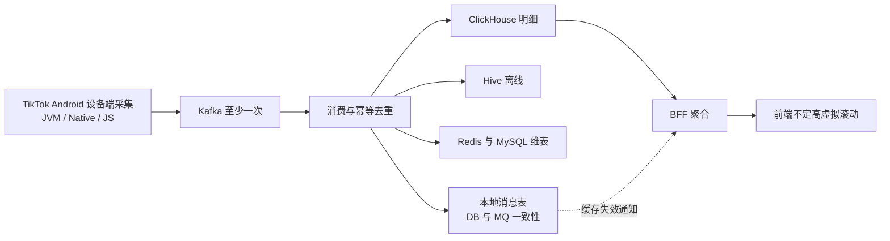
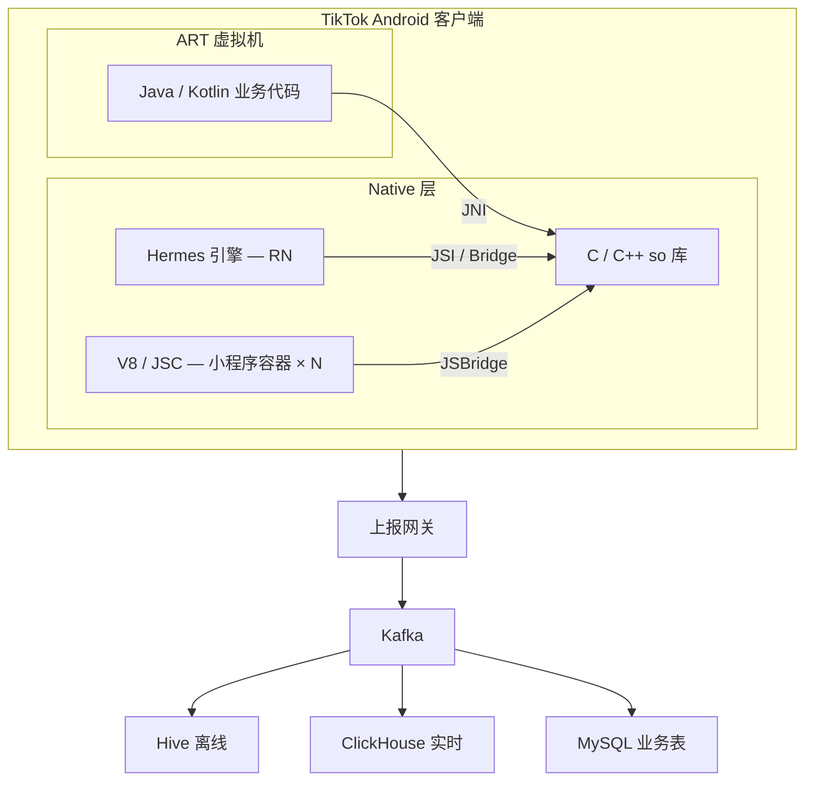
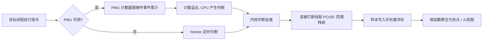
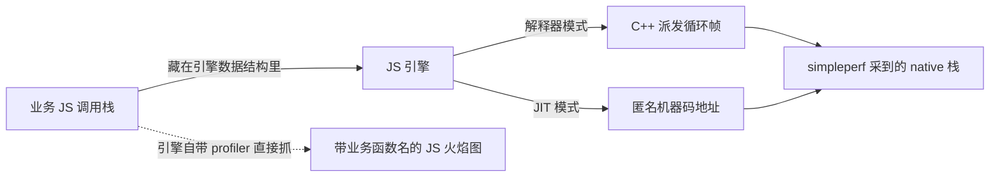
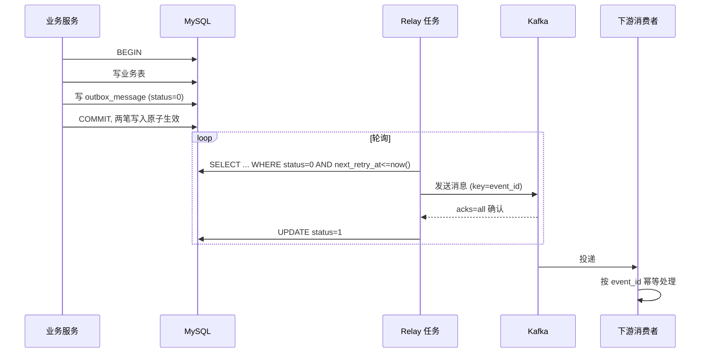
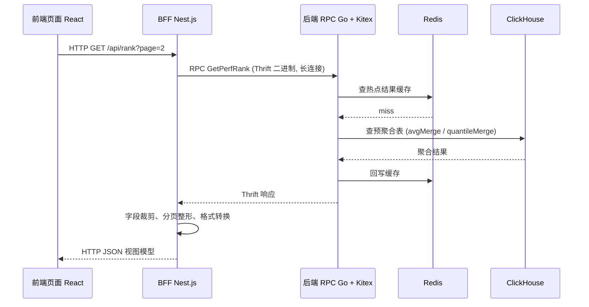

:::note 版本基线
本文为移动端性能监控与数据链路的工程实践总结, 不绑定单一代码仓库。文中声明的技术栈: 客户端为 Android (Java/Kotlin/ART、React Native + Hermes、小程序容器 V8/JavaScriptCore); 后端为 Go + Kitex (Thrift RPC), BFF 为 Nest.js, 前端为 React; 数据链路按 Kafka 4.x、ClickHouse 25.x 口径撰写, 离线数仓为 Hive, 关系库 MySQL, 缓存 Redis。文中的批量大小、超时阈值、采样频率等均为设计取值或示例, 落地时需按目标环境实测标定。
:::

**主线一览**



这份文档以 TikTok Android 客户端为场景, 整理一条完整的设备性能数据链路: 客户端基于 React Native, 同时存在大量 Java / Kotlin 模块与游戏小程序等小程序容器; 从海量设备上统一采集 JVM 系与 JS 侧的性能数据开始, 经过 Kafka 与多种存储的加工, 由后端 RPC 服务与前端 BFF 层逐级适配, 最后在浏览器里用虚拟滚动渲染成长列表。适合做移动端性能监控、数据平台链路设计或大列表渲染优化的工程师阅读。

内容按技术问题组织: 先交代业务场景 (一个 App, 三类代码运行域), 再讲两种采集范式的底层原理、实现方式与线上坑点复盘 (插桩还是抓栈、JVM 系还是 JS 侧), 然后讲多存储链路的职责划分、消息去重与幂等写、数据库与 MQ 的一致性 (本地消息表), 再回答"为什么需要 RPC""为什么需要 BFF", 最后落到不定高虚拟滚动的算法实现。每个环节都给出约束、方案对比与适用边界。

## 业务场景: 一个 App, 三类代码运行域

TikTok Android 客户端不是单一技术栈的 App, 同一个进程里跑着三类代码运行域:

- **Java / Kotlin (JVM 系)**: 主工程与大量业务模块, UI、网络、存储、信息流、直播等核心链路都运行在 ART 上。
- **React Native**: 部分业务页面使用 RN, JS 引擎为 Hermes (默认), 通过 bridge / JSI 与 native 通信, UI 由原生视图渲染。
- **小程序容器**: App 内嵌大量小程序, 包括游戏小程序、工具类小程序等; 每个小程序运行在独立的 JS 上下文里, 引擎为 V8 或 JavaScriptCore, 逻辑层与渲染层分离, 游戏类还有引擎渲染循环 (如 Cocos / Laya)。

三类运行域意味着三类"慢"的位置: JVM 系方法慢、native 库慢、JS 业务逻辑慢, 以及跨边界 (bridge / JSI / JNI) 的相互等待。采集体系的目标是**统一采集**:

- 一套采集 SDK 覆盖 Java / Kotlin、native 与多引擎 JS, 开关、采样率、白名单由云端统一下发配置。
- 数据模型同构: 插桩产出 slice (名称、起止时间、线程归属), 抓栈产出 sample (时间戳、调用栈), 三个运行域的两类数据都能按同一条时间轴合并。
- 采集与上报对业务透明: 业务代码不感知探针, 数据在设备侧完成聚合与脱敏后经上报网关送出。



三个运行域的采集手段矩阵如下, 后续章节沿这张矩阵展开:

| 运行域                 | 代码形态                  | 插桩手段                                  | 抓栈手段                      |
| ---------------------- | ------------------------- | ----------------------------------------- | ----------------------------- |
| ART (Java / Kotlin)    | 字节码加 JIT / AOT 机器码 | AGP 字节码插桩, ART 方法追踪              | ART 采样 profiler, simpleperf |
| Native (C / C++)       | ELF so 机器码             | -finstrument-functions, PLT / inline hook | simpleperf / perf_event       |
| JS (Hermes / V8 / JSC) | 字节码加 JIT 机器码       | Babel 编译期转换, 运行时包装              | 引擎自带 CPU profiler         |

量级决定架构: 大规模 DAU 下即使按抽样采集, 每天仍有大量设备上报; 一次卡顿现场的 trace 含多运行域样本, 体量大, 日增数据量高。这约束了整条链路的形态——设备侧必须预聚合与熔断, 上报必须经网关收敛进 Kafka 缓冲, 存储必须按读写模式分发给 Hive、ClickHouse、MySQL、Redis, 查询必须经后端 RPC 与 BFF 逐级适配后才到前端。具体抽样率、单 trace 体积与日增量级需按目标 App 实测估算。

## 设备端性能采集: 插桩与抓栈

### 两种采集范式的本质区别

设备侧采集慢函数有两条路线, 区别在测量方式:

- 插桩 (instrumentation) 是精确测量。在目标函数入口与出口插入计时探针, 记录开始与结束时间戳, 相减得到这一次调用的真实耗时。
- 抓栈 (sampling) 是统计采样。不做插桩, 由采集线程按固定频率对调用栈做快照, 把大量快照按函数聚合, 某个函数出现在样本里的次数越多, 说明它占用 CPU 的时间越长。

两者不是替代关系, 而是"已知瓶颈的精确分析"与"未知瓶颈的全局发现"的分工。采集系统一般建立在 perfetto 之上: perfetto 是 Android 官方的性能追踪系统, 由 traced 守护进程统一管理 trace 会话, 各类数据源 (data source) 把追踪数据写入共享内存的环形缓冲区 (ring buffer), 再由系统聚合、落盘、上报。

### 插桩: 精确到单次调用

实现方式有两类:

- 编译期插桩: 构建阶段通过字节码或编译插件, 在指定函数的入口、出口自动注入计时代码, 不改业务代码。
- 运行时 hook: 利用 ART 提供的方法追踪能力 (记录方法进入与退出事件), 对指定方法集合开启 trace。

JVM 系的落地细节:

- 编译期字节码插桩: 构建期通过 AGP 的字节码插桩入口 (AsmClassVisitorFactory, 旧版为 Transform API) 做 ASM 字节码转换, 在目标方法入口指令后插入计时调用 (如 TraceCollector.enter(methodId)), 在所有 return 路径与异常抛出 (athrow) 路径插入 exit。methodId 用构建期分配的整型 ID, 与方法签名的映射归档到 mapping 文件, 避免把字符串常量写进每个方法的 dex。
- 运行时方法追踪: Debug.startMethodTracing 输出全量方法进出事件到 .trace 文件, Debug.startMethodTracingSampling 切换为采样模式降低开销; 产物用 Android Studio Profiler 查看或转成 perfetto trace。全量追踪的观察者效应显著, 只适合线下定向分析, 不能在线上长开。

AGP 与 ASM 是两个不同层面的工具: AGP 决定"在构建流水线的哪一站碰字节码", ASM 决定"拿到类之后怎么改字节码"。

**AGP (Android Gradle Plugin)** 是 Google 官方的 Gradle 构建插件, 掌管整条 Android 构建流水线:

```text
.java / .kt 源码
   │  javac / kotlinc 编译
   ▼
.class 文件 (JVM 字节码)          ← AGP 的插桩钩子挂在这一段
   │  D8 / R8 (dex 化 + 混淆优化)
   ▼
.dex 文件 (Dalvik / ART 字节码)
   │  AAPT2 资源编译、Manifest 合并、打包签名
   ▼
APK / AAB
```

Kotlin 也先编译成 .class, 因此在流水线中段做字节码插桩, Java 与 Kotlin 方法一次全覆盖。AGP 对外开放的插桩入口有两代:

- 旧版 Transform API (AGP 1.5 引入, 7.0 废弃, 8.0 移除): 注册一个 Transform, AGP 把全量 .class 文件 (jar 加目录) 交给你自己遍历、修改、输出; 增量编译很难做对, 多个 Transform 的执行顺序也难以控制。
- 新版 Instrumentation API (AGP 7.0 起), 即 AsmClassVisitorFactory: 只需提供一个"逐类的访问器工厂", 遍历、增量、缓存与管线顺序全部由 AGP 托管。注册方式:

```kotlin
androidComponents.onVariants { variant ->
    variant.instrumentation.transformClassesWith(
        TraceClassVisitorFactory::class.java,
        InstrumentationScope.ALL   // ALL = 项目类 + 依赖类; PROJECT = 只改项目类
    ) { /* 插桩参数 */ }
}
```

**ASM** 是读写 .class 文件的 Java 库 (OW2 社区维护, 名字不是缩写, 源自 C 语言的 **asm** 关键字, 寓意"像写汇编一样操作 JVM 字节码")。它懂 JVM class 文件格式, 提供两种 API:

- Core API (事件驱动, SAX 风格): ClassReader 解析 class 文件, 把结构以事件形式吐给 ClassVisitor, 方法体再往下吐给 MethodVisitor (每条指令一个事件), ClassWriter 把事件重新组装成字节; 单遍扫描、内存开销小, 是插桩的主流用法。
- Tree API (DOM 风格): 把整个类加载成对象树 (ClassNode / MethodNode) 再随机修改, 适合复杂重排, 代价是内存。

插桩的典型写法是用 ASM util 包里的 AdviceAdapter 在方法出入口注入探针指令, 它的 onMethodExit 回调区分正常 return 与 athrow 两类出口, 正好落实前面说的"所有 return 路径与异常抛出路径都要插 exit":

```java
class TraceMethodVisitor extends AdviceAdapter {
    protected void onMethodEnter() {
        mv.visitLdcInsn(methodId);
        mv.visitMethodInsn(INVOKESTATIC, "TraceCollector", "enter", "(I)V", false);
    }
    // opcode 参数区分正常 return 与 athrow, 两类出口都会回调, 不会漏结算
    protected void onMethodExit(int opcode) {
        mv.visitLdcInsn(methodId);
        mv.visitMethodInsn(INVOKESTATIC, "TraceCollector", "exit", "(I)V", false);
    }
}
```

字节码层面的效果等价于把每个方法改写成:

```java
void foo() {
    TraceCollector.enter(42);
    try {
        /* 原方法体 */
        TraceCollector.exit(42);   // 每个 return 前
    } catch (Throwable t) {
        TraceCollector.exit(42);   // athrow 前
        throw t;
    }
}
```

很多知名工具底层都是 ASM: JaCoCo 覆盖率探针、Spring 的 CGLIB 动态代理、Hibernate 字节码增强, 以及各家 APM 框架 (腾讯 Matrix、字节 btrace 等早期版本走的就是 Transform API 加 ASM)。

两者的分工:

| 维度         | AGP                                                                      | ASM                                                           |
| ------------ | ------------------------------------------------------------------------ | ------------------------------------------------------------- |
| 是什么       | Android 官方的 Gradle 构建插件                                           | JVM 字节码 (.class) 读写库                                    |
| 插桩里的角色 | 钩子位置与管线托管: 编译后、dex 化前把每个类交给 visitor, 负责增量与缓存 | 改写能力: 解析 class 结构, 在方法出入口注入 invokestatic 探针 |

没有 AGP, 有库但没有工程化集成: 何时改、改哪些、增量、与 R8 的先后都要自己解决; 没有 ASM, 有钩子但不会改字节码。AsmClassVisitorFactory 这个接口名本身就是两者的合体——AGP 的 Instrumentation API 直接以 ASM 的 ClassVisitor 作为交付形态。

Native 的落地细节:

- 编译期回调: 目标 so 加 -finstrument-functions 编译, 编译器在每个函数出入口插入 __cyg_profile_func_enter / __cyg_profile_func_exit 回调, 配合 addr2line 按地址离线还原符号。
- PLT hook: 替换目标函数在 PLT / GOT 表里的入口 (bhook、shadowhook 等成熟库), 适合拦截跨 so 调用, 稳定性好; 对不经 PLT 的模块内部调用无效。
- inline hook: 改写目标函数开头几条指令跳转到探针, 能 hook 任意内部函数, 但要面对指令重入、多线程竞态与指令集兼容问题, 崩溃率显著高于 PLT hook, 线上海量场景慎用。

每次调用产出一条带起止时间的记录, 聚合后就是 perfetto trace 里的 slice (时间片段), 可以精确看到每个函数每一次调用花了多久、调用栈关系如何。

优点与代价:

- 数据精确, 每次调用都有真实起止时间, 不依赖统计推断, 还能拿到完整调用关系与调用次数。
- 探针本身有开销 (时间戳读取、记录写入), 被插桩函数调用越频繁开销越大, 会改变被测程序行为, 即观察者效应。
- 只能看到被插桩的函数, 其余是盲区。海量设备长期采集时必须收敛插桩范围, 通常只对重点函数开启。

适用场景是已知瓶颈路径上的关键函数, 例如渲染、布局、反序列化, 需要精确到单次调用级别的耗时数据。

### 抓栈: 低开销的热点发现

抓栈由采集线程按固定频率采样 (例如每秒上千次), 记录"这一瞬间每个线程的栈上有哪些函数"。Android 上的实现途径包括:

- ART 的采样式 profiling: 周期性挂起目标线程、抓取 Java 调用栈。
- simpleperf / perf_event: 基于硬件 PMU 计数或定时器中断采样, 中断处理时抓栈, Java 与 native 代码都能覆盖。

两条路线的差别在"谁触发采样、需要谁配合"。ART 的方式依赖运行时配合: 采集线程先挂起目标线程, 再通过 ART 内部接口遍历托管栈, 只能看到 Java 帧。simpleperf 走内核的 perf_event 机制: 通过 perf_event_open 系统调用为目标进程/线程注册事件, 由内核负责计数与触发中断, 样本写入 mmap 共享的环形缓冲区, 用户态的 simpleperf 再读出, 全程不需要目标线程或运行时配合。

"基于硬件 PMU 计数或定时器中断"指的是采样节拍的两种中断来源:

- 硬件 PMU 计数溢出: PMU (Performance Monitoring Unit) 是 CPU 内置的性能计数器, 能统计 cpu-cycles、instructions、cache-misses、branch-misses 等硬件事件。配置时给定采样周期 (例如每 10000 个 cycle 溢出一次), 计数器溢出时 CPU 硬件产生中断 (x86 称 PMI, Performance Monitoring Interrupt; ARM 上即 PMU 溢出中断), 内核在这个中断上下文里读取被打断线程当时的 PC/SP 寄存器, 沿栈帧回溯, 得到一条调用栈样本。样本密度正比于 CPU 消耗: 越耗 CPU 的代码被采到得越频繁, 天然形成热点分布。
- 定时器中断: PMU 不可用时 (虚拟机、部分低端 SoC、内核未开放硬件计数器), 退化为软件定时采样: 内核高精度定时器 (hrtimer) 按固定频率触发中断 (例如每 1ms 一次), 同样在中断处理里抓取当前线程的栈。样本按墙上时间均匀分布, 与硬件事件无关。

| 触发源            | 采样节拍                                | 样本分布                      | 依赖条件                      |
| ----------------- | --------------------------------------- | ----------------------------- | ----------------------------- |
| 硬件 PMU 计数溢出 | 每累计 N 个硬件事件 (如 cycle) 一次中断 | 正比于 CPU 消耗, 天然偏向热点 | 需要 CPU 与内核支持性能计数器 |
| 定时器中断        | 每固定时间片 (如 1ms) 一次中断          | 按墙上时间均匀分布            | 只需内核 hrtimer, 通用兜底    |

simpleperf 两种配置口径都支持: 周期模式 (-c, 每累计固定计数采一次) 与频率模式 (-f, 内核动态调整计数周期以命中目标采样频率)。



中断驱动采样的关键是异步打断: 中断发生的那一刻, CPU 寄存器里就是该线程正在执行的真实指令位置, 内核就地抓栈即可。因此不管线程当时跑的是 ART 编译出的机器码还是 C/C++ so 里的代码, 都能采到——在 CPU 看来都只是指令, 这就是"Java 与 native 都能覆盖"的来源。Java 帧的符号还原则依赖 ART 导出的 JIT 代码映射与 AOT 产物 (oat 文件) 的符号信息, 把机器码地址映射回 Java 方法名。

优点与代价:

- 开销只取决于采样频率, 与被测函数的调用次数无关, 因此适合在海量设备上长期开启。
- 覆盖面广, 不需要预先知道哪个函数慢, Java 与 native 都能采到。
- 结果是统计近似值, 样本数只能估算耗时占比, 不是精确时间。
- 采样有粒度, 执行时间小于采样间隔的短函数容易漏掉; 同一样本按 inclusive 与 exclusive 不同口径归因, 结论也不同, 存在归因偏差。

适用场景是未知瓶颈的全局摸底, 以及海量设备侧的常态化采集。

### JS 运行时为什么需要独立的采集手段

App 内嵌 React Native 与小程序容器时, 相当一部分业务逻辑运行在 JS 引擎 (Hermes / V8 / JavaScriptCore) 的 JS 线程上。前述两种方法对 JS 都不直接适用:

- ART 的方法追踪只能看到 Java 方法。
- simpleperf 虽然能采到 JS 引擎的 native 帧, 但看到的是引擎内部实现, 看不到业务 JS 的函数名。

ART 对 JS 盲, 根源在抓栈能力的边界。ART 的栈遍历器只认识托管栈自己的表示: 解释器帧 (shadow frame) 与编译帧 (quick frame) 都依赖 ART 内部元数据还原方法信息。而 JS 引擎对 ART 只是一个普通 native 库, JS 线程由引擎自建, 通常没有 attach 到 ART 虚拟机, 不在 ART 线程列表 (ThreadList) 的管理范围内——挂起机制够不到它, 栈遍历器也无法解释它的栈帧。即便 JS 线程因桥接回调经 JNI attach 到了 ART, ART 能看到的也只是栈上的 Java 帧和标记为 native 的帧, JS 层面的调用关系依然藏在引擎的数据结构里。

simpleperf 能采到 JS 线程, 但采到的是"引擎视角"而非"业务视角"。perf_event 的中断作用于 CPU 上任何正在运行的线程, 不区分代码属于哪个运行时, 因此 JS 线程照样会被采样。问题在于采样结果是机器级的 native 栈, JS 业务栈对 native 展开器不可见:

- 解释器模式: 所有 JS 函数调用都发生在引擎的 C++ 派发循环内部 (如 Hermes 的 interpretFunction), native 栈上只有一个解释器帧, JS 层面的调用关系全部坍缩。
- JIT 模式: JS 函数被运行时编译成机器码, 地址不在任何 ELF 符号表里, simpleperf 看到的是无符号的匿名地址。



例外是引擎主动导出 JIT 符号映射: V8 提供 perf 集成开关 (--perf-basic-prof 写 /tmp/perf-<pid>.map 符号映射, --perf-prof 生成 jitdump), perf / simpleperf 借此能把 JIT 代码地址还原成 JS 函数名, Node.js 在 Linux 上的 perf profiling 就基于这套机制。Android 上的 Hermes 不提供 perf 符号映射, 而是自带采样式 profiler (HermesSamplingProfiler), 周期性抓取 JS 调用栈, 配合 source map 把混淆后的函数名还原成源码名。

三种手段对 JS 的可见性汇总:

| 采集手段                | 能否采到 JS 线程 | 看到什么                   | 业务 JS 函数名在哪丢失                         |
| ----------------------- | ---------------- | -------------------------- | ---------------------------------------------- |
| ART 采样 / 追踪         | 否               | 只有 Java 方法             | JS 线程未附着到 ART, 不在线程列表管理范围      |
| simpleperf / perf_event | 能               | 引擎 C++ 帧与匿名 JIT 地址 | JS 栈在引擎数据结构里, native 展开器看不到     |
| 引擎自带 CPU profiler   | 能               | 业务 JS 调用栈             | 不丢失: 引擎直接抓 JS 栈, 配合 source map 还原 |

因此 JS 侧需要独立的采集通道, 插桩与抓栈两种范式在这里同样成立。

JS 插桩的实现途径有两类:

- 编译期转换: 在 bundle 构建阶段用 Babel 插件做 AST 转换, 在目标函数入口插入开始时间戳, 在正常返回与异常抛出两条路径上记录结束时间并计算耗时。React Native 的 Metro 打包链路与小程序构建链路都基于 Babel, 可以统一接入。
- 运行时包装: 用高阶函数把关键函数包一层, 调用前后记录时间。小程序场景常用于统一包装 Page / Component 的生命周期回调 (onLoad、onShow 等) 与 setData 这类关键 API。

两者的分工: 运行时包装适合少量关键 API, 如生命周期回调、setData、桥接与 JSI 调用, 改动集中、可随时开关; 编译期转换适合面上覆盖, 一次构建给整批函数统一加上探针。

时间戳源的选择决定耗时数据的可信度:

| 时间戳源        | 时钟特性                                           | 适用                         |
| --------------- | -------------------------------------------------- | ---------------------------- |
| Date.now        | 毫秒精度的系统墙钟, 受校时与用户改时影响, 可能回拨 | 只适合记录绝对时刻, 不算耗时 |
| performance.now | 高分辨率单调时钟, 不回拨                           | 插桩计时的默认选择           |

编译期插桩的插入点语义:

- 函数入口记开始时间戳; 正常返回与异常抛出两条出口路径都要记结束, 漏掉异常路径会让抛错的调用永远不结算。AST 层的常见做法是用 try/finally 包住原函数体, 或把函数体包进出口包装函数统一结算。
- async 函数的耗时跨越 await 边界: 函数体的同步部分返回时 Promise 尚未 settle, 结束时间要以 Promise 的 resolve / reject 为准, 不能记同步返回点。
- 插桩范围必须可控: 按白名单、注解标记或文件路径匹配圈定目标函数。全量插桩的观察者效应会明显改变运行时行为, 还会让 bundle 体积膨胀。

运行时包装的适用面:

- 高阶函数包关键函数: 入口记开始、出口记结束, 适合入口明确、调用频次可控的少量 API。
- 统一包 Page / Component 生命周期与 setData: 小程序性能分析的标准埋点位, 一次包装全站生效。
- 包桥接与 JSI 调用: 跨 JS / native 边界的调用是常见瓶颈, 在 JS 侧包住调用点即可拿到 JS 视角的边界耗时。

业务埋点建议直接用 User Timing API 这一标准插桩原语:

- performance.mark 打点、performance.measure 测量两点间隔, 是浏览器标准能力, React Native 有对应实现, 埋点数据不再自造格式。
- 产物是标准 performance entry, 在 Chrome trace / DevTools 的 user timing 轨道上直接可视化, Web 与 RN 通用。

数据模型上, 每次调用产出一条 slice: 名称、起止时间、线程归属。这与 native 侧 perfetto 的 slice 同构, 因此 JS 插桩数据可以按时间轴与 native trace 合并成一张图, 也可以独立上报。

两个注意点:

- JS 是单线程的, 探针开销会直接阻塞业务执行, 对渲染函数、每帧回调这类高频小函数要谨慎插桩。
- 线上 bundle 通常经过压缩混淆, 函数名与源码对不上, 需要配合 source map 还原。

JS 抓栈利用引擎自带的采样式 CPU profiler: 按固定频率中断 JS 执行、抓取当前 JS 调用栈。采样模型与 native 侧一致: 函数出现在样本中的次数, 近似它占用 CPU 时间的比例; 归因分 self (exclusive, 只算栈顶停在自己身上的样本) 与 inclusive (算出现在栈上的所有样本) 两种口径, 火焰图里横轴宽度即样本占比。

各引擎的采样实现:

- V8: CpuProfiler 按固定间隔采栈, 默认间隔约 1ms, 由 CDP (Chrome DevTools Protocol) 的 Profiler 域控制: Profiler.enable / Profiler.start / Profiler.stop 管理会话, Profiler.setSamplingInterval 以微秒为单位调整间隔。stop 返回的 profile 是一棵节点树 (每个节点带 callFrame: 函数名、scriptId、行列号), 加 samples 与 timeDeltas 两个平行数组。
- Node.js (服务端同构): node --cpu-prof 启动即采、进程退出落盘 .cpuprofile, 输出目录、采样间隔、文件名分别用 --cpu-prof-dir / --cpu-prof-interval / --cpu-prof-name 指定; 也可以运行时接入 inspector 会话, 按需开关 Profiler 域。node --prof 是另一条路: 输出 V8 日志再交给 tick processor 处理, 看的是引擎级热点而非业务调用树。
- Hermes (React Native 默认引擎) 内置 sampling profiler, 开启后按引擎设定的间隔周期性抓取 JS 栈, 产出的样本用 hermes-profile-transformer 转成 Chrome trace 格式 (React Native CLI 的 profile-hermes 命令即这条链路), 与 native 侧的 perfetto trace 合并分析。
- 小程序运行时 (V8 / JavaScriptCore) 通过 Inspector 调试协议开启 CPU profiling (Profiler.start / Profiler.stop), 引擎在执行过程中周期性采栈。

JS 抓栈的边界:

- 只能看到 JS 栈, 看不到耗时花在 native 模块里的部分 (JSI 调用、bridge 通信、原生渲染), 跨 JS / native 边界的瓶颈要结合 native 侧数据一起看。
- 同样依赖 source map 还原压缩后的函数名。
- 采样粒度问题与 native 侧一致, 执行时间小于采样间隔的短函数容易漏采。
- JIT 内联会让被内联函数在栈上消失, 耗时归因可能落到调用者身上, 解释热点时要留意。

### CPU Profiling: 从采样到火焰图

抓栈回答数据从哪来, CPU profiling 是把它变成结论的完整工作流: 采样抓栈、聚合成调用树、渲染成火焰图与调用树视图。

数据获取有三种形态:

| 形态       | 做法                                                                                   | 适用                       |
| ---------- | -------------------------------------------------------------------------------------- | -------------------------- |
| 常态化采样 | Hermes sampling profiler、常驻的 V8 CpuProfiler 随应用长期开启, 低频采样               | 海量设备摸底、大盘热点趋势 |
| 按需捕获   | CDP Profiler.start / Profiler.stop 圈定一次会话, 或 --cpu-prof、inspector 会话按需开关 | 定向排查某个操作、某段场景 |
| 离线复现   | 本地用 node --cpu-prof 启动复现问题, 退出落盘 .cpuprofile 后分析                       | 可复现问题的精细分析       |

profile 的数据结构 (以 V8 / CDP 的产物为例):

- nodes 是一棵压缩的调用树: 每个节点带 id、callFrame (函数名、scriptId、行列号) 与子节点列表, 相同的调用路径共享节点, 不重复展开。
- samples 记录每次采样时栈顶节点的 id, timeDeltas 记录距上次采样的时间差 (微秒), 两个数组一一对应。
- 还原火焰图就是按样本聚合: 沿每个样本的调用链向上累计, 得到每个栈帧的 inclusive 样本数; 只算栈顶停在自身的情况则是 self 样本数。样本数除以总样本数即耗时占比。

火焰图的读法:

- 横轴宽度是样本占比而不是时间轴: 同层栈帧通常按字母序排列, 左右顺序没有时间含义, 宽度才代表耗时占比。
- 纵轴是调用深度, 下层是调用者, 上层是被调用者, 栈顶 (叶子) 在最上方。
- 顶层的宽平台是 self time 热点: 时间真正花在这个函数自己身上, 是最直接的优化目标。
- 中下层的宽塔是 inclusive 热点: 函数本身可能很薄, 但子树总耗时长, 要顺着塔往上找到真正的宽平台。
- DevTools 的 Bottom-Up 视图按 self 时间归因, 回答"时间花在谁身上"; Call Tree 视图按调用链展开, 回答"是谁调用了它"。

典型分析流程:

1. 捕获: 按场景在上述三种形态中选一种拿到 profile。
2. 还原: 用 source map 把压缩混淆后的函数名与行列号映射回源码。
3. 定位: 在火焰图里找最宽的平台与塔, 对照源码确认热点函数。
4. 验证: 对疑似热点改用插桩拿单次调用的精确耗时, 采样发现的热点最终由插桩数据确认。

开销边界:

- 采样开销随频率线性增长, 线上常态化采集要降低采样频率, 或只对部分会话开启采样。
- profiler 开启期间, 引擎的部分优化与去优化路径可能改变运行行为, 采样结论用于定位问题, 不作为基准测试的依据。

### 两种范式的对比与配合

| 维度     | 插桩慢函数                 | 抓栈慢函数                     |
| -------- | -------------------------- | ------------------------------ |
| 测量方式 | 精确测量 (instrumentation) | 统计采样 (sampling)            |
| 数据含义 | 每次调用的真实起止时间     | 函数出现在栈上的频率, 估算占比 |
| 开销     | 随被插桩函数的调用次数增长 | 只随采样频率增长, 整体可控     |
| 覆盖面   | 只有被插桩的函数           | 全栈可见, 包括 native          |
| 短函数   | 能精确捕捉                 | 容易漏采                       |
| 典型用途 | 已知慢函数的精确分析       | 未知瓶颈的全局发现             |

实际链路中两者是配合关系: 抓栈在海量设备上常态化运行, 用来发现热点、看大盘趋势; 发现疑似问题后, 再对相关函数做插桩, 拿到单次调用级别的精确数据用于定位。JS 侧的采样数据与 Java / native 侧数据按时间轴对齐后统一上报, 才能完整还原一次卡顿中 JS、bridge、native 各阶段的耗时。抓栈范式的完整工程形态即 CPU profiling (采样、聚合、火焰图), 工作流见上一节。

### 坑点复盘: 两种范式的线上问题

原理与实现回答"怎么采", 这一节回答"采出来的数据为什么不对"。按环节归类, 每个坑给出现象、根因与解法。

插桩的坑:

- **全量插桩的观察者效应吞掉问题本身**: 开启全量方法追踪后, 探针开销让原本临界的帧更超帧预算, 卡顿被测量放大; 高频小函数 (getter、lambda、每帧回调) 调用频次极高, 探针耗时可能超过业务代码本身。解法: 插桩范围按白名单收敛、云控灰度; 大盘摸底交给抓栈, 插桩只用于疑似热点的定点确认。
- **异常路径漏结算导致耗时悬空**: 只在正常 return 插了 exit、没覆盖 throw 路径, 抛错的方法只有 enter 没有 exit; 悬空记录被聚合成长得离谱的慢调用, 直接污染 P99。解法: 字节码层在所有 return 与 athrow 出口统一插 exit, AST 层用 try/finally 包住函数体。
- **异步边界记错耗时**: Kotlin 协程的 suspend/resume、JS 的 async/await, 函数体同步返回不等于业务完成; 按同步返回点记 exit, 耗时比真实值小几个量级。解法: 以真正完成点结算——协程用 CoroutineContext 拦截器在挂起与恢复处打点, JS 以 Promise 的 resolve / reject 为结束时间。
- **mapping 与混淆错位**: R8 混淆后方法名被重写, 构建期生成的 methodId 映射与线上包对不上, 上报数据还原不到源码。解法: mapping.txt 随构建产物归档, 与版本号加构建号强绑定; JS 侧 source map 同理, 服务端符号化先校验版本匹配。
- **运行时 hook 的稳定性**: inline hook 在指令重入与多线程竞态下崩溃; PLT hook 对模块内部不经 PLT 的调用无效, 覆盖不全被误判为"没有调用"。解法: 能编译期就不运行时, 能 PLT 就不 inline; inline 场景选经过海量线上验证的成熟 hook 库。

抓栈的坑:

- **符号丢失, 满屏十六进制地址**: release 包 so 被 strip、JIT 编译代码没有 ELF 符号, 采到的调用栈全是 unknown 地址。解法: 构建管线强制归档未 strip 的 so、oat 符号与 JIT map, 设备端只上报原始地址, 服务端按版本离线符号化; 不要在设备端做符号解析, 既吃性能又吃包体。
- **栈展开失败只剩一帧**: 构建省略帧指针 (-fomit-frame-pointer) 时, 基于 fp 的展开一层就断。解法: simpleperf 用 --call-graph dwarf 把栈快照拷回来离线展开 (数据量大), 或对业务 so 统一开 -fno-omit-frame-pointer (体积与少量性能代价); Java 帧交给 ART 的栈遍历能力, 不要用 native 工具硬展开。
- **采样器自己制造卡顿**: ART 采样抓栈需要挂起线程, 高频挂起本身造成 jank——被测对象变成了测量对象。解法: 降低采样频率、错开采样时机 (fling 与动画期间不采)、只对目标会话开启; 上线前对比开关 profiler 的帧率差异, 量化观察者效应后再定参数。
- **采样偏斜与 skid**: PMU 溢出中断有硬件延迟, 记录的 PC 可能已越过真实热点若干条指令 (skid), 热点在相邻函数间漂移。解法: 精确采样机制 (x86 的 PEBS、ARM 的 SPE) 可降低 skid, 但移动 SoC 支持有限; 工程上接受该误差——采样结论用于排序与方向判断, 不做绝对归因。
- **inclusive / exclusive 口径打架**: 同一份数据, 按 self 看结论是函数 A 热, 按 inclusive 看结论是 B 热 (B 本身薄但子树重), 两份报表互相矛盾。解法: 报表定义里固定口径, 火焰图页面同时标注两种数值。
- **短函数漏采**: 执行时间明显小于采样间隔的函数出现在样本里的概率低, 高频小函数在常规采样频率下几乎不可见。解法: 这类函数改用插桩精确测量; 不要试图靠拉高采样频率解决, 开销随频率线性上涨。

JS 侧的坑:

- **source map 与 bundle 版本错配**: bundle 热更后 source map 没同步, 行列号映射到错误函数, 热点归因张冠李戴。解法: bundle 与 source map 按内容 hash 强绑定, 服务端符号化校验 hash 一致才解析, 不一致直接丢弃并告警。
- **Hermes profile 格式割裂**: Hermes 采样产物不是 Chrome trace 标准格式, 需要 hermes-profile-transformer 转换; 引擎版本升级可能变更格式, 转换链路要跟随引擎版本回归测试。
- **JS 单线程探针阻塞**: 插桩探针在 JS 线程执行, 全量 Babel 转换后低端机明显变卡。解法: 渲染回调、每帧回调等高频函数排除在插桩外; 探针内只做时间戳采集, 缓冲写入批量异步转储。
- **小程序多上下文串扰**: 一个容器进程承载多个小程序实例, 各自独立 JS 上下文, 样本不带上下文标记会把 A 小程序的热点归到 B 头上。解法: 样本结构里带 appid 与 context id 维度, 聚合时按上下文隔离。
- **游戏小程序的循环函数吞掉归因**: 游戏主循环 (requestAnimationFrame / 引擎调度器) 每帧执行, inclusive 口径下几乎 100% 归因到循环函数, 没有信息量。解法: 对这类入口函数只看 self time 与子树展开, 或直接下钻到游戏引擎 (Cocos / Laya) 帧与 JS 业务函数帧。

跨运行域对齐的坑:

- **时钟源不一致**: Java 侧 System.nanoTime、JS 侧 performance.now、native 侧 CLOCK_MONOTONIC 各有原点, 三端时间戳直接比较会错位。解法: SDK 统一用同一个单调时钟做时基, 启动时记录各运行时相对该时基的偏移量, 服务端合并 trace 时校准。
- **trace 体积爆炸**: 一次卡顿的 Java + JS + native 全量 trace 合并后体积可能很大, 设备上传与服务端存储都难以承受。解法: 设备侧裁剪 (只报卡顿点前后时间窗)、样本预聚合 (按函数聚合计数而非上报原始栈)、采样率分级 (大盘低频、定向高频)。
- **bridge / JSI 边界归因失真**: 一次"JS 卡顿"实际是 JS 线程在等 native 同步调用; JS profiler 看到等待, native profiler 看到正常, 两边都抓不到真相。解法: 边界两侧都插桩——JS 侧包住 JSI / bridge 调用点记录边界耗时, native 侧记录 JNI 入口, 合并时间轴后才能看出谁在等谁。

设备侧数据工程的坑:

- **弱网重试造成重复上报**: 上报失败重试、进程被杀后重启重发, 服务端收到多份。解法: 每条数据带设备端生成的全局唯一 event_id, 服务端按 event_id 幂等收敛——设备端就是全链路"至少一次加幂等"模式的第一环。
- **采集影响电量与流量**: 长期高频采样导致耗电与流量明显上升, 触发用户卸载或系统后台限制。解法: 云控采样率与开关, 充电加 Wi-Fi 时才全量采集, 设备高温、低电量时熔断降级。
- **栈数据的隐私合规**: 调用栈与参数可能带用户敏感信息 (URL、用户标识), 原始 trace 不能直接上传。解法: 符号白名单内才上报, 服务端脱敏管线, 数据留存与出境遵循属地法规。

复盘下来, 绝大多数坑的根因集中在三件事: **符号还原链路断裂** (mapping / source map / 未 strip 产物没有随版本归档)、**测量口径不统一** (inclusive / exclusive、时钟原点、异步结算点)、**规模失控** (全量插桩、原始栈上传、高频采样)。三者分别对应三条工程纪律: 构建产物必须归档符号文件, 报表定义必须固定口径, 采集策略必须有云控与熔断。

## 数据链路: 接入层与存储层的职责划分

### 整体链路

设备侧采集结果上报后先落 Kafka, 再由消费任务分发到不同存储; 配置与元数据独立存放在 MySQL, 不经过上报链路。后端从存储读取数据并提供 RPC 服务, 前端 BFF 层消费后渲染设备性能排行榜。

```text
Android 设备侧采集 -> 上报网关 -> Kafka -> 消费任务分发
                                          -> Hive (离线全量)
                                          -> ClickHouse (实时聚合)
                                          -> Redis (热数据缓存)
MySQL (配置/元数据, 不经过上报链路)
存储层 (Hive / ClickHouse / MySQL / Redis) -> 后端 RPC 服务 -> BFF -> 前端页面
```

每个组件解决的是链路中不同性质的问题。

### Kafka: 接入与缓冲

Kafka 在这条链路中充当数据接入层:

- 削峰填谷: 海量设备上报流量有明显的波峰波谷, Kafka 先把数据持久化到 topic, 下游消费方按自己的处理能力匀速消费, 避免上报洪峰直接打垮数据库。
- 解耦上报端与消费端: 设备侧只需写入 Kafka, 不需要知道下游有哪些存储; 后续新增一个分析库只需新增一个消费组, 上报逻辑不用改。
- 数据分发: 一份上报数据可以被多个消费组独立消费, 分别写入 Hive、ClickHouse 等不同存储, 这是"一份数据落多个库"的实现基础。
- 可重放: 数据按保留策略落盘保存, 某个下游消费任务写错数据时可以重新消费、重新灌库; 当前链路按至少一次消费, 回放会产生重复, 依赖下游业务唯一键或去重表收敛, 见"重复消费"一节。

Kafka 在这里不承担查询职责, 它只是流动的管道, 真正的查询能力由后面的存储提供。

这条链路收敛出的消息模型如下: event_id 由设备端生成、全局唯一, 是全链路的幂等键; 分区 key 取 device_id, 保证同一设备的上报落同一分区:

```json
{
  "event_id": "0f9c1e2a-7b3d-4c56-9a1e-2d4f6a8b0c1e",
  "device_id": "a1b2c3d4e5",
  "session_id": "s-1762400000-9527",
  "app_version": "31.2.0",
  "os_version": "Android 15",
  "runtime": "js",
  "scene": "miniprogram-game",
  "ts": 1762400000123,
  "payload": { "type": "cpu_profile", "format": "chrome-trace", "data": "..." }
}
```

runtime 字段标记数据属于哪个运行域 (java / native / js), scene 标记业务场景 (RN 页面或某个小程序的 appid), 服务端据此路由符号还原 (mapping / source map) 与维度聚合。

### 投递语义: 至少一次与端到端不丢

这条链路按至少一次 (At Least Once) 投递: 消费位点在业务处理成功之后提交, 失败或进程崩溃时消息会被重新投递, 因此不会因为消费失败而丢失, 代价是同一条消息可能被处理多次。选择它的依据是设备性能数据不可替代——丢失无法从上游重建, 而重复可以通过业务唯一键与幂等写入收敛。

三种语义的取舍:

| 语义     | 保证         | 代价                     | 适用               |
| -------- | ------------ | ------------------------ | ------------------ |
| 最多一次 | 不重, 可能丢 | 实现简单, 丢失不可恢复   | 可采样的统计型遥测 |
| 至少一次 | 不丢, 可能重 | 需要幂等与去重           | 绝大多数业务数据   |
| 恰好一次 | 不丢不重     | 事务开销大, 跨系统难落地 | 资金、账务、库存   |

恰好一次在海量链路上很少真正端到端成立: Kafka 的事务只能保证 Kafka 内部读写与位点提交的原子性, 数据一旦写入 ClickHouse、Hive 或对象存储, 是否重复取决于 sink 自身的幂等能力。工程上的"恰好一次"通常是"至少一次加幂等写"。

端到端不丢要同时守住生产、Broker、消费三段, 任何一段放松都会出现缺口:

| 环节   | 典型丢失原因                               | 关键手段                                            |
| ------ | ------------------------------------------ | --------------------------------------------------- |
| 生产   | 未等待 ack、重试耗尽、缓冲区满、元数据超时 | acks=all、幂等生产者、有限重试加失败落 outbox       |
| Broker | 副本落后、unclean 选举、保留期过期         | 多副本、min.insync.replicas、禁用 unclean、监控 ISR |
| 消费   | 先提交后处理、rebalance、处理超时、毒消息  | 手动提交、处理成功后提交、优雅停机、死信队列        |

生产者侧:

- acks=all: 等待 ISR 中所有副本确认, 不能只用 acks=1 或 acks=0。
- 开启幂等生产者 (enable.idempotence=true): 配合 acks=all、retries>0、max.in.flight.requests.per.connection 不超过 5, 避免重试在 broker 端写出重复。
- 设置足够的 retries 与 delivery.timeout.ms, 并在发送回调里处理异常; 缓冲区满 (buffer.memory) 或 metadata 超时会直接抛错, 不能吞掉。
- 关键数据不要 fire-and-forget: 发送失败要落本地 outbox 或重试队列, 否则生产端就是缺口。

Broker 侧:

- 副本数至少 3, min.insync.replicas 至少 2, 再配合 acks=all, 单副本故障时仍可写且不丢。
- 关闭 unclean.leader.election.enable: 宁可短暂不可用, 也不让落后副本当 leader 造成数据截断。
- 监控 UnderReplicatedPartitions 与 ISR 收缩, 副本尽量跨机架或可用区。
- 保留期要覆盖最长故障恢复时间: 积压或消费者停机超过 retention 时, 未消费数据会被删除。

消费者侧:

- 关闭自动提交 (enable.auto.commit=false), 处理成功后再提交位点; 下游写入失败时不提交, 让消息重新投递。
- 提交时机与下游事务对齐: 先写库成功、再提交位点; 反过来会在崩溃时丢消息。
- 单批处理时间要小于 max.poll.interval.ms, 否则消费者被踢出组, 未提交的消息重新分配; 长任务用 pause/resume 加定期 poll。
- 实现 ConsumerRebalanceListener: revoke 时提交已处理完的位点; 停机时处理完当前批再退出。
- 毒消息不能无限重试: 超过阈值转死信队列并告警, 否则会阻塞整个分区。

### 消费顺序性: 只保证分区内有序

Kafka 的顺序保证边界是分区: 同一分区内按 offset 有序, 不同分区之间没有顺序。因此"保证顺序"是两道设计题: 把需要保序的消息路由到同一分区, 并保证该分区在消费端串行处理。

- 生产端按业务键选分区: 同一设备、同一会话或同一订单用同一个 key (设备 ID、session_id、order_id), 默认分区器会把相同 key 落到同一分区。不要用随机 key 再指望全局有序。
- 分区扩容会改变 key 到分区的映射: 同一设备的历史消息可能落到新分区, 保序链路要么预留分区, 要么在扩容时做双读或切换。
- 消费组内一个分区同一时刻只由一个消费者消费, 这是 Kafka 的顺序基础; 但消费者内部用线程池并发处理会立刻破坏顺序。做法是按 key 哈希到固定 worker 队列, 每个 key 串行, 或对保序 topic 单线程消费。
- 生产端开启幂等后, max.in.flight.requests.per.connection 可以到 5 而不会因重试乱序; 不开启幂等时要设为 1, 否则重试可能让后发的消息先到。
- 重试与死信会打破顺序: 失败消息进重试 topic 后, 与原队列的后续消息形成竞态。需要保序时按 key 阻塞后续消息, 或用序列号加下游重排缓冲。
- 跨系统写库也可能乱序: 两个消费者线程同时写同一 key, 后到的旧版本会覆盖新版本。用版本号或序列号做条件更新, 或在 ClickHouse 用 ReplacingMergeTree(version) 保留最新版本。

全局有序的代价是单分区, 吞吐会被锁死; 海量上报场景应把"有序"收敛到设备或会话维度, 而不是要求整个 topic 有序。

### 重复消费: 至少一次的必然代价

至少一次语义下, 重复不是异常, 而是协议的一部分。常见来源:

- 生产端重试: 未开幂等生产者时, broker 已写入但客户端没收到 ack, 重试会写两条。
- 消费端提交失败: 业务已处理成功, 提交位点前进程崩溃或网络超时, 重启后从旧位点重放。
- rebalance: 分区从一个消费者转移到另一个, 原消费者已处理但未提交的消息会被新消费者再处理一次。
- 处理超时: 超过 max.poll.interval.ms 被踢出组, 位点未提交, 消息重新分配。
- 人工回放或补数: 重置位点或新消费组重放, 必然产生重复。

解决思路分三层:

1. 业务幂等 (首选): 用业务唯一键做 upsert 或状态机条件更新, 例如 INSERT ... ON DUPLICATE KEY UPDATE、UPDATE ... WHERE status = 'pending', 让重复执行的结果与执行一次一致。这是最可靠的一层, 不依赖 MQ。
2. 去重表或去重键: 消费前用 event_id 做 SETNX 或唯一索引插入, 已存在则跳过; 去重键的 TTL 要覆盖最大重试与回放窗口, 否则窗口外的重复仍会漏过。
3. 存储层收敛: ClickHouse 用 ReplacingMergeTree(version) 按主键保留最新版本, 查询时用 FINAL 或 argMax 取最新; Hive 用 row_number() over (partition by event_id order by ts desc) 去重。注意 ReplacingMergeTree 是后台最终合并, 不是写入瞬间去重。

| 去重层 | 做法                                 | 注意                               |
| ------ | ------------------------------------ | ---------------------------------- |
| 业务表 | 唯一索引加 upsert、状态机条件更新    | 最可靠, 与业务写入放在同一事务     |
| 去重表 | event_id 唯一键, 冲突即跳过          | 保留期要覆盖重试与回放窗口         |
| 缓存   | Redis SET NX EX                      | 缓存丢失会退化为重复, 不能单独兜底 |
| OLAP   | ReplacingMergeTree(version)          | 最终合并, 查询需 FINAL 或 argMax   |
| 离线   | row_number() over (partition by ...) | 批处理去重, 有延迟                 |

两个容易踩的坑:

- 去重与业务写入必须在同一个事务或同一张本地表里完成; 先写去重表再写业务表, 中间崩溃会出现"标记已消费但业务没写"的丢数据。
- 不要用 offset 当幂等键: 它只在单个分区内唯一, 跨分区会冲突; 分区调整或重建后也无法稳定映射到同一条业务消息。

三类 sink 的幂等写落地示例:

MySQL 业务表用唯一索引加 upsert, 重复退化为空操作:

```sql
-- event_id 上有唯一索引 uk_event_id
INSERT INTO perf_event (event_id, device_id, runtime, scene, duration_ms, ts)
VALUES (?, ?, ?, ?, ?, ?)
ON DUPLICATE KEY UPDATE updated_at = NOW();
```

Redis 去重做快路径预筛, MySQL 唯一索引做最终兜底:

```text
SET dedup:{event_id} 1 NX EX 604800   -- 返回 OK 说明首次, 继续业务写入; 返回 nil 说明重复, 跳过
```

注意"Redis 去重"与"MySQL 写入"不是原子操作: 标记去重后、业务写入前崩溃, 这条消息会被永久跳过。因此 Redis 只能作为减少无效写入的预筛层, 正确性由 MySQL 唯一索引保证; 或者把去重记录与业务数据放同一库同一事务 (去重表方案)。

ClickHouse 用 ReplacingMergeTree 按 event_id 收敛重复:

```sql
CREATE TABLE perf_detail
(
    event_id    String,
    device_id   String,
    runtime     LowCardinality(String),
    scene       LowCardinality(String),
    duration_ms UInt32,
    ts          DateTime,
    version     UInt64
)
ENGINE = ReplacingMergeTree(version)
PARTITION BY toDate(ts)
ORDER BY (device_id, runtime, event_id);
```

查询时用 argMax 或 FINAL 取去重后的最新版本; 注意 ReplacingMergeTree 只在后台 merge 时去重, merge 之前同一 event_id 能查出多行, 实时口径要按此设计。

如果链路只在 Kafka 内部流转 (Kafka 到 Kafka), 可以用事务生产者加 sendOffsetsToTransaction 做到 Kafka 范围内的恰好一次; 一旦落到外部存储, 仍然要回到业务幂等。

### 数据库与 MQ 一致性: 本地消息表

前面几节解决"消息进入 Kafka 之后怎么不丢不重", 这一节解决上游问题: **当一个节点既要写数据库又要发消息时, 怎么保证两者原子**。这条链路里存在双写点: 消费任务把聚合结果写入 MySQL 业务表后, 需要向下游 topic 发"榜单更新"消息触发 BFF 缓存刷新; 运营后台修改采集配置 (存 MySQL) 后, 需要通知设备侧长连接通道下发新配置。

双写无论哪个顺序都不原子:

- 先写 DB 再发 MQ: MQ 发送失败 (网络抖动、broker 不可用), DB 已变更而下游永远不知道, 状态永久不一致。
- 先发 MQ 再写 DB: DB 写入失败, 下游收到一条指向不存在数据的消息。
- 用分布式事务 (2PC / TCC) 包住两者理论可行, 工程上不现实: MQ 大多不支持 XA, 2PC 的同步阻塞在海量链路上锁资源, 成本远高于收益。

**方案一: 本地消息表 (Transactional Outbox)**

核心思路是把"发消息"变成"写一行本地表", 与业务写入放在同一个数据库事务里, 借 MySQL 本地事务的原子性; 消息投递由独立的 relay 任务异步完成。

```sql
CREATE TABLE outbox_message (
    id            BIGINT UNSIGNED AUTO_INCREMENT PRIMARY KEY,
    event_id      VARCHAR(64)  NOT NULL,
    topic         VARCHAR(128) NOT NULL,
    payload       JSON         NOT NULL,
    status        TINYINT      NOT NULL DEFAULT 0, -- 0 待发送, 1 已发送, 2 死信
    retry_count   INT          NOT NULL DEFAULT 0,
    next_retry_at DATETIME     NOT NULL,
    created_at    DATETIME     NOT NULL,
    UNIQUE KEY uk_event (event_id),
    KEY idx_status_retry (status, next_retry_at)
);
```



关键设计点:

- **同库事务是一致性边界**: 业务行与 outbox 行一起提交或一起回滚, 不存在"业务成功而消息没记录"的状态。
- **投递仍是至少一次**: 发送成功但 status=1 标记前崩溃, 重启后会重发, 下游收到重复。本地消息表不消灭重复, 它把"可能丢"换成"可能重", 重复仍靠下游 event_id 幂等收敛——与全链路语义一致。
- **失败退避与死信**: 发送失败按指数退避更新 next_retry_at, 超过阈值标记 status=2 并告警人工介入, 避免毒消息无限重试堵住 relay。
- **延迟下限是轮询间隔** (百毫秒到秒级); 延迟敏感场景可以"事务提交后立即尽力发一次, relay 任务兜底", 即时发送失败无所谓, relay 会补上。
- **表要清理**: status=1 的记录定期归档或删除, 否则表膨胀、轮询变慢; 写入量大时按时间分区。

**方案二: CDC 订阅 binlog (Canal / Debezium)**

业务只写 DB, CDC 组件伪装成 MySQL 从库订阅 binlog, 把行级变更近实时转成 Kafka 消息。

- 优点: 业务代码零侵入, 没有双写, 没有轮询; binlog 天然按提交顺序, 配合按主键路由到同一分区可以保序。
- 缺点: 消息形态是"行级变更"而非"业务事件", 下游要理解表结构语义, schema 变更直接冲击下游; 需要独立部署运维 CDC 组件; 大事务与 DDL 会造成订阅延迟。
- 与本地消息表的分工: 需要自定义业务语义 (发什么内容、何时算生效) 用 outbox; 纯数据同步 (MySQL 维表到 ClickHouse / 缓存 / ES) 用 CDC。

**方案三: Kafka 事务 (限 Kafka 内部链路)**

"消费 Kafka → 处理 → 写回另一个 topic 并提交位点"的读处理写场景, 可以用事务生产者配合 sendOffsetsToTransaction 把多 topic 写入与位点提交原子化。边界同样清楚: 原子性只覆盖 Kafka 内部, 对 MySQL、ClickHouse 的写入不生效——这条链路的 sink 都是外部存储, 最终仍回到"至少一次加幂等写"。

**方案对比与在本链路的落地**

| 方案           | 一致性边界      | 业务侵入 | 延迟     | 适用               |
| -------------- | --------------- | -------- | -------- | ------------------ |
| 本地消息表     | 同库本地事务    | 中       | 秒级     | 业务事件发 MQ      |
| CDC binlog     | binlog 即事实源 | 低       | 亚秒到秒 | 数据同步与缓存刷新 |
| Kafka 事务     | Kafka 内部      | 低       | 低       | 纯 Kafka 读处理写  |
| 尽力通知加对账 | 依赖对账        | 低       | 高       | 非关键通知         |

落到本链路: 设备侧 → 网关 → Kafka 段不涉及 DB 双写——网关不落库, 直发 Kafka, 失败靠设备端重试加 event_id 幂等兜底; 双写点集中在消费侧与配置侧——消费任务写 MySQL 聚合结果并通知下游用本地消息表, MySQL 配置与维表变更同步到 ClickHouse 与缓存用 CDC。

### 积压定位: 从 lag 到 SQL 慢查询

积压的第一现场不在 MQ, 而在消费链路。定位顺序是: 确认 lag 与消费速率, 判断是"消费能力不足"还是"单条处理变慢", 再下钻到下游 SQL。

先量化三组指标:

- Kafka: 消费组总 lag、单分区 lag、消费速率 (messages/s)、rebalance 次数。单分区倾斜说明 key 热点; 全组同步上涨说明消费能力整体不足。
- 消费端: 单批处理耗时、线程池队列长度、下游调用 RT 与错误率。处理耗时突然上升而流量没变, 基本可以锁定下游。
- 存储端: QPS、P99 RT、慢查询数量、锁等待、连接池占用。SQL 慢查询是消费变慢最常见的根因之一: 消费线程阻塞在数据库上, poll 频率下降, lag 随之上涨。

不同 lag 曲线对应的排查方向:

| 现象                         | 指向                    | 下一步                             |
| ---------------------------- | ----------------------- | ---------------------------------- |
| 全组 lag 上涨, 消费 RT 平稳  | 流量洪峰或消费能力不足  | 扩容消费者、评估加分区             |
| lag 上涨, 消费 RT 上升       | 下游变慢                | 慢查询、锁等待、连接池             |
| 单分区 lag 明显倾斜          | key 热点或分区不均      | 检查 key 分布与分区数              |
| 消费速率归零, 频繁 rebalance | 处理超时或滚动发布      | max.poll.interval.ms、优雅停机     |
| 写入错误率上升               | ClickHouse 小 part 限流 | 批量写、system.parts 与 merge 监控 |

MySQL 侧的排查入口:

- 慢查询日志: 开启 slow_query_log, 把 long_query_time 调到业务可感知的阈值 (例如 1s), 用 pt-query-digest 聚合出 Top SQL; 临时排查可以配合 log_queries_not_using_indexes, 但线上长期开启会放大日志量。
- performance_schema: 按总耗时、扫描行数、临时表、排序行数排序, 找可疑 digest:

```sql
SELECT
    DIGEST_TEXT,
    COUNT_STAR,
    ROUND(SUM_TIMER_WAIT / 1e12, 3) AS total_seconds,
    ROUND(AVG_TIMER_WAIT / 1e9, 2) AS avg_ms,
    SUM_ROWS_EXAMINED,
    SUM_ROWS_SENT,
    SUM_NO_INDEX_USED,
    SUM_CREATED_TMP_TABLES
FROM performance_schema.events_statements_summary_by_digest
ORDER BY SUM_TIMER_WAIT DESC
LIMIT 20;
```

- 正在执行的慢 SQL: SHOW PROCESSLIST 或查询 information_schema.processlist, 关注 State 里的 Waiting for table metadata lock、Waiting for row lock、Sending data。
- 锁等待: sys.innodb_lock_waits、performance_schema.data_lock_waits (MySQL 8.0), 或 SHOW ENGINE INNODB STATUS 的 LATEST DETECTED DEADLOCK; 消费批越大、事务越长, 持锁时间越长, 越容易把并发消费拖成串行。
- 执行计划: 对 Top SQL 做 EXPLAIN, 看 type=ALL、rows 过大、Using filesort、Using temporary; 常见修复是补联合索引、把范围条件放到索引前缀、拆分大批事务。
- 连接池: Threads_running 持续接近上限、消费线程等待连接, 也会表现为 lag 上涨; 这时 SQL 单条不一定慢, 但整体吞吐被池大小卡住。

ClickHouse 侧没有 MySQL 那种慢查询日志, 用系统表:

```sql
SELECT
    query_duration_ms,
    read_rows,
    formatReadableSize(read_bytes) AS read_bytes,
    formatReadableSize(memory_usage) AS memory,
    written_rows,
    query
FROM system.query_log
WHERE type = 'QueryFinish'
  AND event_time > now() - INTERVAL 1 HOUR
ORDER BY query_duration_ms DESC
LIMIT 20;
```

- system.query_log: 看耗时、扫描行数、内存、写入行数; 扫描行数远大于结果行数通常是分区裁剪失效或排序键不匹配。
- system.processes: 看当前正在跑的查询, 必要时 KILL QUERY。
- system.parts: 单分区 active part 数异常升高, 说明写入批太小或合并跟不上, 会触发 Too many parts 限流, 消费端写入 RT 直接上升。
- system.merges 与 system.mutations: 后台合并或 mutation 占满 IO 时, 写入会排队。
- EXPLAIN indexes=1: 确认 granule 是否被跳过; 没跳过就是全表扫描。

把 SQL 与消费批次关联起来:

- 在 SQL 注释里带上消费上下文, 例如 /* consumer=perf-etl partition=3 offset=123456 */, 这样慢查询日志和 query_log 能直接定位到是哪个 topic、分区、批次拖慢。
- 或者在消费端记录"批次开始/结束加下游 RT", 与 lag 曲线放在同一时间轴; 没有关联 ID 时只能靠时间窗口猜, 效率很低。

定位后的处理顺序:

1. 索引与 SQL 重写: 补覆盖索引、避免函数包裹索引列、减少回表与排序。
2. 批处理与事务: 减小单事务行数, 缩短持锁时间; 批量写入但不要一次提交过大。
3. 连接池与并发: 调整池大小与消费线程数, 避免消费者等连接。
4. 存储扩容或降级: 读写分离、冷热分离、把非核心查询挪走; 仍不够再扩分片。
5. 消费端: 扩容消费者、pause/resume 背压、把慢 sink 拆到独立消费组。

一句话: SQL 慢查询是"消费变慢"的证据, 不是根因; 根因通常在索引、锁、事务粒度、连接池或存储写入模型。用 lag 定位到时间段, 用慢查询定位到具体 digest, 再用执行计划确认修复点。

### Hive: 全量历史的离线数仓

Hive 是构建在 Hadoop 生态上的离线数仓, 用类 SQL (HiveQL) 查询存储在 HDFS 上的海量数据:

- 存全量历史数据: 设备性能数据量大且持续增长, Hive 依托 HDFS 可以低成本存储大规模历史数据, 适合作为全量数据的底座。
- 离线批量分析: 按机型、系统版本、App 版本维度做长周期趋势分析与回溯分析, 这类查询对延迟不敏感, 但对数据全量性要求高。
- 数据加工上游: 可以在 Hive 上做 ETL, 把清洗、聚合后的结果导出给在线库使用。

Hive 的查询延迟是分钟级甚至更高, 不适合在线页面直接查询, 在线场景交给 ClickHouse 与 Redis。

### ClickHouse: 在线聚合分析

ClickHouse 是列式存储的 OLAP 数据库, 承担在线可查的分析职责:

- 排行榜类聚合查询: 排行榜需要按机型聚合性能分、排序、分页, 这是典型的 group by + order by 场景; 列式存储只读取查询涉及的列, 配合向量化执行引擎, 可以在大规模明细数据上做到秒级响应。
- 多维筛选分析: 页面支持按系统版本、App 版本、时间范围等维度筛选, ClickHouse 对这类宽表多维过滤加聚合的查询模式非常友好。
- 压缩比高: 同一列的数据类型相同、取值相近, 列存压缩率远高于行存, 存储成本更低。

ClickHouse 不擅长高频单行更新与事务, 所以只承接"写入后主要做聚合查询"的性能数据, 不存需要频繁修改的业务数据。

写入侧有一条对应的硬约束: 必须批量写。MergeTree 把每次写入落成一批数据分片 (part), 再由后台线程异步合并; 高频单行插入会瞬间堆出大量小分片, 触发 "Too many parts" 限流甚至拒写。因此消费任务从 Kafka 取数后按批写入 (攒够一定行数或按秒级窗口触发), 而不是逐条插入——这也是 Kafka 作为缓冲层的另一重价值: 它把设备侧零散的上报攒成适合 ClickHouse 的批量写入节奏。

### ClickHouse 的选型依据

选型不是"因为它快", 而是数据形态与查询模式刚好落在它的强项上。这条链路的数据是设备性能明细: 只追加、不更新、写入量大且可批量; 查询是多维过滤加聚合排序, 例如按机型、系统版本、App 版本、时间范围过滤, 再按机型聚合性能分排序。延迟要求秒级, 数据规模大, 不需要事务。

用其他存储承接都会在某一维上明显吃亏:

| 组件          | 强项                       | 为什么不适合承接性能明细                   |
| ------------- | -------------------------- | ------------------------------------------ |
| MySQL         | 点查、事务、小规模关系数据 | 大规模明细做全表聚合扫描会把 OLTP 库拖垮   |
| Hive          | 全量历史、离线 ETL         | 查询分钟级起步, 在线页面等不起             |
| Elasticsearch | 全文检索、日志检索         | 高基数多维聚合的内存与精度成本高, 压缩比低 |
| Druid         | 固定维度的预聚合           | 维度组合灵活时预聚合表膨胀, 明细回溯能力弱 |
| Redis         | 热点结果缓存               | 内存成本高, 不能存明细, 不能做范围聚合     |

契合点可以归纳为四条:

- 列存加向量化执行: 聚合只读涉及的列, 大规模明细上的 group by 能到秒级。
- MergeTree 批量追加: 与 Kafka 消费侧攒批写入天然匹配, 不需要事务与行级更新。
- 压缩比高: 同列类型一致、取值相近, 存储成本明显低于行存, 适合长期保留明细。
- 分片加副本水平扩展: 写入与查询都能随数据量扩展。

边界同样明确: 不做高频单行更新、不做事务、不适合高并发点查。所以配置与元数据放 MySQL, 热点结果放 Redis, 页面层再做缓存, 各存储只承接自己擅长的负载。

### ClickHouse 的优化策略

优化分四层, 先建模再调参, 顺序反了收益很小。

建模:

- 分区按天或按月, 分区总数控制在合理量级; 不要按机型、设备 ID 这类高基数列分区, 否则小 part 与元数据开销会失控。
- ORDER BY 就是稀疏主键, 把最常用的等值过滤维度放在前缀, 低基数列在前更利于压缩; 时间范围交给分区裁剪。例如查询基本都带机型条件时, ORDER BY (model, os_version, app_version, ts)。
- 机型、版本用 LowCardinality(String); 时间用 DateTime 而不是字符串; 避免 Nullable, 它会额外存空值标记列。
- 时间列用 DoubleDelta 或 Delta 编码, 浮点用 Gorilla, 整体再套 ZSTD。
- 用 AggregatingMergeTree 加物化视图做分钟级、机型级预聚合, 查询路由到聚合表, 用 avgMerge、quantileMerge 读结果, 把"每次扫明细"变成"扫小表"。
- 非主键但常过滤的列可以加 minmax、bloom_filter 跳数索引, 但要权衡存储与写入成本。
- 明细按 TTL 转冷存储, 超期降采样或删除; 聚合表长期保留。

预聚合的典型写法:

```sql
CREATE MATERIALIZED VIEW perf_model_minute
ENGINE = AggregatingMergeTree
PARTITION BY toDate(ts)
ORDER BY (model, ts)
AS
SELECT
    model,
    toStartOfMinute(ts) AS ts,
    avgState(duration) AS avg_duration,
    quantileState(0.95)(duration) AS p95_duration
FROM perf_detail
GROUP BY model, ts;
```

查询侧用 avgMerge(avg_duration)、quantileMerge(0.95)(p95_duration) 读取合并后的状态。

写入:

- 批量是硬约束: 攒够一批行数或按秒级窗口触发再写; 逐条插入会堆出大量 part。
- 写本地表, 不写分布式表: 副本由 ReplicatedMergeTree 负责, 写分布式表多一跳且容易重复。
- 监控 system.parts 的未合并 part 数与 merge 延迟; 避免 ALTER UPDATE/DELETE 这类 mutation, 它会重写整个 part。
- 分片键按 hash(device_id) 之类打散, 避免单分片热点。
- 客户端批太小时可以用 async_insert 让服务端攒批, 但它引入可见延迟, 去重语义要单独确认。

查询:

- 只 SELECT 需要的列, 禁止 SELECT *; 带上分区过滤条件, 确保分区裁剪生效。
- 避免对大表 JOIN, 维表用字典或 IN 下推; 避免 FINAL, 需要去重时用 argMax 或预聚合表。
- 去重用 uniqCombined, 分位数用 quantileTDigest, 不在大结果集上做精确 COUNT(DISTINCT)。
- 排行榜类查询先聚合再排序再 LIMIT, 不让明细参与排序。
- 限制 max_memory_usage 与 max_threads, 大查询走队列, 避免单条查询打满集群。
- 结果缓存分三层: ClickHouse query cache、Redis 热点结果、BFF 预聚合降采样; 高 QPS 的榜单头部不应该每次都打到 ClickHouse。

运维:

- 监控 system.query_log 里的慢查询与扫描行数、system.parts、system.merges、副本延迟与 Keeper 状态。
- 容量按"日增量 × 保留天数 × 副本数 × 压缩比"估算, 提前规划分片。
- 排序键、分区键的变更属于重建表级别操作, 上线前用真实数据量压测。

### MySQL: 小规模的关系型数据

MySQL 是行式存储的事务型数据库 (OLTP), 承接量不大但需要事务与关系建模的数据:

- 配置与元数据: 排行榜配置、机型维表、采集任务开关与参数等。
- 需要事务保证的业务数据: 例如用户对某个榜单的订阅、标注等操作。
- 点查场景: 按主键读取单条配置这类查询, 索引点查又快又稳。

性能明细数据不会放进 MySQL: 数据量级太大, 且聚合分析不是 OLTP 数据库的强项, 硬扛会把数据库拖垮。

### Redis 与进程内缓存

Redis 是内存 KV 数据库, 是离数据库最近的一层缓存:

- 缓存热点查询结果: 排行榜头部数据、高频访问的机型聚合结果等放进 Redis, 请求直接命中内存, 不打到 ClickHouse 或 MySQL。
- 降低数据库压力: 设备数据对应的查询 QPS 很高, 缓存层把大部分读流量挡掉, 数据库只承接未命中的请求。
- 读多写少: 榜单数据按批次刷新, 更新频率有限, 缓存失效策略简单, 命中率高。

缓存之外, 后端进程内还有一层 LRU (Least Recently Used, 最近最少使用) 内存缓存, 与 Redis 组成多层结构: 进程内 LRU 命中则零网络开销, 未命中再查 Redis, 最后才落到数据库。

### 选型矩阵

不同性质的数据、不同的读写模式, 没有一种存储能同时满足, 按职责拆开:

| 组件       | 类型      | 承接的数据             | 读写模式           | 延迟要求   |
| ---------- | --------- | ---------------------- | ------------------ | ---------- |
| Kafka      | 消息队列  | 流动中的上报数据       | 高吞吐写, 顺序消费 | 不直接查询 |
| Hive       | 离线数仓  | 全量历史明细           | 批量写, 离线分析   | 分钟级以上 |
| ClickHouse | 列式 OLAP | 性能明细数据           | 批量写, 聚合查询   | 秒级       |
| MySQL      | 行式 OLTP | 配置、元数据、业务数据 | 低频写, 点查, 事务 | 毫秒级     |
| Redis      | 内存 KV   | 热点查询结果           | 高频读, 低频写     | 亚毫秒级   |

选型逻辑可以概括为: 流量入口要能扛洪峰、能解耦、能重放, 用 Kafka; 全量历史要存得起、算得动, 用 Hive; 在线聚合要快, 用 ClickHouse; 小而精的关系型数据要事务与点查, 用 MySQL; 热点读流量要挡在数据库前面, 用 Redis。分层之后每一层只处理自己擅长的负载, 任何一层的压力变化 (上报量翻倍、查询 QPS 翻倍) 都可以独立扩容, 不会互相拖垮。各存储的引擎细节、查询优化与生产调优见 [ClickHouse 与 Kafka 技术手册](../be/clickhouse-kafka)、[Redis 技术手册](../be/redis) 与 [MySQL 与 InnoDB 技术手册](../be/mysql)。

## RPC: 让远程调用像本地调用

### 一次 RPC 调用的完整流程

RPC (Remote Procedure Call, 远程过程调用) 是一种进程间通信方式: 调用方像调用本地函数一样调用另一台机器上服务的方法, 底层的网络传输、序列化、服务寻址对业务代码透明。完整流程:

1. 服务提供方用 IDL (Interface Definition Language, 接口定义语言, 例如 Thrift、Protobuf) 定义服务接口: 方法名、入参、出参的数据结构。
2. 代码生成工具根据 IDL 生成服务端骨架 (skeleton) 与客户端存根 (stub)。
3. 调用方调用客户端存根的方法, 存根把入参按协议序列化成二进制字节流。
4. 字节流通过网络传输 (通常是长连接加连接多路复用) 发送到服务端。
5. 服务端反序列化成参数对象, 根据方法名分发到真正的业务实现。
6. 业务执行完成, 结果按相反方向序列化、传输、反序列化, 返回给调用方。

对调用方来说, 第 3 到第 6 步都被存根封装掉了, 代码层面只看到一次函数调用。

### RPC 的收益

- 契约先行、类型安全: 接口由 IDL 定义, 是服务间的强类型契约; 从 IDL 自动生成客户端代码, 字段改名、类型变更在编译期就能发现, 不需要人工对齐 JSON 文档。
- 序列化性能好: Thrift、Protobuf 等二进制协议比 JSON 体积更小、编解码更快, 对高频内部调用尤其明显。
- 长连接与连接复用: 框架通常维护连接池, 一次建连后复用, 避免每次请求都走 TCP 建连与 TLS 握手; 单连接上还可以多路复用多个请求。
- 内置服务治理: 服务注册与发现、负载均衡、超时与重试、熔断限流、链路追踪等由框架统一提供, 业务代码不用重复造轮子。
- 调用语义清晰: 方法级别的调用模型比"拼 URL 加约定 JSON 结构"更贴近业务代码的表达方式, 重构友好。

### RPC 与 HTTP 接口的对比

| 维度     | RPC (如 Kitex + Thrift)            | HTTP + JSON                                     |
| -------- | ---------------------------------- | ----------------------------------------------- |
| 接口契约 | IDL 定义, 代码生成, 强类型         | 依赖文档或 OpenAPI, 约束较弱                    |
| 序列化   | 二进制, 体积小, 编解码快           | 文本 JSON, 可读性好但体积大                     |
| 连接模型 | 长连接加连接池, 复用由框架统一管理 | HTTP/1.1 默认 keep-alive, HTTP/2 长连接多路复用 |
| 服务治理 | 框架内置注册发现、负载均衡、熔断   | 需要网关或自建                                  |
| 通用性   | 多用于内部服务间调用               | 浏览器、开放 API 通用                           |
| 调试     | 需要专用工具                       | curl 即可, 调试直观                             |

两者不是替代关系: 内部服务间高频调用适合 RPC, 面向浏览器、第三方开放接口适合 HTTP。

### 落地方式: IDL 生成可消费的客户端包

后端使用 Go 与 Kitex 对外提供 RPC 服务, 接口用 Thrift IDL 定义。把 Thrift 定义生成为 npm 包提供给 BFF 层消费, BFF 直接引入生成的客户端代码调用后端方法, 入参出参都有 TypeScript 类型, 后端接口变更时 BFF 在编译期就能感知。这条链路上 RPC 的收益具体体现为:

- 后端的数据服务不止一个消费方, 其他团队也通过 RPC 接口消费同一份能力, 契约模型让多消费方接入成本一致。
- 设备性能数据查询 QPS 高, 二进制序列化与长连接降低了单次调用的开销。
- BFF 与后端分属不同进程、不同语言运行时, IDL 生成的代码保证了两端类型一致。

### 超时、重试与服务治理

一次榜单请求要穿透前端 → BFF → RPC → 存储四层, 治理参数按整条链路设计:



- 超时预算逐跳递减: 前端 3s > BFF 2.5s > 单次 RPC 调用 1s, 每一跳给自身与下一跳留余量; 反过来配 (内层比外层长) 会让外层先超时、内层还在空跑, 浪费资源还放大长尾。
- 重试只对幂等读: 这条链路的 RPC 都是查询接口, 天然幂等, BFF 可以安全重试 (限 1 次, 配合熔断); 写接口不自动重试, 或必须携带幂等键。重试会放大流量, 下游过载时重试风暴能把积压变成雪崩, 必须配合熔断与退避。
- 服务治理由框架提供: 注册中心完成实例发现与健康检查, 负载均衡按加权轮询分发, 错误率超阈值熔断, 限流保护自身容量; trace id 贯穿 BFF → RPC → SQL——积压定位一节里"SQL 注释带上下文"的技巧同样适用于 RPC 链路排障。

## BFF 层为什么必要

### 约束: 一个后端能力, 多个消费方

实际链路是"数据库 -> 后端 (Go + Kitex) -> RPC -> 前端 BFF (Nest.js) -> HTTP -> 前端页面 (React)"。一个自然的疑问是能否省掉 BFF, 让后端直接暴露 HTTP 接口给页面:

```text
方案 A (含 BFF): 数据库 -> 后端 RPC 服务 -> rpc -> BFF (Nest.js) -> http -> 页面
方案 B (直连):   数据库 -> 后端 RPC 服务 -> http -> 页面
```

省掉一跳看起来更简单, 但在这个场景下会带来三个问题: 后端接口被单一前端绑架、前端拿到未经加工的大块原始数据、渲染与首屏性能受损。

### 原因一: RPC 接口要保持通用

后端数据服务不是只服务一个页面, 其他团队也通过 RPC 接口消费同一份设备性能数据能力, 这决定了接口形态:

- 后端 RPC 接口必须面向数据能力设计: 返回通用、完整、结构稳定的数据模型, 不能为某一个页面的展示需求定制字段。
- 如果让后端直接出 HTTP 接口给页面, 后端就要为这个页面写一套视图定制接口; 另一个页面接入又要再加一套, 接口数量随消费方膨胀, 且每套都耦合具体 UI。
- 把面向页面的适配收敛到 BFF: 后端只维护一套通用 RPC 接口, 每个前端在各自的 BFF 里适配; 后端接口变更时通过 IDL 生成的包在编译期被 BFF 感知, 影响面可控。

一句话: RPC 层解决"多个消费方如何共用一份后端能力", BFF 层解决"每个前端如何按自己的需要消费这份能力"。

### 原因二: 数据清洗与整形

RPC 返回的通用数据模型与页面真正要渲染的视图模型之间有明显差距, 这部分加工放在 BFF:

- 字段裁剪与重命名: 通用模型字段多、命名面向数据域, 页面只需要其中一部分, BFF 裁剪后前端拿到干净的视图模型。
- 多接口编排: 一个页面往往需要组合多个 RPC 方法的结果 (排行榜数据、筛选维度配置、机型维表), BFF 并行调用后聚合成一次 HTTP 响应, 前端不用发多个请求再自己拼。
- 格式转换与派生计算: 时间戳转展示格式、性能分分档、环比变化计算等属于展示逻辑; 放后端会污染通用接口, 放前端则每个页面重复实现。
- 变更隔离: 后端数据模型调整时只改 BFF 适配层, 页面无感; 页面改版需要新字段组合时也只改 BFF, 不动后端。

### 原因三: 海量设备数据下的前端渲染性能

数据源是海量设备上报的性能数据, 即使经过聚合, 排行榜与明细列表的数据量依然很大。BFF 在控制下发给前端的数据量上起关键作用:

- 服务端分页: 按页取数, 一次 HTTP 响应只下发当前页需要的条目, 不把全量数据推给浏览器。
- 预聚合与降采样: 趋势图这类场景把细粒度数据聚合成前端绘图需要的粒度 (例如按天、按机型分桶), 下发的点数由明细级降到少量绘图点数。
- 就近缓存: 缓存加工后的结果, 配合后端的多层缓存, 高频页面的响应直接从缓存出, 减少 RPC 调用与重复计算。
- 减小传输体积: 裁剪字段加聚合之后响应体显著变小, 下载与 JSON.parse 的耗时都下降。

这些手段共同保证了渲染性能: 前端拿到的数据量被控制在刚好够渲染的规模, 再配合虚拟滚动只渲染可视区域内的行, 长列表才能流畅滚动。如果后端 HTTP 直连页面, 这些加工要么缺失, 要么被迫塞进通用接口或前端组件, 两边都会被污染。

### 其他收益与成本边界

除三个主因外, BFF 还带来协议适配 (浏览器只会说 HTTP, 内部 RPC 服务不直接暴露, 鉴权与限流可以在 BFF 统一处理) 与分工收益 (数据加工逻辑由更贴近页面的团队维护, 迭代不需要排后端的发布窗口)。

代价也要讲清楚: 多一跳网络与一次序列化/反序列化, 链路延迟增加; 多一个服务要部署、监控、排障, 出问题时要区分是 BFF 还是后端的责任; 如果 BFF 里沉淀了过重的业务逻辑, 会变成第二个后端, 职责失控。

所以 BFF 的定位应该克制: 只做面向前端的适配 (编排、清洗、整形、缓存、协议转换), 核心业务逻辑与数据一致性仍然留在后端。

## 不定高虚拟滚动

### 虚拟滚动能改善什么, 不能改善什么

排行榜的数据经 BFF 分页下发, 但单页加滚动加载累积下来的条目数依然很多, 全量渲染成 DOM 节点会明显卡顿。虚拟滚动的核心思想是: 列表容器保持完整高度 (撑出与全量数据一致的滚动条), 但任意时刻只渲染可视区域 (外加上下少量缓冲区) 内的子项, 滚动时动态替换渲染集合。

它解决的是 DOM 节点数量带来的三类成本:

- 渲染成本: 浏览器对每个节点都要做样式计算、布局、绘制、合成。条目数大时全量渲染的首次绘制主线程阻塞明显; 虚拟滚动后同一时刻只渲染可视区外加缓冲的少量节点, 渲染开销与节点数解耦。
- 内存成本: 每个 DOM 节点及其对应的框架内部结构都占内存。节点少了, 内存占用与 GC 压力同步下降。
- 交互成本: 节点少, 滚动时的重排重绘范围小, 帧率稳定, 只 diff 可视集合即可保持不掉帧。

能否提高首屏加载速度要拆开看:

- 能提高的部分: 首屏渲染耗时 (把内容画出来这一段)。即使首屏只展示 20 行, 不做虚拟滚动时浏览器也要把拿到的全部数据渲染成节点再绘制; 虚拟滚动让首屏只渲染可视区的几十个节点, 首次绘制显著变快, 主线程阻塞时间变短。
- 不能提高的部分: 网络请求、数据下载与 JSON.parse 的耗时, 这部分要靠服务端分页与字段裁剪解决。
- 常见误区: 虚拟滚动不是"少加载数据", 而是"少渲染节点"。它优化的是渲染侧, 不改变传输量。

结论: 完整的首屏优化是服务端控制数据量 (分页、裁剪) 加客户端控制节点量 (虚拟滚动) 的组合。

### 手写与开源库的取舍

成熟开源方案 (如 [@tanstack/react-virtual](../fe/tanstack)) 本身质量很高, 覆盖不定高、横向滚动、动态测量等大量边界情况, 一般项目直接用是更省力的选择。选择手写的场景通常满足以下条件:

- 业务形态高度定制: 排行榜不是纯列表, 有分组表头、排名变化标记、展开查看机型明细等定制交互, 滚动定位 (点击搜索后滚动到指定机型) 也需要精细控制; 用开源库做这些定制要不断绕它的抽象, 成本未必更低。
- 场景收敛、实现可控: 单列、纵向滚动、子项高度规则可预估, 核心逻辑 (可视区间计算、绝对定位、偏移) 体量不大, 出问题能直接定位, 不需要读第三方源码。
- 性能调优空间: 滚动事件用 passive 监听、用 requestAnimationFrame 节流、缓冲区大小按实测帧率调整, 通用库不一定有这些开关。
- 依赖治理: 为一个收敛场景引入并长期维护一个依赖, 不如沉淀成团队内部组件。

手写的代价同样明确: 快速滚动白屏、缩放下的尺寸偏差、容器 resize、SSR 等边界情况都要自己兜底, 长期维护成本转移到团队自己身上。

准确的表述是: 不是开源方案不好, 而是在定制需求强、场景收敛、团队有能力维护的前提下, 手写的综合成本更低; 通用中后台列表直接用 @tanstack/react-virtual 才是对的。

### 不定高的三个问题

定高列表很简单: 可视区间等于 scrollTop 除以 itemHeight。不定高 (每条高度渲染后才知道) 需要解决三个问题: 总高度怎么撑、可视区间怎么找、真实高度怎么修正。标准做法是预估高度加渲染后实测, 用前缀和与二分查找定位:

1. 初始化预估高度。给每个子项一个预估高度 (按设计稿的典型高度), 维护高度缓存数组 heights, 未实测前填预估值, 容器总高度取所有高度之和, 用它撑开滚动区域。
2. 用前缀和与二分查找定位可视区间。维护 prefix[i] 为第 i 项的顶部偏移 (前 i 项高度之和)。滚动时, startIndex 是二分查找第一个满足 prefix[i + 1] > scrollTop 的下标, endIndex 是第一个满足 prefix[i] > scrollTop + viewportHeight 的下标。二分把定位复杂度从 O(n) 降到 O(log n), 滚动事件高频触发时很关键。渲染集合取 [startIndex - buffer, endIndex + buffer], buffer 是上下缓冲条数, 用于缓解快速滚动白屏。
3. 渲染后实测, 修正高度缓存。子项渲染完成后用 ResizeObserver (或 ref 加 getBoundingClientRect) 测量真实高度, 与缓存不一致时更新 heights[i], 并重算受影响的前缀和与总高度。越滚动过的位置越准, 滚动条长度与位置抖动逐渐收敛。
4. 子项定位。可视集合内的子项用绝对定位 (position: absolute, top 取 prefix[i]), 或用容器 padding / transform 偏移的方式摆放, 保证滚动时位置正确。

定位与修正的核心逻辑:

```ts
function findStartIndex(prefix: number[], scrollTop: number): number {
  let lo = 0;
  let hi = prefix.length - 1;
  while (lo < hi) {
    const mid = (lo + hi + 1) >> 1;
    if (prefix[mid] <= scrollTop) lo = mid;
    else hi = mid - 1;
  }
  return lo;
}

function onMeasure(index: number, realHeight: number) {
  if (heights[index] === realHeight) return;
  heights[index] = realHeight;
  rebuildPrefixFrom(index);
}
```

工程上还有几个细节:

- 前缀和的增量重算: 实测修正只影响该位置之后的前缀和, 从 index 往后重算即可; 数据量特别大时可以用树状数组把单点更新加区间查询做到 O(log n)。
- 向上滚动加载历史数据时要补偿 scrollTop, 否则视口内容会跳动。
- 测量放在布局完成后 (ResizeObserver 或 useLayoutEffect), 避免拿到旧尺寸造成反复修正。

## 适用场景与结论

采集侧:

- 需要精确到单次调用的耗时、且目标函数已知, 用插桩; 需要在海量设备上常态化摸底、目标未知, 用抓栈。两者配合, 抓栈发现热点、插桩定位单点。
- 含 JS 运行时的 App 必须在 Java / native 通道之外单独采集 JS 侧, 否则 JS 线程的耗时是盲区; 跨 JS / native 边界的瓶颈要合并两边的数据一起看。
- 采集数据的可信度由三件事决定: 符号还原链路 (mapping、source map、未 strip 产物随版本归档)、测量口径 (inclusive / exclusive、时钟原点、异步结算点)、规模控制 (白名单插桩、采样率、设备侧预聚合); 坑点复盘里的绝大多数问题都源于这三件事中的某一件没做到位。

链路侧:

- 各组件的划分依据是数据的读写模式与延迟要求, 不是技术偏好。判断新数据放哪里, 先问它是高吞吐流动数据、全量历史、在线聚合、事务型小数据, 还是热点读。
- 引入 BFF 的前提是后端能力有多个消费方、数据需要面向前端适配、以及服务端必须控制下发数据量; 如果只有一个前端且数据模型就是视图模型, BFF 只会增加一跳延迟与运维成本。
- 投递语义选至少一次: 不丢靠生产者 acks=all 加幂等、Broker 多副本与 min.insync.replicas、消费者处理成功后提交位点; 重复靠业务唯一键、去重表与存储层收敛; 顺序只保证分区内, 按设备或会话维度选 key。
- 积压定位先看 lag 与消费 RT, 再下钻 MySQL 慢查询与锁等待、ClickHouse query_log 与 part 数量; SQL 慢是消费变慢的常见根因, 修复点在索引、事务粒度、连接池与写入模型。
- "写库又发消息"的双写点用本地消息表: outbox 写入与业务写入同库事务, relay 任务至少一次投递, 下游按 event_id 幂等消费; 纯数据同步场景用 CDC 订阅 binlog, 业务零侵入。
- ClickHouse 的选型依据是 append-only 明细与大范围聚合, 优化顺序是先建模 (分区、排序键、预聚合) 再调写入与查询; 只在已有表结构上改参数, 收益有限。

渲染侧:

- 长列表优先虚拟滚动, 但虚拟滚动只解决渲染节点数量, 传输体积要靠服务端分页与裁剪。
- 子项高度不确定时, 用"预估高度撑总高、前缀和加二分定位、实测修正缓存"实现; 若列表形态通用、定制少, 直接使用成熟开源方案是更优选择。

---

**延伸阅读**

- [ClickHouse 与 Kafka 技术手册](../be/clickhouse-kafka): 本文 §数据链路 中批量写入、part 合并、消费积压与回放的存储侧细节。
- [MySQL 与 InnoDB 技术手册](../be/mysql): 本地消息表、唯一索引 upsert、慢查询与锁等待排查的关系库侧依据。
- [Redis 技术手册](../be/redis): 热点结果缓存、NX 去重预筛与缓存失效策略。
- [@tanstack/react-virtual](../fe/tanstack): 成熟虚拟滚动库对不定高测量、动态缓冲与定位的现成实现。
- [前端监控与数据请求工程实践](./data): 设备侧错误/性能采集、去重聚合与上报链路的前端 SDK 视角对照。
