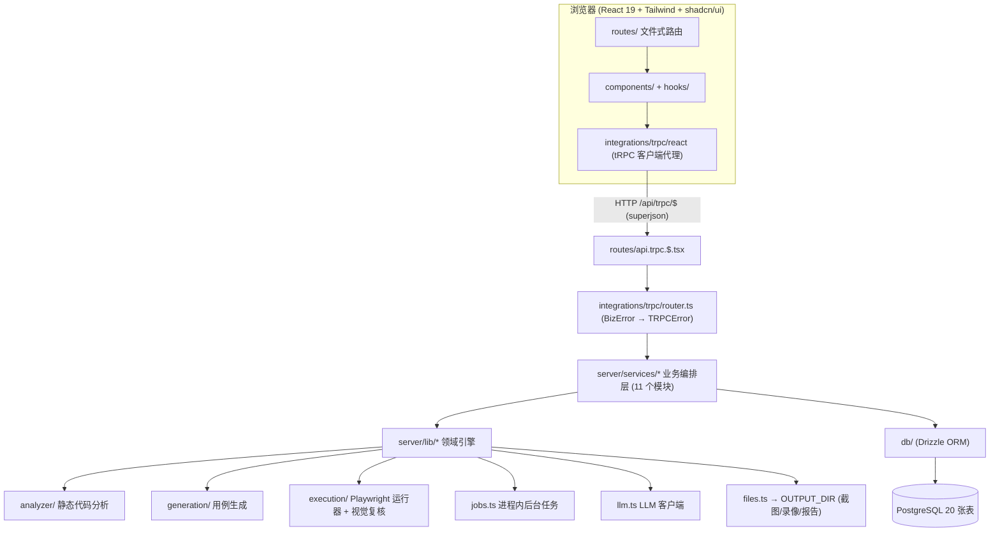

# 架构总览

## 分层视图



- **服务层** (`server/services/`): projects、analysis、requirements、testcases、generation、executions、workflows、stats、coverage、reports、settings 共 11 个模块, 负责业务编排与持久化。
- **领域引擎** (`server/lib/`): 纯逻辑, 不直接暴露给前端; 最大的三个是 `services/workflows.ts` (约 3200 行, 流水线编排)、`lib/generation/rule-cases.ts` (约 1100 行, 规则用例)、`services/executions.ts` (约 800 行, 执行服务)。

## 一次典型请求的数据流

以「触发代码分析」为例:

1. 用户在 `AnalysisTab` 点击按钮 → `useMutation(trpc.analysis.trigger.mutationOptions())`;
2. tRPC 客户端把请求发到 `/api/trpc/$` (`src/routes/api.trpc.$.tsx`);
3. `integrations/trpc/router.ts` 的 `analysis.trigger` 过程调用服务层 `server/services/analysis.ts` 的 `triggerAnalysis(pid)`;
4. 服务层创建**后台任务** (`jobs.ts` 的 `createJob` + `runJob`), 立即返回 `jobId`;
5. 前端用 `useJobPoller(jobId)` 轮询 `trpc.jobs.get`, 直到任务进入终态 (completed/failed);
6. 任务在后台调用 `server/lib/analyzer/*` 扫描代码, 写入 `code_analyses`、`state_machines` 表;
7. 任务终态后, 前端在 `useEffect` 中弹 toast、失效相关查询、刷新界面。

> 关键模式: **「变更即启动任务并返回 jobId, 客户端轮询任务状态」**。所有耗时操作 (分析、生成、批量执行、流水线) 都走这套异步任务机制, 避免长请求阻塞。

### 同步查询 vs 异步任务

- **同步查询 (query)**: 读取类、轻量, 直接返回数据。如 `projects.list`、`testcases.get`、`coverage.matrix`、`stats.overview`。
- **异步任务 (mutation → jobId → 轮询)**: 耗时操作。如 `analysis.trigger`、`generation.start`、`executions.startBatch`、`workflows.create`。

## 后台任务系统 (jobs.ts + useJobPoller)

`src/server/lib/jobs.ts` 是一个**进程内**任务注册表 (非持久化队列):

- `createJob(kind, total)`: 登记任务, 返回 `JobState` (含 id、kind、status、progress、message、error);
- `runJob(id, fn)`: 执行任务函数, 自动把状态推进到 completed/failed;
- `updateJob` / `progressJob`: 更新进度与消息;
- `getJob(id)`: 查询状态, 由 tRPC `jobs.get` 暴露给前端。

前端配套 (`src/hooks/use-job-poller.ts`):

- `useJobPoller(jobId, intervalMs = 1200)`: 用 TanStack Query 轮询 `trpc.jobs.get`, `refetchInterval` 在任务进入终态后自动停止; 返回 `job`、`isRunning`、`isTerminal`、`isCompleted`、`isFailed`、`progress`、`error`、`message`;
- `useJobCompletion(jobId, onDone)`: 任务终态时**恰好触发一次** `onDone`。

**完成副作用必须放在 useEffect 中**: 各 Tab 组件 (AnalysisTab/GenerationTab/RequirementsTab/CasesPanel) 在任务终态时弹 toast、失效查询、清理 jobId。副作用包在 `useEffect` 中并用 `finishedRef` 去重, 确保 React StrictMode 下不会重复触发 (这也是最近一次提交 `a075eb7` 的主题):

```tsx
const finishedRef = useRef<string | null>(null);
useEffect(() => {
  if (job.isTerminal && jobId && finishedRef.current !== jobId) {
    finishedRef.current = jobId;
    if (job.isFailed) toast.error(job.error ?? "... failed");
    else toast.success("... complete");
    queryClient.invalidateQueries({ queryKey: trpc.x.y.queryKey() });
    setJobId(null);
  }
}, [job.isTerminal, job.isFailed, job.error, jobId]);
```

注意: 任务是进程内的, **服务重启会中断运行中的任务**; 流水线有专门的 `recoverInterruptedRuns()` 在启动时把中断的运行诚实标记为 `cancelled` (见[流水线](pipeline))。

## 错误处理: BizError → TRPCError

- 服务层抛出 `BizError(code, message)` (定义于 `server/services/settings.ts`), 例如 `new BizError(40030, 'Profile name is required')`;
- `integrations/trpc/init.ts` 的错误中间件统一捕获:
  - `Math.floor(code / 100) === 404` → `NOT_FOUND`;
  - 其余 → `BAD_REQUEST`;
- 客户端收到稳定的错误消息, 前端统一 `onError: (e) => toast.error(e.message)`。

## 证据文件服务 (/api/files/$ 与 /api/report/$)

- 执行证据 (截图、录像) 在磁盘上以**绝对路径**存储于 `OUTPUT_DIR` (默认 `./outputs`);
- 在**读取边界** (`server/lib/files.ts` 的 `toFileUrl`) 把绝对路径转换为 `/api/files/...` URL, **浏览器永远看不到服务器文件系统路径**;
- `src/routes/api.files.$.tsx` 按 URL 安全回源文件 (含路径穿越防护);
- 生成的 HTML 报告同理经 `/api/report/$` 服务。

## LLM 客户端与档案 (llm.ts + settings)

- `llm_profiles` 表存文本/视觉两类模型档案 (apiKey/baseUrl/model/enabled/isDefault, kind 取 `text` 或 `vision`);
- 首次读取设置时, `LLM_*` / `LLM_VISION_*` 环境变量会被迁移进默认档案; 运行时在 Settings 页创建并设为默认的档案**优先于环境变量**;
- `server/lib/llm.ts` 封装 OpenAI 兼容客户端 `LlmClient` (默认 base `https://api.openai.com/v1`、默认模型 `gpt-4o-mini`), `available()` 判断是否配置了 apiKey;
- **优雅降级**: 任何失败 (缺 key、超时、429、非法 JSON) 都抛 `LlmUnavailableError`, 调用方回退到确定性规则模式——生成退回规则用例、视觉复核记为 `unavailable`、评审退回确定性结论。视觉档案未配置时回退到文本档案。

## Sentry 监控 (可选)

- `instrument.server.mjs` 在服务端启动时初始化 Sentry (读取 `VITE_SENTRY_DSN`, 未配置则打印警告并跳过, tracesSampleRate 0.1);
- `src/router.tsx` 集成 `@sentry/tanstackstart-react` 的浏览器错误采集;
- `vite.config.ts` 中 Nitro 将 `@sentry/*` 标记为 external; `pnpm build` 会把 `instrument.server.mjs` 拷贝进 `.output/server`, `pnpm start` 以 `node --import` 方式加载。

## 构建与配置

- `vite.config.ts`: devtools + nitro + tailwindcss + tanstackStart + viteReact + babel (React Compiler preset);
- `tsconfig.json`: strict、`noUnusedLocals`、`noUnusedParameters`、bundler moduleResolution、路径别名 `#/*` 与 `@/*`;
- `drizzle.config.ts`: schema 指向 `./src/db/schema.ts`, 迁移输出 `./drizzle`, 从 `.env.local`/`.env` 读取 `DATABASE_URL`;
- `components.json`: shadcn new-york 风格、zinc 基色、CSS 变量、别名 `#/components`、`#/lib/utils`。
