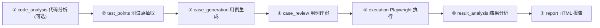

# 七阶段流水线

流水线由 `src/server/services/workflows.ts` (约 3200 行, 全仓最大文件) 编排, 是一个多智能体测试工作流:

> 需求版本 → 测试点 (agent 1) → 用例 (agent 2) → 独立评审/修订 (agent 3) → Playwright 执行已批准的可自动化用例 → 证据驱动的结果分析 (agent 4) → 汇总报告。

设计原则 (文件头注释):

- 流水线**只新增** run/stage/review/analysis 记录, 不替换既有表与 API;
- **每个阶段都持久化**: 阶段失败时保留已有产物, 后续阶段标记 skipped, 数据绝不静默丢弃;
- 评审最多修订 `maxRevisions` 轮, 仍不合格的用例被拒绝, 绝不执行;
- 结果分析只写自己的表 (`workflow_result_analyses`), **绝不覆盖** `execution_records.status`。

## 阶段总览

| 阶段 | STAGE_LABELS 键   | 内容                                   | 失败语义               |
| ---- | ----------------- | -------------------------------------- | ---------------------- |
| ①    | `code_analysis`   | 刷新代码事实 (可配置跳过/复用最近分析) | **硬失败**             |
| ②    | `test_points`     | 从 PRD 抽取测试点                      | **硬失败**             |
| ③    | `case_generation` | rule / llm / auto 生成用例             | **硬失败**             |
| ④    | `case_review`     | 确定性质量门 → LLM 评审 → 最多两轮修复 | 软失败                 |
| ⑤    | `execution`       | Playwright 执行已批准用例              | 软失败                 |
| ⑥    | `result_analysis` | 证据驱动失败分类                       | 软失败                 |
| ⑦    | `report`          | 自包含 HTML 报告                       | 软失败, 但**总是执行** |

## 编排逻辑 (runWorkflow)

`runWorkflow(runId, report)` 的核心控制流 (已在源码验证):

1. 运行置为 `running`, 记录 `startedAt`;
2. 顺序执行 ①~⑥ 六个 handler, 每个阶段通过 `beginStage`/`endStage` 持久化状态、尝试次数与耗时;
3. **硬失败 (hardFailure)**:
   - `code_analysis`、`test_points`、`case_generation` 三个阶段返回 failed 即为硬失败;
   - 任何阶段**抛出异常**也是硬失败 (`persistStageFailure` 记录后继续);
   - 硬失败后, 剩余阶段被 `markRemainingSkipped` 标记为 skipped ("Skipped because an earlier stage failed");
4. **软失败**: `case_review`、`execution`、`result_analysis` 失败只记 `hadFailure`, 不阻断后续;
5. **报告阶段总是执行**: 即使前面失败也产出可读报告 ("Always produce a report so even failures leave a readable artifact");
6. 最终状态:
   - 无失败 → `completed`;
   - 有失败但不是硬失败, 或硬失败但 `hasCompletedWork(runId)` 证明已有完成的工作 → `partial`;
   - 硬失败且无任何已完成工作 → `failed`;
7. `buildSummary` 汇总统计写入 `workflow_runs.summary`。

### 创建运行 (createRun)

`workflows.create` tRPC 入参 (Zod 校验):

| 参数                                         | 默认             | 说明                        |
| -------------------------------------------- | ---------------- | --------------------------- |
| `pid` / `requirementId`                      | 必填             | 项目与需求版本              |
| `mode`                                       | `auto`           | `auto` / `rule` / `llm`     |
| `autoExecute`                                | `true`           | 评审通过后是否自动执行      |
| `maxRevisions`                               | `2` (0~2)        | 评审修复轮数上限            |
| `maxCases`                                   | `20` (1~100)     | 本次运行的用例上限          |
| `reuseExistingCases`                         | `true`           | 复用已有用例                |
| `reanalyzePoints`                            | `false`          | 重新抽取测试点              |
| `targetUrl`                                  | null             | 覆盖被测站点 URL            |
| `testPointLlmProfileId` / `caseLlmProfileId` | null             | 指定 LLM 档案               |
| `analyzeCode` / `reanalyzeCode`              | `true` / `false` | 是否分析代码 / 强制重新分析 |
| `reviewEnabled` / `analyzeEnabled`           | `true`           | 开关评审 / 结果分析阶段     |

### 中断恢复 (recoverInterruptedRuns)

任务是进程内的, 服务重启会中断运行中的流水线。`recoverInterruptedRuns()` 在启动时把这类运行标记为 `cancelled`——诚实反映「被中断」, 不伪造完成。重新发起即可。

## 各阶段要点

### ① 代码分析 (stageCodeAnalysis)

调用 `server/services/analysis.ts` 的 `runAnalysis` 刷新代码事实 (详见[静态代码分析](/base/yukino-agent-test/analyzer))。可通过 `analyzeCode`/`reanalyzeCode` 配置跳过或强制重跑; 跳过时等待/复用最近一次分析 (`waitForAnalysisRow`)。

### ② 测试点抽取 (stageTestPoints)

入口 `server/services/requirements.ts` 的 `startRequirementAnalysis`, 引擎在 `server/lib/generation/test-points.ts`。输入需求版本的 PRD 内容 (仅 `.md`/`.txt`), 输出 `test_points` 记录; 支持规则抽取与 LLM 抽取 (`source` 标记 `rule`/`llm`)。详见[用例生成](/base/yukino-agent-test/generation)。

### ③ 用例生成 (stageCaseGeneration)

入口 `server/services/generation.ts` 的 `generateCases`。三种模式 `rule`/`llm`/`auto`; auto 模式 LLM 先行、规则兜底, LLM 不可用时整体降级为规则模式。详见[用例生成](/base/yukino-agent-test/generation)。

### ④ 用例评审 (stageCaseReview)

「确定性优先、LLM 辅助、可修复」的典范:

1. **确定性评审 `deterministicReview`**: 规则检查每个用例 (必填字段 `missingRequiredFields`、复合预期、单步多输入、缺失锚点等), 产出 `deterministicIssues`;
2. **LLM 评审**: 用 `caseReviewWorkflowPrompt` 让模型逐用例评审, 输出问题清单与建议;
3. **合成结论 `composeReviewStatus`**: `pass` (通过) / `revise` (需修复) / `reject` (拒绝); 阻塞性问题直接 reject, 可修复问题进入修复轮;
4. **修复轮**: 对 revise 用例用 `caseRepairPrompt` 让 LLM 依据问题清单修补, 最多 `maxRevisions` 轮 (`revisionCount` 计数), 每轮写入 `workflow_case_reviews` (round 递增);
5. 仍不合格 → reject, **绝不执行**。

评审结论落在 `workflow_cases.reviewStatus` 与 `workflow_case_reviews`; 质量分 `qualityScore` 由 `scoreCase` 打分、`llmDeduction` 按问题扣分。

### ⑤ 执行 (stageExecution)

对 reviewStatus 为 pass 且 automationStatus 可自动化的用例, 逐个调用 `runCaseExecution` (Playwright 引擎, 详见[浏览器执行](/base/yukino-agent-test/execution)), 执行记录与 `workflow_cases.executionId` 关联。

### ⑥ 结果分析 (stageResultAnalysis)

证据驱动的失败分类, 只针对失败的执行:

- `buildEvidence` 汇总客观证据 (步骤记录、错误类别、断言明细、截图清单等);
- 优先用 LLM (`resultAnalysisPrompt`) 分类; 不可用时退回 `ruleAnalysis` 规则分类;
- `guardAnalysis`/`hasGroundedEvidence` 守卫确保分类有接地证据, 不臆断;
- 分类结果写入 `workflow_result_analyses` (含 `executionStatus` 快照、`failureCategory`、`failureReason`), **不修改执行记录状态**。

失败分类取值: `product_defect` / `test_script_issue` / `test_data_issue` / `environment_issue` / `unknown` / `none`。

### ⑦ 报告 (stageReport)

`server/services/reports.ts` 生成**自包含 HTML 报告** (单文件, 内联样式与数据), 写入 `OUTPUT_DIR`, 经 `/api/report/$` 路由服务。即使流水线失败也会产出可读报告。

## 持久化与查询

- `workflow_runs`: 一次运行的配置 (`config` jsonb) 与汇总 (`summary` jsonb);
- `workflow_stages`: 每阶段的 status/attempt/inputSummary/outputSummary/payload/model/durationMs;
- `workflow_cases`: 运行内逐用例的评审/执行/分析状态串联 (firstReviewId/finalReviewId/executionId/analysisId);
- 前端 `/pipeline` 列出运行、`/pipeline/$runId` 展示阶段时间线与逐用例评审, 轮询 `workflows.detail` 刷新。
