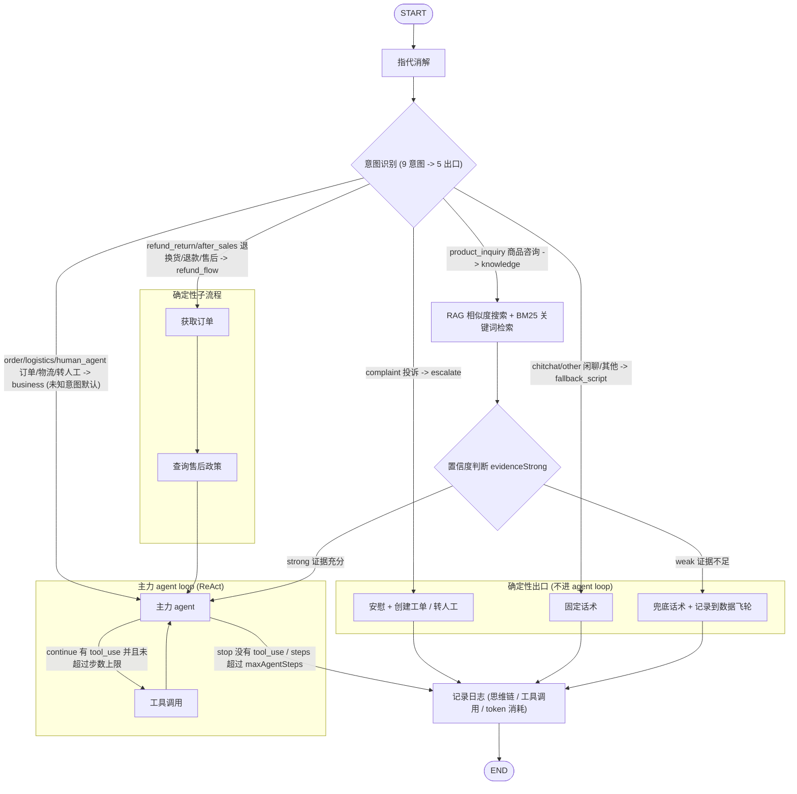

# Workflow

1. 指代消解 (query 优化): 她多少钱? -> iPhone17 多少钱?
2. 意图识别: 用户问的是商品, 还是订单, 还是物流, 还是退换货/退款/售后, 还是投诉, **还是单纯闲聊**
3. 意图分流
   - 闲聊/无关话题: 回复固定话术
   - 知识类问题: RAG 相似度搜索 + BM25 关键词检索
   - 退换货/退款/售后: 确定性子流程 (获取订单 -> 查询售后政策 -> 转主力 agent loop)
   - 订单/物流/转人工等: 直接转 4
   - 投诉: 先安慰, 再提供创建工单和转人工选项
4. 主力 agent loop; 进入主力 agent loop 前, 有一道置信度闸: 判断检索到的知识是否足够回答该问题, 如果不够, 则回复兜底话术, 同时记录该问题, 推入到数据飞轮
5. 记录日志, 记录 workflow 模型的思维链、工具调用、token 消耗, 保证可观测性

## 主力 agent loop

ReAct: Reasoning -> Acting -> Observation

2 种 agent loop 退出条件

1. LLM 决定退出循环: LLM API 响应中没有 tool_use, stop reason 是 end_turn (Anthropic)
2. 设置最大循环次数, 超过最大循环次数后强制退出循环 (本项目 MAX_AGENT_STEPS=6; langchain createReactAgent 的 maxIterations 默认 15)

token 消耗不能作为退出条件

### 不用 workflow 全部使用 agent loop?

1. 排查问题难: 相同的用户提问, 跑两遍 agent, 思维链可能不同, 调试、监控和排查难度大
2. 可能遗漏步骤, 例如知识类问题遗漏知识检索, 导致幻觉
3. 响应速度慢

## Workflow

```ts
// server/src/graph/build.ts
import { END, START, StateGraph } from "@langchain/langgraph";
import type { BaseCheckpointSaver } from "@langchain/langgraph";

import * as nodes from "./nodes.ts";
import { confidenceGate, routeByIntent, shouldContinue } from "./routing.ts";
import { ConversationState } from "./state.ts";

export function buildGraph(checkpointer?: BaseCheckpointSaver) {
  const builder = new StateGraph(ConversationState)
    .addNode("resolve_reference", nodes.resolveReference) // 指代消解
    .addNode("classify_intent", nodes.classifyIntent) // 意图识别
    .addNode("retrieve_knowledge", nodes.retrieveKnowledge) // 知识检索
    .addNode("confidence_check", nodes.confidenceCheck) // 置信度判断
    .addNode("main_agent", nodes.mainAgent) // 主力 agent loop
    .addNode("agent_tools", nodes.agentTools)
    .addNode("complaint_reply", nodes.complaintReply)
    .addNode("script_reply", nodes.scriptReply)
    .addNode("fallback_reply", nodes.fallbackReply) // 兜底话术
    .addNode("fetch_order", nodes.fetchOrder)
    .addNode("retrieve_policy", nodes.retrievePolicy)
    .addNode("log", nodes.logNode)
    // 指代消解 -> 意图识别
    .addEdge(START, "resolve_reference")
    .addEdge("resolve_reference", "classify_intent") // 指代消解完成后, 进入意图识别
    .addConditionalEdges("classify_intent", routeByIntent, {
      escalate: "complaint_reply",
      fallback_script: "script_reply",
      knowledge: "retrieve_knowledge", // 知识类问题 -> 知识检索
      refund_flow: "fetch_order", // 退换货/退款/售后 -> 确定性子流程
      business: "main_agent", // 业务类 -> 主力 agent loop
    })
    .addEdge("fetch_order", "retrieve_policy")
    .addEdge("retrieve_policy", "main_agent")
    .addEdge("retrieve_knowledge", "confidence_check") // 知识检索后, 进入置信度判断
    .addConditionalEdges("confidence_check", confidenceGate, {
      strong: "main_agent",
      weak: "fallback_reply",
    }) // 置信度判断
    .addConditionalEdges("main_agent", shouldContinue, {
      continue: "agent_tools",
      stop: "log",
    })
    .addEdge("agent_tools", "main_agent")
    .addEdge("complaint_reply", "log")
    .addEdge("script_reply", "log")
    .addEdge("fallback_reply", "log")
    .addEdge("log", END);
  return builder.compile(checkpointer === undefined ? {} : { checkpointer });
}
```



## 节点实现

### resolve_reference 指代消解

`coref.resolve` (COREF_REWRITE_PROMPT + chat 模型): 把依赖上下文的当前话语改写成独立完整的问题。她多少钱? -> iPhone17 多少钱。规则:

- 指代解析成明确实体 ("这个还能退吗?" + 前文蓝牙耳机 -> "蓝牙耳机还能退吗?")
- 指代指向具体订单时, 改写必须携带订单号 —— 同一商品往往有多个订单, 只带商品名下游无法定位
- 句子本身完整时原样返回, 不引入历史中不存在的信息; 通用平台规则问题 ("支持花呗分期吗") 即使刚讨论过某订单, 也不塞订单号, 否则检索会错过通用政策
- 失败不阻塞, 用原问题继续

### classify_intent 意图识别

九个意图: logistics / order / product_inquiry / refund_return / after_sales / complaint / human_agent / chitchat / other

常见方案对比:

1. 关键词匹配: 每个意图对应一个关键词清单
2. 训练一个 bert 分类器, 缺点是依赖样本数据和数据标注, 无法解决意图漂移, bert 分类器适合单条用户消息分类, 不适合多轮对话的会话上下文; 除非输入整个会话上下文到 bert 分类器
3. LLM Prompt, 不依赖样本数据和数据标注, 可以输入整个会话上下文
   - 可以使用能力较强的 LLM, 输出意图
   - 可以使用能力较弱的 LLM, 输出意图 + 置信度
   - few-shot: 提供几个真实问题和对应意图的示例

本项目用方案 3 (intent 槽位模型 + 结构化输出 {intent, confidence}): 输入指代消解后的问题 + 最近 6 条历史, prompt 里给出边界案例 few-shot ("这个还能退吗?" -> refund_return, "退货运费谁出?" -> product_inquiry, "帮我建个工单" -> human_agent); 分类失败回落 other。

#### 意图数量很多

意图数量很多, 难以在 prompt 中枚举

- 多层意图树
  - 一级分类: 售前 / 物流 / 售后
  - 二级分类: 细分子意图
- 检索式意图识别, 为每个意图的描述文档建立一个向量库, 对用户 query 相似度搜索, 召回最相关的 topK 个候选意图, 提供给模型选择

### 意图分流

```ts
// server/src/graph/routing.ts
// Nine intents -> five exits; single source shared with build.ts conditional edge keys.
export const INTENT_TO_ROUTE: Record<string, RouteKey> = {
  // 投诉 -> 先安慰, 再提供创建工单和转人工选项
  complaint: "escalate",
  // 闲聊 -> 固定话术
  chitchat: "fallback_script",
  // 其他 -> 固定话术
  other: "fallback_script",
  // 商品咨询 -> 知识检索
  product_inquiry: "knowledge",
  // 退换货、退款 -> 确定性子流程: 获取订单、查询售后政策
  refund_return: "refund_flow",
  // 售后 -> 确定性子流程: 获取订单、查询售后政策
  after_sales: "refund_flow",
  // 转人工: 直接转到主力 agent loop
  human_agent: "business",
  // 订单、物流: 直接转到主力 agent loop
  logistics: "business",
  order: "business",
};

export function routeByIntent(state: GraphState): RouteKey {
  return INTENT_TO_ROUTE[state.intent] ?? "business";
}
```

### retrieve_knowledge 知识检索

1. QUERY_REWRITE_PROMPT 把口语化问题改写成标准问题 + 同义词扩展
2. hybrid_rerank 检索 (标准问题走向量一路, 标准问题 + 扩展词走 BM25 一路)
3. 计算证据置信度: score < 0.26 直接判不足 (fallbackSource=retrieval_low_conf)
4. LLM 自检 (SELF_CHECK_PROMPT): 证据是否足以回答问题; 不足则 fallbackSource=self_check
5. 充分: 证据按首尾排布生成带编号的 citations, evidenceStrong=true

### confidence_check 置信度闸

`confidenceGate` 按 evidenceStrong 分流: strong -> main_agent, weak -> fallback_reply。

### fetch_order + retrieve_policy 退款确定性子流程

- fetch_order: 从问题中提取 4 位以上数字的订单号; 提不到、或订单不属于当前用户时, `interrupt` 中断, 把用户的订单列表 (select_order) 交给前端, 用户选择后经 /api/actions/resume 恢复, 循环直到确认归属; 确认后取订单快照 (状态/金额/商品/运单号)
- retrieve_policy: `expandQueries` 把「问题 + 订单状态」扩写成 3 条检索友好的 query, 各自 hybrid_rerank 检索后合并去重 (同一 chunk 保留最高精排分), 首尾排布生成 citations

### main_agent + agent_tools 主力 agent loop

- main_agent: `registry.getAllSpecs()` 拿全部工具 (内置 + MCP) bindTools; 输入 = AGENT_SYSTEM + 记忆窗口 + 本轮材料 (摘要/证据/退款订单数据); 流式输出; 每步记录 token 消耗 (含 cache_read 命中量), 累加到 state.tokensUsed
- agent_tools: 逐个执行工具调用 (容错见 LLM 一章); 两个人工确认流:
  - create_ticket: 先 `interrupt` 弹工单预览卡 (confirm_ticket), 用户确认后才真正执行; 取消时告诉模型「用户已取消, 除非明确要求不要再次发起」; 一次只处理一个建单请求
  - submit_refund: 校验订单归属后, 只把退款表单交给用户 (refund_form action), 不落库
  - query_order / submit_refund 遇到非本人订单: 追加 select_order action 让用户重选
- `shouldContinue`: 最后一条消息没有 tool_calls, 或 steps >= MAX_AGENT_STEPS (6), 退出循环进 log

### 确定性出口

- complaint_reply: 安慰话术 + 两个动作 (transfer_human / create_ticket 草稿)
- script_reply: chitchat 和 other 各自的固定话术
- fallback_reply: 兜底话术 + transfer_human 动作; 同时把问题写入 low_confidence_question (数据飞轮入口), 附检索快照 (三态: 命中/零命中/未检索) 和置信度信号

### log

logNode 记录意图/路由/trace, 并把本轮回复作为 assistant 消息持久化到 message 表。

## 运行时

- Checkpointer: langgraph PostgresSaver, thread_id = 会话 ID; CHECKPOINTER_DB_URL 指向的数据库首次启动自动创建, saver 自建表; interrupt 的图状态就存在 checkpointer 里, 服务重启后仍可 resume
- SSE 流式 (/api/chat): 同时订阅 messages + updates 两种 streamMode, 翻译成 6 类事件:
  - delta: 主力 agent 的流式文本, 以及确定性出口的完整回复
  - citations: 证据引用列表 (retrieve_knowledge / retrieve_policy 产出)
  - tool: 调用了什么工具 (submit_refund 除外, 它走 actions)
  - actions: 需要用户确认的动作卡片 (按类型去重)
  - interrupt: 图中断 (select_order / confirm_ticket), 前端渲染选择卡或确认卡
  - done: 本轮结束, 返回 conversation_id
- 恢复: /api/actions/resume 传 order_id (选订单) 或 confirmed (工单确认), `Command({resume})` 从中断点继续跑图
- 每轮结束后: 层降级 (settleLayers) + 异步摘要 (maybeScheduleSummary) + langfuse recordTurn, 见「会话上下文」和「可观测性」两章
