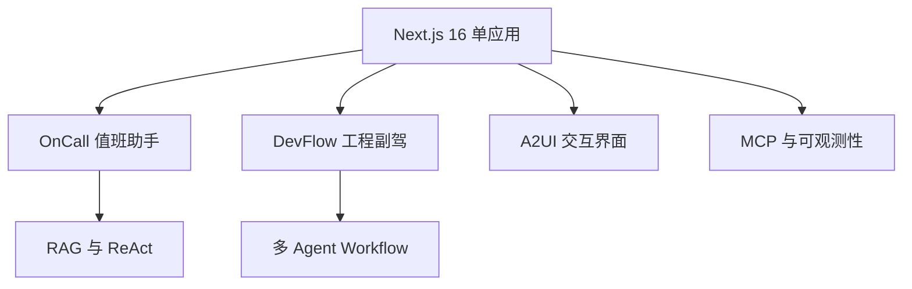

:::note 事实基线
本文依据 `$HOME/github/yukino-dev-agent` 在 `424a27059065` 的源码事实撰写；文中的路径、常量与 API 名称均可在该检出中定位。
:::

**主线一览**

yukino-dev-agent 仓库的系统性技术笔记, 共 4 个页面 (含本落地页).

:::note 单应用双产品面
该仓库是单个 **Next.js 16** App Router 全栈应用, 同进程承载两个产品面: 面向值班运维的 AI <u>OnCall</u> 助手 (根路径) 与面向 GitHub 协作的 <u>DevFlow</u> 工程副驾 (`/dev-flow`), 共用 **Milvus** 混合检索、双槽位模型工厂与 **Langfuse** / **Prometheus** 可观测性.
:::

| 页面                                   | 内容概要                                                                                                                                                                        |
| -------------------------------------- | ------------------------------------------------------------------------------------------------------------------------------------------------------------------------------- |
| [yukino-dev-agent](./yukino-dev-agent) | 深度技术笔记: 分层架构与端到端数据流、Milvus 混合检索 RAG、ReAct 与 Plan-Execute-Replan 编排、A2UI 交互界面、MCP 工具体系、数据模型与记忆、指标桥与告警闭环、配置部署与安全边界 |
| [agent](./agent)                       | OnCall 视角入门: 技术栈与双档模型、RAG 建库与在线问答、Milvus 混合检索流程、ReAct 对话 Agent、Plan-Execute-Replan 运维 Agent 与报告护栏、Tool/MCP、A2UI、知识库管理与自监控     |
| [dev-flow](./dev-flow)                 | DevFlow 视角入门: GitHub 同步与调度、确定性优先的分析 Agent、ActionDraft 安全草稿、每仓 RAG 与答案门禁、对话 Agent 韧性与记忆系统、多 Agent workflow、代码工作区/代码图/知识图  |
