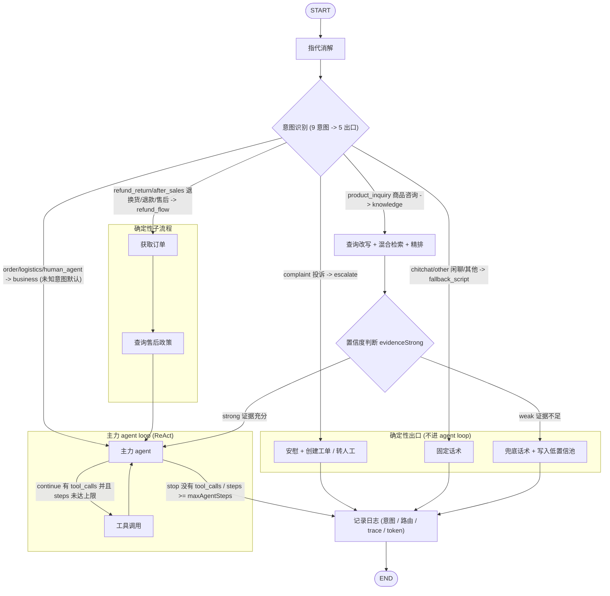

# Workflow

一次对话轮次不是「一个模型从头答到尾」, 而是穿过一张预先编排好的状态图: 能写死的步骤 (指代消解、意图分类、知识检索、兜底话术) 用确定性的 workflow 节点串起来, 真正需要模型自主决定「下一步调什么工具」的部分才交给 ReAct agent loop。整张图用 LangGraph 的 `StateGraph` 声明, 编排代码集中在 `server/src/graph/` 的五个文件:

| 文件         | 职责                                                                         |
| ------------ | ---------------------------------------------------------------------------- |
| `build.ts`   | 声明 12 个节点和边, 编译出可执行的图                                         |
| `state.ts`   | 节点间共享的状态 `ConversationState` (字段清单见 [context](./context))       |
| `routing.ts` | 三个条件路由函数: `routeByIntent` / `confidenceGate` / `shouldContinue`      |
| `nodes.ts`   | 12 个节点的实现                                                              |
| `runtime.ts` | 图的编译与 checkpoint 初始化、每轮执行、SSE 流式事件翻译、中断恢复、轮末结算 |

## 一轮对话的五步

1. 指代消解 (query 优化): 「她多少钱?」改写成「iPhone17 多少钱?」, 让下游节点拿到一个不依赖上下文也能理解的完整问题
2. 意图识别: 用户问的是商品, 还是订单, 还是物流, 还是退换货/退款/售后, 还是投诉, 还是单纯闲聊 —— 共九个意图
3. 意图分流 (九意图映射到五个出口):
   - 闲聊/无关话题: 回复固定话术, 不进模型
   - 知识类问题: RAG 检索 (相似度搜索 + BM25 关键词检索 + 精排)
   - 退换货/退款/售后: 确定性子流程 (锁定订单 -> 检索售后政策 -> 带着材料转主力 agent loop)
   - 订单/物流/转人工等业务问题: 直接转主力 agent loop
   - 投诉: 先安慰, 再提供创建工单和转人工选项
4. 主力 agent loop; 知识分支在进入主力 loop 前还有一道置信度闸: 判断检索到的知识是否足够回答该问题, 不够则回复兜底话术, 同时把问题写入低置信池, 推进数据飞轮 (闭环见 [observable](./observable))
5. 记录日志: `log` 节点把本轮的意图、路由和各节点 trace 打成结构化日志, 并把回复持久化到消息表

### 为什么不全部交给 agent loop

理论上可以把检索、分流都做成工具, 让一个 ReAct loop 自己决定何时调用。不这么做有三个工程理由:

1. 排查问题难: 相同的用户提问跑两遍 agent, 思维链可能不同, 调试、监控和排查难度大; workflow 节点的路径是确定的, trace 里能直接看出「这轮走了哪条分支」
2. 可能遗漏步骤: 例如知识类问题遗漏知识检索, 模型凭参数记忆作答, 产生幻觉; 本项目把 `product_inquiry` 意图硬接到 `retrieve_knowledge` 节点, 检索不可能被跳过
3. 响应速度慢: 闲聊、投诉这类轮次根本不需要工具循环, 固定话术直接返回, 一次模型调用都省了

## 图构建

`buildGraph(checkpointer?)` (`server/src/graph/build.ts`) 的全部拓扑:

```ts
// server/src/graph/build.ts
import { END, START, StateGraph } from "@langchain/langgraph";
import type { BaseCheckpointSaver } from "@langchain/langgraph";

import * as nodes from "./nodes.ts";
import { confidenceGate, routeByIntent, shouldContinue } from "./routing.ts";
import { ConversationState } from "./state.ts";

export function buildGraph(checkpointer?: BaseCheckpointSaver) {
  const builder = new StateGraph(ConversationState)
    .addNode("resolve_reference", nodes.resolveReference) // 指代消解
    .addNode("classify_intent", nodes.classifyIntent) // 意图识别
    .addNode("retrieve_knowledge", nodes.retrieveKnowledge) // 知识检索
    .addNode("confidence_check", nodes.confidenceCheck) // 置信度判断
    .addNode("main_agent", nodes.mainAgent) // 主力 agent loop
    .addNode("agent_tools", nodes.agentTools)
    .addNode("complaint_reply", nodes.complaintReply)
    .addNode("script_reply", nodes.scriptReply)
    .addNode("fallback_reply", nodes.fallbackReply) // 兜底话术
    .addNode("fetch_order", nodes.fetchOrder)
    .addNode("retrieve_policy", nodes.retrievePolicy)
    .addNode("log", nodes.logNode)
    // 指代消解 -> 意图识别
    .addEdge(START, "resolve_reference")
    .addEdge("resolve_reference", "classify_intent") // 指代消解完成后, 进入意图识别
    .addConditionalEdges("classify_intent", routeByIntent, {
      escalate: "complaint_reply",
      fallback_script: "script_reply",
      knowledge: "retrieve_knowledge", // 知识类问题 -> 知识检索
      refund_flow: "fetch_order", // 退换货/退款/售后 -> 确定性子流程
      business: "main_agent", // 业务类 -> 主力 agent loop
    })
    .addEdge("fetch_order", "retrieve_policy")
    .addEdge("retrieve_policy", "main_agent")
    .addEdge("retrieve_knowledge", "confidence_check") // 知识检索后, 进入置信度判断
    .addConditionalEdges("confidence_check", confidenceGate, {
      strong: "main_agent",
      weak: "fallback_reply",
    }) // 置信度判断
    .addConditionalEdges("main_agent", shouldContinue, {
      continue: "agent_tools",
      stop: "log",
    })
    .addEdge("agent_tools", "main_agent")
    .addEdge("complaint_reply", "log")
    .addEdge("script_reply", "log")
    .addEdge("fallback_reply", "log")
    .addEdge("log", END);
  return builder.compile(checkpointer === undefined ? {} : { checkpointer });
}
```

三处 `addConditionalEdges` 的分流函数都在 `routing.ts`, 边表里的 key (`escalate` 等) 与函数返回值一一对应 —— 映射只有一份, 不会出现「路由函数返回了边表里没有的 key」的裂缝:

```ts
// server/src/graph/routing.ts
export type RouteKey =
  "escalate" | "fallback_script" | "knowledge" | "refund_flow" | "business";

export const INTENT_TO_ROUTE: Record<string, RouteKey> = {
  complaint: "escalate",
  chitchat: "fallback_script",
  other: "fallback_script",
  product_inquiry: "knowledge",
  refund_return: "refund_flow",
  after_sales: "refund_flow",
  human_agent: "business",
  logistics: "business",
  order: "business",
};

export function routeByIntent(state: GraphState): RouteKey {
  return INTENT_TO_ROUTE[state.intent] ?? "business";
}

export function confidenceGate(state: GraphState): "strong" | "weak" {
  return state.evidenceStrong ? "strong" : "weak";
}

export function shouldContinue(state: GraphState): "continue" | "stop" {
  const last = state.messages[state.messages.length - 1];
  const hasToolCalls =
    last instanceof AIMessage && (last.tool_calls?.length ?? 0) > 0;
  if (!hasToolCalls) {
    return "stop";
  }
  if ((state.steps ?? 0) >= settings.maxAgentSteps) {
    return "stop";
  }
  return "continue";
}
```

用 mermaid 画出整张图:



注意所有分支最终都汇到 `log` 节点再到 `END`: 不管是 agent 生成的回复、固定话术还是兜底话术, 落库和打日志的出口只有一个。

## 节点实现

### resolve_reference 指代消解

多轮对话里的当前话语经常依赖上文 (「这个还能退吗?」), 直接拿去分类或检索都会失真。`resolveReference` 节点 (`server/src/graph/nodes.ts`) 把它改写成独立完整的问题:

- 输入: `userText(state)` 取消息列表里最后一条用户消息; `historyText(state)` 拼出轻量历史 —— 一行摘要前缀 (`(Summary of earlier conversation: …)`, 无摘要则省略) + 窗口中除当前消息外最近 6 条消息, 逐行标成 `User: …` / `Agent: …`
- 改写: `coref.resolve` (`server/src/core/coref.ts`) 用 `COREF_REWRITE_PROMPT` 接 chat 槽位模型, 输出纯文本的改写结果; 结果为空或调用抛错时原样返回问题 —— 指代消解失败不阻塞主流程
- trace 记录 `coref: "rewrite"` 或 `"passthrough"`, 事后可统计改写率

`COREF_REWRITE_SYSTEM` (`server/src/core/prompts.ts`) 的规则设计:

- 指代解析成明确实体: 「这个还能退吗?」+ 前文蓝牙耳机 -> 「蓝牙耳机还能退吗?」
- 指代指向具体订单时, 改写必须携带订单号而不只是商品名 —— 同一商品往往有多个订单, 只带商品名下游无法定位
- 句子本身完整时原样返回, 绝不引入历史中不存在的信息; 通用平台规则问题 (「支持花呗分期吗」) 即使刚讨论过某订单, 也不塞订单号, 否则检索会错过通用政策
- 只输出改写后的问题本身, 不带解释和引号

### classify_intent 意图识别

九个意图, 定义在 `server/src/core/intent.ts` 的 `INTENTS` 常量: `logistics` / `order` / `product_inquiry` / `refund_return` / `after_sales` / `complaint` / `human_agent` / `chitchat` / `other`。

意图识别的常见方案对比:

1. 关键词匹配: 每个意图对应一个关键词清单; 覆盖不了「帮我建个工单」这类没有领域关键词的表述
2. 训练一个 BERT 分类器: 依赖样本数据和数据标注, 无法解决意图漂移; 适合单条用户消息分类, 不适合多轮对话 —— 除非把整个会话上下文喂给分类器
3. LLM Prompt: 不依赖样本数据和标注, 可以输入整个会话上下文
   - 用能力较强的模型, 直接输出意图
   - 用能力较弱的模型, 输出意图 + 置信度
   - few-shot: 在 prompt 里给出边界案例的真实问题和对应意图

本项目用方案 3: `INTENT_CLASSIFY_PROMPT` 接 `structured(intentSchema, { slot: "intent" })` (结构化输出机制见 [llm](./llm)), zod schema 限定 `{ intent, confidence }` 两个字段, intent 是九选一枚举, confidence 是 0-1 的数 (缺省 0.5)。输入是指代消解后的完整问题 + 同一份 `historyText` 轻量历史; prompt 里给出九类判据和边界 few-shot (「这个还能退吗?」-> `refund_return`, 「退货运费谁出?」-> `product_inquiry`, 「帮我建个工单」-> `human_agent`, 「写首诗吧」-> `other`)。分类调用失败时回落 `other` + confidence 0, 走固定话术出口, 不阻塞对话。

节点同时调 `observability.tagIntent` 把意图和置信度写进 langfuse (见 [observable](./observable)), 并把 `intent` / `intent_confidence` / `route` 写进 trace。

#### 意图数量很多怎么办

九个意图还能在 prompt 里枚举, 意图涨到几十上百个时:

- 多层意图树: 一级分类 (售前 / 物流 / 售后), 二级再细分子意图, 每次只让模型在小集合里选
- 检索式意图识别: 为每个意图的描述文档建一个向量库, 对用户 query 做相似度搜索, 召回最相关的 topK 个候选意图, 再让模型从中选择

### retrieve_knowledge 知识检索

`product_inquiry` 分支的检索节点, 完整管线 (检索策略与精排细节见 [rag](./rag)):

1. 查询理解: `queryUnderstanding.understand` 用 `QUERY_REWRITE_PROMPT` 把口语化问题改写成标准问题, 并给出同义词扩展; 失败时用原问题
2. 混合检索: `retrieval.searchKnowledge` 以 `hybrid_rerank` 策略检索 —— 标准问题走向量一路, 「标准问题 + 扩展词」拼成 `bm25Text` 走 BM25 一路, 召回融合后用 rerank 模型精排
3. 证据置信度: `computeEvidenceConfidence` (`server/src/core/confidence.ts`) 按 top1 精排分、有效条数、top1-top2 分差、关键条款命中四个信号加权打分; `score` 低于 `EVIDENCE_CONFIDENCE_THRESHOLD` (默认 0.26) 直接判不足, `evidenceStrong=false`, `fallbackSource="retrieval_low_conf"`
4. LLM 自检: 过线的证据再过一道 `selfcheck.checkSufficient` (`SELF_CHECK_PROMPT`, 结构化输出 `{ useful, reason }`), 判断证据是否真的足以回答问题; 不足或自检调用失败时 `fallbackSource="self_check"`
5. 证据充分: `arrangeHeadTail` 把第 2 名挪到队尾 (利用首因/近因效应), 生成带编号的 `citations` (`{ n, id, section_path, question, answer, content_type }`), `evidence` 拼成 `[1] 问题: 答案` 的编号文本, `evidenceStrong=true`

无论走哪条分支, 节点都把前 3 条命中存成 `retrievedSnapshot` (`snapshotFromHits`), 供兜底落库和用户点踩时附带 (见 [observable](./observable))。

### confidence_check 置信度闸

进入主力 agent loop 前的闸门。`confidenceCheck` 节点本身只把 `confidence: "strong" | "weak"` 写进 trace, 真正的分流由 `routing.ts` 的 `confidenceGate` 读 `state.evidenceStrong` 决定: strong -> `main_agent` (带着编号证据进循环), weak -> `fallback_reply` (兜底)。把「记录」和「分流」拆开, 是为了让路由逻辑集中在 `routing.ts` 一处, 图的条件边 key 和分流函数永远同源。

### fetch_order + retrieve_policy 退款确定性子流程

`refund_return` / `after_sales` 两个意图不直接进 agent loop, 先走两个确定性节点把「订单」和「政策」两份材料备齐:

- **fetch_order** (`server/src/graph/nodes.ts` 的 `fetchOrder`):
  1. 订单号优先取 `state.orderId`, 否则用正则 `/(?<!\d)(\d{4,})(?!\d)/` 从指代消解后的问题里提取 4 位以上、前后不紧邻其他数字的订单号
  2. 提不到订单号、或订单不属于当前用户 (`business.ownsOrder` 校验) 时, 调 langgraph 的 `interrupt` 中断整张图, 把 `{ type: "select_order", orders }` (当前用户的订单列表) 抛给前端; 用户选择后经 `POST /api/actions/resume` 恢复, `for(;;)` 循环拿着用户选的订单号再校验归属, 直到确认为止
  3. 归属确认后取 `business.orderSnapshot(oid)` 订单快照 (状态/金额/下单时间/商品/运单号), 写进 `state.orderData`
- **retrieve_policy**: 把「问题 + 订单状态」拼成 seed, 用 `queryUnderstanding.expandQueries` (`EXPAND_QUERIES_PROMPT`) 扩写成最多 3 条检索友好的 query, 各自 `hybrid_rerank` 检索后按 chunk id 合并去重 (同一 chunk 保留最高精排分), 按精排分降序、首尾排布后生成与 `retrieve_knowledge` 同构的 `citations` 和 `evidence`

随后进入 `main_agent` 时, `turnContext` 检测到 `state.route === "refund_flow"`, 会额外注入 `REFUND_JUDGE_HINT` + 订单数据 JSON, 把本轮任务收窄成一次性判定: 「只判断这一单能不能退 —— 可退就调 `submit_refund` 并一句话说明依据, 不可退就解释原因并提示可转人工, 绝不编造条款」。

### main_agent + agent_tools 主力 agent loop

ReAct 循环: `main_agent` 推理 (Reasoning, 产出带或不带 `tool_calls` 的 AI 消息) -> `agent_tools` 执行 (Acting, 产出 ToolMessage) -> 工具结果作为观察 (Observation) 回到 `main_agent`。

**main_agent** (`server/src/graph/nodes.ts` 的 `mainAgent`):

- 工具绑定: 每步都重新调 `registry.getAllSpecs()` 拿全部工具 (内置 + MCP, 注册表见 [mcp](./mcp)), 映射成 OpenAI function 定义后 `getChatModel({ streaming: true }).bindTools(toolDefs)`; 工具列表每步刷新, 增删 MCP 服务不需要改 agent 代码
- 消息组装: `agentMessages` = `AGENT_SYSTEM` 系统提示 + 记忆窗口 (`memory.buildWindow`, 分层压缩见 [context](./context)) + 本轮材料 (历史摘要 / 知识证据 `KNOWLEDGE_EVIDENCE_HINT` / 退款订单数据), 材料以 `turn-ctx` 为 ID 的用户消息插在窗口最后一条用户消息之后
- 资源记账: 响应的 `usage_metadata` 经 zod `usageSchema` 解析, 每步打一条 `agent_step` 日志 (input / cache_read / total), `total_tokens` 累加进 `state.tokensUsed`; `steps` 每步 +1, 供 `shouldContinue` 判停

**agent_tools** (`server/src/graph/nodes.ts` 的 `agentTools`): 逐个执行最后一条 AI 消息里的 `tool_calls`, 通用路径走 `engine.executeToolCall` (校验/超时/重试/审计见 [llm](./llm)), 另有三个人工确认相关的特殊分支:

- **create_ticket 写前确认**: 执行前先对第一个 `create_ticket` 调用做参数校验 (`validateArgs` 返回 `null` 才算通过), 通过则 `interrupt` 弹出工单预览卡 (`{ type: "confirm_ticket", preview: { ticket_type, description } }`); 用户经 `/api/actions/resume` 提交 `confirmed` 后:
  - 确认 -> `executeToolCall(..., { confirmed: true })` 真正建单
  - 取消 -> `executeToolCall(..., { confirmed: false, denyNote })`, 引擎写权限闸按 permission_denied 拒绝, 给模型的消息是「用户已在预览卡上点击取消, 本次不建单; 除非用户明确要求, 不要再次发起」
  - 参数校验不通过时不弹预览卡, 调用走通用路径, 由引擎的校验闸或写权限闸拦下
  - 一次只处理一个建单请求: 同轮出现多个 `create_ticket` 时, 只有第一个走确认流, 其余直接以 error ToolMessage 忽略
- **submit_refund 不落库**: 先 `business.ownsOrder` 校验订单归属; 通过后只把退款表单交给用户 (`suggestedActions` 追加 `{ type: "refund_form", draft: { order_id, reason } }`), 给模型的 ToolMessage 是「提交入口已交给用户确认, 一句话说明该订单可退, 然后停下」; 真正的提交走 `POST /api/actions/create-refund` (见 [api](./api))
- **非本人订单重选**: `submit_refund` 前置校验或 `query_order` 执行后发现订单不属于当前用户时, 追加 `{ type: "select_order", orders }` 动作, 让用户在卡片里重选

**循环退出条件**, `shouldContinue` 只有两种 stop:

1. LLM 决定退出: 最后一条消息不是带 `tool_calls` 的 AI 消息 (模型给出终稿回复), 这是 ReAct 的自然出口
2. 步数上限: `steps >= MAX_AGENT_STEPS` (默认 6, `server/src/config.ts`)。`steps` 在每次 `main_agent` 调用后自增, 所以第 6 次模型调用之后无论有没有 `tool_calls` 都强制退出 —— 最多 6 次模型调用、5 轮工具执行, 兜住失控循环的成本上限

token 消耗不能作为退出条件: 中途按 token 掐断会让用户拿到半截回答, 正确做法是用步数上限限制循环规模, 用上下文预算限制单步输入 (见 [context](./context))。

### 确定性出口

三个不经过 agent loop 的回复节点, 回复文本都是 `prompts.ts` 里的固定话术常量, 不调用 LLM:

- **complaint_reply**: 投诉出口。回复 `COMPLAINT_REPLY_TEXT` 安慰话术, 同时给两个动作卡片: `{ type: "transfer_human" }` 和 `{ type: "create_ticket", draft }` (工单草稿预填用户原话 + `ticket_type: "complaint"`, 用户点击后前端直接走 create-ticket API)
- **script_reply**: 闲聊/其他出口。`intent === "other"` 回 `SCRIPT_REPLY_OTHER` (请用户把问题说具体), 否则回 `SCRIPT_REPLY_CHITCHAT` (自我介绍 + 业务范围引导)
- **fallback_reply**: 兜底出口。回复 `FALLBACK_REPLY_TEXT` + `transfer_human` 动作; 同时调 `repository.insertLowConfidence` 把本轮问题写入 `low_confidence_question` 表 —— 这是数据飞轮的入口 (处理闭环见 [observable](./observable))。落库内容:
  - `source`: 取 `state.fallbackSource`, 空则默认 `"retrieval_low_conf"`
  - `reason`: 拼上 `evidence_confidence` 数值和置信度信号 JSON; source 为 `self_check` 时追加自检理由
  - 检索快照三态: 非空数组 = 检索过且有命中; `[]` = 检索过但零命中 (「知识真缺失」的强信号); `null` = 没走检索

### log

`logNode` 是所有分支的汇合点: 打一条 `turn` 结构化日志 (`conv` / `intent` / `route` / `resolved` / `trace`), 再用 `resolveAnswer` 取本轮回复 (`state.answer` 优先 —— 确定性出口写入的固定话术; 否则取最后一条 AI 消息的文本), 以 assistant 角色持久化到 message 表。langfuse 侧的逐节点 trace 由图运行时的 callbacks 自动采集, 不在节点里手写。

## 运行时

`server/src/graph/runtime.ts` 负责把静态的图跑成服务。

### 编译与 checkpoint 持久化

- `initGraph()` (启动时调用): `ensureCheckpointerDatabase` 先连到 `postgres` 维护库执行 `CREATE DATABASE` 自动创建 `CHECKPOINTER_DB_URL` 指向的库 (库名要求纯字母数字下划线; 已存在即错误码 `42P04`, 忽略), 再 `PostgresSaver.fromConnString(...)` + `setup()` 自建 checkpoint 表, 最后 `buildGraph(checkpointer)` 编译并缓存在模块级 `runtimeState` 里; `closeGraph()` 在优雅退出时关闭连接
- 每次执行图都带 `graphConfig`: `configurable.thread_id = String(conversationId)` —— 一个会话就是一个 langgraph thread, 消息历史、`steps`、`orderData`、中断现场都存在 checkpointer 里, 服务重启后依然可以恢复; `metadata.langfuse_session_id` 和 `callbacks: graphCallbacks(...)` 把整轮 trace 挂到 langfuse 的同一个 session

### 每轮执行

四个入口两两成对: 非流式的 `runTurn` / `resumeTurn` (`graph.invoke`, 给 `POST /api/agent` 用) 和流式的 `streamTurn` / `streamResume` (`graph.stream`, 给 `POST /api/chat` 与 `POST /api/actions/resume` 用)。新轮次的共同前置:

1. `ensureConversation`: `conversation_id` 为空则建会话, 不存在则抛 `ConversationNotFound` (API 层映射 404); 顺带读出摘要坐标 `summary` / `summaryUptoMsgId` / `layer1FromMsgId`
2. `appendMessage(cid, "user", ...)` 先落库用户消息, 拿到消息 ID
3. `graphInput` 组装本轮输入: 只有当前这条用户消息 (`HumanMessage` 的 ID 为 `db-<消息ID>`, 分层记忆按它锚定坐标), 更早的消息由 checkpointer 按 thread 恢复; 其余每轮字段 (`intent` / `route` / `steps` / `tokensUsed` / `evidence` / `orderData` / `suggestedActions` 等) 全部重置

### SSE 流式事件翻译

`streamEvents` 同时订阅 `streamMode: ["messages", "updates"]` 两种流, 把 langgraph 的原始 chunk 翻译成 6 类面向前端的事件 (`StreamEvent`):

- `delta`: 流式文本。`messages` 流里 `langgraph_node` 属于 `ANSWER_NODES` (只有 `main_agent`) 的 token 增量; `updates` 流里 `DETERMINISTIC_ANSWER_NODES` (`script_reply` / `complaint_reply` / `fallback_reply`) 一次性给出的完整 `answer` 也走这个事件, 前端无需区分
- `citations`: `CITATION_NODES` (`retrieve_knowledge` / `retrieve_policy`) 产出的证据引用列表, 非空才发
- `tool`: `agent_tools` 的更新里每条 ToolMessage 发一个工具名, `submit_refund` 除外 (它走 actions, 发 tool 事件会误导前端)
- `actions`: 整轮攒下的 `suggestedActions`, 流结束后经 `dedupActions` 按 type 去重一次性发出
- `interrupt`: `updates` 流里检出 `isInterrupted` 时, 发 `{ kind, conversation_id, orders?, preview? }` 并立即结束流 —— 中断后不再发 `actions` 和 `done`
- `done`: 正常跑完时收尾, 携带 `conversation_id`

HTTP 层 (`server/src/api/chat.ts`) 把这 6 类事件写成一帧一行 `data:` 的 SSE, 异常写 `event: error` 帧, 最后以 `data: [DONE]` 收尾; 逐帧负载契约见 [api](./api)。

### 中断与恢复

图里有两处 `interrupt`, 对应两种需要用户拍板的场景:

| 中断点                        | payload                               | 等待的用户输入   |
| ----------------------------- | ------------------------------------- | ---------------- |
| `fetch_order`                 | `{ type: "select_order", orders }`    | 用户选择的订单号 |
| `agent_tools` (create_ticket) | `{ type: "confirm_ticket", preview }` | 建单确认与否     |

前端经 `POST /api/actions/resume` 提交 `{ conversation_id, order_id?, confirmed? }` (两者至少给一个): 有 `order_id` 时 resume 值就是订单号字符串, 否则是 `{ confirmed: boolean }`。运行时用 `new Command({ resume: resumeValue })` 调图, langgraph 从 checkpointer 恢复中断现场, `interrupt()` 调用点直接拿到 resume 值继续执行 —— `fetch_order` 拿着订单号回到归属校验循环, `agent_tools` 拿着 confirmed 决定真正建单还是拒绝建单。中断状态存在 Postgres 里, 恢复不要求还是同一个进程。

### 轮末结算

每轮图跑完 (含恢复轮) 依次做三件事:

1. `recordTurn`: 把本轮输入/输出/意图/累计 token 记成 langfuse 的 `chat-turn` generation (见 [observable](./observable)); 流式路径在流结束后从 checkpointer 读最终状态 (`finalState`), 非流式路径直接用 `invoke` 返回值
2. `settleLayers`: 层降级 —— 层 1 超过 `floor(sliding * LAYER1_RATIO)` 预算时, 计算新的 `layer1FromMsgId` 并持久化, 滑出的消息下轮自动按层 2 压缩; 结算失败只记日志, 不影响已发出的回复。只有新轮次 (`runTurn` / `streamTurn`) 执行, 恢复轮跳过 (详见 [context](./context))
3. `maybeScheduleSummary`: 层 2 超预算时异步调度滚动摘要, 按会话 ID 去重、不阻塞回复 (详见 [context](./context))
