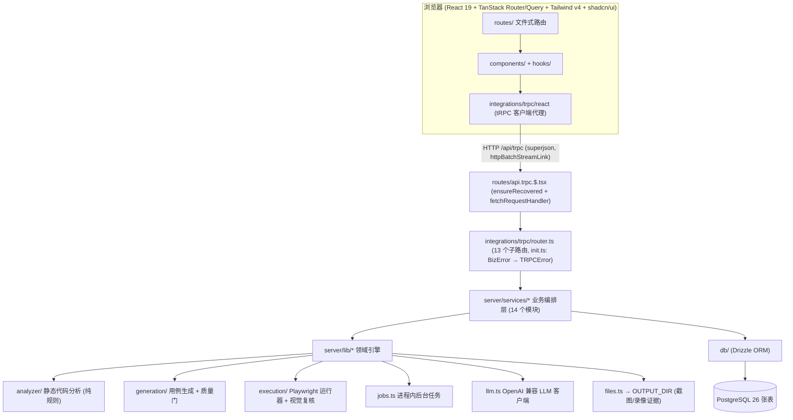

# 架构总览

## 分层视图



- **服务层** (`src/server/services/`, 14 个模块): projects、analysis、requirements、incremental、testcases、case-review、generation、executions、workflows、coverage、mindmap、stats、reports、settings, 负责业务编排与持久化, 是 tRPC 路由唯一直接调用的层。
- **领域引擎** (`src/server/lib/`): 纯逻辑, 不直接暴露给前端——`analyzer/` (扫描与代码分析)、`generation/` (规则/LLM 用例生成、测试点、质量门)、`execution/` (Playwright 运行器、视觉复核)、`evaluation/metrics.ts` (离线评估指标), 以及横切的 `jobs.ts`、`llm.ts`、`files.ts`、`coverage.ts`、`mindmap.ts`、`text-list.ts`。
- 体量最大的四个文件: `services/workflows.ts` (约 3400 行, [七阶段流水线](./pipeline)编排)、`services/incremental.ts` (约 3000 行, 增量需求分析)、`lib/generation/rule-cases.ts` (约 1300 行, 规则用例)、`services/executions.ts` (约 1100 行, 执行服务)。
- **数据层** (`src/db/schema.ts`): 单文件 Drizzle schema, 共 26 张 PostgreSQL 表, 详见[数据模型](./data-model)。

## 路由与请求入口

TanStack Start 全栈应用, `src/routes/` 文件式路由 (由 `tsr generate` 产出 `routeTree.gen.ts`) 同时承载 UI 页面与 server API:

- **UI 路由**: `/`、`/dashboard`、`/projects`、`/projects/$projectId`、`/projects/$projectId/cases/$caseId`、`/testcases`、`/executions`、`/executions/$executionId`、`/pipeline`、`/pipeline/$runId`、`/settings`;
- **项目详情页** 9 个 Tab (Overview / Code analysis / Requirements / Incremental / Generation / Test cases / Mindmap / Executions / Coverage), Tab 状态写入 URL search 参数 `?tab=`;
- **API 路由** (server handler, 不渲染页面):
  - `api.trpc.$.tsx`: GET/POST 都进 `fetchRequestHandler`, endpoint 为 `/api/trpc`; handler 第一行调用 `ensureRecovered()` (见下文启动恢复);
  - `api.files.$.tsx`: GET, 回源 `OUTPUT_DIR` 下的执行证据文件;
  - `api.report.$.tsx`: GET, 按请求动态构建 HTML 报告 (`buildProjectReport` / `buildExecutionReport`), 路径形如 `/api/report/project/:pid?requirementId=&workflowRunId=` 与 `/api/report/execution/:eid`。

tRPC 客户端在 `integrations/tanstack-query/root-provider.tsx` 中创建: `httpBatchStreamLink` + superjson 转换器, URL 为同源 `/api/trpc`; `createTRPCOptionsProxy` 把类型安全的 `queryOptions/mutationOptions` 代理注入 Router context, `setupRouterSsrQueryIntegration` 打通 SSR 数据脱水/注水。前端组件结构与状态管理见[前端架构](./frontend)。

## 一次典型请求的数据流

以「触发代码分析」为例:

1. 用户在 `AnalysisTab` 点击按钮 → `useMutation(trpc.analysis.trigger.mutationOptions())`;
2. tRPC 客户端经 `httpBatchStreamLink` 把请求发到 `/api/trpc` (`src/routes/api.trpc.$.tsx`);
3. `router.ts` 的 `analysis.trigger` 过程调用 `services/analysis.ts` 的 `triggerAnalysis(pid)`: 校验项目是 `local_path` 类型后, 先插入一条 `code_analyses` 行 (status=running), 再 `createJob("analysis")` + `runJob(...)`, **立即返回 `{ analysisId, jobId }`**;
4. 前端 `onSuccess` 里 `setJobId(result.jobId)`, 由 `useJobPoller(jobId)` 轮询 `trpc.jobs.get` (服务端落到 `executions.ts` 的 `getJobState` → `jobs.ts` 的 `getJob`);
5. 后台任务执行 `runAnalysis`: 扫描源码树 → 按技术栈分派 Spring/Go 后端分析与 Vue/Lit 前端分析 → 抽取状态机 → 写 `code_analyses`、`state_machines` 表并回填 `projects.techStack`;
6. 任务进入终态后, 前端在 `useEffect` 中弹 toast、`invalidateQueries(trpc.analysis.latest.queryKey())`、清空 jobId, 界面自动刷新。

> 关键模式: **「变更即启动任务并返回 jobId, 客户端轮询任务状态」**。所有耗时操作 (分析、生成、批量执行、流水线、增量分析) 都走这套异步任务机制, 避免长请求阻塞。

### 同步查询 vs 异步任务

- **同步查询 (query)**: 读取类、轻量, 直接返回数据。如 `projects.list`、`testcases.get`、`analysis.latest`、`coverage.matrix`、`stats.overview`、`mindmap.tree`;
- **异步任务 (mutation → jobId → 轮询)**: 耗时操作。全仓共 8 种 job kind: `analysis`、`requirement-analysis`、`generation`、`incremental-generation`、`execution`、`batch-execution`、`llm-review`、`workflow`;
- 个别操作同时提供两种形态: `generation.start` (异步) 与 `generation.generateSync` (同步)、`executions.runSingle` 与 `executions.runSync`、`incremental.generate` 与 `incremental.generateSync`, 供流水线内部复用与调试脚本直调。

## 后台任务系统 (jobs.ts + useJobPoller)

`src/server/lib/jobs.ts` 是一个**进程内**任务注册表 (非持久化队列): 内部是 `Map<string, JobState>`, 上限 `MAX_JOBS = 500`, 超限时按 `updatedAt` 淘汰最旧的一半终态任务以约束内存。持久化结果永远落在数据库里, 注册表只承载 UI 进度。

- `createJob(kind, total = 0)`: 登记任务, 返回 `JobState`——字段为 id (uuid hex)、kind、status (`pending | running | completed | failed`)、message、current、total、可选 result/error、createdAt/updatedAt (毫秒时间戳);
- `runJob(jobId, task)`: fire-and-forget 执行器, 先置 running, 任务函数拿到 `report(message, current?, total?)` 回调上报进度, 结束时自动推进到 completed/failed, **任务异常只被捕获记录, 永不向上抛**;
- `updateJob` / `progressJob`: 打补丁式更新进度与消息;
- `getJob(id)`: 查询状态, 由 tRPC `jobs.get` 暴露给前端。

前端配套 (`src/hooks/use-job-poller.ts`):

- `useJobPoller(jobId, intervalMs = 1200)`: 用 TanStack Query 轮询 `trpc.jobs.get`, `refetchInterval` 在任务进入终态 (completed/failed) 后返回 `false` 自动停止; 返回 `job`、`isRunning`、`isTerminal`、`isCompleted`、`isFailed`、`progress` (current/total, total 为 0 时是 null)、`isLoading`、`error`、`message`;
- `useJobCompletion(jobId, onDone)`: 任务终态时**恰好触发一次** `onDone`。

**完成副作用必须放在 useEffect 中**: 各 Tab 组件 (AnalysisTab / RequirementsTab / GenerationTab / IncrementalTab) 在任务终态时弹 toast、失效查询、清理 jobId。副作用包在 `useEffect` 中并用 `finishedRef` 按 jobId 去重, 确保 React StrictMode 双调用下不会重复触发:

```tsx
const finishedRef = useRef<string | null>(null);
useEffect(() => {
  if (job.isTerminal && jobId && finishedRef.current !== jobId) {
    finishedRef.current = jobId;
    if (job.isFailed) toast.error(job.error ?? "Analysis failed");
    else toast.success("Code analysis complete");
    queryClient.invalidateQueries({
      queryKey: trpc.analysis.latest.queryKey(),
    });
    setJobId(null);
  }
}, [job.isTerminal, job.isFailed, job.error, jobId]);
```

### 启动恢复 (bootstrap.ts)

任务是进程内的, **服务重启会丢掉运行中的任务**, 数据库里的 pending/running 行会成为「幻影进行中」。`src/server/bootstrap.ts` 的 `ensureRecovered()` 在重启后的**第一个 tRPC 请求**上懒执行 (幂等, 失败可重试), 并行跑四个恢复函数:

- `recoverInterruptedRuns()` (workflows): 只回收**闲置超过 7200 秒**的 pending/running 流水线——以 run/stage 最新时间戳作为活动标记, 避免多 worker 同时启动时误杀别的进程正在跑的任务; 回收时 running stage 标 `failed`、pending stage 标 `skipped`, 并顺手校正「父 run 已结束但 stage 还挂着」的历史脏数据;
- `recoverInterruptedExecutions()`: running 的执行记录标 `failed` (errorCategory=ENV_ERROR), 并把对应用例的 `executionStatus` 从 running 回写为 failed;
- `recoverInterruptedAnalyses()`: running 的代码分析行标 `failed`;
- `recoverInterruptedIncrementalRuns()`: analyzing/generating 的增量运行标 `failed`。

流水线细节见[七阶段流水线](./pipeline), 执行细节见[浏览器执行](./execution)。

## 错误处理: BizError → TRPCError

- 服务层抛出 `BizError(code, message)` (定义于 `services/settings.ts`), 例如 `new BizError(40030, 'Profile name is required')`、`new BizError(40408, 'Job not found: ...')`;
- `integrations/trpc/init.ts` 的错误中间件挂在每个 `publicProcedure` 上统一捕获:
  - `Math.floor(code / 100) === 404` → `NOT_FOUND`;
  - 其余 → `BAD_REQUEST`;
  - 非 `BizError` 原样上抛;
- 客户端收到稳定的错误消息, 前端统一 `onError: (e) => toast.error(e.message)`。完整过程清单见 [API 参考](./api)。

## 证据文件服务 (/api/files/$ 与 /api/report/$)

- 执行证据 (截图、录像) 以**绝对路径**存于 `OUTPUT_DIR` (由 `server/env.ts` 解析, 默认 `./outputs`), 数据库存绝对路径;
- 在**读取边界** (`server/lib/files.ts` 的 `toFileUrl`) 才把绝对路径转成 `/api/files/...` URL——先 `path.relative(outputDir, absPath)` 校验没有逃逸, 再对每段做 `encodeURIComponent`, **浏览器永远看不到服务器文件系统路径**;
- `api.files.$.tsx` 用 `resolveOutputPath` 反向解析: 逐段 decode 后 resolve, 结果必须落在 `outputDir` 根内 (路径穿越防护), 文件不存在或不是普通文件返回 404; 响应带 `contentTypeFor` 推断的 Content-Type (png/jpg/webp/gif/webm/mp4/html/md/json) 与 `Cache-Control: public, max-age=3600`;
- HTML 报告不落盘: `api.report.$.tsx` 每次请求由 `services/reports.ts` 现场构建自包含 HTML。

## LLM 客户端与档案 (llm.ts + settings)

- `llm_profiles` 表存文本/视觉两类模型档案 (name/kind/apiKey/baseUrl/model/enabled/isDefault, kind 取 `text` 或 `vision`), 每类可有多个档案但只有一个默认;
- 首次读取设置时 `ensureSeedProfiles()` 把 `LLM_*` / `LLM_VISION_*` 环境变量迁移进默认档案; 之后 **DB 档案优先, 环境变量兜底**: `getTextClient(profileId?)` 按「指定档案 → 默认 text 档案 → env」降级, `getVisionClient()` 按「默认 vision 档案 → 默认 text 档案 → env (vision 字段缺失时逐项回退 text)」降级;
- API 只回传打码 key (`abcd***wxyz`), 更新时把打码值原样传回表示「保留已存 key」;
- `server/lib/llm.ts` 的 `LlmClient` 封装 OpenAI 兼容 `POST {baseUrl}/chat/completions` (默认 base `https://api.openai.com/v1`、默认模型 `gpt-4o-mini`、temperature 0.2、240 秒超时), `available()` 判断是否配置了 apiKey; `LLM_EXTRA_BODY` 环境变量 (JSON) 会合并进每次请求体, 用于 provider 私有开关 (`model`/`messages` 字段始终忽略);
- **对 reasoning 模型与杂牌兼容端的鲁棒性**: content 支持字符串/分段数组/对象三种形态; content 为空时依次尝试 `reasoning_content`、`reasoning`、`thinking`、`analysis` 等推理字段; GLM-5.2/5.3 自动附加 `reasoning_effort=low`; `finish_reason=length` 时加倍 token 预算重试一次 (上限 32768); json_mode 被拒 (400/422) 自动降级 plain 模式并剥离扩展参数重试; JSON 解析容忍代码围栏、前后散文、尾逗号、截断与多个 JSON 片段 (优先业务包装键如 `testCases`、`verdict`);
- **优雅降级**: 任何不可恢复失败 (缺 key、超时、429、无最终答案、非法 JSON) 都抛 `LlmUnavailableError`, 调用方回退到确定性规则模式——生成退回规则用例、视觉复核记为 `unavailable` 交人工、结果分析退回规则结论;
- `settings.testLlm` 做连通性测试: text 档案发纯文本 ping, vision 档案**必须真发一张 1x1 PNG 图片**, 防止纯文本 ping 在拒图模型上假报「视觉可用」。

## Sentry 监控 (可选)

- `instrument.server.mjs` 在服务端启动时初始化 `@sentry/tanstackstart-react`: 读取 `VITE_SENTRY_DSN`, 未配置则打印警告并跳过; 配置了则以 `tracesSampleRate: 0.1`、`dataCollection: { userInfo: false, httpBodies: [] }` 启动;
- 加载方式是 Node 的 `--import` 预加载钩子: dev 脚本经 `NODE_OPTIONS='--import ./instrument.server.mjs'` 注入, 生产 `pnpm start` 执行 `node --import ./.output/server/instrument.server.mjs .output/server/index.mjs`;
- `pnpm build` 在 `vite build` 之后把 `instrument.server.mjs` 拷进 `.output/server`; `vite.config.ts` 中 Nitro 的 `rollupConfig.external` 把 `@sentry/*` 标记为外部依赖, 由 Node 运行时直接解析。

## 构建与配置

- `vite.config.ts`: 插件链为 devtools + nitro + tailwindcss + tanstackStart + viteReact + babel (React Compiler preset), 并开启 `resolve.tsconfigPaths`;
- `package.json`: `imports` 声明 `#/*` → `./src/*`; 常用脚本 `dev` (dotenv 加载 `.env.local`, 端口 3002)、`demo-site` (内置被测演示站 `scripts/demo-site/server.mjs`)、`e2e` (`scripts/e2e.mts`)、`db:generate/migrate/push/pull/studio` (drizzle-kit);
- `tsconfig.json`: target ES2022、strict、`noUnusedLocals`、`noUnusedParameters`、`verbatimModuleSyntax`、bundler moduleResolution、路径别名 `#/*` 与 `@/*`;
- `drizzle.config.ts`: schema 指向 `./src/db/schema.ts`, 迁移输出 `./drizzle`, dialect postgresql, 从 `.env.local`/`.env` 读取 `DATABASE_URL`; 运行时 `db/index.ts` 用 `drizzle(process.env.DATABASE_URL!)` 直连;
- `components.json`: shadcn new-york 风格、zinc 基色、CSS 变量、别名 `#/components`、`#/lib/utils`, 图标库 lucide;
- `tsr.config.json`: TanStack Router 代码生成 target 为 react;
- 服务端环境变量集中在 `server/env.ts` 的 `serverEnv`: `OUTPUT_DIR` (默认 `./outputs`)、`TARGET_URL_DEFAULT` (默认 `http://127.0.0.1:8200`, 内置演示站地址)、`LLM_API_KEY/BASE_URL/MODEL`、`LLM_VISION_*`、`LLM_EXTRA_BODY`; 客户端变量经 `@t3-oss/env-core` 校验, 强制 `VITE_` 前缀。逐项说明见 [API 与配置参考](./api)。
