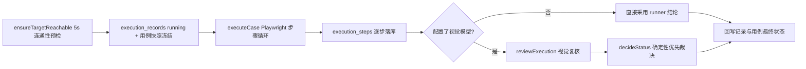

执行域是「绝不伪造绿色」原则的物理落点: Playwright 真实浏览器执行 + 三层断言 + 视觉复核 + 确定性优先的状态裁决. 三个核心文件:

| 文件                                        | 规模       | 职责                                                           |
| ------------------------------------------- | ---------- | -------------------------------------------------------------- |
| `src/server/lib/execution/runner.ts`        | 约 500 行  | 单用例浏览器执行: 步骤引擎、选择器回退、断言、截图与录像       |
| `src/server/lib/execution/vision-review.ts` | 约 400 行  | 视觉模型对执行结果的截图复核                                   |
| `src/server/services/executions.ts`         | 约 1000 行 | 执行服务: 连通性预检、持久化、状态裁决、批量任务、人工/AI 复审 |

## Playwright 运行器 (runner.ts)

文件头自述: **uiSelector 映射 + 五级回退 + 三层断言 + 截图与录像**. 两条铁律 (源码注释):

- **没有假绿**: 无法验证的一律标记 skipped, 绝不因「没报错」而判 passed;
- **失败分类**只使用六个 `ERROR_CATEGORY` 枚举值.

入口为 `executeCase(kase, targetUrl, outputDir)`: `chromium.launch()` 启动 Chromium, 上下文视口 1440×900 并开启录像 (`recordVideo`); 页面默认超时与每次 click/fill 超时均为 `STEP_TIMEOUT_MS = 10_000` (10 秒). 证据文件落在按执行 ID 命名的子目录 (当前实现为 `OUTPUT_DIR/<executionId>/<executionId>/`): 每步 `step-NN-before.png` / `step-NN-after.png`, 录像因 Playwright 文件名随机, 在上下文关闭后统一改名为 `video.webm`.

### 四种结构化步骤

| type           | 行为                                                                                                                                                                                                                                                                                                     |
| -------------- | -------------------------------------------------------------------------------------------------------------------------------------------------------------------------------------------------------------------------------------------------------------------------------------------------------- |
| `ui_action`    | 三分支: `uiSelector.type === "route"` 时导航 (targetUrl 拼接 route 值后 `page.goto`, 响应 ≥ 400 抛 `NAVIGATION_FAILED`, 随后等 300ms); 命中 `REFRESH_RE` (`refresh the page` / `refresh the browser` / `reload`, 不区分大小写) 时走 `reloadAndVerify` 刷新校验; 否则经回退链定位后 click, 点击后等 300ms |
| `input`        | 必须同时具备 `uiSelector.value` 与 `inputValue` (缺失抛 `CASE_INVALID`); 经回退链定位后 `fill` 变量展开后的输入值                                                                                                                                                                                        |
| `capture`      | 用 `pattern` 正则在 body 文本中抓取运行时变量 `variable`: 有捕获组取 `match[1]`, 否则取整段匹配 `match[0]`; 变量名或正则非法抛 `CASE_INVALID`, 页面上匹配不到抛 `ASSERT_FAILED`                                                                                                                          |
| `state_assert` | 执行三层断言 (见下); 若 action/expected 含刷新语义则先执行 `reloadAndVerify`; 断言前等待 800ms 让导航/渲染落定                                                                                                                                                                                           |

未知步骤类型抛 `CASE_INVALID`.

### 运行时变量

`VARIABLE_RE` 匹配 `${name}`、`${name+1}`、`${name-1}`, 在 `input` 的输入值与 `state_assert` 的预期值中展开: 变量未被前置 `capture` 步骤捕获, 或做 `±` 运算而基值不是整数, 都抛 `CASE_INVALID`. 这是[计数断言归一化](./generation)的执行侧支撑——生成期把「固定总数」断言改写为 `capture` 基线 (如 `base_count`) + `${base_count+1}`, 执行期才抓取真实基线完成动态校验.

### 五级选择器回退链 (fallbackChain)

定位失败是脚本脆弱性的主因, 运行器按「由精确到宽泛」的顺序构造候选选择器; `findLocator` 逐个尝试, 取第一个 `count() > 0` 且 `isVisible()` 的 `.first()` 匹配, 全部尝试过的选择器记录在 `attempted` 中 (失败时随错误信息落库, 便于排查):

1. **精确 uiSelector 匹配**: 按 `uiSelector.type` 映射——`placeholder` 映射为 `[placeholder="v"]`; `label` 映射为 `label:has-text("v") >> xpath=following::input[1]`; `role` 映射为 `[role="v"]`; `testid` 映射为 `[data-testid="v"]`; `css`/`xpath` 原样使用; `text` 特殊, 映射为 `button`/`a`/`[role="button"]`/`input[value]`/`summary` 的 `:has-text` 组合;
2. **target 文案在按钮类元素上**: `button`/`a`/`[role="button"]` 的 `:has-text(target)`;
3. **Element Plus 下拉选项**: `[role="option"]`、`.el-select-dropdown__item` (及其内层 span) 的 `:has-text(target)`——el-select 的选项渲染在挂载到 body 的 popper 层里, 无法从触发器到达;
4. **target 文案在全页任意位置**: `body :not(option):not(script):not(style):has-text(target)`;
5. **normalize-space XPath**: `//button[normalize-space(.)="target"]` (两个词的按钮渲染时可能带间隙).

全部失败抛 `SELECTOR_NOT_FOUND`——诚实失败, 进入失败分类.

### 三层断言 (doAssert)

源码注释: "Three-layer assertion: URL -> quoted text anchors -> honest skipped":

1. **URL 断言**: 预期文本命中 `/URL|redirect|route|page address|\/[\w/]+/i` 时, 用 `/(\/[\w/{}]+)/` 提取路径并检查 `page.url()` 是否包含它, 命中即 passed (证据 `URL hit: <path>`); 未命中**不判失败**, 继续下一层;
2. **引号文本锚点断言**: `QUOTE_ANCHOR_RE` (`/["“]([^"”]+)["”]/g`, 直引号与弯引号均可) 提取预期中双引号内的锚点, 在 body `innerText` 中逐一精确查找: 全部命中 → passed (证据 `Text anchors hit: ...`); 有缺失 → failed (错误信息列出缺失锚点);
3. **诚实 skipped**: 既无可验证 URL 也无引号锚点 → skipped, 证据不足, 不判通过也不判失败.

### 刷新校验 (reloadAndVerify)

刷新是截图「看不见」的动作, 运行器因此不信任调用本身: `page.reload({ waitUntil: "load" })` 后读取 Navigation Timing (`performance.getEntriesByType('navigation')`), 最后一条 entry 的 `type` 不是 `reload` 就抛 `NAVIGATION_FAILED`. 成功时步骤记录的 action 追加 `(browser reloaded: performance.navigation.type=reload)`, target/selectorUsed 写入 `browser.reload`——这条客观证据供视觉复核直接引用.

### 步骤证据与整体结果

每步记录 before/after 截图 (截图失败降级为 null 而不中断执行)、实际使用的选择器、耗时 `durationMs` 与结果; 断言与抓取证据拼进 action 字段 (`(assertion evidence: ...)`、`(variable evidence: capture name=value)`), action/target 截断 255 字符、selectorUsed 截断 500 字符. **遇到第一个 failed 步骤即终止循环**, 不再执行后续无意义的步骤.

整体状态汇总: 有 errorCategory → failed; 任一步 failed → failed; 任一步 skipped → skipped; 否则 passed. 没有结构化步骤的用例直接 failed (`CASE_INVALID`); 浏览器启动失败等非业务异常整体归 `ENV_ERROR`.

### 错误分类 (ERROR_CATEGORY)

| 码                   | 含义                                                              |
| -------------------- | ----------------------------------------------------------------- |
| `SELECTOR_NOT_FOUND` | 回退链全部失败, 找不到可操作元素                                  |
| `ASSERT_FAILED`      | URL 或引号锚点断言未满足, capture 抓取落空                        |
| `NAVIGATION_FAILED`  | 页面打不开、目标返回 4xx/5xx, 或刷新未通过 Navigation Timing 校验 |
| `TIMEOUT`            | 步骤超时                                                          |
| `CASE_INVALID`       | 用例缺少结构化步骤/输入/选择器等必要字段, 或变量/正则非法         |
| `ENV_ERROR`          | 浏览器启动失败等非业务环境问题                                    |

归类规则: `StepError` 自带类别; Playwright `TimeoutError` 归 `TIMEOUT`; 其余未知异常在 route 导航步骤归 `NAVIGATION_FAILED`, 否则归 `ENV_ERROR`; 整场执行只记录**第一个**错误类别.

## 执行服务 (executions.ts)

文件头注释给出状态裁决总纲: **确定性执行结论优先**——AI 复核可以确认通过或升级人工复核, 但绝不能把确定的 failed/cancelled 翻成 passed; 只有当原始执行没有确定失败时, AI 的 `ok` 才允许把 skipped (缺文本锚点) 升级为通过.

### 执行前连通性预检 (ensureTargetReachable)

创建任何记录或任务之前, 先对目标 URL 发起 5 秒超时的 `fetch` (`AbortSignal.timeout(5000)`, 跟随重定向): URL 为空、连接失败/超时、或响应状态 ≥ 400 都抛 `BizError(40029)`, 不启动浏览器、不留 running 记录——不可达的目标绝不会产生空截图的假执行. 目标 URL 解析顺序 (`resolveTargetUrl`): 显式入参 → 项目配置 `targetUrl` → 环境变量 `TARGET_URL_DEFAULT` (默认 `http://127.0.0.1:8200`), 末尾斜杠去除.

### 单用例执行 (runCaseExecution)

1. 写 `execution_records`: ID 为 `EX-xxxxxxxx` (uuid 前 8 位), status `running`, 必填 `testCaseSnapshot` 冻结执行时刻的完整用例快照 (用例被改名或删除后历史仍可读); 同步把 `test_cases.executionStatus` 置 `running`;
2. 写 `execution_requirements`: 冻结关联需求的 id/version/name (1:1 唯一索引), 供追溯执行对应的需求版本;
3. 调 runner `executeCase`, 把每一步写入 `execution_steps` (截图/录像存**磁盘绝对路径**);
4. 视觉模型可用时执行 `reviewExecution` 并 `persistReview` 落库, 再由 `decideStatus` 裁决最终状态; 未配置视觉模型时直接采用 runner 结论;
5. 回写记录: 最终状态、`endTime`/`durationMs`、`errorCategory`/`errorMessage` (无整体错误信息时取第一个 failed 步骤的 error)、`videoPath`、`passedSteps`/`totalSteps`, 并同步 `test_cases.executionStatus`;
6. 中途抛异常时 `markExecutionInterrupted` 补偿性地把记录置为终态 failed (`ENV_ERROR`), 绝不留下幽灵 running.

### 状态裁决 (decideStatus)

| 原始状态           | AI verdict = ok         | suspect / unavailable   |
| ------------------ | ----------------------- | ----------------------- |
| failed / cancelled | 保持 failed / cancelled | 保持 failed / cancelled |
| passed             | passed                  | needs_review            |
| skipped            | passed                  | needs_review            |

`skipped + ok → passed` 是唯一的升级通道, 且只发生在原始执行没有确定失败时. 执行记录状态枚举: `running` / `passed` / `failed` / `skipped` / `needs_review` / `cancelled`, 展示元数据 (label/tone/description) 统一定义在 `src/lib/enums.ts` 的 `CASE_EXECUTION_STATUS_META`.

### 后台任务与批量执行

- `startSingleExecution` / `startBatchExecution` 经进程内 job 注册表 (`src/server/lib/jobs.ts`) 后台执行, 立即返回 `jobId` 供前端轮询进度;
- 批量执行上限 100 个用例 (超出抛 `BizError(40043)`, 空选择抛 `BizError(40040)`), 在单个 job 内**顺序**执行, 共享 `batchId`; 单用例异常被捕获进结果集, 不中断批次;
- `cancelBatch(batchId)` 置内存取消标志, 循环在**用例之间**检查后 break——未开跑的用例不产生任何记录;
- `startBatchLlmReview` 一次最多复核 20 条执行 (超出抛 `BizError(40044)`).

### 人工裁定与 AI 复审

- `manualReview(eid, { verdict, note })`: verdict 二选一 `passed`/`failed`, 写 `execution_reviews` (`reviewer = "manual"`, verdict 映射为 ok/suspect, note 截断 2000 字符), 并把执行记录状态**直接置为** passed/failed、同步用例状态;
- `llmReview(eid)`: 单条 AI 复审. 未配置视觉模型抛 `BizError(40041)`; **人工裁定被锁定**——已存在 `reviewer = "manual"` 的复核时抛 `BizError(40024)`, 需重新人工裁定才能变更; 复审读取数据库原始步骤行 (磁盘绝对路径——AI 直接读截图文件, 不能传 `/api/files` URL), 用 `originalStatusFromSteps` 从步骤结果还原确定性原始状态 (failed 优先, 其次 skipped, 全 passed 才 passed), 再套 `decideStatus`;
- `persistReview` 按 1:1 替换旧复核: 先删旧 `execution_review_images` / `execution_review_issues` / `execution_reviews` 行, 再写入新结论.

### 重启恢复 (recoverInterruptedExecutions)

执行只活在进程内存, 服务重启后 `bootstrap.ts` 调用该函数把仍处 `running` 的记录统一置为 failed (`ENV_ERROR`, "Interrupted by server restart; re-run the case", `durationMs` 按 startTime 补算), 并回写仍为 running 的用例状态——UI 永不显示幽灵执行.

### 查询与读取边界

- `listExecutions`: 支持 status/batchId/testCaseId/requirementId 过滤 (`__none__` 匹配「无关联需求」), `groupBy = "case"` 时每个用例只取最新一条执行并附全项目执行次数 `executionCount`; `pageSize` 默认 20、上限 200; 全部过滤在分页/分组**之前**完成;
- `listExecutionsForCase` / `getExecution` / `getExecutionSteps`: 明细与步骤查询, 复核信息 (逐图判定、issues、`recommendedAction`) 由 `reviewForExecutions` 批量装配; suspect/unavailable 且无结构化 issue 的 AI 复核会用 reason 合成一条显式复核要点, 提示人工确认;
- 读取边界统一用 `toFileUrl` 把磁盘绝对路径转成 `/api/files/...` URL, 路径逃逸 `OUTPUT_DIR` 时返回 null.

## 视觉复核 (vision-review.ts)

文件头规则:

- **未配置视觉模型** → 不复核 (返回 null), 执行保持原状态;
- **配置了但调用失败 / 返回结构非法 / 无可用截图** → verdict = `unavailable`, 交人工复核;
- 判断只依据截图与步骤记录; **证据不足一律 suspect, 绝不假通过**.

视觉客户端由 `getVisionClient` 解析: 优先默认 vision 档案 (需同时配置 model 与 apiKey), 回退默认 text 档案, 再回退环境变量 `LLM_VISION_*` / `LLM_*`; `available()` 只看 apiKey 是否存在.

### 关键截图挑选 (pickImages)

按优先级最多取 `MAX_IMAGES = 6` 张, 去重且要求文件存在、大小 ≤ `MAX_IMAGE_BYTES` (8MB): 失败步骤的 after/before → 最后一步 after → 各 `state_assert` 步骤 after → 第一步 after → 其余步骤 after 补齐. 每张图带 label (步骤序号、动作、结果) 供提示词引用.

### 复核提示词 (buildPrompt)

截图以 base64 data URL 随文本标签逐张发送, 调用 `chatJson` (上限 2500 token, 要求 JSON 输出). 提示词核心约束:

1. 只依据截图与步骤记录可见的信息判断, 不臆测未展示的内容;
2. 截图出现错误 toast、空白页、登录页、或与预期矛盾的页面/文案/数据 → suspect;
3. **尊重刷新证据**: 步骤记录明确含 "browser reloaded" 或 `performance.navigation.type=reload` 时视为客观刷新证据, 只用截图验证刷新后的页面状态, 不因刷新动作本身不可见而判 suspect; 仅当用例预期刷新、而步骤记录既无刷新动作也无 Navigation Timing 证据时才因缺失刷新判 suspect;
4. 截图不足以证明其他预期 (关键结果未捕获、图像模糊) → suspect, 不放过;
5. 只有截图清晰展示预期结果 (文案、列表数据、状态变化) 才判 ok; 不因步骤结果写着 passed 就判 ok, 必须亲自看图;
6. **确定性断言补充规则**: 步骤记录含 "assertion evidence: Text anchors hit" 或 "URL hit" 时, Playwright 已做过精确校验, 除非截图明确矛盾 (报错/空白/错页/相反状态), 不因分辨率或文案不显眼而判 suspect.

### 结论收敛 (normalizeVerdict)

模型须输出 JSON: 总体 `verdict`、≤120 词的 `reason`、逐图 `images[]` (image/verdict/analysis)、问题 `issues[]` (image/step/bbox/problem). 解析层做多重防御:

- 逐图 verdict 只接受显式 `ok`, 其余值 (含缺失) 一律按 suspect 计——分析缺失绝不等于截图健康;
- 总体 verdict 非法、存在 issue、任一图 suspect、或选送图片未被全部分析 (只分析了 N/M 张) → 强制降为 suspect, 降级原因追加进 reason;
- bbox 归一化 (`normalizeBbox`): 约定为相对图像左上角的 0~1 归一化坐标; 模型偶尔返回像素坐标时, 用直接解析 PNG 文件头得到的宽高 (`pngSize`, 无需图像库) 归一; x1 大于 x2 自动交换, 数值 clamp 到 0~1, 宽或高小于 0.02 的框丢弃.

落库: 汇总结论写 `execution_reviews` (reviewer 默认 `llm`), 逐图判定写 `execution_review_images`, 发现的问题写 `execution_review_issues` (含 bbox 定位). **视觉复核永远不能把确定性失败改成通过**; suspect/unavailable 结论经 `decideStatus` 把执行推向 `needs_review` (人工确认).

## 结果分析 (阶段⑥)

执行域产出的证据 (步骤记录、错误类别、视觉复核结论) 由 `buildEvidence` 汇总后进入流水线的结果分析: LLM 分类优先 (`resultAnalysisPrompt`), 不可用时退回规则分类 (`ruleAnalysis` + `buildRuleEvidence`); `guardAnalysis`/`hasGroundedEvidence` 守卫要求分类引用具体步骤/错误码/复核结论, 无接地证据的分类降级为 `unknown`. 结果只写 `workflow_result_analyses`, **绝不覆盖** `execution_records.status`. 分类取值与完整流程详见[七阶段流水线](./pipeline) ⑥.

## 证据存储与展示

- 证据 (截图/录像/报告) 存于 `OUTPUT_DIR` (环境变量, 相对当前工作目录解析, 默认 `./outputs`), 数据库存绝对路径;
- 读取边界 `toFileUrl` 把 `OUTPUT_DIR` 内的路径转成 `/api/files/...` URL (逐段 URI 编码, 逃逸目录返回 null); 文件由 `api.files.$.tsx` 路由服务: `resolveOutputPath` 解码并拒绝目录逃逸, 按扩展名返回 Content-Type (`contentTypeFor`), 附 `Cache-Control: public, max-age=3600`;
- 前端 `/executions` 按项目浏览执行 (按 case/execution 分组、状态与需求过滤、批量 AI 复核、进度轮询), 批量执行的取消入口在 `CasesPanel`; `/executions/$executionId` 展示步骤时间线、前后截图对比 (`ScreenshotViewer`, 支持叠加 bbox 问题框)、录像播放、AI 复核逐图分析与问题标注、人工裁定入口. 详见[前端架构](./frontend).
