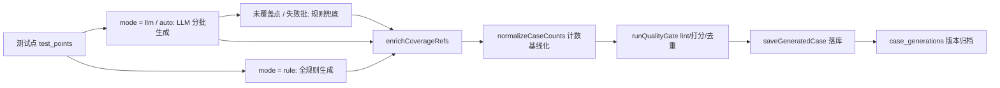

# 用例生成

用例生成覆盖流水线阶段②③④: 测试点抽取 → 用例生成 → 用例评审。生成引擎在 `src/server/lib/generation/` (6 个模块, 共约 3300 行), 编排入口在服务层: `requirements.ts` 负责测试点抽取与持久化, `generation.ts` 负责用例生成与版本归档, `workflows.ts` 驱动评审 (完整流程见[七阶段流水线](pipeline))。

| 模块                 | 行数    | 职责                                                      |
| -------------------- | ------- | --------------------------------------------------------- |
| `test-points.ts`     | 约 700  | Agent 1: 从 PRD + 代码事实抽取测试点 (LLM 优先, 规则兜底) |
| `rule-cases.ts`      | 约 1330 | 纯规则用例生成器 (项目级 + 按测试点, 零 LLM)              |
| `llm-cases.ts`       | 约 480  | Agent 2: 按测试点分批的 LLM 用例生成                      |
| `count-assertion.ts` | 约 250  | 固定计数断言 → 运行时基线改写                             |
| `quality-gate.ts`    | 约 340  | 质量门: lint / 打分 / 去重 (零 LLM)                       |
| `prompts.ts`         | 约 210  | 五个英文提示词模板 (测试点/用例/评审/修复/结果分析)       |

## 共享契约

生成链路上下游共用 `src/lib/types.ts` 的结构化类型:

- **测试点 `TestPointDraft`**: `title / category / priority / description / pageRoute / endpoint / fields[] / expected / source / confidence`。类别白名单 `functional / negative / boundary / state / api / permission`, 优先级 `P0 / P1 / P2`, `source` 取 `llm` 或 `rule`;
- **用例内存态 `GeneratedCase`**: 在测试点字段之外增加 `module / type / preconditions / steps / expectedResults / structuredSteps / testData / coverageRefs / qualityScore? / lintIssues? / testPointId?`。`type` 取 `positive / negative / boundary / state`; `source` 取 `rule / ai / manual / import`, 生成链路只写前两种;
- **结构化步骤 `StructuredStep`**: `{ order, type, action, target, uiSelector: { type, value }, expected?, inputValue?, variable?, pattern? }`, `type` 取 `ui_action / input / state_assert / capture`;
- **选择器白名单**: `uiSelector.type` 只允许 `route / placeholder / text / label / role / testid`。`css / xpath` 无法在代码事实中验证, 生成链路直接拒收, 评审阶段同样拦截;
- **锚点约定**: 断言用双引号引用页面可见文案, 如 `expect "Order created successfully"`。`quotedAnchors` 同时识别直双引号与弯双引号, 运行器按同一约定提取文案; 每条断言只允许恰好一个锚点。

## 阶段②: 测试点抽取

编排在 `services/requirements.ts`: tRPC `requirements.analyze` (入参 `rid / mode / profileId`, mode 默认 `auto`) → `startRequirementAnalysis` 创建 `requirement-analysis` 后台 job 并返回 `jobId`。job 本体先 `parsePoints` 再 `savePoints`:

- `parsePoints(req, mode, profileId)`: 通过 `getGenerationContext` 加载代码事实 (尚无成功分析时容错为空事实, 仅靠 PRD)。`mode = llm/auto` 且文本 LLM 可用 (`client.available()`, 即配置了 API Key) 时走 `extractPointsLlm` (PRD 内容截断至 12000 字符进提示词); 抛 `LlmUnavailableError` (无 Key/限流/HTTP 错误/回复解析不出 JSON) 或产出为空时降级 `extractPointsRule` 规则抽取; 其他异常向上抛出, 需求状态置 `failed`。结果统一再过一遍 `filterStaticStructurePoints`;
- `savePoints`: 全量替换——先删掉该需求版本的旧测试点, 再按 `seq` 从 1 递增逐条写入 `test_points` 表, 最后把需求状态推进为 `ready`;
- 需求内容变化 (`updateRequirement` / `uploadRequirementPrd`) 会作废旧产物: 删除测试点、删除 `rule/ai` 来源的生成用例并解除全部 `requirement_cases` 映射, 状态回到 `draft`。

### LLM 抽取 (extractPointsLlm)

提示词 `testPointsPrompt` 的硬约束: 只准引用代码事实中真实存在的路由/字段/接口/文案; 至多 30 个点; P0 只留给核心正向路径; 一个测试点只描述一个场景一个可观察结果; 边界校验必须拆成「合法边界」与「越界值」两个点; `expected` 恰好包含一个双引号锚点, 不得是裸状态词或按钮名; 禁止静态结构/固定计数点; 每个测试点必须能通过 UI 验证。调用 `client.chatJson(messages, 8192, jsonMode=true)`。

喂给提示词的代码事实摘要由 `factsForPrompt` 压缩: 页面 (name/route/字段的 label/prop/type/required/placeholder/rules)、前 60 个 endpoint (method/path/controller)、前 40 条 uiTexts、状态机状态标签与 `from -> to (trigger)` 迁移列表。

### 归一化与静态结构过滤

`normalizePoints(raw, source)` 把 LLM 输出 (dict 的 `testPoints` / `points` / `data` 键, 或直接数组) 收敛为 `PointInput[]`:

- 至多 40 条, 按 title 去重;
- 字段截断: title 255、description 2000、pageRoute/endpoint 255、fields 至多 20 个 (每个 80 字符)、expected 1000;
- 类别不在白名单回落 `functional`, 优先级回落 `P1`;
- confidence 缺失时按来源取默认值 (`llm` 0.85 / `rule` 0.7), 并 clamp 到 0~1。

`validatePoints` 过滤结构非法条目——不合格的点直接丢弃, 绝不落库。`isStaticStructurePoint` 拒绝「新建订单页展示 5 个表单字段」「列表默认显示 4 条种子订单」这类静态结构点: 命中计数正则 (`STATIC_STRUCTURE_RE` / `BARE_FIELD_COUNT_RE`), 或「结构性标题词 (first row / sort / action column / display…) + 裸状态标签 expected (Pending Payment / Pay / Submit…)」组合。这类计数随页面和数据漂移, 属于业务场景与运行时基线, 不是业务测试点。

### 规则兜底 (extractPointsRule)

从 PRD 文本 + 代码事实做确定性抽取, 输出上限 40 条:

1. **候选行**: 逐行清洗 (去 markdown 标题、列表符、序号、checkbox、加粗与代码标记), 取长度 6~160、命中动作/负向/边界/状态四类词表、跳过标题行与目录/修订记录等前缀的行, 至多 18 行;
2. **分类** (`ruleCategory` 优先级): 边界词 → `boundary`; 负向词 → `negative`; 含状态机 trigger 的词首匹配且未被否定 → `state` ("cannot be cancelled" 描述的是禁止迁移, 不是可执行的 state 点); 否则 `functional`;
3. **页面绑定** (`matchPage`): list/search/query/filter 行优先挂到 list 页; 其余按页面名 (+3)、route (+3)、路由词元 (+1) 打分取最高; 未匹配到页面的 state 点回落到 list 页 (Pay/Ship 按钮在列表上);
4. **优先级与期望**: functional/state 行含 submit/pay/ship/refund/create/login → `P0`, 否则 `P1`; PRD 行内显式引号文案 (2~60 字符) 直接作断言锚点, 否则取 uiTexts 中第一条含 "success" 的文案 (兜底 `"Operation successful"`);
5. **代码事实补全**: 对 PRD 已覆盖的页面补一条正向提交点与至多 4 条必填字段空值校验点; PRD 未产出任何点时, 用后端 `size/pattern/max/min` 约束生成至多 10 个边界点; 对 verified 且 trigger 未被文本覆盖的迁移补 P0 state 点 (仅当 PRD 无产出、或 PRD 已含 state 点时)。

## 阶段③: generateCases 三种模式

入口 `services/generation.ts` 的 `generateCases(pid, { mode, requirementId, profileId }, report)`: tRPC `generation.start` 经 `startGeneration` 把它作为 `generation` 后台 job 运行并返回 `jobId` 供轮询; `generation.generateSync` 是同步版本; 流水线阶段③也直接复用 `generateCases`。`mode` 取 `auto / rule / llm`, 默认 `auto`。

前置检查: 无成功代码分析 → `BizError 40010` ("Run code analysis before generating cases"); 指定了需求版本但没有测试点 → `BizError 40011` (先解析需求)。

### 需求级生成: LLM 先行, 规则兜底

- `mode = llm/auto` 且 client 可用 → `generateLlmCasesForPoints` 按测试点分批生成; 有产出则 `actualMode = "llm"` (mode 字段反映实际产出来源);
- LLM 调用抛错 → 记录 `fallbackReason` ("LLM call failed: …"), 整个需求降级为规则模式;
- 未配置可用文本 LLM → `fallbackReason = "No usable text LLM configured; using rule generation"`;
- 无论成败, 对 LLM 产物未覆盖的测试点 (`testPointId` 不在 covered 集合中) 调 `generateRuleCasesForPoints(missing, ...)` 逐点补齐。

### 项目级生成 (未指定需求版本)

`generateRuleCases` 全量产出四类规则用例; `mode = llm/auto` 且 client 可用时追加调用 `generateProjectCasesLlm` (单次调用、项目级提示词、confidence 0.8), LLM 产物排在前面。

### 后处理与空门保护

合并后的用例依次经过: `enrichCoverageRefs` (覆盖引用富化) → `normalizeCaseCounts` (计数基线化, `drop` 的用例直接跳过不保存; `changed` 时把改写后的 structuredSteps/expectedResults/steps/preconditions 回写) → `runQualityGate` (质量门)。

**空门保护**: 只有本轮 `kept.length > 0` 才会清掉旧生成用例 (`clearGeneratedForRequirement` / `clearGeneratedForProject`); kept 为 0 且库里已有旧生成用例 (`countGeneratedFor*` 大于 0) 时什么都不删, 返回 `preservedExisting = true` 并报告 "Generated 0 usable cases; keeping the existing cases"——质量门全灭时, 旧用例仍是最有价值的产物, 绝不被空结果清空。

返回值 `GenerationResult`: `generated / kept / dropped / dropReasons / byType / mode / requestedMode / llmCaseCount / ruleCaseCount / fallback / fallbackReason / generationId / requirementId / testPointCount / preservedExisting`。

## 规则用例 (rule-cases.ts)

两套生成器: 项目级 `generateRuleCases` 与按测试点 `generateRuleCasesForPoints`。共享的确定性基建: `FIELD_SAMPLE` 字段示例值启发式 (phone → `"15550100123"`、amount → `"100.00"`、email → `"test@example.com"`, 未知字段兜底 `"test data"`)、`MODULE_LABEL` 模块名映射、`TRIGGER_SUCCESS` 迁移成功文案、`newCase` 工厂 (默认 `source = "rule"`、`confidence = 1`)。断言步统一走 `atomicExpected`: 复合预期 (多锚点/嵌套引号/分号拼接) 不能作为单条断言, 必要时 `fallbackAnchor` 取最后一个锚点 (通常是错误提示)。

### 项目级四类生成器

- **genPositive**: 对每个含表单的页面, 填齐必填字段 (前端 `required` ∪ 后端 notblank/notnull/notempty/required 约束) → Submit → 断言成功文案。没有必填字段的表单 (如搜索框) 不产正向用例——"提交" 语义不成立;
- **genNegative**: 逐个必填字段留空、其余必填字段填齐 → Submit → 断言 `"{Label} cannot be empty"`;
- **genBoundaryWithConstraints**: 按字段聚合后端约束并按规则去重 (DTO 常重复实体约束)。`size` → 输入超长 N+1 字符, 断言 `"{Label} cannot exceed N characters"`; `pattern` → 输入 `"123"`, 断言 `"{Label} format is invalid"`; `max`/`min` → 输入限值 ±1, 断言 `"{Label} is out of range"`;
- **genState**: 只处理 `verified` 迁移。用 `bfsPaths` 从初始状态做 BFS 得到最短推进路径, 经 `triggerMap` 把路径翻译成前置点击序列 (复用真实按钮文案), 再执行本迁移的 trigger; 断言 `TRIGGER_SUCCESS` 文案 (Pay → `"Payment successful"`、Ship → `"Shipment successful"`、Cancel → `"Order cancelled"` 等, 未知 trigger 兜底 `"{Trigger} successful"`)——成功文案不存在于种子数据, 只有操作真的成功才会出现, 杜绝「假绿」。标题格式 `{Module}: {Trigger} ({from} → {to})`, `coverageRefs.transitionIds` 写入迁移 id。

### 按测试点生成 (generateRuleCasesForPoints)

按页面形态与测试点类别分派, 核心原则: **绝不给不支持提交的页面形态编造填表提交用例** (无事可提交, 或提交会打到错误接口):

- **统计页** (route 含 statistic/stats/dashboard) → 只打开页面断言稳定指标/文案;
- **批量操作点** (endpoint 或文本含 batch/bulk/select rows/checkbox) → 定位列表页做入口 smoke, 不编造行勾选或 API 注入步骤;
- **列表页** → 筛选类点 (含 filter/query/search/reset 等词, 且 endpoint 为空或 GET) 填至多 6 个筛选字段后点 Search/Reset; 其余做打开页面的文案 smoke;
- **state** → 复用项目级 BFS 状态用例: 先 `stripStateLabels` 去掉多词状态标签 (防止 "Pending payment" 里的 payment 误命中 Pay 触发器), 再按 trigger 词首匹配模板 (shipped/shipment 都能命中 Ship)。一个点可命名多条迁移 → 逐条克隆为独立用例, 各自保留迁移专属的成功断言 (刻意不用测试点的单一 expected 覆盖, 否则会对其他动作断言错误文案);
- **negative** → 测试点标题点名的字段优先; format/invalid 类点输入 `"123"` 而非留空; 至多产出 2 个字段的用例, 标题加 `(field)` 后缀保持可区分;
- **boundary** → 按约束拆成合法/越界两个用例: `size` 产「N 字符合法」+「N+1 字符超长」, `max`/`min` 产「限值合法」+「越界」, `pattern` 只产非法用例、仅当已知示例值能满足该 pattern 时才补合法用例 (绝不编造注定失败的正向)。产哪一侧由测试点 expected 的语义判定 (`expectsSuccess` / `ERROR_HINTS`);
- **functional / api / permission** → 填齐必填字段 (至多 8 个) → Submit → 断言;
- **匹配不到页面** → `genericPointCase`: 打开路由 + 断言两步 (confidence 0.5), precondition 标注需人工补全, 让测试点在用例列表里保持可追溯。

`finishPointCase` 最后把模板用例绑回测试点: 标题取测试点标题 (多用例时保留 `(字段)` 后缀)、priority/module/`testPointId`/`coverageRefs.testPointIds` 跟随测试点; 仅当测试点的 expected 能通过原子化 (`atomicExpected`) 时才覆盖模板断言——复合预期不得污染已拆分的单场景断言。

## LLM 用例 (llm-cases.ts)

`generateLlmCasesForPoints` 每 5 个测试点一批, 用 `testCasesByPointPrompt` + `client.chatJson(messages, 16384, jsonMode=true)` 生成。事实 JSON 由 `buildCaseFacts` 压缩: 页面字段 (required 取前端规则与后端约束的并集——后端校验注解才是 required/size 的可靠来源, Vue rules 常写在 `<script>` 里对前端解析器不可见)、前 120 条字段约束、前 80 个选择器、前 40 条 uiTexts、前 60 个 endpoint、状态机迁移。

提示词硬约束 (节选): `testPointId` 原样回显, 禁止编造; 只有 boundary 测试点允许输出 2 个用例, 其余点至多 1 个; 页面上每个 required 字段都必须给出具体 `inputValue` 并记入 `testData` (只填测试点提到的字段, 正向路径必然提交失败); 至多 8 步; 第一步必须打开页面 (route); `state_assert` 的 expected 与 uiSelector.value 各含恰好一个双引号锚点; 禁 css/xpath; 禁 API/数据库断言; 禁止硬编码列表总数——验证数量变化用 capture 步骤 + `${base_count+1}`, 或断言唯一行标识。

**批失败只降级该批**: 某批调用抛错 (典型场景: 推理模型把 token 预算烧在隐藏推理上, 始终吐不出 JSON) 时, 在 `runInfo` 记录 `fallbackReason` / `fallbackAt` 并中断循环——继续请求后面的批次只会让页面空转; 剩余测试点交给调用方的规则兜底, 已成功批次不受影响。

逐用例语义校验与质量门共用 `isCompoundExpected` / `quotedAnchors` / `stepsHaveMultipleInputs`——一套标准, 不是两套 ("one standard, not two"):

- `testPointId` 必须属于当前批次; 测试点自身 expected 是复合预期 → 跳过, 交给规则拆分 (LLM 倾向于二选一或合并);
- `normalizeSteps`: 至多 12 步、type 白名单、字段长度截断、order 重排;
- `hasUnsupportedUiStep`: 运行器只会填值/点击/断言, 表格选行或 API/数据注入步骤 (select the row / checkbox / inject data / call the api / send request 等关键词) → 整案拒绝, 交回规则生成;
- `uiSelector.type` 不在 `route/placeholder/text/label/role/testid` 白名单 → 拒绝;
- 任一 `state_assert` 的引号锚点数不等于 1 → 拒绝;
- 首步不是 route → 按测试点 `pageRoute` (缺省 `/`) 自动插入打开页面步;
- `expectedResults` 为空 → 用测试点 expected/title 兜底; 含复合预期或同字段多输入 → 拒绝。

产物 `source = "ai"`、`confidence = 0.85`, precondition 带需求版本, `steps` 取前 10 条动作摘要, `expectedResults` 取前 5 条。

## 计数断言归一化 (count-assertion.ts)

问题: 持久化测试数据下列表总数不是固定的 4/5, 断言 "total of 5 items" 在脏环境必然失败。正确做法是**操作前先读基线, 然后断言「基线 + 1」**。

`normalizeCaseCounts(kase, listRoutes)` 只处理结构清晰、可安全推导的场景, 三个条件全部满足才改写:

1. `state_assert` 步骤中恰好有一个计数断言 (且未含 `${`), 由三组正则匹配: `total/count/number of N items`、`total becomes/is/equals N`、`N items in total`;
2. 断言之前存在 create/add 类 `ui_action` (submit/create/add/save/new 关键词);
3. 列表路由唯一可判定——预期/步骤文本中恰好出现一个含 "list" 的显式路由, 或页面事实中恰好只有一个 list 路由; 多候选一律视为失败, 绝不在错误页面上建运行时基线。

满足时: 插入 `capture` 步骤 (`variable = "base_count"`, `pattern` 由 `countPattern` 从锚点生成空白容忍正则、含唯一捕获组, 运行器将其应用于页面正文), 首步未打开该路由时再前置一个打开列表页步骤, 重排 order, 把断言中的数字改写为 `${base_count+1}` (`expected` 与 `uiSelector.value` 同步), `expectedResults` 的固定数字句替换为 "the total increases by 1 item compared to before the operation", precondition 追加基线说明。

不满足则标记 `drop: true` 并注明原因——多个计数断言无法安全转换、无 create 动作可建基线 (建议改用唯一行标识或隔离数据)、找不到列表路由。`generateCases` 中被 drop 的用例直接跳过、不落库; 评审阶段 (workflows.ts) 用同一函数复核存量用例, 无法基线化的固定总数直接 reject。

## 质量门 (quality-gate.ts)

`runQualityGate(cases)` 做零 LLM 的确定性体检, 输出 `{ generated, kept[], dropped, dropReasons }`——**只有 kept 会被持久化**。四道门 (源码头注释 Gate 0~3), `dropReasons` 键集为 `no_expected / compound_expected / multiple_inputs / low_score / duplicate`:

- **Gate 0 一案一场景** (硬丢弃): `expectedResults` 为空 (no_expected); 复合预期 (compound_expected)——两个及以上引号锚点、锚点内嵌套引号 (运行器只会切出半句)、分号切分后每段都是不小于 4 字符的完整句; 同一字段先后填入两个不同值 (multiple_inputs)——两条断言可能各自通过, 但失败时无法定位元凶, 且证据只保留最后一次输入;
- **Gate 1 lintCase 语言体检** (写入 `lintIssues`): API 式描述 (call api / curl / postman / check database / check return value 等); `ui_action`/`input` 缺 `uiSelector`; `capture` 步缺 `variable` 或 `pattern`; 不可验证的视觉断言 (displays normally / as expected / works fine 等);
- **Gate 2 scoreCase 打分** (写入 `qualityScore`): 100 起扣——每个 lint 问题 -8 (封顶 -40); 每个缺 uiSelector 的操作/输入步 -10; `coverageRefs` 三组全空 -10; 步骤数超过 15 再 -10; 下限 0。分数低于 40 硬丢弃 (low_score);
- **Gate 3 相似度去重**: 指纹 `scenarioText` = 标题 + 全部步骤字段 (action/target/inputValue/expected/variable/pattern) + expectedResults 按 `|` 连接, 去空白转小写; `similarity = 2 × LCS / 两者长度和` (滚动数组 DP, 近似 difflib ratio); 相似度高于 0.95 判重, 按 qualityScore 降序保留高分者。两条保护: 同一测试点拆出的合法/越界用例期望不同, 互不判重; 不同测试点的用例即使步骤相同也互不判重——否则同页 smoke 用例会被并成一条, 测试点在覆盖率矩阵里丢失用例。阈值取 0.95 而非 0.85: 同类规则用例只差字段名, 0.85 会误杀 "receiver empty" 与 "phone empty" 这类正当区分。

## 覆盖引用富化与缺口自查

持久化前 `enrichCoverageRefs` 对每条用例调 `resolveCoverageRefs` (`lib/coverage.ts`) 补全 `coverageRefs`。显式引用永远优先 (人工/模型给出的精确事实胜过动作词推断), 推断只补接地于代码事实的高置信匹配:

- `endpointIds` 按优先级: ① 测试点 endpoint ("METHOD /path") 精确匹配; ② 用例文本包含 endpoint 路径; ③ 动作词别名表 (`ACTION_ALIASES`: create/list/pay/ship/cancel/refund/update/delete/login) 恰好命中一个 endpoint 时采信, 一个动作命中多个则歧义跳过;
- `ruleIds`: 规则 id 或 description 出现在用例文本、真实业务字段 (testData 键 ∪ 测试点 fields) 与规则文本共现、或状态动作词两侧匹配;
- `transitionIds`: verified 迁移的 trigger 出现在用例文本中;
- `testPointIds`: 直接取用例的 `testPointId`。

`generation.coverageGaps` 反向计算缺口: 已 verified 但没有任何用例 `coverageRefs.transitionIds` 引用的迁移进入 `transitionGaps` (`{ from, to, trigger }`); `endpointGaps` 当前实现恒为空数组。前端 Generation Tab 展示缺口清单, 配合覆盖率矩阵 (`coverage.matrix`) 可针对性补生成。

## 持久化与生成版本

**保存** (`saveGeneratedCase`, 每用例一个事务):

1. `nextTcIdInTx` 分配全局序列 ID `TC-{6位序号}` (如 `TC-000001`): 序列存于 `id_sequences` 表的 `test_case` 行, `FOR UPDATE` 行锁保证并发生成不重号, `scanMax` 从现有行回灌计数保证永不倒退;
2. `nextProjectSeqInTx` 分配项目内 `projectSeq` (`project_seq:{pid}` 序列);
3. 写 `test_cases` (steps/expectedResults/structuredSteps/testData/coverageRefs, `qualityScore` 缺省 100、`lintIssues` 缺省空、`executionStatus = "not_run"`), 有需求版本时再写 `requirement_cases` 桥表 (requirementId + testCaseId + testPointId); 每保存 5 条上报一次进度。

**清理**: `clearGeneratedForRequirement` / `clearGeneratedForProject` 只删 `source = rule/ai` 的生成用例 (连带 `test_case_versions` 与 `requirement_cases` 映射), `manual/import` 用例保留; 项目级清理同时移除孤儿映射, 防止新用例复用 TC id 时被错误重新关联。

**版本归档**: 保存成功后向 `case_generations` 写一行只读归档——`mode` (实际模式 rule/llm)、`profileId`、`caseCount`、`summary` (mode/requestedMode/fallback/fallbackReason/llmCaseCount/ruleCaseCount/dropReasons/byType)、`snapshot` (每条用例的 id/testPointId/title/module/type/priority/source/qualityScore/expectedResults 轻量快照)。归档从不回写活用例。tRPC `generation.versions` (默认 50 条, 上限 1~100) 列出版本并标记 `isLatest`, `generation.version` 读取某版本的快照明细; 前端 Generation Tab 的版本下拉可在「当前活用例」与历史快照间切换, 详见[前端界面](frontend)。

## 阶段④: 用例评审 (由流水线驱动)

评审逻辑在 `workflows.ts` 的 `stageCaseReview` (完整流程见[七阶段流水线](pipeline) ④): 确定性评审 `deterministicReview` → 无阻塞问题且 LLM 可用时执行 LLM 评审 (`caseReviewWorkflowPrompt`) → `composeReviewStatus` 合成 pass/revise/reject (阻塞性问题直接 reject; 可修复问题在有修复轮余额时 revise, 否则 reject) → revise 用例用 `caseRepairPrompt` 修补, 最多 `maxRevisions` 轮 (配置 0~2, 默认 2), 每轮结论写 `workflow_case_reviews` (round 递增, source 为 `deterministic` 或 `mixed`); 仍不合格 → reject, 绝不执行。

与生成标准的一致性由代码结构保证: 评审阶段直接 import 质量门的同一套函数——`caseHasCompoundExpected`、`caseHasMultipleInputs`、`quotedAnchors`、`scoreCase` (有阻塞问题时质量分压至不高于 30), LLM 问题清单再按 `llmDeduction` 扣分 (blocker -25 / warning -8 / info -2)。评审阶段同样调用 `normalizeCaseCounts` 复核存量用例的计数断言。生成、质量门、评审三处共用一套判定, 不会出现「生成能过、评审又拒」的标准分裂。
