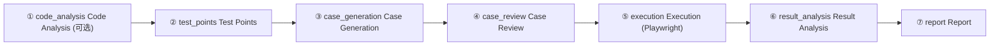

# 七阶段流水线

流水线由 `src/server/services/workflows.ts` (约 3400 行, 全仓最大的源文件) 编排, 是一个多智能体测试工作流, 把一次需求版本走完「从代码事实到可执行用例再到证据化结论」的闭环:

> 需求版本 → 测试点 (agent 1) → 用例 (agent 2) → 独立评审/修订 (agent 3) → Playwright 执行已批准的可自动化用例 → 证据驱动的结果分析 (agent 4) → 汇总报告。

四个 LLM「agent」分别负责测试点抽取、用例生成、评审/修订与结果分析; 执行阶段是纯 Playwright 引擎, 不含 LLM。设计原则 (源文件头注释):

- 流水线**只新增** run/stage/review/analysis 记录, 不替换既有表与 API;
- **每个阶段都持久化**: 阶段失败时保留已有产物, 后续阶段标记 skipped, 数据绝不静默丢弃;
- 评审最多修订 `maxRevisions` 轮, 仍不合格的用例被拒绝, 绝不执行;
- 结果分析只写自己的表 (`workflow_result_analyses`), **绝不覆盖** `execution_records.status`。

## 阶段总览

阶段顺序由导出的 `STAGES` 常量固定 (`StageName` 为其字面量联合), 展示名取自 `lib/enums.ts` 的 `STAGE_LABELS`:

| 阶段 | 键 (`STAGES`)     | STAGE_LABELS    | 内容                                     | 失败语义                  |
| ---- | ----------------- | --------------- | ---------------------------------------- | ------------------------- |
| ①    | `code_analysis`   | Code Analysis   | 刷新代码事实 (可跳过 / 复用最近一次分析) | **硬失败**                |
| ②    | `test_points`     | Test Points     | 从 PRD 抽取测试点                        | **硬失败**                |
| ③    | `case_generation` | Case Generation | rule / llm / auto 生成用例               | **硬失败**                |
| ④    | `case_review`     | Case Review     | 确定性质量门 → LLM 评审 → 最多若干轮修复 | 软失败 (阶段本身总是完成) |
| ⑤    | `execution`       | Execution       | Playwright 执行已批准的可自动化用例      | 软失败                    |
| ⑥    | `result_analysis` | Result Analysis | 证据驱动的失败分类                       | 软失败 (阶段本身总是完成) |
| ⑦    | `report`          | Report          | 汇总统计, 报告阶段                       | **总是执行**              |

`workflow_stages.status` 取值 `pending` / `running` / `completed` / `failed` / `skipped`; 其中 `skipped` 表示「按配置跳过」或「因前序失败被跳过」, 不算失败。

## 编排逻辑 (runWorkflow)

`createRun` 建表后, 通过 `runJob` 触发内部函数 `runWorkflow(runId, report)` 在进程内异步执行, `report(message, current, total)` 回调把阶段进度写回 job 状态 (前端轮询)。核心控制流 (已在源码逐行验证):

1. 运行置为 `running`, 记录 `startedAt`, 清空 `errorMessage`;
2. 顺序执行 ①~⑥ 六个 handler (`handlers` 数组), 每个阶段用 `beginStage`/`endStage` 持久化 status、attempt 与 durationMs; `beginStage` 同时把 `workflow_runs.currentStage` 指向当前阶段;
3. **硬失败 (hardFailure)**:
   - `code_analysis`、`test_points`、`case_generation` 三个阶段返回 `status: "failed"` 即为硬失败;
   - 任何阶段**抛出异常**也是硬失败——catch 块调用 `persistStageFailure` 落库后继续;
   - 硬失败后, 循环对剩余 handler 直接 `continue`, 并由 `markRemainingSkipped` 把所有仍处于 `pending`/`running` 的阶段标记为 skipped (原因 "Skipped because an earlier stage failed");
4. **软失败**: `case_review`、`execution`、`result_analysis` 返回 `failed` 只置 `hadFailure`, 不阻断后续; 阶段返回 `partial` (如执行阶段部分用例启动失败) 同样只置 `hadFailure`;
5. **报告阶段总是执行**: 无论前面成败, `stageReport` 都会在 try/catch 中运行 (源码注释 "Always produce a report so even failures leave a readable artifact"); 硬失败时 `markRemainingSkipped` 会先把仍处 pending 的 report 行标记 skipped, 但紧接着 `stageReport` 内的 `beginStage` 又把它重置为 running→completed, 因此 report 最终态几乎总是 completed;
6. 最终状态判定:
   - 无失败 → `completed`;
   - `hadFailure` 但非硬失败 → `partial`;
   - 硬失败但 `hasCompletedWork(runId)` 为真 → `partial`;
   - 硬失败且无任何已完成工作 → `failed`;
   - `hasCompletedWork` 统计 status 为 `completed` 的阶段, 但**刻意排除 report**——因为 report 总会完成, 若计入则每次硬失败都会被误判为 partial;
7. 收尾: `buildSummary` 汇总统计写入 `workflow_runs.summary`, `currentStage` 置 null, 记录 `finishedAt`。

`createRun` 是同步返回的: 校验通过后立即写库并 `createJob("workflow", STAGES.length)` + `runJob`, 返回 `{ run, jobId }`; 真正的流水线在后台跑, 客户端凭 jobId 轮询进度、凭 runId 拉取详情。

### 创建运行 (createRun)

`createRun(pid, input)` 先 `getProjectOr404`、`getRequirementOr404`, 校验需求归属该项目 (否则 `BizError 40406`)、需求内容非空 (否则 `BizError 40014`), 再据 `input` 夹取 (clamp) 出 `WorkflowConfig` 落库。tRPC 入口 `workflows.create` 的 Zod 入参 (`workflowCreate.extend({ pid })`) 与服务层默认值一致:

| 参数                                         | 默认              | 说明                                |
| -------------------------------------------- | ----------------- | ----------------------------------- |
| `pid` / `requirementId`                      | 必填              | 项目与需求版本                      |
| `mode`                                       | `auto`            | `auto` / `rule` / `llm`             |
| `autoExecute`                                | `true`            | 评审通过后是否自动执行              |
| `maxRevisions`                               | `2` (整数 0~2)    | 评审修复轮数上限                    |
| `maxCases`                                   | `20` (整数 1~100) | 本次运行保留的用例上限              |
| `reuseExistingCases`                         | `true`            | 复用需求下已有用例                  |
| `reanalyzePoints`                            | `false`           | 强制重新抽取测试点 (并连带重新生成) |
| `targetUrl`                                  | null              | 覆盖被测站点 URL (传入执行阶段)     |
| `testPointLlmProfileId` / `caseLlmProfileId` | null              | 为测试点 / 用例阶段指定 LLM 档案    |
| `analyzeCode` / `reanalyzeCode`              | `true` / `false`  | 是否分析代码 / 强制重新分析         |
| `reviewEnabled` / `analyzeEnabled`           | `true`            | 开关评审 / 结果分析阶段             |

`createRun` 随后插入一行 `workflow_runs` (status `pending`, currentStage 预置 `test_points`, 冻结 requirementVersion/Name) 与 7 行 `workflow_stages` (全部 `pending`, attempt 1), 保证阶段骨架先于执行存在。

### 中断恢复 (recoverInterruptedRuns)

流水线任务活在进程内存, 服务重启会丢失运行中的 job, 使数据库行卡在 `pending`/`running`。`server/bootstrap.ts` 的 `ensureRecovered()` 在**首个 tRPC 请求**到来时触发 `recoverInterruptedRuns()` (与执行、分析、增量分析的恢复并行), 诚实反映「被中断」而非伪造完成:

- 默认 `staleSeconds = 7200` (2 小时): 只有「最近活动」早于 cutoff 的运行才被回收——由于没有心跳列, 活动标记取 run 与其所有 stage 的 `startedAt`/`finishedAt` 的最大值 (`lastActivityForRun`); 完全无时间戳的运行**不动**, 以免多 worker 同时启动时误杀他人正在跑的流水线;
- 被回收的运行置为 `failed`, errorMessage "Interrupted by server restart; re-run the pipeline", 记录 `finishedAt`; 其 `running` 阶段置 `failed`、`pending` 阶段置 `skipped`;
- 另外做历史一致性清理: 父运行已结束、却仍卡在 `pending`/`running` 的孤立阶段, 按 `running`→`failed`、`pending`→`skipped` 纠正;
- 返回回收的运行数, bootstrap 据此打印告警。恢复后重新发起即可。

## 各阶段要点

各阶段的引擎内部 (选择器回退、质量门规则、提示词、视觉复核等) 在专门文档展开, 本节聚焦编排语义。

### ① 代码分析 (stageCodeAnalysis)

为后续测试点与用例提供「接地的」页面 / 字段 / 端点事实。逻辑分支:

- `analyzeCode = false` → 阶段 `skipped` ("Automatic code analysis is disabled");
- 已有最近一次成功分析且未要求 `reanalyzeCode` → `skipped` 并复用, payload 带回 endpoints/pages 计数; 若最近分析仍在 `running`, 先 `waitForAnalysisRow` 轮询 (每秒一次, 默认 120s 超时) 等其收敛;
- 项目非 `local_path` 或未设置 `sourcePath` → `failed` ("Only local_path projects can be analyzed")——这是硬失败;
- 否则插入一行 `code_analyses` (running) 并调用 `server/services/analysis.ts` 的 `runAnalysis` 刷新事实, 完成后据最新行状态判定 completed / failed。

payload (`analysisPayload`) 汇总 endpoints、pages、selectors、stateMachines、uiTexts、warnings。分析引擎详见[静态代码分析](./analyzer)。

### ② 测试点抽取 (stageTestPoints)

入口是 `server/services/requirements.ts` 的 `parsePoints` + `savePoints` (流水线**不**走后台 job 版的 `startRequirementAnalysis`), 抽取引擎在 `server/lib/generation/test-points.ts`:

- 需求下已有测试点且未要求 `reanalyzePoints` → `skipped` 复用;
- `parsePoints(req, mode, testPointLlmProfileId)`: `mode` 为 llm/auto 时先试 `extractPointsLlm`, LLM 不可用或抛 `LlmUnavailableError` 则退回 `extractPointsRule`; 结果经 `filterStaticStructurePoints` 去掉纯静态结构点; 每个点的 `source` 标记 `rule`/`llm`;
- 抽出 0 个点 → `failed` ("No test points parsed")——硬失败; 否则 `savePoints` 全量替换该需求的测试点并把需求状态置 `ready`;
- payload 带 `testPointCount` 与 `byCategory`/`bySource` 分布。

抽取细节详见[用例生成](./generation)。

### ③ 用例生成 (stageCaseGeneration)

入口是 `server/services/generation.ts` 的 `generateCases`:

- `reused = reuseExistingCases && !reanalyzePoints`; 命中复用且需求下已有用例时, 直接取前 `maxCases` 条, 阶段 `skipped`;
- 否则调用 `generateCases(pid, { mode, requirementId, profileId: caseLlmProfileId })`——三种模式 `rule`/`llm`/`auto`, auto 下 LLM 先行、按测试点规则兜底, LLM 整体不可用时降级为规则; 再取 `casesForRequirement` 前 `maxCases` 条;
- 生成后 0 条可用 → `failed` ("No usable cases generated")——硬失败;
- 逐用例 upsert `workflow_cases`: `automationStatusOf` 把 source 为 manual/import 的判为 `manual`, 有结构化步骤的判为 `automated`, 否则 `blocked`; 初始 `reviewStatus` 为 `pending`;
- payload 带 `generation`/`dropped`/`dropReasons`/`byAutomation`。

生成引擎、计数断言归一化与质量门详见[用例生成](./generation)。

### ④ 用例评审 (stageCaseReview)

「确定性优先、LLM 辅助、可修复」的典范。`reviewEnabled = false` → 阶段 `skipped`, 并给尚未评审的用例补记一条 `revise` (证据 "configuration")。启用时按 `position` 顺序逐用例处理:

1. **前置分流**: 用例已不存在 → `reject`; 经 `requirement_cases` 映射找到测试点, 用 `sourceFacts` 拉取接地事实并按「需求:测试点」缓存; `automationStatus` 为 `manual` → 记 `pass` 但不自动化, 为 `blocked` → 记 `reject`;
2. **计数断言归一化**: `normalizeCaseCounts` 把「固定总数」断言改写为运行时基线 (`updateCase` 落库), 无法稳定化则 `drop` → `reject` 并置 `blocked`;
3. **确定性评审 `deterministicReview`**: 规则检查每个用例, 产出 `blocking` (阻塞, 如无结构化步骤、缺预期结果、复合预期 `caseHasCompoundExpected`、单字段多输入 `caseHasMultipleInputs`)、`fixable` (可修复, 如缺失必填字段、锚点/选择器不在源码事实中)、`warnings` (非阻塞) 三桶, 并给出 `qualityScore`;
4. **LLM 评审**: 仅当无 blocking 且 LLM 可用时, 用 `caseReviewWorkflowPrompt` 让模型逐用例评审, `parseWorkflowReview` 经 `STATUS_ALIASES` 归一到 pass/revise/reject, 并把无问题却判负的结果补一条 issue;
5. **合成结论 `composeReviewStatus`**: 有 blocking → `reject`; LLM 判 reject → 可修复则 `revise` 否则 `reject`; 有 fixable 或 LLM 判 revise → 可修复则 `revise` 否则 `reject`; 否则 `pass`。「可修复」= `revisions < maxRevisions` 且 LLM 可用;
6. **打分**: `score = deterministic.qualityScore - llmDeduction(llmIssues)` (blocker 扣 25、warning 扣 8、info 扣 2), 下限 0; 有 blocking 时封顶 30;
7. **落库 `recordReview`**: 每轮写一行 `workflow_case_reviews` (`round` 递增, source 为 `mixed`/`deterministic`), 并更新 `workflow_cases` 的 reviewStatus/qualityScore 与 firstReviewId/finalReviewId;
8. **修复轮**: 结论为 `revise` 且未达上限时, 用 `caseRepairPrompt` 让 LLM 依据问题清单产出补丁, `repairCase` 先经 `validateCase` 用源码事实校验再 `updateCase` (最多 `maxRevisions` 轮, `revisionCount` 计数); 补丁校验失败但确定性检查干净且仅 LLM 判 revise → 记一条 `pass` 兜底 (fallbackPass); 轮次耗尽仍 `revise` → 追加一条 `reject` (分数封顶 40)。

`pass` 的用例 `automationStatus` 置 `automated`, 其余置 `blocked`; **被拒用例绝不进入执行**。阶段本身几乎总是 `completed` (逐用例结果作为数据留存), payload 汇总 `pass`/`revise`/`reject`/`manual`/`revisions`/`errors` 与 `avgQuality`/`maxRevisions`/`llmAvailable`。评审内部详见[用例生成](./generation)。

### ⑤ 执行 (stageExecution)

`autoExecute = false` → `skipped`。否则取本运行中 `reviewStatus = pass` 且 `automationStatus = automated` 的用例 (按 position), 无则 `skipped`; 逐个调用 `server/services/executions.ts` 的 `runCaseExecution(pid, caseId, { targetUrl })` (Playwright 引擎 `runner.ts`), 把返回的执行 id 写入 `workflow_cases.executionId`, 并采集 status/durationMs 与 `byStatus` 分布:

- 单用例启动异常计入 `errors` (`failedToStart`);
- 全部批准用例都启动失败 (`executed = 0` 且 `errors > 0`) → 阶段 `failed` (软失败); 否则 `completed`, 部分失败标记 `partial`。

执行引擎、五级选择器回退与三层断言详见[浏览器执行](./execution)。

### ⑥ 结果分析 (stageResultAnalysis)

证据驱动的失败分类。`analyzeEnabled = false` → `skipped`; 否则选取本运行中 `executionId` 非空的**全部**用例 (通过或失败都分析, 通过的归为 `none`), 无则 `skipped`。逐用例:

- `buildEvidence` 汇总客观证据: 至多 20 条步骤记录、errorCategory/errorMessage、执行时长与通过步数、视觉复核结论 (`visionReview`)、测试点与需求摘录;
- `analyzeResult`: LLM 可用时优先用 `resultAnalysisPrompt` 分类 (`parseFailureAnalysis` 校验类别与置信度), 失败或不可用则退回 `ruleAnalysis` 规则分类 (按 error code 与脚本文本标记映射);
- `guardAnalysis` + `hasGroundedEvidence` 守卫: 结论必须引用具体步骤 / 错误码 / 截图裁定, 否则降级为 `unknown`; 对 `unknown` 压低置信度, 对 `product_defect`/`unknown` 强制 `needsHumanReview`;
- 结果写入 `workflow_result_analyses` (含 `executionStatus` 快照、`failureCategory`、`failureReason`、`evidence`、`confidence`、`recommendedAction`、`needsHumanReview`、`source` (llm/rule)、`model`、`rawResponse`), 并把 `workflow_cases.analysisId` 指向它——**绝不修改 `execution_records.status`**;
- 单用例分析抛错也会补写一条 `unknown` 行, 保证「有执行就有分析」。

失败分类取值: `product_defect` / `test_script_issue` / `test_data_issue` / `environment_issue` / `unknown` / `none` (`VALID_CATEGORIES`)。阶段几乎总是 `completed`, payload 带 `byCategory`/`bySource`/`errors`/`llmAvailable`。规则映射与证据展示详见[浏览器执行](./execution)。

### ⑦ 报告 (stageReport)

报告阶段**只汇总、不产 HTML**: `stageReport` 调用 `buildSummary` 计算全量统计, 写入 report 阶段的 payload (附前端详情地址 `reportUrl = /pipeline/{runId}`) 并置 completed; `runWorkflow` 收尾时再算一次 `buildSummary` 写入 `workflow_runs.summary`。`buildSummary` 覆盖各阶段状态 (`stageStatuses`)、代码分析产物、测试点数、用例数、`automation`/`review` 分布、评审轮次 (`revisions`)、通过用例均分 (`avgQuality`)、执行数与 `executionStatuses`、分析 `analysis`/`analysisSources` 分布, 以及 `errors` (失败阶段名与执行启动失败数)。

**自包含 HTML 报告是另一条按需路径** (不在流水线内落盘): `server/services/reports.ts` 的 `buildProjectReport`/`buildExecutionReport` 生成单文件 HTML (内联 CSS, 证据经 `/api/files/...` 引用), 由 `/api/report/$` 路由 (`api.report.$.tsx`) 实时响应。`RunDict.reportUrl` 即 `/api/report/project/{pid}?workflowRunId={runId}`; 带 `workflowRunId` 时报告额外渲染 "Multi-Agent Workflow" 段 (阶段时间线 + 逐用例评审/根因表)。因为报告阶段总会执行, 即便流水线失败也能留下可读产物。

## 持久化与查询

流水线只新增五张 `workflow_*` 表, 不复用或改写既有业务表 (详见[数据模型](./data-model)):

- `workflow_runs`: 一次运行的配置 (`config` jsonb) 与汇总 (`summary` jsonb), 冻结 requirementVersion/Name, 记录 status/currentStage/startedAt/finishedAt/errorMessage;
- `workflow_stages`: 每阶段一行, 存 status/attempt/inputSummary/outputSummary/payload/errorMessage/model/durationMs;
- `workflow_cases`: 运行内逐用例的评审/执行/分析串联 (testPointId、position、automationStatus、reviewStatus、revisionCount、qualityScore、firstReviewId/finalReviewId、executionId、analysisId);
- `workflow_case_reviews`: 每轮评审一行 (round、reviewStatus、qualityScore、issues、missingCoverage、suggestions、deterministicIssues、source、model);
- `workflow_result_analyses`: 每次执行分析一行 (executionStatus 快照、failureCategory、failureReason、evidence、confidence、recommendedAction、needsHumanReview、source、model、rawResponse)。

查询侧导出 `listRuns(pid, limit ≤ 100)`、`getRunOr404`、`getRunDetail(runId)`; `getRunDetail` 把阶段按 `STAGES` 顺序排序, 并为每个用例组装 firstReview/finalReview/reviews 列表与 execution/analysis。对应 tRPC 过程为 `workflows.list` 与 `workflows.detail`。

前端 `/pipeline` 列出运行 (`workflows.list`), `/pipeline/$runId` 展示阶段时间线与逐用例评审/分析, 并在 status 为 running/pending 时以 2 秒间隔轮询 `workflows.detail` 刷新 (详见[前端架构](./frontend))。
