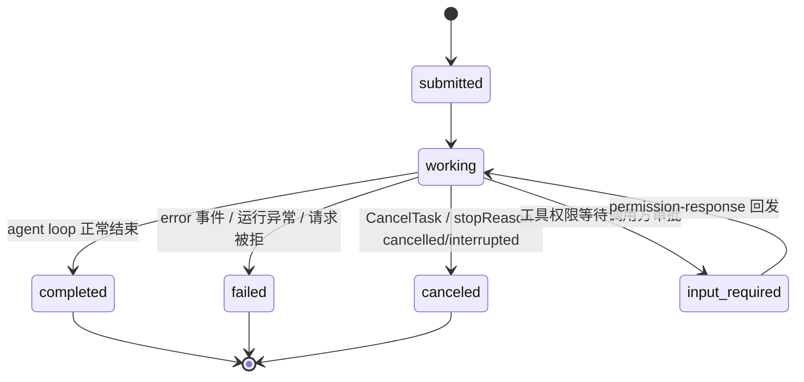
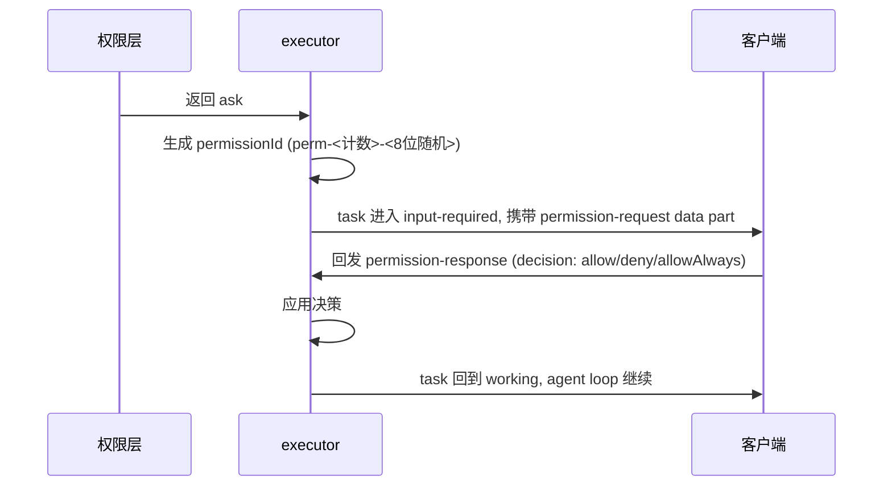

:::note 事实基线
本文依据 `$HOME/github/yukino-code/apps/yukino` 在 `1847a71e03f9` 的源码事实撰写；文中的路径、常量与 API 名称均可在该检出中定位。
:::

A2A (Agent2Agent) 是一个开放的 agent 互通协议: 一个 agent 以标准化服务的形式对外暴露能力, 其他 agent 或编排器可以发现它、给它派发任务、消费它的流式状态更新

MCP 解决「agent 接入工具」, A2A 解决「agent 接入 agent」: `--a2a` 模式下 Yukino 作为 A2A 服务器运行, 任何 A2A 兼容的客户端都能把编码任务派发给它; 服务端基于 `@a2a-js/sdk` (package.json 声明 `^1.3.0`, 本机安装 1.3.0) 实现, 协议版本由 `A2A_PROTOCOL_VERSION = "1.0"` 固定, 源码集中在 src/a2a/ (card、constants、conversion、executor、prompts、request-handler、server 七个模块, index.ts 以命名空间形式聚合导出)

## 启动

```bash
yukino --a2a            # 默认监听 127.0.0.1:18890
yukino --a2a 9000       # 自定义 loopback 端口 (host:port、[IPv6]:port 也可以)
yukino --a2a 0          # 端口 0 由 OS 分配, 实际地址启动后打印
```

- `--a2a` 是服务器模式旗标, 与 `--remote` 互斥, 也不能与 `-p` / `--resume` / `--output-format` 组合

:::warning
只允许绑定 **loopback** 地址 (`127.0.0.1` / `::1` / `localhost`), 非 loopback 地址直接抛错 `A2A server must listen on a loopback address.`。服务器**没有内置鉴权** (SDK 侧挂的是 `UserBuilder.noAuthentication`, card 的 `securitySchemes` 为空), 暴露到网络上等于把代码执行能力暴露到网络上。
:::

- 服务器先绑定端口, 再用实际绑定地址生成 Agent Card 中的 URL, 所以端口 0 也能对外公布可达地址 (IPv6 地址会带 `[]` 包裹)
- 启动成功后向 stderr 打印 `A2A server listening at <url>` 和 `Agent card at <cardUrl>`, 随后阻塞直到 SIGINT/SIGTERM; 退出时关闭 HTTP 服务器并 dispose 所有 agent runtime (src/a2a/server.ts 的 runA2aServer)

## 端点与线协议

| 端点                               | 协议                  |
| ---------------------------------- | --------------------- |
| `GET /.well-known/agent-card.json` | Agent Card (服务发现) |
| `POST /`                           | JSON-RPC 2.0          |
| `/v1/...`                          | HTTP+JSON (REST)      |

JSON-RPC 方法白名单 (src/a2a/constants.ts 的 A2A_METHODS) 共 11 个: `SendMessage`、`SendStreamingMessage`、`GetTask`、`ListTasks`、`CancelTask`、`SubscribeToTask`、`CreateTaskPushNotificationConfig`、`GetTaskPushNotificationConfig`、`ListTaskPushNotificationConfigs`、`DeleteTaskPushNotificationConfig`、`GetExtendedAgentCard`; 白名单之外的方法名 (例如 `message/send`) 直接以 `-32601` 拒绝, 错误消息回显方法名并列出全部受支持方法, 不会触碰 agent。REST 侧由 SDK 的 restHandler 挂载在 `/v1` 前缀下: `POST /v1/message:send`、`POST /v1/message:stream`、`GET /v1/tasks`、`GET /v1/tasks/:taskId`、`POST /v1/tasks/:taskId:cancel`、`GET|POST /v1/tasks/:taskId:subscribe`、`GET /v1/extendedAgentCard` 与 `/v1/tasks/:taskId/pushNotificationConfigs` 系列路由, 每条路由另有带租户段的变体。push notification config 与 extended card 方法只在白名单里放行: card 声明 `pushNotifications: false` 且未配置 extended card, 实际调用返回 SDK 的不支持错误

请求管线 (src/a2a/server.ts) 依次为: Agent Card handler → body 解析 (express.json, 上限 100 KiB, 接受 `application/json` 与 `application/a2a+json`) → 解析错误处理 → 版本与方法门 → JSON-RPC handler → REST handler:

- 协议请求 (`/` 与 `/v1/...`) 必须带 `A2A-Version: 1.0` 头, 由服务器自己的中间件在 SDK handler 之前校验 (Agent Card 端点不受限制): 缺失报 `Missing A2A-Version header; send A2A-Version: 1.0.`, 取值不符报 `Unsupported A2A-Version "<值>"; this server requires A2A-Version: 1.0.`, 未知方法报 `Unknown method "<方法>". Supported methods: <白名单列表>.`
- body 解析失败同样返回结构化错误: 超过 100 KiB 报 `Request body exceeds the 102400 byte limit.`, 非法 JSON 报 `Request body must contain valid JSON.`
- 协议错误在两种绑定上形状不同: JSON-RPC 侧返回 `{ jsonrpc, id, error: { code, message, data } }` 信封 (id 取请求体 `id`, 缺省 null), REST 侧返回 `{ error: { code: <HTTP 状态码>, message, status, details } }`, 其中 `status` 在 `VERSION_NOT_SUPPORTED` 时为 `FAILED_PRECONDITION`, 其余为 `INVALID_ARGUMENT`; `data`/`details` 都携带 `google.rpc.ErrorInfo` 条目 (`reason` + `domain: "a2a-protocol.org"`)

| 错误                     | HTTP (`/`) | HTTP (`/v1/...`) | JSON-RPC code | ErrorInfo reason      |
| ------------------------ | ---------- | ---------------- | ------------- | --------------------- |
| A2A-Version 缺失或不正确 | 200        | 400              | -32009        | VERSION_NOT_SUPPORTED |
| 未知 JSON-RPC 方法       | 200        | —                | -32601        | METHOD_NOT_FOUND      |
| 请求体超过 100 KiB       | 413        | 413              | -32700        | CONTENT_TOO_LARGE     |
| JSON 不合法              | 400        | 400              | -32700        | INVALID_ARGUMENT      |

- 流式: `SendStreamingMessage` / `message:stream` 配合 `accept: text/event-stream`, 响应是 SSE 流, 依次推送 task 快照、TaskStatusUpdateEvent 与 TaskArtifactUpdateEvent
- 历史长度: YukinoA2aRequestHandler (src/a2a/request-handler.ts) 扩展 SDK 的 DefaultRequestHandler, 为 `SendMessage.configuration.historyLength`、`GetTask.historyLength`、`ListTasks.historyLength` 注入默认值 10 (DEFAULT_HISTORY_LENGTH); 显式设为 0 省略 history, 但 `status.message` 与 artifacts 仍携带完整回答, REST 的 task 查询用 `historyLength` query 参数
- task 对象存在内存 (InMemoryTaskStore), 重启即清空; 对话内容经 session 文件持久化, contextId→sessionId 映射在容量驱逐时 checkpoint 到磁盘, 重启后已 checkpoint 的 context 仍能按 contextId 恢复历史

## Agent Card

Agent Card 是 A2A 的服务发现文档, 描述这个 agent 是谁、能做什么、从哪里调用 (源码: src/a2a/card.ts 的 buildAgentCard):

```jsonc
{
  "name": "yukino",
  "description": "Yukino is a terminal-based AI coding agent...",
  "supportedInterfaces": [
    // JSON-RPC 与 HTTP+JSON 两种绑定同源部署, REST 接口带 /v1/ 路由前缀
    {
      "url": "http://127.0.0.1:18890/",
      "protocolBinding": "JSONRPC",
      "protocolVersion": "1.0",
    },
    {
      "url": "http://127.0.0.1:18890/v1/",
      "protocolBinding": "HTTP+JSON",
      "protocolVersion": "1.0",
    },
  ],
  "version": "0.0.20", // 跟随当前运行的 Yukino 版本 (src/version.ts)
  "capabilities": {
    "streaming": true,
    "pushNotifications": false,
    "extensions": [
      {
        // 权限握手扩展, 见「权限请求」一节
        "uri": "https://github.com/hangtiancheng/yukino-code/blob/main/apps/yukino/README.md#yukino-a2a-permissions-v1",
        "description": "Yukino permission handshake v1: ...",
        "required": false,
        "params": {
          "decisions": ["allow", "deny", "allowAlways"],
          "versionHeader": "A2A-Version: 1.0",
          "requestSchema": { ... }, // PermissionRequestDataSchema 经 z.toJSONSchema 转换
          "responseSchema": { ... }, // PermissionResponseDataSchema 经 z.toJSONSchema 转换
        },
      },
    ],
  },
  "defaultInputModes": ["text/plain"],
  "defaultOutputModes": ["text/plain"],
  "skills": [
    {
      "id": "coding",
      "name": "Coding",
      "description": "Executes software engineering tasks...",
      "tags": ["code", "development", "programming"],
      "examples": [
        "Fix the failing tests in this repository.",
        "Add a dark mode toggle to the settings page.",
      ],
    },
  ],
}
```

`streaming: true` 对应 SSE 状态与 artifact 流; `pushNotifications: false` 表示不支持 webhook 推送, 客户端需要自己订阅流或轮询 task; card 还带 `securitySchemes: {}` / `securityRequirements: []` (对应 SDK 侧 `UserBuilder.noAuthentication`, 无鉴权)、两个 interface 的 `tenant: ""`、`provider: undefined` 与 `signatures: []`; `extensions[0]` 把 Yukino 权限握手声明为非必需扩展 (PERMISSION_EXTENSION_URI 在 src/a2a/constants.ts, PERMISSION_EXTENSION_DESCRIPTION 在 src/a2a/prompts.ts), `params` 携带决策枚举、版本头约定与请求/响应 JSON Schema (由 `z.toJSONSchema` 从 zod schema 转换), 客户端无需读文档即可程序化理解权限语义

## 任务模型: context 到 session 的映射

A2A 的核心对象是 Task: 客户端发消息 (SendMessage 或流式 SendStreamingMessage), 服务器创建或续跑一个 Task, 以状态更新流式回推进度; Yukino 侧的执行器是 YukinoA2aExecutor (src/a2a/executor.ts), 一个 A2A contextId 对应一个 Yukino session



- runtime 按需惰性创建 (ensureRuntime): 只有合法且非 busy 的消息才会触发; 空消息 (既无 text 也无 permission-response data part) 直接 fail, 不会创建 session 或拉起 runtime
- 默认工厂 createA2aRuntime 复用 remote 模式的 agent 装配 (createRemoteAgent, non-interactive): 工具注册、skills、hooks、MCP、沙箱、记忆全套; agent 的工作目录是服务器启动进程的 cwd; runtime 的权限模式取自服务器配置 `permission_mode` (缺省 `default`), 调用方无法通过消息元数据提升本地策略
- 用户文本经 saveMessage 写入 session transcript, 与交互式模式同一套会话存储; 上下文压缩、恢复行为一致
- 空闲驱逐: 30 分钟无活动 (DEFAULT_IDLE_TIMEOUT_MS) 后 dispose runtime, 释放 MCP 连接和后台资源, 内存中的 contextId→sessionId 映射保留; 下一条消息按 sessionId 重建 runtime 并用 rebuildFromSession 回放 transcript, 驱逐对对话透明; 若 transcript 已不可用则报 `A2A context transcript is no longer available. Start a new context.`
- 容量上限: 最多跟踪 256 个 context (MAX_TRACKED_SESSIONS), 超出时按 LRU 驱逐完全空闲的 session (进行中或等待权限的绝不驱逐); 被驱逐 session 的映射先以「临时文件 + rename」原子写入 `~/.yukino/projects/<sha256(cwd)>/a2a-contexts/<sha256(contextId)>` (带文件锁), 无法驱逐则报 `A2A session capacity reached; retry when an active context finishes.`
  :::warning
  **单并发约束**: 同一 `context` 同时只允许一个 run, busy 期间的新消息被拒绝: `Context <contextId> is busy with task <taskId>. Cancel it or wait for it to finish before sending a new message.`
  :::

- 取消: `cancelTask` 把所有 pending 权限 resolve 为 deny、清空待决表并 abort runtime, `finishRun` 因 `run.canceled` 把终态置为 canceled, 终态消息取 `flushAnswer` 留下的最后一条完整回答 (若运行以 error 结束则为错误文本); 仅当没有 live run 可取消时 (例如事件总线先于消费者结束), `cancelTask` 才直接发布 canceled 状态并携带文本 `Task canceled by user request.` (TASK_CANCELED_TEXT)

## 事件转换

Yukino 的 AgentEvent 由 YukinoA2aExecutor 转换为两类 A2A 事件 (载荷映射在 src/a2a/conversion.ts 的 agentEventToMessage, 投递通道在 src/a2a/executor.ts 的 publishAgentEvent / flushAnswer):

| AgentEvent    | A2A 事件                                                        |
| ------------- | --------------------------------------------------------------- |
| stream_text   | artifact-update: 文本增量                                       |
| turn_complete | artifact-update: 该轮全文收尾 + working status-update: 完整消息 |
| thinking_text | working status-update: `metadata.yukino` 携带 thinking 载荷     |
| tool_use      | working status-update: `metadata.yukino` 携带 tool-call 载荷    |
| tool_result   | working status-update: `metadata.yukino` 携带 tool-result 载荷  |
| 其他事件      | 不转换                                                          |

- 助手文本走 artifact 通道: 每条回答有一个稳定的 artifactId (UUID), 增量逐块推送 (首块 `append: false`, 后续 `append: true`, 均 `lastChunk: false`); turn 结束时把累计全文再推一次 (`append: false`, `lastChunk: true`, 以全文替换增量), 并附带一条携带完整消息的 working status-update, 随后轮换 artifactId, 下一轮回答使用新的 artifact
- thinking 与工具事件不占用 `status.message`, 载荷统一放在 status-update 的 `metadata.yukino`, 以 `yukino` 作为判别键 (discriminator): `{ yukino: "thinking", text }`、`{ yukino: "tool-call", toolCallId, toolName, args }`、`{ yukino: "tool-result", toolCallId, toolName, isError, elapsed, output }`, tool output 超过 8000 字符截断并追加 `… [truncated]` 标记
- 各类载荷的形状由 zod schema 定义并校验 (PermissionRequestDataSchema、PermissionResponseDataSchema、ThinkingDataSchema、ToolCallDataSchema、ToolResultDataSchema)
- history 与终态 `status.message` 只包含完整的助手消息, 不含逐 token 增量
- 终态映射: finishRun 先 flush 未收尾的文本, 再推终态 status-update — loop_complete 的 stopReason 为 cancelled/interrupted 时 task 进入 canceled; error 事件或异常进入 failed, 错误文本作为终态消息; 正常完成进入 completed, 终态消息是最后一条 flush 出的完整回答 (lastAnswer)

## 权限请求: input-required

工具权限请求走 A2A 的 input-required 状态, 把决策权交回调用方 agent; 该握手在 Agent Card 中声明为扩展 (见上节):



- reason 只包含权限层给出的理由; 请求来自子 agent 时另有可选的 source 字段 (`{ agentName, cwd }`) 标明来源, 不再把来源拼进 reason 文本
- allowAlways 为后续调用持久化匹配的项目规则, 但不绕过显式 deny 规则; 服务器同时应用本地 `permission_mode` 配置与项目权限规则

:::tip
**一条消息只处理一个待决权限**: 只有消息中的第一个 `permission-response` 被应用, 其余 pending 权限重新发 `input-required`, 客户端需要逐个应答。
:::

- 各类错误都以拒绝消息返回: taskId 不匹配、permissionId 未知或已解决、run 已结束 (`No active run is awaiting a permission response.`); run 进行中时拒绝以独立 Message 发布, 不扰动进行中 task 的持久化状态, 否则把本次请求的 task 置为 failed
- CancelTask、服务器 dispose、子 agent 的 abort signal 都会把 pending 权限自动 resolve 为 deny; 其中子 agent 的 abort signal 只移除对应的那一条权限, 若仍有剩余待决权限则重新推 input-required, 否则推一条 working status-update 回到 working; CancelTask 与 dispose 是一次性清空整个待决表

## 使用场景

- 另一个 agent (或编排器) 把「修复这个仓库的失败测试」作为一个 task 派发给 Yukino
- CI 系统把 Yukino 作为一个可编程的修复执行器
- 多 agent 系统中, Yukino 作为 coding 专家节点被发现和调用
- 库形式嵌入: 包 `@yukino.js/yukino` 导出 `A2A` 命名空间 (Card、Constants、Conversion、Executor、Prompts、RequestHandler、Server 七个子命名空间), `A2A.Server.startA2aServer({ address, runtimeFactory, cwd })` 返回 `{ url, cardUrl, close }`, runtimeFactory 可替换成自定义 runtime (测试即用它注入假 runtime)

A2A 面向 agent (程序驱动, 调用方也是 agent); 面向人的浏览器聊天界面则是 [remote](./remote) 模式的职责
