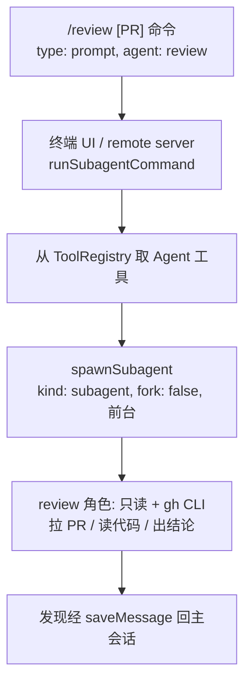

Code Review 在 Yukino 中不是独立子系统: 一条 `/review` slash command + 一个内置的 `review` subagent 角色。审查 agent 用 `gh` CLI 拉取 PR 详情和 diff, 用常规只读工具读代码和项目指令, 最后把发现以文字形式直接返回当前会话, 主 agent 下一轮可以基于发现继续动作 (比如直接按发现修复)

:::info
为什么收敛成「一个角色 + 一条命令」:

- 审查的本质是「读 diff + 读上下文 + 给结论」, 一个剥掉写工具的前台 agent 循环就够了, 不需要独立的 diff 采集/分组/定位管线
- PR 采集交给 `gh` (`gh pr list` / `gh pr view` / `gh pr diff`), 复用官方 CLI, 不自己解析 git diff
- 发现以文字返回主会话, 主 agent 拿到即可修复, 不需要评论锚定机制
  :::

## `/review` 命令

注册在 src/commands/commands.ts: `type: "prompt"`, `agent: "review"` (`REVIEW_AGENT_NAME`, src/subagent/constants.ts), handler 调用 `buildReviewPrompt(args)` (src/commands/prompts.ts); `/help` 展示的描述是 `REVIEW_COMMAND_DESCRIPTION` = "Review a pull request: /review [PR number or URL]" (src/commands/constants.ts)。命令解析、参数切分、四种命令类型的划分见 [slash-command](./slash-command)

```txt
/review                  无参数: agent 先跑 gh pr list, 列出开放 PR 供用户选择
/review 123              审查 PR #123
/review <url>            审查指定 URL 的 PR
/review 123 重点看并发    PR 号 + 额外审查指令
```

`buildReviewPrompt` 把 args 原样拼在固定英文提示词的末尾 ("PR number, URL, or additional review instructions: ..."), 对 agent 提四步要求:

1. 没给 PR 号/URL 时, 先跑 `gh pr list` 返回开放 PR 供用户选择
2. 对目标 PR 跑 `gh pr view <number-or-url>` 取详情、`gh pr diff <number-or-url>` 取 diff
3. 读相关代码和项目指令, 在上下文中理解改动
4. 输出简洁但完整的审查: PR 做了什么、正确性、项目约定、性能、测试覆盖、安全; 具体问题带文件路径和行号, 说明影响并给改进建议; 如实说明没能完成的检查

提示词末尾是显式约束: "Review only: do not modify files or publish a GitHub review. Return your findings directly." — 只审查, 不修改文件、不发布 GitHub review, 直接把发现返回

## 执行路径

终端 UI (src/ui/app.tsx) 和 remote server (src/remote/server.ts) 两个宿主对带 `agent` 字段的 prompt 型命令走同一分支: 调用 `runSubagentCommand` (src/commands/subagent.ts), 从 ToolRegistry 取 `Agent` 工具 (取不到抛 "Agent tool is not available."), 以固定参数前台跑一次:



```ts
{
  kind: "subagent",
  subagent_type: "review",
  fork: false,                // fork: agentName === PLAN_AGENT_NAME
  description: "/review 123", // 原始输入文本
  prompt: "...",              // buildReviewPrompt 的产物
  run_in_background: false,   // 永远前台
}
```

- `fork: false` → 全新子对话, 不继承父对话快照; `/plan` 是唯一例外, 但它并不走 `agent.execute(args)` —— `runSubagentCommand` 对 `PLAN_AGENT_NAME` 改调 `runPlanAgent` (src/subagent/plan.ts), 后者让 checker 进入 plan 模式并走 `AgentTool.runBuiltin` (内部固定 `fork: true`), 成功后再 `savePlan` 落盘; 因此上面构造的 `args.fork = true` 对 /plan 并不生效, 继承父上下文是 `runBuiltin` 内部保证的
- `run_in_background: false` 显式传入, 覆盖 agent 定义里的 `background` 字段: 即使 `~/.yukino/agents/review.md` 写了 `background: true`, `/review` 仍前台同步等待 (tests/review.test.ts 断言)
- 会话落盘: 原始命令文本经 `saveUserMessage` 以 user 消息进入当前会话, agent 返回经 `saveMessage` 以 assistant 消息进入同一会话 (src/session) — 发现直接出现在对话历史里, 主 agent 下一轮可见并可继续
- 事件流: 先发 `tool_use` 事件 (UI 渲染 Agent 卡片), subagent 跑完发 `tool_result`、`stream_text` (完整发现文本, 渲染为流式文本)、`turn_complete`、`loop_complete`; 中断时 `stopReason` 为 `interrupted`
- Agent 卡片进度行显示 `review subagent | N turns | <最近工具>` (src/ui/agent-tool-progress.tsx); Esc / Ctrl+C 中断前台执行, 信号直达 run_in_background=false 的 subagent

subagent 内部 (`spawnSubagent`, src/subagent/spawn.ts):

- 独立会话: 分配 `subagentSessionId`, 对话记录写进自己的 `transcript.jsonl` (`sessionPath(sessionId, TRANSCRIPT_FILENAME)`)
- system prompt: review 没有 `systemPromptOverride` 也没有 model 覆盖, `spawnSubagent` 直接复用父 `LLMClient` (与主 agent 同一 system prompt, 即 `buildSystemPrompt(env)` 的产物); AGENTS.md 项目指令经 `loadInstructions` (src/memory/instructions.ts) 作为 `instructions` 传入 agent, 所以项目约定对审查 agent 同样生效
- 角色指令经 `buildSubagentInstructions` (src/prompt/prompts.ts) 以 system-reminder 注入: 角色名 + `REVIEW_AGENT_DESCRIPTION` + 范围/协作/如实汇报约束
- 权限经 `checker.forSubagent`: review 不设 `permissionMode`, 继承父 checker 的模式 (`acceptEdits` / `bypassPermissions` 会下传, 否则 default); Bash 跑 `gh` 命令走常规权限决策 (default 模式下 ask, 用户在权限对话框批准)
- 输出兜底: 空输出返回 `[No output]`, 中断时部分输出追加 `[Interrupted]` 标记

## review 角色

`review` 是四个内置角色之一 (`BUILTIN_AGENTS`, src/subagent/constants.ts):

```ts
{
  name: "review",
  description: REVIEW_AGENT_DESCRIPTION,
  disallowedTools: ["EditFile", "WriteFile", "ExitPlanMode"],
}
```

`REVIEW_AGENT_DESCRIPTION` (src/subagent/prompts.ts): 从正确性、项目约定、性能、测试覆盖、安全五个角度审查 PR; 读 diff 和相关代码, 返回带文件路径、行号、影响和改进建议的简洁发现; 不修改文件、不发布 review, 缺上下文或受阻时向父 agent 如实汇报

与 plan / explore 对比 (四个内置角色的完整说明见 [subagent](./subagent)):

| 角色    | permissionMode | readOnly | 定位                          |
| ------- | -------------- | -------- | ----------------------------- |
| review  | 不设           | 不设     | PR 审查, 需要 Bash 跑 gh 命令 |
| plan    | plan           | true     | 实现计划                      |
| explore | plan           | true     | 代码探索                      |

三个角色的 `disallowedTools` 都是 `["EditFile", "WriteFile", "ExitPlanMode"]`。关键区别在 `modeDecide` (src/permissions/index.ts): `plan` 模式下 read=allow、write/command=deny, `default` 模式 read=allow、其余=ask, `acceptEdits` 模式 command=ask、其余=allow, `bypassPermissions` 全 allow; 所以 plan 模式下所有非读操作被拒、Bash 跑不了命令。review 需要执行 `gh pr view` / `gh pr diff`, 因此不锁权限模式, Bash 走常规 ask 流程

review 的「只读」由三层约束合成:

- 工具层: `disallowedTools` 剥掉 `EditFile` / `WriteFile`; `ExitPlanMode` 本就被全局 `SUBAGENT_DISALLOWED_TOOLS` 剥离, 定义里显式再列一次
- 全局层 (`filterToolsForAgent`, src/subagent/tool-filter.ts): 剥掉 `MAIN_AGENT_ONLY_TOOLS` (Workflow、ComputerUse、AskUserQuestion、EnterPlanMode、ExitPlanMode、Goal) 和委派策略工具 (Agent、TeamCreate、TeamDelete、SendMessage) — review 不能递归 spawn、不能编排 Workflow、不能反问用户
- 提示词层: 角色描述和 `/review` 提示词都禁止修改文件、禁止发布 review

`/review` 路径下 review 同步前台运行 (`isAsync` 为 false), 不经后台异步白名单 (`ASYNC_AGENT_ALLOWED_TOOLS`) 过滤; 过滤后剩下的可用工具为 Bash / PowerShell (跑 gh)、ReadFile、Grep、Glob、WebFetch、TodoWrite、TaskOutput、TaskStop、LoadSkill、ToolSearch、McpCall、SyntheticOutput、TeamList、EnterWorktree / ExitWorktree (终端 UI 宿主还注册了 InstallSkill), 以及全部已注册的 `mcp__*` MCP 工具

review 不设 `maxTurns` (`BUILTIN_AGENTS` 的 review 定义无此字段), 角色没有默认轮数上限: `spawnSubagent` 把 `maxIterations: definition.maxTurns` 传给 Agent, 仅在定义显式配置 `max_turns` 时生效

## 自定义 review 角色

用户级 `~/.yukino/agents/review.md` 同名覆盖内置定义 (`loadAgentDefinitions`, src/subagent/loader.ts); frontmatter 可配 tools / disallowed_tools / system_prompt / max_turns / model / permission_mode / background / worktree, body 映射为 initialPrompt:

```md
---
name: review
model: haiku
max_turns: 20
---

你负责审查 PR, 重点关注安全与并发问题...
```

:::tip
`background: true` 不影响 `/review` (命令侧显式 `run_in_background: false`); `/review` 按名字 `review` 查定义, 用户覆盖对命令同样生效。
:::

主 agent 也可以不经 `/review`, 直接调 Agent 工具指定 `subagent_type: "review"` 委派审查, 此时 `kind` / `fork` / `run_in_background` 由调用参数决定 (见 [subagent](./subagent))

## 相关机制

- `/plan` 同为 prompt + agent 命令, 但走 `runPlanAgent` 独立分支: `checker.enterPlanMode()` 进入 plan 模式、`AgentTool.runBuiltin` 固定 `fork: true` 继承父上下文、成功后 `savePlan` 落盘并等待 plan 审批; review 走 `agent.execute` 的 `fork: false` 全新对话, 没有审批流程
- 需要并发编排多个审查/验证任务 (例如逐 PR 批量审查) 时用 Workflow 脚本 (见 [workflow](./workflow)), `/ultracode` 是让主 agent 编写 Workflow 脚本编排 subagent 的入口
