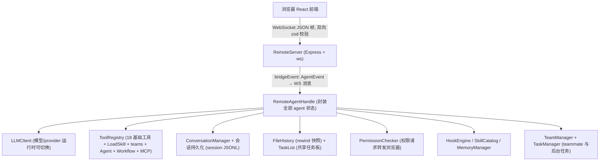
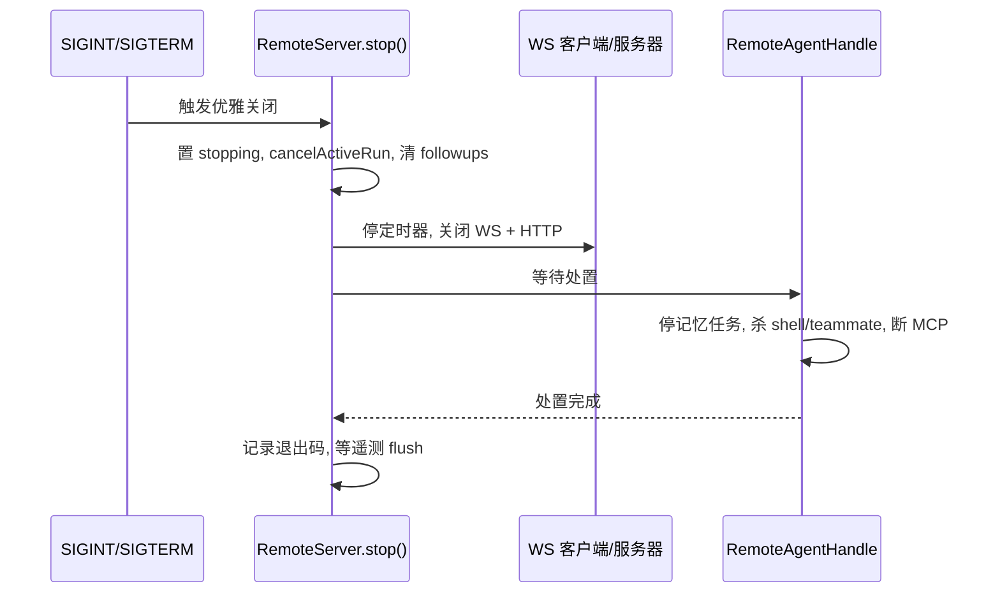

:::note 事实基线
本文依据 `$HOME/github/yukino-code/apps/yukino` 在 `7b9add587b16` 的源码事实撰写；文中路径、常量与 API 名称均可在该检出中定位。
:::

Remote 模式把 Yukino 变成一个本地 Web 服务: Express HTTP 服务器 + 同端口的 WebSocket 桥, 浏览器打开一个 React 前端, 得到与终端 UI 功能对齐的聊天界面 —— 流式回复、工具执行卡片、权限对话框、plan 审批、slash 命令、模型/provider 切换都在这里发生。

场景: 手机/平板访问开发机上的 agent、长跑任务放到服务器上跑、把 Yukino 嵌进自己的 Web 工作台。它和 [a2a](./a2a) 一样是服务器形态, 区别在于 Remote 服务的是浏览器里的人。本文按「启动与接入控制 → 架构装配 → WebSocket 协议 → 浏览器前端 → 生命周期」的顺序展开, 读者可以据此定位每一条断言对应的源码入口。

**主线一览**



## 一、启动与地址解析

```bash
yukino --remote                  # 监听 127.0.0.1:18888
yukino --remote 9000             # 自定义 loopback 端口 (":9000" 也可以)
yukino --remote 0.0.0.0:9000     # 显式暴露到所有网卡 (没有内置鉴权)
yukino --remote 0                # OS 分配端口, 实际地址打印到 stderr
```

### 1.1 地址解析规则

来源: `src/cli.ts`（`--remote` 参数解析）、`src/remote/address.ts`（`parseRemoteAddress`）。

- 地址由 `parseRemoteAddress` 解析: 纯数字按端口处理 (`"9000"` 等价于 `":9000"`), 也接受 `host:port` 和 `[IPv6]:port`; host 缺省回落 `127.0.0.1`, 即默认只绑定 loopback, 绑定非 loopback 地址必须显式写 host; 缺省端口 `18888`, 合法范围 0-65535（`allowEphemeral: true` 时端口 0 合法, 否则下限为 1）。
- 端口 `0` 时由 OS 选空闲端口, listen 成功后把实际地址写到 stderr: `Remote server listening at http://<host>:<port>/#token=<accessToken>`（`src/remote/server.ts` 监听成功分支）。走 stderr 是为了不污染 stdout 上的 JSONL 日志流。
- HTTP 侧由 Express 托管打包好的浏览器前端（`src/remote/browser` 单独构建, `pnpm build:browser`, 产物落在 `browser/dist`; 发布时随 CLI dist 一起打包, 运行时按 `BROWSER_DIST` 候选路径定位）。另有 `/health` 探针返回 `{ status: "ok", remote: true, clients }`; 未命中的路径回退 `index.html` 支撑 SPA 路由。
- 配置装载与终端一致: `loadConfig(undefined, { allowEmptyProviders: true })` 允许空 provider 启动（失败留到运行时暴露）, 项目级 MCP 配置合并、hooks、sandbox、coordinator、`enable_memory` 等开关全部透传给 `RemoteServer`（`src/main.tsx` 的 `runRemoteMode`）。

### 1.2 WS 接入控制

来源: `src/websocket-security.ts`（`authorizeWebSocketRequest`）。

- 每个 `RemoteServer` 实例构造时生成一次性访问 token: `randomBytes(32)` 编码为 base64url; 升级请求必须在 `?token=` 查询参数里携带, 用 `timingSafeEqual` 做时序安全比较（长度先比对再比较内容）, 不匹配返回 401。
- 升级路径必须是 `/ws`（否则 404）; `Origin` 头存在时必须与 `Host` 同源且协议为 `http:`, 防浏览器跨站 WebSocket 劫持, 违反返回 403; 不带 Origin 的非浏览器客户端不受此限。
- token 只经 stderr/URL fragment 本地分发: 前端从 `location.hash` 读出后存入 `sessionStorage`（键 `yukino.remote.accessToken`）并把 fragment 从地址栏抹掉, 之后连接 `ws(s)://<host>/ws?token=...`; 页面收到新的 `#token=...` 导航（服务器重启换新 token）会自动采纳并重连。

:::warning
HTTP 层**没有任何账号体系**, 暴露到公网必须自己套反向代理 + 认证。
:::

## 二、架构装配

### 2.1 Agent 懒创建与共享会话

来源: `src/remote/server.ts`（`createRemoteAgent`、`ensureAgent`）。

- agent 装配有懒创建兜底: `run()` 启动时先尝试 `createRemoteAgent`, 失败（例如 provider 未配置）只记一条警告, 推迟到第一条消息经 `ensureAgent()` 重试; 初始化去重靠共享的 init Promise, 失败会给所有客户端广播 `error`。
- 与 [terminal-ui](./terminal-ui) 共享同一套 Agent 循环和会话文件: remote 会话写入同样的 session JSONL, 既能被 CLI `--resume` 恢复, 也能在浏览器里用 `/resume` 选择器恢复（最多列 50 条, `SESSION_LIST_LIMIT`）。
- 记忆的后台整理（consolidation）在 remote 和交互式 UI 都会运行, 同一套 `MemoryConsolidator` 门槛: 距上次整理 ≥ 24h、会话数 ≥ 5、文件锁互斥（`src/memory/constants.ts` 的 `DEFAULT_MIN_HOURS` / `DEFAULT_MIN_SESSIONS`）。

### 2.2 工具装配

来源: `src/bootstrap/tool-registry.ts`（`createToolRegistry`）、`src/remote/server.ts`（remote 追加注册段）。

- `createToolRegistry` 以交互模式给出 18 个基础工具（Goal、TodoWrite/TeamTodoWrite、TaskOutput、Bash、PowerShell、ComputerUse、EditFile、EnterPlanMode、EnterWorktree、ExitPlanMode、ExitWorktree、ReadFile、ToolSearch、McpCall、WriteFile、Glob、Grep、WebFetch; 见 [function-calling](./function-calling)）。
- remote 再注册 LoadSkill、AskUserQuestion、TeamCreate、SendMessage、TeamDelete、TeamList、TaskStop、SyntheticOutput、Agent、Workflow（`attachWorkflow`）和 MCP 工具包装; 与终端 UI 的差异是 remote 不注册 InstallSkill（该工具只在 `src/ui/app.tsx` 的终端路径注册）。
- skills 同时被接成 slash 命令: inline 模式注册为 `prompt` 类型, fork 模式注册为 `skill_fork` 类型（隔离 subagent 里执行, 见 [skills](./skills)、[slash-command](./slash-command)）。

## 三、WebSocket 协议

JSON 帧 `{ type, data }`。服务端先按宽松的 `WsInboundSchema`（`{ type: string, data: unknown }`）解析整帧, 再逐类型用对应 zod schema 校验 data, 畸形消息记警告后丢弃; 前端侧 schema 在 `src/remote/browser/src/types.ts`, 是一个 `z.discriminatedUnion("type", ...)` 严格校验整帧, 不认识的帧直接丢弃。

### 3.1 client → server（18 种）

来源: `src/remote/browser/src/types.ts` 的 `ClientMessage` 联合类型; 服务端分发在 `src/remote/server.ts` 的 `handleWsMessage` switch。

| type                   | 用途                                    |
| ---------------------- | --------------------------------------- |
| user_message           | 发送用户消息（运行中则转为 steering）   |
| permission_response    | 权限请求应答 allow / deny / allowAlways |
| ask_user_response      | AskUserQuestion 应答                    |
| plan_approval_response | plan 审批应答 yolo / manual / feedback  |
| set_permission_mode    | 切换权限模式                            |
| model_list_request     | 请求当前 provider 的模型列表            |
| model_select           | 切换模型                                |
| provider_list_request  | 请求 provider 列表                      |
| provider_select        | 切换 provider                           |
| provider_save          | 保存 provider 配置                      |
| rewind_list_request    | 请求可回退的快照列表                    |
| rewind_action          | 执行回退                                |
| file_complete_request  | 文件路径补全（@ 提及）                  |
| image_upload           | 上传图片附件                            |
| background_shells      | 前台 shell 转后台（等价终端 Ctrl+B）    |
| mcp_app_request        | MCP app 交互请求                        |
| cancel                 | 中断当前 agent loop                     |
| ping                   | 心跳, 回 pong                           |

### 3.2 server → client（44 种）

来源: `src/remote/browser/src/types.ts` 的 `ServerMessageSchema`（44 个 `z.literal` 分支）。

- **连接与会话**: connected（session/cwd/streaming）、commands（slash 命令列表）、status（model/provider/permissionMode/thinkingLevel/thinkingLevels/sandboxEnabled/sandboxAutoAllow/contextWindow 快照）、session_list、clear、command_done、run_state（streaming）、pong、system（系统消息, 可带 markdown 标记）。
- **历史回放**: replay_user、replay_assistant。
- **流式输出**: stream_text、stream_end、thinking_text。
- **工具**: tool_use（toolId/toolName/args）、tool_result（output/isError/elapsed/mcpApp）、tool_output（增量输出）。
- **交互**: permission_request（id/toolName/description/rememberPatterns）、ask_user（id/questions）、plan_approval_request（id/planPath/planContent）、plan_approval_closed、request_expired（待决请求失效）。
- **steering**: steering_queued、steering_delivered（流式期间追加消息）。
- **生命周期**: turn_complete（turn）、loop_complete（stopReason/totalTurns/elapsed）、usage（inputTokens/outputTokens/contextTokens/contextWindow）、error、compact、retry（reason/waitMs）。
- **面板与状态**: history、todo_update（boardId/tasks）、subagents、background_tasks、teammates、followups。
- **配置与选择器**: model_list、provider_list、rewind_list、thinking_form、file_complete_response、image_saved、image_error。
- **MCP**: mcp_app_response。

### 3.3 事件桥接与流式冲刷

来源: `src/remote/server.ts` 的 `bridgeEvent` 与 `streamAgentRun`。

- AgentEvent 到 WS 消息的转换在 `bridgeEvent`: agent loop 的事件流被逐条翻译成前端消息, 前端不感知 agent 内部结构。
- `streamAgentRun` 维护一个 `streamBuf` 文本缓冲: 遇到 `tool_result` / `turn_complete` / `loop_complete` 边界先以 `stream_end` 冲刷缓冲, 保证工具卡片和轮次边界出现在正确的文本之后; 其余 `stream_text` 增量随帧广播。
- 失败的工具结果、retry、compact 还会经 `AgentEventLogger` 输出结构化日志（输出预览截断到 800 字符, `TEXT_PREVIEW_CHARS`）, 例行进度不落日志。

### 3.4 新连接初始快照

来源: `src/remote/server.ts` 的 `setupWebSocket` connection 分支。

新客户端连上时会收到一整套初始快照: connected/status（agent 就绪时）、commands、最近 200 条输入历史（`INPUT_HISTORY_LIMIT`）、usage、已注册的 MCP app 卡片重放、待决的 plan 审批与权限/提问请求重放（F5、新标签页、重连后仍能看到同样的待决对话框, 不会触发工具重跑或超时重置）。

### 3.5 请求与生命周期细节

- **原子认领**: 权限请求（见 [permission](./permission)）与 AskUserQuestion 应答用原子认领处理: 第一个应答（对重复应答或竞速的超时/取消）恰好完成请求一次, 然后向所有客户端广播 `request_expired`; `allowAlways` 但没有可记忆 pattern 时自动降级为一次性 `allow`。
- **待决请求超时**: 10 分钟（`PENDING_REQUEST_TIMEOUT_MS = 10 * 60 * 1000`）无响应自动了结: 权限自动拒绝、提问按空答案继续、plan 审批过期, 均伴随 system 消息。
- **plan 审批与终端对齐**: plan 模式下一轮运行成功退出 plan（ExitPlanMode/EnterPlanMode 成功）后弹出审批, `yolo` 进 bypassPermissions、`manual` 回 default, 批准后读取 plan 文件构造执行 prompt 自动开工; `feedback` 则把反馈当作新消息继续规划。
- **双向心跳**: 前端每 10s 发 `ping`（`PING_INTERVAL_MS`）, 服务端只回发送者 `pong`; 服务端每 30s 向每个客户端发 WS 层 ping（`HEARTBEAT_INTERVAL_MS`）, 75s 没收到 pong 就 terminate（`HEARTBEAT_STALE_MS`）, 清理半开连接。
- **运行中发来的消息**: 普通文本走 steering（`steering_queued` → agent 注入成功后的 `steering_delivered`）, 投递太晚的 leftover 变成后续轮次; `/goal` 控制指令就地处理; slash 命令和 Bash 命令进 followups 队列排队, 空闲槽位腾出后依次重放。
- **空闲唤醒**: 服务端每 250ms 检查一次 leader 邮箱和后台任务通知（`WAKEUP_POLL_INTERVAL_MS`）, 有待投递的就起一轮无用户消息的通知轮（对齐终端的 `useNotificationWakeup`）; teammate 状态每 500ms diff 一次（`TEAMMATE_POLL_INTERVAL_MS`）, 有变化才广播 `teammates`。

## 四、浏览器前端

技术栈: React 19.2.7 + Tailwind CSS v4, tsup 构建（ESM、`es2020` 目标、生产构建 minify）为静态资源由 Express 托管; markdown 渲染用 marked + DOMPurify, 代码高亮用 shiki。

### 4.1 组件清单

来源: `src/remote/browser/src/components/`。

- **消息流**: message-list、user-message、assistant-message、system-message、error-message、thinking-block、streaming-cursor、tool-block（可折叠的工具调用卡片）、collapsible、diff-lines、markdown。
- **交互对话框**: permission-dialog、ask-user-dialog、plan-approval-dialog、session-picker、rewind-dialog、provider-dialog、modal、picker-list。
- **输入与导航**: input-area、slash-menu（斜杠命令补全）、welcome、status-bar、done-indicator、activity-panel、todo-progress、model-picker、thinking-picker、mcp-app。

### 4.2 Hooks 与前端状态

来源: `src/remote/browser/src/hooks/`、`src/remote/browser/src/constants.ts`。

- `use-web-socket`: 连接与重连; `use-chat`: 消息 reducer, `ChatItem` 模型, 最多保留 1000 条（`MAX_CHAT_ITEMS`）; `use-auto-scroll`: 跟随滚动, 用户上翻或按住拖拽时暂停; `use-scroll-follow`: 键盘下拉菜单的光标行滚入可视区; `use-theme`; `offline-queue`。
- WebSocket 断开自动重连（3s 间隔, `RECONNECT_DELAY_MS`）, 连接状态 connecting / connected / reconnecting 展示在状态栏。
- 高频消息（`stream_text` / `thinking_text` / `tool_output`）按帧合并后经 `requestAnimationFrame` 批量派发, 避免每个 token 一次渲染。
- **离线队列**: 只重放 `user_message`（上限 100 条 / 1MB, `MAX_PENDING_MESSAGES` / `MAX_PENDING_BYTES`）; 权限/提问/plan 审批、ping、图片上传等离线即视为过期直接丢弃 —— 重连后重放旧授权可能重新授权或触发旧请求, 图片上传体积大且靠服务端应答闭环, 调用方会显式报告丢弃而非静默排队。

## 五、优雅关闭

`run()` 阻塞直到服务器停止（而不是一监听就返回）, 调用方的退出簿记因此总发生在服务器真正倒下之后。`/quit` 留 250ms（`SHUTDOWN_GRACE_MS`）给前端确认消息, 然后调用 `stop()`; Ctrl+C（SIGINT, 退出码 130）/ SIGTERM（退出码 143）由 `installRemoteTelemetrySignalHandlers` 安装处理器（`src/telemetry/index.ts`）触发的优雅关闭链:

1. `stop()` 置 stopping 标记, 清空 followups、待决 plan 执行与 MCP app 状态, `cancelActiveRun` 中断当前 agent loop、compact、用户 Bash 与 subagent 控制器, 把所有待决权限按拒绝了结、待决提问按空答案了结。
2. 停掉心跳/teammate 轮询/空闲唤醒三个定时器并中止在途的 model-list 请求, 关闭所有 WS 客户端, 依次关闭 WebSocketServer 与 HTTP 服务器。
3. 等待 `RemoteAgentHandle` 处置完成: 停后台记忆任务、杀掉 detached 的后台 shell 和 teammate 进程、断开 MCP 子进程、处置工具注册表与 OS sandbox。
4. 解除 `run()` 的阻塞, 记录真实退出码, 等遥测 flush 完成后以该退出码结束进程。



### 5.1 取舍与适用边界

- Remote 与终端共享会话文件和工具注册表, 换来两端功能对齐; 代价是浏览器前端必须与 CLI 同版本发布, 协议 schema 双向 zod 校验把版本漂移挡在连接层。
- 内置鉴权只有一次性 token, 适合本机 loopback 与受控内网; 跨公网部署必须前置反向代理认证, 否则 token 泄露即等于开放执行通道。
- 离线队列只保用户文本, 牺牲了弱网下的审批可达性, 换取不会在重连后重放旧授权的安全性。

---

**延伸阅读**: [a2a](./a2a) · [terminal-ui](./terminal-ui) · [permission](./permission) · [slash-command](./slash-command) · [skills](./skills) · [subagent](./subagent)
