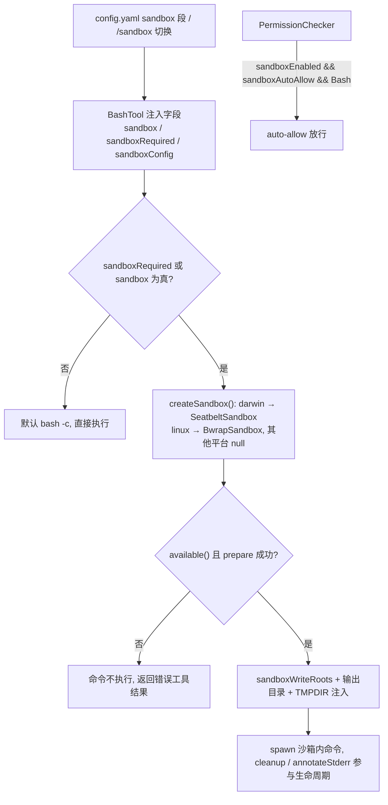
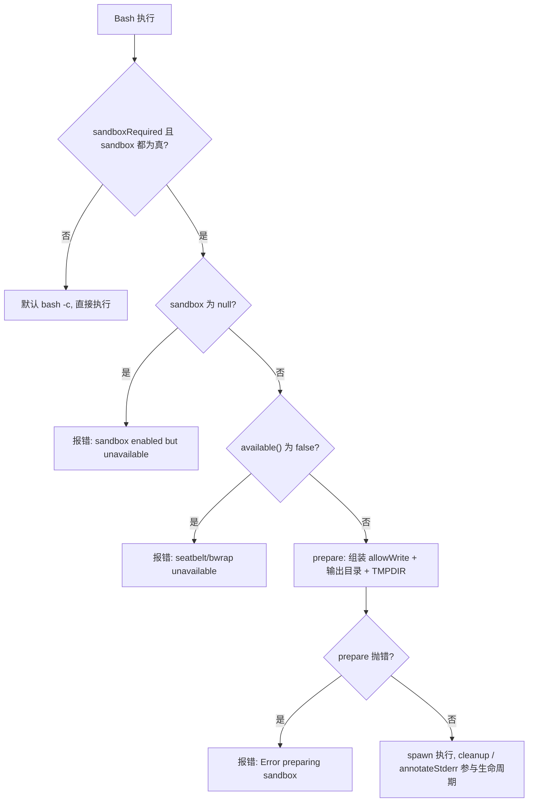

:::note 事实基线
本文依据 `$HOME/github/yukino-code/apps/yukino` 在 `7b9add587b16` 的源码事实撰写；文中路径、常量与 API 名称均可在该检出中定位。
:::

OS 级沙箱: 把 Bash 命令放进操作系统提供的隔离环境执行, 文件系统写入被收敛到允许的目录内, 网络可以整体关闭。

权限系统（见 [permission](./permission)）回答「这个工具调用要不要用户确认」, 沙箱回答「这条命令允许碰什么」; 两者独立又协同: 沙箱开启后, Bash 命令的破坏半径被 OS 收敛, 权限层就可以免人工确认（auto_allow）。本文按「配置与切换 → 统一接口 → macOS seatbelt → Linux bubblewrap → BashTool 集成 → worktree 联动 → auto_allow」的顺序展开。

**主线一览**



## 一、配置与运行时切换

### 1.1 配置文件

来源: `src/config/index.ts`（`SandboxYamlConfigSchema`）。

`~/.yukino/config.yaml` 的 `sandbox` 段, 三个键都是可选布尔值:

```yaml
sandbox:
  enabled: false # 主开关, 缺省 false
  auto_allow: false # 沙箱生效时, Bash 命令免人工确认（显式 deny/ask 规则仍然优先）
  network_enabled: true # 沙箱内的命令是否可以访问网络, 缺省 true
```

### 1.2 `/sandbox` 运行时切换

命令注册于 `src/commands/commands.ts`（占位 handler, 实际处理在 `src/ui/app.tsx` 与 `src/remote/server.ts` 各有一份等价实现）:

- `/sandbox auto`: 开启沙箱 + auto_allow 自动放行。
- `/sandbox manual`: 开启沙箱 + 手动确认。
- `/sandbox off`: 关闭沙箱, 释放沙箱实例（`disposeSandbox` 调 `sandbox.dispose?.()`）, 并把 BashTool 上的 `sandbox` / `sandboxRequired` 复位为 `null` / `false`。
- 无参数或其他参数: 打印当前状态（`ON + auto-allow` / `ON + manual` / `OFF`）、运行时可用性（`ready` / `blocked`）和用法说明。

`/status` 也会输出一行沙箱状态: 开启时是 `ON (auto-allow), ready` 这类组合, 未开启时是 `OFF`。

### 1.3 默认策略组装

来源: `src/bootstrap/sandbox.ts`（`configureBashSandbox`）。

默认的沙箱策略由 `configureBashSandbox` 组装, print 模式（`src/print-mode.ts`）和 remote server（`src/remote/server.ts`）启动时走这条路:

```ts
bash.sandboxRequired = config?.enabled ?? false;
if (bash.sandboxRequired) {
  bash.sandbox = await createSandbox();
  bash.sandboxConfig = {
    allowWrite: [cwd, tmpdir()], // 项目目录 + 临时目录
    denyWrite: [], // 默认没有写保护的洞
    networkEnabled: config?.network_enabled ?? true,
  };
}
if (checker) {
  checker.sandboxEnabled = bash.sandboxRequired;
  checker.sandboxAutoAllow = config?.auto_allow ?? false;
}
```

TUI（`src/ui/app.tsx`）有一份自己的同名闭包, 策略几乎一致, 差别是 `allowWrite` 为 `[cwd, "/tmp", tmpdir()]`（额外硬编码 `/tmp`）; 每次 agent loop 启动和用户用 `!` 前缀直接执行命令前都会重新套用当前开关状态, 并按 `available()` 的真实结果决定权限层的 `sandboxEnabled` / `sandboxAutoAllow` 是否置位 —— 沙箱不可用时 auto_allow 不会生效。

> tmpdir 必须在 allowWrite 里: mktemp、编译器、git、python tempfile 都依赖临时目录; macOS 的 tmpdir 是 `/var/folders/...` 而不是 `/tmp`; seatbelt 生成 profile 时还会为每个路径补发 realpath 变体（覆盖 `/tmp` → `/private/tmp` 这类符号链接）。

## 二、统一沙箱接口

来源: `src/sandbox/index.ts`。库入口以 `Sandbox` 命名空间导出 `Bwrap` / `Seatbelt` / `Constants` 三个子模块。

```ts
export type SandboxImplementation = "bwrap" | "seatbelt";

export interface SandboxConfig {
  allowWrite: string[];
  /** 永远只读的路径, 优先级高于 allowWrite */
  denyWrite: string[];
  networkEnabled: boolean;
}

export interface SandboxExecutionContext {
  cwd: string;
  abortSignal?: AbortSignal;
  commandId?: string;
}

export interface PreparedSandboxCommand {
  executable: string;
  args: string[];
  env?: NodeJS.ProcessEnv;
  annotateStderr?(stderr: string): string;
  cleanup?(): Promise<void> | void;
}

export interface Sandbox {
  readonly implementation: SandboxImplementation;
  readonly availabilityError?: string;
  available(): boolean | Promise<boolean>;
  prepare(
    command: string,
    config: SandboxConfig,
    context: SandboxExecutionContext,
  ): PreparedSandboxCommand | Promise<PreparedSandboxCommand>;
  /** 释放沙箱持有的会话级资源 */
  dispose?(): Promise<void> | void;
}
```

- `prepare` 的职责是「把用户命令包装成沙箱内执行的可执行文件 + 参数向量」, 返回的 `executable` / `args` 直接交给 `spawn`, 不再经过外层 shell 拼接。
- `annotateStderr` / `cleanup` / `env` 是留给实现的扩展点（当前 seatbelt 和 bwrap 都只用 `executable` + `args`）。
- `createSandbox()` 按平台选择实现: darwin → `SeatbeltSandbox`, linux → `BwrapSandbox`, 其他平台返回 `null`。

## 三、macOS: seatbelt

seatbelt 是 macOS 内核级的沙箱机制, 通过一个 SBPL（Sandbox Profile Language）策略文本定义进程的行为边界。实现是 `SeatbeltSandbox`（`src/sandbox/seatbelt.ts`）。

### 3.1 可用性与命令包装

- 可执行文件硬编码为 `/usr/bin/sandbox-exec`（`SANDBOX_EXEC_PATH`, `src/sandbox/constants.ts`）—— 不走 PATH, 防止 PATH 注入。
- `available()` 就是 `existsSync(SANDBOX_EXEC_PATH)`。
- `prepare` 先用 `resolveToolPath(cwd, path)` 解析 allowWrite / denyWrite 里的每个路径（展开 `~`, 相对路径基于 cwd resolve）, 再动态生成 profile。

包装后的命令（参数向量, 不是字符串拼接）:

```txt
/usr/bin/sandbox-exec -p <profile> bash -c <command>
```

### 3.2 profile 生成顺序

`buildProfile` 生成的 profile, 按固定顺序逐行产出:

```txt
(version 1)
(deny default)                              ;; 默认拒绝一切
(allow process-exec)                         ;; 允许执行程序
(allow process-fork)                         ;; 允许 fork 子进程
(allow sysctl-read)                          ;; 允许读 sysctl
(allow file-read* (subpath "/"))             ;; 允许读整个文件系统
(allow file-write* (literal "/dev/null"))    ;; shell 重定向 (> /dev/null) 需要可写的 /dev/null
(allow file-write* (subpath "/project"))          ;; allowWrite: 项目目录可写
(allow file-write* (subpath "/private/tmp"))      ;; allowWrite 的 realpath 变体也各发一条
(allow file-write* (subpath "/tmp"))
(deny file-write* (literal "/project/.yukino/config.yaml"))  ;; denyWrite: 每个变体
(deny file-write* (subpath "/project/.yukino/config.yaml"))  ;; 先发 literal 再发 subpath
(allow network*)                             ;; network_enabled: true; false 时是 (deny network*)
```

要点:

- `(deny default)` 起步: 写保护不是「列出禁止的路径」, 而是「默认禁止一切写, 只放行 allowWrite 子树」, denyWrite 再从放行的子树里挖洞; deny 规则在 allow 之后发出, SBPL 后者优先, 所以挖洞生效。
- 读是整个文件系统放行的: coding agent 需要读工具链、系统库、头文件。
- `/dev/null` 单独放行一个 literal 节点（不是整个 `/dev` 子树）: `> /dev/null`、`2>&1` 丢弃输出这类重定向需要以写模式打开它。
- allowWrite 和 denyWrite 的每个路径都经 `pathVariants` 展开: 原形式 + `realpathSync` 结果（macOS 的 `/tmp` → `/private/tmp`、`/var/folders/...` → `/private/var/folders/...` 这类符号链接）; 路径尚不存在时 realpath 抛错被吞掉, 只发原形式。
- denyWrite 的每个变体同时发 literal 和 subpath 两条 —— 覆盖「路径本身」和「路径的所有后代」, 且不依赖生成时的文件存在性检查（检查结果到启动时可能已经过期）。

:::warning
**注入防护**（有专门的测试覆盖）: 路径写入 profile 前经 `quoteProfileString` 转义反斜杠和双引号; 含 NUL、CR、LF 的路径直接抛错 `Seatbelt paths cannot contain NUL or newline characters` —— 防止配置里的恶意路径拼出额外的 profile 行。
:::

## 四、Linux: bubblewrap

bubblewrap（bwrap）是一个轻量级的用户空间容器工具, 通过 Linux 的 namespace 机制创建隔离环境。实现是 `BwrapSandbox`（`src/sandbox/bwrap.ts`）。

- `available()` 用 `execFileSync("which", ["bwrap"])` 探测, 结果缓存在实例的 `detected` 字段, 只探测一次。
- `prepare` 同样先经 `resolveToolPath` 解析配置路径; 可执行文件就是二进制名 `bwrap`, 由 spawn 经 PATH 解析。
- 用户命令通过 `bash -c` 在沙箱内运行, `--` 终止 bwrap 的选项解析, 命令内容不会与 bwrap 参数混淆。

包装后的参数向量:

```bash
bwrap \
  --unshare-user \              # 独立的用户 namespace
  --unshare-pid \              # 独立的进程 namespace
  --die-with-parent \          # yukino 异常死亡 (SIGKILL/崩溃) 时沙箱进程组一起退出, 不留孤儿
  --ro-bind / / \              # 整个文件系统挂载为只读
  --bind /project /project \   # allowWrite: 项目目录可写 (bind mount 覆盖只读)
  --ro-bind /project/.yukino/config.yaml /project/.yukino/config.yaml \  # denyWrite: 后挂载, 重叠时优先
  --unshare-net \              # 仅 network_enabled: false 时: 独立的网络 namespace, 断网
  --proc /proc \               # 独立的 proc, 很多命令依赖
  -- bash -c "用户命令"
```

和 seatbelt 的区别: seatbelt 是内核按策略文本过滤系统调用, bwrap 是用 namespace 重建一个受限的文件系统视图; denyWrite 在 bwrap 里靠挂载顺序实现 —— 只读 bind 在可写 bind 之后挂载, 路径重叠时后挂载的只读视图优先。

## 五、与 Bash 工具的集成

来源: `src/tools/bash.ts`、`src/tools/powershell.ts`、`src/tools/shell-background.ts`。

只有 Bash 工具消费 Sandbox 接口; PowerShell 明确不包裹（`src/tools/powershell.ts` 的注释: seatbelt 和 bwrap 包装的都是 `bash -c`, 而 Windows —— PowerShell 的主平台 —— 没有 OS 沙箱实现）。

BashTool 上的三个注入字段: `sandbox: Sandbox | null`、`sandboxRequired: boolean`、`sandboxConfig: SandboxConfig`（默认 `{ allowWrite: [], denyWrite: [], networkEnabled: true }`）。执行路径:

1. 沙箱未启用（`sandboxRequired` 和 `sandbox` 都为假）: prepared 就是默认的 `bash -c <command>`, 直接执行。
2. 启用了但 `sandbox` 为 null（平台不支持, `createSandbox()` 返回 null）: 返回错误工具结果 `Error: sandbox is enabled but unavailable; command was not executed`, 命令不执行 —— Windows 上配置 `sandbox.enabled: true` 就是这个后果, 每条 Bash 命令都直接报错。
3. `sandbox` 存在但 `available()` 为 false: 返回 `Error: <implementation> sandbox is unavailable; command was not executed`（seatbelt / bwrap 同理）, 命令不执行。
4. prepare 时组装实际生效的 allowWrite:
   - 有 permissionChecker 时, 基础写根取 `checker.sandboxWriteRoots(sandboxConfig.allowWrite)` 而不是配置原值（见下节 worktree）; 没有 checker 就用配置原值。
   - 再追加命令输出文件所在目录: stdout/stderr 直写进会话产物目录（`~/.yukino/sessions/artifacts/<sessionId>/tool-results/`, 创建失败时回退 tmpdir）里的随机命名文件, 目录按会话稳定、文件名每条命令随机且 prepare 时尚不存在, 所以放行的是目录。
   - `checker.sandboxTempDirectory()` 有值时（隔离 worktree 场景）, `prepared.env` 追加 `TMPDIR` / `TMP` / `TEMP` 指向 worktree 专属临时目录。
5. prepare 抛错（如 seatbelt 的路径注入检查）: 返回 `Error preparing sandbox: ...`, 命令不执行。



spawn 之后, `PreparedSandboxCommand` 的扩展点参与命令生命周期: 前台命令 settle 或后台任务结束时调用 `prepared.cleanup?.()`, cleanup 失败会在工具结果后追加 `Error cleaning up sandbox: ...`; `prepared.annotateStderr` 传给 `buildShellResult`, 用于给 stderr 附加沙箱违规说明。`BashTool.dispose()` 会调用 `sandbox.dispose?.()` 并置空引用。

:::warning
沙箱启用但平台不支持（`createSandbox()` 返回 null）或 `available()` 为 false 时, **每条 Bash 命令都会直接报错**、不执行 —— Windows 上配置 `sandbox.enabled: true` 即为此后果; `prepare` 抛错（如路径注入检查）同样不执行命令。
:::

## 六、与 worktree 隔离的联动

来源: `src/permissions/index.ts`、`src/worktree/index.ts`。

PermissionChecker 提供两个方法把 worktree 隔离（见 [worktree](./worktree)）翻译进沙箱的写根:

- `sandboxWriteRoots(fallback)`: checker 处于隔离 worktree（`isolatedRoot`）时, 用 `[isolatedRoot]` 替换 fallback 写根, 再叠加 extraRoots 和所有已注册 worktree 的 git 写根 —— git 运行需要 per-tree index（gitDir）、共享对象库（`objects/`）和本分支的 `refs/heads/`、`logs/` 目录, 但绝不放行 common Git 目录整体或兄弟分支的 refs。
- `sandboxTempDirectory()`: 隔离 worktree 场景返回 `<gitDir>/yukino-tmp`（注册时以 `0o700` 创建）, 经 env 注入让沙箱内命令的临时文件也落在隔离区。

效果: 沙箱化的 Bash 命令在隔离 worktree 里能写 worktree 目录和它自己的 git 元数据, 写不到主 checkout 和其他 worktree。

## 七、auto_allow: 沙箱换确认

来源: `src/permissions/index.ts`（`checkAction` 判定链）。

沙箱生效后, Bash 命令的写破坏半径已经被 OS 限制, 权限层增加一道沙箱自动放行:

```ts
if (this.sandboxEnabled && this.sandboxAutoAllow && toolName === "Bash") {
  return { effect: "allow", reason: "Sandbox auto-allow: OS sandbox active" };
}
```

它位于判定链的中后段, 前面每一层都先短路, 所以 auto_allow 放行的命令有明确边界:

- **显式规则最先评估**: 命中 deny / ask 规则的命令在这一层之前就被拦下, 沙箱不能覆盖显式规则; Bash 的复合命令在规则评估阶段就按 `;`、`|`、`&`、`&&`、`||`、换行拆成子命令逐条匹配（deny / ask 规则还额外匹配可执行名 basename 归一化的形式）。
- **安全只读命令**（`isSafeCommand`）本来就在更前面的层放行, auto_allow 免确认的是「非只读但没有规则命中」的命令。
- **空命令 ask** 也在前面。
- `analyzeShell` 判定「不完整」的命令（含 `$` 展开、反引号、命令替换、重定向、未闭合引号等无法按字面分解的语法）会先落入 ask（reason: `Complex shell syntax requires approval`）—— 展开后的真实效果无法靠字面授权, 沙箱模式也不例外; 因此 auto_allow 实际放行的是可字面分解的命令。

只有 Bash 享受这一层: PowerShell 等其他 command 工具不会被 OS 沙箱包裹, `toolName === "Bash"` 的条件把它们排除在外。

两个开关标志的来源: print 模式和 remote server 由 `configureBashSandbox` 直接从配置置位; TUI 在每次 agent loop 启动前重新计算, `checker.sandboxEnabled` / `checker.sandboxAutoAllow` 还要与 `available()` 的就绪结果相与 —— 沙箱不可用时不会自动放行。

### 7.1 取舍与适用边界

- **设计取舍**: 沙箱负责限制「能碰什么」, 规则负责表达「不许做什么」, `auto_allow` 把两者组合起来, 用 OS 隔离换掉大部分人工确认, 同时保留显式规则和复杂语法审批的最后否决权。
- **平台边界**: seatbelt 只在 macOS、bwrap 只在 Linux; Windows 既无实现也无 `available()` 路径, 配置开启即每条命令报错。
- **隔离强度**: seatbelt 是系统调用级策略过滤, bwrap 是 namespace 视图重建; 两者都不构成强安全容器, 面对已知逃逸路径的恶意命令仍需显式 deny 规则兜底。

---

**延伸阅读**: [permission](./permission) · [worktree](./worktree) · [terminal-ui](./terminal-ui) · [what-is-an-agent](./what-is-an-agent) · [remote](./remote)
