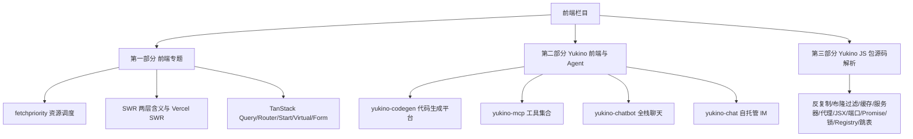

前端方向的补充笔记, 按主题分为三部分, 共 24 个页面 (含本落地页). JavaScript、CSS、React、Next.js、Vite 与浏览器监控 SDK 等通用基础知识由 `h` 知识库覆盖, 本栏目只保留 `h` 之外的专题与源码解析.

### 栏目地图

## 第一部分: 前端专题

| 页面                                 | 内容概要                                                                                                                                      |
| ------------------------------------ | --------------------------------------------------------------------------------------------------------------------------------------------- |
| [fetchpriority](fetchpriority)       | Priority Hints: `fetchpriority` 属性语义与取值、浏览器资源优先级模型、预加载与首屏优化用法与度量、渐进增强与误区                              |
| [swr](swr)                           | SWR 的两层含义: RFC 5861 `stale-while-revalidate`/`stale-if-error` 指令与 CDN 生态、前端"先回缓存再后台重验证"模式、Vercel `swr` 库与手写方案 |
| [tanstack-query](tanstack-query)     | TanStack Query v5: 缓存模型、queryKey 设计、失效与乐观更新、分页与预取水合, 以及与客户端状态、表单、虚拟列表的职责边界                        |
| [tanstack-router](tanstack-router)   | TanStack Router: 类型安全的路由、file-based 与 code-based 两种声明方式、loader 数据预取与搜索参数校验                                         |
| [tanstack-start](tanstack-start)     | TanStack Start: 全栈 React 框架的路由与 Server Functions、`createServerFn` 校验与 CSRF 中间件、流式渲染与部署模型                             |
| [tanstack-virtual](tanstack-virtual) | TanStack Virtual: 虚拟列表的 `useVirtualizer`、动态测量、overscan 与程序化滚动, 以及不定高场景的取舍                                          |
| [tanstack-form](tanstack-form)       | TanStack Form: 类型安全表单、字段级校验与异步校验、`form.Field` 与订阅模型, 以及与服务端状态的边界                                            |

## 第二部分: Yukino 前端与 Agent 系列

:::info
以下文档均以对应仓库的**真实源码**为事实依据, 而非官方文档或二手资料. 技术断言、文件名、命令、常量、版本号均已在编写时逐条核对.
:::

| 页面                             | 内容概要                                                                                                                                                                                                                     |
| -------------------------------- | ---------------------------------------------------------------------------------------------------------------------------------------------------------------------------------------------------------------------------- |
| [yukino-codegen](yukino-codegen) | Yukino Codegen AI 全栈代码生成平台: 服务端用 Yukino 编码 Agent 在真实磁盘上迭代产出 Vite 工程, 再在 OS 沙箱内完成依赖安装与生产构建, 以能力 URL 形式的静态预览发布 dist, 经 WebSocket 事件溯源与预览桥闭合生成/运行/修复回路 |
| [yukino-mcp](yukino-mcp)         | Yukino 官方 MCP 服务器: 把本地 RAG 文档检索、MCP Apps 交互式 UI、gh CLI 与多类数据后端收敛成一组 MCP 工具, 以 stdio 与无状态 Streamable HTTP 双传输暴露                                                                      |
| [yukino-chatbot](yukino-chatbot) | pnpm 全栈 LLM 聊天应用: Koa 3 后端的 JWT 会话、Provider 热切换、即时构建的 RAG 检索与 SSE 流式输出, React 19 前端以 Jotai 加 React Query 分层状态, 流式渲染热路径移出 React                                                  |
| [yukino-chat](yukino-chat)       | 自托管 IM 平台 (重点关注 Hono 服务端): WebSocket 消息枢纽与投递语义、WebRTC 信令、分块断点续传、Redis 缓存双实现降级、Nginx 边缘部署, 以及进程内嵌入的只读 coding agent 与 JSON-RPC 桥                                       |

## 第三部分: Yukino JS 包源码解析

:::info
这一组的每篇均以 `yukino.js` monorepo 中对应 package 的当前源码为事实依据, 聚焦各包独有的设计与实现取舍; 通用 JS/React/Lit 教程由 `h` 知识库覆盖.
:::

| 页面                                             | 内容概要                                                                        |
| ------------------------------------------------ | ------------------------------------------------------------------------------- |
| [yukino-anti-copy](yukino-anti-copy)             | 反复制保护: 剪贴板拦截、键盘/右键/打印拦截、样式注入与生命周期清理              |
| [yukino-bloom-filter](yukino-bloom-filter)       | 布隆过滤器: 位数组与多重哈希、误判率与容量估算、增删查边界                      |
| [yukino-cache](yukino-cache)                     | groupcache 风格缓存: Group、双层 LRU、singleflight、一致性哈希与 gRPC peer 通信 |
| [yukino-create-servers](yukino-create-servers)   | 便捷服务器创建器: 配置入口与默认中间件组合                                      |
| [yukino-http-proxy](yukino-http-proxy)           | HTTP 代理: 请求转发、头部处理与流管道                                           |
| [yukino-http-server](yukino-http-server)         | HTTP 服务器封装: 路由、中间件与 CLI 入口                                        |
| [yukino-lit-jsx](yukino-lit-jsx)                 | JSX → Lit 模板转换链: `jsx-runtime`、元素注册、事件与 spread/select-value 指令  |
| [yukino-port-finder](yukino-port-finder)         | 可用端口探测: 端口扫描与并发边界                                                |
| [yukino-promises-a-plus](yukino-promises-a-plus) | Promises/A+ 实现: 状态机、then 链与异步调度、规范测试适配                       |
| [yukino-redis-lock](yukino-redis-lock)           | TS 版分布式锁: 秒/毫秒 API、客户端所有权与取消机制, 与 Go 版的差异              |
| [yukino-registry-mock](yukino-registry-mock)     | 本地 registry mock: 请求拦截、响应注入与 CLI                                    |
| [yukino-skiplist](yukino-skiplist)               | 跳表实现: 层级与查找/插入/删除、持久化与迭代                                    |

:::tip
按主题选读即可: 想深入资源调度与服务端状态看**第一部分**, 了解 Yukino 系列的真实架构则直接跳到**第二、三部分**.
:::
