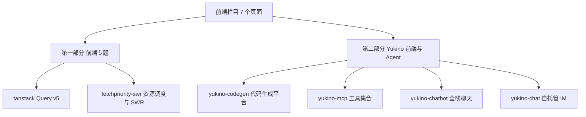

前端方向的补充笔记, 按主题分为两部分, 共 7 个页面 (含本落地页). JavaScript、CSS、React、Next.js、Vite 与浏览器监控 SDK 等通用基础知识由 `h` 知识库覆盖, 本栏目只保留 `h` 之外的专题与源码解析.

### 栏目地图

## 第一部分: 前端专题

| 页面                                   | 内容概要                                                                                                                                               |
| -------------------------------------- | ------------------------------------------------------------------------------------------------------------------------------------------------------ |
| [tanstack](tanstack)                   | TanStack Query v5: 缓存模型、queryKey 设计、失效与乐观更新、分页与预取水合, 以及与客户端状态、表单、虚拟列表的职责边界                                 |
| [fetchpriority-swr](fetchpriority-swr) | Priority Hints 与 fetchpriority: 属性语义与取值、浏览器资源优先级模型、预加载与首屏优化用法与度量; SWR 的两层含义: RFC 5861 缓存指令与前端数据获取模式 |

## 第二部分: Yukino 前端与 Agent 系列

:::info
以下文档均以对应仓库的**真实源码**为事实依据, 而非官方文档或二手资料. 技术断言、文件名、命令、常量、版本号均已在编写时逐条核对.
:::

| 页面                             | 内容概要                                                                                                                                                                                                                                          |
| -------------------------------- | ------------------------------------------------------------------------------------------------------------------------------------------------------------------------------------------------------------------------------------------------- |
| [yukino-codegen](yukino-codegen) | Yukino Codegen AI 全栈代码生成平台: 服务端用 Yukino 编码 Agent 在真实磁盘上迭代产出 Vite 工程, 再在 OS 沙箱内完成依赖安装与生产构建, 以能力 URL 形式的静态预览发布 dist, 经 WebSocket 事件溯源与预览桥闭合生成/运行/修复回路                      |
| [yukino-mcp](yukino-mcp)         | Yukino 官方 MCP 服务器: 把本地 RAG 文档检索、MCP Apps 交互式 UI、gh CLI 与 PostgreSQL/MySQL/ClickHouse/Redis/MongoDB/Prometheus/Grafana/MinIO/etcd/Milvus/Kafka 十一类数据后端收敛成 15 个 MCP 工具, 以 stdio 与无状态 Streamable HTTP 双传输暴露 |
| [yukino-chatbot](yukino-chatbot) | pnpm 全栈 LLM 聊天应用: Koa 3 后端的 JWT 会话、Provider 热切换、即时构建的 RAG 检索与 SSE 流式输出, React 19 前端以 Jotai 加 React Query 分层状态, 流式渲染热路径移出 React                                                                       |
| [yukino-chat](yukino-chat)       | 自托管 IM 平台: Hono 服务端、WebSocket 消息枢纽与投递语义、WebRTC 信令、分块断点续传、Redis 缓存双实现降级、前后端分离的 Nginx 边缘部署与移动端适配, 以及为每个用户进程内嵌入的只读 coding agent 与其 JSON-RPC 桥                                 |

:::tip
按主题选读即可: 想深入服务端状态与资源调度看**第一部分**, 了解 Yukino 系列的真实架构则直接跳到**第二部分**.
:::
