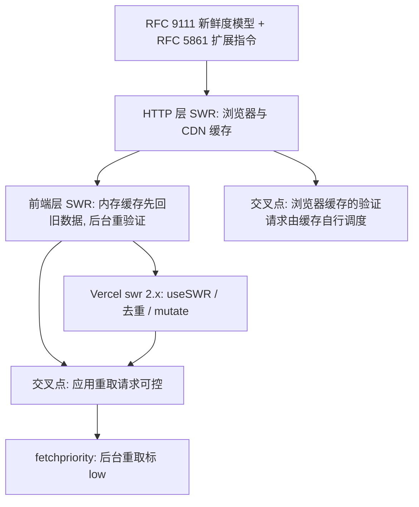

:::note 版本基线
HTTP 缓存指令按 **RFC 9111** (缓存基线) 与 **RFC 5861** (`stale-while-revalidate` / `stale-if-error` 扩展) 口径描述; 前端数据模式对照 **TanStack Query v5**; Vercel `swr` npm 包按当前 **2.x** 口径描述, 其 API 名称与默认值以官方文档 (https://swr.vercel.app/docs/getting-started、/docs/advanced/cache、/docs/mutation、/docs/api) 本次抓取结果为准. 浏览器私有缓存对两条指令的实现差异已在文内标注, 不把实验行为写成通用保证; 与资源优先级调度的交叉点见 [fetchpriority](fetchpriority).
:::

**主线一览**



标题里的 SWR 还有第二层含义, 而且与优先级调度在同一个问题上交汇: 数据请求的调度与新鲜度. 本文从 HTTP 缓存指令讲到前端数据获取模式, 再补上把这套模式做成 Hooks 库的 Vercel `swr`.

SWR 这个名字同时指两件事: HTTP 缓存层的 `stale-while-revalidate` 响应指令 (RFC 5861 定义, 运行在浏览器与 CDN 的 HTTP 缓存里), 以及前端数据获取层的 "先返回缓存立即渲染, 再后台重新验证" 模式 (运行在应用自己的缓存里). 两者同名, 是因为它们描述同一个取舍: 宁可先给旧数据, 也不让用户等待, 旧数据在后台被悄悄换成新的.

## 十一、HTTP 层的 SWR: 缓存扩展指令

### 11.1 RFC 9111 的新鲜度模型是前提

HTTP 缓存的基线行为由 RFC 9111 定义: 一个可缓存的响应在"新鲜生命周期"内可以直接返回, 过期 (stale) 之后原则上必须通过条件请求重新验证 (`ETag` 配 `If-None-Match`, 或 `Last-Modified` 配 `If-Modified-Since`). 新鲜时长由 `max-age` 决定 (`Expires` 头在 `max-age` 存在时被忽略); 对共享缓存, `s-maxage` 进一步覆盖 `max-age` 与 `Expires`. 两条关键约束:

- `must-revalidate`、`proxy-revalidate` 与 `s-maxage` 都禁止共享缓存在验证成功之前返回过期响应. 对这些响应, 不存在"先给旧数据"的余地.
- RFC 9111 规定, 缓存只有在断网, 或得到客户端/源站显式许可时才允许返回过期响应; RFC 5861 的两条扩展指令正是这种"显式许可"的标准化形式.

RFC 9111 同时规定了扩展指令的命名空间: 缓存必须忽略不认识的 Cache-Control 指令. 因此 `stale-while-revalidate` 与 `stale-if-error` 天然渐进增强——不支持的实现直接忽略, 行为退回纯 `max-age` 语义.

### 11.2 stale-while-revalidate: 过期窗口内的异步重验证

```http
Cache-Control: max-age=600, stale-while-revalidate=30
```

语义按时间轴分三段:

| 阶段     | 区间         | 缓存行为                                             |
| -------- | ------------ | ---------------------------------------------------- |
| fresh    | 0 至 600s    | 直接返回缓存, 不发任何请求                           |
| SWR 窗口 | 600s 至 630s | 立即返回过期缓存, 同时异步发起重新验证, 客户端不等待 |
| 窗口外   | 630s 之后    | 停止特殊优待, 下一个请求被阻塞, 走正常的同步验证     |

三个精确要点:

- 重验证成功后, 响应重新变为 fresh, 时间轴归零, 对客户端而言这段过期期完全不可见——验证延迟被藏在了窗口内.
- 窗口外的行为是"退化", 不是"报错": 缓存只是不再享受异步特权, 阻塞式验证是 RFC 9111 的标准流程.
- 异步验证只有请求落在窗口内才会被触发. 缓存不应在无请求时主动验证 (RFC 5861 的安全考量是防止放大攻击), 所以低流量资源的窗口可能始终没有机会被使用.

### 11.3 stale-if-error: 出错时容忍旧数据

```http
Cache-Control: max-age=600, stale-if-error=1200
```

当缓存为获取或验证响应而遇到错误时, 允许用过期的旧响应顶上, 而不是把硬错误抛给客户端. 这里的"错误"有明确边界: 指导致 500、502、503、504 这四类状态码的情况 (源站报错、上游不可达、DNS 失败等). 值的含义是陈旧度的上限: 旧响应的 Age 超过 `max-age` 加 `stale-if-error` 之和后, 必须把真实的错误响应原样返回.

两个补充:

- 它也可以写在请求的 Cache-Control 里, 作用域仅限该请求; 但各浏览器目前都不支持请求侧的用法.
- 它不改变新鲜度语义: 被拿来应急的响应仍是过期的, 带有非零的 `Age` 头, 缓存应如实暴露陈旧.

### 11.4 CDN 与代理生态

两条指令的主要价值在共享缓存侧, 各生态的实现程度:

| 生态              | stale-while-revalidate                                                            | stale-if-error |
| ----------------- | --------------------------------------------------------------------------------- | -------------- |
| Fastly            | 支持, 并可通过请求配置扩展窗口                                                    | 支持           |
| Cloudflare        | 支持                                                                              | 支持           |
| Akamai 等商业 CDN | 支持 (各家配置项名称不同)                                                         | 支持           |
| Varnish           | 4.0 起识别两条指令                                                                | 同左           |
| Squid             | 支持 stale-while-revalidate                                                       | 不识别         |
| Nginx (开源版)    | 不识别响应指令, 用 `proxy_cache_use_stale` 配置等价行为                           | 同左           |
| 浏览器            | Chrome 75、Firefox 68 起明确支持; Safari 支持程度随版本差异较大, 需在目标版本实测 | 均未实现       |

浏览器侧现状意味着: `stale-while-revalidate` 在 Chrome 与 Firefox 的私有 HTTP 缓存中已生效, Safari 的实际行为存在版本差异, 不应作为通用保证; 但 `stale-if-error` 没有任何浏览器实现, 出错兜底只能由 CDN/代理兑现. 浏览器按 RFC 9111 忽略不认识的指令, 两条指令都无兼容风险. 前端 SWR 模式 (见十二节) 仍有独立价值: 它管理的是应用自己的内存数据缓存, 与组件生命周期和 UI 状态联动, 这一层不受 HTTP 缓存指令控制.

### 11.5 典型 Cache-Control 组合

| 组合                                                           | 适用对象                                                         |
| -------------------------------------------------------------- | ---------------------------------------------------------------- |
| `max-age=604800, stale-while-revalidate=86400`                 | 带内容哈希的静态资源: 一周内免验证, 过期后一天内异步更新         |
| `max-age=60, stale-while-revalidate=600, stale-if-error=86400` | 公共读接口: 一分钟新鲜, 十分钟异步刷新窗口, 出错时旧数据兜底一天 |
| `s-maxage=60, stale-while-revalidate=600, private`             | CDN 只缓存一分钟, 浏览器私有缓存可继续享受 SWR 窗口              |

注意两点: 其一, 服务端要按 `max-age` 与 `stale-while-revalidate` 之和评估最坏情况——两个值都设 600 意味着必须容忍响应最多被缓存 20 分钟; 其二, `s-maxage` 自带 must-revalidate 语义, 共享缓存对带 `s-maxage` 的响应过期后必须先验证, 因此把过长的 SWR 窗口与 `s-maxage` 同用时, 实际生效的宽松程度以具体 CDN 的实现为准.

### 11.6 适用与不适用

适合:

- 变化频率低、最终一致即可的内容: 商品详情、配置、字典数据、静态化 JSON.
- 读多写少的公共资源: 窗口内的异步验证把回源压力摊薄, 同时多数请求的延迟被完全隐藏.
- 作为可用性兜底: `stale-if-error` 让源站短暂故障 (发布、抖动) 不直接转化为用户可见的 5xx.

不适合:

| 场景         | 原因                                                              | 对策                                           |
| ------------ | ----------------------------------------------------------------- | ---------------------------------------------- |
| 个性化内容   | 响应因人而异, 过期副本可能把 A 的数据发给 B, 且共享缓存本就不该存 | `private` 或 `no-store`, 配合短 `max-age`      |
| 强一致性读   | 余额、库存、权限这类数据, 旧值可能导致错误业务决策                | `must-revalidate` 或不缓存                     |
| 写后立即读   | 提交后立刻看到旧数据是显性体验 bug                                | 短 `max-age`、`s-maxage=0`, 或在应用层主动失效 |
| 安全敏感响应 | 撤销、封禁类数据的过期使用是安全漏洞                              | `must-revalidate` 或 `no-cache`                |

一句话: SWR 是拿一致性换延迟的旋钮, 前提是业务能容忍短暂旧数据; 容忍度为零的读路径不要用.

## 十二、前端数据获取模式的 SWR

### 12.1 模式的定义与收益

HTTP 层的 SWR 由缓存在响应链路里自动执行; 前端层的 SWR 是应用代码里的显式策略, 流程固定为三步:

1. 读取时若缓存里有数据, 立即用它渲染, 不等待网络.
2. 同时 (或紧随其后) 发起后台重新验证请求.
3. 新数据返回后替换缓存, 界面就地更新.

收益是消除了"请求往返期间界面空白": 没有骨架屏等待, 二次进入页面瞬间有数据. 代价与 HTTP 层一致——首次渲染的数据可能是旧的, 且必须接受"后台刷新可能失败或更晚到达". 这个模式成立的前提与十一节相同: 数据允许短暂陈旧.

### 12.2 手写 SWR: 三个能力

仓库内的手写 SWR 方案 ([前端监控与数据请求工程实践](../docs/ieg) 中有完整实现) 用约 155 行核心代码提供三个能力, 恰好是 SWR 模式的最小集合:

| 能力                   | 实现要点                                                                                        |
| ---------------------- | ----------------------------------------------------------------------------------------------- |
| 预加载                 | 内联脚本在 HTML 解析阶段发起请求, 早于框架 bundle 下载完成; promise 先入缓存, 结果后补          |
| 去重                   | 缓存条目同时持有 promise 与 result 两个锚点; 在途时多个消费方共享同一个 promise, 天然不重复请求 |
| stale-while-revalidate | result 已就绪时立即返回旧数据 (耗时接近 0), 同时后台静默重新验证, 新数据回来后更新缓存          |

消费侧按 "result 命中 -> promise 复用 -> 冷启动重建" 三级降级, 任何接入状态下都能正确工作. 它与 HTTP 层 SWR 的结构对应关系是直接的: "result 命中" 对应 fresh 期直接返回, "后台静默重新验证" 对应 SWR 窗口内的异步验证; 区别在于它没有窗口参数, 采用"每次命中都后台刷新"的激进策略, 适合分钟级以下变化的低频数据.

### 12.3 与 TanStack Query v5 缓存模型的对照

[TanStack Query](tanstack-query) 是通用服务端状态库, 其默认策略就是 SWR: 一条数据可以同时"已过期"和"仍在缓存中", 此时组件挂载先用旧数据渲染, 同时后台重取, 完成后原地替换——官方称之为"缓存优先、后台刷新". 与手写方案的差异在工程覆盖面:

| 维度       | 手写 SWR                                                        | TanStack Query v5                                                          |
| ---------- | --------------------------------------------------------------- | -------------------------------------------------------------------------- |
| 缓存结构   | 全局 Map, 条目含 promise / result / timestamp                   | QueryCache 按 queryHash 存 Query, key 经确定性哈希 (对象键排序)            |
| 新鲜度判定 | 无 TTL, 每次命中都后台刷新                                      | `staleTime` 参数化: 过期只是"允许重取", 触发时机是挂载、窗口聚焦、网络重连 |
| 失效控制   | 无主动失效 (TTL、主动失效、按 key 过期策略是几十行内的演进方向) | `invalidateQueries` 前缀匹配 + 写后直写 + 乐观更新回滚                     |
| 请求去重   | promise 在途复用                                                | 相同 queryKey 共享同一 Query 实例与在途请求                                |
| 预加载     | 内联脚本, 早于 bundle                                           | `queryClient.query` / `usePrefetchQuery`, 运行在 bundle 内                 |
| 失败处理   | 后台刷新失败保留旧数据, 下次消费再重试                          | `retry` / `retryDelay` 指数退避, 离线 `paused` 挂起                        |
| 能力覆盖   | 刻意只做三件事                                                  | 分页、无限滚动、SSR 水合、持久化等完整能力                                 |

最关键的分野仍是预加载时机: 手写方案把请求发起点提前到 HTML 解析阶段的内联脚本, 此时 bundle 还在下载, 网络请求与脚本加载并行——任何运行在 bundle 内部的库都无法利用这个时间窗口, 因为库本身就是 bundle 的一部分. 库的预取最早也只能在应用初始化后触发. 这正是 MPA 多页、老新框架共存的存量项目选择手写方案的决策点; 新项目若需要失效、写后同步、分页等能力, TanStack Query 的成熟度则是净收益.

## 十三、交叉点: 后台重新验证请求的优先级

上篇的 `fetchpriority` 与下篇的 SWR 在一处相遇: 后台重新验证发起的请求, 用户看不见、不阻塞交互, 正适合标记低优先级.

```js
// SWR 的后台重新验证: 用户已在渲染旧数据, 这个请求不与任何等待竞争
await fetch("/api/selector-options", { priority: "low" });
```

三个要点:

- 浏览器缓存层面, `stale-while-revalidate` 触发的验证请求由浏览器/CDN 自行调度, 开发者无法也不应干预其优先级; 应用层面, SWR 的重新验证请求走 `fetch()`, `priority` 选项完全可控.
- `low` 只改变排队顺序, 不取消请求, 也不会"导致不加载" (上篇误区之一); 但验证请求被压得越久, 缓存里停留的旧数据就越久. 对带 TTL 或激进刷新的实现, 要确保低优先级不至于让重新验证长期完不成, 最终把用户拖入一次同步等待.
- 服务端视角的对应建议同 RFC 5861: 重新验证应以"有消费触发"为前提, 不做无请求的主动全量预热, 避免请求放大.

## 十四、两层 SWR 的对照小结

| 维度       | HTTP 层的 SWR                     | 前端层的 SWR                                                  |
| ---------- | --------------------------------- | ------------------------------------------------------------- |
| 定义来源   | RFC 5861 (RFC 9111 的扩展指令)    | 应用层数据获取模式, 以 SWR 客户端库 / TanStack Query 等为代表 |
| 声明方式   | 服务端 `Cache-Control` 响应指令   | 应用代码策略 (TTL / staleTime / 每次命中刷新)                 |
| 生效位置   | 浏览器 HTTP 缓存与 CDN/代理       | 应用自己的内存缓存 (Map / QueryCache)                         |
| 新鲜度旋钮 | `max-age` + SWR 窗口秒数          | staleTime / 过期策略                                          |
| 触发重验证 | 请求落在窗口内                    | 组件挂载、窗口聚焦、主动失效                                  |
| 失败兜底   | `stale-if-error` 按秒数容忍旧数据 | 保留旧数据, 下次消费重试                                      |

两层的哲学完全一致: 拿一致性换延迟, 把重新验证藏到用户感知之外; 差异只在生效位置与调参方式. 而 `fetchpriority` 恰好为前端层的后台重取请求提供了调度信号——让"看不见的请求"排在"看得见的请求"后面.

## 十五、Vercel SWR (`swr` npm 包)

前面几节讨论的两层 SWR 是"模式与协议": 一层写在服务端的 `Cache-Control` 里, 一层是应用代码里的策略. 本节补上第三层——把前端 SWR 模式做成开箱即用 React Hooks 的库: Vercel 维护的 `swr` npm 包. 它是十二节"前端数据获取模式"的一种主流实现, **既不是 RFC 5861 的 HTTP 指令, 也不是浏览器 HTTP 缓存的一部分**.

:::note 版本口径
本节按 **SWR 2.x** 现行口径撰写. API 名称、默认值与代码示例来自官方文档 `getting-started`、`advanced/cache`、`mutation`、`api` 与 `global-configuration` 页面 (本次写作抓取); 官方文档以 `/latest` 与 "2.x 体系"表述为准, 页面本身未标注具体小版本号, 因此不写死版本数字. `useSWRMutation`、`swr/mutation` 等 2.x 才有的入口作为现行 API 描述; 未能在文档中核实的细节一律降级为定性说明, 不补造签名.
:::

### 15.1 核心思想与安装

SWR 库把 `stale-while-revalidate` 的取舍直接做成默认行为: **先返回缓存中已有的数据让界面立即可用, 同时在后台发起重新验证, 拿到新数据后再更新界面**. 官方文档在 Getting Started 里把它描述为: 使用同一个 SWR key 的组件会共享请求, 请求被 **deduped (去重)、cached (缓存)、shared (共享)**; 当用户在页面间切换回来或网络重连时, 应用能够自动重新请求数据. 请求有三种状态: `loading`、`ready`、`error`.

安装使用包名 `swr` (不是 `@tanstack/...`, 也不是 RFC 指令名):

```bash
npm i swr
# 或 pnpm add swr / yarn add swr / bun add swr
```

:::warning 别和另外两层混淆
`swr` npm 包是一个**客户端 React Hooks 库**, 它管理的是应用进程内的内存缓存, 与组件生命周期、`useSyncExternalStore` 式的订阅联动. 它不会解析服务端下发的 `stale-while-revalidate` 响应指令, 也不会写到浏览器 HTTP 缓存里; 反过来, 服务端的 `Cache-Control` 指令也管不到它. 三者只是共享同一个名字和同一个哲学, 生效位置与调参方式完全不同 (见 15.7 对照表).
:::

### 15.2 `useSWR(key, fetcher)`: 最小用法

`useSWR` 接受一个 key 与一个 fetcher 函数. key 是缓存与去重的身份标识; fetcher 是原生 `fetch` 的一层薄包装:

```jsx
import useSWR from "swr";

const fetcher = (...args) => fetch(...args).then((res) => res.json());

function Profile({ userId }) {
  const { data, error, isLoading } = useSWR(`/api/user/${userId}`, fetcher);

  if (error) return <div>failed to load</div>;
  if (isLoading) return <div>loading...</div>;

  return <div>hello {data.name}!</div>;
}
```

返回值中最核心的三个字段是 `data`、`error`、`isLoading`, 分别对应"成功的数据""失败的错误""首屏加载中". 应用常在自定义 hook 里把它们重命名 (例如把 `data` 命名为 `user`、把 `error` 命名为 `isError`), 此时 `user` 与 `isError` 是**调用方自定义的字段**, 不是 `useSWR` 的原生 API.

key 不只能是字符串: 官方文档的 `mutate` 章节说明, 在命令式 API 里 key 还可以是过滤函数, 用于按前缀批量命中 (见 15.5); 数组形式的 key 常用于多参数场景 (参数顺序参与身份判定). 具体 key 形态以 `/docs/arguments` 为准, 此处不展开未核实的签名细节.

### 15.3 去重与缓存: 同 key 共享一张 Map

SWR 的去重不是额外开关, 而是缓存模型的自然结果: 相同 key 的 hook 指向同一份缓存条目, 在途请求被合并, 后挂载的组件直接共享结果. 官方文档给出的默认去重窗口是 **`dedupingInterval: 2000` 毫秒**——这段时间内对相同 key 的请求会被去重. 需要更精细控制时, 可以通过 `SWRConfig` 配置缓存 provider:

```jsx
import { SWRConfig } from "swr";

<SWRConfig value={{ provider: () => new Map() }}>
  <Page />
</SWRConfig>;
```

`provider` 是一个返回缓存提供者的函数; JavaScript 的 `Map` 实例可以直接作为 provider. 缓存提供者类型 `Cache<Data>` 是 Map-like 对象, 暴露 `get(key)`、`set(key, value)`、`delete(key)`、`keys()` 四个方法. 在组件内部可以用 `useSWRConfig()` 拿到当前作用域的 `cache`、`mutate` 与 `unload`:

```jsx
import { useSWRConfig } from "swr";

function Debug() {
  const { cache, mutate, ...extraConfig } = useSWRConfig();
  // ...
}
```

:::warning 自定义 provider 下的 mutate
官方文档明确: 一旦使用了自定义 cache provider, 全局导入的 `mutate` 对 `<SWRConfig>` 边界下的 hook **不会生效**. 应改用 `useSWRConfig()` 返回的 `mutate`, 它绑定到当前 provider 作用域.
:::

清空缓存用 `unload(options?: { revalidate?: boolean })`, 默认 `revalidate: true`, 即清缓存后重新验证已挂载 hook 的 key; 传 `{ revalidate: false }` 则只清不重取. 自定义 provider 下同样要用 `useSWRConfig().unload`.

### 15.4 自动重验证: 焦点、重连与轮询

前端 SWR 的"后台重验证"由几种事件触发, 官方 API 文档给出了以下默认值:

| 选项                    | 默认值 | 含义                                                            |
| ----------------------- | ------ | --------------------------------------------------------------- |
| `revalidateOnFocus`     | `true` | 窗口重新获得焦点时自动重新验证                                  |
| `revalidateOnReconnect` | `true` | 网络重连时自动重新验证 (网络状态经 `navigator.onLine` 判断)     |
| `refreshInterval`       | `0`    | 轮询间隔 (毫秒); 也可传函数, 接收最新数据并返回下一次间隔毫秒数 |
| `dedupingInterval`      | `2000` | 相同 key 请求的去重窗口 (毫秒)                                  |

:::tip 轮询的配置名是 `refreshInterval`
SWR 没有名为 `revalidateOnInterval` 的选项; 定时重验证由 `refreshInterval` 控制, 默认 `0` 表示关闭. 这一点与 TanStack Query 的 `refetchInterval` 只是命名不同, 语义都是按间隔轮询.
:::

全局配置写在 `SWRConfig` 上, hook 级配置就近覆盖:

```jsx
import { SWRConfig, useSWR } from "swr";

<SWRConfig
  value={{
    refreshInterval: 3000, // 全局默认每 3 秒轮询
    fetcher: (resource, init) =>
      fetch(resource, init).then((res) => res.json()),
  }}
>
  <Page />
</SWRConfig>;

// hook 级覆盖: 这一处关闭轮询
const { data } = useSWR("/api/user", { refreshInterval: 0 });
```

`<SWRConfig>` 可以嵌套, 配置按作用域合并: 原始值 (primitive) 被子级覆盖, `fallback` 等对象按浅合并处理. 这让我们能"全局统一策略 + 局部特例", 而不必在每个 hook 上重复配置.

### 15.5 `mutate` 与乐观更新

`mutate` 是 SWR 的写入与失效入口, 三种调用形态:

| 形态                         | 入口                             | key 是否必传             |
| ---------------------------- | -------------------------------- | ------------------------ |
| `mutate(key, data, options)` | `import { mutate } from "swr"`   | 必传                     |
| `mutate(data, options)`      | `useSWR()` 返回的绑定式 `mutate` | 不传, 已绑定当前 key     |
| `mutate(key)`                | 全局或 `useSWRConfig().mutate`   | 必传, 不带 data 即重验证 |

不带 `data` 的 `mutate(key)` 会把数据标记为过期并触发重取, 且向同一 cache provider 作用域下的 hook 广播; 没有 provider 时广播到所有 hook. 注意: 只传 key 的全局 `mutate` 不会无条件更新缓存, 需要先有使用相同 key 的已挂载 hook.

带 `data` 时可直接写缓存, 也可传异步函数做远端变更:

```jsx
const { mutate } = useSWRConfig();

// 直接写入 + 重新验证
mutate("/api/user", { ...user, name: newName });

// 以当前缓存值为输入, 异步变更后返回新值
mutate(
  "/api/todos",
  async (todos) => {
    const updated = await fetch("/api/todos/1", { method: "PATCH" }).then(
      (res) => res.json(),
    );
    return [...todos.filter((t) => t.id !== "1"), updated];
  },
  { revalidate: false },
);
```

`mutate` 的 options 以官方文档为准:

| 选项              | 默认值                             | 含义                                                             |
| ----------------- | ---------------------------------- | ---------------------------------------------------------------- |
| `optimisticData`  | 无                                 | 立即写入的乐观数据, 或接收当前数据返回新数据的函数               |
| `revalidate`      | `true`                             | 异步更新 resolve 后是否重新验证; 也可传 `(data, key) => boolean` |
| `populateCache`   | `true` (useSWRMutation 为 `false`) | 是否把远端 mutation 结果写入缓存, 或由函数自定义写入结果         |
| `rollbackOnError` | `true`                             | 远端出错时是否回滚, 或传 `(error) => boolean` 决定是否回滚       |
| `throwOnError`    | `true`                             | mutation 失败时 `mutate` 调用是否抛出错误                        |

乐观更新的标准写法是把乐观值、回滚与最终验证交给 options:

```jsx
mutate("/api/user", updateUserName(newName), {
  optimisticData: (user) => ({ ...user, name: newName }),
  rollbackOnError: true,
});
```

:::warning 乐观更新的硬约束
① 乐观值必须与读取侧使用同一个 key, 否则"写了等于没写"; ② 出错回调里要用快照回滚 (`rollbackOnError`), 库不会无代价地帮你撤销已发出的网络副作用; ③ `onSuccess`/`onSettled` 式的最终重验证是兜底, 不能省. 这与 [TanStack Query](tanstack-query) 的乐观更新四条约束同构.
:::

批量失效可以把 key 写成过滤函数:

```jsx
mutate(
  (key) => typeof key === "string" && key.startsWith("/api/item?id="),
  undefined,
  { revalidate: true },
);
```

远程变更还有专用 Hook `useSWRMutation` (从 `swr/mutation` 导入): 它不自动发起请求, 而是暴露 `trigger` 手动触发, 返回 `data`、`error`、`reset`、`isMutating` 等状态. 它与 `useSWR` **共享同一 cache store**, 因此能检测并避免与 `useSWR` 之间的竞态; 其 `populateCache` 默认值是 `false`, 与 `mutate` 的 `true` 不同, 这是最容易踩的默认值差异.

### 15.6 与手写 SWR / TanStack Query 的对照

把十二节的三种前端实现放在一起, 边界就清晰了:

| 维度       | 手写 SWR (十二节)                 | Vercel `swr` 2.x                            | TanStack Query v5                                      |
| ---------- | --------------------------------- | ------------------------------------------- | ------------------------------------------------------ |
| 定位       | 约 155 行核心代码, 刻意只做三件事 | 轻量 React Hooks 库, 缓存 + 重验证 + 变更   | 框架无关的通用服务端状态层                             |
| 缓存结构   | 全局 Map, 条目含 promise/result   | cache provider (默认 `Map`), 按 key 共享    | QueryCache 按确定性 `queryHash` 存 Query               |
| 新鲜度旋钮 | 无 TTL, 每次命中都后台刷新        | `dedupingInterval` + 焦点/重连/轮询选项     | `staleTime` / `gcTime` 分离过期与回收                  |
| 去重       | 在途 promise 复用                 | 同 key 共享 + `dedupingInterval` 窗口       | 相同 queryKey 共享 Query 实例与在途请求                |
| 失效控制   | 无主动失效                        | `mutate(key)` 重验证 + key 过滤函数批量失效 | `invalidateQueries` 前缀匹配 + 写后直写                |
| 预加载时机 | 内联脚本, 早于 bundle             | Hooks 运行在 bundle 内                      | `queryClient.query` / `usePrefetchQuery`, 在 bundle 内 |
| 能力覆盖   | 最小集合                          | 缓存、重验证、变更、基础订阅                | 分页、无限查询、SSR 水合、持久化、Devtools 等          |

:::tip 三者怎么选

- 需要**内联脚本级别的极早预加载** (MPA、老新框架共存), 手写方案有 bundler 内的库拿不到的时间窗口.
- 只要**轻量地给 React 组件加缓存与自动重验证**, `swr` 的 API 面积更小, 接入成本最低.
- 需要**写后一致性、分页/无限滚动、SSR 水合、持久化**等完整工程能力, TanStack Query 的覆盖面是净收益.
  :::

### 15.7 与 HTTP 指令、前端模式、优先级调度的边界

| 层次                  | 代表                                                 | 声明位置                 | 生效位置                    | 调参方式                              |
| --------------------- | ---------------------------------------------------- | ------------------------ | --------------------------- | ------------------------------------- |
| HTTP 缓存指令         | RFC 5861 `stale-while-revalidate` / `stale-if-error` | 服务端 `Cache-Control`   | 浏览器 HTTP 缓存与 CDN/代理 | `max-age` + 窗口秒数                  |
| 前端数据获取模式      | 手写 SWR / Hooks 库                                  | 应用代码策略             | 应用内存缓存                | TTL / staleTime / 每次命中刷新        |
| Vercel `swr` 库 (2.x) | `useSWR` / `mutate`                                  | React 组件与 `SWRConfig` | 应用内存缓存 + 组件订阅     | key、options、全局配置、绑定式 mutate |

三者的哲学相同 (先给旧数据, 后台换新), 但**不会互相替代**: 服务端指令优化的是网络与回源链路, 库优化的是组件取数与界面状态. 一个页面可以同时启用两层: `Cache-Control` 让 CDN 与浏览器缓存受益, `swr` 让组件在切换回来时立即渲染内存数据.

至于资源调度, 第十三节的交叉点同样适用于这一层: `swr` 触发的后台重验证最终也是 `fetch()` 请求, 业务代码可以在 fetcher 里给这类请求标 `priority: "low"`; 但由 HTTP 层 SWR 指令触发的验证请求由浏览器/CDN 调度, 开发者不应也无法干预. 细节见 [fetchpriority](fetchpriority).

### 15.8 适用与不适用

适合:

- React 应用中"多处以同一个 key 消费同一份远端数据", 希望自动去重、缓存并在焦点/重连时刷新.
- 以读为主、能容忍短暂旧数据的界面 (列表、详情、配置项), 希望首屏无骨架等待.
- 需要轻量乐观更新与写后重验证, 但不想引入完整服务端状态框架的项目.

不适用或需谨慎:

- 强一致性读 (余额、库存、权限): 旧数据可能造成错误决策, 应缩短新鲜度或走 `must-revalidate` 式设计.
- 高频瞬态数据 (逐字流、拖拽中间态): 放进缓存会引发高频更新, 宜用 ref 或局部状态.
- 需要分页/无限查询、SSR 水合、跨组件复杂失效的场景: 更应考虑 [TanStack Query](tanstack-query).

:::note 小结
Vercel `swr` 把"先回旧数据、后台重验证"的前端模式做成了一组很小的 API: `useSWR(key, fetcher)` 负责读, `mutate` 负责写与失效, `SWRConfig` 负责全局策略, `dedupingInterval` 与焦点/重连/轮询选项负责调度. 记住它的定位: 这是**前端内存缓存的 React 库**, 既不是 RFC 5861 的响应指令, 也不是浏览器 HTTP 缓存; 三层共享同一个名字与哲学, 但生效位置与责任边界各不相同.
:::

---

**延伸阅读**

- [fetchpriority](fetchpriority): 后台重新验证请求的 `priority: "low"` 调度信号与度量方法.
- [tanstack-query](tanstack-query): 查询缓存的 `staleTime` / `gcTime`、失效与写后同步, 前端层 SWR 的完整工程化对照.
- [ieg](../docs/ieg): 手写预加载、在途去重与 SWR 数据方案的完整实现与选型权衡.
