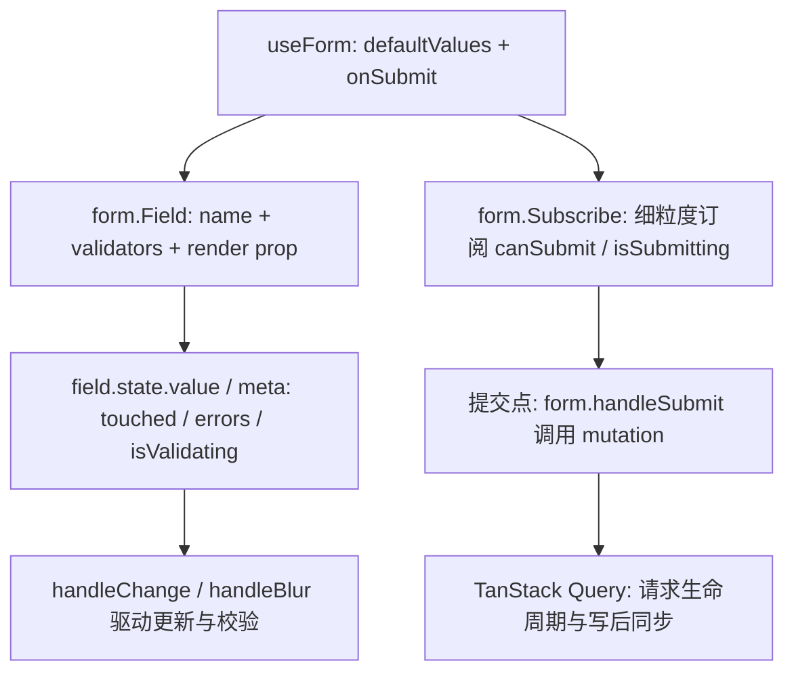

:::note 版本基线
本文以官方文档 `tanstack.com/form/latest` 的**当前稳定版**为准, 信息来源为官方 Overview 页及其完整 React 示例 (本次抓取核实). 文档以 `/latest` 路径发布, 概览页未标注具体版本号, 因此本文不写死版本数字. 文中 API 与代码 (`useForm`、`form.Field`、`form.Subscribe`、`field.state`、`handleChange`/`handleBlur`、`validators`) 均来自官方示例; 概览页未展开的校验适配器与高级签名仅作定性描述, 细节以官方文档为准. 本站是 h/docs 的补充, 通用 React 受控表单教程由 h 覆盖, 这里只聚焦 TanStack Form 自家特性与取舍.
:::

**主线一览**



TanStack Form 是一个 **headless、框架无关、TypeScript 优先**的表单库. 它不管你的输入框长什么样, 只负责字段值、校验时机、错误信息与提交状态, 并通过 render prop 把这些能力交给你自己渲染. 官方把它定位为"端到端的表单管理方案", 用来替代各自为政的自定义实现. 本文按"状态模型 → validators → 细粒度订阅 → 提交点"展开, 并明确它与 Query 的职责边界.

## 一、解决什么问题

官方 Motivation 指出: 多数框架没有完整的表单方案, 开发者要么自己写, 要么用能力不足的库, 结果是一致性差、性能不佳、开发时间变长. TanStack Form 要覆盖的常见难题包括:

- 响应式数据绑定与状态管理.
- 复杂校验与错误处理.
- 无障碍与响应式设计.
- 国际化与本地化.
- 跨平台兼容与自定义样式.

它的设计选择是 **headless UI + 框架无关**: 核心逻辑与 UI 解耦, React adapter 只是一层绑定. 因此它既能嵌入任意设计系统, 也能把同一套表单逻辑迁移到不同框架. 与"受控组件 + 手写 useState"相比, 它把字段级状态、校验时序与提交状态标准化; 与自带 UI 的表单库相比, 它把渲染权完全交还给你.

## 二、核心概念与 API

### 2.1 useForm: 表单实例

表单实例由 `useForm` 创建, 两个核心配置是 `defaultValues` 与 `onSubmit`:

```tsx
import { useForm } from "@tanstack/react-form";

const form = useForm({
  defaultValues: {
    firstName: "",
    lastName: "",
  },
  onSubmit: async ({ value }) => {
    // 在这里提交表单数据
    console.log(value);
  },
});
```

`defaultValues` 的形状决定了字段名的类型; `onSubmit` 拿到的是经过类型推导的 `value`. 整个表单的类型从这两个配置推导出来, 后续 `form.Field` 的 `name` 会被约束在合法字段集合内——这是"first-class TypeScript"的实际含义, 而不是事后补的类型声明.

### 2.2 form.Field: 字段级 render prop

字段用 `form.Field` 声明, 关键 prop 是 `name`、`validators` 与 `children` (render prop):

```tsx
<form.Field
  name="firstName"
  validators={{
    onChange: ({ value }) =>
      !value
        ? "A first name is required"
        : value.length < 3
          ? "First name must be at least 3 characters"
          : undefined,
    onChangeAsyncDebounceMs: 500,
    onChangeAsync: async ({ value }) => {
      await new Promise((resolve) => setTimeout(resolve, 1000));
      return value.includes("error") && 'No "error" allowed in first name';
    },
  }}
  children={(field) => (
    <>
      <label htmlFor={field.name}>First Name:</label>
      <input
        id={field.name}
        name={field.name}
        value={field.state.value}
        onBlur={field.handleBlur}
        onChange={(e) => field.handleChange(e.target.value)}
      />
    </>
  )}
/>
```

官方对 render prop 的态度很明确: "Avoid hasty abstractions. Render props are great!" —— 与其封装一层通用 Input 组件, 不如直接在 `children` 里写清楚每个字段的渲染.

字段 API 的关键字段与方法:

| 名称                            | 作用                                  |
| ------------------------------- | ------------------------------------- |
| `field.name`                    | 字段名, 可直接用于 `id`/`name` 属性   |
| `field.state.value`             | 字段当前值                            |
| `field.state.meta.isTouched`    | 是否被触碰过 (常用于决定是否展示错误) |
| `field.state.meta.errors`       | 当前校验错误数组                      |
| `field.state.meta.isValid`      | 字段是否通过校验                      |
| `field.state.meta.isValidating` | 异步校验是否进行中                    |
| `field.handleChange(value)`     | 更新字段值并触发相应校验              |
| `field.handleBlur()`            | 标记字段已失焦                        |

### 2.3 validators: 同步、异步与防抖

官方示例展示了三种校验配置: `onChange` (同步, 返回错误字符串或 `undefined`)、`onChangeAsync` (异步函数, 适合服务端唯一性校验)、`onChangeAsyncDebounceMs` (异步校验的防抖毫秒数). 这些配置放在 `validators` 对象里, 与字段声明放在一起, 作用域清晰.

:::tip 校验时机的边界
概览页只展开上述三种配置. 其他校验时机 (如失焦、提交时统一校验) 与 schema 校验库的 adapter 属于后续指南内容, 本文不给出未核实的具体签名; 接入时请以官方文档对应章节为准.
:::

错误展示同样是 render prop 的一部分. 官方示例提供 `FieldInfo` 组件, 接收 `AnyFieldApi` 类型, 按 `isTouched`、`errors`、`isValidating` 决定是否展示:

```tsx
import type { AnyFieldApi } from "@tanstack/react-form";

export function FieldInfo({ field }: { field: AnyFieldApi }) {
  return (
    <>
      {field.state.meta.isTouched && !field.state.meta.isValid ? (
        <em>{field.state.meta.errors.join(",")}</em>
      ) : null}
      {field.state.meta.isValidating ? "Validating..." : null}
    </>
  );
}
```

`AnyFieldApi` 是官方导出的类型, 便于把错误信息展示抽成可复用组件而不丢失类型.

### 2.4 form.Subscribe: 细粒度订阅

表单级状态用 `form.Subscribe` 订阅, 通过 `selector` 挑出需要的字段:

```tsx
<form.Subscribe
  selector={(state) => [state.canSubmit, state.isSubmitting]}
  children={([canSubmit, isSubmitting]) => (
    <>
      <button type="submit" disabled={!canSubmit}>
        {isSubmitting ? "..." : "Submit"}
      </button>
      <button
        type="reset"
        onClick={(e) => {
          e.preventDefault();
          form.reset();
        }}
      >
        Reset
      </button>
    </>
  )}
/>
```

`selector` 让提交按钮只在 `canSubmit`/`isSubmitting` 变化时重渲染, 而不是跟随整个表单状态. `form.handleSubmit()` 在原生 `<form onSubmit>` 里调用, 并配合 `preventDefault()` / `stopPropagation()` 避免浏览器默认提交. `form.reset()` 重置表单.

官方示例还挂载 `TanStackDevtools` 与 `formDevtoolsPlugin`, 便于在开发期观察字段状态与校验过程.

## 三、典型用法: 完整表单骨架

把前面片段拼起来, 就是官方示例的骨架:

```tsx
export default function App() {
  const form = useForm({
    defaultValues: { firstName: "", lastName: "" },
    onSubmit: async ({ value }) => console.log(value),
  });

  return (
    <form
      onSubmit={(e) => {
        e.preventDefault();
        e.stopPropagation();
        form.handleSubmit();
      }}
    >
      {/* form.Field ... */}
      {/* form.Subscribe ... */}
    </form>
  );
}
```

职责分工: 字段值、校验与提交时机归 Form; 真正的网络请求与写后同步归 [tanstack-query](tanstack-query) 的 mutation. 两者在提交点汇合——`onSubmit` 调用 `mutate`, 并用 mutation 的 pending 状态禁用按钮. 这条边界与 Query 文档"常见陷阱"里"表单与提交"的说明一致.

## 四、与相邻方案的边界

| 需求                         | 归属                     | 说明                             |
| ---------------------------- | ------------------------ | -------------------------------- |
| 字段值、校验、提交时机       | TanStack Form            | 本地状态, 只在提交点与数据层交互 |
| 请求生命周期、缓存、写后同步 | TanStack Query           | 服务端状态, 由 mutation 承接提交 |
| URL 中的筛选/分页状态        | TanStack Router          | search params 是全局可分享状态   |
| 长列表 DOM 虚拟化            | TanStack Virtual         | 只管测量与定位                   |
| 通用受控表单                 | h/docs 的 React 基础教程 | 本站不重复                       |

与通用表单库的区别: 本站只指出 TanStack Form 的差异点——headless (无自带 UI)、框架无关、字段级类型推导与细粒度订阅. 需要快速搭出带现成样式的表单时, 通用方案更省事; 需要嵌入自有设计系统、跨框架复用或强类型表单模型时, 它的取舍才划算.

## 五、适用与不适用

适合:

- 字段多、校验逻辑复杂 (同步 + 异步 + 跨字段) 的表单.
- 强类型诉求: 希望字段名、值类型、错误结构全程有推导.
- 已有设计系统, 希望表单库只管状态、不管样式.

需谨慎:

- 只有一个输入框的简单场景: `useState` + 原生校验更轻.
- 依赖特定 UI 库的表单控件: 需要自己写适配层, 因为库不提供组件.
- 把服务端数据直接当表单值: 应把远端数据读进查询缓存, 表单只持有草稿副本, 提交时再调用 mutation.

## 六、小结与交叉链接

TanStack Form 的定位是"表单状态与校验的 headless 引擎": `useForm` 建实例, `form.Field` 声明字段与校验, `field.state` 暴露值/错误/状态, `form.Subscribe` 做细粒度订阅, `form.handleSubmit` 在提交点把数据交给数据层. 它不碰网络、不碰缓存、不碰路由.

**延伸阅读**

- [tanstack-query](tanstack-query): mutation、乐观更新与写后同步, 与表单提交点的协作.
- [tanstack-router](tanstack-router): search params 作为全局状态, 与表单草稿的分工.
- [tanstack-start](tanstack-start) / [tanstack-virtual](tanstack-virtual): 同家族库各自的职责边界.
- [swr](swr): 另一种前端数据获取模式, 帮助理解"本地状态 vs 服务端状态"的分野.
