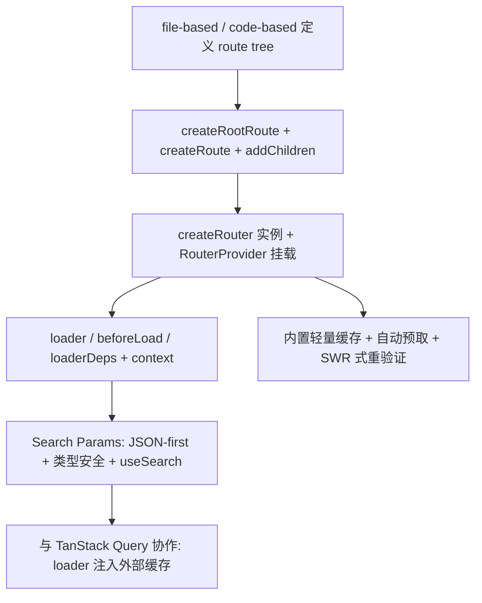

:::note 版本基线
本文以官方文档 `tanstack.com/router/latest` 的**当前稳定版**为准, 信息来源为官方 Overview、Quick Start、File-Based Routing、Code-Based Routing 与 basic-file-based 示例页 (本次抓取核实). 官方 quick start 要求 React 18+ / react-dom 18+ (需 `createRoot`), 推荐 TypeScript 5.3+ 并声明支持最近 5 个 minor 版本; 文档以 `/latest` 路径发布, 概览页未标注具体版本号, 因此本文不写死版本数字. 文中 API 与代码均来自上述官方页面, 未核实的细节降级为定性描述. 本站是 h/docs 的补充, 通用 React 与通用 React Router 教程由 h 覆盖, 这里只聚焦 TanStack Router 自家特性与取舍.
:::

**主线一览**



TanStack Router 是面向 React 与 Solid 的类型安全路由库. 它不只做"路径到组件"的映射: 导航 100% 类型推导、search params 被当成一等公民状态容器、loader 带一层轻量内置缓存, 并且能与 TanStack Query、SWR 等外部数据缓存协作. 本文按"route tree → 创建挂载 → loader → search params → 相邻边界"展开, 帮助已经熟悉通用路由概念的读者判断引入它的收益.

## 一、解决什么问题

官方 Overview 把它的能力分成两层. 一层是通用路由都该有的: 嵌套路由、布局路由、分组路由、file-based routing、并行数据加载、预取、URL 路径参数、错误边界、SSR、路由掩码. 另一层是它刻意做出差异的:

- **100% inferred TypeScript 支持**. 路由库知道应用里所有路由及其配置 (path、path params、search params、context), 因此 `Link` 与 `navigate` 的目标在编译期就能校验; 它通过大量泛型参数做无损类型推导, 把类型信息贯穿到整个应用.
- **一等公民的 Search Params**. 官方的观点是"search params 是整个应用里最强大的状态管理器": 全局、可序列化、可收藏、可分享. 它们被自动解析/序列化为 JSON, 带校验与类型, 可从父路由继承, 在 loader、组件与 hook 中可访问, 并可用细粒度 selector 订阅以减少重渲染.
- **内置缓存与灵活的数据生命周期**. 自带一层" loosely based on TanStack Query"的轻量缓存 (更少特性、更小 API 面), 提供合理的默认值: 缓存复用、必要时失效、不用时回收, 也提供手动失效 API. 同时 `context`、`beforeLoad`、`loaderDeps`、`loader` 可以声明式地编排数据依赖, 并接入 TanStack Query、SWR、Apollo、Relay 或自建方案.
- **继承式路由 Context**. 路由上下文可同步或异步构建, 被所有子路由继承, 适合鉴权、SSR/CSR 混合预取、主题、单例与工具函数, 且完全类型安全.
- **file-based 与 code-based 混用**. file-based 由 Vite 插件或 CLI 生成路由配置, 生成的 code 仍由你掌控; 两种风格可同时存在.

## 二、核心概念与 API

### 2.1 route tree: 两种等价的组织方式

无论哪种方式, 路由都被组织成一棵 route tree, 再被匹配、组合成组件树. 区别只在"用什么描述层级": 文件系统或代码.

官方推荐 **file-based** (大多数项目). 文件名约定里, `/` 表示目录层级, `.` 也可表示嵌套, `_` 前缀表示 pathless layout; `index.tsx` 是精确索引路由, `$postId.tsx` 是动态段, `$.tsx` 是 catch-all. 通过 Vite/Rsbuild/Webpack/Esbuild 插件或 CLI, 路由配置在 dev 与 build 阶段自动生成. 脚手架命令:

```bash
npx @tanstack/cli create --router-only
```

**code-based** 提供完全控制, 但官方明确"不推荐大多数应用使用". 两种风格可以混用, 不必二选一到底.

### 2.2 用代码定义路由

code-based 的核心函数是 `createRootRoute` (根路由) 与 `createRoute` (其余路由). 每个非根、非 pathless layout 的路由必须提供 `path`; `getParentRoute` 返回父路由——这是类型推导的关键, 因为 TypeScript 需要它来推断类型.

```ts
import { createRootRoute, createRoute } from "@tanstack/react-router";

const rootRoute = createRootRoute();

const postsRoute = createRoute({
  getParentRoute: () => rootRoute,
  path: "posts",
  component: PostsLayoutComponent, // 作为 layout 包裹子路由
});

const postRoute = createRoute({
  getParentRoute: () => postsRoute,
  path: "$postId",
  loader: ({ params }) => fetchPost(params.postId),
  component: PostComponent,
});

const routeTree = rootRoute.addChildren([postsRoute.addChildren([postRoute])]);
```

需要 context 时用 `createRootRouteWithContext<MyRouterContext>()`, 它同样来自 `@tanstack/react-router`, 可以把 `QueryClient` 之类的共享实例注入路由上下文. pathless layout 用 `id` 代替 `path`; 非嵌套路由则把完整路径写在 `path` 里并挂到目标父节点. 代码拆分场景下可用 `getRouteApi` 在其他文件里访问带类型的 `useParams()` 等 API.

:::tip code-based 的代价
file-based 本质上是 code-based 的超集: 文件系统 + 代码生成帮你产出上面那棵树. 除非有明确理由, 优先让插件生成路由配置, 自己只写路由内容.
:::

### 2.3 创建 router 与挂载

route tree 建好后, 用 `createRouter` 创建实例, 用 `RouterProvider` 挂载到 React 树. 官方 basic-file-based 示例的入口写法:

```tsx
import React from "react";
import ReactDOM from "react-dom/client";
import { RouterProvider, createRouter } from "@tanstack/react-router";
import { routeTree } from "./routeTree.gen";

const router = createRouter({
  routeTree,
  defaultPreload: "intent",
  defaultStaleTime: 5000,
  scrollRestoration: true,
});

// 注册类型, 让整个应用的 Link / navigate 获得推导
declare module "@tanstack/react-router" {
  interface Register {
    router: typeof router;
  }
}

const rootElement = document.getElementById("app")!;
if (!rootElement.innerHTML) {
  ReactDOM.createRoot(rootElement).render(<RouterProvider router={router} />);
}
```

`defaultPreload: "intent"` 体现"自动预取": 用户表现出访问意图时就提前加载路由与数据; `defaultStaleTime` 则与内置缓存的过期策略呼应. `Register` 接口是类型推导闭环的最后一环——把实例类型注册进模块声明后, 所有导航目标都获得校验.

### 2.4 loader、context 与数据生命周期

数据加载相关 API 的协作关系: `context` 提供共享依赖, `beforeLoad` 在加载前运行并可构建/消费 context, `loaderDeps` 声明影响 loader 的依赖, `loader` 执行实际取数. 官方把它们描述为"声明式数据依赖 + 预取 + 管理外部数据源生命周期"的组合.

Router 提供两层选择:

| 方式                    | 做法                                    | 适用                                    |
| ----------------------- | --------------------------------------- | --------------------------------------- |
| 内置轻量缓存            | 在 `loader` 中直接取数, 用默认缓存策略  | 数据简单、不想引入额外状态库            |
| 外部缓存 (Query/SWR 等) | `loader` 里调用 `queryClient` 预取/读取 | 已有 Query 缓存, 希望路由与缓存共享数据 |

内置缓存"loosely based on TanStack Query", 有缓存复用、失效与回收的合理默认值, 但 API 面比 Query 小得多; 它提供手动失效的 API. 当应用已经用 Query 管理服务端状态时, 更常见的做法是在 `beforeLoad`/`loader` 里预取 Query 缓存, 让路由导航与数据缓存共享同一份数据, 避免双重请求——这正是 [tanstack-query](tanstack-query) 与 [tanstack-start](tanstack-start) 的衔接点.

### 2.5 Search Params 是一等公民

官方把 search params 当作状态管理器, 而不仅是字符串. 能力包括: 基于标准 `URLSearchParams` 但用自研 parser/serializer 支持深层 JSON 结构; 自动解析与序列化; 校验与类型化; 从父路由继承; 在 loader、组件与 hook 中访问; 通过 `useSearch`、`Link`、`navigate`、`router.navigate` 修改; 自定义 search filter 与 middleware; 细粒度 selector 订阅.

官方概览明确列出的相关 API 名称是 **`useSearch`**、`Link`、`navigate` 与 `router.navigate` —— 它们既用于读取也用于修改 search params. 本次抓取的概览页未给出这些 API 的完整签名, 因此这里不写出调用代码; 接入时以官方文档对应章节为准.

实践上的收益是: 过滤条件、页码、标签页等"需要刷新与分享后仍存活"的状态可以放进 URL, 同时获得和本地状态相近的开发体验. 这部分是通用 React Router 教程不会展开的细节, 本站也不重复基础路由教学.

## 三、典型用法: file-based + Query 协作

把上面的片段拼成一个常见形态: 用插件生成 `routeTree.gen.ts`, 路由文件里声明 loader, 并把数据交给外部缓存.

```tsx
// routes/posts/$postId.tsx (file-based)
import { createFileRoute } from "@tanstack/react-router";

export const Route = createFileRoute("/posts/$postId")({
  loader: ({ params, context }) => {
    // 在这里用 context 注入的 queryClient 预取/读取数据
    // 命令式入口见 tanstack-query; 本次抓取的 Router 概览未展开其签名
    return getPost(params.postId);
  },
  component: PostComponent,
});
```

这里 `createFileRoute` 来自 file-based 生成的代码路径 (官方 Start 文档也给出同形示例), `context` 则来自前面 `createRootRouteWithContext` 注入的上下文. loader 返回的数据可直接被组件读取; 若应用已引入 Query, 也可以在 loader 里用 Query 的命令式入口把数据预取进缓存, 让路由与数据层共享同一份数据. 两个库各司其职.

:::warning 不要把令牌放进 search params 或 queryKey
认证令牌属于客户端状态, 应交给 store 并由请求客户端统一注入. 放进 URL 会泄漏到分享链接与历史记录, 放进 queryKey 则会在登录态变化时让所有缓存 key 失效重来. 这与 [tanstack-query](tanstack-query) 的"常见陷阱"一致.
:::

## 四、与相邻方案的边界

| 需求                                  | 归属             | 说明                                 |
| ------------------------------------- | ---------------- | ------------------------------------ |
| URL 到组件的映射、导航、search params | TanStack Router  | 路由层, 类型安全是核心差异           |
| 远端数据的缓存、失效、写后同步        | TanStack Query   | 数据层, 可被 Router 的 loader 调用   |
| 全栈渲染、server functions            | TanStack Start   | 框架层, 路由 100% 依赖 Router        |
| 表单字段值与校验                      | TanStack Form    | 本地状态, 在提交点调用 mutation      |
| 长列表 DOM 虚拟化                     | TanStack Virtual | 只管测量与定位, 数据来源仍是查询缓存 |

与通用 React Router 的边界: 本站把通用 React Router 教程留给 h/docs, 这里只讨论 Router 自家的差异点——完整类型推导、search params 状态管理、内置 loader 缓存与 context 继承. 如果项目只需要基础路由, 通用方案已经够用; 当类型安全与 URL 状态成为痛点时, 再考虑迁移成本.

## 五、适用与不适用

适合:

- 中大型 React/Solid SPA, 路由数量多、参数结构复杂, 类型推导能显著减少导航错误.
- 需要把过滤、分页、标签页等状态放进 URL 以便刷新与分享, 且希望有类型与校验.
- 已经有 TanStack Query, 希望 loader 与缓存协同 (预取 + 水合), 避免两套数据链路.

需谨慎:

- 极小应用或只需基础跳转: 引入 route tree、代码生成与类型注册的成本大于收益.
- 团队对 TypeScript 泛型推导不熟悉: 类型错误信息可能较长, 需要理解 `Register`、`getParentRoute` 等机制.
- 只需要 code-based 的极端动态路由: 官方明确不推荐大多数场景, 且会失去 file-based 的代码分割与类型生成红利.

## 六、小结与交叉链接

TanStack Router 的定位可以压缩成三句话: 用 route tree 把路由组织成可推导的类型图; 把 search params 升级为一等公民状态; 用 loader 与轻量缓存把数据生命周期纳入路由. 它不替代 Query 的数据缓存, 也不等于全栈框架——后者是 [tanstack-start](tanstack-start) 的职责.

**延伸阅读**

- [tanstack-query](tanstack-query): `staleTime`/`gcTime`、失效与写后同步, 与 loader 预取的协作.
- [tanstack-start](tanstack-start): 基于 Router 的全栈框架, server functions 与 SSR.
- [tanstack-form](tanstack-form) / [tanstack-virtual](tanstack-virtual): 表单与虚拟化的职责边界.
- [swr](swr): 前端数据获取的另一种缓存模型与 stale-while-revalidate 语义.
