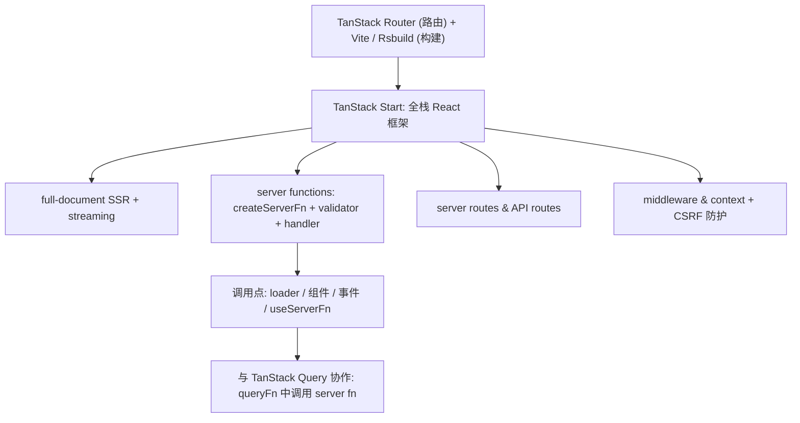

:::note 版本基线
本文以官方文档 `tanstack.com/start/latest` 的**当前稳定版**为准: 官方 Overview 明确写明 "TanStack Start is stable", 并给出从 RC 升级的迁移指南; 文档以 `/latest` 路径发布且未在概览页标注具体版本号, 因此本文不写死版本数字. API 名称与代码示例来自本次抓取的官方 Overview 与 Server Functions 指南, 未核实的签名降级为定性描述. 本站是 h/docs 的补充, React Server Components、通用 SSR 教学由 h 覆盖, 这里只聚焦 TanStack Start 自家能力与取舍.
:::

**主线一览**



TanStack Start 是一个**由 TanStack Router 驱动的全栈 React 框架**. 它在 Router 的类型安全路由之上, 加上整文档 SSR、流式渲染、server functions、server routes、中间件与客户端/服务端构建, 并支持部署到任意托管平台或运行时. 如果说 Router 解决"页面怎么组织与导航", Start 解决"页面在服务端怎么渲染、后端逻辑怎么与前端类型安全地连接".

## 一、解决什么问题

官方 Overview 给出的定位很直接: Start 100% 依赖 TanStack Router 作为路由系统; 在 Router 的能力之上, 额外提供:

- **Full-document SSR**: 服务端渲染整份文档, 改善性能与 SEO.
- **Streaming**: 渐进式页面加载, 改善用户体验.
- **Server Routes & API Routes**: 与前端并列编写后端端点.
- **Server Functions**: 客户端与服务端之间的类型安全 RPC.
- **Middleware & Context**: 请求/响应处理与数据注入.
- **Full-Stack Builds**: 客户端与服务端代码的优化构建.
- **Universal Deployment**: 借助 Vite 或 Rsbuild 构建, 部署到任意托管平台/运行时.
- **End-to-End Type Safety**: 跨整个技术栈的 TypeScript 支持.

它的两个关键依赖是 **TanStack Router** 与 **Vite 或 Rsbuild** (现代构建工具, 提供快速 HMR 与优化的生产构建). 官方也给出判断建议: 如果**确定**不需要上述全栈能力, 只用 TanStack Router 依然是相比其他路由/框架的强类型升级.

关于限制, 官方的说法是: Start 提供与 Next.js、Remix 等全栈框架相当的能力, 并有一些额外特性; React Server Components 作为**实验性特性**提供, 有单独的指南.

## 二、核心概念与 API

### 2.1 server functions: 跨网络边界的类型安全 RPC

Server functions 让你定义"只在服务端运行、但可以从应用任意位置调用"的函数. 它们运行在服务端, 因此可以访问数据库、环境变量、文件系统; 从客户端调用时, Start 负责跨网络的序列化与类型保持.

```tsx
import { createServerFn } from "@tanstack/react-start";

export const getServerTime = createServerFn().handler(async () => {
  // 只在服务端执行
  return new Date().toISOString();
});

// 可从组件、loader、hook 或其他 server function 调用
const time = await getServerTime();
```

可用 `method` 指定 HTTP 方法, 默认是 `GET`:

```tsx
export const saveData = createServerFn({ method: "POST" }).handler(
  async () => ({ success: true }),
);
```

server functions 是**同源 RPC 端点**: 浏览器发出的请求应来自同源, 用 Fetch Metadata (`Sec-Fetch-Site`)、`Origin` 或 `Referer` 头校验. 如果需要供 Start 应用之外的客户端调用, 应使用 server routes 而非 server functions.

### 2.2 参数校验与序列化

server function 接受单个 `data` 参数. 因为跨网络边界, 需要用 `validator` 做运行时校验; 可以手写校验函数, 也可以接 schema 库 (官方示例用 Zod):

```tsx
import { createServerFn } from "@tanstack/react-start";
import { z } from "zod";

const UserSchema = z.object({
  name: z.string().min(1),
  age: z.number().min(0),
});

export const createUser = createServerFn({ method: "POST" })
  .validator(UserSchema)
  .handler(async ({ data }) => {
    // data 已完成类型推导与运行时校验
    return `Created user: ${data.name}, age ${data.age}`;
  });

await createUser({ data: { name: "Ada", age: 36 } });
```

输入输出跨网络边界, Start 默认做**序列化类型检查** (`strict` 模式): validator 输入类型必须可序列化 (POST 允许 `FormData`), handler 返回类型必须可序列化 (允许 `Response`). 可以用 `strict: false` / `strict: { input: false }` / `strict: { output: false }` 有选择地关闭检查, 但官方提醒: 这只放松 TypeScript 层面的检查, 运行时仍需正确处理序列化, 优先保留默认值.

:::warning 安全边界
server functions 是可被独立访问的 API 端点, 不依附于渲染它的路由. 任何读写私有数据的 server function 都必须在端点内部做鉴权 (例如 `authMiddleware` 或 handler 内检查), `beforeLoad` 只是路由 UX, 不是数据边界.
:::

### 2.3 调用点与文件组织

官方列出的调用点: **route loaders** (最适合取数)、**组件** (配合 `useServerFn()` hook)、**其他 server functions** (组合服务端逻辑)、**事件处理** (表单提交、点击等).

```tsx
// 在 route loader 中
export const Route = createFileRoute("/posts")({
  loader: () => getServerPosts(),
});

// 在组件中
function PostList() {
  const getPosts = useServerFn(getServerPosts);
  const { data } = useQuery({
    queryKey: ["posts"],
    queryFn: () => getPosts(),
  });
}
```

大型应用推荐把服务端代码分文件组织:

```text
src/utils/
├── users.functions.ts   # createServerFn 包装, 任意文件可导入
├── users.server.ts      # 仅服务端助手 (数据库查询、内部逻辑)
└── schemas.ts           # 共享校验 schema (客户端安全)
```

构建过程会把客户端 bundle 中的 server function 实现替换为 RPC stub, 真实服务端代码不会进入浏览器. 因此 server function 可以**静态导入**到任何文件 (包括客户端组件); 官方明确警告避免动态导入, 以免打包器出问题.

### 2.4 中间件、CSRF 与请求上下文

Start 提供 `createCsrfMiddleware()` 防护跨站请求. 如果应用没有定义 `src/start.ts`, Start 会自动为 server functions 安装该中间件; 如果定义了, 需要显式加入:

```tsx
// src/start.ts
import { createStart, createCsrfMiddleware } from "@tanstack/react-start";

const csrfMiddleware = createCsrfMiddleware({
  filter: (ctx) => ctx.handlerType === "serverFn",
});

export const startInstance = createStart(() => ({
  requestMiddleware: [csrfMiddleware],
}));
```

服务端上下文工具来自 `@tanstack/react-start/server`: `getRequest()` 取完整 `Request`, `getRequestHeader(name)` 读单个请求头, `setResponseHeader(name, value)` / `setResponseHeaders(headers)` 设置响应头, `setResponseStatus(code)` 设置状态码. 官方特别强调 `Cache-Control` 的安全性: 公开、非个性化数据才可用 `public`; 任何读取 session、cookie、鉴权头或按身份分支的响应都必须用 `private` 并 `Vary: Cookie, Authorization`, 否则会造成跨租户数据泄漏——这与本站 [swr](swr) 讨论的 HTTP 缓存指令边界完全一致.

错误处理方面, server function 抛出的错误、重定向与 not-found 会在路由生命周期或通过 `useServerFn()` 调用时被自动处理. `redirect` 与 `notFound` 来自 `@tanstack/react-router`.

## 三、典型用法: 一个完整的取数链路

把前述片段拼起来: 路由 loader 调用 server function, 组件通过 Query 读同一份数据; server function 内部访问数据库并做鉴权.

```tsx
// users.functions.ts
import { createServerFn } from "@tanstack/react-start";

export const getUser = createServerFn({ method: "GET" })
  .validator((data: { id: string }) => data)
  .handler(async ({ data }) => {
    const user = await findUserById(data.id); // 仅服务端可用
    if (!user) throw notFound();
    return user;
  });

// routes/users/$id.tsx
export const Route = createFileRoute("/users/$id")({
  loader: ({ params }) => getUser({ data: { id: params.id } }),
  component: UserPage,
});
```

这条链路体现 Start 的核心价值: 从 URL 参数到服务端数据库查询, 类型一路推导, 客户端 bundle 里只有 RPC stub.

## 四、与相邻方案的边界

| 需求                      | 归属            | 说明                                              |
| ------------------------- | --------------- | ------------------------------------------------- |
| 路由、导航、search params | TanStack Router | Start 的路由 100% 依赖它                          |
| 全栈渲染、SSR、streaming  | TanStack Start  | 框架层                                            |
| 远端数据缓存、失效        | TanStack Query  | 服务端状态层, 可在 loader/组件中与 server fn 配合 |
| 后端端点供外部系统访问    | Server routes   | server functions 是同源 RPC                       |
| 表单字段值与校验          | TanStack Form   | 提交点调用 mutation 或 server fn                  |

与 Next.js / Remix 的关系: 官方认为 Start 提供同等能力与更丰富的开发体验, React Server Components 尚属实验性. 与 **只用 Router** 的关系: 如果不需要 SSR、server functions、server routes 等, 单独用 Router 更轻. 本站不重复通用 SSR/RSC 教程 (由 h 覆盖), 只讨论 Start 自身取舍.

## 五、适用与不适用

适合:

- 需要 SEO 与首屏性能的全栈 React 应用, 希望用同一套路由与类型体系贯穿前后端.
- 需要类型安全的后端调用 (server functions) 并与 Query 缓存协作.
- 希望部署到自有运行时/平台, 不被特定托管商绑定 (Vite / Rsbuild 构建).

需谨慎:

- 纯 SPA、不需要 SSR/后端端点: 直接用 [tanstack-router](tanstack-router) 更合适.
- 依赖 RSC 生态的团队: 官方将其标为实验性, 需评估成熟度.
- 已有成熟后端框架且只需前端路由: 引入全栈框架会重复后端职责.

## 六、小结与交叉链接

TanStack Start 的本质是"Router + 全栈能力": 路由完全交给 Router, 自己补上 SSR/streaming、server functions、server routes 与中间件, 并把类型安全贯穿网络边界. 它不是数据缓存库——服务端状态仍由 [tanstack-query](tanstack-query) 管理, 只是在 loader 与组件里和 server functions 协作.

**延伸阅读**

- [tanstack-router](tanstack-router): Start 的路由基座, loader 与 search params 的完整说明.
- [tanstack-query](tanstack-query): `queryKey`、失效与写后同步, 与 server functions 的协作.
- [swr](swr): HTTP 缓存指令与前端缓存的边界, 对应 Start 文档中的 `Cache-Control` 安全提醒.
- [tanstack-form](tanstack-form) / [tanstack-virtual](tanstack-virtual): 表单与虚拟化的职责边界.
