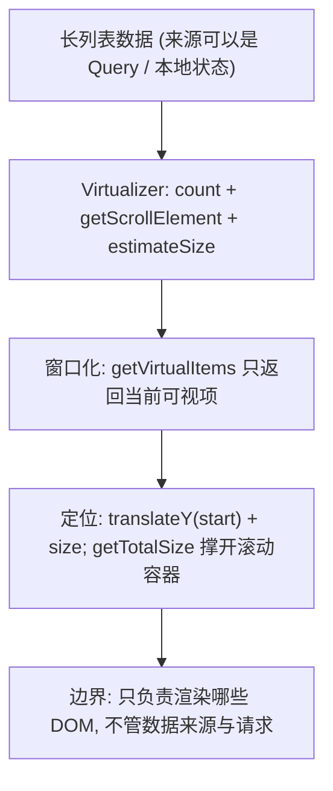

:::note 版本基线
本文以官方文档 `tanstack.com/virtual/latest` 的**当前稳定版**为准, 信息来源为官方 Introduction 页 (本次抓取核实). 文档以 `/latest` 路径发布, 概览页未标注具体版本号, 因此本文不写死版本数字. 文中代码块与 API 名称 (`useVirtualizer`、`count`、`getScrollElement`、`estimateSize`、`getVirtualItems`、`getTotalSize`) 均来自官方示例; 概览页未展开具体签名的能力 (如 overscan、动态测量、程序化滚动、window 级 virtualization) 仅作定性描述, 细节以官方文档为准. 本站是 h/docs 的补充, 通用 DOM/CSS 与 React 教程由 h 覆盖, 这里只聚焦 TanStack Virtual 自家特性与取舍.
:::

**主线一览**



TanStack Virtual 是一个 **headless UI 工具**, 用于在 JS/TS、React、Vue、Svelte、Solid、Lit、Angular 中虚拟化长列表. 它不是一个组件: 不附带、也不渲染任何 markup 或样式, 所有 DOM 结构与样式都由使用方提供, 因此你对设计与实现保留 100% 控制. 代价是需要自己写容器与绝对定位的样式. 本文解释它的核心模型与最小用法, 并划清它与数据层、通用虚拟列表库的边界.

## 一、解决什么问题

一屏只能看到十几行, 但列表有一万条数据时, 把全部节点挂到 DOM 会带来首次渲染慢、内存占用高、滚动掉帧. 虚拟化的思路是: 只渲染当前视口附近的项, 用一个足够高的占位元素撑开滚动条, 再把可视项按计算出的偏移定位到正确位置.

TanStack Virtual 把这层计算抽象成一个 **Virtualizer**: 它接收"有多少项、滚动容器是谁、每项大概多高", 输出"当前该渲染哪些项、每项放在哪里、整体占位多高". 因为它是 headless 的, 你可以用任何元素结构承载输出——这对需要自定义滚动容器、复杂布局或跨框架复用的场景是关键优势.

官方还特别指出: 聊天、AI 流式输出、日志和其他反向 feed 有单独的 Chat 指南, 因为它们涉及"反向滚动锚定"等特殊处理, 不在基础概览里展开.

## 二、核心概念与 API

### 2.1 Virtualizer 与轴向

Virtualizer 可以设置为**垂直** (默认) 或**水平**方向; 把两个轴向的配置组合起来, 还能实现网格状 (grid-like) 的虚拟化. 这意味着同一个核心模型能覆盖长列表、横向卡片轨道与二维网格, 而不必为每种布局换库.

### 2.2 三个输入

官方 React 示例使用 `useVirtualizer`, 三个必要输入是:

| 输入               | 作用                                                   |
| ------------------ | ------------------------------------------------------ |
| `count`            | 列表总项数                                             |
| `getScrollElement` | 返回滚动容器元素 (示例中通过 `ref` 取得)               |
| `estimateSize`     | 估算每项尺寸的函数; 垂直列表返回行高, 水平列表返回列宽 |

`estimateSize` 是"估算"而非"精确值": 虚拟化需要在渲染前知道大致尺寸来推算偏移; 对固定高度列表, 返回一个常量即可. 对动态高度内容 (如可变长度的评论), 需要配合测量机制修正, 这部分概览页未展开具体签名, 按定性理解为"先估后测、测完修正偏移".

### 2.3 两个输出与 virtual item 字段

Virtualizer 的关键输出:

- `getTotalSize()`: 所有项加起来的总尺寸, 用来设置占位容器的高度/宽度, 让滚动条比例正确.
- `getVirtualItems()`: 当前需要渲染的项数组. 每一项至少包含官方示例中出现的四个字段: `key` (稳定键)、`index` (数据下标)、`size` (该项尺寸)、`start` (相对滚动起点的偏移).

使用方遍历 `getVirtualItems()`, 用 `index` 去数据源取真实内容, 用 `start`/`size` 做绝对定位. 这一步是把"虚拟项"映射回"业务数据"的接缝.

### 2.4 概览页未展开的扩展能力 (定性)

官方概览把细节导向后续指南, 以下能力按概念列出, **不在本文给出具体签名**:

- **overscan**: 在视口上下额外渲染若干项, 减少快速滚动时的空白闪烁, 代价是多渲染一些 DOM.
- **动态测量**: 用真实元素尺寸替换 `estimateSize` 的估算值, 适合高度不固定的内容.
- **程序化滚动**: 按索引跳到指定项 (常见于"回到顶部""定位到某条消息").
- **window 级虚拟化**: 以窗口作为滚动容器而非某个 div.
- **反向 feed**: 聊天/AI 流的反向滚动与锚定, 见官方 Chat 指南.

:::warning 不编造签名
上述扩展能力确实存在于 TanStack Virtual 的文档体系中, 但本次抓取的 Introduction 页未给出其准确函数名与参数. 此处只做定性说明; 接入时请以官方文档对应章节为准, 不要照抄本文的定性描述去调用不存在的签名.
:::

## 三、典型用法: 一万行列表

下面是官方 Introduction 给出的最小完整形态 (React), 展示 headless 用法的三个部分: 滚动容器、占位容器、可视项绝对定位.

```tsx
import { useVirtualizer } from "@tanstack/react-virtual";

function App() {
  // 1. 滚动容器
  const parentRef = React.useRef(null);

  // 2. Virtualizer
  const rowVirtualizer = useVirtualizer({
    count: 10000,
    getScrollElement: () => parentRef.current,
    estimateSize: () => 35,
  });

  return (
    <>
      {/* 滚动容器: 必须有确定的高度与 overflow */}
      <div ref={parentRef} style={{ height: "400px", overflow: "auto" }}>
        {/* 占位容器: 用 getTotalSize 撑开可滚动区域 */}
        <div
          style={{
            height: `${rowVirtualizer.getTotalSize()}px`,
            width: "100%",
            position: "relative",
          }}
        >
          {/* 只渲染可视项, 用 transform 定位到正确偏移 */}
          {rowVirtualizer.getVirtualItems().map((virtualItem) => (
            <div
              key={virtualItem.key}
              style={{
                position: "absolute",
                top: 0,
                left: 0,
                width: "100%",
                height: `${virtualItem.size}px`,
                transform: `translateY(${virtualItem.start}px)`,
              }}
            >
              Row {virtualItem.index}
            </div>
          ))}
        </div>
      </div>
    </>
  );
}
```

要点: 滚动容器要有确定高度并开启滚动; 占位容器用 `getTotalSize()` 撑开; 每个可视项用 `translateY(start)` 定位. 真实项目里把 `Row {index}` 换成 `data[index]` 的渲染, 数据可以来自 [tanstack-query](tanstack-query) 的查询结果, 也可以来自本地状态——Virtual 对此完全不关心.

## 四、与相邻方案的边界

| 需求                                 | 归属                     | 说明                                   |
| ------------------------------------ | ------------------------ | -------------------------------------- |
| 远端数据缓存、分页、无限查询         | TanStack Query           | 数据层, Virtual 只消费它给出的数组     |
| 长列表 DOM 渲染优化                  | TanStack Virtual         | 视图层, 只决定渲染哪些项与放在哪       |
| 滚动请求下一页                       | Query 的 `fetchNextPage` | 触发点在滚动/加载更多, 不要写进缓存    |
| 表单字段值与校验                     | TanStack Form            | 本地状态                               |
| 简单 CSS 方案 (`content-visibility`) | 浏览器原生               | 轻量场景可替代, 但不提供索引化定位 API |

与通用虚拟列表库 (react-window、react-virtualized 等) 的区别: 本站不重复通用方案教程, 只指出 TanStack Virtual 的差异点——headless、无 markup/样式、支持多框架、轴向可组合成网格、与 TanStack 其他库共享设计语言. 如果项目只需要"固定行高的简单长列表", 通用方案已经够用; 需要跨框架复用、自定义布局或与 TanStack 生态协同时, 它的优势才明显.

## 五、适用与不适用

适合:

- 列表项数量大 (千级以上), 完整渲染会造成明显首屏或滚动卡顿.
- 需要自定义滚动容器、行结构与样式, 不希望被组件的默认 DOM 束缚.
- 聊天、日志、AI 流等场景 (参考官方 Chat 指南处理反向滚动).
- 同一套虚拟化逻辑希望跨 React/Vue/Solid 等框架复用.

需谨慎:

- 列表很短 (几十项): 虚拟化的定位计算与占位结构反而是负担.
- 每项高度高度动态且无法测量: 估算不准会导致跳动, 需要先解决尺寸问题.
- 需要复杂滚动联动 (如多个列表同步滚动): 这属于交互逻辑, 库只提供基础设施, 需自行编排.

## 六、小结与交叉链接

TanStack Virtual 的定位是"只做窗口化": 用 `count`、`getScrollElement`、`estimateSize` 描述列表, 用 `getVirtualItems()` 与 `getTotalSize()` 渲染和定位. 它不管数据从哪来、也不管怎么请求——那是 [tanstack-query](tanstack-query) 的职责; 它更不碰表单与路由.

**延伸阅读**

- [tanstack-query](tanstack-query): 分页与无限查询, 与 Virtual 的 `fetchNextPage` 协作点.
- [tanstack-router](tanstack-router): 路由层 loader 与 search params, 与列表数据来源的关系.
- [tanstack-form](tanstack-form) / [tanstack-start](tanstack-start): 同家族库各自的职责边界.
