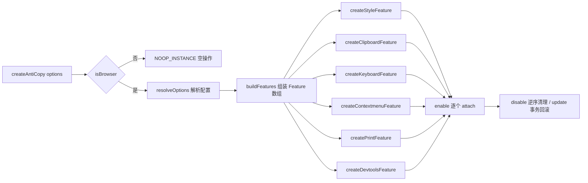

:::note 事实基线
本文依据 `$HOME/github/yukino.js/packages/anti-copy` 在 `1afcb40eef9` 的源码事实撰写；文中的路径、常量与 API 名称均可在该检出中定位。
:::

**主线一览**



`@yukino.js/anti-copy` 是 packages 里唯一一个**纯浏览器端、零框架依赖**的 SDK。本站不重复"如何禁止右键 / 如何监听 copy"这类通用 JS 教程（那属于 h 的覆盖范围），只聚焦它自己的设计取舍：把每一种防护拆成独立的 `Feature`，用一个统一的事务化生命周期把它们串起来，并在 DevTools 探测上做了远超普通实现的状态机设计。

## 定位与整体架构

包只有一个导出入口（`package.json` 的 `exports` 只暴露 `"."`），即 `src/index.ts`。核心抽象是一个极简接口（`src/core/types.ts`）：

```ts
export interface Feature {
  attach(): void;
  detach(): void;
}
```

`createAntiCopy(options)`（`src/index.ts:70`）先判 `isBrowser()`，非浏览器环境直接返回 `NOOP_INSTANCE`——一个 `enable/disable/destroy/update` 全部空转、`isEnabled()` 恒为 `false` 的对象，从而对 SSR 友好。在浏览器中，它维护四份闭包状态：`currentOptions`、`features`、`attached`、`enabled`，外加 `destroyed` 终止标志。

`buildFeatures()`（`src/index.ts:38`）根据解析后的 `ResolvedOptions` 按**固定顺序**压入 Feature：

| 顺序 | Feature 工厂               | 触发条件      | 主要拦截目标                                  |
| ---- | -------------------------- | ------------- | --------------------------------------------- |
| 1    | `createStyleFeature`       | `selectStyle` | 注入 `user-select: none` 样式 + `selectstart` |
| 2    | `createClipboardFeature`   | `copy`        | `copy` / `cut` / `dragstart`                  |
| 3    | `createKeyboardFeature`    | `keyboard`    | `keydown` 快捷键                              |
| 4    | `createContextmenuFeature` | `contextmenu` | `contextmenu` 右键菜单                        |
| 5    | `createPrintFeature`       | `print`       | `@media print` + `beforeprint`                |
| 6    | `createDevtoolsFeature`    | `devtools`    | 尺寸差 + `debugger` 探测                      |

所有 `Feature` 都把监听器注册到 `options.target.defaultView ?? options.target`，并且都在**捕获阶段**（`addEventListener(..., true)`）工作，注释明确写道要在用户代码和剪贴板 API 之前抢先 `preventDefault`。

## 核心 API 与实现机制

### `AntiCopyOptions` 与解析默认值

`resolveOptions()`（`src/core/options.ts:33`）把可选配置填成 `ResolvedOptions`。几个关键默认：

```ts
export const DEFAULT_REPLACE_TEXT = "Copying is not allowed on this page.";
// resolveOptions 摘录
mode: options.mode ?? "block",
selectStyle: options.selectStyle ?? options.mode !== "replace",
devtools: resolveDevtools(options),   // false | Required<DevtoolsOptions>
target: options.target ?? document,
```

注意 `selectStyle` 是 **mode-aware** 的：默认 block 模式下为 `true`，replace 模式下自动降为 `false`（`src/core/options.ts:41`）。`resolveDevtools()` 对 `devtools: true` 展开为完整对象，默认 `intervalMs = 1000`、`threshold = 170`、`freeze = true`、`redirectUrl = "about:blank"`；并对非法值做防御性回退（见边界章节）。

### 违规事件类型

`ViolationType`（`src/core/types.ts:3`）是八个字面量的联合：`copy`、`cut`、`drag`、`selection`、`keyboard`、`contextmenu`、`print`、`devtools`。`onViolation` 收到 `ViolationEvent { type, originalEvent?, key? }`，其中 `key` 只有键盘 Feature 会填（如 `"Ctrl+U"`、`"Shift+Delete"`）。

`AntiCopyOptions`（`src/core/types.ts:26`）的完整选项面如下，默认值取自 `resolveOptions()`：

| 选项               | 类型                                      | 默认                   | 说明                                     |
| ------------------ | ----------------------------------------- | ---------------------- | ---------------------------------------- |
| `mode`             | `"block" \| "replace"`                    | `"block"`              | 取消复制，或替换剪贴板内容               |
| `replaceText`      | `string \| (selection: string) => string` | `DEFAULT_REPLACE_TEXT` | replace 模式的替换文案                   |
| `excludeSelectors` | `string[]`                                | `[]`                   | 放行区域；非法选择器被静默丢弃           |
| `copy`             | `boolean`                                 | `true`                 | 拦截 copy / cut / dragstart              |
| `keyboard`         | `boolean`                                 | `true`                 | 拦截复制、导出与 DevTools 快捷键         |
| `contextmenu`      | `boolean`                                 | `true`                 | 禁用右键菜单                             |
| `selectStyle`      | `boolean`                                 | mode-aware             | block 为 `true`，replace 为 `false`      |
| `print`            | `boolean`                                 | `true`                 | `@media print` 隐藏 + `beforeprint` 上报 |
| `devtools`         | `boolean \| DevtoolsOptions`              | `false`                | DevTools 防护开关/配置                   |
| `onViolation`      | `(event: ViolationEvent) => void`         | —                      | 每次触发时回调                           |
| `target`           | `Document`                                | `document`             | 被保护的文档，可注入以便测试/iframe      |

README 给出的最短可用例子（`README.md` Usage 段），也是本包唯一公开的调用方式：

```ts
import { createAntiCopy } from "@yukino.js/anti-copy";

const antiCopy = createAntiCopy({
  mode: "replace",
  replaceText: (selection) => `${selection.slice(0, 60)}… — © example.com`,
  excludeSelectors: ["pre code"],
  devtools: true,
  onViolation: (e) => console.warn("[anti-copy]", e.type),
});

antiCopy.enable();
// antiCopy.disable(); antiCopy.destroy(); antiCopy.update({...});
```

`src/index.ts` 还对外导出了类型（`AntiCopyInstance`、`AntiCopyMode`、`AntiCopyOptions`、`DevtoolsOptions`、`ViolationEvent`、`ViolationType`）、常量 `DEFAULT_REPLACE_TEXT` 和工具 `isBrowser`。包根是唯一入口，`package.json` 的 `exports` 只映射 `"."` 到 ESM/CJS/d.ts 三种产物。

### 共享工具：跨 shadow DOM 的豁免判定

`src/core/utils.ts` 是本包最值得复用的一组内部函数：

- `eventElement(event)`——优先走 `event.composedPath?.()[0]`，否则退到 `event.target`；`toElement()` 会把文本节点上推到父元素，并沿 `ShadowRoot.host` 向上爬（`ELEMENT_NODE = 1`）。
- `isExcluded(target, selectors)`——对每个选择器调用 `el.closest(selector)`，`try/catch` 吞掉非法选择器；再用 `shadowHost()` 跨越**开放的** shadow root 继续匹配宿主。
- `isEditable(target)`——`TEXTAREA` 恒为可编辑；`INPUT` 按 `NON_TEXT_INPUT_TYPES`（button/checkbox/color/file/hidden/image/radio/range/reset/submit）排除非文本类型；沿祖先识别 `contenteditable`，`EDITABLE_VALUES = {"", "true", "plaintext-only"}`，遇到最近的 `contenteditable="false"` 立即停止继承。
- `isSelectionExcluded(doc, selectors)`——按**整个选区**判定：逐个 `Range.commonAncestorContainer` 调用 `isExcluded`，只有所有 range 都落在豁免区才返回 `true`，任一 range 跨出受保护区就返回 `false`。
- `escapeHtml(text)`——转义 `& < > "`，供 replace 模式的 `text/html` flavor 使用。

### 剪贴板与拖拽（clipboard.ts）

`createClipboardFeature` 在 `window`（无 window 则 `document`）上以捕获阶段注册三个监听。`clipboardHandler` 的处理顺序很关键：

1. `isEditable(el)` → 直接放行，保留输入框原生复制。
2. `isSelectionExcluded(...) ?? isExcluded(el, ...)` → 判定豁免；选区判定优先，无有效选区时退到事件元素判定。
3. **先** `event.preventDefault()`，再做替换内容计算，避免替换逻辑抛错导致复制漏网。
4. replace 模式下用 `replaceText(selection)` 生成文本，写入 `text/plain` 与转义后的 `text/html`。

`dragHandler` 不做选区判定（注释和测试都验证：豁免区遗留的选区不能放过受保护内容的拖拽），只看事件元素本身是否可编辑或豁免。

来自 `test/clipboard.test.ts` 的真实例子：

```ts
instance = createAntiCopy({ mode: "replace", replaceText: "© notice" });
instance.enable();
const { event, setData } = fireCopy();
expect(setData).toHaveBeenCalledWith("text/plain", "© notice");
expect(setData).toHaveBeenCalledWith("text/html", "© notice");
expect(event.defaultPrevented).toBe(true);
```

### 键盘快捷键（keyboard.ts）

四个集合定义了键位：`COPY_KEYS = {"c","x","a"}`、`EXPORT_KEYS = {"s","p"}`、`DEVTOOLS_KEYS = {"i","j","c"}`、`VIEW_SOURCE_KEYS = {"u"}`。`matchKey()` 同时比对**布局字符**（`e.key`）和**物理键**（`e.code` 形如 `KeyC`），因此非拉丁键盘布局和改键映射都无法绕过。`devtoolsShortcut()` 覆盖：

- `F12`（比对 `e.key` 或 `e.code`）；
- `Ctrl+Shift+I/J/C` 与 `Cmd+Opt+I/J/C`（`DEVTOOLS_KEYS`）；
- `Ctrl+U` 与 `Cmd+Opt+U`（`VIEW_SOURCE_KEYS`，要求 `!shiftKey`）。

普通复制/剪切/全选/导出路径里，`Ctrl+Insert` 复制、`Shift+Delete` 剪切被单独识别；`exportKey` 只有在 `options.print` 打开时才拦截（`src/core/keyboard.ts:68`）。`replace` 模式下 `Ctrl+C`/`Ctrl+Insert` 直接 `return`（因为内容已被剪贴板 Feature 替换），但 `Ctrl+A` 仍会被拦。

几个容易忽略的取舍，都能在 `test/keyboard.test.ts` 找到对应断言：

- `if (event.altKey) return`（`src/core/keyboard.ts:55`）让 AltGr（Ctrl+Alt）组合放行，欧洲键盘布局才能正常输入 `ś`/`ć` 等字符——这是物理键与布局字符双匹配带来的副作用，必须显式让路。
- `exportKey`（`Ctrl/Cmd+S/P`）即使发生在 `<input>` 里也照拦，因为导出属于"保护内容"而非"输入文本"；相反 `Ctrl+A` 在可编辑控件里放行。
- `Ctrl+A` 的豁免用 `isExcluded(el, ...)`，而复制/剪切用 `isSelectionExcluded(...) ?? isExcluded(...)`——因为全选作用域是焦点元素，不是上一次遗留的选区（`test/keyboard.test.ts:196`）。

```ts
// test/keyboard.test.ts：物理键匹配防止非拉丁布局绕过
instance = createAntiCopy({ selectStyle: false });
instance.enable();
expect(
  fireKey({ key: "с", code: "KeyC", ctrlKey: true }).defaultPrevented,
).toBe(true);
expect(
  fireKey({ key: "i", ctrlKey: true, shiftKey: true }).defaultPrevented,
).toBe(true);
```

:::tip 关键判断：先取消，后计算
`clipboardHandler` 在 `isEditable`/`isSelectionExcluded` 判定通过后**先**调用 `event.preventDefault()`，再执行 `replaceText()` 和 `setData()`。`test/clipboard.test.ts` 专门验证了当 `replaceText` 或 `setData` 抛错时，`event.defaultPrevented` 仍为 `true`——替换逻辑的异常不会变成复制成功的漏洞。
:::

### 样式与打印（style.ts / print.ts）

`createStyleFeature` 注入带 `yukino-anti-copy` 属性的 `<style>`，`buildCss()` 先经 `validSelectors()` 过滤掉无法被 `doc.querySelector` 解析的选择器，再生成：

- `body` 上的 `-webkit-user-select: none !important; user-select: none !important; -webkit-touch-callout: none;`（后者针对 iOS 长按）；
- 用 `:is(sel), :is(sel) *` 为 `EDITABLE_SELECTORS` 与用户 `excludeSelectors` 开白名单，恢复 `user-select: text`。

仅当 `mode !== "replace"` 时才额外注册 `selectstart` 拦截。`createPrintFeature` 独立注入带 `yukino-anti-print` 属性的样式 `@media print { body { display: none !important; } }`，并监听 `beforeprint` 上报 `print` 违规——这覆盖了从菜单发起的打印，而不仅是 `Ctrl/Cmd+P`。

### DevTools 探测状态机（devtools.ts）

这是全包最复杂的部分。`createDevtoolsFeature` 用一个**双循环 + generation 版本号**实现：

- `createProbe()` 用 `Function("debugger")` 动态构造探测函数（失败则退到字面 `debugger`），使每次调用产生一个名为 `anonymous` 的栈帧；只有调试器附加时 `runProbe()` 的耗时才会超过 `PAUSE_THRESHOLD_MS = 100`。
- `sizeOpen()` 用 `outerWidth/innerWidth`、`outerHeight/innerHeight` 的差值对比 `config.threshold` 判定停靠式 DevTools；在 `outerWidth < 800` 或 `(pointer: coarse)` 触屏设备上直接返回 `false`。
- `pollTick()`（慢轮询，`intervalMs`）发现"探测暂停"时 `stopLoops()` 并切到 `guardTimer = setInterval(guardTick, GUARD_INTERVAL_MS)`，`GUARD_INTERVAL_MS = 20`；否则继续慢轮询，并上报 `devtools`（仅首次 `lastOpened`）。
- `guardTick()` 中若既无暂停也无尺寸差，判定 DevTools 已关闭，退回慢轮询；若探测不再暂停但尺寸仍判定打开，则累加 `bypassTicks`，达到 `BYPASS_MAX_TICKS = 25` 后调用 `redirectTo(config.redirectUrl)` 跳空白页（应对 userscript 中和 `debugger` 的情况）。
- 每次 `attach()`/`detach()` 都 `generation += 1`，`pollTick`/`guardTick` 在回调中校验 `generation` 与 `active`，从而在 `onViolation` 里 `disable/destroy/update` 时让旧循环自然失效。`redirectTo()` 会 `stopLoops()` 并置 `redirected = true` 防止重复跳转。

## 并发、边界与容错

**生命周期事务**是 index.ts 的核心保证：

- `enable()` 幂等，开头先 `instance.disable()` 重试上一次失败遗留的清理；`attach` 途中抛错则 `disable()` 回滚并重新抛出原错误。
- `disable()` 把 `attached` 数组整体换出后逐个 `detach()`，单个失败仍继续清理其余 Feature，但把失败的 Feature 放回 `attached` 以便下次重试，最后抛出**第一个**错误。README 与 `test/lifecycle.test.ts` 都验证了 `undefined`/`null` 被抛出时仍能正确重抛。
- `update(patch)` 用 `mergeOptions` 深合并嵌套的 `devtools` 对象（`{...current.devtools, ...patch.devtools}`），但 `excludeSelectors` 等数组整体替换；并在创建/更新时复制数组与 DevTools 配置对象，防止外部后续 mutate（`test/lifecycle.test.ts` 的 "snapshots mutable option values" 用例）。
- `update()` 若重新 `enable()` 失败，会恢复 `currentOptions`/`features`、重试 `enable()` 恢复旧防护，再抛出更新错误。

**非法值与降级**：`intervalMs` 必须是有限数且在 `1..2_147_483_647`（否则回退 1000 ms，防止计时器溢出成热循环），`threshold` 必须有限且非负（否则回退 170）。`excludeSelectors` 中的非法 CSS 选择器在 `isExcluded` 与 `validSelectors` 两处都被静默丢弃，绝不抛错。

:::danger 这不是安全边界
README 的 Disclaimer 明确声明：客户端防复制只是 **deterrent（威慑）**，不是 security boundary。查看源码、禁用 JavaScript、直接 HTTP 请求、`curl`、阅读模式都能绕过。`devtools: true` 的探测——`debugger` 探测 + 尺寸差——会冻结页面甚至跳 `about:blank`，在浮动 DevTools 窗口关闭断点时与"未打开"无法区分；尺寸启发式在窄窗口与触屏设备上更是直接关闭。**不要**用它保护真正敏感的数据。
:::

:::tip 尽早加载
所有监听器都在捕获阶段注册，但注册时机之前就存在的 `window` 脚本可以先发制人。README 建议尽早加载本库；同时 `target` 可注入，便于在测试和 iframe 场景中替换为特定 `Document`。
:::

## 适用与不适用

**适用**：

- 数字出版、付费阅读、题库等内容站，需要"提高复制成本"而非真正防盗；
- 框架无关（README 明确支持 React / Vue / 原生 HTML），因为 API 仅是 `createAntiCopy()` 返回的对象；
- 需要细粒度放行：代码块 `pre code` 等可用 `excludeSelectors` 豁免，输入框/可编辑区永远保留原生行为；
- 需要可观测：`onViolation` 把八类触发统一上报，便于埋点。

**不适用**：

- 强安全诉求的机密内容——见上方 danger 块；
- 需要无障碍合规的严格场景——`user-select: none` 会阻碍文本选择与辅助技术；
- 已被用户脚本/浏览器扩展高度定制的环境——DevTools 探测可能被中和，反而误伤正常用户（跳空白页）。

## 交叉链接

- `yukino-create-servers`：本包的专注点是浏览器端防护；服务端多协议监听见 create-servers 解析。
- `yukino-http-server`：同为 `@yukino.js` 包，但面向静态文件服务，可作为对比阅读。
- 通用 JS 事件捕获、剪贴板 API、CSS `user-select` 等基础知识由 h 文档覆盖，本文不再展开。

**核心源码文件清单**：`src/index.ts`、`src/core/{types,options,utils,clipboard,keyboard,contextmenu,print,style,devtools}.ts`、`test/{lifecycle,clipboard,exclude,keyboard,contextmenu,devtools,options,print,style}.test.ts`、`README.md`、`package.json`。
