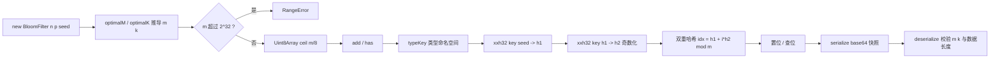

:::note 事实基线
本文依据 `$HOME/github/yukino.js/packages/bloom-filter` 在 `1afcb40eef9` 的源码事实撰写；文中的路径、常量与 API 名称均可在该检出中定位。
:::

**主线一览**



`@yukino.js/bloom-filter` 是一个标准布隆过滤器的 TypeScript 实现，底层哈希来自 `@node-rs/xxhash` 的 `xxh32`。本站不重复"布隆过滤器原理"这类通用数据结构教程（由 h 覆盖），只聚焦这个实现自己的工程取舍：如何用**双重哈希**把 k 次哈希降到 2 次、如何在反序列化时不信任外部快照、以及如何用增量 popcount 让诊断属性保持 O(1)。

README 给出的完整用法（构造 → 链式插入 → 查询 → 快照往返）：

```ts
import { BloomFilter } from "@yukino.js/bloom-filter";

const filter = new BloomFilter(10_000, 0.01); // 10k expected items, 1% FP rate

filter.add("apple").add("banana");

filter.has("apple"); // true
filter.has("cherry"); // false (probably)

// Serialize / restore
const snapshot = filter.serialize();
const restored = BloomFilter.deserialize(snapshot);
```

包名为 `@yukino.js/bloom-filter`，`version: "0.0.0"`，`type: "module"`，`exports` 同时映射 ESM/CJS/d.ts 三种产物（见 `package.json`）。构建走 `rollup -c rollup.config.mjs` + `rollup-plugin-dts`，测试走 `vitest run`。

## 定位与整体架构

整个包只有一个源文件 `src/index.ts`，导出三样东西：

- `class BloomFilter`——唯一运行时入口；
- `interface BloomFilterConfig`——`{ readonly m, k, seed, expectedItems, falsePositiveRate }`；
- `interface BloomFilterSnapshot`——`{ config, data: string, insertedCount }`。

类的内部状态分为三组（`src/index.ts:32`）：

| 类别     | 字段                                               | 作用                             |
| -------- | -------------------------------------------------- | -------------------------------- |
| 公开只读 | `m`、`k`                                           | 位数组长度与哈希次数，构造时推导 |
| 私有只读 | `seed`、`expectedItems`、`falsePositiveRate`       | 构造参数，`getConfig()` 可回读   |
| 私有可变 | `bitArray: Uint8Array`、`insertedCount`、`setBits` | 位图与统计                       |

`bitArray` 按 `Math.ceil(this.m / 8)` 字节分配（`src/index.ts:81`），即每位 1 bit，而非每槽 1 字节。这与 `cache` 包自行实现的位操作是两套独立代码，不要混淆。

## 核心 API 与实现机制

### 尺寸推导：`optimalM` / `optimalK`

两个纯函数实现了标准布隆边界（`src/index.ts:24`）：

```ts
function optimalM(n: number, p: number): number {
  return Math.ceil((-n * Math.log(p)) / (Math.LN2 * Math.LN2));
}

function optimalK(m: number, n: number): number {
  return Math.max(1, Math.round((m / n) * Math.LN2));
}
```

`m` 由期望插入量 `n` 与目标误判率 `p` 推出，`k` 再由 `m/n` 推出并至少为 1。`MAX_M = 2 ** 32` 是硬上限——即便 `m` 计算正确，超过它也会抛 `RangeError`，提示"Reduce expectedItems or increase falsePositiveRate"（`src/index.ts:74`）。`test/index.test.ts` 用 `new BloomFilter(1_000_000_000, 1e-15)` 专门触发这条分支。

构造参数校验全部是 fail-fast 的 `RangeError`：

- `expectedItems` 必须是正整数；
- `falsePositiveRate` 必须是有限数且严格落在 `(0, 1)`；
- `seed` 必须是 `0..0xffffffff` 的整数。

### 双重哈希与置位：`add` / `has`

`add(item)` 与 `has(item)`（`src/index.ts:84`、`src/index.ts:102`）共享完全相同的寻址逻辑，这是"无假阴性"的根本保证——插入时置过的位，查询时一定会查到：

```ts
const key = typeKey(item);
const h1 = xxh32(key, this.seed) >>> 0;
const h2 = (xxh32(key, h1) | 1) >>> 0;
for (let i = 0; i < this.k; i++) {
  const idx = ((h1 + Math.imul(i, h2)) >>> 0) % this.m;
  const byteIdx = idx >>> 3;
  const bitMask = 1 << (idx & 7);
  // add: 若该位原本为 0 则置 1 并 setBits++
  // has: 若该位为 0 立即 return false
}
```

几个值得点出的细节：

1. **只算两次哈希**。第二个哈希以第一个哈希值 `h1` 作为 seed，得到 `h2`；第 i 个位置由 `h1 + i * h2` 线性组合而成。这是 Kirsch–Mitzenmacher 双重哈希技巧，避免对每个 i 重新调用 `xxh32`。
2. `h2` 用 `| 1` 强制为奇数，配合 `Math.imul(i, h2)` 做 32 位整数乘法（避免普通 `*` 在大数下丢失精度），再 `>>> 0` 保持无符号，最后 `% this.m` 落到 `[0, m)`。
3. `idx >>> 3` 等价于 `idx / 8` 取整得到字节下标，`1 << (idx & 7)` 得到该字节内的位掩码——整个位图是 packed 的 `Uint8Array`。
4. `setBits` 只在**位从 0 翻到 1** 时自增，因此重复插入同一元素不会多算置位数；但 `insertedCount`（即 `size`）每次 `add` 都自增，包含重复项。`test/index.test.ts` 明确断言 `bf.add("a"); bf.add("a"); bf.size === 2`。

`has()` 一旦遇到未置位的槽就返回 `false`（确定性"不存在"）；全为 1 才返回 `true`（"可能存在"）。README 用一句话概括：no false negatives，possible false positives。

### 类型命名空间：`typeKey`

`add(0)` 与 `add("0")` 被视为两个不同元素，因为键在哈希前被加上类型前缀（`src/index.ts:238`）：

```ts
function typeKey(item: string | number | boolean): string {
  switch (typeof item) {
    case "string":
      return `s:${item}`;
    case "number":
      return `n:${item}`;
    case "boolean":
      return `b:${item}`;
  }
}
```

`item` 的公开类型是 `string | number | boolean`。`test/index.test.ts` 验证了 `add(0)` 后 `has("0")`/`has(false)` 均为 `false`，以及 `add(false)` 与 `has("false")` 互不干扰。需要注意：类型联合是穷尽的，但 `typeKey` 没有 `default` 分支——传入联合之外的运行时值会得到 `undefined` 并让 `xxh32` 收到非字符串，这属于外部误用而非受支持场景。

### 批量、清空、并集与克隆

| 方法                           | 实现要点                                                                                             | 返回             |
| ------------------------------ | ---------------------------------------------------------------------------------------------------- | ---------------- |
| `addAll(items: Iterable<...>)` | `for...of` 逐个调用 `add`                                                                            | `this`，可链     |
| `clear()`                      | `bitArray.fill(0)`，`insertedCount`/`setBits` 归零                                                   | `void`           |
| `union(other)`                 | 先 `assertCompatible`，`clone()` 后逐字节 `\|=`，`recountSetBits()`，`insertedCount` 相加            | 新 `BloomFilter` |
| `clone()`                      | `Object.create(BloomFilter.prototype)` + `Object.assign`，`bitArray` 用 `new Uint8Array(...)` 深拷贝 | 新 `BloomFilter` |

`union` 是纯函数式的：测试断言 `a.union(b)` 后 `a.has("item_b") === false`，原对象不被修改。`assertCompatible()`（`src/index.ts:228`）要求 `m`、`k`、`seed` 三者完全一致，否则抛错——因为 seed 不同意味着同一元素映射到位图的位置不同，直接 OR 毫无意义。

### 诊断属性

- `size` = `insertedCount`（调用 `add` 的次数，含重复）。
- `fillRatio` = `setBits / m`。
- `isSaturated` = `fillRatio > 0.5`——轻量经验阈值，提示误判率开始显著上升。
- `estimatedItemCount`（`src/index.ts:167`）用标准反推公式，并由 `setBits` 推回近似去重元素数：

```ts
if (this.setBits === 0) return 0;
if (this.setBits >= this.m) return Infinity;
return Math.round(-(this.m / this.k) * Math.log(1 - this.setBits / this.m));
```

注意 `setBits >= this.m` 时返回 `Infinity` 而不是一个有限大数，避免 `Math.log(0)` 的边界；`test/index.test.ts` 断言插入 500 项后估值落在 400–600 之间。

### 序列化与反序列化

`serialize()` 把位图交给 Node 的 `Buffer.from(this.bitArray).toString("base64")`，连同 `getConfig()` 与 `insertedCount` 组成快照（`src/index.ts:183`）。快照是可 JSON 化的——测试用 `JSON.stringify` → `JSON.parse` → `deserialize` 完整走通。

`static deserialize(snapshot)`（`src/index.ts:191`）的设计取舍很关键：**它不信任快照里的 `config.m` / `config.k`**，而是用 `expectedItems`、`falsePositiveRate`、`seed` 重新构造过滤器，得到新的 `m`/`k`，再与快照声明的值对比：

```ts
if (filter.m !== config.m || filter.k !== config.k) {
  throw new Error(`Snapshot config mismatch: ...`);
}
const buf = Buffer.from(data, "base64");
if (buf.length !== filter.bitArray.length) {
  throw new Error(`Snapshot data length mismatch: ...`);
}
filter.bitArray = new Uint8Array(buf);
filter.insertedCount = snapshot.insertedCount ?? NaN;
filter.recountSetBits();
```

随后 `recountSetBits()` 用预计算的 `POPCNT_TABLE`（`new Uint8Array(256)`，通过 `POPCNT_TABLE[i] = POPCNT_TABLE[i >> 1] + (i & 1)` 构建，见 `src/index.ts:19`）逐字节累加置位数，**不信任快照里的 `setBits`**（快照本来也没带这个字段）。这是"派生状态一律重算"的防御性做法。

## 并发、边界与容错

**非法输入**：构造器的三类 `RangeError` 覆盖了零/负/非整数 `expectedItems`、越界 `falsePositiveRate`、越界 `seed`，以及 `m > 2^32`。测试用 `it.each` 列举了 `NaN`、`Infinity`、负数、`1.5`、`2**32` 等具体坏值。

**损坏快照**：`deserialize` 对两类篡改都有防御——改 `m` 触发 `/config mismatch/`，把 `data` 换成 `[0,1,2]` 的 base64 触发 `/length mismatch/`。`insertedCount` 缺失时用 `?? NaN` 退化，而不是伪造一个 0。

**误判率实测**：测试用 50,000 个未插入的探针字符串统计实际误判率，断言 `actualRate < targetP * 2`——即实现允许约 2 倍于理论值的偏差，这是双重哈希与取整 `k` 带来的现实边界。还有 100k 规模的用例验证 `fillRatio < 0.8`。

:::warning 没有删除操作
这是标准布隆过滤器：只有 `add`、`has`、`clear`（全量清空），**没有单元素删除**。想要"可删除"需要计数布隆过滤器，本包不提供。`size` 统计的是 `add` 调用次数而非去重元素数，因此不要用 `size` 当作"集合基数"的精确值；近似基数请用 `estimatedItemCount`。当 `isSaturated` 为 `true`（fillRatio > 0.5）时，误判率会显著偏离目标值。
:::

:::tip 依赖取向
`xxh32` 来自 `@node-rs/xxhash`（唯一运行时依赖），序列化又用到 Node 的全局 `Buffer`。因此本包是**面向 Node 环境**的实现；要在浏览器中用需要自行处理 `Buffer` polyfill 与原生依赖打包。若需要纯浏览器位图实现，参考 anti-copy 那种不依赖 Node 内置对象的写法。
:::

## 适用与不适用

**适用**：

- 大规模"可能重复"预筛：先用过滤器挡掉绝大多数确定不存在的键，再对 `has() === true` 的少数候选做昂贵精确查询；
- 缓存穿透防护、URL/ID 去重等允许可控误判的场景（与 `cache` 包的缓存体系可组合，但两者实现独立）；
- 需要跨进程持久化或合并：`serialize`/`deserialize` 走 base64 + JSON，`union` 支持同构过滤器合并。

**不适用**：

- 要求零误判（过滤器只能保证零假阴性，不能保证零假阳性）；
- 需要删除单个元素或精确基数统计；
- 纯浏览器运行时（见上方 tip 的 `Buffer`/原生依赖问题）；
- 期望 `expectedItems` 远超实际插入量时——`fillRatio` 过低虽不提升误判，但 `m` 定得过大浪费内存。

## 交叉链接

- `yukino-cache`：同样涉及哈希与位级数据结构，但服务于分布式缓存；其一致性哈希与 LRU 是另一套实现。
- `yukino-anti-copy`：对比依赖取向——anti-copy 刻意零 Node 依赖以保持浏览器可用，本包则直接依赖 `@node-rs/xxhash` 与 `Buffer`。
- 布隆过滤器的数学推导（m/k 公式来源）与误判率理论属于通用知识，由 h 文档覆盖，本文只讲代码中的落地形式。

**核心源码文件清单**：`src/index.ts`、`test/index.test.ts`、`README.md`、`package.json`。
